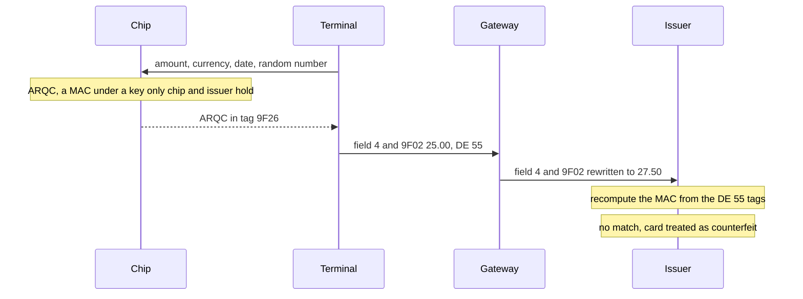

## 14. Advanced Topics

A web shop's order table leaks: 40,000 card numbers, each with its expiry date. What can a thief do
with them? That depends on what else an authorization carries besides the card number, and on
whether the shop had to keep the numbers at all. Five rules, one per section heading.

> **Moved.** This unit once also covered the 2023 datasets (now unit 17), chip data in depth (unit
> 18), high availability (unit c14) and TransactionManager sessions (units s4 and s15).

### 14.1. A Chip Purchase Carries a Cryptogram Over Its Own Data, So Nobody on the Path May Change That Data

A card number printed on plastic can be copied by anyone who has seen it. A chip can't be copied the
same way: for each purchase it computes a cryptogram, the ARQC in tag `9F26` of DE 55 (unit 3). The
cryptogram is a MAC (unit 8) under a key that only the chip and its issuer hold. It covers the
amount, the currency, the date, the transaction type, a random number from the terminal, the card's
transaction counter and a few more values, each of them also a tag in DE 55. The issuer recomputes
the MAC from the tags it receives. A match proves that this card took part in this purchase, and
that the values it covered arrived as the card saw them. A thief with the leaked table has no chip
and no key.

A restaurant's gateway adds a 2.50 tip to a 25.00 chip purchase before forwarding it. Someone has
noticed that field 4 and tag `9F02` (the amount) should agree, so the gateway updates both:

```java
ISOMsg up = (ISOMsg) sent.clone();          // the gateway adds a 2.50 tip
up.set(4, "000000002750");
TLVList icc = new TLVList();                 // ...and keeps DE 55 "consistent"
icc.unpack(up.getBytes(55));
icc.deleteByTag(0x9F02);
icc.append(0x9F02, "000000002750");
up.set(55, icc.pack());
```

In the program, a retail MAC (ISO 9797-1 algorithm 3) under a test key stands in for the card's
cryptogram. Each run prints the cryptogram as received, then whether the issuer's recomputation
matches it:

```text
as the terminal sent it
  field 4 000000002500   9F02 000000002500
  cryptogram 014D2FF614B2F9AB  recomputed by the issuer: matches
tip written into field 4 and 9F02
  field 4 000000002750   9F02 000000002750
  cryptogram 014D2FF614B2F9AB  recomputed by the issuer: DOES NOT MATCH
tip written into field 4 only
  field 4 000000002750   9F02 000000002500
  cryptogram 014D2FF614B2F9AB  recomputed by the issuer: matches
```

The issuer finds each covered value by its tag, so their order in DE 55 doesn't matter: the
gateway's code moved `9F02` to the end, and only its new value broke the match. The rewritten `9F02`
breaks the cryptogram, and an issuer that checks it treats the card as
counterfeit: most decline every tipped chip purchase in the restaurant. Changing field 4 alone keeps
the cryptogram intact, because the cryptogram can't see field 4, but it asks the issuer to approve
27.50 on a card that agreed to 25.00. The issuer's comparison of field 4 with `9F02` catches that
(unit 18). The tip belongs in the completion or the clearing record, as the
network's rules say (unit 19), not in the authorization.



DE 55 also carries the terminal's own checks (tag `95`), which the issuer reads together with field
22, the way the card number was read (chip, contactless, or magnetic stripe after the chip failed).
Nobody on the path changes a tag the cryptogram covers. Pass DE 55 on as it came, unless the
network's specification tells you how to re-wrap it.

### 14.2. A 3-D Secure Result Rides in the Authorization, and a Hop That Drops It Drops the Proof

Online there is no chip, and 3-D Secure proves the cardholder instead. Before the shop asks for the
authorization, the issuer authenticates the customer: from device and purchase data alone, or, when
it wants more, with a challenge in its app or a code. The
result comes back to the shop as a few values:

- the **ECI** (electronic commerce indicator), which says whether the cardholder was authenticated;
- the **authentication value** (CAVV at Visa, AAV at Mastercard), a cryptogram the issuer can
  verify;
- the **directory server transaction ID** and the protocol version.

The shop's gateway must put these into the authorization, and every hop after it must keep them.
This gateway copies a fixed list of fields upstream, a list written when it carried only
card-present traffic. The 3-D Secure values sit in field 48, in a layout made up for
this example, and `22=812` is this network's code for an e-commerce purchase:

```java
static final int[] COPIED = { 2, 3, 4, 7, 11, 12, 13, 14, 22, 25, 37, 41, 42, 49 };
```

```text
from the web shop: 22=812 48=EC00202AV028kAbCdEfGhIjKlMnOpQrStUvWxYz=DS036f25084f0-5b16-4c0a-ae5d-b24808a95e4bVR0052.2.0
forwarded with COPIED: 2=555555______4444 22=812 48 ABSENT
forwarded with COPIED_WITH_48: 2=555555______4444 22=812 48 present
```

The customer did authenticate, but the authentication happened outside the authorization, and the
authorization is all the issuer gets. It sees an e-commerce purchase with no result attached. Where
the law requires strong customer authentication online, as in the European Economic Area, the
issuer usually declines it with a code that asks for authentication, unless an exemption applies.
Elsewhere it may approve. Under most networks' rules a fraud chargeback on an authenticated (or
attempted) purchase falls on the issuer, and on an unauthenticated one on the merchant, whatever
the amount: what decides it is whether the result reached the issuer in the authorization. So the thief
with the leaked table can still buy at shops that skip 3-D Secure and don't ask for the CVV2, and
those shops pay.

The authentication value proves one authentication for one purchase. Treat it like authentication
data and keep it out of logs (unit 8).

> **Networks differ.** Each network defines where the 3-D Secure values go in its 1987-based
> messages, often a private field with tagged subfields. On a 2023 link they go in the datasets
> of DE 34 (unit 17). Take the layout from your network's specification.

### 14.3. A Token Is Random, Shaped Like a Card Number Under a BIN of Its Own

The shop in the opening kept card numbers so that returning customers could pay with one click. It
needed something that leads back to the card, not the card number itself. A **token** replaces the
card number in every system that doesn't need the number: the shop's database, its logs, its
analytics. A vault keeps the card number, sealed, and maps each token to it.

```java
package com.example.iso.advanced;

import org.jpos.iso.ISOUtil;

import java.security.SecureRandom;

/** Random 16-digit tokens under a range reserved for tokens, with a correct check digit. */
public final class TokenGenerator {
    private final String tokenBin;
    private final SecureRandom random = new SecureRandom();

    public TokenGenerator(String tokenBin) {
        if (!tokenBin.matches("\\d{6,8}"))
            throw new IllegalArgumentException("token BIN must be 6 to 8 digits");
        this.tokenBin = tokenBin;
    }

    public String next() {
        StringBuilder sb = new StringBuilder(tokenBin);
        while (sb.length() < 15)
            sb.append(random.nextInt(10));                 // nothing here comes from the card
        return sb.append(ISOUtil.calcLUHN(sb.toString())).toString();
    }
}
```

Three tokens under the made-up token BIN `990001`:

```text
9900010811949446  check digit ok
9900019699817039  check digit ok
9900012320294322  check digit ok
```

**Nothing in a token comes from the card.** The obvious shortcut, encrypting the card number or
hashing it, gives a value that can be turned back. Whoever holds the key decrypts every token at
once. Unit s9 showed that an unkeyed hash of a card number whose BIN and last four digits are
known is reversed by trying about 100,000 candidates, in a quarter of a second. A token that keeps the card's last four digits gives part
of the number away; the vault can keep them as display data instead. With random digits, the leaked
token table is only a list of numbers, and the vault holds the only map back.

**The token looks like a card number** so that every system on the way accepts it: field 2, a
database column sized for 16 digits, the Luhn check that unit 10 described. **The BIN is reserved
for tokens.** Without it, a random 16-digit number with a correct check digit can be a real card
number: if a token escapes into a system that doesn't recognise it, the number is routed to the
issuer of that range and can be approved against a stranger's card. A range your network has
assigned for tokens can't collide with a real card, and any system can see from the first digits
that it holds a token. The `990001` above is made up.

> **Network tokens.** The tokens on this page belong to a merchant's or gateway's vault and are
> turned back into card numbers before anything goes to the network. Card networks also issue tokens
> of their own (EMVCo payment tokens), which travel to the network in field 2, usually with a
> cryptogram, and are turned back by the network's or issuer's token service. The design rules are the same.

### 14.4. A Token Belongs to the Requestor It Was Issued To

One customer pays at a bookshop and at a florist, both through the same gateway. Should both shops
get the same token for that card?

A single token per card is tempting: it works like a customer ID that every shop shares. But then a
token leaked from the bookshop pays at the florist, and anyone holding both shops' data can follow
the customer from one to the other. So the vault issues tokens per **requestor**, the party that
asked for them. It finds an existing token through the keyed lookup value of unit s9, never through
the card number:

```java
String a1 = vault.tokenize("bookshop", "4111111111111111");
String a2 = vault.tokenize("bookshop", "4111111111111111");
String b1 = vault.tokenize("florist", "4111111111111111");
```

```text
bookshop, first purchase:  9900010746498386
bookshop, second purchase: 9900010746498386
florist:                   9900019874249727
```

The bookshop gets the same token on every purchase, so one-click checkout and refunds keep working.
The florist gets a different one. When the gateway receives a token, it uses it only for the
requestor it was issued to.

<!-- practice 1 -->

### 14.5. Only the Component That Builds the Network Message May Turn a Token Back Into a Card Number

The bookshop's developers ask for the right to detokenize: their refund screen wants to show the full
card number.

That undoes the whole design. The thief who breaks into the bookshop's app now calls detokenize with
the app's own credentials and gets every card number back. The app and its database are back in PCI
DSS scope (unit 13). Tokenization is worth something only if it changes where card numbers can
be read. So detokenizing is a separate permission, held by one component: the one that builds the
ISO 8583 request for the network, here called the station. It acts for one requestor at a time:

```java
Set<String> station = Set.of("DETOKENIZE");
Set<String> shopApp = Set.of("TOKENIZE", "REVOKE");
```

```text
station for bookshop, bookshop's token -> 411111______1111
station for florist, bookshop's token  -> ISOException: unknown token
bookshop's own app, its own token      -> SecurityException: caller may not detokenize
station for bookshop, after revoke     -> ISOException: unknown token
bookshop, next purchase:   9900014607903054
```

The shop app may create and revoke tokens, and show display data kept beside them, such as the last
four digits and the expiry date. A token the vault doesn't know, one revoked, or one presented
for another requestor gets the same refusal, and the transaction stops before anything reaches the
issuer. After a revoke the card gets a new token. The CVV is never stored, so no detokenization can
return it.

The card number still leaves the vault for each authorization, but only to the station, inside the
systems that are in PCI DSS scope anyway.

<!-- practice 2 -->

### 14.6. Summary

- **A chip purchase carries a cryptogram over its own data.** Anything that changes a value the
  cryptogram covers makes the issuer see a counterfeit card, so DE 55 passes through unchanged.
- **A 3-D Secure result rides in the authorization.** A hop that drops it turns an authenticated
  purchase into an unauthenticated one: declined where the law requires authentication, and a
  fraud chargeback for the merchant elsewhere.
- **A token is random, under a BIN of its own.** A token derived from the card number can be turned
  back; one outside a reserved range can be a real card number.
- **A token belongs to its requestor.** A token leaked from one merchant pays nowhere else, and
  tokens don't link a customer across merchants.
- **Only the component that builds the network message may detokenize.** A merchant app that can
  detokenize puts every card number back in reach of a breach.

### 14.7. Reference

**Chip-related fields (common ISO 8583:1987 usage; each network defines its codes):**

| Field | Content | Chip values |
|---|---|---|
| 22 | POS entry mode, n3 | `05x` chip, `07x` contactless chip, `80x` magnetic stripe after a failed chip read (fallback), `90x` full magnetic stripe; third digit: PIN capability |
| 23 | card sequence number, n3 | from tag `5F34`; tells apart cards with the same number |
| 52 | PIN block | when the PIN is verified online (unit 8) |
| 55 | ICC data, BER-TLV (unit 3) | passed through unchanged |

**Tags in nearly every chip authorization:**

| Tag | Name | Note |
|---|---|---|
| `9F26` | application cryptogram | the ARQC in a request |
| `9F27` | cryptogram information data | which kind of cryptogram |
| `9F10` | issuer application data | issuer-specific data from the card |
| `9F37` | unpredictable number | from the terminal |
| `9F36` | application transaction counter | increases with every transaction |
| `95` | terminal verification results | the terminal's checks |
| `82` | application interchange profile | what the card supports |
| `9F02`, `5F2A`, `9A`, `9C` | amount, currency, date, type | covered by the cryptogram; must agree with the ISO fields |
| `91`, `71`, `72` | issuer authentication data, issuer scripts | in the response |

**3-D Secure values in an authorization:**

| Value | Holds | Common values |
|---|---|---|
| ECI | how the cardholder was authenticated | Visa `05` authenticated, `06` attempted, `07` none; Mastercard `02`, `01`, `00` |
| authentication value | CAVV (Visa), AAV (Mastercard) | a 20-byte cryptogram, often sent in base64 |
| DS transaction ID | the 3-D Secure 2 transaction | a UUID; replaced the XID of version 1 |
| protocol version | the 3-D Secure version | for example `2.2.0` |

**What a token vault keeps per token:** the requestor, the card number sealed (unit s9), and the
card's keyed lookup value, filed under that requestor. A new draw that is already taken is drawn
again. Display data (last four digits, expiry) may be
kept beside it; the CVV never.

### 14.8. Challenges

1. A restaurant adds tips after the card has left the reader. Find out how one network you know
   expects the final amount to reach the issuer, and what tolerance it allows between the
   authorization and the final amount.
2. Your vault issues 16-digit tokens under one 8-digit token BIN. How many tokens can it issue
   before a new draw collides more than one time in a hundred, and what do you do before that?
3. A merchant wants to move from your gateway to another one and asks for its customers' card
   numbers. Which design choices in this unit make that easy, and which make it hard?
4. A subscription service charges every month without the customer present. Which of this unit's
   proofs can such a charge carry, and what does the issuer rely on instead?

### 14.9. Design Note: Why Tokens Look Like Card Numbers

A token could be anything, a UUID or a random string. Many gateways make it a number of card length
with a correct check digit because of everything already built around card numbers. Field 2, the
card-number columns of databases, the validation in checkout forms and reports expect (usually
sixteen) digits that pass the Luhn check. A token in that shape replaces the card
number without changing any of them, and a merchant can switch to tokens system by system.

The price is that a token can be mistaken for a card. Length and check digit can't tell a token
from a card number; only the reserved BIN can. Assessors have to check which systems see which
ranges, and a token range that overlaps a real one turns a harmless number into someone's card.
Some gateways choose the other side of the trade: tokens that deliberately fail the Luhn check, or
contain letters, so nothing can take them for cards, at the cost of changing every system that
stores them.
