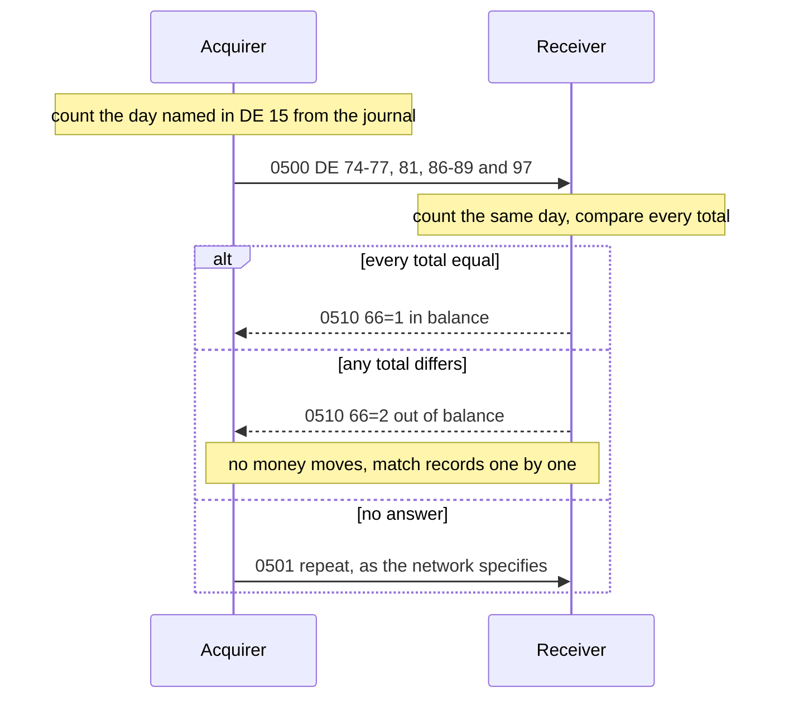

## 19. Clearing and Reconciliation

On Monday morning the network's settlement report credits an acquirer 18,412.50 for Friday. The
acquirer's journal says Friday's approvals came to 18,473.00. No message was lost on any link. Was
the missing 60.50 never presented, counted on another day, or counted by other rules?

Unit 7 placed clearing, settlement and the `05xx` messages in a payment's flow; this unit follows
the records behind them, in five rules, one per section heading. The message types and fields are
the ISO 8583 editions', and your network's specification and settlement agreement decide the rest.
Every output comes from a program run against jPOS 2.1.7.

### 19.1. A Clearing Record Carries the Final Amount and the Approval It Completes

In the dual-message flow an approval moves no money (unit 7). After the sale the acquirer sends one
**clearing record**, a presentment, per transaction, usually in a file at the end of the merchant's
day. The issuer posts it and releases the hold the approval placed. To do the second, it has to
know which approval the record completes.

A restaurant authorizes a dinner at 120.00, and the guest adds a tip, so 138.00 is presented. The
acquirer builds the record from its journal: the request, the response and the final amount. The
issuer is unit 7's account model, which posts a clearing record and releases the hold whose approval
code the record carries:

```java
void clear(long amount, String approvalCode) {
    ledger -= amount;
    if (approvalCode != null) holds.remove(approvalCode);   // the hold this record completes
}
```

We run the dinner twice. In the first run the clearing system copies field 38 from the journal; in
the second it rebuilds the records from the terminal's batch file, which has no approval code:

```text
record with field 38:
  0100 120.00 dinner        -> 0110 39=00 38=A00017  ledger  500.00  available  380.00
  clearing record: 2=411111______1111 4=000000013800 49=840 37=631012000417 38=A00017 41=29110001
  clearing 138.00                              ledger  362.00  available  362.00
  0100 300.00 next morning  -> 0110 39=00 38=A00018
record without field 38:
  0100 120.00 dinner        -> 0110 39=00 38=A00017  ledger  500.00  available  380.00
  clearing record: 2=411111______1111 4=000000013800 49=840 37=631012000417 38=none 41=29110001
  clearing 138.00                              ledger  362.00  available  242.00
  0100 300.00 next morning  -> 0110 39=51
```

Without field 38 the issuer posts 138.00 and can't tell which hold it completes, so the 120.00 hold
stays until it lapses, days later by the network's rules. Until then the cardholder can spend 120.00
less than the account holds, and the next morning's purchase of 300.00 is declined. A presentment
the issuer can't tie to an approval may also be charged back as unauthorized, and the acquirer
passes that loss to the merchant.

So the record carries, besides the card, the amount, the date and the merchant:

- the **approval code** (DE 38) and the network's own trace identifier from the authorization
  response, which tie it to the approval;
- the **terminal and the retrieval reference number** (DE 41 and 37), by which the acquirer finds
  the sale in its own records (19.5);
- for a chip sale, the chip data (DE 55) with the card's cryptogram (unit 18), which for an offline
  approval is the issuer's only proof that the card approved;
- an **acquirer reference number** (ARN), which the acquirer assigns when it clears the sale and
  which every later dispute quotes. In 1993-based layouts it travels in DE 31, *acquirer reference
  data*.

The presented amount may differ from the authorized one: the tip of unit 14, the hotel's minibar,
the fuel pump that authorized 100.00 and delivered 61.40. Each network sets how far the two may
differ before a new authorization is needed.

Clearing records travel in files on the network's schedule, not on the authorization link, and the
network sends files back: acknowledgements, rejected records, chargebacks and settlement reports.
The files carry full card numbers, so they belong to the cardholder data environment (unit 13). jPOS 2.1.7
has no clearing component. A jPOS application keeps the journal the records are built from, and a
`DirPoll` (unit s17) can pick up the files that come back.

> **Networks differ.** The file layouts are the networks'. Some are built from 1993-edition
> messages, as Mastercard's are (unit 7); others use fixed-length records of their own.

On a single-message link there is no clearing record: the approved `0200` posts at once and is the
record the network settles from (unit 7). Every `0200`, advice and reversal on that link changes what
the acquirer is paid, and the totals of 19.3 are the first check before the money moves.

### 19.2. A Transaction Belongs to the Business Day That the Network's Cutover Gives It

A network's business day ends at its **cutover**, a time of day in the network's own time zone.
A transaction after it belongs to the next business day, and weekends and the network's holidays
roll forward to the next day it settles. That day is the **settlement date**, DE 15: `MMDD` in the
1987 edition, `YYMMDD` in the 1993 one.

The opening's acquirer is on a network whose cutover is 18:00 in New York. One of its purchases, for
18.50, was made on Friday 6 November at 18:00:30 New York time. Its reconciliation dated
transactions by its servers' UTC calendar date, with weekends rolled to Monday. Here are five
instants through that calendar, through an 18:00 cutover at a fixed UTC-5, and through the network's
own calendar, with Thanksgiving, 26 November, as a holiday:

```java
public LocalDate businessDate(Instant when) {
    ZonedDateTime local = when.atZone(zone);          // America/New_York, never the server's zone
    LocalDate date = local.toLocalDate();
    if (!local.toLocalTime().isBefore(cutover))
        date = date.plusDays(1);                      // at or after 18:00: the next day
    while (!isBusinessDay(date))
        date = date.plusDays(1);                      // weekends and the network's holidays
    return date;
}
```

```text
instant               New York      UTC, 00:00  -05:00, 18:00  New York, 18:00
2026-11-06T22:59:59Z  Fri 17:59:59  1106        1106           1106
2026-11-06T23:00:30Z  Fri 18:00:30  1106        1109           1109
2026-11-07T15:00:00Z  Sat 10:00:00  1109        1109           1109
2026-11-25T23:30:00Z  Wed 18:30:00  1125        1127           1127
2026-07-07T22:30:00Z  Tue 18:30:00  0707        0707           0708
```

The server's calendar put the 18.50 on Friday, and the network put it on Monday. Friday's totals at
the two ends differ by 18.50, and Monday's by 18.50 the other way. Neither day reconciles, although
both ends hold every message. The same calendar puts Wednesday's purchases between 18:00 and 19:00
on Wednesday, when the network, closed on Thursday, settles them on Friday.

The fixed offset is right all winter. From March to November New York is UTC-4, so a fixed UTC-5
puts every purchase between 18:00 and 19:00 local time on the day before (the last line). Both ends
have to apply the same three details:

- the zone is the network's, with its daylight saving time, not the server's or a fixed offset;
- the cutover moment itself belongs to the next day (here) or to the day before, as the network
  writes it down;
- the holidays are the network's, which need not be the country's.

Often the host sets DE 15 in its response, since only the host knows which side of its cutover the
request arrived on. The acquirer records that value and counts by it, and computes the date itself
only where no host has answered yet, as for an advice in its store-and-forward queue (unit 20). DE 15 in the 1987 layout has no year, so take the year nearest to the transaction, as unit 12
does for field 13.

A message that crosses the cutover counts on its own day. An `0420` queued at 17:59 for one of
Friday's purchases and delivered at 18:02 carries Monday's DE 15. Both ends count the purchase on
Friday and the reversal on Monday, so reconciliation compares days, not transactions. Some networks
have their own rules for late reversals; follow them at both ends.

<!-- practice 1 -->

### 19.3. Both Ends Count the Day by the Same Rules, and a Reversal Is Counted in Fields of Its Own

After the cutover the two ends of a link can compare what they counted, with an `0500`
reconciliation request and its `0510` answer. The request carries counts and amounts per category:
credits and debits, each with its reversals, and authorizations (Reference). "Debit" and "credit"
are from the cardholder's side: a purchase debits the account, a refund credits it.

The acquirer counts from its journal. Each entry is a request with the DE 39 and DE 15 of its
answer; reversals are written once acknowledged and carry no DE 39. One acquirer's journal for Friday, with DE 90 shortened:

```text
0200 3=000000 4=000000010000 15=1106 39=00
0200 3=000000 4=000000002500 15=1106 39=00
0200 3=000000 4=000000009900 15=1106 39=51
0200 3=200000 4=000000001500 15=1106 39=00
0100 3=000000 4=000000020000 15=1106 39=00
0420 3=000000 4=000000002500 15=1106 90=0200000042...
0421 3=000000 4=000000002500 15=1106 90=0200000042...
0200 3=000000 4=000000004000 15=1109 39=00
```

Four rules decide which entries count, and where:

- only the entries whose DE 15 is the day being reconciled, so the last purchase waits for Monday;
- only approved requests and acknowledged reversals, since the declined 99.00 moved nothing;
- an approved `0100` counts in DE 81 and nowhere else, because it moved no money;
- a reversal counts once, in the reversal fields, and the debit it reverses stays counted. The
  `0420` and its repeat `0421` name the same original in DE 90, so they are one reversal:

```java
if (mti.startsWith("04")) {                      // 0420 / 0421, acknowledged
    if (!reversed.add(m.getString(90)))
        continue;                                // a repeat of one counted already
    if (credit) { crRev++; crRevAmt += amount; } else { dbRev++; dbRevAmt += amount; }
}
```

The day counted by those rules, and by two counters that each break one of them:

```text
DE                     74  75  76  77  81      86   87      88     89  97
by the rules            1   0   2   1   1    1500    0   12500   2500  C8500
reversal subtracted     1   0   1   0   1    1500    0   10000      0  C8500
repeat counted again    1   0   2   2   1    1500    0   12500   5000  C6000
```

The counter that subtracts the reversal from the debits arrives at the same net, C8500, with four
other fields different. The receiver answers it "out of balance" (19.4), and both ends spend the
morning on a day where no money differs. The separate fields are there to say where two ends
disagree: a missing debit is a purchase one side never saw, a missing debit reversal is a reversal
that never arrived.

The counter that counts the `0421` again lowers the net by 25.00, as if the purchase had been
reversed twice. Repeats are normal on any link, because an advice is repeated until it is
acknowledged (units 4 and 20).

Sum amounts as `long` minor units of their own currency (unit 11); a link that settles in several
currencies keeps one set of totals per currency.

<!-- practice 2 -->

### 19.4. The Receiver Compares Every Total, Because Equal Nets Can Hide Different Counts

The acquirer sends its totals for the day named in DE 15. The receiver counts the same day from its
own records and answers with a **settlement code** in DE 66: `1` in balance, `2` out of balance, `3`
error (the usual 1987 values; each network publishes its own list). The comparison, and the sign of
DE 97:

```java
m.set(97, (t.net() >= 0 ? "C" : "D") + ISOUtil.zeropad(Math.abs(t.net()), 16));
// ... and on the receiving side, against the request built from its own totals:
for (int f : TOTALS)                              // 74-77, 81, 86-89 and 97
    inBalance &= own.getString(f).equals(request.getString(f));
```

The `0500` for 19.3's day, packed with jPOS's `iso87ascii.xml`, and the answers of three receivers:

```text
net 8500, packed 198 bytes
<isomsg>
  <!-- org.jpos.iso.packager.GenericPackager[jar:packager/iso87ascii.xml] -->
  <field id="0" value="0500"/>
  <field id="7" value="1106230500"/>
  <field id="11" value="000101"/>
  <field id="15" value="1106"/>
  <field id="32" value="123456"/>
  <field id="50" value="840"/>
  <field id="74" value="0000000001"/>
  <field id="75" value="0000000000"/>
  <field id="76" value="0000000002"/>
  <field id="77" value="0000000001"/>
  <field id="81" value="0000000001"/>
  <field id="86" value="0000000000001500"/>
  <field id="87" value="0000000000000000"/>
  <field id="88" value="0000000000012500"/>
  <field id="89" value="0000000000002500"/>
  <field id="97" value="C0000000000008500"/>
</isomsg>
host missed the reversal:    66=2
host subtracted the reversal: 66=2  (its net 8500)
host counted by the rules:   66=1
```

The first receiver never got the reversal, so its DE 77, 89 and 97 differ. The second saw every
message and subtracted the reversal. Its net equals the acquirer's, and only the counts show that
the two ends counted differently. A receiver that compared DE 97 alone would answer `1`, and the two
ends would go on counting by different rules.

DE 97 is a sign followed by 16 digits, and jPOS packs it with `IFA_AMOUNT`, which expects that
form. Which party `C` and `D` refer to is each network's definition; here `C` means the sender of the
totals is owed the net.

What does a `2` change? No money moves with an `0510`, and neither side's totals are corrected.
Settlement pays by the network's records, and the `2` tells both ends to find the transactions
behind the difference (19.5). It is no reason to reverse anything, since a reversal is for a
request whose outcome is unknown (unit 4), and no reason to send the `0500` again: it has been
answered, and a recount gives the same totals until a record changes. Only an `0500` that gets no
answer is sent again, as the network specifies, often as an `0501` repeat. It asks about records and
moves no money, so unit 4's rule that an unanswered request is reversed doesn't apply.



> **Editions differ.** The 1993 edition uses `1500` to `1530`. DE 24, the function code, tells a
> final reconciliation from a checkpoint during the day, DE 28 is the reconciliation date and DE 29
> an indicator, and the verdict is an action code in DE 39. DE 66 holds original fees there.

> **Networks differ.** Many networks never send `05xx` online and reconcile only through
> settlement reports in files. The counting rules of 19.3 apply to those reports too.

<!-- practice 3 -->

### 19.5. Matching Puts Every Record in One Category, and Each Category Has an Owner

Totals say that Friday is out of balance, not which transactions. To find them, match records one by
one: the approvals against the presentments, the presentments against the network's
acknowledgements, and on a single-message link the journal against the network's settlement report.
Unit 15 matches every day, even when the totals agree, because differences that offset each other
vanish from a total.

A match needs a key that both records carry. For the acquirer that is the terminal (DE 41) with the
RRN (DE 37), because an RRN is unique per terminal, not across the network.
DE 38 ties a presentment to its approval, DE 90 a reversal to its original, and the ARN a dispute to
its presentment. Approvals from one merchant's terminals against the clearing file, with the last
three digits of each RRN:

```java
String key() {
    return terminal + "/" + rrn;              // an RRN is unique per terminal, not globally
}
```

```text
                       41/37           ours  theirs
MATCHED                29110001/101  100.00  100.00
AMOUNT_DIFFERS         29110002/101   36.00   41.40
MATCHED                29110001/102   25.00   25.00
DUPLICATE_PRESENTMENT  29110001/102   25.00   25.00
NOT_AUTHORIZED         29110001/199       -   13.00
NOT_PRESENTED          29110001/103   42.00       -
```

Keyed on the RRN alone, the two sales numbered 101 share one key. Run that way, terminal 29110001's
approval of 100.00 vanished from the report, terminal 29110002's 36.00 was paired with a presentment
of 100.00, and its own presentment of 41.40 came out as a duplicate.

Each category has an owner:

- **Amount differs.** A tip within the network's tolerance is normal. Beyond it the presentment may
  be refused or charged back.
- **Duplicate presentment.** The same sale submitted twice charges the cardholder twice. The
  acquirer has to catch it before the file leaves; otherwise the cardholder disputes it and it
  returns as a chargeback.
- **Not authorized.** A presentment with no approval on record: an offline sale below the floor
  limit, an error, or fraud. Without an approval the acquirer has nothing to answer a chargeback
  with.
- **Not presented.** An approval the merchant never cleared. The other 42.00 of the opening's 60.50 is one: terminal
  29110001 approved it and its batch was never closed. The merchant isn't paid, and the cardholder's
  hold lapses by itself.

Disputes arrive the same way, as new records on a later day. A chargeback quotes the ARN, carries a
reason code, and debits the acquirer in the clearing and settlement of the day it arrives, not of the
sale (unit 7 gives the stages). Several common reasons are this section's categories, found by the
issuer instead of the acquirer: duplicate processing, no authorization, an amount other than the one
approved. The acquirer answers from its journal: the approval code, the RRN, the STAN and
transmission time, and proof that a reversal was sent when an outcome was unknown. A reversal that
never got through, parked by its store-and-forward queue (unit 20), is settled the same way: the
acquirer usually raises an adjustment through the network's exception process, another new record
on a later day.

<!-- practice 4 -->

<!-- practice 5 -->

### 19.6. Summary

- **A clearing record carries the final amount and the approval it completes.** Without DE 38 and
  the network's trace identifier the issuer posts the sale and keeps the hold, and the presentment
  can be charged back as unauthorized.
- **A transaction belongs to the business day the network's cutover gives it**: in the network's
  zone with its daylight saving time, with the cutover moment counted as the network writes it,
  weekends and network holidays rolled forward, and the host's DE 15 when it sends one. A server's
  calendar day puts purchases near the cutover on another day, and both days fail to reconcile.
- **Both ends count by the same rules**: that day's DE 15 only, approved requests and acknowledged
  reversals only, authorizations outside the money fields, and each reversal once, in fields of its
  own.
- **The receiver compares every total**, because equal nets can hide different counts. A `2` in
  DE 66 moves no money; it starts the search for the transactions.
- **Matching puts every record in one category** on a key both sides carry, the terminal with the
  RRN. Every category but "matched" has an owner, and what the acquirer misses comes back as a
  chargeback.

### 19.7. Reference

**What a clearing record usually carries** (the network's layout decides):

| Item | From | Used for |
|---|---|---|
| card number | DE 2 | posting |
| final amount and currency | the sale; DE 4 and 49 as authorized | posting; compared with the authorized amount |
| transaction date | DE 13 | the cardholder's statement |
| merchant and its category | DE 42, 18 | the statement; fees |
| approval code | DE 38 of the response | releasing the hold; proof of authorization |
| network trace identifier | the network's private field in the response | tying the record to the authorization |
| terminal and RRN | DE 41, 37 | the acquirer's own matching |
| chip data and cryptogram | DE 55 | proof that the card approved, the only one for an offline approval |
| acquirer reference number | assigned at clearing (1993: DE 31) | disputes |

**DE 15, settlement date:** n 4 `MMDD` in `iso87ascii.xml`, n 6 `YYMMDD` in `iso93ascii.xml`.

**1987 reconciliation MTIs:** `0500` / `0510` request and answer, `0520` / `0530` advice and
acknowledgement, `0521` repeat of an `0520`.

**1987 totals fields** (numeric, zero-padded on the left):

| Field | Content | Format |
|---|---|---|
| 74 / 75 | credits number / credits reversal number | n 10 |
| 76 / 77 | debits number / debits reversal number | n 10 |
| 78 / 79 | transfers number / transfer reversals number | n 10 |
| 80 / 81 | inquiries number / authorizations number | n 10 |
| 82 / 83 | credits, processing fee / transaction fee amount | n 12 |
| 84 / 85 | debits, processing fee / transaction fee amount | n 12 |
| 86 / 87 | credits amount / credits reversal amount | n 16 |
| 88 / 89 | debits amount / debits reversal amount | n 16 |
| 97 | net settlement amount | x+n 16 |
| 50 | settlement currency code | n 3 |
| 66 | settlement code, in the answer | n 1 |

**Where each journal entry counts** (the rules of 19.3):

| Entry | Counts in |
|---|---|
| approved `0200`, purchase | 76, 88 |
| approved `0200`, refund (processing code `20`) | 74, 86 |
| approved `0100` | 81 only |
| acknowledged `0420` with its repeats, once | 77, 89 for a purchase; 75, 87 for a refund |
| declined, or DE 15 of another day | nowhere |

**Exceptions and who acts:**

| Category | Usual cause | Who acts |
|---|---|---|
| amount differs | a tip, a final amount, a keying error | acquirer, against the network's tolerance |
| duplicate presentment | a batch sent twice | acquirer, before the file leaves |
| not authorized | an offline sale, an error, fraud | acquirer, with the merchant |
| not presented | a batch never closed | merchant; the hold lapses at the issuer |

### 19.8. Challenges

1. Your network moves its cutover from 18:00 to 17:00 New York time from next Monday. Which days'
   totals does the change touch, what do you deploy when, and how do you test it before Monday?
2. Your `0510` for Friday says `2`, and the difference is one debit of 18.50 and nothing else. Which
   mistakes of 19.2 and which categories of 19.5 could explain it, and which records do you pull
   first?
3. A terminal resets its RRN counter after maintenance and reuses `631010000101` in the same week.
   What happens in the matcher of 19.5, and which field would you add to the key?
4. A merchant asks why a sale approved at 120.00 shows as 138.00 on the statement and why, for three
   days, the cardholder's available balance was 120.00 lower. Write the answer from the records the
   acquirer holds.

### 19.9. Design Note: Why Totals Before Transactions?

The `05xx` exchange compares a few numbers, not a list of transactions. Each end counts from its own
records, independently, and one online message says within seconds whether a day needs work. A
list of every transaction would be large, would travel in files, and would arrive after the money
had moved.

Totals show only that two ends differ, not where, and two differences of opposite sign cancel
(unit 15). The categories narrow the search: credits and debits, each with its reversals, so a
difference in DE 77 alone points at reversals before anyone opens a file.
