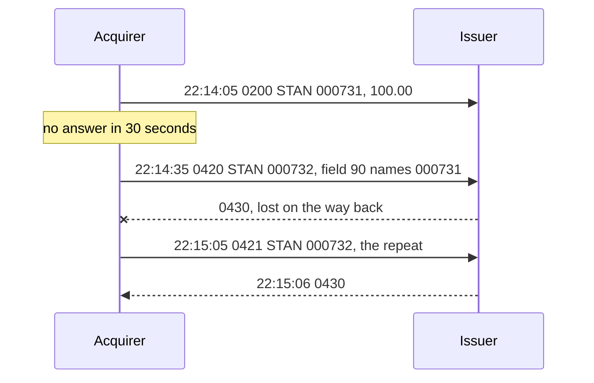

## 4. Message Type Indicators (MTIs)

A host's log for terminal `29110001`, one evening:

| Time | MTI | STAN | Amount |
|---|---|---|---|
| 22:14:05 | `0200` | `000731` | 100.00 |
| 22:14:35 | `0420` | `000732` | |
| 22:15:05 | `0421` | `000732` | |
| 22:15:06 | `0430` | `000732` | |

The purchase got no answer. Did the cardholder pay? Each message's first four digits, its Message
Type Indicator (MTI), say what it is, what answers it, and what approving it commits. Reading the
log takes four rules, one per section heading.

### 4.1. The Third Digit Pairs Every Message With Its Answer

The third digit, the function, says where a message sits in an exchange: `0` a request, `1` its
response, `2` an advice (a report of something already done, 4.3), `3` the advice's response. jPOS derives the answer's MTI with `setResponseMTI`. What
answers an `0420`, and what answers its repeat, the `0421`?

```java
package com.example.iso.mti;

import org.jpos.iso.ISOException;
import org.jpos.iso.ISOMsg;

public class Pairs {
    public static void main(String[] args) throws ISOException {
        for (String mti : new String[] { "0100", "0200", "0120", "0220", "0400", "0420", "0421", "0800", "1804" }) {
            ISOMsg m = new ISOMsg(mti);
            m.setResponseMTI();
            System.out.println(mti + " -> " + m.getMTI());
        }
        try {
            new ISOMsg("0110").setResponseMTI();
        } catch (ISOException e) {
            System.out.println("0110 -> " + e.getMessage());
        }
    }
}
```

```text
0100 -> 0110
0200 -> 0210
0120 -> 0130
0220 -> 0230
0400 -> 0410
0420 -> 0430
0421 -> 0430
0800 -> 0810
1804 -> 1814
0110 -> not a request - can't set response MTI
```

The answer keeps the first two digits and adds one to the third. An advice gets an advice
response: `0420` → `0430`, never `0410`. The fourth digit loses its repeat mark, because the answer
is to the message, not to one attempt at sending it: `0421` → `0430` too. A response has no answer,
and jPOS refuses to make one.

The MTI pairs kinds of message, not transactions. Ten terminals on one link get ten `0210`s, so a
response belongs to your request only when it also carries the request's STAN (field 11) and
terminal ID (field 41). Take the next `0210` on the link as yours, and one cardholder's approval is
reported on another's purchase. Unit c12 shows this in jPOS.

> **Later editions.** The pairs hold in 1993 and 2003: `1804` is answered by `1814`. The Reference
> maps this unit's MTIs to their later counterparts.

<!-- practice 1 -->

### 4.2. The Second Digit Says What an Approval Commits

The second digit is the class: `1` authorization, `2` financial, `4` reversal, `8` network
management. An `0100` and an `0200` built from the same fields and packed with `iso87ascii.xml`
(the PAN masked for printing):

```text
0100722000000080800016411111______1111000000000000010000110622140500073129110001840
0200722000000080800016411111______1111000000000000010000110622140500073129110001840
length 83 and 83, different at offset 1
```

Only the second byte differs, the class digit, and it decides what an approval does:

- an approved `0100` places a **hold** on the amount. The money moves later, when the acquirer
  clears the transaction (unit 7). Credit card purchases mostly work this way;
- an approved `0200` **posts** the debit at once. ATM withdrawals and PIN debit purchases work this
  way;
- an `0800` touches no account. Field 70 says what it does, such as `301`, echo test.

A fuel pump asks for 100.00 before the customer fills up, and the customer takes 35.00. As an
`0100`, the 100.00 is a hold, a completion advice (`0220`) carries 35.00, and the rest is
released. Sent as an `0200` on a link that accepts it, 100.00 is debited at once. Until a second
message gives 65.00 back, the cardholder has paid for fuel they never took.

An echo with no answer needs no clean-up, because it committed nothing; the next one is a new
message.

### 4.3. An Advice Reports What Already Happened, So It Is Repeated Until It Is Acknowledged

An advice tells the receiver about something already decided: a network's stand-in approval
(`0120`), a completion or an offline purchase (`0220`), a reversal (`0420`). The receiver can't
decline it; it acknowledges it. Until the acknowledgement arrives, the sender sends the advice
again as a repeat. `setRetransmissionMTI` changes the fourth digit from `0` to `1` and nothing
else, STAN included, so the receiver can tell that it has seen this message before. With a new
STAN, the repeat of an `0220` would look like a second completion and could be posted twice.

> **jPOS 2.1.7 assumes the acquirer.** `setRetransmissionMTI` writes `1` into the fourth digit
> whatever was there, so an issuer's `0422` becomes `0421` instead of `0423`. On the issuer side,
> set the repeat MTI yourself.

#### 4.3.1. Spot the Problem: The Dispatcher That Ignored a Repeat

An issuer's host dispatches each incoming message on its MTI:

```java
switch (in.getMTI()) {
    case "0100":
    case "0200": return respond(in, "00");
    case "0420": return respond(in, "00");   // (1) undo the purchase, acknowledge
    default:     return null;                 // (2) not one of ours
}
```

`respond` clones the message, calls `setResponseMTI` and sets field 39. One night the `0430` for a reversal is lost on its way back to the acquirer. What happens next?

```text
first dispatcher:
  0420 11=000732 -> 0430 39=00 (lost on the way back)
  0421 11=000732 -> nothing
  0421 11=000732 -> nothing
  0421 11=000732 -> nothing
```

The repeat matches no case and falls into (2). The acquirer repeats until its limit, then parks the
reversal for someone to look at (unit 20), though the issuer applied it long ago. If the issuer
was down for the `0420` itself, every attempt it sees is an `0421`, the reversal is
never applied, and the cardholder pays for a purchase the terminal reported as failed.

Dispatch on the class and function, digits 2 and 3, and let `setResponseMTI` build the answer. The
same reversal, then an `0600` and a late `0810`:

```java
switch (in.getMTI().substring(1, 3)) {
    case "10":
    case "20": return respond(in, "00");
    case "12":
    case "22":
    case "42": return respond(in, "00");      // an advice or its repeat: acknowledge
    default:   return in.isRequest() ? respond(in, "12") : null;
}
```

```text
fixed dispatcher:
  0420 11=000732 -> 0430 39=00 (lost on the way back)
  0421 11=000732 -> 0430 39=00
0600 -> 0610 39=12
0810 -> null
```

An unsupported request gets error `12`, invalid transaction (unit 9), so its sender isn't left
waiting. `isRequest` is true for any even third digit, so an unknown advice gets that answer too. A
response nobody waits for, such as a late `0810`, gets no answer; log it.
The issuer still has to notice that it already applied `000732` before it undoes the purchase a
second time; unit 20 builds that.

### 4.4. A Request Without an Answer Is Reversed, Never Sent Again

The `0200` in the opening got no answer in 30 seconds. Either it never reached the issuer, or the
issuer declined it, or the issuer approved it and the answer was lost. The acquirer can't tell
which. Send the `0200` again, and in the third case it is a second purchase: an issuer that doesn't
look for duplicates approves it, and the cardholder pays twice.

A **reversal** says "if you approved this, undo it". It changes nothing in the first two cases and
gives the money back in the third. It goes as an `0400` request or, more often, an `0420` advice,
and either way it is a new message that points back at the original:

```java
package com.example.iso.mti;

import org.jpos.iso.ISOException;
import org.jpos.iso.ISOMsg;
import org.jpos.iso.ISOUtil;

public class ReversalBuilder {
    /** What identifies the card, the amount, the acquirer and the merchant. Never 35, 52 or 55. */
    private static final int[] COPIED = { 2, 3, 4, 32, 33, 37, 41, 42, 49 };

    /** A new 0420 that reverses {@code original}, sent with its own STAN and time. */
    public static ISOMsg reversalOf(ISOMsg original, String stan, String now) throws ISOException {
        ISOMsg rev = (ISOMsg) original.clone(COPIED);
        rev.setMTI("0420");
        rev.set(7, now);
        rev.set(11, stan);
        rev.set(90, original.getMTI()
                + ISOUtil.zeropad(original.getString(11), 6)
                + ISOUtil.zeropad(original.getString(7), 10)
                + ISOUtil.zeropad(original.hasField(32) ? original.getString(32) : "", 11)
                + ISOUtil.zeropad(original.hasField(33) ? original.getString(33) : "", 11));
        return rev;
    }

    public static void main(String[] args) throws ISOException {
        ISOMsg purchase = new ISOMsg("0200");
        purchase.set(2, "4111111111111111");
        purchase.set(3, "000000");
        purchase.set(4, "000000010000");
        purchase.set(7, "1106221405");
        purchase.set(11, "000731");
        purchase.set(32, "123456");
        purchase.set(35, "4111111111111111=28121010000000000000");
        purchase.set(41, "29110001");

        ISOMsg rev = reversalOf(purchase, "000732", "1106221435");
        System.out.println(rev.getMTI() + "  11=" + rev.getString(11) + "  7=" + rev.getString(7)
                + "  4=" + rev.getString(4) + "  35 copied: " + rev.hasField(35));
        System.out.println("90=" + rev.getString(90) + " (" + rev.getString(90).length() + " digits)");
        System.out.println("original still " + purchase.getMTI() + " 11=" + purchase.getString(11));
    }
}
```

```text
0420  11=000732  7=1106221435  4=000000010000  35 copied: false
90=020000073111062214050000012345600000000000 (42 digits)
original still 0200 11=000731
```

**It has its own STAN and time**, because it is a new message on the link. The issuer finds the
original through field 90, not field 11.

**Field 90, original data elements, names the original** in 42 digits:

```text
0200  000731  1106221405  00000123456  00000000000
MTI   STAN    field 7     field 32     field 33
```

**It copies only what identifies the transaction.** Track 2 (field 35), the PIN block (52) and chip
data (55) stay out of a message that may wait in a queue for hours.

The `0420` at 22:14:35 reversed purchase `000731`. Its `0430` was lost, the `0421` repeated it with
the same STAN, and the `0430` at 22:15:06 closed it. Whatever the issuer did with the purchase, the cardholder hasn't paid for it.



> **Networks differ.** Most networks want an `0420` after a timeout; some want an `0400`, the
> original's STAN in field 11, a reason code, or more of the original's fields. Unit 7 places reversals in the transaction flow, and unit
> c12 builds and queues them in jPOS.

<!-- practice 2 -->

<!-- practice 3 -->

### 4.5. Summary

- **The third digit pairs every message with its answer**: request `0` with response `1`, advice
  `2` with advice response `3`, and a repeat is answered like the original. A response is yours only
  if it also carries your STAN and terminal ID.
- **The second digit says what an approval commits**: an `0100` holds, an `0200` posts, an `0800`
  touches no account. The wrong class takes the wrong amount from the cardholder.
- **An advice is acknowledged, never declined, and repeated until it is.** A receiver that
  dispatches on the whole MTI ignores the repeats and leaves the sender repeating.
- **A request without an answer is reversed, never resent.** The reversal is a new message with its
  own STAN that names the original in field 90.

### 4.6. Reference

**The 1987 MTIs of this unit:**

| Request or advice | Answer | Meaning |
|---|---|---|
| `0100` | `0110` | authorization: approval places a hold |
| `0120` | `0130` | authorization advice, e.g. a stand-in decision |
| `0200` | `0210` | financial request: approval posts the debit |
| `0220` | `0230` | financial advice, e.g. a completion or an offline purchase |
| `0400` | `0410` | reversal request |
| `0420` | `0430` | reversal advice |
| `0421` | `0430` | repeat of an `0420` |
| `0800` | `0810` | network management; field 70: `001` sign-on, `002` sign-off, `301` echo |

**The same messages in later editions:**

| Purpose | 1987 | 1993 | 2003 |
|---|---|---|---|
| authorization | `0100` / `0110` | `1100` / `1110` | `2100` / `2110` |
| financial request | `0200` / `0210` | `1200` / `1210` | `2200` / `2210` |
| financial advice | `0220` / `0230` | `1220` / `1230` | `2220` / `2230` |
| reversal advice | `0420` / `0430` | `1420` / `1430` | `2420` / `2430` |
| network management | `0800` / `0810` | `1804` / `1814`, function code in field 24 | `2800` / `2810` (jPOS CMF) |

**Field 90, original data elements (1987, n 42):**

| Positions | Content |
|---|---|
| 1-4 | original MTI |
| 5-10 | original STAN (field 11) |
| 11-20 | original transmission date and time (field 7, MMDDhhmmss) |
| 21-31 | original acquiring institution ID (field 32), zero-filled on the left |
| 32-42 | original forwarding institution ID (field 33), zero-filled on the left |

### 4.7. Challenges

1. A hotel takes an `0100` for three nights and the guest stays two. Which messages follow, and
   what does the cardholder see on their account in between?
2. Your issuer receives an `0420` for a purchase it never saw, and the purchase arrives a second
   later. What should each message do, and what must the host remember to get it right?
3. A network sends you `0620` administrative advices, which your dispatcher has no case for. Should
   it acknowledge them, answer with an error, or log them, and what does each choice cost the
   sender?

### 4.8. Design Note: Why Four Digits in Front?

The MTI puts a message's purpose before its bitmap, so a receiver knows what it holds before it
parses a single field. A switch can route on four digits, and it can answer a message it doesn't
support with the matching response MTI without knowing its fields.

Four digits can't name every message: the 1987 edition puts what a network message does in field 70
and leaves the rest to each network. The 1993 edition added field 24, the function code, so the MTI
names a family of messages and a field names the exact one; a 1993 echo test is `1804` with field
24 = `831`. A receiver now reads two places to know what it holds.
