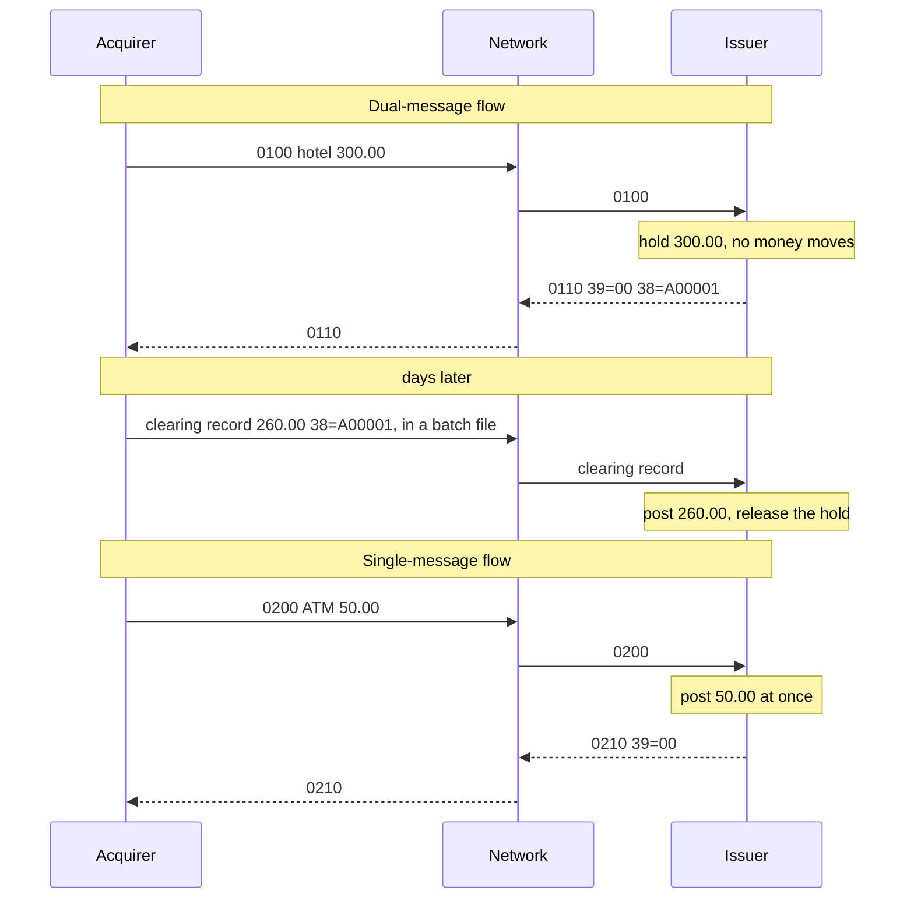
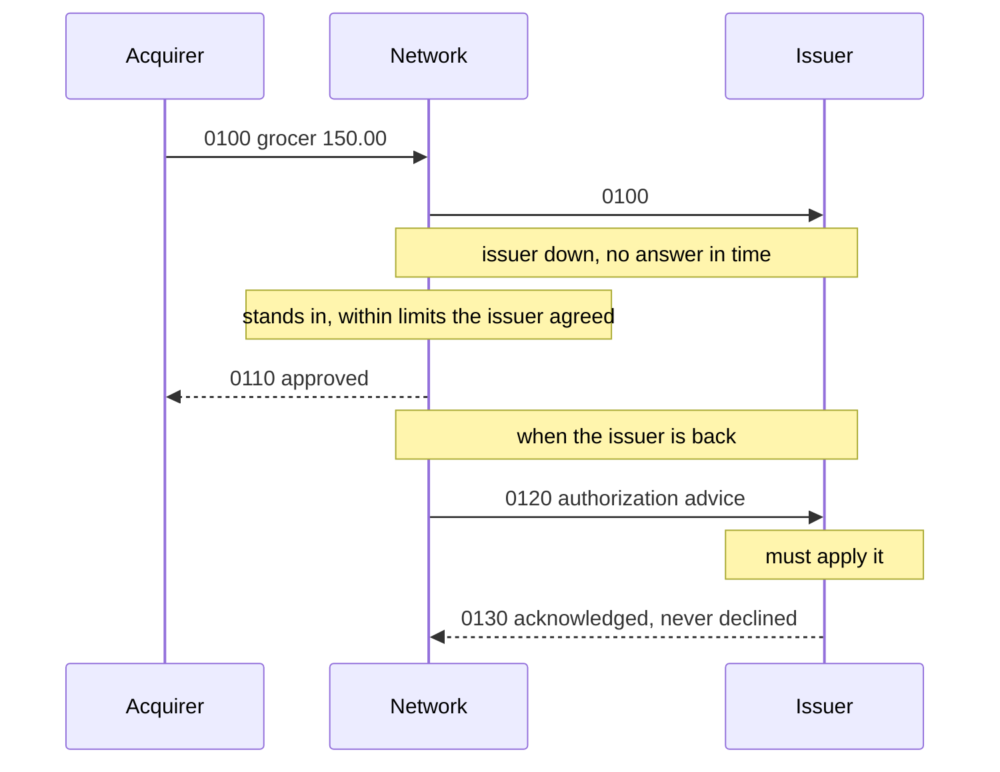

## 7. Transaction Flow

A cardholder's banking app, one week:

| When | Merchant | Amount | Status |
|---|---|---|---|
| Monday 21:40 | Harbour Hotel | 300.00 | pending |
| Tuesday 08:15 | ATM withdrawal | 50.00 | posted |
| Tuesday 11:50 | Corner Grocer | 150.00 | pending |
| Thursday | Harbour Hotel | 260.00 | posted, and the 300.00 line is gone |

The ATM took the money at once; the hotel took less than it asked for, three days later. The
grocer's purchase was approved while the bank's own host was down. Who decided each line, and which
message moved the money? Five rules, one per section heading.

### 7.1. A Payment Crosses Four Parties, and Each Hop Is a Link of Its Own

The card is read at a **merchant**'s terminal. The terminal's request goes to the **acquirer**, the
merchant's bank or a processor working for it. The acquirer passes it to a **card network** (Visa,
Mastercard, a domestic scheme), which picks the **issuer**, the cardholder's bank, from the card
number's leading digits. The issuer approves or declines, and the answer goes back the same way.

The issuer approves or declines the purchase; the acquirer and the network can decline it on
their own checks, and approve it only in the cases of 7.4. Each hop is a separate ISO 8583 link
with its own specification: its own packager, header and private fields (units 1 and 5). Every hop
rebuilds the message and passes on only the fields its specification defines. An acquirer
that puts a loyalty tag for the issuer into field 48 sees it arrive nowhere unless the network's
specification carries that tag. The issuer decides without it, often with no error on either side.

Each hop also waits for the next. The network gives the issuer a few seconds; when the issuer is
down or slow, the network may decide in its place (7.4). The acquirer's own timeout has to cover
the whole path.

### 7.2. An Approval Holds the Money in the Dual-Message Flow and Moves It in the Single-Message Flow

Unit 4 showed that an approved `0100` places a hold and an approved `0200` posts the debit. An
issuer keeps two numbers for an account: the **ledger**, the money posted, and what is
**available**, the ledger minus open holds. A model of the opening's account, starting at 500.00:

```java
case "0100":                                       // approve: hold
    if (amount > available()) return answer(in, "51", null);
    String code = String.format("A%05d", ++codes);
    holds.put(code, amount);
    return answer(in, "00", code);
case "0200":                                       // approve: post
    if (amount > available()) return answer(in, "51", null);
    ledger -= amount;
    return answer(in, "00", String.format("A%05d", ++codes));
```

The hotel's `0100`, the ATM's `0200`, and Thursday's clearing record for the hotel:

```text
start                                        ledger  500.00  available  500.00
0100 300.00 hotel  -> 0110 39=00 38=A00001   ledger  500.00  available  200.00
0200  50.00 ATM    -> 0210 39=00             ledger  450.00  available  150.00
clearing A00001 260.00                       ledger  190.00  available  190.00
```

In the **dual-message flow** the `0100` only asks for permission. The issuer holds 300.00 and returns an approval code in field 38. No money has moved. Days later the
acquirer sends the **clearing** record, usually in a batch file to the network rather than as an
online message. It carries the final amount and the approval code that ties it to the `0110`. The issuer posts 260.00 and releases the whole hold (unit 19 takes clearing
apart). Credit card purchases mostly work this way, and it suits merchants whose amount isn't final at
the counter: hotels, car rentals, fuel and tips. On some links an advice carries the final amount
online first, as the fuel pump's completion did in unit 4; the money still moves with clearing.

In the **single-message flow** the `0200` carries everything needed to authorize and to post, and
the issuer posts at once. There is no clearing record per transaction. ATM withdrawals and PIN debit
purchases usually work this way.



When an approval is taken for a payment:

- **The merchant never sends the clearing.** A terminal whose batch is never closed has approvals
  and nothing else. After some days, set by the issuer and the network's rules, the issuer drops the
  uncleared hold. The cardholder has the goods, and a merchant that presents the sales late risks
  having them charged back as unauthorized.
- **The acquirer clears the authorized amount.** The hotel's guest is charged 300.00 for a 260.00
  stay, and gets the 40.00 back only by a refund or a dispute (7.5).

In the single-message flow the online message is the financial record. An approved `0200` whose
answer is lost is a debit already posted, which is why unit 4 reverses it at once.

### 7.3. Settlement Moves One Net Amount per Institution, Days After the Purchases

Clearing says who owes whom; **settlement** pays it. The network adds up each member's cleared
transactions for the settlement day and instructs the settlement banks to move one net amount per
member. Three banks, each both an acquirer and an issuer, with eight cleared purchases between them
(fees left out):

```text
8 purchases, gross 970.50
  Bank A pays       93.00
  Bank B pays      101.50
  Bank C receives  194.50
```

Each purchase is owed to its acquirer and owed by its issuer. Eight purchases worth 970.50 become
three transfers, and 194.50 moves. The acquirer then pays each merchant its day's sales, less a
service charge that includes the interchange fee the issuer keeps out of each purchase.

A merchant who checks each sale against the bank's deposits matches nothing. What can be checked is totals: the online `05xx` reconciliation messages of the 1987 edition let
the two ends of a link agree on counts and amounts, and move no money themselves (unit 19).

### 7.4. A Decision Taken Elsewhere Arrives as an Advice, and the Issuer Must Apply It

Two parties may approve a purchase without asking the issuer. When the issuer doesn't answer in
time, the network may **stand in**: it decides within limits the issuer agreed beforehand, then
reports each decision with an authorization advice, `0120`. And a terminal may approve a small
purchase offline, below its floor limit; that one reaches the issuer as a clearing record, or as a
`0220` advice on links that use them. Unit 4 showed that an advice is acknowledged, never declined.



#### 7.4.1. Spot the Problem: The Advice Nobody Recorded

The grocer's 150.00 from the opening was a stand-in approval, reported at 12:05 when the issuer's
host was back. After the ATM withdrawal, 150.00 is available. The issuer's handler for stand-in
advices:

```java
ISOMsg onStandIn(ISOMsg in, long amount) throws ISOException {
    return answer(in, "00", null);           // (1) acknowledge; we never approved it, so nothing to hold
}
```

Half an hour later the cardholder spends 120.00 in a shop. What does the issuer answer?

```text
first handler:
  0120 150.00 stand-in -> 0130 39=00 available  150.00
  0100 120.00          -> 0110 39=00 available   30.00
  after clearing                     ledger     -80.00
```

The issuer approved 120.00 against money already spent. Line (1) acknowledges the advice but
records nothing. When everything clears, the account is 80.00 overdrawn, on a card that has no
overdraft. The issuer is exposed: the network's stand-in decision binds it, and the 120.00 was its
own approval.

Hold the amount under the network's approval code, which the clearing record will carry:

```java
ISOMsg onStandIn(ISOMsg in, long amount) throws ISOException {
    holds.put(in.getString(38), amount);         // as if we had approved it
    return answer(in, "00", null);
}
```

```text
fixed handler:
  0120 150.00 stand-in -> 0130 39=00 available    0.00
  0100 120.00          -> 0110 39=51 available    0.00
  after clearing                     ledger      40.00
```

An advice above what is available is applied too, and the account goes below zero. Stand-in
limits keep that small.

<!-- practice 1 -->

### 7.5. What Undoes a Transaction Depends on How Far It Has Gone

| The purchase is | Undo it with | Sent by | Where |
|---|---|---|---|
| approved, but the answer was lost or the terminal could not finish | a reversal, `0420` (unit 4) | acquirer | the online link, at once |
| approved and cancelled by the cashier the same day, a **void** | a reversal, usually | acquirer | the online link, before clearing |
| cleared, and the goods are returned | a **refund**, a new credit with its own STAN (unit 5) | merchant, through the acquirer | a new transaction |
| cleared, and the cardholder disputes it | a **chargeback** | issuer | the network's dispute process, in clearing |

A reversal of an `0100` releases the hold; a reversal of an `0200` gives the money back. Either
works only within a window the network's rules set: for an `0100`, typically before it is cleared,
for an `0200`, typically the same business day. Some terminal protocols carry a void as a processing code of its own, and the acquirer's
host turns it into a reversal on the network link.

Suppose a merchant's system answers every return with an `0420`, as it does for voids. A customer
brings goods back a week after the purchase cleared. The reversal is past the window: the network
declines it or matches it to nothing, depending on its rules. The cleared purchase stands. The
merchant's records say "reversed", while the cardholder still sees the charge. The cardholder
disputes it, and the issuer charges it back. The merchant gives back the sale as it meant to, and pays a chargeback fee on top.

A dispute runs in stages: the issuer's **chargeback** with a reason code, the acquirer's
**representment** with the merchant's evidence, and, when they still disagree, a decision by the
network. All of it happens in clearing files and the networks' dispute systems, not on the online
link. Each network sets its own stages and reason codes.

> **Editions differ.** The 1993 edition defines chargeback messages in its `14xx` class, and
> Mastercard's clearing files use `1442` for a chargeback. The 1987 edition's `04xx` class defines
> reversals only.

<!-- practice 2 -->

### 7.6. Summary

- **A payment crosses four parties, and each hop is a link of its own.** The issuer decides,
  except in stand-in, and only what the next link's specification defines gets across.
- **An approval holds the money in the dual-message flow and moves it in the single-message flow.**
  The clearing record carries the final amount and releases the hold. Without it the hold lapses
  and nothing is paid; with the authorized amount instead of the final one, the cardholder is
  overcharged.
- **Settlement moves one net amount per institution**, days later. No purchase appears in a
  transfer of its own; totals are what can be reconciled.
- **A decision taken elsewhere arrives as an advice, and the issuer must apply it.** An advice that
  is acknowledged and not recorded leaves available too high, and the next approval overdraws the
  account.
- **What undoes a transaction depends on how far it has gone**: a reversal while it is open, a
  refund or a chargeback once it has cleared.

### 7.7. Reference

**The two flows, step by step (1987 MTIs):**

| Step | Dual-message | Single-message |
|---|---|---|
| decide | `0100` / `0110`: a hold, approval code in field 38 | `0200` / `0210`: posted at once |
| decided elsewhere (stand-in, offline) | `0120` / `0130`, or only the clearing record | `0220` / `0230` |
| final amount | the clearing record, in a batch file | the `0200` itself |
| cancel while open | `0420` / `0430`, or `0400` / `0410` | the same |
| agree totals | `05xx` | `05xx` |
| move the money | settlement, one net amount per institution | the same |
| dispute | chargeback, representment, network decision, in clearing | per network |

**What the account model of 7.2 and 7.4 does with each message:**

| Message | Ledger | Available |
|---|---|---|
| approved `0100` | unchanged | lower by the amount (a hold) |
| approved `0200` | lower by the amount | lower by the amount |
| `0120` stand-in advice | unchanged | lower by the amount, never declined |
| clearing record | lower by the final amount | the hold for that approval code is released |

### 7.8. Challenges

1. A restaurant takes an `0100` for the bill and the customer adds a 15% tip afterwards. What
   amount goes into clearing, and what should the issuer do when it is above the held amount?
2. Your issuer stands in for itself: while the core banking system is down, the authorization host
   approves up to 50.00 per purchase from a copy of each balance taken at midnight. What must happen
   when the core comes back, and how much can one card overspend?
3. In the netting of 7.3, Bank A fails to pay its 93.00. Who is short, by how much, and what could
   the network have required of its members beforehand?

### 7.9. Design Note: Why Two Flows?

The dual-message flow lets the amount be fixed after the decision. A hotel, a fuel pump or a
restaurant knows the final amount only later, so the online message asks for permission and a
cheaper batch carries the final amount. The cost is two records per purchase that have to be matched,
holds that lapse when the second record never comes, and final amounts that differ from what was
approved.

The single-message flow suits the counter where the amount is final: an ATM, a PIN debit purchase.
One message decides and posts, and nothing waits for a batch. Here the price is paid on the online link:
every message on it is money, so a lost answer is a posted debit, and the reversals and advices
that repair it have to reach the issuer however long that takes (unit 20).
