# jPOS Client: 1. Basic Setup

You start a new client for the first time. Q2 reports that it deployed the channel and the
multiplexer, your code sends an `0800` echo, and after the full timeout the answer is `null`. Is
the host down, or is the client wired wrong?

Your code sees nothing come back either way. The client itself can tell the two apart, if you know
what each of its pieces does and what it reports when something is missing. The unit has six rules,
one per section heading. Every output is from a jPOS 2.1.7 client talking to a small host on
`127.0.0.1:8000` that answers every request with `39=00`.

## 1.1 Q2 Builds the Client From the Files in `deploy/`

A jPOS client is a directory with three descriptors in it:

```text
iso-client/
├── pom.xml
├── deploy/
│   ├── 00_logger.xml         the logger every component writes to
│   ├── 10_host_channel.xml   the ChannelAdaptor: one TCP connection to the host
│   └── 20_host_mux.xml       the QMUX: matches responses to requests
├── cfg/
│   └── default.yml           values for ${...} in the descriptors (optional)
└── log/                      must exist: the file logger does not create it
```

Q2 is the jPOS runtime. You start it with `org.jpos.q2.Q2` as the main class and the project root
as the working directory. For every file in `deploy/` it creates the component the file names,
configures it from the XML and starts it. Such components are called QBeans. Q2 started from
`/iso-client`, then stopped with Ctrl-C:

```text
Q2 started, deployDir=/iso-client/deploy, environment=default
deploy: /iso-client/deploy/10_host_channel.xml
deploy: /iso-client/deploy/20_host_mux.xml
  Connection established to 127.0.0.1:8000
shutting down (hook)
undeploying:/iso-client/deploy/20_host_mux.xml
undeployed:/iso-client/deploy/20_host_mux.xml
undeploying:/iso-client/deploy/10_host_channel.xml
undeployed:/iso-client/deploy/10_host_channel.xml
undeploying:/iso-client/deploy/00_logger.xml
```

Q2 initialises every new file in name order, then starts them in the same order, and stops them
in reverse. `00_logger.xml` is the one fixed name: Q2 deploys it first, even before it logs "Q2
started". The other prefixes are a convention (`10_` channels, `20_` multiplexers, `30_`
transaction managers, `50_` servers) that puts each component after the ones it uses.

Q2 also watches the directory. A new file is deployed, a deleted one undeployed. Change one, even
just its timestamp, and Q2 throws the running component away and builds a new one. Touching
`20_host_mux.xml` while the client runs:

```text
undeploying:/iso-client/deploy/20_host_mux.xml
undeployed:/iso-client/deploy/20_host_mux.xml
deploy: /iso-client/deploy/20_host_mux.xml
```

So you never create the channel or the multiplexer in your code, or as Spring beans configured
with setters. A `QMUX` built with `new` has no queues, is never started, and is registered under
no name.

> **Versions.** The course runs on jPOS 2.1.7, Java 17 and Maven, the combination the practices
> are graded on (the build file is in 1.8). 2.1.x is jPOS's maintenance ("tail") line and 2.1.9
> is its latest release. jPOS 3.x is the current line; it needs Java 23 or later and its tooling
> is Gradle-based. Unit s13 lists what changes there.

> **Licence.** Q2 prints its licence when it starts: `jPOS Community Edition, licensed under GNU
> AGPL v3.0`. If users reach your modified jPOS application over a network, the AGPL requires you
> to offer them its source. The jPOS project sells a commercial licence for those who can't.

## 1.2 The Channel and the Multiplexer Share Only Two Queues, and the Queues Cross

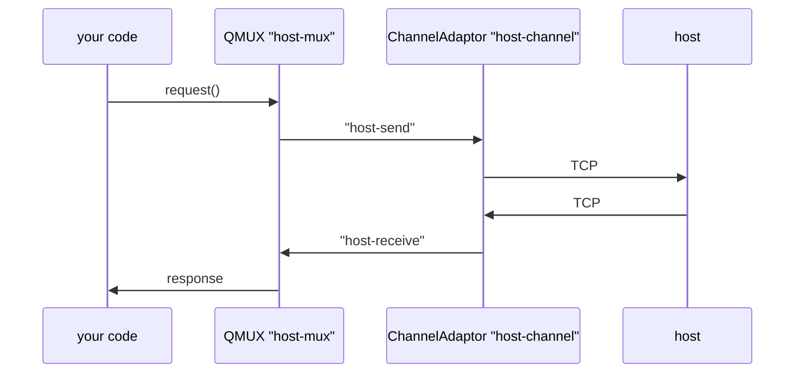

The ChannelAdaptor owns the TCP connection. It connects, reconnects when the link drops, sends
every message that appears in one queue and puts every message it receives into another. It knows
nothing about requests and responses. The QMUX knows nothing about sockets: it writes requests to
one queue, reads from the other, and hands each response to the thread waiting for it. The queues
live in a Space, the in-memory store that jPOS components share. The channel logs each connection
attempt (`<connect>`) and every message it sends (`<send>`) and receives (`<receive>`) to the
logger named in `logger="Q2"`, which `00_logger.xml` defines (1.6). Unit c3 covers the adaptor in
depth, unit c4 the multiplexer.

`deploy/10_host_channel.xml`:

```xml
<channel-adaptor name="host-channel" class="org.jpos.q2.iso.ChannelAdaptor" logger="Q2">
  <channel class="org.jpos.iso.channel.ASCIIChannel"
           packager="org.jpos.iso.packager.GenericPackager" logger="Q2">
    <property name="host" value="${host.address:127.0.0.1}"/>
    <property name="port" value="${host.port:8000}"/>
    <property name="packager-config" value="jar:packager/iso87ascii.xml"/>
  </channel>
  <in>host-send</in>
  <out>host-receive</out>
  <reconnect-delay>10000</reconnect-delay>
</channel-adaptor>
```

`deploy/20_host_mux.xml`:

```xml
<mux name="host-mux" class="org.jpos.q2.iso.QMUX" logger="Q2">
  <in>host-receive</in>
  <out>host-send</out>
  <ready>host-channel.ready</ready>
  <unhandled>host-unhandled</unhandled>
</mux>
```

Each component names its queues from its own point of view: `<in>` is what it reads, `<out>` what
it writes. The adaptor reads `host-send` and writes it to the socket; the multiplexer writes
`host-send`. So the multiplexer's `<out>` is the adaptor's `<in>`, and the other way round.
`<unhandled>` is where the multiplexer puts a message that no request is waiting for (1.5.1).

The mistake is to make the two descriptors look alike. With the adaptor's values in the
multiplexer, `<in>host-send</in>` and `<out>host-receive</out>`, one echo with a five-second
timeout gives:

```text
isConnected: true
request: null after 5000 ms
```

The request went into `host-receive`, which only the multiplexer was meant to read, and nobody
read it. The channel's log has no `<send>` entry, and the host's log stays empty. To the caller
this looks exactly like a host that doesn't answer.

Q2 fills in the `${host.address:127.0.0.1}` values when it reads the file. jPOS looks for an
environment variable (`host.address`, then `HOST_ADDRESS`), then a Java system property, then
`cfg/default.yml`, and uses the text after the colon only when all of them are missing. Started
with `HOST_PORT=8001`, with `-Dhost.port=8001`, and with `port: 8001` under `host:` in
`cfg/default.yml`, the client connected to port 8001 each time. Keep real host names and
credentials out of the descriptor.

## 1.3 `isConnected()` Knows About the Link Only Through `<ready>`

While its connection is up, the adaptor keeps an entry named after itself plus `.ready`
(`host-channel.ready`) in the Space, and removes it when the connection drops. The multiplexer's
`<ready>` points at that entry, and `isConnected()` does nothing more than check that the
multiplexer is running and look for it.

Here the host is stopped for maintenance, so every connection attempt is refused. First without
`<ready>`, then with it:

```text
mode: noready
isConnected: true
request: null after 5000 ms
mode: ready
isConnected: false
request: null after 5000 ms
```

With `<ready>`, the client can answer the opening question:

- `isConnected()` is false: the link is down. The channel's `<connect>` entries in the log say
  why (`Connection refused`, for instance).
- `isConnected()` is true, and the channel never logged a `<send>`: the request didn't reach the
  adaptor. Check the queue names.
- The channel logged a `<send>` and no `<receive>`: the host has the request and didn't answer.

Without `<ready>` the first case looks like the second, and you debug the queue names while the
link is down.

<!-- practice 1 -->

## 1.4 `request` Returns `null` When Nothing Comes Back

The first code you write is an echo: the `0800` network message with field 70 set to `301`, which
asks the host "are you there?".

```java
package com.example.jpos.client;

import org.jpos.iso.ISODate;
import org.jpos.iso.ISOException;
import org.jpos.iso.ISOMsg;
import org.jpos.iso.ISOUtil;
import org.jpos.iso.MUX;
import org.jpos.space.SpaceFactory;
import org.jpos.space.SpaceUtil;

import java.util.Date;
import java.util.TimeZone;

public class EchoClient {
    private final MUX mux;
    private final long timeout;

    public EchoClient(MUX mux, long timeout) {
        this.mux = mux;
        this.timeout = timeout;
    }

    /** True when the host approved an 0800 echo; false when the link is down or nothing came back. */
    public boolean echo() throws ISOException {
        if (!mux.isConnected())
            return false;                                // (1) nothing is sent on a dead link

        ISOMsg request = new ISOMsg("0800");
        request.set(7, ISODate.getDateTime(new Date(), TimeZone.getTimeZone("UTC")));
        request.set(11, nextStan());
        request.set(70, "301");                          // echo test

        ISOMsg response = mux.request(request, timeout);
        if (response == null)
            return false;                                // (2) no answer within the timeout
        return "00".equals(response.getString(39));
    }

    static String nextStan() {
        long n = SpaceUtil.nextLong(SpaceFactory.getSpace(), "stan.host");
        return ISOUtil.zeropad((n - 1) % 999999 + 1, 6);  // 000001 .. 999999, then again
    }
}
```

The channel's log for one call:

```text
<send>
  <isomsg direction="outgoing">
    <field id="0" value="0800"/>
    <field id="7" value="1106172029"/>
    <field id="11" value="000001"/>
    <field id="70" value="301"/>
  </isomsg>
</send>
<receive>
  <isomsg direction="incoming">
    <field id="0" value="0810"/>
    <field id="7" value="1106172029"/>
    <field id="11" value="000001"/>
    <field id="39" value="00"/>
    <field id="70" value="301"/>
  </isomsg>
</receive>
```

**(1) Check the link before you send.** In 2.1.7 a request on a dead link doesn't fail at once:
`request` never looks at `isConnected()`. It puts the message in `host-send` with the timeout as
its lifetime and waits. Here the link is down when the client calls `request` with a 15-second
timeout, and the host comes back three seconds later:

```text
isConnected: false
request: 0810 39=00 after 10000 ms
```

The request waited in `host-send` until the adaptor's next connection attempt, ten seconds after
the refused one (its `<reconnect-delay>`), and then went out. A purchase would have kept the
cardholder waiting ten seconds, and with a slightly later reconnect it would have expired unsent
and `request` would have returned `null`. With `<ready>` configured, `false` from line (1) means
nothing was sent, so you can say "host unavailable" right away.

**(2) `null` is how jPOS says "no answer".** `request` doesn't throw when the time is up; it
returns `null`, and every call site has to check for it. Code that goes straight to
`response.getString(39)` passes every test against a quick host and throws a
`NullPointerException` the first time the host is slow. For an echo, `null` only means that the
host didn't answer. For a purchase it means you don't know whether the host took the money: you
reverse it, never simply send it again (unit c12).

The STAN (field 11) comes from one counter for the link, kept in the Space. Unit c2 explains why
it must never be random.

## 1.5 Your Code Finds the Multiplexer by Name, Inside Q2's JVM, When It Needs It

Q2 registers the multiplexer under its name in the `NameRegistrar`, a registry inside the JVM, and
`QMUX.getMUX("host-mux")` looks it up.

**The lookup works only in the JVM that runs Q2.** A Q2 in another process is invisible. An
application with its own `main` starts Q2 itself, as a library, with the same `deploy/` directory:

```java
package com.example.jpos.client;

import org.jpos.iso.MUX;
import org.jpos.q2.Q2;
import org.jpos.q2.iso.QMUX;
import org.jpos.space.SpaceFactory;

public class ClientApplication {
    public static void main(String[] args) throws Exception {
        Q2 q2 = new Q2("deploy");
        q2.start();
        if (!q2.ready(30_000))
            throw new IllegalStateException("Q2 did not finish deploying");

        // ready() means "deployed", not "connected": wait for the channel's ready entry
        if (SpaceFactory.getSpace().rd("host-channel.ready", 60_000) == null)
            throw new IllegalStateException("host-channel did not connect");

        MUX mux = QMUX.getMUX("host-mux");
        System.out.println(new EchoClient(mux, 10_000).echo() ? "echo approved" : "echo failed");
        q2.stop();
    }
}
```

**The multiplexer exists only after Q2 has deployed it, and is connected only later.** The same
JVM, asked at three moments:

```text
before Q2 starts: NotFoundException: mux.host-mux
right after ready: isConnected=false
2 s later: isConnected=true
```

`q2.ready(...)` returns once every descriptor is deployed. The channel connects on its own thread
a moment later, so `ClientApplication` waits for `host-channel.ready` with `Space.rd`, a read that
blocks until the entry appears or the time runs out.

**A redeploy replaces the object** (the three log lines at the end of 1.1).

### 1.5.1 Spot the Problem: The Cached Multiplexer

A payment service looks the multiplexer up once, when it starts, and keeps it in a field:

```java
private final MUX mux = QMUX.getMUX("host-mux");   // (1) looked up once
...
ISOMsg response = mux.request(echo, 5000);          // (2) used for weeks
```

One afternoon an operator renames the unhandled queue in `20_host_mux.xml`. From then on every
request returns `null`, while the host is up and answering.

One echo, then a touch of `20_host_mux.xml`, then one echo through the kept reference and one
through a fresh lookup:

```text
cached mux, before: 0810 39=00 after 0 ms
redeployed; same object? false
cached mux isConnected: false
cached mux, after:  null after 5000 ms
looked up again:    0810 39=00 after 0 ms
in host-unhandled: 0810 11=000002
```

The host's log shows all three echoes arriving, and it answered each one. Q2 stopped the old
multiplexer and deployed a new one under the same name. The old object still writes to
`host-send`, so its request went out, but a stopped multiplexer no longer reads `host-receive`.
The new one read the answer, found nobody waiting for it, and put it on the unhandled queue.

**Look the multiplexer up each time you use it.** The lookup is a map read. Catch
`NameRegistrar.NotFoundException` and report it as "not deployed", a different problem from "link
down".

### 1.5.2 Spring Starts and Stops Q2, and Nothing Else

jPOS 2.1.7 has no Spring integration of its own. In a Spring Boot application, for example a REST
service that forwards payments, Q2 still runs the channel and the multiplexer from `deploy/`.
Spring only starts Q2 with the application and stops it on shutdown:

```java
package com.example.jpos.client.spring;

import org.jpos.q2.Q2;
import org.springframework.context.SmartLifecycle;

/** Starts Q2 when the Spring context starts, and stops it when the context closes. */
public class EmbeddedQ2 implements SmartLifecycle {
    private final String deployDir;
    private Q2 q2;

    public EmbeddedQ2(String deployDir) {
        this.deployDir = deployDir;
    }

    @Override
    public synchronized void start() {
        q2 = new Q2(deployDir);
        q2.start();
        if (!q2.ready(30_000))
            throw new IllegalStateException("Q2 did not finish deploying " + deployDir);
    }

    @Override
    public synchronized void stop() {
        if (q2 != null) {
            q2.stop();
            q2 = null;
        }
    }

    @Override
    public synchronized boolean isRunning() {
        return q2 != null && q2.running();
    }
}
```

```java
package com.example.jpos.client.spring;

import com.example.jpos.client.EchoClient;
import org.jpos.iso.ISOException;
import org.jpos.iso.MUX;
import org.jpos.q2.iso.QMUX;
import org.jpos.util.NameRegistrar;
import org.springframework.stereotype.Service;

@Service
public class HostEchoService {
    public boolean echo() throws ISOException {
        MUX mux;
        try {
            mux = QMUX.getMUX("host-mux");               // looked up on every call
        } catch (NameRegistrar.NotFoundException e) {
            return false;                                // Q2 has not deployed it (yet)
        }
        return new EchoClient(mux, 10_000).echo();
    }
}
```

```java
package com.example.jpos.client.spring;

import org.springframework.boot.SpringApplication;
import org.springframework.boot.autoconfigure.SpringBootApplication;
import org.springframework.context.annotation.Bean;

@SpringBootApplication
public class ClientBootApplication {
    public static void main(String[] args) {
        SpringApplication.run(ClientBootApplication.class, args);
    }

    @Bean
    public EmbeddedQ2 embeddedQ2() {
        return new EmbeddedQ2("deploy");
    }
}
```

One call to the service, then one after the context closed (Q2 undeployed both descriptors):

```text
echo through the Spring service: true
after close: NotFoundException mux.host-mux
after close, echo: false
```

Spring starts lifecycle beans such as `EmbeddedQ2` only after it has created every ordinary bean.
A service that calls `QMUX.getMUX` in its constructor therefore runs before Q2 exists, and the
application never starts: the constructor threw `NotFoundException: mux.host-mux`, and Spring gave
up on the context.

Connection and send failures happen on the channel's own threads. Spring's `@ControllerAdvice`
never sees them; they are in the jPOS log. Only what `request` throws to its caller, such as an
`ISOException`, reaches the web request's thread.

> **Spring versions.** The example uses Spring Boot 2.6 (`spring-boot-starter`), the line built on
> the Spring 5.3 that the course pins. Nothing in it depends on that version.

<!-- practice 2 -->

## 1.6 The Log Is Masked Before Anything Writes It

The channel logs every message it sends and receives, field by field. A purchase carries the card
number (field 2), track 2 (field 35) and the PIN block (field 52). `deploy/00_logger.xml` keeps
them out of the log in clear:

```xml
<logger name="Q2" class="org.jpos.q2.qbean.LoggerAdaptor">
  <log-listener class="org.jpos.util.ProtectedLogListener">
    <property name="protect" value="2 35 45"/>
    <property name="wipe" value="52 55"/>
  </log-listener>
  <log-listener class="org.jpos.util.SimpleLogListener"/>
  <log-listener class="org.jpos.util.RotateLogListener">
    <property name="file" value="log/q2.log"/>
    <property name="window" value="86400"/>
    <property name="copies" value="10"/>
    <property name="maxsize" value="100000000"/>
  </log-listener>
</logger>
```

A logger hands each log event to its listeners in the order they are listed. `SimpleLogListener`
writes to the console, `RotateLogListener` to `log/q2.log`. `ProtectedLogListener` writes nothing:
it masks the fields listed in `protect` and blanks the ones in `wipe`, in the event that the
listeners after it receive. One purchase with the test card `4111111111111111`:

```text
<field id="2" value="411111______1111"/>
<field id="35" value="411111______1111=____________________"/>
<field id="52" value="AA55AA55" type="binary"/>
PAN in the message we sent: 4111111111111111
```

The log is masked, and the message on the wire is not. With `SimpleLogListener` moved above
`ProtectedLogListener`, as someone might to "see the messages sooner", the console shows:

```text
<field id="2" value="4111111111111111"/>
<field id="35" value="4111111111111111=28121010000000000000"/>
<field id="52" value="0123456789ABCDEF" type="binary"/>
```

`log/q2.log` is still masked, because its listener still comes after the masking one. Whoever
checks the log file finds nothing wrong, while the console, and whatever collects it from the
container, holds card numbers and PIN blocks in clear. Put `ProtectedLogListener` first.

`log/` must exist. Without it, Q2 prints a `FileNotFoundException: log/q2.log` warning among its
first lines and keeps running, with the console working and nothing ever written to the file.

<!-- practice 3 -->

## 1.7 Summary

- **Q2 builds the client from `deploy/`**, in file-name order, stops it in reverse, and replaces a
  component as soon as its file changes. A QMUX created with `new` is one that nothing can find.
- **The queues cross.** The multiplexer's `<out>` is the adaptor's `<in>`. Get it backwards and
  every request times out while the host sees nothing.
- **`isConnected()` is only as good as `<ready>`.** Without it a dead link reports connected,
  and a link problem looks like a wiring problem.
- **`null` means no answer**, and a request on a dead link waits and may go out late. Check the
  link first, so that each outcome means one thing.
- **Look the multiplexer up when you use it**, in the JVM that runs Q2. A kept reference stops
  hearing answers after a redeploy, and a lookup in a Spring constructor runs before Q2 exists.
- **Mask first.** `ProtectedLogListener` protects only the listeners listed after it.

## 1.8 Reference

**`pom.xml`** for the client:

```xml
<?xml version="1.0" encoding="UTF-8"?>
<project xmlns="http://maven.apache.org/POM/4.0.0"
         xmlns:xsi="http://www.w3.org/2001/XMLSchema-instance"
         xsi:schemaLocation="http://maven.apache.org/POM/4.0.0 https://maven.apache.org/xsd/maven-4.0.0.xsd">
  <modelVersion>4.0.0</modelVersion>
  <groupId>com.example.jpos</groupId>
  <artifactId>iso-client</artifactId>
  <version>1.0.0</version>

  <properties>
    <project.build.sourceEncoding>UTF-8</project.build.sourceEncoding>
    <maven.compiler.release>17</maven.compiler.release>
  </properties>

  <dependencies>
    <dependency>
      <groupId>org.jpos</groupId>
      <artifactId>jpos</artifactId>
      <version>2.1.7</version>
    </dependency>
    <dependency>
      <groupId>org.junit.jupiter</groupId>
      <artifactId>junit-jupiter</artifactId>
      <version>5.14.4</version>
      <scope>test</scope>
    </dependency>
  </dependencies>
</project>
```

Unit s1 shows the plugins that build a runnable jar with its dependencies in `lib/`. Pin the jPOS
version, and when a scanner flags one of its transitive dependencies, override that version in
your own `dependencyManagement`.

**Descriptor elements used in this unit (2.1.7):**

| Element | Component | Meaning |
|---|---|---|
| `<in>` | ChannelAdaptor | queue it reads and sends to the host |
| `<out>` | ChannelAdaptor | queue it writes received messages to |
| `<reconnect-delay>` | ChannelAdaptor | ms between connection attempts (default 10000) |
| `<in>` | QMUX | queue it reads responses from: the adaptor's `<out>` |
| `<out>` | QMUX | queue it writes requests to: the adaptor's `<in>` |
| `<ready>` | QMUX | Space entry that means "link up": the adaptor's name plus `.ready` |
| `<unhandled>` | QMUX | queue for messages nobody waits for; each expires after two minutes |
| `<key>` | QMUX | fields that match a response to its request; default `41, 11` (unit c12) |

**Where `${name:default}` comes from**, first match wins: the environment variable `name`; the
environment variable with dots turned into underscores, in upper case (`HOST_PORT`); the Java
system property `name`; `cfg/default.yml` (`cfg/prod.yml` when started with `-Djpos.env=prod`);
the default after the colon.

**`ProtectedLogListener`:** `protect` lists fields to mask (a PAN keeps its first six and last
four digits); `wipe` lists fields to blank. It changes the log event only, never the message.

## 1.9 Challenges

These have no single answer.

1. Your client runs in a container that ships its console output to a central log service. Which
   listeners do you keep, in which order, and how would you prove in a test that no card number
   leaves the container?
2. A request made on a dead link waits in `host-send` for up to its timeout. Pick a timeout for
   an echo and for a purchase, given a `<reconnect-delay>` of 10 seconds. What does each choice
   cost when the link comes back after 4 seconds, and after 12?
3. Operations want to change the host's port without restarting the client. Compare editing
   `10_host_channel.xml`, changing `cfg/default.yml`, and changing an environment variable. Which
   of them take effect without a restart, and what happens to a request in flight?
4. Your Spring service must answer "is the host reachable?" in under 100 ms for a load balancer's
   health check. What can it look at without sending anything, and what can't it know that way?

## 1.10 Design Note: Why Queues Between the Channel and the Multiplexer?

The adaptor and the multiplexer could have been one object that sends a request on the socket and
reads the response from it. jPOS puts a pair of Space queues between them instead, at the price of
two names to keep in step and a ready entry to tie the two components together.

In return, the adaptor can drop and rebuild its connection while the multiplexer sees only the
ready entry come and go. Anything that reads and writes the two queues can stand in for the
adaptor: unit c12 replaces it with a test host in the same JVM, and the multiplexer can't tell the
difference.

A wrong queue name doesn't throw; it only makes requests wait. With `<ready>` in place and the
channel's log in view (1.3), a wiring mistake shows up the first time you send an echo.


# 2. ISO-8583 Message Creation

The client from unit c1 passes all its tests. On its first morning against the acquirer's test
host, two purchases in a batch come back as `null` when their timeout runs out. The host never
received the first and approved the second. Nothing in the client threw an exception.

Both failures come from one line that set a 17-character merchant ID in a field that holds 15. The
unit has six rules for building requests, one per section heading.

## 2.1 An ISOMsg Holds Strings, and the Packager Decides the Bytes

An `ISOMsg` is a map from field numbers to values (unit c6 covers its API). It knows nothing about
field formats. Only when a packager packs it do the values become bytes, and only then is anything
checked. Here is a purchase with a short amount and a short STAN, packed with the course's packager
(`jar:packager/iso87ascii.xml`) and unpacked as the host would:

```java
ISOMsg m = new ISOMsg("0200");
m.set(3, "000000");
m.set(4, "2500");
m.set(11, "731");
m.set(41, "29110001");
m.setPackager(new GenericPackager("jar:packager/iso87ascii.xml"));
byte[] wire = m.pack();
```

```text
in memory:  4=2500  11=731
on the wire: 0200302000000080000000000000000000250000073129110001
unpacked:   4=000000002500  11=000731
same STAN?  false
```

The host echoes field 11 in its response. Does `"731"` equal what comes back?

It doesn't. The packager pads a short numeric field with zeros on the left, so the host receives
and echoes `000731` while your `ISOMsg` still says `731`. QMUX pads field 11 itself when it matches
the response (unit c12), so the response still arrives. But code that stores the STAN with the
transaction and later looks for `"731"` finds nothing. Set every fixed-length numeric field at its
full width (`ISOUtil.zeropad`), and the message in memory is the message on the wire.

Besides padding, the packager refuses a value that is too long, and checks no content at all:

```text
set(42) took 17 characters
pack: error packing field 42
  cause: org.jpos.iso.IF_CHAR: Problem packing field 42
  cause: Field length 17 too long. Max: 15
4="25.00" packs as: 02001020000000000000000000025.00000733
```

An amount written as `"25.00"` went out as `000000025.00`: twelve characters, so it fits, and
nothing in jPOS complains. Field 4 holds the amount in the currency's minor unit: 25.00 dollars is
`2500`, sent as `000000002500`. Unit c13 covers what each field packager checks.

## 2.2 A Message That Doesn't Pack Fails on the Channel Thread

In production your code hands the message to a MUX, and the channel packs it on its own thread
just before writing it to the socket.

We ran a real client in one JVM: the ChannelAdaptor and QMUX of unit c1, connected over
`127.0.0.1` to a QServer that approves everything. A good purchase gets its 0210. Then we send one
with the 17-character merchant ID (`purchase(stan, amount, merchantId)` is a test helper that fills
in the other fields):

```java
ISOMsg bad = purchase("000102", "000000002500", "MERCHANT123456789");
ISOMsg r = mux.request(bad, 5000);
```

```text
set(42, 17 chars) accepted, field 42 = MERCHANT123456789
long merchant ID: null after 5 s
```

`request` didn't throw. It waited the full five seconds and returned `null`, as it does when the
host is slow. The client's log has a warning:

```text
<log realm="org.jpos.q2.iso.ChannelAdaptor" at="2026-11-06T11:19:22.987350467">
  <warn>
    channel-sender-host-send
    error packing field 42
  </warn>
</log>
```

The log then shows the server's session ending and a new one starting. In 2.1.7 the
ChannelAdaptor's sender treats an `ISOException` from `send` as a broken link: it disconnects, and
the adaptor reconnects after its reconnect delay.

Now suppose another purchase is in flight. We sent purchase `000103`, which the host answers after
800 ms, and 200 ms later purchase `000104` with the long merchant ID:

```text
host approved STAN 000103, connected=true
in flight while it failed: null; bad one: null
```

The host approved `000103`, but the client had closed the socket, so the approval never arrived:

- **`000104`, the bad one**, never left the client. Its caller sees `null`.
- **`000103`, the good one**, went through, and the cardholder's money moved. Its caller also sees
  `null`.

Unit c12 shows that `null` means "you don't know" and the client must reverse both. One
reversal undoes a real purchase. The other carries the same bad merchant ID, so it fails to pack
too and takes the link down again.

The fix is to pack the message yourself, with the channel's packager, before it goes to the MUX.
Then a failure is an exception in your code, and you know that message was not sent:

```java
msg.setPackager(packager);    // the packager the channel uses: jar:packager/iso87ascii.xml
msg.pack();                   // throws ISOException here, before anything is queued
```

For fields your code builds itself, a unit test that packs every message type is enough (2.3
shows one). For values from outside, such as a merchant record or a terminal's input, pack before
you send. Building and packing a purchase took about 1.5 microseconds.

> **Keeping the link up.** The ChannelAdaptor element `<ignore-iso-exceptions>yes</ignore-iso-exceptions>`
> stops the disconnect. With it, the in-flight purchase got its 0210, and the bad one still
> returned `null` after five seconds. It limits the damage but doesn't tell your code what happened.

<!-- practice 1 -->

## 2.3 The Fields Every Request Shares Are Set in One Place

Every message a client sends carries fields that have nothing to do with what it asks for: when
it was sent (field 7) and its number on the link (field 11). Card requests also carry the terminal
and merchant (fields 41 and 42). jPOS 2.1.7 has no class that builds requests, so you write one.
With the shared fields in one method, every message type gets them right, or all get them wrong
together and a test catches it:

```java
package com.example.jpos.client;

import org.jpos.iso.ISOException;
import org.jpos.iso.ISOMsg;
import org.jpos.iso.ISOUtil;

import java.time.Clock;
import java.time.ZoneOffset;
import java.time.format.DateTimeFormatter;
import java.util.function.LongSupplier;

/** Builds the requests one terminal sends on one link. */
public class RequestFactory {
    private static final DateTimeFormatter FIELD_7 = DateTimeFormatter.ofPattern("MMddHHmmss");

    private final String terminalId;          // field 41, 8 characters
    private final String merchantId;          // field 42, 15 characters
    private final Clock clock;
    private final LongSupplier counter;       // the link's sequence: 1, 2, 3, ...

    public RequestFactory(String terminalId, String merchantId, Clock clock, LongSupplier counter) {
        this.terminalId = terminalId;
        this.merchantId = merchantId;
        this.clock = clock;
        this.counter = counter;
    }

    public ISOMsg authorization(String pan, long amountMinor) throws ISOException {
        return cardRequest("0100", pan, amountMinor);
    }

    public ISOMsg purchase(String pan, long amountMinor) throws ISOException {
        return cardRequest("0200", pan, amountMinor);
    }

    public ISOMsg echo() throws ISOException {
        ISOMsg m = stamped("0800");
        m.set(70, "301");
        return m;
    }

    private ISOMsg cardRequest(String mti, String pan, long amountMinor) throws ISOException {
        ISOMsg m = stamped(mti);
        m.set(2, pan);
        m.set(3, "000000");
        m.set(4, ISOUtil.zeropad(amountMinor, 12));
        m.set(41, terminalId);
        m.set(42, merchantId);
        m.set(49, "840");
        return m;
    }

    /** What every message on the link carries: its MTI, when it was sent, and its number. */
    private ISOMsg stamped(String mti) throws ISOException {
        ISOMsg m = new ISOMsg(mti);
        m.set(7, clock.instant().atZone(ZoneOffset.UTC).format(FIELD_7));
        m.set(11, nextStan());
        return m;
    }

    /** 000001 .. 999999, then 000001 again. */
    String nextStan() {
        long n = counter.getAsLong();
        return ISOUtil.zeropad((n - 1) % 999999 + 1, 6);
    }
}
```

The clock and the counter come in from outside: a test passes a fixed clock and a counter that
starts wherever it needs, and production passes `Clock.systemUTC()` and the link's counter (2.5).
Three messages from a factory whose clock is in New York and whose counter has reached
999997. The PAN is printed masked (2.6), and `-` marks a field the message doesn't have:

```text
0200  7=1105233000  11=999998  41=29110001  2=411111______1111  (98 bytes)
0100  7=1105233000  11=999999  41=29110001  2=411111______1111  (98 bytes)
0800  7=1105233000  11=000001  41=-         2=-  (55 bytes)
```

An authorization (0100) and a purchase (0200) carry the same fields: the MTI alone says whether
the money is only held or moved. The echo is a network message with no card or terminal, but it
still has a time, and it takes the next number from the same sequence.

The test packs every message type with the channel's packager, the check 2.2 asked for:

```java
package com.example.jpos.client;

import org.jpos.iso.ISOException;
import org.jpos.iso.ISOMsg;
import org.jpos.iso.packager.GenericPackager;
import org.junit.jupiter.api.Test;

import java.time.Clock;
import java.time.Instant;
import java.time.ZoneId;
import java.util.concurrent.atomic.AtomicLong;

import static org.junit.jupiter.api.Assertions.assertEquals;

class RequestFactoryTest {
    private final Clock newYorkEvening =
            Clock.fixed(Instant.parse("2026-11-05T23:30:00Z"), ZoneId.of("America/New_York"));

    private RequestFactory factoryAt(long lastStan) {
        AtomicLong counter = new AtomicLong(lastStan);
        return new RequestFactory("29110001", "000000001234567", newYorkEvening, counter::incrementAndGet);
    }

    @Test
    void everyMessagePacksWithTheChannelsPackager() throws ISOException {
        GenericPackager packager = new GenericPackager("jar:packager/iso87ascii.xml");
        RequestFactory factory = factoryAt(0);
        for (ISOMsg m : new ISOMsg[] {
                factory.purchase("4111111111111111", 2500),
                factory.authorization("5555555555554444", 999_999_999_999L),
                factory.echo() }) {
            m.setPackager(packager);
            m.pack();                                     // throws if any field does not fit
        }
    }

    @Test
    void fieldSevenIsGmtWhateverTheClocksZone() throws ISOException {
        assertEquals("1105233000", factoryAt(0).purchase("4111111111111111", 2500).getString(7));
    }

    @Test
    void theStanWrapsToOneAndIsSharedByEveryType() throws ISOException {
        RequestFactory factory = factoryAt(999_998);
        assertEquals("999999", factory.purchase("4111111111111111", 2500).getString(11));
        assertEquals("000001", factory.echo().getString(11));
    }
}
```

Follow-up messages (reversals, repeats) copy fields from the original request, so store each
request before you send it. Unit c12 builds them.

## 2.4 Field 7 Is GMT, Whatever the Server's Time Zone

Field 7, the transmission date and time, is `MMddHHmmss` (24-hour clock) in GMT. jPOS's helper for
it has two forms. The same instant, 23:30 GMT on 5 November, on four servers:

```java
Date now = Date.from(Instant.parse("2026-11-05T23:30:00Z"));
ISODate.getDateTime(now);                                    // the JVM's default zone
ISODate.getDateTime(now, TimeZone.getTimeZone("UTC"));
```

```text
UTC               1105233000  1105233000
Europe/Berlin     1106003000  1105233000
America/New_York  1105183000  1105233000
Asia/Tokyo        1106083000  1105233000
```

The one-argument form formats in the JVM's default zone. On a laptop set to UTC, both columns agree
and every test passes. On a server in New York, every message claims to have been sent five hours
early; in Tokyo, nine hours late and on the next day. A host that checks
field 7 against its own clock sees requests from the past or the future, and a reversal copies the
wrong time into field 90 (unit c12).

The factory in 2.3 formats in `ZoneOffset.UTC`, so its test expects `1105233000` even from a New
York clock.

Fields 12 and 13, the transaction's time and date, hold the terminal's local time instead.

## 2.5 The STAN Is One Sequence per Link

Field 11, the System Trace Audit Number, is the sender's number for a message. With field 41 it
is how QMUX matches a response to its request, and a request with the key of one still waiting is
refused with a `Duplicate key` exception (unit c12). So two requests in flight on one link must
never share a STAN. Three common ways to pick one, simulated over a million requests on a
link that starts ten per second and has 20 in flight at any moment:

```text
random 000001-999999: 17
time of day (HHmmss): 899999
sequence, wrapping:   0
```

The counts are requests whose STAN was still in use by one in flight. A random STAN collided
17 times in a million, rarely enough to pass every test, and about twice a day on a link that
carries 100,000 requests a day. The time of day collides whenever two requests start in the same
second, which at ten per second is nine times out of ten. A counting sequence never collides,
because a number comes back only after 999,999 others.

The sequence wraps from 999999 to 000001, and the obvious way to write that gets it wrong:

```text
n % 1000000 at 999999, 1000000, 1000001: 999999 000000 000001
```

The factory computes `(n - 1) % 999999 + 1`, which never gives 000000. Many host
specifications reject a STAN of zero, so check yours.

**One sequence per link** means every message on it, echoes included, takes the next number from
the same counter, as the 0800 did in 2.3. In a running Q2 application the counter lives in a
Space: `SpaceUtil.nextLong(space, "stan.host")` increments it atomically, so every thread that sends
on the link shares it. Unit c4 puts it in a persistent space so a restart doesn't start
again at 1.

<!-- practice 2 -->

## 2.6 Mask What You Print, Never What You Send

The factory prints the PAN as `411111______1111` with `ISOUtil.protect`, which works on a copy of
the string, never on the message:

```java
ISOMsg m = new ISOMsg("0200");
m.set(2, "5555555555554444");
m.set(4, "000000004200");
m.set(11, "000815");
System.out.println("protect: " + ISOUtil.protect(m.getString(2)));
System.out.println("field 2 after protect: " + m.getString(2));
m.dump(System.out, "");
```

```text
protect: 555555______4444
field 2 after protect: 5555555555554444
<isomsg>
  <field id="0" value="0200"/>
  <field id="2" value="5555555555554444"/>
  <field id="4" value="000000004200"/>
  <field id="11" value="000815"/>
</isomsg>
```

Put the masked PAN into the message "to be safe", and the host receives a card number that doesn't
exist and declines it. Call `dump` on a
request in your own logging, and the clear PAN lands in a log file, which then falls under the same
rules as your card database. Unit c8 configures the Q2 logger to do that for every message it logs.

<!-- practice 3 -->

## 2.7 Summary

- **An ISOMsg holds strings, and the packager decides the bytes.** It pads short numerics and
  refuses long values only when it packs, and never checks content. Set numeric fields at full
  width and amounts in minor units.
- **A message that doesn't pack fails on the channel thread.** `request` returns `null` after the
  full timeout, and the 2.1.7 adaptor drops the link, losing answers to other requests in flight.
  Pack with the channel's packager before you queue.
- **The shared fields are set in one place**: your own factory with an injected clock and counter,
  tested by packing every message type.
- **Field 7 is GMT.** Format the instant in UTC; never rely on the JVM's default zone.
- **The STAN is one counting sequence per link**, 000001 to 999999 and around again, shared by
  every message type. Random and time-based STANs collide.
- **Mask what you print.** The message keeps the real PAN; `dump` prints it in clear.

## 2.8 Reference

**The fields the factory sets, in `iso87ascii.xml`:**

| Field | Name | Format | Packer pads a short value with |
|---|---|---|---|
| 2 | Primary account number | n..19, two-digit length prefix | nothing (variable length) |
| 3 | Processing code | n6 | zeros on the left |
| 4 | Amount, transaction (minor units) | n12 | zeros on the left |
| 7 | Transmission date and time, GMT | n10, `MMddHHmmss` | zeros on the left |
| 11 | System trace audit number | n6 | zeros on the left |
| 41 | Card acceptor terminal ID | ans8 | spaces on the right |
| 42 | Card acceptor ID (merchant) | ans15 | spaces on the right |
| 49 | Currency code, transaction | 3 characters (`840` is USD) | spaces on the right |
| 70 | Network management information code | n3 (`301` echo, `001` sign-on) | zeros on the left |

**When a message doesn't fit**, in 2.1.7:

| Where it is packed | What you see |
|---|---|
| `msg.pack()` in your code | `ISOException: error packing field N`, caused by `Field length L too long. Max: M` |
| the ChannelAdaptor's sender | a `warn` "error packing field N" in the log; the link is closed and reconnected (unless `<ignore-iso-exceptions>yes`); `request` returns `null` after its timeout |

## 2.9 Challenges

1. Your merchant records come from another team's database. Do you pack-check the messages built
   from them when a record is loaded, when a message is built, or just before it is sent? What
   does each choice cost when a record changes during the day?
2. A link carries 50 requests per second at peak, and a request waits at most 30 seconds. How long
   until the sequence comes back to the same number, and how many requests are in flight at once?
   What would make a counting sequence collide after all?
3. Two client instances share one terminal ID on one link, each with its own Space counter. What
   happens on the first morning? Design a counter both can share.
4. A host wants field 7 in its local time, against the standard. Where in the factory does that
   belong, and how do you keep a test from passing on a laptop in that zone?

## 2.10 Design Note: Why Doesn't ISOMsg Check Anything?

An `ISOMsg` doesn't refuse a 17-character merchant ID when you set it, because it doesn't know its
fields' formats. Field 4 is twelve ASCII digits in `iso87ascii`, six bytes of BCD in a binary
packager, and a network may define it differently again. The format belongs to the link, and an
`ISOMsg` can travel between links: a gateway reads it from one channel and sends it on another.

The price is an error that appears late, on a thread that isn't yours.
`GenericValidatingPackager` can also check content (unit c13), but in 2.1.7 `pack` never runs those
checks; they run only when your code calls the packager's `validate`. So whoever builds a message
packs it once, with the packager of the link it is going to, before anyone else has to find out.


# 3. Channel Management for jPOS Client

The acquirer's interface spec says: "Each message is preceded by a 2-byte binary length." We set up
the client with the course's usual `ASCIIChannel` and a three-second read timeout, and send an
echo. No answer comes, and nobody logs a format error:

```text
    5 ms  client: sent 0800 11=000201
    5 ms  host: length header says 12336 bytes
 3013 ms  host: EOFException
 3013 ms  client: SocketTimeoutException
```

Every field was right. The client and the host disagreed about where a message ends, so the host
waited for 12336 bytes that never came. The object that owns that decision is the **channel**.
The unit comes down to six rules, one per section heading.

## 3.1 The Channel Decides Where a Message Ends

An `ISOChannel` owns one TCP connection. `send(ISOMsg)` asks the packager for the message's bytes,
writes a **frame** around them and returns `void`. `receive()` reads one frame, hands its bytes to
the packager and returns the `ISOMsg`. The packager knows how each field is encoded. The channel
knows what goes around the whole message: a length, sometimes a header.

The same 55-byte echo, written by three channels from `org.jpos.iso.channel` (the frame bytes
before `|`, in hex):

```text
ASCIIChannel 30303535 | 0800...  (55 bytes of message)
NACChannel   0037 | 0800...  (55 bytes of message)
PostChannel  0037 | 0800...  (55 bytes of message)
```

`ASCIIChannel` writes the length as four ASCII digits, `0055`. `NACChannel` and `PostChannel` write
it as a 2-byte unsigned binary number, high byte first: `0x0037` is 55. The message itself is
identical.

In the opening run the host has a `NACChannel`. It reads the ASCII digits `00`, bytes
`0x30 0x30`, as a binary length: 12336. Both sides wait until the client times out and closes, and
the host's read ends with `EOFException`. No message was ever complete, so nothing logged a format
error.

The host's spec decides two things independently: the packager from its field table, the channel
from its paragraph about message boundaries. A wrong packager shows up as
format errors or unpack failures; a wrong channel usually shows up as silence. The Reference lists the
common channel classes and their frames.

Inside this course both ends use `ASCIIChannel` with `GenericPackager` and
`jar:packager/iso87ascii.xml`, because the frame is readable in a hex dump. Unit c13 covers
packagers.

## 3.2 One Read Is Not One Message

TCP delivers a stream of bytes. The sender's stack may merge two small writes into one segment or
cut a large one into several, and a busy receiver may find several messages waiting in its buffer.
The frame lets the receiver find where each message ends.

A raw socket writes one frame in three pieces, 300 ms apart, then two frames in a single write. An
`ASCIIChannel` on the other end calls `receive()` three times:

```text
   59 ms  wrote 2 bytes
  370 ms  wrote 20 bytes
  672 ms  wrote 37 bytes
  674 ms  receive() -> 0800 11=000301
  990 ms  wrote 118 bytes
  990 ms  receive() -> 0800 11=000302
  990 ms  receive() -> 0800 11=000303
```

Why did the first `receive()` wait for the third piece?

The channel read the four length digits, which took two writes, then exactly 55 more bytes, across
as many network reads as that needed. The 118-byte write held two frames, and the channel took one
per call and left the rest in the stream for the next.

On loopback small writes usually arrive whole, so code that treats one read as one message passes
its tests. Over a WAN, or under load, it unpacks half messages as garbage. When two answers
arrive in one read, it loses the second, perhaps an approval.

A frame can also be empty. A sender with nothing to say may write a zero-length frame to keep the
connection busy. The adaptor element `<keep-alive>` sends one; the channel property `keep-alive`
is different and turns on TCP keep-alive probes. `ASCIIChannel` writes `0000` back and reads on.
`NACChannel` and `PostChannel` accept it only with the property `expect-keep-alive`. A `NACChannel`
receives a keep-alive and then an echo:

```text
expect-keep-alive=false: receive() threw ISOException: receive length 0 seems strange - maxPacketLength = 100000
expect-keep-alive=true: receive() -> 0800 11=000701
```

Without the property, the first keep-alive is an error, and a ChannelAdaptor drops the
connection on it (unless it has `<ignore-iso-exceptions>`).

<!-- practice 1 -->

## 3.3 `receive()` Returns the Next Frame, Not Your Answer

Four scripted hosts run against the same client, which sends one echo and then calls `receive()`
until it has the answer or an exception:

```java
ASCIIChannel c = new ASCIIChannel("127.0.0.1", port, packager);   // port of the scripted host
c.setTimeout(1000);                                // read timeout: 1 second
c.connect();
c.send(echo("000401"));                            // 0800 with field 11 = 000401
ISOMsg m = c.receive();
```

```text
-- the host sends its own echo before answering
    7 ms  receive() -> 0800 11=900001
   15 ms  receive() -> 0810 11=000401 39=00
-- the answer takes 1400 ms; other traffic arrives at 700 ms
  701 ms  receive() -> 0800 11=900002
 1401 ms  receive() -> 0810 11=000401 39=00
-- the answer takes 1400 ms; nothing else arrives
 1044 ms  receive() threw SocketTimeoutException; isConnected() = false
 1048 ms  send() threw unconnected ISOChannel
 1401 ms  host: sent the answer
-- the host closes the connection
    1 ms  receive() threw EOFException; isConnected() = false
    1 ms  send() threw unconnected ISOChannel
```

- **The first frame isn't necessarily yours.** Hosts send messages of their own (echoes, sign-on
  requests, key exchanges), and `receive()` returns whatever arrives first.
- **The read timeout measures silence, not your wait.** The second answer took 1400 ms against a
  1000 ms timeout and still arrived, because the host's echo at 700 ms restarted the clock. A
  host that keeps talking can keep a reader waiting for its answer forever.
- **Silence ends the connection.** `receive()` never returns `null`. When the timeout fires it
  throws `SocketTimeoutException`, and in 2.1.7 the channel closes its socket before it throws.
  The host's answer, sent 357 ms later, went into a connection that no longer existed.
- **A closed connection is a different exception.** When the host hangs up, `receive()` throws
  `EOFException`, and waiting longer is pointless. (A frame the packager can't unpack
  throws `ISOException`, and that one leaves the socket open, out of step with the stream.) Only
  the timeout means "the host may still be working on it".

### 3.3.1 Spot the Problem: A Pool of Channels

A team coming from JDBC keeps a few connected channels and lends one to each request:

```java
package com.example.jpos.client.channel;

import org.jpos.iso.ISOChannel;
import org.jpos.iso.ISOException;
import org.jpos.iso.ISOMsg;

import java.io.IOException;
import java.util.concurrent.ArrayBlockingQueue;
import java.util.concurrent.BlockingQueue;

/** Borrow a connected channel, send, read the answer, give it back. Don't do this. */
public class ChannelPool {
    private final BlockingQueue<ISOChannel> idle;

    public ChannelPool(ISOChannel... connected) {
        idle = new ArrayBlockingQueue<>(connected.length);
        for (ISOChannel c : connected)
            idle.add(c);
    }

    public ISOMsg request(ISOMsg m) throws IOException, ISOException, InterruptedException {
        ISOChannel c = idle.take();                    // (1)
        try {
            c.send(m);
            return c.receive();                        // (2)
        } finally {
            idle.add(c);                               // (3)
        }
    }
}
```

Two channels with a one-second read timeout and four purchases, one after the other. The host sends
its own echo on the first connection before it answers, and it is slow on the second. What does
each purchase get?

```text
purchase 000801 -> 0800 11=900001
purchase 000802 -> SocketTimeoutException: Read timed out
purchase 000803 -> 0210 11=000801 39=00
purchase 000804 -> IOException: unconnected ISOChannel
```

Line (2) takes whatever comes next, so purchase 801 is "answered" by the host's echo. Purchase 802
waits through the read timeout. Its channel closes, and the host's approval for it is lost. Line (3)
returns the closed channel to the pool anyway. Purchase 803 gets the first connection again and
reads the approval meant for 801. Purchase 804 gets the dead channel and fails at once.

Checking the response and reconnecting don't fix it: a message that arrives while nobody holds the channel
still goes to the wrong borrower or to no one. Networks also tend to limit an acquirer to one
connection or a few, each signed on (unit c11), so a pool of ten may be refused. **On a link,
reading is a job for one thread that never stops**, and matching answers to requests is a separate
job.

jPOS 2.1.7 has a class named `org.jpos.iso.channel.ChannelPool`. Despite the name, it is a failover
list: `connect()` uses the first channel that connects.

<!-- practice 2 -->

## 3.4 A Link Has One Reader That Never Stops: the ChannelAdaptor

`org.jpos.q2.iso.ChannelAdaptor` is a QBean that owns one channel and runs two threads:

- the **Receiver** calls `receive()` in a loop and puts every message it reads on the `<out>`
  queue, whatever the message is;
- the **Sender** takes messages from the `<in>` queue and calls `send`.

Application code never touches the channel. It writes requests to one Space queue and reads
everything the host sent from another. QMUX (unit c4) does both and matches each answer to its
request. Q2 deploys the adaptor from `deploy/10_host_channel.xml`:

```xml
<channel-adaptor name="host-channel" class="org.jpos.q2.iso.ChannelAdaptor" logger="Q2">
  <channel class="org.jpos.iso.channel.ASCIIChannel"
           packager="org.jpos.iso.packager.GenericPackager">
    <property name="host" value="127.0.0.1"/>
    <property name="port" value="8000"/>
    <property name="packager-config" value="jar:packager/iso87ascii.xml"/>
    <property name="connect-timeout" value="10000"/>
    <property name="timeout" value="360000"/>
  </channel>
  <in>host-send</in>
  <out>host-receive</out>
  <reconnect-delay>10000</reconnect-delay>
</channel-adaptor>
```

The `<channel>` element names the channel and packager classes. Q2 gives its `<property>` children
to both: the channel reads `host`, `port`, `timeout` and the like, and the packager reads
`packager-config`. `<in>` is the queue the adaptor sends from, and `<out>` the queue it delivers to.
From the application's side that reads backwards, so name the queues after the peer and the
direction (`host-send`, `host-receive`). A second link (`acquirer-b-send`) then never collides
with the first.

`timeout` is the read timeout, six minutes here. The Receiver always reads, so it fires only after
six minutes of silence on the whole link. An echo every few minutes prevents that (unit c11 sets it
up, and unit c12 relates all the timeouts).

## 3.5 The Adaptor Reconnects and Announces the Link

We deploy the adaptor above in a real Q2 against a host that answers echoes, with
`reconnect-delay` at 3000 to keep the run short, and the host drops the connection:

```text
  296 ms  host-channel.ready = Date
  301 ms  from host-receive: 0810 11=000501 39=00
  303 ms  host: closed the connection
  314 ms  host-channel.ready is gone
 4305 ms  host: connection accepted
 4305 ms  host-channel.ready is back; same object as before: false
 4307 ms  from host-receive: 0810 11=000502 39=00
```

Once the Sender has a connection it puts a `java.util.Date` in the Space
under **`host-channel.ready`**, the adaptor's name plus `.ready`. When the Receiver hits EOF, a read
timeout or an unpack error, it removes that entry, disconnects, and leaves a
`host-channel.reconnect` entry that lives for `reconnect-delay`. The Sender won't connect while that
entry exists, so a host that keeps dropping you is retried every few seconds instead of in a tight
loop. Across runs the reconnect came after 3 to 4 seconds: the delay, plus the adaptor's own
one-second pauses.

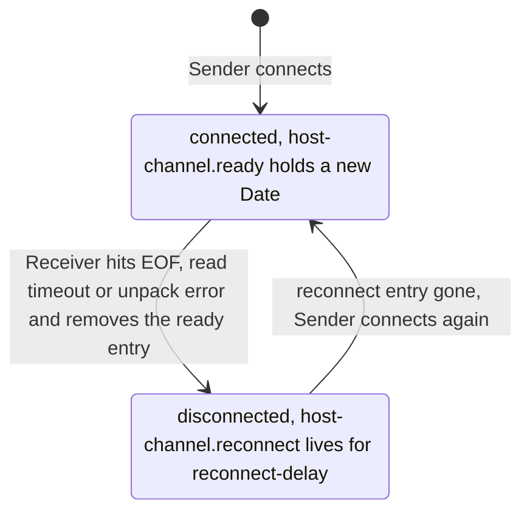

QMUX watches the ready entry through its `<ready>` element, so `mux.isConnected()` reports the
real link state (unit c4). Each connection puts a **new**
`Date` there, so code that has to act once per connection, such as a sign-on, compares the object it
saw last with the one there now (unit c11). A cached flag can't tell that the link went down,
or that it came back as a new connection.

### 3.5.1 Two Settings That Do Nothing

We deploy this descriptor, often copied between projects, and ask the running channel for its read
timeout and the Space for the ready key the descriptor names:

```xml
<channel-adaptor name="host-channel" class="org.jpos.q2.iso.ChannelAdaptor" logger="Q2">
  <channel class="org.jpos.iso.channel.ASCIIChannel" timeout="360000"
           packager="org.jpos.iso.packager.GenericPackager">
    <property name="host" value="127.0.0.1"/>
    <property name="port" value="8000"/>
    <property name="packager-config" value="jar:packager/iso87ascii.xml"/>
  </channel>
  <in>host-send</in>
  <out>host-receive</out>
  <ready>acquirer.ready</ready>
  <reconnect-delay>10000</reconnect-delay>
</channel-adaptor>
```

```text
  269 ms  host-channel.ready = Date
         acquirer.ready = null
         channel read timeout = 300000 ms
```

The `timeout` **attribute** is ignored. The channel reads only the `timeout` **property** and
falls back to its default of five minutes. With an echo every five minutes, the link can then be
torn down and rebuilt whenever an echo comes a little late. The `<ready>` element is ignored too:
the adaptor's ready key is always its name plus `.ready`, and `<ready>` belongs to QMUX. A QMUX
pointed at `acquirer.ready` would report the link down forever.

> **In jPOS 3.** The adaptor gains elements such as `soft-stop` and a reworked reconnect, neither of
> which exists in 2.1.7.

## 3.6 A TLS Channel Checks the Host Only When You Tell It To

TLS is not a channel class. A channel that extends `BaseChannel` opens its socket through a socket
factory, and with an SSL factory the same frames travel inside a TLS session. In a ChannelAdaptor
you name the factory in the channel property `socketFactory`, and the factory reads the channel's
other properties:

```xml
<channel-adaptor name="host-channel" class="org.jpos.q2.iso.ChannelAdaptor" logger="Q2">
  <channel class="org.jpos.iso.channel.ASCIIChannel"
           packager="org.jpos.iso.packager.GenericPackager">
    <property name="host" value="127.0.0.1"/>
    <property name="port" value="8000"/>
    <property name="packager-config" value="jar:packager/iso87ascii.xml"/>
    <property name="timeout" value="360000"/>
    <property name="socketFactory" value="org.jpos.iso.GenericSSLSocketFactory"/>
    <property name="keystore" value="cfg/client.jks"/>
    <property name="storepassword" value="${KEYSTORE_PASSWORD}"/>
    <property name="keypassword" value="${KEY_PASSWORD}"/>
    <property name="serverauth" value="true"/>
    <property name="servername" value="host.example.com"/>
  </channel>
  <in>host-send</in>
  <out>host-receive</out>
  <reconnect-delay>10000</reconnect-delay>
</channel-adaptor>
```

What happens without the `serverauth` line? We start a TLS host whose certificate
(`CN=host.example.com`) the client has never been told to trust, and connect four ways:

```text
serverauth=false, keystore without the host's certificate                        -> 0810 11=000601 39=00
serverauth=true,  keystore without the host's certificate                        -> IOException: Unable to connect
                                                                                    because SSLPeerUnverifiedException: peer not authenticated
serverauth=true,  host's certificate trusted, servername host.example.com        -> 0810 11=000601 39=00
serverauth=true,  host's certificate trusted, servername acquirer.example.com    -> IOException: Unable to connect
                                                                                    because SSLPeerUnverifiedException: Invalid SSL server name. Expected 'acquirer.example.com', got 'host.example.com'
```

With `serverauth` false, which is the default, the 2.1.7 factory accepts **any** certificate. The
link is encrypted, but anyone who can get between you and the host can play the host and collect
every PAN you send. With `serverauth=true` the factory trusts what is in the keystore, which is also
the trust store, so it needs the host's CA or certificate next to your own key pair.

The factory then compares `servername` (or, if that is missing, the peer's host name) with the certificate's
**CN**, exactly: it does not look at Subject Alternative Names, and a wildcard CN such as
`*.example.com` never matches. So `host` (or `servername`) must be the certificate's name, not an
IP address the certificate doesn't carry. With a socket factory, the channel's
`connect-timeout` is not used.

Don't write the passwords in the file. Q2 replaces `${KEYSTORE_PASSWORD}` with the
environment variable of that name, or a system property, or a value from the active environment
file under `cfg/`. Leave them out, and the factory falls back to the system properties
`jpos.ssl.storepass` and `jpos.ssl.keypass`, whose default is the literal `password`. Leave out
`keystore`, and it reads `~/.keystore`. Set all three.

For a test or a diagnostic tool, the same factory can be set up in code:

```java
package com.example.jpos.client.channel;

import org.jpos.iso.GenericSSLSocketFactory;
import org.jpos.iso.ISOException;
import org.jpos.iso.channel.ASCIIChannel;
import org.jpos.iso.packager.GenericPackager;

public final class TlsChannels {
    private TlsChannels() { }

    public static ASCIIChannel tlsChannel(String host, int port, String keystorePath)
            throws ISOException {
        String storePass = System.getenv("KEYSTORE_PASSWORD");
        String keyPass = System.getenv("KEY_PASSWORD");
        if (storePass == null || keyPass == null)
            throw new IllegalStateException("KEYSTORE_PASSWORD and KEY_PASSWORD must be set");

        GenericSSLSocketFactory tls = new GenericSSLSocketFactory();
        tls.setKeyStore(keystorePath);
        tls.setPassword(storePass);
        tls.setKeyPassword(keyPass);
        tls.setServerAuthNeeded(true);      // without this, any certificate is accepted
        tls.setServerName(host);            // compared with the certificate's CN

        ASCIIChannel channel = new ASCIIChannel(host, port,
                new GenericPackager("jar:packager/iso87ascii.xml"));
        channel.setSocketFactory(tls);
        return channel;
    }
}
```

> **In jPOS 3.** Host names are checked by the JDK, which reads Subject Alternative Names, so test
> certificates need a matching SAN (unit s13).

<!-- practice 3 -->

## 3.7 Summary

- **The channel decides where a message ends**, the packager what is inside. Both come from the
  host's spec, and a wrong channel usually shows up as silence, not as an error.
- **One read is not one message.** A channel reads exactly the announced length, across as many
  reads as needed and one frame per call. A zero-length frame is a keep-alive, and `NACChannel` or
  `PostChannel` needs `expect-keep-alive` to accept it.
- **`receive()` returns the next frame, not your answer.** It never returns `null`. The read
  timeout measures silence, and when it fires the 2.1.7 channel closes the connection, losing any
  answer still on its way.
- **A link has one reader that never stops.** Never pool raw channels. Deploy one ChannelAdaptor
  per link and let QMUX match the answers.
- **The adaptor reconnects by itself**, after `reconnect-delay`, and puts a new `Date` under
  `<name>.ready` for each connection. The `timeout` attribute and the adaptor's `<ready>` element do
  nothing.
- **TLS checks the host only with `serverauth=true`**, against the CN, with the keystore as trust
  store and the passwords from the environment.

## 3.8 Reference

**Client channels in jPOS 2.1.7** (all in `org.jpos.iso.channel`). Each also has a no-argument
constructor, which Q2 uses, and constructors that take a `ServerSocket`.

| Channel | Frame on the wire | Client constructor |
|---|---|---|
| `ASCIIChannel` | 4 ASCII decimal digits of length (property `length-digits` changes the count); answers a `0000` keep-alive with `0000` | `ASCIIChannel(String host, int port, ISOPackager p)` |
| `NACChannel` | 2-byte binary length, then an optional TPDU header (`null` for none); `include-header-length` counts the two length bytes | `NACChannel(String host, int port, ISOPackager p, byte[] tpdu)` |
| `PostChannel` | 2-byte binary length, optional header | `PostChannel(String host, int port, ISOPackager p)` |
| `VAPChannel` | 2-byte length and 2 zero bytes, then a Visa Base I header; skips zero-length polls itself | `VAPChannel(String host, int port, ISOPackager p)` |
| `XMLChannel` | no length: reads up to `</isomsg>`; pair it with `XMLPackager` | `XMLChannel(String host, int port, ISOPackager p)` |
| `PADChannel` | no length: the packager parses the stream to find the end; after one bad message there is no way to find the next | `PADChannel(String host, int port, ISOPackager p)` |

**`ISOChannel` methods:** `connect()`, `disconnect()`, `isConnected()`, `send(ISOMsg)` (returns
`void`), `receive()` (blocks for one frame; throws `SocketTimeoutException` on silence,
`EOFException` when the peer closes, `ISOException` on a bad frame or unpack error; on an
`IOException` the 2.1.7 `BaseChannel` has already closed its socket, on an `ISOException` it has
not; `PADChannel` closes on neither).

**Channel properties used on this page:** `host`, `port`, `timeout` (read timeout in ms, default
300000, `0` disables it), `connect-timeout` (default: same as `timeout`; not used when a
`socketFactory` is set), `keep-alive` (TCP `SO_KEEPALIVE`, default false), `expect-keep-alive`
(accept zero-length frames on channels such as `NACChannel` and `PostChannel`, default false),
`socketFactory`.

**ChannelAdaptor elements in 2.1.7:**

| Element | Meaning |
|---|---|
| `<in>` / `<out>` | queue the adaptor sends from / delivers received messages to |
| `<reconnect-delay>` | ms between connect attempts and after a dropped link (default 10000); also the idle period for `<keep-alive>` |
| `<keep-alive>yes</keep-alive>` | when nothing was sent for `reconnect-delay` ms, write a zero-length frame |
| `<timeout>` | lifetime of each received message in `<out>` (default 0, no expiry); not a socket timeout |
| `<write-only>yes</write-only>` | no Receiver thread |
| `<ignore-iso-exceptions>yes</ignore-iso-exceptions>` | keep the connection after a pack or unpack error |
| `<wait-for-workers-on-stop>yes</wait-for-workers-on-stop>` | on stop, wait for the Sender and Receiver to finish |

The ready key is always `<name>.ready`; the reconnect guard is `<name>.reconnect`.

**`GenericSSLSocketFactory` properties:** `keystore` (JKS; default `~/.keystore`),
`storepassword`, `keypassword`, `serverauth` (default false: any certificate accepted),
`servername` (compared with the CN), `clientauth` (server side), and the repeatable
`addEnabledProtocol` and `addEnabledCipherSuite`. `SunJSSESocketFactory` is a deprecated subclass.

## 3.9 Challenges

1. A host's spec says "2-byte length", without saying binary or ASCII, or whether the length counts
   itself. What one test message, and what view of the bytes on the wire, would settle all three
   questions on the first connection?
2. Your link carries an echo every five minutes, but the host answers echoes only while it is
   signed on. Choose a read timeout and an echo interval, and say what happens to a link whose
   sign-on fails at 3 a.m.
3. A host allows two connections. Would you deploy two adaptors with one QMUX each behind a
   `MUXPool` (unit c4), or one adaptor? What does each choice do to message order, and to the
   reversals of unit c12?
4. You have to accept a host whose certificate's CN is not its host name, with only a SAN that
   matches. What are your options in 2.1.7, and what does each one cost?

## 3.10 Design Note: Why the Channel Knows Nothing About Requests

A JDBC connection is request-and-response: you send a query and the next thing on the
wire is its result. ISO 8583 links are not: either side may start a conversation at any time,
answers can come back in a different order from the requests, and the host sends messages of its
own. A channel that paired each `send` with the next `receive` would be wrong whenever any of that
happens.

So jPOS splits the work. The channel only moves frames, in both directions at once, with
no idea what they mean. The adaptor keeps one connection open and drains it into a
queue. The MUX, a layer above, matches what it reads to what was sent. A different frame is then a
different channel class, and a second link a second adaptor; neither touches the matching.

The cost is indirection. A round trip passes through two queues and three threads (the caller, the
Sender, the Receiver), and a simple "send and wait" test needs a QMUX or a scripted host. Use the
raw channel to see what crosses the wire, not to run a link.


# 4. Transaction Sending

A checkout service runs two hundred threads over one TCP connection to the acquirer's host, the
ChannelAdaptor of unit c3. Thread 17 sends a 0200 for 10.00, and the next 0210 off the socket
answers thread 42's purchase of 40.00, which thread 17 must not read. When the host says nothing,
or the link is down, thread 17 still has to tell a cashier something.

QMUX solves this for every thread at once. What it promises and what it leaves to you comes down
to seven rules, one per section heading. Every output is from jPOS 2.1.7: Q2 in the same JVM,
started from the descriptors shown here (a ChannelAdaptor and a QMUX), and an `ISOServer` on
127.0.0.1 playing the host, with a 500 ms reconnect delay so the examples finish quickly.

## 4.1 QMUX Sits on the Adaptor's Queues, Crossed

The ChannelAdaptor of unit c3 never talks to your code. It writes what it takes from the Space
queue `host-send` to the socket, and puts everything it reads on `host-receive`. QMUX is the other
end: it writes requests to the queue the adaptor sends from and reads the queue the adaptor fills.

`deploy/20_host_mux.xml`, the same file as in unit c1:

```xml
<mux name="host-mux" class="org.jpos.q2.iso.QMUX" logger="Q2">
  <in>host-receive</in>
  <out>host-send</out>
  <ready>host-channel.ready</ready>
  <unhandled>host-unhandled</unhandled>
</mux>
```

Each element is named from the QMUX's point of view: its `<in>` is what comes in from the host,
the adaptor's `<out>`, and its `<out>` is the adaptor's `<in>`. What happens if you copy
`<in>host-send</in>` and `<out>host-receive</out>` from the adaptor's file, because the names look
like they should match? Each version on its own, with the link up, sending one purchase with a
2-second timeout:

```text
crossed: isConnected true
crossed: 0210 39=00 after 0 ms, host received 1
copied:  isConnected true
copied:  null after 2000 ms, host received 0
```

The copied QMUX writes the purchase into `host-receive`, a queue only the adaptor should write to,
and listens on `host-send`, where no answer arrives. The purchase never leaves the JVM. Q2 logs
nothing, `isConnected()` is true because the adaptor's ready entry exists, and every request
returns `null` after its full timeout. A client that handles `null` correctly (section 4.3) reports
every purchase as "outcome unknown" and, with unit c12's policy, queues a reversal for each. When
every request times out and the host has no record of any, check the queues first.

`<ready>` names the entry the adaptor keeps in the Space while it is connected,
`host-channel.ready` (unit c3); section 4.4 shows why you need it. `<unhandled>` is where QMUX puts
messages nobody is waiting for.

## 4.2 Every Thread Gets Its Own Answer

Five threads send a purchase at once over the one link, each with its own STAN and amount. The
host holds all five and answers them in its own order. Which thread gets the first 0210?

```java
Future<?> f = pool.submit(() -> {
    ISOMsg r = mux.request(Stack.purchase("29110001", stans[n], amounts[n]), 5000);
    ...
});
```

```text
host answers in this order: 000102 000105 000103 000101 000104
thread 1 sent 11=000101 4=000000001000  got 0210 11=000101 4=000000001000
thread 2 sent 11=000102 4=000000002000  got 0210 11=000102 4=000000002000
thread 3 sent 11=000103 4=000000003000  got 0210 11=000103 4=000000003000
thread 4 sent 11=000104 4=000000004000  got 0210 11=000104 4=000000004000
thread 5 sent 11=000105 4=000000005000  got 0210 11=000105 4=000000005000
```

Thread 2 got the first answer, because it was for STAN 000102. When QMUX sends a request, it
computes a string from it, the **key**: by default the out queue, the MTI (a response's 0210 mapped
back to 0200), and fields 41 and 11. It parks the waiting thread under that key, computes the key of
every message on `host-receive`, and hands each to the thread parked under the same key. Unit c12
takes the key apart and shows what goes wrong when two requests share one.

A message that matches no waiting thread (an answer that came too late, or a request the host sent
on its own) goes to `<unhandled>`, where it stays for two minutes (fixed in 2.1.7) unless you read
it first.

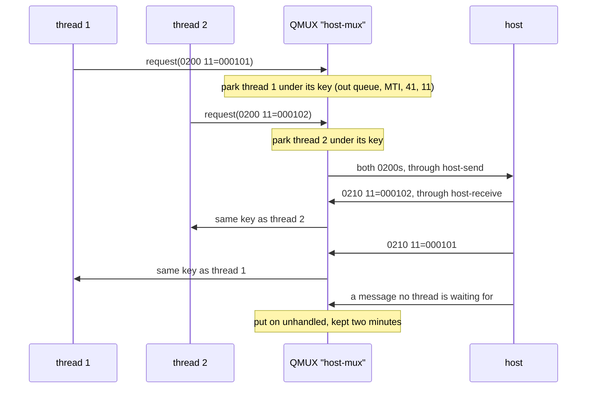

The usual alternative, a lock around "write, then read the next message", serialises the service:
with a host that takes 300 ms to answer, it completes about three purchases a second, however many
threads it has. The same reasoning ruled out pools of raw channels in unit c3.

## 4.3 A Missing Answer Comes Back as null

The host receives a purchase for 42.00 and never answers. What `request` gives back, and what the
obvious next line does with it:

```java
ISOMsg response = mux.request(Stack.purchase("29110001", "000318", "000000004200"), 2000);
boolean approved = "00".equals(response.getString(39));
```

```text
response: null after 2000 ms
java.lang.NullPointerException
host received 1, 4=000000004200
```

`request` waited the whole timeout and returned `null`; it did not throw. Unit c3's socket read
timeout is an exception, so it is easy to expect one here. The `ISOException`s that `request` does
throw mean the message was refused before it was sent: none of the key fields is present, or the
key is a duplicate (unit c12).

The `NullPointerException` is the cheap part of the bug. It lands in a generic error handler and the
cashier sees "system error", while the host's log shows the purchase arrived. The host may have
approved it and lost the answer, and nothing in the code starts the reversal that unit c12 builds
for this case. A `null` from `request` is an unknown outcome: not a decline, and never a reason to
send the same purchase again.

## 4.4 A Request on a Down Link Waits in the Queue

The host restarted, and the adaptor is reconnecting. A thread calls `request` with a 5-second
timeout anyway. Does the purchase fail at once?

```text
-- the link comes back within the timeout
0.0 s  isConnected: false
1.1 s  host is up
1.5 s  request returned 0210 39=00
host received 1
-- the link stays down past the timeout
0.0 s  isConnected: false
2.0 s  request returned null
3.0 s  host is up
4.5 s  host received 0
```

In 2.1.7 `request` never checks the link. It puts the message on `host-send` with the timeout as
its lifetime and waits. If the adaptor reconnects in time, the message goes out, here after a
second and a half. If not, it expires in the queue unsent, and `request` returns `null` like any
missing answer. (`send`, the method without an answer, does check, and throws `ISOException` "MUX
is not connected".)

In the first ending, a purchase can reach the host many seconds after it was made, when a terminal
that waits less than your timeout has already shown a failure. In the second, the cashier waits the
full timeout to hear "outcome unknown" about a purchase that never left the building. The reversal
queued for it is usually harmless but is noise, and the true answer was available at once: the host
is unavailable, try again or take another payment method.

So ask first. With `<ready>` configured, `isConnected()` is true only while the adaptor's ready
entry exists; without it, whenever the QMUX is running. A client that keeps the endings apart:

```java
package com.example.jpos.client.send;

import org.jpos.iso.ISOException;
import org.jpos.iso.ISOMsg;
import org.jpos.iso.MUX;

public class AuthorizationClient {
    public enum Outcome { APPROVED, DECLINED, NO_ANSWER, HOST_UNAVAILABLE }

    private final MUX mux;
    private final long timeout;

    public AuthorizationClient(MUX mux, long timeout) {
        this.mux = mux;
        this.timeout = timeout;
    }

    public Outcome authorize(ISOMsg request) throws ISOException {
        if (!mux.isConnected())
            return Outcome.HOST_UNAVAILABLE;           // nothing left our side
        ISOMsg response = mux.request(request, timeout);
        if (response == null)
            return Outcome.NO_ANSWER;                  // unknown: unit c12 reverses it
        return "00".equals(response.getString(39)) ? Outcome.APPROVED : Outcome.DECLINED;
    }
}
```

Against a host that approves, declines, drops, and then goes away:

```text
000801: APPROVED after 0 ms
000802: DECLINED after 0 ms
000803: NO_ANSWER after 2000 ms
000804: HOST_UNAVAILABLE after 0 ms
host received 3
```

The check is not a guarantee: the link can drop between `isConnected()` and the write, which puts
you back in the first ending. It turns the common case, a link that has been down for a while, into
an immediate and certain answer.

<!-- practice 1 -->

## 4.5 The Asynchronous Form Calls Back Once, With an Answer or With null

A blocking `request` holds its thread as long as the host takes. A service waiting on thousands of
answers can pass a listener instead and get its thread back at once:

```java
mux.request(purchase, 2000, (resp, handBack) -> { ... }, "000401");
```

The listener is an `ISOResponseListener`. Its one abstract method is `responseReceived(response,
handBack)`, where the hand-back is any object you passed in, returned untouched. When the timeout
passes with no answer, QMUX calls `expired(handBack)`, whose 2.1.7 default calls
`responseReceived(null, handBack)`, so a lambda sees `null` on expiry as the blocking form does. An
answered request and a dropped one, with the thread each callback ran on:

```text
caller thread: main
both requests sent, caller continues
000401: 0210 39=00 on channel-receiver-host-receive
000402: null on pool-2-thread-1
```

A response's callback runs on the adaptor's receiver thread, the one thread that reads the socket,
and an expiry's on a QMUX scheduler thread. Neither is yours.

A listener that ignores `null`, say one that completes a future only when
a response arrives, leaves that future waiting forever:

```text
000403: future done after 5 s? false
```

The caller, perhaps an HTTP request in your own API, hangs until its own timeout, and every dropped
purchase adds another hung caller.

A listener that does real work holds up the whole link. One asynchronous request whose listener
spends three seconds writing to a database, then a blocking request with a 2-second timeout that
the host answered at once:

```text
000702: null after 2000 ms
000701: listener done
host answered 2 requests at once
host-mux-unhandled: 0210 11=000702
```

The receiver thread was inside the first listener, so nobody read the second approval off the
socket until the blocking request had given up: the host approved 000702, the caller got `null`,
and the approval went to `<unhandled>`. Keep the listener to completing a future or handing the
message to a queue of your own, and do the work elsewhere:

```java
package com.example.jpos.client.send;

import org.jpos.iso.ISOException;
import org.jpos.iso.ISOMsg;
import org.jpos.iso.MUX;

import java.util.concurrent.CompletableFuture;

public class AsyncSender {
    private final MUX mux;
    private final long timeout;

    public AsyncSender(MUX mux, long timeout) {
        this.mux = mux;
        this.timeout = timeout;
    }

    /** Completes with the response, with null when none came in time, or with the refusal. */
    public CompletableFuture<ISOMsg> send(ISOMsg request) {
        CompletableFuture<ISOMsg> result = new CompletableFuture<>();
        try {
            mux.request(request, timeout,
                    (response, handBack) -> result.complete(response),   // null on expiry
                    null);
        } catch (ISOException e) {
            result.completeExceptionally(e);           // refused: nothing was sent
        }
        return result;
    }
}
```

```text
000901: 0210 39=00
000902: null
000903 again: failed, Duplicate key 'host-send.0200000000029110001000903.req' detected.
000903: null
```

The asynchronous `request` throws the same `ISOException`s as the blocking one, before anything is
sent. That third ending is not a `null`: the host never saw the message, so there is nothing to
undo.

<!-- practice 2 -->

## 4.6 Each Link Numbers Its Own Messages

Field 11, the STAN, has six digits and is one of the two default key fields. The host uses it with
field 41 to spot duplicates, and a reversal names its original by it. Where should it come from?

A random number looks unique enough. One terminal ID, simulated with 20 purchases in flight and
100,000 a day, each with a random STAN:

```text
random STANs, 20 in flight, 100,000 purchases a day: 1.8 collisions a day (30 days)
```

Each collision is a purchase QMUX refuses as a duplicate key while the other waits. Over a day,
100,000 draws from a million values also repeat many times, which a host that looks for duplicates
notices. Use a counter: one sequence per outbound link, 000001 to 999999, then 000001 again.

```java
package com.example.jpos.client.send;

import org.jpos.iso.ISOUtil;
import org.jpos.space.Space;
import org.jpos.space.SpaceUtil;

/** One STAN sequence per outbound link: 000001 .. 999999, then 000001 again. */
public final class StanSequencer {
    private final Space<String, Object> space;
    private final String key;

    public StanSequencer(Space<String, Object> space, String link) {
        this.space = space;
        this.key = "stan." + link;
    }

    public String next() {
        long n = SpaceUtil.nextLong(space, key);    // atomic within this JVM
        return ISOUtil.zeropad(((n - 1) % 999999) + 1, 6);
    }
}
```

`SpaceUtil.nextLong` takes the number from the Space, adds one and puts it back while holding the
Space's lock, so two threads never get the same number. Started at 999997, it continues:

```text
999998 999999 000001
```

Where the counter lives decides what a restart does. A program that takes three STANs, run twice
with a transient space (`tspace:stan`) and twice with `je:stan`, the Berkeley DB space that ships
with jPOS 2.1.7 (the part before the colon picks the kind of space, the part after names it):

```text
tspace:stan: 000001 000002 000003
tspace:stan: 000001 000002 000003
je:stan: 000001 000002 000003
je:stan: 000004 000005 000006
```

After a restart the transient counter starts at 000001 again, so the afternoon's first purchases
repeat the morning's terminal and STAN, and a host that checks duplicates by those fields may
decline them. Production uses a persistent space. The lock is local to the JVM, though: two
processes that share a terminal ID on one link need one shared sequence, such as a database
sequence, rather than a space each.

Keep every request with its transaction record. A reversal (unit c12) copies fields from it and
names it by its MTI, STAN, field 7 and acquirer ID. The rest of the request comes from unit c2's
request factory.

<!-- practice 3 -->

## 4.7 Code Names a MUX and Never Keeps One

Q2 registers each QMUX in the `NameRegistrar` as `mux.<name>`, and `QMUX.getMUX("host-mux")` looks
it up. The registry is per JVM, so this works only in the process that runs Q2, as the application or
embedded in it (unit c1).

A lookup in the constructor fails if the service is built before Q2 has deployed the descriptor.
Here a service looked up `host-pool`, the pool of section 4.7.1, too early:

```text
before deploy: org.jpos.util.NameRegistrar$NotFoundException: mux.host-pool
```

A reference kept from startup goes stale when an operator edits the descriptor and Q2 redeploys it.
After touching the file, one purchase through a kept reference and one through a fresh lookup:

```text
descriptor redeployed; same object? false
kept reference: isConnected false, request -> null
looked up now:  isConnected true, request -> 0210
host received:
- 0200 11=000601
- 0200 11=000602
host-mux-unhandled: 0210 11=000601 39=00
```

The old QMUX is stopped but still wrote the purchase to `host-send`, as any `request` does. The
adaptor sent it, the host approved it, and the approval reached the new QMUX, which had nobody
waiting for it, so the caller got `null` for a purchase that went through. Look the MUX up when you use
it:

```java
package com.example.jpos.client.send;

import org.jpos.iso.MUX;
import org.jpos.q2.iso.QMUX;
import org.jpos.util.NameRegistrar;

import java.util.function.Supplier;

/** Finds the MUX by name each time it is needed. */
public final class MuxLocator implements Supplier<MUX> {
    private final String name;

    public MuxLocator(String name) {
        this.name = name;
    }

    @Override
    public MUX get() {
        try {
            return QMUX.getMUX(name);                  // "mux." + name in the NameRegistrar
        } catch (NameRegistrar.NotFoundException e) {
            throw new IllegalStateException("MUX '" + name + "' is not deployed", e);
        }
    }
}
```

### 4.7.1 A Pool Takes the Name's Place

The lookup returns the `MUX` interface, and the code needs nothing more. When one link is not
enough, each link gets its own ChannelAdaptor and QMUX, and a `MUXPool` in front of
them is itself a `MUX`, registered the same way. `deploy/25_host_pool.xml`:

```xml
<mux name="host-pool" class="org.jpos.q2.iso.MUXPool" logger="Q2">
  <muxes>host-mux host-mux-b</muxes>
  <strategy>primary-secondary</strategy>
</mux>
```

The second pair is the first one with other names: adaptor `host-channel-b` with queues
`host-b-send` and `host-b-receive`, and QMUX `host-mux-b`. Each QMUX reads only its own in queue, so
the two links never confuse each other's answers.

The pool looks its members up once, when it is deployed, so it comes after them (`25_`), and a
missing name fails the deployment. It keeps those references: redeploy a member and the pool still
holds the stopped one, so redeploy the pool with it. With two hosts, A and B:

```text
host-pool is a MUXPool
000501: 0210 from host A after 0 ms
000502: 0210 from host A after 0 ms
link A down
000503: 0210 from host B after 0 ms
link B down, pool isConnected: false
000504: null after 3000 ms
```

`primary-secondary` uses the first member that is connected, so B takes over when A drops. With no
member connected, the pool checks again every second until the timeout is spent and then returns
`null` without handing the purchase to any member, the same answer as a lost response. Ask
`isConnected()` first here too: the pool's is true while any member is. The application changed
one word, `host-pool` for `host-mux`. Unit c14 covers the other strategies and how to design for failover.

> **The pool's asynchronous form differs.** In 2.1.7, `MUXPool.request` with a listener also waits
> in the caller's thread for a usable member, up to the timeout, and then throws `ISOException`
> "No MUX available" instead of calling the listener. In our run that took the full 3000 ms.

Depending on `MUX` also lets a test hand the client a fake that answers, declines or stays silent on
demand (unit c10).

<!-- practice 4 -->

<!-- practice 5 -->

## 4.8 Summary

- **QMUX sits on the adaptor's queues, crossed.** Its `<in>` is the adaptor's `<out>`. Copied
  unchanged, every request times out without leaving the JVM or logging an error.
- **Each thread gets its own answer**, matched by a key, in whatever order the host answers. A lock
  around write-then-read serialises the whole service.
- **A missing answer is `null`, not an exception.** It means "unknown", never "declined" and never "send it
  again".
- **`request` doesn't check the link.** On a down link the message waits in the queue for the
  timeout and may go out late. Ask `isConnected()` first, with `<ready>` configured.
- **The asynchronous listener runs once, on a jPOS thread**, with `null` on expiry. Complete the
  caller's future in both cases, and keep the listener short, or every answer on the link waits.
- **One STAN sequence per link**, wrapping 999999 to 000001, kept in a persistent space. Random or
  in-memory numbers repeat.
- **Look a MUX up by name when you use it, and depend on `MUX`.** A kept reference goes stale on
  redeploy, and a `MUXPool` can take the name's place.

## 4.9 Reference

**The `MUX` interface in 2.1.7** (`MUX` extends `ISOSource`):

| Method | Does |
|---|---|
| `ISOMsg request(ISOMsg m, long timeout)` | sends and blocks; the matching response, or `null` after `timeout` ms |
| `void request(ISOMsg m, long timeout, ISOResponseListener l, Object handBack)` | sends and returns; `l` is called once, with the response or (via `expired`) with `null` |
| `void send(ISOMsg m)` | sends without waiting; QMUX throws `ISOException` when not connected |
| `boolean isConnected()` | QMUX: a `<ready>` entry exists (or, with no `<ready>`, the QMUX is running); MUXPool: some member is usable |

Both `request` forms throw `ISOException` before sending for "Key fields not found" and "Duplicate
key".

**QMUX elements used in this course:**

| Element | Meaning |
|---|---|
| `<in>` | queue QMUX reads: the adaptor's `<out>` |
| `<out>` | queue QMUX writes requests to: the adaptor's `<in>` |
| `<ready>` | Space entry (or entries) that `isConnected()` checks; `host-channel.ready` |
| `<unhandled>` | queue for messages nobody waits for; each expires after 120000 ms |
| `<key>` | key fields, default `41, 11` (unit c12) |
| `<request-listener>` | gets unmatched messages before `<unhandled>` (unit c11) |

**MUXPool strategies in 2.1.7:**

| `<strategy>` | Picks |
|---|---|
| `primary-secondary` (default) | the first usable member in `<muxes>` order |
| `round-robin` | the next usable member in turn |
| `round-robin-with-override` | round-robin, except that MTIs in `<follower-override>` go to the link named in the field set by `<original-channel-field>` |
| `split-by-divisor` | member number `<split-field>` modulo the member count, else round-robin |

"Usable" means connected. With `<property name="check-enabled" value="true"/>` a QMUX member also
needs an entry named after the QMUX plus `.enabled`, which must be the same object as its ready
entry when the QMUX has one `<ready>` name, and merely present when it has several (unit c11). When no
member is usable, the pool checks once a second until the timeout runs out.

## 4.10 Challenges

1. Your host answers in 300 ms on average, and 2% of answers take 8 seconds. How many threads does a
   service using the blocking form need for 200 purchases a second? How many does the asynchronous
   form need, and what does it need instead?
2. The link drops for 40 seconds at lunchtime. Your request timeout is 25 seconds and the adaptor's
   reconnect delay is 10 seconds. Draw what happens to purchases submitted at seconds 0, 20 and
   35, with and without the `isConnected()` check.
3. Two instances of the checkout service share one terminal ID on one link. Design their STAN
   numbering without a shared database. What happens at a restart?
4. Write a request listener for `<unhandled>` traffic that logs late approvals. Which fields would
   you log, and which must you never log?

## 4.11 Design Note: Why Queues Between the MUX and the Socket?

QMUX never touches the socket. A MUX that owned the channel would be shorter by one thread, but
jPOS puts Space queues in between.

The queues keep the two sides independent. The adaptor reconnects and backs off without the MUX
knowing, and the MUX keeps its waiting threads throughout. A message written while the link is down
waits, which suits an advice (a 0220 reporting something already done) and, as section 4.4 showed,
can send a purchase late. Anything can sit on the other end of the queues: a second adaptor, a test
host in the same JVM, a recorder. Unit c12 replaces the adaptor with a scripted host, and QMUX
can't tell.

The price is that the queues hide the link. A write to a queue always succeeds, so a mistake like
copied queue names shows up only as timeouts, and a stopped QMUX can still put a purchase on the
wire. The MUX's whole view of the link is a single Space entry, the ready flag.


# 5. Visa and Mastercard Specific Requests

Your client has sent Visa purchases through your acquirer for a year, and product wants
Mastercard in the next release. Which parts of your request code change, which come from
configuration, and which can't you write until someone hands you a document you don't have yet?

That document is the network's interface specification: licensed to member institutions and
processors, revised with each network release, and defining the network-specific fields byte by
byte. Distrust any tutorial, this one included, that prints a
"Visa field 62 layout" from memory. This unit uses what is public and stable: the ISO 8583
structure both networks build on.

Most clients never talk to Visa or Mastercard directly. A merchant system or a gateway talks to
its acquirer's host, and its specification is the acquirer's interface document, which usually
hides most of the differences. The unit comes down to five rules, one per section heading.

## 5.1 One Builder Makes What Every Network Shares

A Visa and a Mastercard purchase for 10.50 USD at one terminal, built by the same code. The PAN
is masked only in print. Which fields differ?

```text
field VISA                                       MASTERCARD
MTI   0100                                       same
2     411111______1111                           555555______4444
3     000000                                     same
4     000000001050                               same
18    5999                                       same
32    400001                                     500001
41    29110001                                   same
42    000000001234567                            same
43    [EXAMPLE CORNER CAFE      SPRINGFIELD  US] same
49    840                                        same
packed: 134 and 134 bytes
```

(Packed with the course packager, `GenericPackager` and `jar:packager/iso87ascii.xml`.)

Two: the card number and field 32, the acquiring institution ID, which the acquirer assigned to
this merchant once for Visa and once for Mastercard. Every other field is defined by ISO
8583:1987 and means the same on both networks. The networks differ elsewhere: in the private-use
fields they define for themselves (5.4), in the values they accept in a few shared fields such as
22 and 55 (5.3), and sometimes in a layout detail such as the positions inside field 43 (5.2.2).

So one builder takes the network as a parameter, and the merchant's data comes from a
`MerchantProfile` (5.2):

```java
package com.example.jpos.client.requests;

import java.util.Locale;

public enum Network {
    VISA, MASTERCARD;

    /** "visa", "VISA", "MasterCard"... Anything else is refused, never guessed. */
    public static Network of(String name) {
        if (name != null) {
            switch (name.trim().toLowerCase(Locale.ROOT)) {
                case "visa": return VISA;
                case "mastercard": return MASTERCARD;
                default: break;
            }
        }
        throw new IllegalArgumentException("unsupported network: " + name);
    }
}
```

```java
package com.example.jpos.client.requests;

/** Field 3: two digits for the transaction, then from-account and to-account (00 = default). */
public enum TxnType {
    PURCHASE("000000"),
    CASH_ADVANCE("010000"),
    REFUND("200000");

    public final String processingCode;

    TxnType(String processingCode) {
        this.processingCode = processingCode;
    }
}
```

```java
package com.example.jpos.client.requests;

import org.jpos.iso.ISOException;
import org.jpos.iso.ISOMsg;
import org.jpos.iso.ISOUtil;

/** The part of a card request that every network reads the same way. */
public final class CardRequests {
    private final MerchantProfile merchant;

    public CardRequests(MerchantProfile merchant) {
        this.merchant = merchant;
    }

    public ISOMsg request(String mti, TxnType type, Network network, String pan, long amountMinor)
            throws ISOException {
        ISOMsg m = new ISOMsg(mti);
        m.set(2, pan);
        m.set(3, type.processingCode);
        m.set(4, ISOUtil.zeropad(amountMinor, 12));
        m.set(18, merchant.mcc());
        m.set(32, merchant.acquirerId(network));
        m.set(41, merchant.terminalId());
        m.set(42, merchant.merchantId());
        m.set(43, merchant.nameAndLocation());
        m.set(49, merchant.currency());
        return m;
    }
}
```

Fields 7 and 11 are left out on purpose: they belong to the moment of sending and come from the
link's sequence, whatever the network (units c2 and c4).

The alternative, a `VisaRequests` class and a `MastercardRequests` class copied from it, drifts.
Fix a merchant name too long for field 43 in the Visa class, because Visa purchases are the ones
failing, and Mastercard purchases at that merchant keep failing. The bug report reads "Mastercard
declines at one store", and everyone looks at Mastercard.

## 5.2 The Network Shows Up as Configuration, and a Missing Value Stops the Request

The acquirer, not your code, decides the per-network values and the merchant's own data when it
boards the merchant: the terminal and merchant IDs, the category code, an acquirer ID per network. They belong in configuration, read into one object:

```java
package com.example.jpos.client.requests;

import org.jpos.iso.ISOUtil;

import java.util.Map;

/** What the acquirer assigned when it boarded the merchant. Loaded from configuration. */
public final class MerchantProfile {
    private final String terminalId, merchantId, mcc, currency, name, city, country;
    private final Map<Network, String> acquirerIds;

    public MerchantProfile(String terminalId, String merchantId, String mcc, String currency,
                           String name, String city, String country,
                           Map<Network, String> acquirerIds) {
        this.terminalId = terminalId;
        this.merchantId = merchantId;
        this.mcc = mcc;
        this.currency = currency;
        this.name = name;
        this.city = city;
        this.country = country;
        this.acquirerIds = Map.copyOf(acquirerIds);
    }

    public String terminalId() { return terminalId; }
    public String merchantId() { return merchantId; }
    public String mcc() { return mcc; }
    public String currency() { return currency; }

    /** Field 32 for this network. A network nobody configured is refused, never sent without it. */
    public String acquirerId(Network n) {
        String id = acquirerIds.get(n);
        if (id == null)
            throw new IllegalArgumentException("no acquirer ID configured for " + n);
        return id;
    }

    /** Field 43: name in positions 1-25, city in 26-38, country in 39-40. */
    public String nameAndLocation() {
        return fit(name, 25) + fit(city, 13) + fit(country, 2);
    }

    private static String fit(String s, int width) {
        return ISOUtil.strpad(s.length() > width ? s.substring(0, width) : s, width);
    }
}
```

### 5.2.1 Spot the Problem: The Mastercard Launch

Before the profile existed, the builder looked up field 32 in a map filled from a properties file:

```java
Map<Network, String> acquirerIds = new EnumMap<>(Network.class);
acquirerIds.put(Network.VISA, "400001");          // nobody added Mastercard yet

ISOMsg m = new ISOMsg("0100");
m.set(2, "5555555555554444");
m.set(4, "000000001050");
m.set(32, acquirerIds.get(Network.MASTERCARD));   // the naive line
m.set(41, "29110001");
```

Mastercard goes live, and the release is deployed without the new property. What happens to the
first Mastercard purchase?

```text
field 32 present: false
packed: 58 bytes, no exception
```

`ISOMsg.set(n, null)` doesn't complain: it removes field n. The purchase packs, leaves and reaches the host without an acquirer ID, and nothing in your
logs looks wrong. Every Mastercard purchase from this merchant fails at the host, and your support
desk hears about it from the merchant.

The profile refuses instead, before anything is sent, and so does `Network.of` for a network it
doesn't know. The tempting "if it isn't Mastercard, it's Visa" would send an American Express card
as a Visa purchase with Visa's acquirer ID:

```text
CardRequests: no acquirer ID configured for MASTERCARD
Network.of: unsupported network: amex
```

The exception comes at the first purchase, in your own code, and names what is missing. To get it
before the first cardholder does, build a test request at startup for every network you accept.

### 5.2.2 Field 43 Has Positions, Not Separators

Field 43 holds three values with nothing between them. The receiver finds them by position: the
name in characters 1 to 25, the city in 26 to 38, the country in 39 and 40. Here is field 43 for
two Springfield merchants, `CORNER CAFE` and the 30-character `EXAMPLE CORNER CAFE AND BAKERY`,
filled three ways and read back by position as a host would:

```text
joined   sent 24 chars -> name [CORNER CAFESPRINGFIELDUS] city [] country []
fitted   sent 40 chars -> name [CORNER CAFE] city [SPRINGFIELD] country [US]
padded   sent 45 chars -> Field length 45 too long. Max: 40
fitted   sent 40 chars -> name [EXAMPLE CORNER CAFE AND B] city [SPRINGFIELD] country [US]
```

**Joined** concatenates the three strings. The packager pads the field to 40 characters at the end,
so it packs, and the host reads one long name with no city and no country. A host that checks the
merchant's country refuses the purchase. One that doesn't prints the wrong name on the
cardholder's statement.

**Padded** pads each part to its width but doesn't cut the long name, so the field is 45
characters and doesn't pack. The `IF_CHAR` javadoc says it truncates, but in 2.1.7 the length
check runs first. Inside a ChannelAdaptor that failure happens on the channel's thread, far from
your code (unit c2).

**Fitted** cuts each part to its width and then pads it, as `MerchantProfile.nameAndLocation`
does. A long name loses its end, and the city stays where the host looks for it.

> **Networks differ.** The 25/13/2 split is common, not universal. Some specifications divide the
> 40 characters differently, for example with a state or region code. Take the positions from
> yours and keep them in `nameAndLocation`.

<!-- practice 1 -->

## 5.3 How the Card Was Read Decides the Card Fields

Field 22, the POS entry mode, says how the terminal got the card's data. Its first two digits name
the method, and the third says whether the terminal can take a PIN. A keyed card has no track, so the request carries the expiry date in
field 14. A stripe read carries track 2 in field 35. A chip read carries the chip's track 2
equivalent there and, in field 55, the cryptogram and the data objects the card signed for this
transaction.

A chip read fails, and the cashier swipes the same card. What should field 22 say now,
and which fields go?

The request is now a stripe read: track 2, no field 55, and an entry mode that says so. Integrations
often get this wrong by taking the entry mode from the terminal's configuration ("a chip
terminal", code 05 plus the PIN digit: `051`) and the card fields from what actually happened. The
swiped fallback then leaves claiming a chip read and carrying no chip data. What the issuer does
with that depends on the network's rules. A decline for a good card is likely.

So set field 22 and the card fields from one value, and refuse a read that lacks its data:

```java
package com.example.jpos.client.requests;

/** How the terminal got the card's data. The codes are the PAN-entry part of field 22. */
public enum CardRead {
    KEYED("01"),
    STRIPE("90"),
    CHIP("05"),
    CONTACTLESS_CHIP("07");

    public final String panEntry;

    CardRead(String panEntry) {
        this.panEntry = panEntry;
    }
}
```

```java
package com.example.jpos.client.requests;

import org.jpos.iso.ISOException;
import org.jpos.iso.ISOMsg;

/** Sets field 22 and the card fields from one value, so the two can't disagree. */
public final class CardData {
    private CardData() { }

    /**
     * @param pinCapability third digit of field 22: '1' the terminal can take a PIN, '2' it can't
     * @param expiryYYMM    for a keyed card
     * @param track2        for a stripe or chip read (from the chip, tag 57)
     * @param icc           field 55, the TLV the chip kernel produced, for a chip read
     */
    public static void apply(ISOMsg m, CardRead read, char pinCapability,
                             String expiryYYMM, String track2, byte[] icc) throws ISOException {
        m.set(22, read.panEntry + pinCapability);
        switch (read) {
            case KEYED:
                m.set(14, required(expiryYYMM, read, "expiry date"));
                break;
            case STRIPE:
                m.set(35, required(track2, read, "track 2"));
                break;
            case CHIP:
            case CONTACTLESS_CHIP:
                m.set(35, required(track2, read, "track 2"));
                m.set(55, required(icc, read, "chip data"));
                break;
        }
    }

    private static <T> T required(T value, CardRead read, String what) {
        if (value == null)
            throw new IllegalArgumentException(read + " read without " + what);
        return value;
    }
}
```

The same purchase read four ways, then a chip read without chip data, then the chip data the first
chip read used:

```text
KEYED            22=011  card fields: 14
STRIPE           22=901  card fields: 35
CHIP             22=051  card fields: 35 55
CONTACTLESS_CHIP 22=071  card fields: 35 55
CHIP read without chip data
field 55: 29 bytes: 9F26081A2B3C4D5E6F70819F270180950500000080009F37049A8B7C6D
```

Here the chip kernel produced four data objects, packed as BER-TLV with `org.jpos.tlv.TLVList`.
Your code copies those bytes and never computes them. Whether they travel as raw bytes or as hex
text depends on how the packager defines field 55 (unit c6 shows both). Track 2 and the chip's
track 2 equivalent are sensitive card data: send them, and keep them out of logs and storage
(unit c8).

> **Networks differ.** Both networks commonly use the entry-mode codes above. Your specification
> lists the codes you may send, adds others (for a swipe after a failed chip read, for example),
> may give field 22 another length (jPOS's `Base1Packager` declares four digits, not three), and
> says what field 25, the POS condition code, must carry beside it. Keep all of it in `CardRead`,
> copied from the document.

<!-- practice 2 -->

## 5.4 Private Fields Come From the Network's Specification, Behind One Hook

Fields 48, 60 to 63 and 120 to 127 are reserved for private or national use. ISO 8583 gives each a
number and a maximum length and nothing else, so each network decides what goes inside. jPOS
doesn't know the content either: its `Base1Packager`, written for Visa, declares fields 48, 62 and
63 as plain binary of up to 99, 59 and 255 bytes. The layouts are in the licensed
specifications and nowhere else.

Keep that knowledge behind one interface, implemented once per network:

```java
package com.example.jpos.client.requests;

import org.jpos.iso.ISOException;
import org.jpos.iso.ISOMsg;

/** The fields one network's specification adds to a request. One implementation per network. */
public interface NetworkFields {
    void apply(ISOMsg request, TxnType type) throws ISOException;

    /** For a host, such as most acquirers, that hides the networks' differences. */
    NetworkFields NONE = (request, type) -> { };
}
```

```java
package com.example.jpos.client.requests;

import org.jpos.iso.ISOException;
import org.jpos.iso.ISOMsg;

import java.util.Map;

/** The common core, then the network's own fields. */
public final class NetworkRequests {
    private final CardRequests common;
    private final Map<Network, NetworkFields> rules;

    public NetworkRequests(CardRequests common, Map<Network, NetworkFields> rules) {
        this.common = common;
        this.rules = Map.copyOf(rules);
    }

    public ISOMsg request(String mti, TxnType type, Network network, String pan, long amountMinor)
            throws ISOException {
        NetworkFields own = rules.get(network);
        if (own == null)
            throw new IllegalArgumentException("no field rules configured for " + network);
        ISOMsg m = common.request(mti, type, network, pan, amountMinor);
        own.apply(m, type);
        return m;
    }
}
```

A network with no rules configured is refused, for the reason of 5.2.1:

```text
MASTERCARD: no field rules configured for MASTERCARD
```

Against an acquirer that hides the networks, both entries are `NONE`. Connecting to a network
directly adds one class and changes nothing else. That class reads its constants from
configuration (the services you are certified for, for instance) and writes subelements as nested
fields such as `48.1`, which pack only if the packager defines the field's subelements (units c6
and c13).

A private field filled from a blog post, from memory or from the other network's layout is either
rejected, and certification takes another round, or accepted and misread, and you may find out
only when a transaction is disputed.

## 5.5 Each Network Is a Destination of Its Own

When Visa and Mastercard traffic go to different hosts, each host gets its own ChannelAdaptor and
QMUX: `visa-channel` with `visa-mux`, `mc-channel` with `mc-mux`. A QMUX doesn't route: it writes
every request to its one out queue, which leads to one link, so choosing the network's host means
choosing its MUX. Each QMUX names its own adaptor's ready key in `<ready>`, as in unit c4, because
without it `isConnected()` stays true while the link is down:

```java
package com.example.jpos.client.requests;

import org.jpos.iso.ISOException;
import org.jpos.iso.ISOMsg;
import org.jpos.iso.MUX;
import org.jpos.q2.iso.QMUX;
import org.jpos.util.NameRegistrar;

import java.util.Map;

/** Sends each request through the MUX of its own network, and through no other. */
public final class NetworkRouter {
    private final Map<Network, String> muxNames;     // e.g. VISA -> "visa-mux"

    public NetworkRouter(Map<Network, String> muxNames) {
        this.muxNames = Map.copyOf(muxNames);
    }

    /** The response, or null when none came in time. Throws, having sent nothing, when the link is down. */
    public ISOMsg send(Network network, ISOMsg request, long timeout) throws ISOException {
        String name = muxNames.get(network);
        if (name == null)
            throw new IllegalArgumentException("no MUX configured for " + network);
        MUX mux;
        try {
            mux = QMUX.getMUX(name);                  // looked up when used (unit c4)
        } catch (NameRegistrar.NotFoundException e) {
            throw new ISOException("MUX " + name + " is not deployed");
        }
        if (!mux.isConnected())
            throw new ISOException(network + " host unavailable");
        return mux.request(request, timeout);
    }
}
```

Two QMUXes in one JVM, each in front of a scripted host like unit c12's, with a purchase on each
network:

```text
both links up:
  Visa host received 0100 2=411111______1111 32=400001
  VISA: 0110 39=00
  Mastercard host received 0100 2=555555______4444 32=500001
  MASTERCARD: 0110 39=00
```

Now the Mastercard link drops while the Visa link stays up. It is tempting to send a waiting
Mastercard purchase through whatever link is up, since every link reaches "the bank" somehow:

```java
for (String name : muxNames.values()) {            // the tempting version
    MUX mux = QMUX.getMUX(name);
    if (mux.isConnected())
        return mux.request(m, timeout);
}
```

That sender, then `NetworkRouter`, with the same purchase:

```text
Mastercard link down, any connected link:
  Visa host received 0100 2=555555______4444 32=500001
  MASTERCARD: 0110 39=00
Mastercard link down, NetworkRouter:
  MASTERCARD: ISOException: MASTERCARD host unavailable
```

Our scripted host approves anything. A real Visa host receives a Mastercard card with Mastercard's
acquirer ID and can at best decline it. The router reports at once that the Mastercard host is
unavailable, and since it sent nothing, there is nothing to reverse.

A `MUXPool` (unit c4) is different: its members are links to the same host, and any of them can
carry any request. A pool per network, `visa-pool` in place of `visa-mux`, is fine. A pool across
networks repeats the mistake above in configuration.

### 5.5.1 The Link Speaks the Network's Framing

A direct link to a network also has its own framing (unit c3). For Visa, jPOS 2.1.7 ships
`org.jpos.iso.channel.VAPChannel` with the BASE I header
(`org.jpos.iso.header.BASE1Header`) and `org.jpos.iso.packager.Base1Packager`. Here is one binary
0800 sent through a `VAPChannel` and a `NACChannel` to a loopback socket:

```text
VAPChannel  54 bytes
  length   00320000
  header   16010200322222221111110000000000000000000000
  message  08008220000000000000040000000000000011061015000004010301
NACChannel  30 bytes
  length   001C
  message  08008220000000000000040000000000000011061015000004010301
```

The message is the same 28 bytes. `NACChannel` puts a 2-byte length in front of it. `VAPChannel`
puts a 2-byte length that counts the header too (`0032` where `NACChannel` wrote `001C`), two zero
bytes and a 22-byte BASE I header that carries the destination station ID `222222` and the source
`111111`; fundamentals unit 5 takes the header apart byte by byte. A host that expects only the
length, as a `NACChannel` does, reads the zero bytes and the header as the start of the message and
can't unpack it. The station IDs are assigned to you and go in the descriptor:

```xml
<channel-adaptor name="visa-channel" class="org.jpos.q2.iso.ChannelAdaptor" logger="Q2">
  <channel class="org.jpos.iso.channel.VAPChannel"
           packager="org.jpos.iso.packager.Base1Packager" logger="Q2" realm="visa-channel">
    <property name="host" value="vap.example.com"/>
    <property name="port" value="8000"/>
    <property name="srcid" value="111111"/>
    <property name="dstid" value="222222"/>
  </channel>
  <in>visa-send</in>
  <out>visa-receive</out>
  <reconnect-delay>10000</reconnect-delay>
</channel-adaptor>
```

jPOS has no channel named after Mastercard. Pick the channel whose frame matches the
specification's, as in unit c3, and build the packager from its field table (unit c13).

<!-- practice 3 -->

## 5.6 Summary

- **One builder makes the fields every network shares**, with the network as a parameter. Copies
  per network drift, and a fix reaches only one of them.
- **The network shows up as configuration**: an acquirer ID per network and the merchant's
  boarding data. `ISOMsg.set(n, null)` silently removes the field, so refuse a missing value.
  Field 43 is cut and padded into fixed positions.
- **How the card was read decides the card fields.** Field 22 and fields 14, 35 and 55 come from
  one value, so a swiped fallback never claims a chip read.
- **Private fields come from the network's specification**, behind one hook per network, never
  from memory.
- **Each network is its own destination**: its own MUX, never another network's link, and a
  channel that speaks its framing.

## 5.7 Reference

**Common and network-specific fields (ISO 8583:1987):**

| Field | Name | Common or network-specific |
|---|---|---|
| MTI | message type | common: `0100` authorization, `0200` financial, `0400`/`0420` reversal |
| 2 | primary account number | common |
| 3 | processing code | common structure; the networks list the codes they accept |
| 4 | amount, transaction | common: 12 digits in the currency's minor unit |
| 7 | transmission date and time | common: `MMddhhmmss`, GMT |
| 11 | STAN | common: one sequence per link |
| 12, 13 | local time, local date | common |
| 14 | expiration date | common: `YYMM`, keyed cards |
| 18 | merchant category code | common (ISO 18245) |
| 22 | POS entry mode | structure common, accepted values network-specific |
| 25 | POS condition code | ISO values, extended differently by each network |
| 32 | acquiring institution ID | common format; the value is assigned per network |
| 35 | track 2 data | common; stripe and chip reads |
| 37 | retrieval reference number | common |
| 41, 42, 43 | terminal ID, merchant ID, merchant name and location | common |
| 48 | additional data, private use | **network-specific** |
| 49 | currency code | common: ISO 4217 numeric |
| 52 | PIN block | common (unit c7) |
| 55 | ICC data | structure common (BER-TLV); required tags network-specific |
| 60 to 63, 120 to 127 | reserved for national and private use | **network-specific** |

**Field 3 transaction codes used in this unit:** `00` goods and services, `01` cash, `20` refund.
Positions 3-4 and 5-6 are the from- and to-account types, `00` when unspecified. Your
specification lists the codes it accepts, including the one for a balance inquiry.

**Field 43 (40 characters) in this unit:** name 1-25, city 26-38, country code 39-40, each padded
with spaces. Check the positions in your specification.

**Field 22 (n3 in `iso87ascii.xml`) in this unit**, values both networks commonly use: PAN entry `01` keyed, `90` stripe, `05` chip, `07` contactless
chip; PIN capability `1` can accept a PIN, `2` cannot.

**Network channels in jPOS 2.1.7:**

| Class | Frame | Configuration |
|---|---|---|
| `VAPChannel` | 2-byte length, 2 zero bytes, 22-byte BASE I header | `srcid`, `dstid` (default `000000`); answers zero-length polls |
| `NACChannel` | 2-byte length, optional TPDU | `new NACChannel(host, port, packager, null)` for no TPDU |
| `ASCIIChannel` | 4 ASCII digits | the course's channel |

## 5.8 Challenges

1. Your acquirer starts accepting a third network next quarter. List every place in this unit's
   code that changes and every value someone must add to configuration. Which would a startup
   check catch?
2. A merchant's name contains `É` and `Ø`. Field 43 is 40 characters in your packager, but does the
   host count characters or bytes? Find out from your specification, and decide where in
   `MerchantProfile` the answer belongs.
3. The Mastercard link is down for 20 minutes at lunchtime, and product asks for "a fallback, any
   fallback". What could you offer that doesn't send Mastercard cards to the Visa host, and what
   does each cost?
4. Your terminals report the read method, but an older model always reports `CHIP`, even after a
   failed chip read. Where would you detect that, and what would you send?

## 5.9 Design Note: Why ISO 8583 Leaves Fields to the Networks

ISO 8583 could have defined every field. Instead it defines the ones every institution needs
(card, amount, terminal, time, trace number) and leaves others, field 48 and the range 60 to 63
among them, to private and national use, with a number, a data type and a maximum length.

Every network has products and rules of its own, and adds more with each release. A standard that
named all of that data would need a revision for each, agreed by every member, and would always lag
behind. Private fields let each network change at its own pace inside a frame everybody can parse:
any system can unpack a Visa message and find the amount, even if field 62 is opaque bytes to it.

Anyone who connects to more than one network pays for that freedom: the same fact about a
purchase can live in different fields, with different codes, on each, in documents you need a
licence to read. Keeping the common part in one builder and each network's
part behind one hook puts the line in the code where the standard put it.


# 6. Data Elements Handling in jPOS Client

The new chip terminals go live on Monday. Stripe purchases are approved as before, but every chip
purchase is declined for bad chip data. The host's trace shows field 55 as 58 bytes. The terminal
produced 29.

The terminal's software hands over the chip data as hex text, and the client sets it with
`m.set(55, iccHex)`. Nothing threw, the message packed, and the host received the wrong bytes. The
cause is in what an `ISOMsg` field holds.

Every output below comes from a program run against jPOS 2.1.7, packing with the course's
`jar:packager/iso87ascii.xml` unless the text says otherwise.

## 6.1 A Field Holds Text, Bytes or a Message

Each value in an `ISOMsg` is an `ISOComponent` of one of three kinds:

- `ISOField` holds a `String`. `set(n, String)` makes one.
- `ISOBinaryField` holds a `byte[]`. `set(n, byte[])` makes one.
- `ISOMsg` holds other fields. A field with sub-fields is a message inside the message (6.3).

Below is a purchase with one of each, read along with a field it doesn't have. What does
`getString` return for field 55, which holds five bytes, and for field 48, which holds sub-fields?

```java
ISOMsg m = new ISOMsg("0200");
m.set(4, "000000004750");
m.set(55, ISOUtil.hex2byte("9F3602014B"));
m.set("48.1", "ECM");
```

```text
4   ISOField        getString=000000004750   getBytes=12 bytes
55  ISOBinaryField  getString=9F3602014B     getBytes=5 bytes
48  ISOMsg          getString=null           getBytes=null
38  (absent)        getString=null           getBytes=null
hasField(48)=true  getString("48.1")=ECM
```

`getString` on bytes gives their hex form, ten characters for five bytes. `getBytes` on text gives
the characters as ISO-8859-1 bytes. On a nested message both return `null`, although `hasField(48)`
is true: you read it through its sub-fields, `getString("48.1")`.

An absent field never throws: `getString`, `getBytes` and `getValue` return `null`, and setting a
field to `null` removes it (unit c5). `getMTI` is the exception. With no MTI it throws
`ISOException` (`MTI not available`).

Receipt code goes wrong on that `null`. Field 38, the approval code, comes back on approvals only:

```java
static String receiptLine(ISOMsg response) {
    return "result " + response.getString(39) + ", approval code " + response.getString(38).trim();
}
```

```text
receipt for a decline: NullPointerException
```

Every approval prints a receipt, so the tests pass. The first decline in production throws on the
thread that holds the host's answer. A caller that treats an exception as "no answer" reverses a
purchase the host declined, and the terminal shows a communication error. The cashier tries the
card again and gets the same decline, with a reversal in the log for each attempt. Read any field
the host may leave out with a `null` check or with the constant first:
`"00".equals(response.getString(39))`.

## 6.2 Binary Data Goes In as Bytes

On Monday the terminal hands over its 29 bytes of chip data, the TLVs unit c5 built with
`TLVList`, as 58 hex characters. The string set as it came, and the same data set as bytes:

```java
String fromTerminal = "9F26081A2B3C4D5E6F70819F270180950500000080009F37049A8B7C6D";
asText.set(55, fromTerminal);
asBytes.set(55, ISOUtil.hex2byte(fromTerminal));
```

```text
ISOField       field 55 on the wire: length 058, starts 39463236
ISOBinaryField field 55 on the wire: length 029, starts 9F26081A
```

`39 46 32 36` is the ASCII for the characters `9F26`: the host received the hex text, twice as
long. Read as TLV, its first tag is `39` and nothing after it makes sense, hence the decline on
every chip card.

jPOS converts hex in one case only: `set(int, String)` asks the message's packager whether the
field is binary, and if so stores `hex2byte(value)`. A `new ISOMsg` has no packager. The channel
attaches its own when it sends (`BaseChannel.send` calls `setPackager` just before packing). Field
52, the PIN block, is binary in `iso87ascii.xml`, so it shows both cases (`iso87` is a
`GenericPackager` loaded from that file):

```java
attached.setPackager(iso87);
attached.set(52, pinBlockHex);       // the packager is there: stored as 8 bytes
notYet.set(52, pinBlockHex);         // no packager yet: stored as 16 characters
notYet.setPackager(iso87);
```

```text
ISOBinaryField 8 bytes  packs
ISOField       16 bytes  pack fails: Binary data length not the same as the packager length (16/8)
```

A request built from scratch is the second case. Behind a QMUX and a ChannelAdaptor the pack
fails on the channel thread, as in unit c2, and `mux.request` waits out its timeout and returns
`null`.

The first case turns up where you don't expect it: `clone()` copies the packager along with the
fields, so a copy of a message that was already sent converts hex again. Field 55 in
`iso87ascii.xml` is declared as text (`IFA_LLLCHAR`), so there nothing fails at all and the hex
goes out as it is. A packager that declares 55 as binary, such as `iso93ascii.xml`, does the same
with a string set before it was attached: it sends the 58 characters as 58 bytes. Convert at the edge, where the hex
comes in, and set bytes: `set(55, ISOUtil.hex2byte(hex))`. Then the packager decides only how the
bytes travel.

`set(n, byte[])` stores your array itself, not a copy. A PIN pad driver that reads every PIN block
into the same buffer makes every request share it:

```java
byte[] pinPad = new byte[8];
// the PIN pad writes the first cardholder's block into pinPad
first.set(52, pinPad);
// ... and then the second cardholder's, into the same array
second.set(52, pinPad);
```

```text
first request carries the second PIN block: true, same array as the second's: true
```

The bytes are read when the message is packed. A request that waits in the
out queue while the link is down (unit c4) is packed after the next cardholder has typed a PIN,
and goes out with the wrong PIN block. Give the message its own copy, `set(52, pinPad.clone())`,
whenever the array isn't yours to keep.

<!-- practice 1 -->

## 6.3 Sub-fields Are a Nested Message That Only a Declaring Packager Can Carry

Say the acquirer's interface document splits field 48 into sub-fields: 1 is the order channel
(three characters, `ECM` for e-commerce), 2 the merchant's order reference (up to 25 characters
with a two-digit length). In an `ISOMsg`, field 48 then becomes an `ISOMsg` whose own field number
is 48, and a dotted path reaches inside it:

```java
m.set(11, "000478");
m.set("48.1", "ECM");                // creates the nested ISOMsg(48) when it isn't there
m.set("48.2", "INV-20931");
```

The layout of those sub-fields is in the packager, not the message, and the stock
`iso87ascii.xml` declares field 48 as plain text. The acquirer's packager is a copy of it whose
field 48 declares the two sub-fields. The same message packed with each:

```xml
<isofieldpackager id="48" length="999" name="ADDITIONAL DATA - PRIVATE"
    class="org.jpos.iso.IFA_LLLCHAR"
    packager="org.jpos.iso.packager.GenericSubFieldPackager"
    emitBitmap="false" firstField="1">
  <isofield id="1" length="3"  name="ORDER CHANNEL"   class="org.jpos.iso.IF_CHAR"/>
  <isofield id="2" length="25" name="ORDER REFERENCE" class="org.jpos.iso.IFA_LLCHAR"/>
</isofieldpackager>
```

```text
acquirer packager: 02000020000000010000000478014ECM09INV-20931
stock packager:    error packing field 48
  caused by org.jpos.iso.IFA_LLLCHAR: Problem packing field 48
  caused by ClassCastException: class org.jpos.iso.ISOMsg cannot be cast to class java.lang.String
```

With the declaration, field 48 is `014` (14 characters follow), `ECM` (sub-field 1, fixed at
three), then `09INV-20931` (sub-field 2 behind its own length). The outer class, `IFA_LLLCHAR`,
writes the field's length; `GenericSubFieldPackager` lays out the inside. Without the declaration
the text packager is handed a message and fails, on the channel thread. `emitBitmap="false"` suits
sub-fields that always come in order; unit c13 covers the other attributes, including a sub-field
bitmap.

Setting sub-fields by path keeps the ones already there. Setting a new `ISOMsg(48)` replaces the
field, as `set` does with any component. From 48.1 and 48.2 set by path, one message gets a new
`ISOMsg(48)` holding only sub-field 1, the other `set("48.1", "MOT")`:

```java
ISOMsg fresh = new ISOMsg(48);
fresh.set(1, "MOT");
step.set(fresh);                     // the other message: path.set("48.1", "MOT")
```

```text
after set(new ISOMsg(48)): 48.1=MOT 48.2=null
after set("48.1", ...):  48.1=MOT 48.2=INV-20931
```

When two steps of your code each fill in their own sub-fields, the one that builds a fresh
`ISOMsg(48)` erases the other's without an error.

### 6.3.1 The Receiving Side Needs the Declaration Too

The same bytes unpacked as a client unpacks a response, once with each packager:

```text
received with acquirer 48 is ISOMsg   getString(48)=null            getString("48.2")=INV-20931
received with stock    48 is ISOField getString(48)=ECM09INV-20931  getString("48.2")=null
```

Nothing failed on the stock side. The field is there as 14 characters of text, and every dotted
path into it returns `null`, because `getString("48.2")` finds text where it expects a message.
The same happens with any field declared as text, and `iso87ascii.xml` declares 48, 60 to 63 and
120 to 127 that way (`IFA_LLLCHAR`). If the host returns loyalty points in sub-fields of field 63
and your channel still uses the stock packager, every response reads as "no points", and no log
line explains why. Both ends of a link need the same declaration, so the packager named by the
channel's `packager-config` must declare the sub-fields. A test that unpacks a recorded response
from the host and reads one sub-field catches the mismatch.

<!-- practice 2 -->

## 6.4 A Follow-up Copies the Fields It Lists and Leaves the Original Alone

Many messages start from another one: a response from its request, a reversal from its original
(unit c12), a completion from a pre-authorization. A hotel authorizes 300.00 at check-in with
an 0100, stores the request, and at check-out sends the final 254.30 as an 0220 completion advice
built from it:

```java
ISOMsg completion = (ISOMsg) original.clone(2, 3, 14, 22, 32, 37, 41, 42, 49);
completion.setMTI("0220");
completion.set(4, "000000025430");
completion.set(7, "1107103344");
completion.set(11, "000327");                    // a new message on the link: its own STAN
```

```text
completion: 0220  2 3 4 7 11 14 22 32 37 41 42 49
original:   0100  2 3 4 7 11 14 22 32 35 37 41 42 49 52 55  4=000000030000
```

`clone(int...)` copies only the listed fields into a new message, so the check-in's track 2, PIN
block and chip data (35, 52, 55) stay behind. The stored original still says 0100 and 300.00,
which matters on the day someone reverses it.

The other way is to copy everything and remove what shouldn't go:

```java
ISOMsg pruned = (ISOMsg) original.clone();
pruned.unset(35, 52);
```

```text
clone() then unset(35, 52), sensitive fields left: 55
```

Whoever wrote the `unset` remembered track 2 and the PIN block. The chip data went out with the
completion and sits in every store-and-forward queue and log that keeps completions. With a list of
what to keep, a forgotten field is missing instead: the host says so, and you add it.

`clone()` and `clone(int...)` give the copy its own field map and nested messages, but the text and
byte fields are the same objects as in the original:

```java
ISOMsg copy = (ISOMsg) original.clone();
Arrays.fill(copy.getBytes(52), (byte) 0);
copy.set(4, "000000000100");
```

```text
after wiping the copy's PIN block, the original's is all zeros: true
after copy.set(4, ...), original 4=000000030000
```

Writing into the array that `getBytes` returns writes into both messages. Change a copy through
`set` and `unset` only.

A response is a follow-up too. `setResponseMTI()` turns the request's MTI into the response's,
and a repeat gets the same response MTI as a first attempt:

```text
0100 -> 0110
0201 -> 0210
0220 -> 0230
0421 -> 0430
0210 -> not a request - can't set response MTI
```

A test host, the stand-in for the real host that unit c12 builds, answers the same way: it clones
the fields it echoes, sets the response MTI and adds field 39. The request it was given stays as it
was.

> **Networks differ.** Your network's specification says which fields a completion carries,
> whether it points back at the pre-authorization through field 90 (Original Data Elements, unit
> c12) or the approval code, and whether it is an 0220 at all. Either way, list what you copy.

<!-- practice 3 -->

<!-- practice 4 -->

## 6.5 Summary

- **A field holds text, bytes or a message.** `getString` on bytes gives hex and on a nested
  message gives `null`; an absent field gives `null` everywhere, so read optional fields with a
  `null` check or the constant first.
- **Binary data goes in as bytes.** A hex string is converted only if a packager is attached when
  you set it, which a new message doesn't have, so it goes out as text or fails to pack. `set(n, byte[])`
  keeps your array, so give it one nobody else writes to.
- **Sub-fields are a nested `ISOMsg`**, set and read by dotted paths. Only a packager that declares
  them can pack them, and a receiver without the declaration gets flat text and a `null` for every
  sub-field, without an error.
- **A follow-up lists the fields it copies**, never copies everything and prunes. The copy shares
  its leaf values with the original, so change it through `set` and `unset`.

## 6.6 Reference

**`ISOMsg` methods in 2.1.7:**

| Method | What it does |
|---|---|
| `set(n, String)` | stores an `ISOField`; with a packager attached and a binary field, stores `hex2byte(value)` as an `ISOBinaryField`; `null` removes the field |
| `set(n, byte[])` | stores an `ISOBinaryField` holding the array itself; `null` removes the field |
| `set("48.2", value)` | creates the nested `ISOMsg(48)` if needed, then sets its field 2 |
| `set(ISOComponent)` | puts the component under its own field number, replacing what was there |
| `getString(n)` | text as is, bytes as hex, `null` for a nested message or an absent field |
| `getBytes(n)` | bytes as is, text as ISO-8859-1 bytes, `null` for a nested message or an absent field |
| `getString("48.2")` | the sub-field, or `null` if any level is absent or not a message |
| `getComponent(n)` | the `ISOField`, `ISOBinaryField` or `ISOMsg` itself, or `null` |
| `hasField(n)`, `hasField("48.2")`, `hasFields(int[])`, `hasAny(int[])` | presence checks |
| `unset(n...)`, `unset("48.2")` | removes fields; `unset("48.2")` also removes field 48 when it was its last sub-field |
| `clone()` | new message, own field map and nested messages, shared leaf components |
| `clone(int...)` | the same, with only the listed fields; both keep the packager reference |
| `merge(m)` | puts every component of `m`, MTI included, into this message (shared, not copied), replacing those it has |
| `getMTI()` | the MTI; throws `ISOException` if there is none |
| `setResponseMTI()` | third digit plus one; a fourth digit of 1, 3 or 5 drops to 0, 2 or 4 (6 to 9 become 0); throws on a response |
| `setRetransmissionMTI()` | fourth digit becomes `1`; throws on a response |

**Binary fields in the stock 2.1.7 packagers:**

| Field | `iso87ascii.xml` | `iso93ascii.xml` | `iso87binary.xml` |
|---|---|---|---|
| 52 PIN block | `IFA_BINARY` (16 hex characters on the wire) | `IFA_BINARY` | `IFB_BINARY` (8 raw bytes) |
| 55 ICC data | `IFA_LLLCHAR` (text: bytes pass unchanged, unpack as `ISOField`) | `IFA_LLLBINARY` (raw bytes, unpack as `ISOBinaryField`) | `IFB_LLLBINARY` |
| 64 MAC | `IFA_BINARY` | `IFA_BINARY` | `IFB_BINARY` |

Whatever the declaration, set binary data as bytes and read it with `getBytes`, which gives the
same bytes in every column.

## 6.7 Challenges

1. Your terminals send chip data as hex over JSON, and your host wants it as raw bytes. Where does
   the conversion belong: in the JSON layer, in the code that builds the request, or in a channel
   filter? What does each choice make harder to test?
2. Write a unit test that would have caught Monday's declines before release. What does it pack
   with, and what does it compare?
3. A host adds a sub-field 3 to field 48 in its next release, and old clients will keep sending
   two. With `emitBitmap="false"`, what does your packager send for a message that has sub-fields
   1 and 3 but not 2? Run it, and decide whether you want a sub-field bitmap.
4. A completion is built from a pre-authorization stored eight hours earlier. List the fields that
   must come from the original, the ones that must be new, and the ones that must never be stored
   at all. Which of them does your network's specification decide?

## 6.8 Design Note: Why a Field Can Be a Message

jPOS models a message as a tree. `ISOMsg`, `ISOField` and `ISOBinaryField` all extend
`ISOComponent`, so a field can be a leaf or a whole message, and the same packing code recurses
into it. That is why a network's sub-fields cost one XML element and no Java, and why `48.2` reads
like a path.

The price is that the message carries no layout of its own. An `ISOMsg` doesn't know that field 48
has sub-fields until a packager tells it, or that field 52 is binary unless a packager is attached
when you set it. A message built in your code and the same message unpacked from the wire can hold
the same data as different components. Code that reads fields by kind (bytes with `getBytes`,
sub-fields by path, absence as `null`) works on both; code that assumes one kind breaks when the
packager changes.


# 7. Security and Encryption in jPOS Client

A shop's new terminals go live behind our client on a Monday morning. Purchases without a PIN are
approved. Every purchase where the cardholder typed a PIN comes back declined with `39=55`,
incorrect PIN, and the cardholders insist they typed the right one:

```text
0200 11=000301  no PIN       -> 0210 39=00
0200 11=000302  PIN entered  -> 0210 39=55
0200 11=000303  PIN entered  -> 0210 39=55
```

The client copies field 52 from the terminal's request into the request it sends to the host. That
field holds the PIN encrypted under a key that only the terminal and our client share, and nothing
in the message says which key was used. The host tries its own key, gets nonsense, and declines.

What a client must do with PINs, keys, MACs and card data comes down to six rules, one per section
heading. TLS on the link itself is unit c3's subject.

## 7.1 A Security Module on Your Desk

PINs and keys are handled by a **security module**. In production it is a hardware security module
(HSM), a tamper-resistant box that holds the keys and does the cryptography itself. Your code talks
to it through one jPOS interface, `org.jpos.security.SMAdapter`. jPOS's software implementation,
`JCESecurityModule`, lets you develop and test without the hardware.

Three kinds of key appear below: a **TPK** (terminal PIN key) shared with a terminal, a **ZPK**
(zone PIN key) shared with the host for PIN blocks, and a **ZAK** (zone authentication key) shared
with the host for MACs. The module keeps every key encrypted under its own master key, the **LMK**.
Here the software module is loaded with published test keys, so every output can be reproduced:

```java
package com.example.jpos.client.security;

import org.jpos.core.ConfigurationException;
import org.jpos.core.SimpleConfiguration;
import org.jpos.security.SMAdapter;
import org.jpos.security.SMException;
import org.jpos.security.SecureDESKey;
import org.jpos.security.jceadapter.JCESecurityModule;

/** A software security module with fixed test keys. For examples and tests, never for real cards. */
public final class DeskHsm {
    // Clear test keys, known to everyone. A real key never appears in clear outside a key ceremony.
    public static final String TERMINAL_PIN_KEY = "0123456789ABCDEFFEDCBA9876543210";
    public static final String HOST_PIN_KEY     = "89ABCDEF0123456776543210FEDCBA98";
    public static final String HOST_MAC_KEY     = "FEDCBA98765432100123456789ABCDEF";

    private DeskHsm() { }

    /** A JCESecurityModule with a fresh master key (LMK) that lives only in memory. */
    public static JCESecurityModule module() throws ConfigurationException {
        SimpleConfiguration cfg = new SimpleConfiguration();
        cfg.put("provider", "org.bouncycastle.jce.provider.BouncyCastleProvider");
        cfg.put("rebuildlmk", "true");                    // no "lmk" file: nothing is written
        JCESecurityModule hsm = new JCESecurityModule();
        hsm.setConfiguration(cfg);
        return hsm;
    }

    /** Loads a clear test key into the module; what comes back is encrypted under its LMK. */
    public static SecureDESKey key(SMAdapter<SecureDESKey> hsm, String type, String clearHex)
            throws SMException {
        return hsm.formKEYfromClearComponents(SMAdapter.LENGTH_DES3_2KEY, type, clearHex);
    }
}
```

The host side is a test acquirer with its own module. It knows each test card's PIN, checks the MAC
when the link requires one, and answers `00`, `55` (incorrect PIN) or `63` (security violation). It
signs its responses with the client's `MacService` from 7.5 and reads PINs with calls 7.2 and 7.3
explain:

```java
package com.example.jpos.client.security;

import java.util.Map;

import org.jpos.iso.ISOMsg;
import org.jpos.security.EncryptedPIN;
import org.jpos.security.SMAdapter;
import org.jpos.security.SMException;
import org.jpos.security.SecureDESKey;
import org.jpos.security.jceadapter.JCESecurityModule;

/** The host side for this unit's examples: checks the MAC and the PIN, then answers. */
public final class TestAcquirer {
    private static final Map<String, String> PINS =
            Map.of("4111111111111111", "1234", "5555555555554444", "8642");

    private final JCESecurityModule hsm = DeskHsm.module();   // its own module, its own LMK
    private final SecureDESKey pinKey = DeskHsm.key(hsm, SMAdapter.TYPE_ZPK, DeskHsm.HOST_PIN_KEY);
    private final MacService macs =
            new MacService(hsm, DeskHsm.key(hsm, SMAdapter.TYPE_ZAK, DeskHsm.HOST_MAC_KEY));
    private final boolean macRequired;

    public TestAcquirer(boolean macRequired) throws Exception {
        this.macRequired = macRequired;
    }

    public ISOMsg answer(ISOMsg request) throws Exception {
        ISOMsg response = (ISOMsg) request.clone(2, 3, 4, 11, 41);
        response.setPackager(request.getPackager());
        response.setMTI(request.getMTI());
        response.setResponseMTI();
        response.set(39, decide(request));
        if (macRequired)
            macs.sign(response);
        return response;
    }

    private String decide(ISOMsg request) throws Exception {
        if (macRequired && !macs.verify(request))
            return "63";                                    // security violation
        if (!request.hasField(52))
            return "00";
        String pan = request.getString(2);
        try {
            EncryptedPIN underLmk = hsm.importPIN(
                    new EncryptedPIN(request.getBytes(52), SMAdapter.FORMAT01, pan), pinKey);
            String pin = hsm.decryptPIN(underLmk);          // a test host may; a real one compares inside its HSM
            return pin.equals(PINS.get(pan)) ? "00" : "55";
        } catch (SMException e) {
            return "55";                                    // no valid PIN in the block
        }
    }
}
```

Every output comes from jPOS 2.1.7 with no network. All but the Q2 deployment use these two
classes, and messages carry the course's `iso87ascii.xml` packager. The opening's purchases went to
a `TestAcquirer` that did not require MACs.

## 7.2 A PIN Block Means Nothing Without Its Key and Its Card Number

Field 52 is 8 bytes: the PIN, mixed with the card number, then encrypted.

The usual layout is ISO 9564 **format 0**. Write the PIN as 16 hex digits: `0`, the PIN length,
the PIN, and `F` padding. Write the card number as `0000` followed by its 12 rightmost digits
without the check digit. XOR the two:

```text
PIN 1234, card 4111111111111111:  041234FFFFFFFFFF xor 0000111111111111 = 041225EEEEEEEEEE
PIN 1234, card 5555555555554444:  041234FFFFFFFFFF xor 0000555555555444 = 041261AAAAAAABBB
```

The clear block is then encrypted under a **PIN key**. PIN 1234 on the first card under the
terminal's key and under the host's, and on the second card under the terminal's key:

```text
under the terminal key: 2A3D408A1977DDE9
under the host key:     58B583E21EEB26B5
same PIN, other card, terminal key: AC66F4F4F462E997
```

The host holds only its own key. Which of the three can it read? Only the second. Recovering the
PIN takes both the key and the card number. The module checks the decrypted block's structure (the
leading `0`, which its errors call the check digit, a length from 4 to 12, digits, `F` padding), so
a wrong guess for either one usually fails outright:

```text
translate with card 4111111111111111: 58B583E21EEB26B5
translate with card 5555555555554444: SMException: PIN Block Error - invalid padding
translate from the wrong key: SMException: PIN Block Error - invalid check digit
```

The opening's host was in the last case: right card, wrong key, so its module found no valid PIN
and it declined.

Mixing in the card number makes a block copied from one purchase useless on another card, and gives
two cards with the same PIN different blocks. Someone who collects encrypted blocks can't match them
up to find the cards whose PIN is `1234`.

TLS can't do this job. It encrypts a connection, and at each end the bytes are decrypted into the
process that receives them, which logs them, queues them and passes them on. A PIN block stays
encrypted through all of that, past every hop, until it reaches a security module that holds the
key.

> **Formats differ.** Format 0 is the most common for terminals that read the card number, but the
> host's spec decides. ISO format 1 (`SMAdapter.FORMAT05` in jPOS) uses no card number at all;
> ISO format 3, which adds random fill to format 0 and which PCI now prefers for new deployments,
> has no constant in 2.1.7's `SMAdapter`.

## 7.3 The Client Translates the PIN and Never Sees It

The client turns a block under the terminal's key into one under the host's key without decrypting
the PIN itself. It asks the security module to **translate** the block: the module decrypts it,
rebuilds it and encrypts it under the second key, all inside, and returns only the new block.

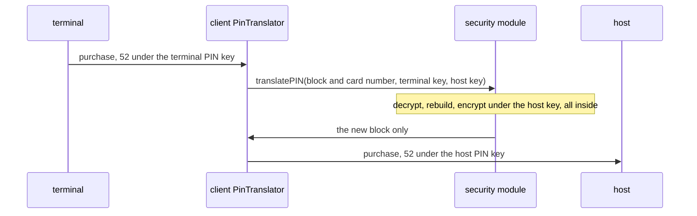

```java
package com.example.jpos.client.security;

import org.jpos.iso.ISOException;
import org.jpos.iso.ISOMsg;
import org.jpos.security.EncryptedPIN;
import org.jpos.security.SMAdapter;
import org.jpos.security.SMException;
import org.jpos.security.SecureDESKey;

/** Re-encrypts field 52 from the terminal's PIN key to the PIN key shared with the host. */
public class PinTranslator {
    private final SMAdapter<SecureDESKey> hsm;
    private final SecureDESKey hostPinKey;

    public PinTranslator(SMAdapter<SecureDESKey> hsm, SecureDESKey hostPinKey) {
        this.hsm = hsm;
        this.hostPinKey = hostPinKey;
    }

    public void translate(ISOMsg msg, SecureDESKey terminalPinKey) throws ISOException, SMException {
        EncryptedPIN fromTerminal =
                new EncryptedPIN(msg.getBytes(52), SMAdapter.FORMAT01, msg.getString(2));
        EncryptedPIN forHost =
                hsm.translatePIN(fromTerminal, terminalPinKey, hostPinKey, SMAdapter.FORMAT01);
        msg.set(52, forHost.getPINBlock());             // 8 bytes, not 16 hex digits
    }
}
```

`EncryptedPIN` carries the block together with its format and the card number, from which it keeps
the 12 digits format 0 uses. `translatePIN` takes the source key, the destination key and the
destination format, which here stays format 0 (`FORMAT01` in jPOS: the numbers in the constant
names are not ISO's format numbers). The opening's two PIN purchases, on `4111111111111111` and
`5555555555554444`, translated:

```text
52 from terminal 2A3D408A1977DDE9  52 to host 58B583E21EEB26B5  -> 39=00
52 from terminal 99C263AF3E246AA9  52 to host 2C79CDC9CD7CFBDF  -> 39=00
```

The client's `SecureDESKey` objects are keys encrypted under the module's LMK: the client can store
them and pass them around, but only the module can use them. With a hardware module, the clear PIN
and the clear keys never exist in your process. The software module does the same work inside your
JVM, which is why it is for development only.

- **Don't decrypt the PIN in the application** and encrypt it again "because it is simpler". That
  puts clear PINs in your heap, your exception messages and your heap dumps. The card schemes' PIN
  security requirements allow a clear PIN only inside a secure device, so this fails a PIN audit.
- **Don't send the purchase without field 52 when translation fails.** A block the module can't
  translate means the terminal and the client disagree about the key, or the block is damaged.
  Remove field 52 and the request becomes a purchase without a PIN, which the host may approve on
  a stolen card. Refuse the purchase locally instead and tell the terminal it failed.

> **Many terminals use DUKPT.** Instead of one fixed PIN key per terminal, each PIN is encrypted
> under a key derived from a base key and a serial number the terminal sends along. `SMAdapter`
> has a `translatePIN` that takes the `KeySerialNumber` and the base derivation key; the rest of
> this section stays the same.

<!-- practice 1 -->

## 7.4 Keys Live Under the Module's Master Key and Are Known by Their Check Value

In a Q2 deployment, the security module is a QBean. `org.jpos.q2.security.SMAdaptor` creates the
implementation named in `impl`, passes it the properties, and registers it under its name. Save
this as `deploy/05_hsm.xml`, so it is deployed before the channels:

```xml
<s-m-adaptor name="hsm" class="org.jpos.q2.security.SMAdaptor">
  <attr name="impl">org.jpos.security.jceadapter.JCESecurityModule</attr>
  <property name="provider" value="org.bouncycastle.jce.provider.BouncyCastleProvider"/>
  <property name="lmk" value="cfg/dev.lmk"/>
</s-m-adaptor>
```

It names no `logger`: the module would log every call with its PIN blocks, keys and card numbers
in hex, which `ProtectedLogListener` does not mask (unit s7). Code finds it with
`NameRegistrar.get("hsm")`. With a hardware module, `impl` names the vendor's
adapter class and nothing else in your code changes, because your code only sees `SMAdapter`.

On Java 17 the `provider` line is required. Without it, `JCESecurityModule` loads
`com.sun.crypto.provider.SunJCE` by class name, which the JDK no longer lets outside code do. We
deployed the descriptor twice in one Q2, once without the line:

```text
hsm: registered, ZPK check value EB7A8D
hsm-no-provider: not registered (hsm-no-provider)
```

The second one logs `Unable to load jce provider whose class name is:
com.sun.crypto.provider.SunJCE` once, as a warning while Q2 starts. Q2 carries on deploying
everything else, so the client connects and looks healthy. The first lookup of the module, typically
in the first PIN purchase, throws `NameRegistrar.NotFoundException`. Opening the package with
`--add-exports java.base/com.sun.crypto.provider=ALL-UNNAMED` gets the module started, but SunJCE
doesn't have the module's default MAC algorithm, so every MAC fails instead:

```text
generateCBC_MAC: Unable to load MAC algorithm whose name is: ISO9797ALG3MACWITHISO7816-4PADDING. Check that is used correct JCE provider and/or it is proper configured for this module.
```

Bouncy Castle comes with jPOS 2.1.7, so name it.

**`lmk`** is the file holding the software module's master keys, the LMK (local master keys). You
create it once per development environment by starting a `JCESecurityModule` with `rebuildlmk` set
to `true`, which overwrites any file already there. Keep it out of the repository, and never let a
software LMK near real cards.

### 7.4.1 Two Modules, One Key, Different Bytes

A working key such as the PIN key you share with the host exists in two modules, yours and the
host's, each under its own LMK. The same clear key loaded into two modules:

```text
our module:   D554E2EA5787649BECC7EEBB8C39E865  check value EB7A8D
their module: 7ED195D86AD857FA10CF092945E90B97  check value EB7A8D
```

The bytes differ because they are encrypted under different master keys. What matches is the **check
value** (KCV): the first three bytes of a block of zeros encrypted under the clear key. It
identifies a key without revealing it. When the host's operations team reads you a key's check
value, compare that, never the bytes.

### 7.4.2 A Key Exchange Is Checked Before It Is Used

The PIN key shared with the host is not typed in. The host generates it and sends it encrypted
under a **zone master key** (ZMK), which both sides loaded once in a key ceremony: two or three
people each enter one clear component, and the module XORs them together. Each new key arrives with
its check value, and you import it under your copy of the ZMK:

```text
ZMK check value: theirs 4BE3CA, ours 4BE3CA
new ZPK under ZMK 0D0D6EE9404299F60800149A1566F3AA, host says check value 6D0613
imported: check value 6D0613
```

Suppose one person at our ceremony typed one hex digit wrong, `1F3E…` instead of `1F2E…`:

```text
ZMK with a typo: check value F271B6
import under it: SMException: Parity not adjusted
import without the parity check: check value 8D6B46
```

The ceremony's own check value, `F271B6` instead of `4BE3CA`, already gives the typo away if anyone
compares it. The import fails the DES parity check, which the last argument of `importKey` asks for.
With that check off, the module imports a key that is not the host's, and its check value catches
the typo whatever the parity says. If nobody compares it, every PIN block you send is encrypted
under the wrong key, every PIN purchase is declined `55`, and for days it looks like a wave of
forgetful cardholders.

Matching ZMK check values only say the ceremony went right. They say nothing about the key that
arrives next, which may be damaged, stale or not the one announced, so compare each new key's own
check value too.

## 7.5 A MAC Covers the Bytes as Sent, So It Is the Last Thing You Add

Many hosts require a **MAC** (message authentication code) on every message. It is a short
cryptographic checksum computed with a key both sides share, the ZAK. The receiver recomputes it;
if it matches, the message wasn't changed on the way and came from someone who holds the key.

The host's specification sets what is MACed. A common rule, and the one this unit's host uses: the
packed message up to, and not including, the MAC field, with the MAC's bit already set in the
bitmap.

```java
package com.example.jpos.client.security;

import java.security.MessageDigest;
import java.util.Arrays;

import org.jpos.iso.ISOBasePackager;
import org.jpos.iso.ISOException;
import org.jpos.iso.ISOMsg;
import org.jpos.security.SMAdapter;
import org.jpos.security.SMException;
import org.jpos.security.SecureDESKey;

/** MACs a message the way this unit's host specifies: the packed message up to field 64. */
public class MacService {
    private final SMAdapter<SecureDESKey> hsm;
    private final SecureDESKey macKey;

    public MacService(SMAdapter<SecureDESKey> hsm, SecureDESKey macKey) {
        this.hsm = hsm;
        this.macKey = macKey;
    }

    static byte[] macInput(ISOMsg msg) throws ISOException {
        ISOMsg copy = (ISOMsg) msg.clone();             // (1) never touch the caller's message
        copy.set(64, new byte[8]);                      // (2) bit 64 is on in the bitmap
        byte[] packed = copy.pack();
        int macLength = ((ISOBasePackager) copy.getPackager())
                .getFieldPackager(64).getMaxPackedLength();
        return Arrays.copyOf(packed, packed.length - macLength);   // (3) without the MAC itself
    }

    public void sign(ISOMsg msg) throws ISOException, SMException {
        msg.set(64, hsm.generateCBC_MAC(macInput(msg), macKey));
    }

    public boolean verify(ISOMsg msg) throws ISOException, SMException {
        byte[] received = msg.getBytes(64);
        if (received == null)
            return false;                               // (4) no MAC is not a good MAC
        byte[] expected = hsm.generateCBC_MAC(macInput(msg), macKey);
        return MessageDigest.isEqual(expected, received);
    }
}
```

The client translates the PIN and signs the message. Does the order matter? A PIN purchase both
ways, and one more whose MAC was computed over the message packed before field 64 existed:

```text
sign, then translate:  39=63
translate, then sign:  39=00
MAC over the message packed without bit 64:  39=63
```

Signing before translating covers a field 52 that the host never receives. Packing without field 64
covers a bitmap that ends in `…1000`, while the host's copy ends in `…1001`:

```text
packed 102 bytes, bitmap 7020000000801001, last 16 = field 64: D273A3A239C6ECC7
without 64: bitmap 7020000000801000
```

So `macInput` sets a placeholder in field 64 before packing (2), and cuts off exactly the
MAC field's packed length (3): with `iso87ascii.xml` the 8 MAC bytes travel as 16 hex characters.
It works on a clone (1) because the same method verifies responses, whose field 64 must stay as it
arrived. Sign **last**, after the PIN is translated, the STAN is set and every other field is in
place: any change after signing, however harmless it looks, makes the host reject the message.

`SMAdapter` in 2.1.7 has no MAC verify method, so you compute and compare. `MessageDigest.isEqual`
compares in constant time, so it doesn't leak how many bytes matched.

> **Networks differ.** Some MAC a list of fields rather than the packed message, and some use field
> 128 when a message has a secondary bitmap (fields above 64). `macInput` is the one method to
> change; the rule "sign last, over what is sent" stays.

## 7.6 A Response That Fails Its MAC Is an Unknown Outcome, Not a Decline

The host signs its responses too, and the client verifies every one.

```java
package com.example.jpos.client.security;

import org.jpos.iso.ISOException;
import org.jpos.iso.ISOMsg;
import org.jpos.iso.MUX;
import org.jpos.security.SMException;
import org.jpos.security.SecureDESKey;

/** The client's send path: translate the PIN, sign last, and believe only a response that verifies. */
public class SecureClient {
    public enum Outcome { APPROVED, DECLINED, UNKNOWN }

    private final MUX mux;
    private final PinTranslator pins;
    private final MacService macs;

    public SecureClient(MUX mux, PinTranslator pins, MacService macs) {
        this.mux = mux;
        this.pins = pins;
        this.macs = macs;
    }

    public Outcome send(ISOMsg request, SecureDESKey terminalPinKey, long timeout)
            throws ISOException, SMException {
        ISOMsg out = (ISOMsg) request.clone();
        if (out.hasField(52))
            pins.translate(out, terminalPinKey);
        macs.sign(out);                                 // the last change before it leaves
        ISOMsg response = mux.request(out, timeout);
        if (response == null || !macs.verify(response))
            return Outcome.UNKNOWN;                     // reverse (unit c12) and raise an alert
        return "00".equals(response.getString(39)) ? Outcome.APPROVED : Outcome.DECLINED;
    }
}
```

The host approved four purchases. We left one response alone, changed two on the way back and
dropped the fourth:

```text
host approved, response as sent           -> APPROVED
host approved, response 39 changed to 05  -> UNKNOWN
host approved, response field 64 removed  -> UNKNOWN
host approved, response no answer         -> UNKNOWN
```

In all three bad cases the host approved the purchase, and the client can't know it: anyone on the
path could have written the response it holds. That is the situation of a request with no answer,
and unit c12 settles what follows: the purchase is reversed, never resent.

If the client reports a bad MAC as a decline, the second line above becomes a real customer: the
issuer approved and holds the funds, the terminal printed "declined", and the cardholder paid
again with another card. If it reports it as an approval, anyone who can change bytes on the path
can approve purchases. A missing MAC counts as a wrong one: stripping the MAC is the easiest attack
there is.

A run of MAC failures means your key is out of step with the host's, or someone is changing
messages. Either way, alert someone.

<!-- practice 2 -->

## 7.7 Card Data Crosses the Client Intact and Stays Nowhere

A client handles card numbers and track data in every purchase. It is allowed to move them, not to
keep or show them.

A developer who wants the card number out of the logs sometimes masks it in the message itself,
with `ISOUtil.protect`. jPOS packs the result without complaint:

```text
field 2 = 411111______1111
packed: 0200702000000080000016411111______111100000000000000200000032129110001
```

The host receives a card number it can't authorize, and declines. Masking is for what people read:
the log, with `ProtectedLogListener` configured to protect fields 2, 35 and 45 and wipe fields 52
and 55 (unit c8), and anything you print, with `ISOUtil.protect`. The message you send carries the
card number the way it came.

- **Track data, CVV and PIN blocks are never kept** after the purchase is answered: not in a
  database, a queue, a retry file or an exception message. The reversal builder of unit c12 copies
  neither field 35 nor 52 for this reason.
- **A card number you must keep**, to refund later for example, is stored encrypted, with a key from
  a key store or the HSM, and looked up by a keyed hash. Unit s9 shows the server side of this.
- **Keys and passwords never appear in code or configuration**, published test keys like
  `DeskHsm`'s aside. Keys come from the module, under its LMK. Passwords come from the
  environment, as unit c3 showed for the key store.

<!-- practice 3 -->

## 7.8 Summary

- **A PIN block means nothing without its key and its card number.** Format 0 mixes the PIN with
  12 digits of the card number before encrypting it, so a block is readable only with both. A block
  relayed unchanged reaches a host that doesn't hold the key, and every PIN purchase is declined.
- **The client translates the PIN and never sees it.** `translatePIN` re-encrypts the block inside
  the module. When translation fails, the purchase is refused, never sent without field 52.
- **Keys live under the module's master key and are known by their check value.** Deploy the module
  as an `SMAdaptor` with the Bouncy Castle provider. Compare check values whenever a key is loaded
  or exchanged; the encrypted bytes always differ between modules.
- **A MAC covers the bytes as sent.** Sign last, with the MAC's bitmap bit set, over exactly what
  the host's spec names. One change after signing and the host answers `63`.
- **A response that fails its MAC is an unknown outcome.** A wrong or missing MAC is handled like no
  answer: reverse, and alert someone.
- **Card data crosses the client intact and stays nowhere.** Mask in logs and displays, never in the
  message; keep no track data, CVV or PIN blocks.

## 7.9 Reference

**`SMAdapter` methods a client uses (2.1.7, `T` is `SecureDESKey` for `JCESecurityModule`):**

| Method | What it does |
|---|---|
| `translatePIN(EncryptedPIN pin, T kd1, T kd2, byte format)` | re-encrypts a PIN block from `kd1` to `kd2`, in the given destination format |
| `translatePIN(EncryptedPIN pin, KeySerialNumber ksn, T bdk, T kd2, byte format, boolean tdes)` | the same for a DUKPT terminal |
| `generateCBC_MAC(byte[] data, T kd)` | the MAC of `data`; `JCESecurityModule` uses the ISO 9797-1 algorithm 3 "retail MAC" by default |
| `importKey(short length, String type, byte[] encrypted, T kek, boolean checkParity)` | a key received under a key-encrypting key (a ZMK), returned under the LMK |
| `generateKeyCheckValue(T key)` | the key's check value |
| `formKEYfromClearComponents(short length, String type, String... components)` | XORs one to three clear components into a key under the LMK (key ceremonies, tests) |
| `encryptPIN(String pin, String pan)`, `exportPIN(EncryptedPIN pinUnderLmk, T kd2, byte format)` | a PIN typed into software you control, to the LMK and then out under `kd2` (test harnesses) |

**PIN block formats in jPOS constants:**

| Constant | Format |
|---|---|
| `SMAdapter.FORMAT01` | ISO 9564 format 0 (ANSI X9.8): PIN XOR 12 digits of the card number |
| `SMAdapter.FORMAT05` | ISO 9564 format 1: PIN and random fill, no card number |
| `SMAdapter.FORMAT03` | Diebold |
| `SMAdapter.FORMAT00` | a module's own format for PINs under its LMK; never sent to anyone |

**Key types (`SMAdapter.TYPE_…`) on a client:** `ZMK` zone master key (encrypts keys exchanged with
the host), `ZPK` zone PIN key (PIN blocks to the host), `ZAK` zone authentication key (MACs), `TPK` terminal PIN key,
`TAK` terminal MAC key, `BDK` base derivation key (DUKPT).

**`JCESecurityModule` properties in 2.1.7:** `provider` (JCE provider class; default
`com.sun.crypto.provider.SunJCE`, which Java 17 refuses), `lmk` (LMK file), `rebuildlmk` (`true`
writes new master keys, destroying the old ones), `cbc-mac` (default
`ISO9797ALG3MACWITHISO7816-4PADDING`), `ede-mac` (default `DESEDEMAC`). The Javadoc names the
provider property `jce`, but the 2.1.7 code reads `provider`.

**Response codes used on this page (ISO 8583:1987):** `00` approved, `55` incorrect PIN, `63`
security violation.

## 7.10 Challenges

1. Your host rotates the PIN key every day at 02:00 with an 0800 carrying the new key under the ZMK.
   Purchases are in flight at that moment, some with blocks translated under the old key. What do
   you keep, for how long, and what does the host need to do for this to work?
2. A MAC failure on a response triggers a reversal. The reversal is MACed with the same key. If the
   key is out of step with the host's, what happens to that reversal, and to the next hundred
   purchases? Design the alert and what it should stop.
3. Your test suite uses `JCESecurityModule`, and production uses a hardware HSM through its vendor's
   adapter. List the behaviours your tests can't see, such as error codes, timeouts, and a busy
   HSM, and say how you would find out about each one before go-live.
4. A colleague proposes dropping the MAC because the link already runs TLS with `serverauth=true`.
   What does each one protect against that the other doesn't, on this client's link?

## 7.11 Design Note: Why the PIN Is Re-encrypted at Every Hop

A PIN travels from the PIN pad to the issuer through the terminal, the acquirer's client, the
acquirer's host and one or more networks. It is not encrypted once for the issuer: each pair of
neighbours shares a PIN key, and every hop translates the block from the key it came in under to
the key it goes out under.

The alternative, one key from terminal to issuer, would need every terminal to hold a key for every
issuer, or one key shared by everybody. Neither survives a single compromised terminal. With keys
per hop ("zones"), each party manages only its neighbours' keys, a leaked key exposes one link, and
a key can be replaced between two parties without telling anyone else.

The cost is that every hop needs a security module, a key ceremony with each neighbour, key
exchange, check values, and staff who know how to run them. The opening's client skipped that cost
by copying field 52. MACs follow the same pattern: a MAC
key per link, so a message is re-signed by each party that forwards it.


# 8. Logging and Debugging in jPOS Client

The acquirer's support desk calls about a purchase from 10:15 that their host declined with
response code 30, format error. They want what you sent and what came back. You open the log.
Either the exchange isn't there, or it is there with the card number in clear, and you can't send
it to anyone.

Unit c1 put `ProtectedLogListener` at the front of the `Q2` logger. What that filter can and cannot
see, how an event reaches a logger at all, and where to look when the log is silent come down to
seven rules, one per section heading.

## 8.1 A Log Event Holds One Piece of Work and Is Written When the Work Ends

Two purchases are in flight on one link, and the client logs one line per step, as most Java code
does:

```text
11:52:39.318 INFO [client] sending purchase
11:52:39.366 INFO [client] sending purchase
11:52:39.668 INFO [client] response 00
11:52:40.351 WARNING [client] no response
```

Which purchase got no answer? That is the one you must reverse (unit c9), and the log can't tell
you. A STAN on every line helps until twenty exchanges are in flight and the support desk has to
stitch each one together from scattered lines.

In jPOS, a `LogEvent` collects everything about one piece of work, and the logger writes it as one
block when the work is over. This sender creates the event before the request and writes it in
`finally`:

```java
package com.example.jpos.client.logging;

import org.jpos.iso.ISOException;
import org.jpos.iso.ISOMsg;
import org.jpos.iso.MUX;
import org.jpos.util.Log;
import org.jpos.util.LogEvent;
import org.jpos.util.Logger;

/** Sends through a MUX and logs each exchange as one event. */
public class LoggedSender {
    private final MUX mux;
    private final Log log;

    public LoggedSender(MUX mux, Logger logger) {
        this.mux = mux;
        this.log = new Log(logger, "client.sender");    // (1) the event's source
    }

    public ISOMsg send(ISOMsg request, long timeout) throws ISOException {
        LogEvent ev = log.createInfo();                 // (2) created when the work starts
        ev.addMessage(request);                         // (3) the ISOMsg itself
        try {
            ISOMsg response = mux.request(request, timeout);
            if (response != null) {
                ev.addMessage(response);
            } else {
                ev.setTag("warn");
                ev.addMessage("no response in " + timeout + "ms");
            }
            return response;
        } catch (ISOException e) {
            ev.setTag("error");
            ev.addMessage(e);
            throw e;
        } finally {
            Logger.log(ev);                             // (4) written once, whatever happened
        }
    }
}
```

Two purchases through a real QMUX; the host answered the first after 300 ms and dropped the
second:

```text
<log realm="client.sender" at="2026-11-06T11:52:25.414712840" lifespan="304ms">
  <info>
    <isomsg>
      <field id="0" value="0200"/>
      <field id="2" value="411111______1111"/>
      <field id="4" value="000000005000"/>
      <field id="11" value="000731"/>
      <field id="35" value="411111______1111=____________________"/>
      <field id="41" value="29110001"/>
      <field id="52" value="AA55AA55" type="binary"/>
    </isomsg>
    <isomsg>
      <field id="0" value="0210"/>
      ...
      <field id="39" value="00"/>
      ...
    </isomsg>
  </info>
</log>
<log realm="client.sender" at="2026-11-06T11:52:26.435169306" lifespan="1002ms">
  <warn>
    <isomsg>
      <field id="0" value="0200"/>
      ...
      <field id="11" value="000732"/>
      ...
    </isomsg>
    no response in 1000ms
  </warn>
</log>
```

The second block answers the support desk on its own: purchase 000732, no response, after 1002 ms.
`lifespan` runs from creating the event to writing it, so creating it at (2) makes it the duration
of the exchange. The tag (`info`, `warn`, `error`) says how the work ended, and `realm` says which
component did it. Writing at (4), in `finally`, keeps the failures: an event written only on the
success path is missing for every exchange that went wrong.

## 8.2 An Event Goes to Its Source's Logger, and a Channel Without One Writes Nothing

`Logger.log(ev)` is static, so which logger receives the event? We gave our own logger (`mine`)
and the `Q2` logger each a listener that counts events, and logged "hello" four ways:

```text
new LogEvent("info"):          mine=0 Q2=1
new Log(mine, realm).info:     mine=1 Q2=0
new Log().info:                mine=0 Q2=0
log.createInfo() + Logger.log: mine=1 Q2=0  mine got info realm='client.sender'
```

The event's **source** decides: `Logger.log` asks the source for its logger. An event built with
`new LogEvent(tag)` has no source, so it falls back to `Q2`. In a test with a fresh logger that is
nowhere you look, and the test reports that nothing was logged. An event created by a `Log`
(line (1) above) reaches the logger the `Log` was given. Such an event is also marked to honour its
source's logger, so when the `Log` has none (the third line) it does not fall back to `Q2`. It goes
nowhere, and nothing tells you.

QBeans such as the ChannelAdaptor and QMUX start out with the `Q2` logger, attribute or not. The
objects a QBean builds from its child elements are different: the channel inside an adaptor, a
packager, a request listener that implements `LogSource`. Q2 calls their `setLogger(logger, realm)`
only when their own element has a `logger` attribute. Without it they drop every event the way
`new Log()` does, so the channel needs its own attribute:

```xml
<channel-adaptor name="host-channel" class="org.jpos.q2.iso.ChannelAdaptor" logger="Q2">
  <channel class="org.jpos.iso.channel.ASCIIChannel"
           packager="org.jpos.iso.packager.GenericPackager" logger="Q2" realm="host-channel">
    <property name="host" value="127.0.0.1"/>
    <property name="port" value="8000"/>
    <property name="packager-config" value="jar:packager/iso87ascii.xml"/>
  </channel>
  <in>host-send</in>
  <out>host-receive</out>
  <reconnect-delay>10000</reconnect-delay>
</channel-adaptor>
```

We sent one purchase through this client in Q2 three times: as shown (`full`), without
`logger="Q2" realm="host-channel"` on `<channel>` (`nochannel`), and with the attribute back but no
`00_logger.xml` (`nologger`), and counted the events other than Q2's own. The second `receive` is
the channel noticing the socket close at shutdown:

```text
full: host-channel/127.0.0.1:<port> connect x1, host-channel/127.0.0.1:<port> send x1, host-channel/127.0.0.1:<port> receive x2; clear PAN in output: False
nochannel: no event from the channel or the packager; clear PAN in output: False
nologger: host-channel/127.0.0.1:<port> connect x1, host-channel/127.0.0.1:<port> send x1, host-channel/127.0.0.1:<port> receive x2; clear PAN in output: True
```

Without the channel's attribute, the purchase went out and its answer came back, and the log has no
connect, send or receive. The adaptor's own `logger` covers only the adaptor. The support desk asks
for the 10:15 exchange, and it was never written.

Without `00_logger.xml`, Q2 finds no listeners on the `Q2` logger and attaches a console writer
with no filter. Nothing fails, and the console, with whatever collects it from the container,
carries the card number and track 2 in clear.

> **The jar's own template.** jPOS 2.1.7 carries a sample `00_logger.xml` under
> `META-INF/q2/installs/deploy/`. It has a console writer, a buffer and a `DailyLogListener`, and no
> `ProtectedLogListener`. Add the filter before you use it. One of its comments says compression
> defaults to gzip; in 2.1.7 it defaults to none.

<!-- practice 1 -->

## 8.3 The Filter Masks Messages, Never Text

With the filter first in the chain, is everything after it safe? We logged the same purchase six
ways through `ProtectedLogListener` (`protect` `2 35 45`, `wipe` `52 55`) and a writer into a
buffer, and searched the output for the card number. The `Exchange` row is 8.3.1's subject; the
last line checks the message we hold afterwards:

```text
the ISOMsg itself          clear PAN in log: false
"card " + field 2          clear PAN in log: true
req.toString()             clear PAN in log: false
an Exchange(req, resp)     clear PAN in log: true
List.of(req, resp)         clear PAN in log: false
ISOUtil.protect(field 2)   clear PAN in log: false
field 2 of the message we send: 4111111111111111
```

The logger, as a test builds it:

```java
package com.example.jpos.client.logging;

import java.io.OutputStream;
import java.io.PrintStream;
import java.nio.charset.StandardCharsets;

import org.jpos.core.ConfigurationException;
import org.jpos.core.SimpleConfiguration;
import org.jpos.util.Logger;
import org.jpos.util.ProtectedLogListener;
import org.jpos.util.SimpleLogListener;

/** The chain of 00_logger.xml, built in code: the filter, then a writer into a buffer. */
public final class TestLoggers {
    private TestLoggers() {}

    public static Logger protectedLogger(OutputStream out) throws ConfigurationException {
        ProtectedLogListener protect = new ProtectedLogListener();
        SimpleConfiguration cfg = new SimpleConfiguration();
        cfg.put("protect", "2 35 45");
        cfg.put("wipe", "52 55");
        protect.setConfiguration(cfg);

        Logger logger = new Logger();                   // a fresh logger, not Q2's
        logger.addListener(protect);
        logger.addListener(new SimpleLogListener(new PrintStream(out, true, StandardCharsets.UTF_8)));
        return logger;
    }
}
```

`ProtectedLogListener` never reads the text that will be written. It walks the event's list of
messages and replaces each one that **is an `ISOMsg`** with a masked copy (it also looks inside a
jPOS `SimpleMsg`). A string that contains a card number is left alone. `ISOMsg.toString()` and a
list of messages print only `0200 000731 29110001`: safe, and no help to the support desk. Because
the filter masks a copy, the message on the wire keeps its PAN. When a string has to mention a
card, protect it yourself: `ISOUtil.protect("4111111111111111")` gives `411111______1111`.

### 8.3.1 Spot the Problem: The Exchange Record

A developer wants each request and its response grouped in the log, and writes a small `Loggeable`
for it:

```java
package com.example.jpos.client.logging;

import java.io.PrintStream;

import org.jpos.iso.ISOMsg;
import org.jpos.util.Loggeable;

/** A request and its response, dumped together as one block. */
public record Exchange(ISOMsg request, ISOMsg response) implements Loggeable {
    @Override
    public void dump(PrintStream p, String indent) {
        p.println(indent + "<exchange>");
        request.dump(p, indent + "  ");                 // (1)
        if (response != null)
            response.dump(p, indent + "  ");
        p.println(indent + "</exchange>");
    }
}
```

After a decline the sender calls `log.warn(new Exchange(request, response))`. The block looks like
the `<isomsg>` blocks of 8.1, and the filter is first in the chain. What does the log hold? The
card lines of the writer's output:

```text
    <exchange>
        <field id="2" value="4111111111111111"/>
        <field id="35" value="4111111111111111=28121010000000000000"/>
        <field id="52" value="0123456789ABCDEF" type="binary"/>
        <field id="2" value="4111111111111111"/>
        <field id="35" value="4111111111111111=28121010000000000000"/>
        <field id="52" value="0123456789ABCDEF" type="binary"/>
    </exchange>
```

The card number, track 2 and the PIN block, in clear, twice. The event's only message is an
`Exchange`, not an `ISOMsg`, so the filter passes it through, and line (1) dumps the real messages
when the writer asks. A PCI assessor finds card data in a correctly configured log, and every such
event since the change went live has to be purged from every copy that log shipping made.

**An `ISOMsg` is masked only if it is itself a message of the event** (or sits in a `SimpleMsg`).
Add the request and the response to the event directly, as `LoggedSender` does. The same trap
catches any object that holds messages and dumps them itself, such as a TransactionManager's
context (unit s8).

## 8.4 Bytes and Packager Traces Are Text Too

A format error means the host could not parse something you sent, so the support desk asks for the
bytes. `ISOUtil.hexdump` gives the offset, hex and ASCII view of what `pack()` produced:

```text
0000  30 32 30 30 35 30 32 30  30 30 30 30 32 30 38 30  0200502000002080
0010  31 30 30 30 31 36 34 31  31 31 31 31 31 31 31 31  1000164111111111
0020  31 31 31 31 31 31 30 30  30 30 30 30 30 30 35 30  1111110000000050
0030  30 30 30 30 30 37 33 31  33 37 34 31 31 31 31 31  0000073137411111
0040  31 31 31 31 31 31 31 31  31 31 3D 32 38 31 32 31  1111111111=28121
0050  30 31 30 30 30 30 30 30  30 30 30 30 30 30 30 32  0100000000000002
0060  39 31 31 30 30 30 31 30  31 32 33 34 35 36 37 38  9110001012345678
0070  39 41 42 43 44 45 46                              9ABCDEF
```

The PAN starts at 0x16, track 2 at 0x3A, and the PIN block is the last sixteen characters. A dump
is a string, so no filter touches it, and the packager's own trace is text too. With
`packager-logger` set on the channel, `GenericPackager` logs a `<pack>` and an `<unpack>` event for
every message, and with `ProtectedLogListener` first the unpack event still carried:

```text
    <unpack fld="2" packager="org.jpos.iso.IFA_LLNUM">
      <!-- PAN - PRIMARY ACCOUNT NUMBER -->
      <value>4111111111111111</value>
    </unpack>
```

A reply the channel can't unpack is logged as a hex dump too, its card number in clear; unit c17
shows that event and a filter that withholds it. For a message that carried a real card, mask a
copy and dump the copy:

```java
package com.example.jpos.client.debug;

import org.jpos.iso.ISOException;
import org.jpos.iso.ISOMsg;
import org.jpos.iso.ISOPackager;
import org.jpos.iso.ISOUtil;

/** A hex dump of a message that can leave the building: card data masked, layout intact. */
public final class SupportDump {
    private SupportDump() {}

    public static String of(ISOMsg m, ISOPackager packager) throws ISOException {
        ISOMsg copy = (ISOMsg) m.clone();                   // (1) never touch the real message
        for (int f : new int[] { 2, 35, 45 })
            if (copy.hasField(f))
                copy.set(f, ISOUtil.protect(copy.getString(f)));  // (2) same length, digits hidden
        for (int f : new int[] { 52, 55 })
            if (copy.hasField(f))
                copy.set(f, new byte[copy.getBytes(f).length]);   // (3) zeros, same length
        copy.setPackager(packager);
        return ISOUtil.hexdump(copy.pack());
    }
}
```

```text
0000  30 32 30 30 35 30 32 30  30 30 30 30 32 30 38 30  0200502000002080
0010  31 30 30 30 31 36 34 31  31 31 31 31 5F 5F 5F 5F  100016411111____
0020  5F 5F 31 31 31 31 30 30  30 30 30 30 30 30 35 30  __11110000000050
0030  30 30 30 30 30 37 33 31  33 37 34 31 31 31 31 31  0000073137411111
0040  5F 5F 5F 5F 5F 5F 31 31  31 31 3D 5F 5F 5F 5F 5F  ______1111=_____
0050  5F 5F 5F 5F 5F 5F 5F 5F  5F 5F 5F 5F 5F 5F 5F 32  _______________2
0060  39 31 31 30 30 30 31 30  30 30 30 30 30 30 30 30  9110001000000000
0070  30 30 30 30 30 30 30                              0000000
field 2 of the message: 4111111111111111, wire length 119
```

Masking keeps every length, so the bitmap, the length prefixes and each field's position are what
the host received, and a format error is about those. Dropping field 2 instead would show the
analyst a different message from the one their host rejected.

<!-- practice 2 -->

## 8.5 A Realm Filter Narrows the Log and Drops Everything It Doesn't Name

In a busy log you want only the channel and your sender. `RealmLogFilter` keeps the realms listed
in `<enabled>` (or drops those in `<disabled>`). It goes after `ProtectedLogListener` and before
the writers:

```xml
<log-listener class="org.jpos.util.RealmLogFilter">
  <enabled>
    host-channel
    client.sender
  </enabled>
</log-listener>
```

We gave it events from seven realms and one with no source:

```text
host-channel/127.0.0.1:8000    kept
host-channel                   kept
client.sender                  kept
client.sender/retry            kept
client.sender.retry            dropped
host-mux                       dropped
Q2.system                      dropped
(no source)                    dropped
```

The filter cuts the realm at the first `/` and compares the rest exactly, which is why the channel,
whose realm carries the address it is connected to, matches. A dot is not a separator, so
`client.sender.retry` is a different realm. Name sub-components with a slash if one entry should
cover them.

What it drops, it drops for every listener after it, because it returns `null` and the chain stops
(with `dump-interval` set, it now and then passes on a summary of the realms it dropped). Q2 keeps
watching `deploy/` and reports a descriptor that fails to deploy, at start-up or later, under
`Q2.system`. With this filter in place, a typo in `20_host_mux.xml` makes the MUX vanish without a
word in the log, so add `Q2.system` to the list. Q2 redeploys `00_logger.xml` when it changes, so
you can add the filter for an hour and remove it without a restart.

## 8.6 A Late Answer Is Counted, Not Logged, by the MUX

The host's log says it approved purchase 000732, and your `request` returned `null`. Your sender's
`warn` event is all your code wrote. Where did the approval go?

It arrived after the wait was over, found nobody waiting for its key, and went to the MUX's
`<unhandled>` queue (unit c12 follows that path). If the channel has its `logger`, its `<receive>`
event shows the 0210, but nothing ties it to the request. QMUX writes no event for it; it only
counts it. `SystemMonitor`, a QBean you deploy as `99_sysmon.xml`, writes one event every
`sleepTime` milliseconds with the state of the JVM and of every component registered in the node:

```xml
<sysmon logger="Q2">
  <attr name="sleepTime" type="java.lang.Long">3600000</attr>
  <attr name="detailRequired" type="java.lang.Boolean">true</attr>
</sysmon>
```

Our node's host answered 000731 and 000733 at once and 000732 after 1.5 seconds, against a
one-second timeout. The end of the monitor's event:

```text
  host-channel: org.jpos.q2.iso.ChannelAdaptor
    tx=3, rx=3, connects=1, last=1793987637158, idle=141ms
  mux.host-mux: org.jpos.q2.iso.QMUX
    tx=3, rx=2, tx_expired=0, tx_pending=0, rx_expired=1, rx_pending=0, rx_unhandled=1, rx_forwarded=0, connected=true, last=1793987637158, idle=141ms
```

The channel received three messages and the MUX matched two. One request ended with no answer
(`rx_expired=1`), and one answer matched nothing (`rx_unhandled=1`). `tx_expired=0` says the
unanswered request did go out. A `connects` count that keeps rising is a link that keeps dropping,
and `tx` rising with `rx` flat is a host that has gone quiet. `rx_unhandled` counts only when the
MUX has an `<unhandled>` queue. Without one, and without a channel logger, a late answer leaves no
trace at all.

The event's first lines also carry the process's user name, host name and working directory.
Treat it like any other log before you paste it into a ticket.

## 8.7 A Bridge to SLF4J Sits After the Filter and Keeps Each Event Whole

**jPOS into SLF4J.** The operations team wants everything in Logback, and jPOS 2.1.7 ships no
listener for it. Write one that renders each event whole, as one SLF4J message, and put it after
`ProtectedLogListener`:

```java
package com.example.jpos.client.logging;

import java.io.ByteArrayOutputStream;
import java.io.PrintStream;
import java.nio.charset.StandardCharsets;

import org.jpos.util.LogEvent;
import org.jpos.util.LogListener;
import org.slf4j.Logger;
import org.slf4j.LoggerFactory;

/** Writes each jPOS event, whole and already masked, as one SLF4J message. */
public class Slf4jBridgeListener implements LogListener {
    private static final Logger LOG = LoggerFactory.getLogger("jpos");

    @Override
    public LogEvent log(LogEvent ev) {
        ByteArrayOutputStream buf = new ByteArrayOutputStream();
        try (PrintStream p = new PrintStream(buf, true, StandardCharsets.UTF_8)) {
            ev.dump(p, "");
        }
        String text = buf.toString(StandardCharsets.UTF_8);
        String tag = ev.getTag();
        if ("fatal".equals(tag) || "error".equals(tag) || "warn".equals(tag))
            LOG.warn(text);
        else
            LOG.info(text);
        return ev;
    }
}
```

```xml
<log-listener class="com.example.jpos.client.logging.Slf4jBridgeListener"/>
```

With Logback 1.2 on the classpath, a `warn` event like 8.1's dropped purchase, logged through the
filter and the bridge, comes out as one Logback record:

```text
12:10:42.741 [main] WARN jpos - <log realm="client.sender" at="2026-11-06T12:10:42.734435024" lifespan="1ms">
  <warn>
    <isomsg>
      <field id="0" value="0200"/>
      <field id="2" value="411111______1111"/>
      ...
    </isomsg>
    no response in 1000ms
  </warn>
</log>
```

The bridge is a writer, so the filter must come before it; placed first, it ships clear card
numbers to whoever can search the log platform. Split into lines, an event is back to the scattered
lines of 8.1.

**SLF4J into jPOS.** Libraries you use may log through SLF4J. When there is no SLF4J binding on the
classpath, Q2 2.1.7 tries to bind SLF4J to its own `Q2` logger at start-up, so that library messages
appear under realms such as `slf4j::com.example.lib`. On a current JDK that attempt fails quietly.
Our program called the same binder and printed the exception Q2 discards, then SLF4J's warning:

```text
applyMods failed: java.lang.reflect.InaccessibleObjectException: Unable to make protected final java.lang.Class java.lang.ClassLoader.defineClass(java.lang.String,byte[],int,int,java.security.ProtectionDomain) throws java.lang.ClassFormatError accessible: module java.base does not "opens java.lang" to unnamed module @6438a396
SLF4J: Failed to load class "org.slf4j.impl.StaticLoggerBinder".
SLF4J: Defaulting to no-operation (NOP) logger implementation
```

SLF4J falls back to a logger that discards everything, so the library's messages go nowhere.
Start the JVM with `--add-opens java.base/java.lang=ALL-UNNAMED` and the binding works. If the
project already has an SLF4J 1.7 binding (Logback 1.2, as `spring-boot-starter-logging` 2.x
brings), Q2 leaves SLF4J alone and that binding gets the messages. Q2 looks only for the 1.7-style
binder class, so an SLF4J 2 binding doesn't stop it from trying.

> **Which JDKs.** We saw the failure on Java 21 and 26. Java 17 already denies this kind of access
> by default, so expect the same there.

> **In jPOS 3:** logging gains a structured audit log (JSON lines, typed events); see unit s13.

<!-- practice 3 -->

## 8.8 Summary

- **One piece of work is one event**, created when the work starts and written in `finally`. It
  keeps a request with its answer, its duration and how it ended, even when the call throws.
- **An event goes to its source's logger.** An event without a source goes to `Q2`, a channel
  without a `logger` attribute writes nothing, and a node without `00_logger.xml` writes everything
  to the console unmasked.
- **The filter masks `ISOMsg` objects in the event, never text.** Strings, and wrappers that dump
  messages themselves, pass through in clear. Protect strings with `ISOUtil.protect`.
- **Dumps and packager traces are text.** Share a dump of a masked copy, which keeps every length
  and so keeps the bug you are hunting.
- **A realm filter stops the chain** for every realm it doesn't name, `Q2.system` included.
- **The MUX counts a late answer and logs nothing.** `rx_unhandled` and the other QMUX counters in
  `SystemMonitor` tie it to the MUX when the log can't.
- **A bridge to SLF4J is a writer**, so it goes after the filter and keeps events whole. Q2's own
  SLF4J binding needs `--add-opens` on a current JDK.

## 8.9 Reference

**Listeners in jPOS 2.1.7:**

| Listener | Role | Properties |
|---|---|---|
| `org.jpos.util.ProtectedLogListener` | filter: replaces each `ISOMsg` in the event with a masked copy | `protect`: fields shown as first 6 and last 4 digits (a binary value becomes `AA55AA55`); `wipe`: fields replaced by `[WIPED]` (binary: `AA55AA55`). Dotted paths such as `127.2` work |
| `org.jpos.util.RealmLogFilter` | filter: drops events by realm (the part before the first `/`) | `<enabled>` or `<disabled>` elements; `dump-interval` property (ms) to log the dropped realms now and then (that summary event does go on down the chain) |
| `org.jpos.util.SimpleLogListener` | writer: `System.out` | none |
| `org.jpos.util.RotateLogListener` | writer: one file, rotated | `file`, `window` (seconds), `copies`, `maxsize` (bytes), `rotate-on-startup` |
| `org.jpos.util.DailyLogListener` | writer: one file per period, named by date | `prefix`, `suffix` (`.log`), `date-format` (`-yyyy-MM-dd`), `sleeptime` (seconds, default one day; the jar's template says `window`, which this listener ignores), `compression-format` (`none`, `gzip`, `zip`), `maxsize`, `maxage` |

Neither file writer creates its directory (unit c1).

**`LoggerAdaptor`** (`00_logger.xml`): `<property name="redirect" value="stdout, stderr"/>` sends
`System.out` and `System.err` through the logger.

**The event header:** `realm` is the source's realm; `at` is the local time when the event was
written; `lifespan` is the time from creating the event to writing it, left out when it is 0 ms.

**Packager logging** (properties on the `<channel>`): `packager-logger` (a logger name),
`packager-realm`, `packager-log-fieldname` (default `true`). Test cards only.

**`SystemMonitor`** (`99_sysmon.xml`): `sleepTime` (ms, default 3600000), `detailRequired`
(default `false`; `true` adds each registered component's own dump, such as the counters below).

**QMUX counters:** `tx` requests sent, `rx` answers matched, `rx_expired` requests that ended with
no answer, `tx_expired` those of them that never left the queue, `tx_pending` messages still in the
`<out>` queue, waiting for the adaptor to send them, `rx_pending` requests waiting for an answer now,
`rx_unhandled` messages nobody waited for (counted only with an `<unhandled>` queue),
`rx_forwarded` messages offered to the MUX's request listeners.

## 8.10 Challenges

1. Your log platform keeps logs for a year and is searchable by three hundred people. Your network
   wants field 45 (track 1) masked as well, and a field 127.2 that carries the PAN again. Write the
   `protect` and `wipe` lists, and decide how you would prove, every night, that no clear PAN
   reached the log.
2. A `LoggedSender` event is created before `request` and written after it. At 500 exchanges a
   second with a 30-second timeout, how many events can be open at once, and what does that cost in
   memory? When would you write an event early?
3. The support desk wants a hex dump of every message their host rejected with code 30 last month.
   Design how you would capture them, given that the client keeps no raw bytes and must not log card
   data.
4. `RealmLogFilter` compares realms exactly. Design a realm naming scheme for a client with two
   links, a sender per link and a reversal process, so that one `<enabled>` list can show one
   link's whole story.

## 8.11 Design Note: Why Mask in the Logger and Not in the Message?

It is tempting to mask the PAN in the message before you log it. jPOS masks a copy in the logger
instead.

The message has to stay real. The host needs the PAN, and the same object travels from your code
through the MUX to the channel, which logs it on the way out. Masking it in your code would either
break the transaction or force every caller to copy it first. Masking in the logger means one
decision, in one file, applies to every component that logs a message: the channel, the MUX, your
sender, and libraries you didn't write.

The price is that the filter protects only what it recognises, an `ISOMsg`. Every leak in this unit
came from turning a message into something else before the filter saw it.


# 9. Error Handling in jPOS Client

A bakery signs up with a merchant name of 41 characters. Its first purchase goes through your
client, and `request` throws nothing. A moment later a cardholder at another till, whose purchase
the host had approved, is told "outcome unknown". The only trace in the log is a warning:
`error packing field 43`.

The bakery's bug landed on someone else, and none of your error handling saw it. Where each failure
of a jPOS client shows up, and what it tells you, comes down to four rules, one per section heading.

Every output is from jPOS 2.1.7: Q2 in the same JVM with unit c4's ChannelAdaptor and QMUX, and an
`ISOServer` on 127.0.0.1 as the host. The host can answer, decline, drop or hold each request, or
answer with a field 39 we choose. The reconnect delay is 500 ms, so the examples finish quickly.

## 9.1 Your Thread Sees Four Endings, and Each Says What the Host Knows

We sent five purchases. One had neither field 11 nor field 41. One reused the key of a purchase
still waiting. The host declined one, dropped one, and was shut down before the last. The call is
wrapped the way most first versions are:

```java
try {
    if (!mux.isConnected()) ending = "isConnected() false";
    else ending = "returned " + show(mux.request(m, 1000));
} catch (ISOException e) {
    ending = "ISOException: " + e.getMessage();
}
```

In which cases did the host receive the purchase?

```text
no 11, no 41  host received 0   ISOException: Key fields not found - not sending host-send.020
same key      host received 0   ISOException: Duplicate key 'host-send.0200000000029110001000611.req' detected
declined      host received 1   returned 0210 39=05
dropped       host received 1   returned null
link down     host received 0   isConnected() false
```

Each of the four endings says something different about the host:

- **An `ISOException` from `request`** means QMUX refused the message before queueing it. The host
  saw nothing. Fix the message, and if the key was a duplicate, send it again with a new STAN.
- **`isConnected()` false** means nothing was sent either. Tell the caller the host is unavailable.
  (The link can still drop between a `true` and the call; that ends in `null`, as unit c4 showed.)
- **`null`** means the outcome is unknown: the host may have approved the purchase. Unit c12
  reverses it.
- **A response** means the host decided, and field 39 says what, as long as you can read it (9.3).

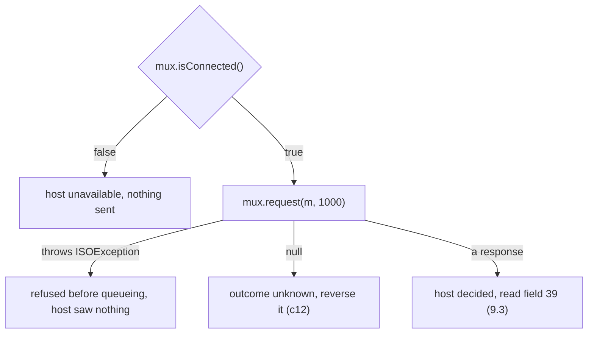

`request` declares only `ISOException`, so a `catch (IOException e)` around it doesn't compile.
The socket is read and written on the adaptor's threads, so a broken connection reaches you as
`isConnected()` false or as `null`. A timeout is `null` too, never a `TimeoutException`.

The trap is reading these four as two, "it threw" and "it didn't". Put an `ISOException` and a
`null` in the same "failed" branch and you either reverse purchases the host never saw, or tell a
cardholder "declined, try again" about a purchase the host approved. Ask of every failure what the
host knows. Only `null`, and an answer you can't read, leave that open.

## 9.2 A Field the Packager Refuses Fails on the Adaptor's Thread, and Takes the Link With It

The bakery's 41 characters go into field 43, which holds 40. Where does packing fail?

QMUX doesn't pack. It puts the `ISOMsg` on the adaptor's queue, and the adaptor's sender thread
packs it when it writes to the socket. We sent three purchases on one link: 000201, whose approval
the host held for a moment, then 000202 with the long field 43, and 100 ms later 000203:

```java
ISOMsg bad = Stack.purchase("29110002", "000202", "000000001000");
bad.set(43, "THE CORNER BAKERY AND COFFEE HOUSE LONDON");   // 41 characters, field 43 holds 40
Future<ISOMsg> refused = pool.submit(() -> mux.request(bad, 5000));
```

```text
isConnected 0.3 s after the bad message: false
host could not answer 000201: unconnected ISOChannel
000201 (sent before): null
000202 (bad):         null
000203 (sent after):  0210 39=00 after 900 ms
host received: 2
```

Nothing threw in the calling thread. The sender thread caught the `ISOException`, logged a warning
in the realm `org.jpos.q2.iso.ChannelAdaptor` with the text `error packing field 43`, closed the
connection and slept for a second before taking the next message. The 2.1.7 source does this for
any `ISOException` during a send, except a veto from a channel filter.

- **000201 had nothing wrong with it.** The host approved it and tried to answer on a connection
  that no longer existed. Its caller got `null`, its cardholder hears "outcome unknown", and a
  reversal goes out for a purchase that was fine.
- **000202 never left the JVM.** Its caller still waited the full five seconds and got `null`, the
  same answer as a lost approval. A client that follows the rules reverses a purchase the host
  never saw.
- **000203** went out on the new connection, about a second late.

The warning names a field number but no STAN or terminal, so with twenty purchases in flight the
log can't tell which one was bad.

With the adaptor's `<ignore-iso-exceptions>yes</ignore-iso-exceptions>`, the same run keeps the
link:

```text
isConnected 0.3 s after the bad message: true
000201 (sent before): 0210 39=00
000202 (bad):         null
000203 (sent after):  0210 39=00 after 900 ms
```

The bad purchase still waits five seconds for a `null` that means
"unknown" when the truth is "never sent", and the one-second pause after the error still delays the
next message. The switch also covers the receiving side, where an answer that can't be unpacked
drops the link too by default.

The fix is to pack a copy with the channel's packager, in the caller's thread, before you queue.
The failure is then an `ISOException` before sending.

```java
package com.example.jpos.client.errors;

import org.jpos.iso.ISOException;
import org.jpos.iso.ISOMsg;
import org.jpos.iso.ISOPackager;

/** Packs a copy with the link's packager, so a bad field fails here and not on the link. */
public final class Preflight {
    private final ISOPackager packager;

    public Preflight(ISOPackager packager) {
        this.packager = packager;               // the same packager the channel uses
    }

    public void check(ISOMsg m) throws ISOException {
        ISOMsg copy = (ISOMsg) m.clone();
        copy.setPackager(packager);
        copy.pack();                            // throws "error packing field NN"
    }
}
```

Purchases 000201 and 000202 again, with `preflight.check(m)` before each `request`:

```text
000202 (bad):  refused after 0 ms: error packing field 43
isConnected: true
000201 (good): 0210 39=00
host received: 1
```

The bad purchase is refused at once, in the thread that knows its STAN and terminal, with nothing
to reverse, and the link stays up. The price is packing every message twice, small next to a
network round trip. The check uses the packager alone: if the channel has outgoing filters that
change fields, or picks a packager per message, check against what it really sends.

A packager checks lengths, not meaning. With `iso87ascii.xml`, a 41-character field 43 or a
20-digit PAN fails, but an amount written as `50.00` packs and reaches the host as `000000050.00`.
Checking what is in a field stays the job of the code that builds the request (unit c2).

<!-- practice 1 -->

## 9.3 Field 39 Says Who Acts Next

A response means the host decided, and field 39 says what. Most first versions read it like this:

```java
String naive = "00".equals(r.getString(39)) ? "APPROVED" : "DECLINED";
```

The host answered seven purchases, each with a different field 39 (the last two with none at all
and with a code that isn't on the network's list). We read each answer with the line above and
with a policy built from the network's code list. Which answers moved the cardholder's money, and
after which should the cardholder try again in a minute?

```text
39    "00" or declined    policy
00    APPROVED            APPROVED
08    DECLINED            APPROVED
51    DECLINED            DECLINED
91    DECLINED            TRY_LATER
30    DECLINED            FIX_REQUEST
none  DECLINED            REVERSE
N7    DECLINED            REVERSE
```

The naive line reads two rows of seven correctly.

- **08 is an approval** ("honour with identification" in ISO 8583:1987). Read as a decline, the
  till says the purchase failed while the money has moved. Because a decline needs no reversal,
  nothing ever gives it back.
- **91 says the issuer or the switch is unavailable.** Reported as a decline, it sends away a
  cardholder whose card is fine and who would have succeeded in a minute. Trying again means a new
  transaction with a new STAN, not the same message again.
- **30 is a format error**: your request is wrong. After a release that breaks one field, every
  purchase comes back 30. Read as declines, cardholders blame their cards, and no alert reaches the
  developers who could fix it.
- **No field 39, or a code you don't know**, says nothing about the money. Treat it as no answer,
  and reverse. Sending the same purchase again would charge twice if the first was approved.

A reversal costs one message and undoes the worst case; the design note weighs it.

The code list belongs to the network, so keep it as data and keep the decisions in code:

```java
package com.example.jpos.client.errors;

import org.jpos.iso.ISOMsg;

import java.util.Map;

/** What field 39 asks of us. The codes come from the network's specification. */
public final class AnswerPolicy {
    public enum Next { APPROVED, DECLINED, TRY_LATER, FIX_REQUEST, REVERSE }

    private final Map<String, Next> codes;

    public AnswerPolicy(Map<String, Next> codes) {
        this.codes = Map.copyOf(codes);
    }

    public Next of(ISOMsg response) {
        String rc = response.getString(39);
        if (rc == null)
            return Next.REVERSE;                      // an answer that decides nothing
        return codes.getOrDefault(rc, Next.REVERSE);  // a code we can't place: the same
    }
}
```

Each value of `Next` says who acts: the cardholder goes home with the goods, tries another card or
tries again later; a developer fixes the request; or the reversal process takes over. The run above
used the list in the Reference.

> **Networks differ.** Each network publishes its own field 39 values, and its own rules for which
> are approvals and which may be retried, and how soon. Build the map from your network's
> specification; the codes in this unit are the common ISO 8583:1987 ones.

<!-- practice 2 -->

## 9.4 An Exception in a jPOS Callback Drops the Link and Reaches No Caller

Unit c4's asynchronous `request` calls your listener with the answer on the adaptor's receiver
thread (an expiry arrives on a QMUX timer thread instead). Suppose the listener writes the answer to
the database and the write fails, while purchase 000301 waits for its own answer:

```java
mux.request(purchase, 5000, (response, handBack) -> {
    System.out.println("listener for 000302 got " + response.getString(11) + " 39=" + response.getString(39) + ", and throws");
    throw new IllegalStateException("payments table is locked");     // say, a failed database write
}, null);
```

What happens to 000301?

```text
listener for 000302 got 000302 39=00, and throws
isConnected: false
000301 (blocking): null
host received: 2
```

The link dropped, and 000301's approval, which the host sent right behind 000302's, was lost with it.

The receiver puts each incoming message on the QMUX's in queue, and the Space calls QMUX on that
same thread to match it. QMUX calls your listener from there, and nothing on the way catches a
runtime exception. It ends in the receiver's own
`catch (Exception e)`, which logs a warning in the `ChannelAdaptor` realm and reconnects. Every
answer still in the socket is lost, and each of those purchases returns `null` and is reversed.

QMUX's `<request-listener>`s are called the same way, for every message no request is waiting for.
Ours takes the first six digits of field 2 of everything it sees. An 0800 echo, STAN 000402, gave
up after 300 ms while purchase 000401 waited. Then the host answered both, the late 0810 first, and
an 0810 has no field 2:

```text
000402: null
request listener got 0810 000402
isConnected: false
000401: null
```

No caller hears of the exception: the thread that called `request` gets `null` like any lost
answer, and the listener's caller is jPOS. A Spring `@ControllerAdvice` sees only exceptions thrown
by a controller method on the HTTP request's thread, so it misses this one too. The decision about
the purchase (reverse, repeat, report) belongs in the code that called the MUX, made from the ending
it got, before anything returns to the HTTP layer.

So a callback that jPOS calls catches its own failures and hands them to whoever is waiting:

```java
package com.example.jpos.client.errors;

import org.jpos.iso.ISOException;
import org.jpos.iso.ISOMsg;
import org.jpos.iso.MUX;

import java.util.concurrent.CompletableFuture;
import java.util.function.Consumer;

/** Sends asynchronously and records each answer; a failure is the caller's, never the link's. */
public class RecordingSender {
    private final MUX mux;
    private final long timeout;
    private final Consumer<ISOMsg> recorder;           // e.g. a write to the payments table

    public RecordingSender(MUX mux, long timeout, Consumer<ISOMsg> recorder) {
        this.mux = mux;
        this.timeout = timeout;
        this.recorder = recorder;
    }

    public CompletableFuture<ISOMsg> send(ISOMsg request) throws ISOException {
        CompletableFuture<ISOMsg> result = new CompletableFuture<>();
        mux.request(request, timeout, (response, handBack) -> {
            try {                                       // the receiver thread (a timer thread on expiry)
                if (response != null)
                    recorder.accept(response);
                result.complete(response);
            } catch (RuntimeException e) {
                result.completeExceptionally(e);        // the caller learns of it; the link doesn't
            }
        }, null);
        return result;
    }
}
```

The same failing write, through `RecordingSender`:

```text
isConnected: true
000301 (blocking): 0210 39=00
000302 (async):    java.lang.IllegalStateException: payments table is locked
```

The caller of 000302 knows the host approved and the record wasn't written, and can retry the
write or reverse. A request listener follows the same rule, with one more option: return `false`
from `process` for anything it can't handle, and the message goes on to the next listener or to
`<unhandled>`.

Unit c4 has the other half of this rule: a callback that blocks holds up every answer on the link.
Keep callbacks short, and never let them throw.

<!-- practice 3 -->

<!-- practice 4 -->

## 9.5 Summary

- **Your thread sees four endings.** An `ISOException` and `isConnected()` false mean the host saw
  nothing. A response you can read means it decided, and `null` means nobody knows. `null` needs a
  reversal, and no catch block ever sees it.
- **A field the packager refuses fails on the adaptor's sender thread.** By default the link drops,
  innocent purchases in flight come back `null`, and the bad one waits out its timeout. Pack a copy
  in the caller's thread first and it becomes a plain refusal.
- **Field 39 says who acts next.** Read it from the network's list: approvals other than 00, "try
  later" as a new transaction, format errors as a developer's problem. An answer with no code or an
  unknown one is treated like no answer, and reversed.
- **An exception in a listener drops the link.** A response listener given an answer, and every
  request listener, runs on the receiver thread. Its exception ends in the adaptor's reconnect,
  never with a caller. Catch inside the callback and hand the failure to whoever waits.

## 9.6 Reference

**Where each failure of a 2.1.7 client surfaces:**

| What fails | Where it surfaces | Did the host see it? | What to do |
|---|---|---|---|
| no key field, or a key already waiting | `ISOException` from `request`, in your thread | no | fix the message; a new STAN for a duplicate |
| link down before the call | `isConnected()` false | no | report the host unavailable |
| no answer, a lost answer, a link that dropped | `null` after the timeout | unknown | reverse (unit c12) |
| a field the packager refuses | warning `error packing field NN` on the sender; link dropped; `null` | no | pack a copy first |
| an answer that can't be unpacked | warning on the receiver; link dropped; `null` | yes | reverse |
| an exception in a response or request listener | warning on the receiver; link dropped | depends | catch inside the callback |
| an answer | the response; field 39 | yes, and it decided | by the code's category |

**ChannelAdaptor settings involved:**

| Element | Default | Effect |
|---|---|---|
| `<ignore-iso-exceptions>` | `no` | with `yes`, an `ISOException` while packing or unpacking is logged and the link stays up |
| `<reconnect-delay>` | 10000 ms | wait before reconnecting after the link drops |

After an error (other than a filter's veto), the sender or receiver thread also sleeps for one
second before it carries on.

**Common ISO 8583:1987 response codes** (your network's list is the one that counts):

| Code | Meaning | `Next` in this unit |
|---|---|---|
| `00` | approved | `APPROVED` |
| `08` | honour with identification | `APPROVED` |
| `05` | do not honour | `DECLINED` |
| `51` | insufficient funds | `DECLINED` |
| `54` | expired card | `DECLINED` |
| `55` | incorrect PIN | `DECLINED` |
| `91` | issuer or switch inoperative | `TRY_LATER` |
| `96` | system malfunction | `TRY_LATER` |
| `12` | invalid transaction | `FIX_REQUEST` |
| `13` | invalid amount | `FIX_REQUEST` |
| `30` | format error | `FIX_REQUEST` |
| none, or not on the list | | `REVERSE` |

## 9.7 Challenges

1. A network wants `ignore-iso-exceptions` off, because it treats an unreadable answer as a broken
   session. You want it on, because of the bakery. Which failures does each setting turn into a
   dropped link, and which into a silent timeout? Could you have both behaviours with one link?
2. Your packager accepts `50.00` as an amount. List the fields of your purchase where a value of the
   right length can still be wrong, and decide for each whether the request builder, the preflight
   or the host should catch it.
3. After a release, one purchase in ten comes back 30. How would you notice within a minute, and
   what would you stop doing until it is fixed?
4. A response listener writes to a database that sometimes takes three seconds and sometimes
   throws. Design the hand-off so that neither the delay nor the failure reaches the link, and say
   what the caller learns in each case.

## 9.8 Design Note: Why Reverse an Answer You Can't Read?

An answer with no field 39, or with a code nobody on your team recognises, is still an answer, and
it is tempting to call it a decline: the host did reply, and a decline sounds cautious at the till.

It is cautious only for the merchant. A decline needs nothing more from you, so if the unreadable
answer was an approval, the cardholder has paid for goods they didn't get, and nothing in your
system will notice. A reversal costs one more message: if the host had declined, it finds nothing
to undo, and if it had approved, the money comes back. When you don't know which mistake you are
making, choose the one whose cost you can see and bound.

The same reasoning sorts every ending in this unit. A refusal before sending and a link that was
down leave nothing to undo. A decision you can read is followed. A `null`, an answer lost to a
dropped link and a code you can't place are outcomes you don't know, and get the one answer that is
safe when you don't know. The price is reversals for some purchases that were declined anyway, and
a reversal process that must be reliable (unit c12).


# 10. Testing in jPOS Client Implementation

The client's test suite is green, run every night against the acquirer's certification host. Then
the host stays silent for a minute in production, and `request` returns a `null` that no test has
produced. A certification host won't decline, answer late or stay silent on demand, so a test has to
play the host itself. Where to put that stand-in, and what each kind catches, comes down to five
rules, one per section heading. Every output is from jPOS 2.1.7, in one JVM.

## 10.1 A Test Plays the Host Through the `MUX` Interface

Unit c4's client, unchanged:

```java
package com.example.jpos.client.send;

import org.jpos.iso.ISOException;
import org.jpos.iso.ISOMsg;
import org.jpos.iso.MUX;

public class AuthorizationClient {
    public enum Outcome { APPROVED, DECLINED, NO_ANSWER, HOST_UNAVAILABLE }

    private final MUX mux;
    private final long timeout;

    public AuthorizationClient(MUX mux, long timeout) {
        this.mux = mux;
        this.timeout = timeout;
    }

    public Outcome authorize(ISOMsg request) throws ISOException {
        if (!mux.isConnected())
            return Outcome.HOST_UNAVAILABLE;           // nothing left our side
        ISOMsg response = mux.request(request, timeout);
        if (response == null)
            return Outcome.NO_ANSWER;                  // unknown: unit c12 reverses it
        return "00".equals(response.getString(39)) ? Outcome.APPROVED : Outcome.DECLINED;
    }
}
```

It takes a `MUX`, an interface with four methods: `request` with a timeout, `request` with a
listener, `send`, and `isConnected`. Anything that implements them can stand in for the host:

```java
package com.example.jpos.client.send;

import org.jpos.iso.ISOException;
import org.jpos.iso.ISOMsg;
import org.jpos.iso.ISOResponseListener;
import org.jpos.iso.MUX;

import java.util.ArrayList;
import java.util.List;
import java.util.function.Function;

/** The host, as a test wants it: each answer is decided by the test, in the test's thread. */
public class FakeMux implements MUX {
    private final Function<ISOMsg, String> host;     // field 39 for a request, or null: no answer
    private final List<ISOMsg> sent = new ArrayList<>();
    private boolean connected = true;

    public FakeMux(Function<ISOMsg, String> host) {
        this.host = host;
    }

    public static FakeMux answering(String responseCode) {
        return new FakeMux(request -> responseCode);
    }

    public FakeMux down() {
        connected = false;
        return this;
    }

    public synchronized List<ISOMsg> sent() {
        return new ArrayList<>(sent);
    }

    @Override
    public synchronized ISOMsg request(ISOMsg m, long timeout) throws ISOException {
        sent.add(m);                                  // counted even when nobody answers
        String code = host.apply(m);
        if (code == null)
            return null;                              // what QMUX returns when the time is up
        ISOMsg response = (ISOMsg) m.clone();         // a new message; the caller keeps its own
        response.setResponseMTI();
        response.set(39, code);
        return response;
    }

    @Override
    public void request(ISOMsg m, long timeout, ISOResponseListener listener, Object handBack)
            throws ISOException {
        ISOMsg response = request(m, timeout);
        if (response != null)
            listener.responseReceived(response, handBack);
        else
            listener.expired(handBack);
    }

    @Override
    public synchronized void send(ISOMsg m) {
        sent.add(m);
    }

    @Override
    public boolean isConnected() {
        return connected;
    }
}
```

Each of the client's four endings is now a short test:

```java
package com.example.jpos.client.send;

import org.jpos.iso.ISOMsg;
import org.junit.jupiter.api.Test;

import static com.example.jpos.client.send.AuthorizationClient.Outcome.APPROVED;
import static com.example.jpos.client.send.AuthorizationClient.Outcome.DECLINED;
import static com.example.jpos.client.send.AuthorizationClient.Outcome.HOST_UNAVAILABLE;
import static com.example.jpos.client.send.AuthorizationClient.Outcome.NO_ANSWER;
import static org.junit.jupiter.api.Assertions.assertEquals;

class AuthorizationClientTest {

    static ISOMsg purchase(String stan, String amount) throws Exception {
        ISOMsg m = new ISOMsg("0200");
        m.set(2, "4111111111111111");
        m.set(3, "000000");
        m.set(4, amount);
        m.set(11, stan);
        m.set(41, "29110001");
        return m;
    }

    @Test
    void approved() throws Exception {
        FakeMux host = FakeMux.answering("00");
        assertEquals(APPROVED, new AuthorizationClient(host, 30000).authorize(purchase("000101", "000000001000")));
    }

    @Test
    void declined() throws Exception {
        FakeMux host = FakeMux.answering("51");
        assertEquals(DECLINED, new AuthorizationClient(host, 30000).authorize(purchase("000102", "000000001000")));
    }

    @Test
    void noAnswerIsSentOnce() throws Exception {
        FakeMux host = new FakeMux(request -> null);
        assertEquals(NO_ANSWER, new AuthorizationClient(host, 30000).authorize(purchase("000103", "000000001000")));
        assertEquals(1, host.sent().size());
    }

    @Test
    void downLinkSendsNothing() throws Exception {
        FakeMux host = FakeMux.answering("00").down();
        assertEquals(HOST_UNAVAILABLE, new AuthorizationClient(host, 30000).authorize(purchase("000104", "000000001000")));
        assertEquals(0, host.sent().size());
    }
}
```

```text
AuthorizationClientTest
approved               passed (8 ms)
declined               passed (0 ms)
downLinkSendsNothing   passed (0 ms)
noAnswerIsSentOnce     passed (0 ms)
```

The fake returns `null` at once, although the client asked for 30 seconds. It also records what it
was sent, which a cashier never sees: the unanswered purchase went out exactly once (unit c12
explains why a second attempt would be a second charge), and on a down link nothing went out.

A hand-written fake reads better than Mockito once the answer depends on the request. Either way,
the fake has to answer the way QMUX does, and that is easy to get wrong.

### 10.1.1 Spot the Problem: The Fake That Answered With the Request

A team's three-line fake, and a slip in its client:

```java
public ISOMsg request(ISOMsg m, long timeout) throws ISOException {
    m.setResponseMTI();                                                    // (1)
    m.set(39, code);
    return m;
}
// ... and in the client:
ISOMsg response = mux.request(request, timeout);
if (response == null) return Outcome.NO_ANSWER;
return "00".equals(request.getString(39)) ? Outcome.APPROVED : Outcome.DECLINED;   // (2)
```

Every test passed. What did production do?

Line (2) reads field 39 from the request instead of the response. Against this fake that makes no
difference, because line (1) turns the request into the response: they are one object. QMUX hands
back a different message, unpacked from the wire, and the request never gets a field 39:

```text
mutating fake, host approves: APPROVED   (request is now 0210)
mutating fake, host declines: DECLINED
cloning fake,  host approves: DECLINED
real QMUX,     host approves: DECLINED
```

In production every approval is reported as a decline. The host has moved the money, the cashier
says the card was refused, and the client sends no reversal, because a decline needs none. The
cardholder pays with another card and is charged twice, until reconciliation or a dispute catches
it.

So a fake answers with a new message and leaves the request alone. Like QMUX, it returns `null`,
never an exception, when nobody answers, and calls `expired` on the listener form.

<!-- practice 1 -->

## 10.2 A Fake Checks Your Decisions, and Only QMUX Checks jPOS's Rules

The fake decides answers and nothing else. QMUX builds a key from each request, by default from
fields 41 and 11, refuses to send a request it could never match, and hands an answer only to the
request with the same key (unit c12 takes the key apart). `FakeMux` does none of this.

QMUX needs no socket for it: it writes requests to its `<out>` queue, `host-send`, and reads answers
from its `<in>` queue, `host-receive`. A listener on those two queues, in the same Space, can play
the host for a real QMUX in the test:

```java
package com.example.jpos.client.testing;

import org.jpos.iso.ISOException;
import org.jpos.iso.ISOMsg;
import org.jpos.space.LocalSpace;
import org.jpos.space.SpaceListener;

import java.util.Date;
import java.util.function.UnaryOperator;

/** Sits where the ChannelAdaptor would: takes requests from host-send, answers on host-receive. */
public final class QueueHost implements SpaceListener<String, Object> {
    private final LocalSpace<String, Object> sp;
    private final UnaryOperator<ISOMsg> host;          // the response to a request, or null

    public QueueHost(LocalSpace<String, Object> sp, UnaryOperator<ISOMsg> host) {
        this.sp = sp;
        this.host = host;
        sp.addListener("host-send", this);
        sp.out("host-channel.ready", new Date());      // what the adaptor does when it connects
    }

    public static ISOMsg answer(ISOMsg request, String responseCode) {
        try {
            ISOMsg response = (ISOMsg) request.clone();
            response.setResponseMTI();
            response.set(39, responseCode);
            return response;
        } catch (ISOException e) {
            throw new IllegalStateException(e);
        }
    }

    @Override
    public void notify(String queue, Object value) {
        ISOMsg request = (ISOMsg) sp.inp(queue);
        if (request == null)
            return;
        ISOMsg response = host.apply(request);
        if (response != null)
            sp.out("host-receive", response);
    }
}
```

That QMUX is unit c1's `deploy/20_host_mux.xml`, unchanged, deployed by Q2. It names no `<space>`,
so it and the queue host share `SpaceFactory.getSpace()`, where the queue host's ready entry makes
`isConnected` true.

Three situations, each sent through `FakeMux` and through QMUX with a `QueueHost`, with a one-second
timeout. Does the fake notice anything?

- an 0800 echo with only field 70, no STAN or terminal ID;
- a purchase for terminal `29110001`, STAN `000417`, sent while another with the same pair is
  waiting;
- a purchase, STAN `000418`, to a host that answers without field 41.

```text
echo without 11/41   fake: 0810 39=00 | qmux: ISOException: Key fields not found - not sending host-send.080
same key, in flight  fake: 0210 39=00, 0210 39=00 | qmux: 0210 39=00, ISOException: Duplicate key 'host-send.0200000000029110001000417.req' detected
answer without 41    fake: 0210 39=00 | qmux: null after 1000 ms
host-unhandled: 0210 11=000418
```

The fake answered all four requests. QMUX refused the echo before sending it: its key held only the
queue name and the MTI, so no answer could match it. It refused the second purchase, because one
answer would match both. The answer without field 41 matched no key, so the caller got `null` after
its full second and the answer went to the `<unhandled>` queue, `host-unhandled`.

The fake compares no keys, so it answered both purchases that shared one. In production that
collision takes two requests in flight at once, and unit c12 shows a gateway whose STANs collide
while its tests stay green. A host that doesn't echo a key field is worse: every purchase is a
`null`, and every `null` becomes a reversal.

Keep the fake for decisions. When the test is about what QMUX does with your messages (concurrency,
STANs, a host's echo), run the real QMUX against a queue host: it starts in a few hundred
milliseconds and opens no socket.

## 10.3 Only a Test That Deploys Your Files Tests Them

Neither the fake nor the queue host packs a byte or opens a connection. The channel, packager, host,
port, adaptor name and queues live in deploy files that no test has run yet.

A client gets a second network, and someone renames the adaptor in `10_host_channel.xml` from
`host-channel` to `visa-channel` to tell the links apart in the log. The QMUX descriptor still says
`<ready>host-channel.ready</ready>`. The fake reads no descriptor, and the queue host writes
`host-channel.ready` itself, so neither notices. The client against those two files and a host on
127.0.0.1:

```text
visa-channel.ready present: true
host-mux isConnected: false
authorize: HOST_UNAVAILABLE
host received: 0
```

The link is up, announced under the new name, but QMUX looks for the old one and reports the link
down, so the client sends nothing and returns `HOST_UNAVAILABLE`. In production every cardholder is
asked for another payment method while the link is healthy, and the host sees no traffic, so nothing
fails on its side.

The test that catches this plays the host with an `ISOServer` on 127.0.0.1:

```java
package com.example.jpos.client.testing;

import org.jpos.core.SimpleConfiguration;
import org.jpos.iso.ISOMsg;
import org.jpos.iso.ISORequestListener;
import org.jpos.iso.ISOServer;
import org.jpos.iso.ISOSource;
import org.jpos.iso.channel.ASCIIChannel;
import org.jpos.iso.packager.GenericPackager;

import java.net.ServerSocket;
import java.util.function.UnaryOperator;

/** The host for tests that use the real channel: an ISOServer on 127.0.0.1 in the test's JVM. */
public final class LoopbackHost implements ISORequestListener {
    private final UnaryOperator<ISOMsg> host;          // the response to a request, or null
    private final ISOServer server;
    public final int port;

    public LoopbackHost(UnaryOperator<ISOMsg> host) throws Exception {
        this.host = host;
        try (ServerSocket probe = new ServerSocket(0)) {
            port = probe.getLocalPort();                // a free port, chosen by the OS
        }
        GenericPackager packager = new GenericPackager("jar:packager/iso87ascii.xml");
        server = new ISOServer(port, new ASCIIChannel(packager), null);
        SimpleConfiguration cfg = new SimpleConfiguration();
        cfg.put("bind-address", "127.0.0.1");
        server.setConfiguration(cfg);
        server.addISORequestListener(this);
        new Thread(server, "loopback-host").start();
    }

    @Override
    public boolean process(ISOSource source, ISOMsg request) {
        try {
            ISOMsg response = host.apply(request);
            if (response != null)
                source.send(response);
        } catch (Exception e) {
            throw new IllegalStateException(e);
        }
        return true;
    }

    public void stop() {
        server.shutdown();
    }
}
```

Then it starts Q2 in the test's JVM on copies of the descriptors you ship. Unit c1's channel
descriptor reads its port as `${host.port:8000}`, so the test sets the system property `host.port`:

```java
package com.example.jpos.client.send;

import com.example.jpos.client.testing.LoopbackHost;
import com.example.jpos.client.testing.QueueHost;
import org.jpos.iso.ISOMsg;
import org.jpos.iso.MUX;
import org.jpos.q2.Q2;
import org.jpos.space.SpaceFactory;
import org.jpos.util.NameRegistrar;
import org.junit.jupiter.api.AfterAll;
import org.junit.jupiter.api.BeforeAll;
import org.junit.jupiter.api.Test;

import java.nio.file.Files;
import java.nio.file.Path;
import java.util.List;

import static com.example.jpos.client.send.AuthorizationClient.Outcome.APPROVED;
import static com.example.jpos.client.send.AuthorizationClient.Outcome.NO_ANSWER;
import static org.junit.jupiter.api.Assertions.assertEquals;
import static org.junit.jupiter.api.Assertions.assertNotNull;

class EmbeddedClientTest {
    private static LoopbackHost host;
    private static Q2 q2;

    @BeforeAll
    static void start() throws Exception {
        host = new LoopbackHost(request ->
                request.getString(4).endsWith("1") ? null : QueueHost.answer(request, "00"));
        System.setProperty("host.port", String.valueOf(host.port));   // ${host.port} in the descriptor
        Path deploy = Files.createTempDirectory("deploy");
        for (String f : List.of("10_host_channel.xml", "20_host_mux.xml"))
            Files.copy(Path.of("deploy", f), deploy.resolve(f));        // the files you ship
        q2 = new Q2(deploy.toString());
        q2.start();
        assertNotNull(NameRegistrar.get("mux.host-mux", 10000), "host-mux deployed");
        assertNotNull(SpaceFactory.getSpace().rd("host-channel.ready", 10000), "link up");
    }

    @AfterAll
    static void stop() {
        q2.shutdown(true);
        host.stop();
    }

    private static MUX mux() {
        return NameRegistrar.getIfExists("mux.host-mux");
    }

    @Test
    void approvedOverTheWire() throws Exception {
        ISOMsg purchase = AuthorizationClientTest.purchase("000301", "000000004200");
        assertEquals(APPROVED, new AuthorizationClient(mux(), 2000).authorize(purchase));
    }

    @Test
    void silentHostIsNoAnswer() throws Exception {
        ISOMsg purchase = AuthorizationClientTest.purchase("000302", "000000004201");
        assertEquals(NO_ANSWER, new AuthorizationClient(mux(), 300).authorize(purchase));
    }
}
```

```text
EmbeddedClientTest
approvedOverTheWire    passed (1 ms)
silentHostIsNoAnswer   passed (300 ms)
```

With the renamed adaptor, this test fails in its setup, at "link up", after ten seconds.

> **An environment variable wins.** jPOS 2.1.7 reads `${host.port}` from the environment
> (`host.port`, then `HOST_PORT`) before the system property, so a `HOST_PORT` on a build machine
> silently overrides the test.

Q2 has to run in the test's JVM: `QMUX.getMUX` and `NameRegistrar.get` read the `NameRegistrar`, a
static map per JVM (unit c1), so a test can't reach a Q2 that a script started in another process.

> **Q2 can end the JVM.** In 2.1.7 an exception that escapes Q2's main loop ends in
> `System.exit(1)`. Maven Surefire forks a JVM for tests by default, so the build reports a crashed
> fork instead of disappearing. Keep it forked.

### 10.3.1 The Packager Without the Socket

Unit c9 sent the bakery's 41-character merchant name into a field that holds 40. Nothing checked it
on the way in: `ISOMsg.set` accepts any string, and QMUX queues the message as it is. The adaptor's
thread packed it when it wrote to the socket, failed, and dropped the link. A test can load the same
packager file without a socket: pack a copy, unpack it into a fresh message, and compare.

```java
package com.example.jpos.client.send;

import org.jpos.iso.ISOMsg;
import org.jpos.iso.packager.GenericPackager;
import org.junit.jupiter.api.Test;

import static org.junit.jupiter.api.Assertions.assertEquals;

class WireRoundTripTest {
    private static final String PACKAGER = "jar:packager/iso87ascii.xml";  // as in 10_host_channel.xml

    static ISOMsg roundTrip(ISOMsg m) throws Exception {
        ISOMsg copy = (ISOMsg) m.clone();
        copy.setPackager(new GenericPackager(PACKAGER));
        ISOMsg back = new ISOMsg();
        back.setPackager(new GenericPackager(PACKAGER));
        back.unpack(copy.pack());
        return back;
    }

    @Test
    void purchaseSurvivesTheWire() throws Exception {
        ISOMsg purchase = AuthorizationClientTest.purchase("000401", "1500");
        ISOMsg back = roundTrip(purchase);
        assertEquals("000000001500", back.getString(4));
        assertEquals(purchase.getString(41), back.getString(41));
    }

    @Test
    void bakeryNameFitsField43() throws Exception {
        ISOMsg purchase = AuthorizationClientTest.purchase("000402", "000000001500");
        purchase.set(43, "THE CORNER BAKERY AND COFFEE HOUSE LONDON");
        roundTrip(purchase);
    }
}
```

```text
WireRoundTripTest
bakeryNameFitsField43  FAILED: ISOException: error packing field 43 (6 ms)
purchaseSurvivesTheWire passed (3 ms)
```

The bakery's name is now refused in the build, and the test stays red until the client checks the
name before sending it, as unit c9 does. The first test shows why a test compares what was sent the
way the packager writes it: the client set `1500`, and the host receives `000000001500`. The test
packs a clone because `setPackager` changes the message it is called on.

Use the packager file the channel descriptor names. Another packager proves only that the message
fits that one.

## 10.4 A Test Waits for a Condition, Never for a Time

`q2.start()` returns at once. Q2 deploys the directory on its own thread, and the adaptor connects
on another. So when can the test send? One start, with the host already listening:

```text
t=3 ms  q2.start() returned; getMUX: NotFoundException mux.host-mux
t=276 ms  q2.ready() returned; host-mux registered, isConnected false
t=277 ms  host-channel.ready present; isConnected true
```

Right after `start`, the QMUX doesn't exist yet. `q2.ready(timeout)` waits until Q2 has deployed the
directory once, so the QMUX is registered, but the adaptor may not have connected. In eight of
twelve runs the link was still down at that moment, and a millisecond later it was up in all twelve.

That millisecond makes a test flaky. It is longer on a loaded build server, and much longer when the
host isn't listening at the first attempt. Here the host started 200 ms after Q2:

```text
t=5 ms  q2.start() returned; getMUX: NotFoundException mux.host-mux
t=282 ms  q2.ready() returned; host-mux registered, isConnected false
t=490 ms  host starts listening
t=10284 ms  host-channel.ready present; isConnected true
```

The first connect failed, and the adaptor tried again after its `reconnect-delay` of 10 seconds. A
test that sleeps two seconds after `start` passes on the developer's machine and fails on the build
server whenever the host is slow to listen. A test that fails now and then gets re-run until it
passes, and then its real failures get re-run too.

So the test in 10.3 waits for the two things it needs with jPOS's blocking reads.
`NameRegistrar.get("mux.host-mux", 10000)` returns once the QMUX is registered, and
`SpaceFactory.getSpace().rd("host-channel.ready", 10000)` once the adaptor announces the link, the
entry that `isConnected` reads (unit c1). Each returns `null` after 10 seconds. When the condition
holds after 3 ms, the test goes on after 3 ms, and the 10 seconds only bound a failure. Start the
host before Q2, too, so the first connect succeeds.

The no-answer path waits the whole request timeout, so give it a short one: `silentHostIsNoAnswer`
waits 300 ms, not production's 30 seconds. And a test that checks something on another thread, such
as a reversal reaching the host from a store-and-forward queue (unit c12), waits for the host to
receive it, not for a guessed number of milliseconds.

<!-- practice 2 -->

<!-- practice 4 -->

## 10.5 A Load Test Is Judged by Its Slow Tail and Its Nulls

A load test runs outside the unit suite, against the embedded stack or a simulator (unit c16), never
a certification or production host.

Here 2000 purchases from 20 threads go through the stack of 10.3 with a 500 ms request timeout, and
the host ignores one purchase in fifty. Each purchase takes its STAN from one `StanSequencer` (unit
c4), because random STANs on one terminal ID would sooner or later collide in QMUX:

```java
long t0 = System.nanoTime();
ISOMsg r = mux.request(m, timeout);
micros[i] = (System.nanoTime() - t0) / 1_000;
answered[i] = r != null;
```

The mean is about 11 ms. Is the client fast?

```text
2000 requests, 20 threads, timeout 500 ms, took 1226 ms
all requests   n=2000  mean=10.9  p50=0.3  p95=4.1  p99=500.4  max=501.2  nulls=40   (ms)
answered only  n=1960  mean=0.9  p50=0.3  p95=3.4  p99=6.1  max=42.4  nulls=0   (ms)
```

Half the purchases took under 0.3 ms, and 40 took the full 500 ms and came back `null`. The mean
describes neither group.

The second line is what a report shows when it drops the `null` samples as "errors": a p99 of
6.1 ms. Yet 40 cardholders waited the whole timeout for "outcome unknown", and each of those
purchases now needs a reversal. A `null` is a request that took as long as you let it, so it goes
into the latencies at that time, and the null count goes beside the percentiles.

Size the load as a rate from the business: the busiest hour's purchases divided by 3600, times a
factor for bursts. Threads are only what it takes to reach that rate.

<!-- practice 3 -->

## 10.6 Summary

- **A test plays the host through `MUX`.** Declines, silence and a down link become short tests,
  if the fake answers as QMUX does. Otherwise it hides bugs production finds.
- **A fake checks decisions; QMUX checks the rules.** Key fields, duplicate keys and a missing key
  field show up only with a real QMUX, against a queue host.
- **Only a test that deploys your files tests them.** Run Q2 in the test's JVM on the shipped
  descriptors, and round-trip through the link's packager.
- **Wait for a condition.** `q2.ready` means deployed, not connected: block on the registry and
  ready entries.
- **A load test is judged by its tail and its nulls.** Count a `null` at the time it waited, and
  report how many there were.

## 10.7 Reference

**What each stand-in exercises:**

| Stand-in | Your decisions | QMUX keys and matching | Descriptors and `<ready>` | Packager and framing | Start-up |
|---|---|---|---|---|---|
| `FakeMux` | yes | no | no | no | none |
| real QMUX + `QueueHost` | yes | yes | the QMUX file only | no | a few hundred ms |
| Q2 + `LoopbackHost` on 127.0.0.1 | yes | yes | yes | your side, against the stand-in's channel | under a second, plus the first connect |
| packager round trip | no | no | no | the packager only | none |

**Waits in a 2.1.7 test:**

| Call | Returns when | On timeout |
|---|---|---|
| `q2.ready(ms)` | Q2 has deployed the directory once | `false` |
| `NameRegistrar.get("mux.host-mux", ms)` | the QMUX is registered | `null` |
| `QMUX.getMUX("host-mux")` | at once | `NameRegistrar.NotFoundException` if not registered |
| `SpaceFactory.getSpace().rd("host-channel.ready", ms)` | the adaptor has announced the link | `null` |
| `mux.request(m, ms)` | the answer arrives | `null` (an answer already being delivered can add up to 10 s) |

**What a fake MUX must reproduce:** a new message per answer (the request unchanged), the response
MTI, `null` and `listener.expired(handBack)` for no answer, and a controllable `isConnected`.

## 10.8 Challenges

1. Your suite has 300 fake-MUX tests, 20 queue-host tests and 3 embedded-Q2 tests. A release
   mishandles a host that echoes field 37 with trailing spaces. Which level should have caught it,
   and with what test?
2. The embedded tests take 12 seconds, mostly Q2's start and the no-answer timeouts. Find two ways
   to speed them up without waiting for time, and what each costs.
3. With the host ignoring 1 purchase in 200 instead of 1 in 50, which percentile still shows the
   problem, and how many requests make the p99 stable?
4. A colleague would replace the embedded tests with a script that starts the client and unit
   c16's simulator before the build. What does the build lose and gain?

## 10.9 Design Note: Why Cut at the `MUX` Interface?

Above the `MUX` interface are your decisions; below it are jPOS's keys, queues, adaptor, packager
and socket. Its four methods are small enough to fake in about fifty lines.

Cutting higher, behind your own interface such as a `PaymentGateway`, makes the fake easier to write
and lets it drift from jPOS: it returns what the team wishes the network did, such as an exception
for a timeout instead of QMUX's `null`. Cutting lower, at the socket, makes every test pay for
framing, a packager and a server. An HTTP mock such as WireMock can't stand there at all: a jPOS
channel writes a length header and an ISO 8583 message, not an HTTP request.

The price of the `MUX` cut is that the fake has to keep the interface's promises, which 10.1.1 shows
breaking, and that it can't keep QMUX's, which is why the queue host and the embedded stack exist.


# 11. Connection Management

The acquirer's host restarts at 03:10. The ChannelAdaptor of unit c3 waits its reconnect delay
and connects again. The ready entry is back, `mux.isConnected()` says `true`, and the first
purchase of the morning comes back declined. So does every purchase after it, until someone at the
acquirer looks at the log at 07:30.

The host wanted a sign-on on the new connection, and nothing in jPOS 2.1.7 sends one. The unit has
six rules, one per section heading.

## 11.1 A Connected Link Is Not a Signed-On Link

The examples run a real Q2 with the descriptors of units c3 and c4 against a small host on
127.0.0.1. Like hosts that want a sign-on, it keeps a signed-on flag per connection and declines
every purchase on an unsigned connection with response code 91. It can also drop its connections,
hang, refuse sign-ons and send echoes of its own. The adaptor's `reconnect-delay` is 3 seconds, to
keep the runs short.

The 03:10 restart, compressed: a purchase on a fresh connection, a sign-on by hand, another
purchase, then the host drops the connection and we try again:

```text
   0.0 s  host: 0200 11=000701 on connection 1 -> 39=91
   0.0 s  isConnected true, purchase -> 0210 39=91
   0.0 s  host: 0800 70=001 on connection 1 -> 39=00
   0.0 s  0800 70=001 -> 0810 39=00
   0.0 s  host: 0200 11=000703 on connection 1 -> 39=00
   0.0 s  purchase -> 0210 39=00
   0.0 s  host: dropped its connections
   4.0 s  host: connection 2 accepted
   4.0 s  host: 0200 11=000704 on connection 2 -> 39=91
   4.0 s  isConnected true, purchase -> 0210 39=91
```

`isConnected()` was true every time. It reads the adaptor's ready entry (unit c4), which says only
that a TCP connection exists. Whether the host will take traffic on it is settled at the ISO 8583
level, with network management messages: MTI 0800, the function in field 70:

- **001, sign-on.** "I am here and ready to send you traffic." Many hosts refuse financial
  messages on a connection until it has signed on.
- **301, echo.** "Are you still there?" Sent every few minutes.
- **002, sign-off.** "I am about to stop." Sent before a planned disconnect.

The host answers each with an 0810, `39=00` when it agrees. The sign-on is per connection: when
the connection goes, the session goes with it, and the reconnect starts unsigned.

jPOS 2.1.7 has no component that sends these messages. The `org.jpos.tutorial.LogonManager` of
the jpos.org tutorial is tutorial code, not a class in the 2.1.7 jar. We write our own in 11.3.

> **Networks differ.** Some hosts decline unsigned traffic, some drop it without an answer, some
> close the connection. Some also require a key exchange after sign-on (unit c15). The client's
> side of the problem is the same.

## 11.2 Only an Echo Proves the Host Is Answering

Two settings have "alive" in their name, and a team that has switched both on may think the link
is watched. Neither proves what an echo proves:

| Mechanism | Configured as | What goes on the wire | What an answer proves |
|---|---|---|---|
| network echo | an 0800 / 301 that your code sends | a real request, answered by the host application | the host application is taking messages |
| adaptor keep-alive | `<keep-alive>yes</keep-alive>` on the ChannelAdaptor | an empty frame when nothing was sent for `reconnect-delay` ms | nothing: the adaptor neither expects nor checks an answer |
| TCP keep-alive | channel property `keep-alive` = `true` | operating system probes on an idle socket, often after two hours | the far side's TCP stack is there |

Hang the host's application while its process keeps reading the socket. Read timeout 5
seconds, one echo every 5 seconds by hand:

```text
   0.0 s  the host application hangs (read timeout 5 s, keep-alive no)
   2.0 s  isConnected true, echo -> null
   7.0 s  isConnected true, echo -> null
   7.0 s  host: connection 2 accepted
  12.0 s  isConnected true, echo -> null
  13.0 s  host: connection 3 accepted
  ...
  38.0 s  host: connection 7 accepted
```

Each time the read timeout fires, the adaptor reconnects, and the host's process accepts a new
connection that is just as dead: accepting is not the application's job. Seven connections in 40
seconds, and `isConnected()` was true at almost every check.

The same run with `<keep-alive>yes</keep-alive>` and a reconnect delay of 1 second:

```text
   0.0 s  the host application hangs (read timeout 5 s, keep-alive yes)
   2.0 s  isConnected true, echo -> null
  ...
  27.0 s  host: connection 2 accepted
  ...
  40.0 s  tx=9, rx=1, tx_expired=0, tx_pending=0, rx_expired=8, rx_pending=0, rx_unhandled=0, rx_forwarded=0, connected=true, last=1793989451917, idle=40010ms
```

One reconnect in 40 seconds instead of six. The 2.1.7 `ASCIIChannel`, at either end, answers an
empty frame with an empty frame inside its own read loop, before any application code sees it.
So the hung host's channel kept answering, and the read timeout seldom saw five seconds of silence.

Only the echoes showed it: eight sent, eight expired (`rx_expired=8` in the QMUX counters). Every
purchase sent in that time would also have expired, each an unknown outcome to reverse (unit c12).
A failed echo has to take the link out of service, which the sign-on manager in 11.3 does.

Echoes also keep a quiet link from tripping the read timeout or an idle firewall, as long as they
come more often than either fires. Unit c12 sizes all the timeouts together.

## 11.3 A Sign-On Belongs to One Connection

Each connection needs exactly one sign-on, made after it opens and before it carries traffic. How
does a manager know that the connection it signed on is the one that is up now?

The adaptor puts a **new** `Date` object under `host-channel.ready` for every connection (unit
c3), so that object names the connection. Store the same object when the sign-on succeeds, and the
question becomes one comparison: is the object I signed on the one there now? After a reconnect it
is not, whatever happened in between.

A boolean "signed on" flag, cleared when the manager sees the link down, can't tell. The manager
below runs one loop for all its links, and one unanswered exchange blocks that loop for `timeout`
(30 seconds by default), while the adaptor reconnects within `reconnect-delay` (10 seconds). A
link can drop and come back while the loop is busy elsewhere, and the flag still says "signed
on" about a connection that never was.

The manager keeps its whole state in the Space, as marks next to the ready entry:

| Space key | Value | Written when | Lives for |
|---|---|---|---|
| `host-mux.logon` | the ready object of the connection that signed on | a sign-on is answered with 00 | `logon-interval`, e.g. 24 hours |
| `host-mux.echo` | `Boolean.TRUE` | a sign-on or an echo is answered with 00 | `echo-interval`, e.g. 5 minutes |
| `host-mux.enabled` | the same ready object | a sign-on is answered with 00 | until the manager sees the link down, an echo fails or the manager stops |

Self-expiring entries replace timers. When the echo mark has expired, an echo is due. When the
logon mark has expired, or holds another connection's object, a sign-on is due.

```java
package com.example.jpos.client.link;

import org.jpos.iso.ISODate;
import org.jpos.iso.ISOException;
import org.jpos.iso.ISOMsg;
import org.jpos.iso.ISOUtil;
import org.jpos.iso.MUX;
import org.jpos.q2.QBeanSupport;
import org.jpos.q2.iso.QMUX;
import org.jpos.space.Space;
import org.jpos.space.SpaceFactory;
import org.jpos.space.SpaceUtil;
import org.jpos.util.NameRegistrar;

import java.util.Date;
import java.util.TimeZone;

/** Course code, not a jPOS class: signs on and echoes one or more QMUXes. */
public class LogonManager extends QBeanSupport implements Runnable {
    public enum Action { WAIT, LOGON, ECHO, IDLE }

    protected Space<String, Object> sp;
    private Space<String, Object> stanSpace;
    private String stanKey;
    protected String[] muxNames;
    private long timeout, echoInterval, logonInterval;

    @Override
    protected void initService() {
        sp = SpaceFactory.getSpace(cfg.get("space", ""));
        stanSpace = SpaceFactory.getSpace(cfg.get("stan-space", ""));
        stanKey = cfg.get("stan-key", "stan.host");
        muxNames = cfg.getAll("mux");
        timeout = cfg.getLong("timeout", 30000L);
        echoInterval = cfg.getLong("echo-interval", 300000L);
        logonInterval = cfg.getLong("logon-interval", 86400000L);
    }

    @Override
    protected void startService() {
        new Thread(this, getName()).start();
    }

    @Override
    public void run() {
        while (running()) {
            for (String name : muxNames)
                step(name);
            ISOUtil.sleep(1000);
        }
    }

    /** The decision, kept pure so that a test can call it without Q2. */
    public static Action decide(Object ready, Object logonMark, Object echoMark) {
        if (ready == null)
            return Action.WAIT;                         // link down
        if (logonMark != ready)
            return Action.LOGON;                        // (1) a new connection, or the logon expired
        if (echoMark == null)
            return Action.ECHO;                         // (2) the echo interval has passed
        return Action.IDLE;
    }

    private void step(String name) {
        Object ready = sp.rdp(readyKey(name));
        switch (decide(ready, sp.rdp(name + ".logon"), sp.rdp(name + ".echo"))) {
            case WAIT:
                SpaceUtil.wipe(sp, name + ".enabled");
                break;
            case LOGON:
                SpaceUtil.wipe(sp, name + ".enabled");
                if (exchange(name, "001")) {
                    sp.put(name + ".logon", ready, logonInterval);      // (3) put replaces
                    sp.put(name + ".echo", Boolean.TRUE, echoInterval);
                    sp.put(name + ".enabled", ready);                 // (4) the ready object itself
                }
                break;
            case ECHO:
                if (exchange(name, "301")) {
                    sp.put(name + ".echo", Boolean.TRUE, echoInterval);
                } else {
                    SpaceUtil.wipe(sp, name + ".enabled");            // (5) out of the pool,
                    SpaceUtil.wipe(sp, name + ".logon");              //     and sign on again
                }
                break;
            default:
                break;
        }
    }

    /** Sends an 0800 with the given network management code; true if answered with 00. */
    protected boolean exchange(String muxName, String code) {
        try {
            MUX mux = QMUX.getMUX(muxName);
            ISOMsg m = new ISOMsg("0800");
            m.set(7, ISODate.getDateTime(new Date(), TimeZone.getTimeZone("UTC")));
            long n = SpaceUtil.nextLong(stanSpace, stanKey);    // the link's own STAN sequence
            m.set(11, ISOUtil.zeropad(((n - 1) % 999999) + 1, 6));
            m.set(70, code);
            ISOMsg r = mux.request(m, timeout);
            return r != null && "00".equals(r.getString(39));
        } catch (ISOException | NameRegistrar.NotFoundException e) {
            getLog().warn(muxName + " " + code, e);
            return false;
        }
    }

    protected String readyKey(String muxName) {
        try {
            String[] ready = ((QMUX) QMUX.getMUX(muxName)).getReadyIndicatorNames();
            return ready != null && ready.length > 0 ? ready[0] : muxName + ".ready";
        } catch (NameRegistrar.NotFoundException e) {
            return muxName + ".ready";
        }
    }
}
```

**(1) Identity, not equality.** `!=` compares objects. Two connections opened in the same
millisecond have equal `Date`s, and `equals` would call them one connection.

**(2) An echo is due when its mark has expired**, and only on a connection that signed on.

**(3) `put`, not `out`.** `out` adds a second entry, and `rdp` keeps returning the first one.
`put` replaces it.

**(4) The enabled mark is the ready object.** 11.4 shows who reads it.

**(5) A failed echo starts over.** The link leaves the pool at once, and the next pass signs on
again. Against the hung host of 11.2 that sign-on gets no answer either, so the link stays out
until the host recovers. Unit c15 discusses when one failed echo is too few.

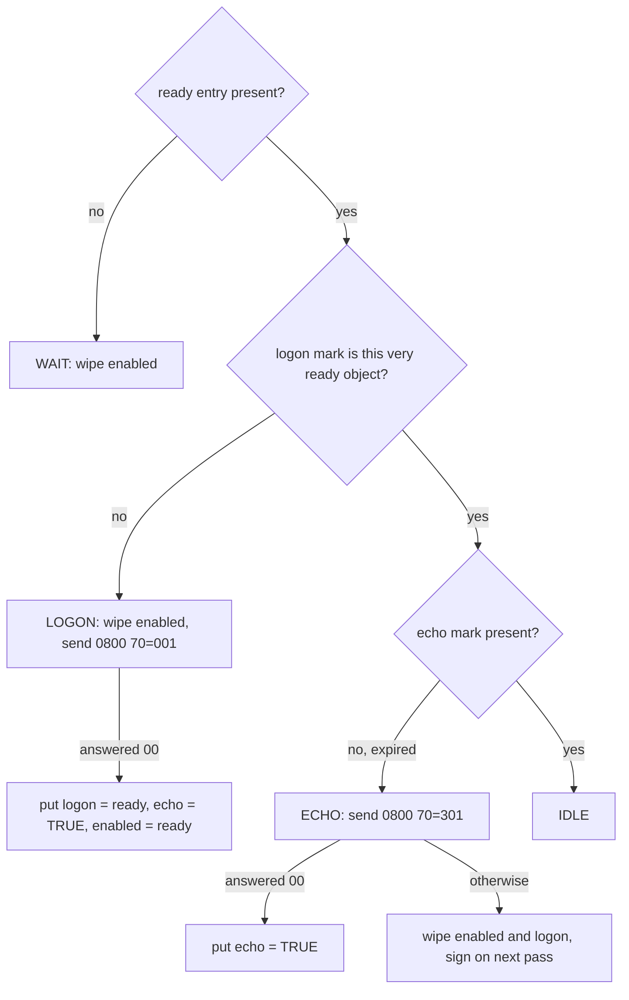

The STAN comes from the same sequence as the link's purchases (unit c4), so the host never sees
two messages from this link with the same STAN. An 0800 carries no field 41, so QMUX's key for it
is the out queue, the MTI and field 11, and only this client's own 0800s compete for it. Field 7
is in UTC, as the standard wants.

Q2 deploys the manager from `deploy/30_host_logon.xml`, after the channels and QMUXes it names:

```xml
<logon-manager name="host-logon" class="com.example.jpos.client.link.LogonManager" logger="Q2">
  <property name="mux" value="host-mux"/>
  <property name="stan-space" value="je:stan"/>
  <property name="stan-key" value="stan.host"/>
  <property name="timeout" value="30000"/>
  <property name="echo-interval" value="300000"/>
  <property name="logon-interval" value="86400000"/>
</logon-manager>
```

A repeated `mux` property becomes the array that `cfg.getAll("mux")` returns.

Deployed with a 4-second echo interval (and `tspace:stan`, to keep the run free of files), with
the host dropping the connection after 9.5 seconds:

```text
   0.0 s  host: 0800 70=001 on connection 1 -> 39=00
   0.0 s  host-mux.enabled is the ready object: true
   4.0 s  host: 0800 70=301 on connection 1 -> 39=00
   9.0 s  host: 0800 70=301 on connection 1 -> 39=00
   9.5 s  host: dropped its connections
  12.5 s  host: connection 2 accepted
  13.0 s  host: 0800 70=001 on connection 2 -> 39=00
  13.0 s  host-mux.enabled is the new ready object: true
```

Half a second after the reconnect, the next pass of the loop saw a ready object it had never
signed on, and signed on. Nothing had told it about the reconnect.

## 11.4 A Pool Uses a Link Only While It Is Signed On

Two links, A and B, sit behind a round-robin `MUXPool` (unit c4), with one manager for both. Host
B drops its connection, and when the adaptor reconnects, host B refuses the first three sign-ons.
Eight purchases come in, one every half second from the moment B reconnects. Where do they go?

```text
   0.0 s  host B: dropped its connections
   4.0 s  host B: connection 2 accepted
   4.0 s  host B: 0200 11=000702 on connection 2 -> 39=91
   4.5 s  host B: 0800 70=001 on connection 2 -> 39=91
   5.0 s  host B: 0200 11=000704 on connection 2 -> 39=91
   5.5 s  host B: 0800 70=001 on connection 2 -> 39=91
   6.0 s  host B: 0200 11=000706 on connection 2 -> 39=91
   6.5 s  host B: 0800 70=001 on connection 2 -> 39=91
   7.0 s  host B: 0200 11=000708 on connection 2 -> 39=91
   7.5 s  host B: 0800 70=001 on connection 2 -> 39=00
   7.5 s  host A approved 4; host B approved 0, declined 4
```

Half went to B and were declined. The pool asks each member only `isConnected()`, B's adaptor is
connected, and the manager has no way to tell the pool otherwise. Add one property to the pool:

```xml
<mux name="host-pool" class="org.jpos.q2.iso.MUXPool" logger="Q2">
  <muxes>host-mux host-mux-b</muxes>
  <strategy>round-robin</strategy>
  <property name="check-enabled" value="true"/>
</mux>
```

and run the same morning again:

```text
   0.0 s  host B: dropped its connections
   3.0 s  host B: connection 2 accepted
   3.5 s  host B: 0800 70=001 on connection 2 -> 39=91
   4.5 s  host B: 0800 70=001 on connection 2 -> 39=91
   5.5 s  host B: 0800 70=001 on connection 2 -> 39=91
   6.5 s  host B: 0800 70=001 on connection 2 -> 39=00
   6.5 s  host B: 0200 11=000707 on connection 2 -> 39=00
   7.5 s  host A approved 7; host B approved 1, declined 0
```

With `check-enabled`, the 2.1.7 pool counts a QMUX that has one `<ready>` name as usable only when
it is connected **and** the Space entry `<mux name>.enabled` is the same object as its ready entry.
The test is `==`, made on every request. B's enabled mark held the ready object of connection 1,
so it stopped matching when connection 2 brought a new one, before the manager had noticed the
reconnect. B came back into rotation with its first successful sign-on.

The `==` test also rejects `Boolean.TRUE` as the enabled mark, a natural choice for "enabled":
TRUE is never the ready `Date`. One link behind a pool with `check-enabled`; after the first
purchase we put the ready `Date` there by hand:

```text
   0.0 s  host-mux.enabled = TRUE; pool isConnected false
   3.0 s  purchase -> null
   3.0 s  host-mux.enabled = the ready Date; pool isConnected true
   3.0 s  purchase -> 0210 39=00
```

With `Boolean.TRUE` the link is never used. Every purchase waits its full timeout and comes back
`null` without leaving the pool, while the host is signed on and waiting. The caller can't tell
that `null` from a lost answer, so under unit c12's policy it would reverse purchases the host
never saw.

A client without a pool has no `check-enabled` and has to ask the same question itself before it
sends.

> **One link, several addresses.** The channel properties `alternate-host` and `alternate-port`,
> repeated in pairs, give one adaptor more addresses to try when a connect fails, the primary
> first: failover at connect time, one connection at a time, no pool. Each new connection still
> needs its sign-on, which the manager handles the same way. Unit c14 compares this with a pool.

<!-- practice 1 -->

## 11.5 Take a Link Out of Service Before You Sign It Off

Every Tuesday night, operations take link A out for maintenance. Each link has its own manager
(`host-logon-a`, `host-logon-b`), and the plan is to remove `30_host_logon_a.xml` from `deploy/`,
which makes Q2 call the manager's `stopService`. A first version:

```java
    @Override
    protected void stopService() {
        for (String name : muxNames) {
            exchange(name, "002");                      // (1) sign off
            SpaceUtil.wipe(sp, name + ".enabled");      // (2) then take the link out of the pool
        }
    }
```

Purchases flow through the pool, one every quarter second, and the host takes a second to answer
the 002. Later the manager is deployed again. What goes wrong?

```text
   1.0 s  stopping host-logon-a
   2.0 s  host A: 0800 70=002 on connection 1 -> 39=00
   2.0 s  host A: 0200 11=000706 on connection 1 -> 39=91
   4.0 s  host A: approved 2, declined 1
   4.0 s  host-logon-a deployed again
   4.0 s  host A: 0800 70=301 on connection 1 -> 39=00
   8.0 s  host A: 0800 70=301 on connection 1 -> 39=00
  12.0 s  host A: 0800 70=301 on connection 1 -> 39=00
  14.0 s  host-mux.enabled absent; host A approved 2, declined 1
```

**A purchase was lost to the sign-off.** Between (1) and (2) the link was still enabled: the host
had already processed the 002, and the pool kept routing purchases to A while the 0810 was on its
way. One cardholder was declined; on a busy link that second costs dozens.

**The link never came back.** The redeployed manager found a logon mark that still matched the
ready object, because the connection was the same one. `decide` said "signed on, echo due", the
echoes were answered, and nothing wrote an enabled mark again. In production link A stays out of
the pool until the logon mark expires, a day later, while the host has been told the client left.

The order follows from what each mark means:

- the enabled mark is what routes traffic, so it goes **first**;
- the 002 goes only to a connection that actually signed on: the ready entry is there and is the
  very object in the logon mark. A link that is down, or that reconnected since, has no session
  to end;
- the logon mark goes **last**, whether or not the host answered, because the session is over
  either way.

With that order, the same night:

```text
   1.0 s  stopping host-logon-a
   2.0 s  host A: 0800 70=002 on connection 1 -> 39=00
   4.0 s  host A: approved 2, declined 0
   4.0 s  host-logon-a deployed again
   4.0 s  host A: 0800 70=001 on connection 1 -> 39=00
   4.0 s  host A: 0200 11=000717 on connection 1 -> 39=00
```

The pool sent everything to B while A signed off, and A rejoined with its first sign-on.

Requests already waiting on A still finish or time out there; unit c15 drains them before the
002. Q2's stop only asks the loop thread to end: a pass in the middle of a 30-second sign-on can
still write an enabled mark after `stopService` removed it. Check `running()` before writing, or
wait for the thread to end.

<!-- practice 2 -->

## 11.6 The Host's Own Echo Is a Request, and Someone Must Answer It

A host may check the link from its side too: it sends an 0800 / 301 every few minutes and drops
the connection after a few go unanswered. One arriving at a QMUX configured as in unit c4:

```text
   0.0 s  host: sent 0800 70=301 11=000042
   0.0 s  host-mux-unhandled: 0800 70=301 11=000042
```

QMUX found no waiting request for it and put it on the `<unhandled>` queue, where it expires after
two minutes. Neither QMUX nor the channel answers an 0800 by itself, so the host gives up and drops
a healthy link.

Messages that match no waiting request go first to the QMUX's request listeners, in order, and
only reach `<unhandled>` when none of them takes the message:

```java
package com.example.jpos.client.link;

import org.jpos.iso.ISOException;
import org.jpos.iso.ISOMsg;
import org.jpos.iso.ISORequestListener;
import org.jpos.iso.ISOSource;

import java.io.IOException;

/** Answers the host's own 0800 echoes with 0810 / 00. Unit c15 handles the other codes. */
public class NetworkManagementResponder implements ISORequestListener {
    @Override
    public boolean process(ISOSource source, ISOMsg m) {
        try {
            if (!"0800".equals(m.getMTI()) || !"301".equals(m.getString(70)))
                return false;                   // the next listener, or <unhandled>, gets it
            ISOMsg reply = (ISOMsg) m.clone(0, 7, 11, 70);
            reply.setResponseMTI();
            reply.set(39, "00");
            source.send(reply);                 // through the channel it came in on
            return true;
        } catch (ISOException | IOException e) {
            return false;
        }
    }
}
```

Add it to `20_host_mux.xml`:

```xml
<mux class="org.jpos.q2.iso.QMUX" name="host-mux" logger="Q2">
  <in>host-receive</in>
  <out>host-send</out>
  <ready>host-channel.ready</ready>
  <unhandled>host-mux-unhandled</unhandled>
  <request-listener class="com.example.jpos.client.link.NetworkManagementResponder"/>
</mux>
```

```text
   0.0 s  host: got 0810 39=00 on connection 1
   0.0 s  host: sent 0800 70=301 11=000042
   2.0 s  host-mux-unhandled: empty
```

The `source` a listener receives is the channel that read the message: the 2.1.7 `BaseChannel`
marks every message it receives with itself, so the reply leaves through the channel the echo came
in on. QMUX passes itself only for a message that carries no source.

The reply copies only the fields an 0810 needs. `clone(int...)` copies exactly the fields you
name, so field 0, the MTI, has to be in the list. Without it `getMTI` throws, the listener returns
`false`, and the echo lands on `<unhandled>`. Return `false` for anything you don't handle, so
that late answers to your own requests still reach `<unhandled>` (unit c12).

<!-- practice 3 -->

## 11.7 Summary

- **A connected link is not a signed-on link.** The ready entry says that TCP is up. A host that
  wants a sign-on declines or drops everything on a new connection until it gets one.
- **Only an echo proves the host is answering.** Adaptor and TCP keep-alives are answered below
  the application, so a hung host passes them; an 0800 / 301 that expires is the signal to take
  the link out.
- **A sign-on belongs to one connection**, and the adaptor's ready object names it. Store that
  object in the logon mark and compare with `==`; a boolean flag misses a reconnect that happened
  while the loop was busy.
- **A pool uses a link only while it is signed on**: with `check-enabled`, the enabled mark must
  be the very ready object. A reconnect takes the link out by itself, and `Boolean.TRUE` keeps it
  out for good.
- **Disable, sign off, forget.** Remove the enabled mark before the 002, send the 002 only to the
  connection that signed on, and remove the logon mark whatever the answer, or the link stays out
  of the pool after the next deploy.
- **Answer the host's echo** with a request listener on the QMUX, through the `source` it is
  given. Unanswered echoes end on `<unhandled>`, and the host drops the link.

## 11.8 Reference

**Network management (0800 / 0810) codes used here,** in field 70:

| Code | Meaning | Sent by |
|---|---|---|
| `001` | sign-on | the client after each new connection; some hosts too |
| `002` | sign-off | the side about to stop |
| `301` | echo test | either side, while the link is quiet |

**The sign-on manager's marks** (in the Space the pool and the adaptor use):

| Key | Value | Lifetime |
|---|---|---|
| `<mux>.logon` | the ready object of the connection that signed on | `logon-interval` |
| `<mux>.echo` | `Boolean.TRUE` | `echo-interval` |
| `<mux>.enabled` | the same ready object | until the manager sees the link down, an echo fails, or the manager stops |

**`LogonManager` properties:** `mux` (repeatable), `space` (default space if empty),
`stan-space`, `stan-key` (default `stan.host`), `timeout` (default 30000 ms per exchange),
`echo-interval` (default 300000 ms), `logon-interval` (default 86400000 ms).

**`MUXPool` usability in 2.1.7** (`isUsable`, checked on every request):

| Configuration | A QMUX member is usable when |
|---|---|
| no `check-enabled` | `isConnected()` |
| `check-enabled`, one `<ready>` name | `isConnected()` and `<mux>.enabled` `==` the ready entry |
| `check-enabled`, several `<ready>` names | `isConnected()` and `<mux>.enabled` exists |

**Counters for watching a link** (JMX through Q2, or the methods directly):

| Component | Counter | Read it as |
|---|---|---|
| ChannelAdaptor | `getConnectsCounter()` | connections made; a steady rise is a flapping link |
| ChannelAdaptor | `getTXCounter()`, `getRXCounter()`, `getIdleTimeInMillis()` | messages sent and received, time since the last message received |
| QMUX | `getCountersAsString()`: `tx`, `rx`, `tx_expired`, `tx_pending`, `rx_expired`, `rx_pending`, `rx_unhandled`, `rx_forwarded`, `connected`, `last`, `idle` | `rx_expired` counts requests that got no answer; `rx_unhandled` counts late answers and host messages nobody took; `rx_forwarded` counts messages offered to request listeners |

**Keep-alive settings:** `<keep-alive>yes</keep-alive>` on the ChannelAdaptor writes an empty frame
when no message was sent for `reconnect-delay` ms. The channel property `keep-alive` sets the
socket's `SO_KEEPALIVE`. The channel property `timeout` is the read timeout (unit c3).

## 11.9 Challenges

1. Your host answers a sign-on in 200 ms but sometimes takes 25 seconds to answer an echo under
   load. Choose the manager's `timeout`, `echo-interval` and the read timeout, and say what a
   25-second echo does to the other links served by the same manager thread.
2. A host requires a sign-on per connection and also a daily sign-on at its cutover, 00:00 host
   time, on every open connection. Which mark would you change, and how, so that the existing
   `decide` handles it?
3. Two client instances each run their own adaptor to the same host, one connection each, and
   share a terminal ID. Does each need its own manager? What do they have to share, and what must
   they never share?
4. Measure how long a link stays in the pool after its host application hangs, with an echo
   interval of 5 minutes, a manager `timeout` of 30 seconds and the loop of 11.3. How would you
   shorten it without echoing every few seconds?

## 11.10 Design Note: Why Marks in the Space and Not a State Machine?

A sign-on lifecycle is a state machine, and the obvious code keeps the state in a field: DOWN,
CONNECTED, SIGNED_ON. This manager keeps no state in fields. Everything it knows sits in the Space,
as entries that expire by themselves or stop matching when another component writes something new.

The state is not the manager's. The connection belongs to the adaptor, which can replace it at any
moment without telling anyone. A field in the manager is a copy of the adaptor's state, wrong from
the moment the original changes until it is next refreshed. Storing the adaptor's own object
removes that window: a stale mark stops matching the moment the adaptor writes a new ready entry,
and the pool, which reads the same entries, sees the change at the same moment. Expiry replaces
the timers a state machine would need for "echo due" and "sign-on expired", each one more thing to
cancel correctly on every path.

The price is that the logic is spread over keys rather than written in one place, and a mistake in
one of them shows up somewhere else: a mark that is never removed keeps a link out of the pool
(11.5). Unit c15 draws the same lifecycle as a state diagram, so the two views can be checked
against each other.


# 12. Correlation, Timeouts and Reversals

A terminal sends a 0200 for 50.00 and waits. Ten seconds pass and nothing comes back. The cardholder
is still at the counter, and the merchant asks: did the bank take the money?

Nobody knows. The request may not have arrived, or the host declined it, or the host approved it and
the answer got lost. What jPOS does while you wait for an answer, and what you must do when the wait
ends with nothing, comes down to six rules, one per section heading from 12.2 to 12.7.

## 12.1 A Host You Can Break

QMUX never touches a socket. It writes each request to a Space queue (`<out>`) and reads responses
from another one (`<in>`). The ChannelAdaptor of unit c4 moves messages between those queues and
the wire. Put something else on the far side of the two queues and QMUX can't tell the difference.

```java
package com.example.jpos.client.testhost;

import org.jpos.iso.ISOException;
import org.jpos.iso.ISOMsg;
import org.jpos.space.LocalSpace;
import org.jpos.space.SpaceListener;

import java.util.ArrayDeque;
import java.util.ArrayList;
import java.util.Deque;
import java.util.List;
import java.util.concurrent.Executors;
import java.util.concurrent.ScheduledExecutorService;
import java.util.concurrent.TimeUnit;

/** The far end of a QMUX's queues: answers, drops or delays each request it receives. */
public final class TestHost implements SpaceListener<String, Object> {
    private final LocalSpace<String, Object> sp;
    private final String in;                         // where the host sends responses
    private final Deque<Long> script = new ArrayDeque<>();
    private final List<ISOMsg> received = new ArrayList<>();
    private final ScheduledExecutorService later = Executors.newSingleThreadScheduledExecutor();

    public static final long ANSWER = 0, DROP = -1;  // any other value: answer after that many ms

    public TestHost(LocalSpace<String, Object> sp, String out, String in) {
        this.sp = sp;
        this.in = in;
        sp.addListener(out, this);
    }

    /** What to do with the next requests, in order; after the script runs out, answer. */
    public synchronized TestHost then(long... acts) {
        for (long a : acts) script.add(a);
        return this;
    }

    public synchronized List<ISOMsg> received() {
        return new ArrayList<>(received);
    }

    @Override
    public void notify(String queue, Object value) {
        ISOMsg request = (ISOMsg) sp.inp(queue);
        if (request == null) return;
        long act;
        synchronized (this) {
            received.add(request);
            act = script.isEmpty() ? ANSWER : script.poll();
        }
        if (act == ANSWER) answer(request);
        else if (act > 0) later.schedule(() -> answer(request), act, TimeUnit.MILLISECONDS);
    }

    private void answer(ISOMsg request) {
        try {
            ISOMsg response = (ISOMsg) request.clone();
            response.setResponseMTI();
            response.set(39, "00");
            sp.out(in, response);
        } catch (ISOException e) {
            throw new IllegalStateException(e);
        }
    }
}
```

The host approves everything it answers (`39=00`). `then(...)` scripts the next few requests:
`ANSWER`, `DROP`, or a delay in milliseconds. The QMUX in front of it:

```xml
<mux class="org.jpos.q2.iso.QMUX" name="host-mux" logger="Q2">
  <in>host-receive</in>
  <out>host-send</out>
  <unhandled>host-unhandled</unhandled>
</mux>
```

Every output in this unit comes from a jPOS 2.1.7 QMUX with this configuration, in the same JVM as
the test host.

## 12.2 A Response Finds Its Request Through a Key

QMUX has sent the 0200 for terminal `29110001` with STAN `123`, and a thread is blocked in
`request`. A message arrives on `<in>`. How does QMUX know that this is the answer?

It turns the message into a string, the **key**, and compares it with the string it made from the
request. Here is `mux.getKey(m)` for five messages, all for terminal `29110001`:

```text
0200 host-send.0200000000029110001000123     (field 11 = "123")
0210 host-send.0200000000029110001000123     (field 11 = "000123")
0220 host-send.0220000000029110001000123
0420 host-send.0420000000029110001000124
0421 host-send.0420000000029110001000124
```

The 0200 and the 0210 give the same string. From left to right: the out queue and a dot, three
digits of the MTI, field 41 padded to 16 characters, field 11 padded to 6 digits. Because of the
padding, a host that echoes `000123` for a STAN sent as `123` still matches.

A request and its response differ in the MTI, so QMUX keeps only what the two have in common:

- **The fourth digit gives the message's origin and whether it is a repeat**, so it is dropped. An
  0421 has the same key as its 0420.
- **The third digit is 0 for a request and 1 for its response.** QMUX maps both to the even value
  before building the key, so 0200 and 0210 meet. A 0220 (an advice, see 12.5) keeps its 2, so it
  never answers a 0200. The mapping is `<mtimapping>`, and you almost never change it.
- **The out queue is part of the key**, so two links never confuse each other's traffic.

A message with none of the key fields can't be matched, so QMUX refuses to send it. Here is an
0800 echo with only field 70 set:

```text
0800 Key fields not found - not sending host-send.080
```

Give every network message a STAN.

### 12.2.1 A Late Answer Has Nobody to Go To

The host answers the first request at once and the second after 1.5 seconds. The client waits one
second:

```java
TestHost host = new TestHost(sp, "host-send", "host-receive").then(TestHost.ANSWER, 1500);
ISOMsg r1 = mux.request(purchase(123), 1000);
ISOMsg r2 = mux.request(purchase(124), 1000);
Thread.sleep(1000);
ISOMsg late = (ISOMsg) sp.inp("host-unhandled");
```

```text
first:  0210 39=00
second: null after 1000 ms
unhandled: 0210 11=000124 39=00
```

After one second `request` returned `null`, and half a second later the approval arrived. QMUX
computed its key, found nobody waiting, and handled it like any message it never asked for, such as
the host's own 0800. It offered the message to its `<request-listener>`s and, since none took it,
put it on the `<unhandled>` queue, where it expires after two minutes. With neither configured, the
message is silently dropped.

The host approved that purchase, and the program was told `null`. Section 12.5 deals with that.

## 12.3 Only One Request per Key Can Wait

Suppose two requests with the same key were waiting at once. A response arrives and matches both.
QMUX can't tell which one it belongs to, and one cardholder's approval could be reported on
another's purchase.

So QMUX checks before it sends. While a request waits, QMUX keeps a marker for its key (the key plus
`.req`), and a second request with the same key is refused and never sent:

```java
new TestHost(sp, "host-send", "host-receive").then(500);    // the first answer takes 500 ms
Future<ISOMsg> first  = pool.submit(() -> mux.request(msg("0200", 41, "GW000001", 11, "000042"), 2000));
Thread.sleep(100);
Future<ISOMsg> second = pool.submit(() -> mux.request(msg("0200", 41, "GW000001", 11, "000042"), 2000));
```

```text
first:  0210
second: Duplicate key 'host-send.02000000000GW000001000042.req' detected
```

The exception isn't the bug. The bug is whatever made two live requests share a key.
Because the refused request was never sent, it is safe to give it a fresh STAN and send it again.

### 12.3.1 Spot the Problem: The Gateway at Lunchtime

A gateway accepts purchases from three hundred terminals and forwards them to the acquirer's host
through one QMUX. The host knows the gateway as a single terminal, so the gateway puts its own ID
in field 41:

```java
ISOMsg up = (ISOMsg) fromTerminal.clone();
up.set(41, "GW000001");                        // (1) the host knows us by this ID
up.set(32, acquirerId);
ISOMsg response = mux.request(up, 20000);      // (2)
```

It passes every test. In production, around noon, the log fills with `Duplicate key` and a few
terminals time out. Can you see why?

With field 41 the same on every message, line (1) reduces the key to the MTI and the STAN, and the
STAN is still the terminal's own. Every terminal counts its STAN from 1, so sooner or later one of
them sends a STAN that another terminal's request, still waiting, already uses. A test lab with one
terminal never sees it.

On the upstream link the gateway is the sender, so the gateway numbers the messages: **one STAN
sequence per outbound link**. It replaces the terminal's STAN on the way up and puts it back into
the response on the way down. The other option is to add a field to the key that is unique per
transaction and that the host echoes, such as the retrieval
reference number: `<key>41, 11, 37</key>`.

Other ways to get the same collision:

- a STAN counter per thread or per terminal, when several of them share one link;
- network messages without field 41 that share STANs with each other;
- a repeat (0421) sent while the previous attempt is still waiting. That one is covered in 12.7.

### 12.3.2 Choosing the Key Fields

`<key>` sets the fields for every MTI. `<key mti="08">` sets them for every MTI that starts with
those two digits. Whatever you choose, the host must echo each key field unchanged. A field it
rewrites or drops gives a response that matches nothing, and every request times out.

In 2.1.7 this configuration looks right but isn't:

```xml
<mux class="org.jpos.q2.iso.QMUX" name="gw-mux" logger="Q2">
  <in>host-receive</in>
  <out>host-send</out>
  <key mti="08">11</key>
  <key>41, 11, 37</key>
</mux>
```

The key of a 0200 that carries fields 11, 37 and 41 comes out as:

```text
host-send.020000123
```

That is the STAN alone. QMUX 2.1.7 reads a `<key>` without `mti` by asking for the text of the
*first* `<key>` element, which here is the `08` one. Put the plain `<key>` first and you get what
you asked for:

```text
host-send.0200000000029110001000123531012345678
```

When the host echoes a key field in a different form (trailing spaces trimmed, for instance), no
configuration helps. Subclass QMUX, normalise a copy of the message and let `super.getKey` do the
rest, so the out queue, the MTI mapping and the padding stay as they are:

```java
package com.example.jpos.client.mux;

import org.jpos.iso.ISOException;
import org.jpos.iso.ISOMsg;
import org.jpos.q2.iso.QMUX;

/** QMUX whose key ignores leading and trailing spaces in field 37. */
public class TrimmedRrnQMUX extends QMUX {
    @Override
    public String getKey(ISOMsg m) throws ISOException {
        if (!m.hasField(37))
            return super.getKey(m);
        ISOMsg normalised = (ISOMsg) m.clone();     // never change the message being sent
        normalised.set(37, m.getString(37).trim());
        return super.getKey(normalised);
    }
}
```

<!-- practice 1 -->

## 12.4 Every Timeout Guards a Different Wait

A customer asks for links that never time out. Their network is reliable, they say, and disconnects
only cause trouble.

Between you and the host sits a firewall that silently drops sessions after 15 idle minutes: neither
side receives anything.

- **On the client**, jPOS still believes it is connected. The next purchase is written into the
  dead connection and never arrives. The ChannelAdaptor has already taken it off its queue, so it
  is not sent again, even after a reconnect. `request` returns `null`, and you are in the situation
  of 12.5: a purchase whose outcome you don't know.
- **On the server**, the terminal reconnects on a new session. The old session stays open forever,
  because nothing will ever arrive on it and nothing is waiting to notice. Every quiet night adds a
  few more. Weeks later the QServer reaches its session limit and refuses new connections, and only
  a restart brings it back.

A read timeout (the channel's `timeout` property) closes dead sessions on the server and makes the
client reconnect before the next purchase. An echo every few minutes (unit c11) keeps a healthy but
quiet session from looking dead, and from being dropped by the firewall. So: **echo interval < read
timeout < firewall idle time**, for example an echo every 5 minutes, a read timeout of 6 and a
firewall at 15.

The request timeout, the second argument of `mux.request`, guards a different wait: the
cardholder's. Size it from the outside in: whoever calls you (the terminal, the upstream switch, a
REST client) has a limit of its own, and your timeout must end first. If the terminal gives up at 30
seconds and you wait 45, a host approval at 40 seconds becomes a payment the terminal has already
shown as failed.

The Reference lists every setting with "timeout" or "alive" in its name, what it waits for and what
happens when it fires.

<!-- practice 5 -->

## 12.5 No Answer Means You Don't Know

When `request` returns `null`, one of three things happened, and the client can't tell which:

- the request never reached the host;
- the host received it and declined it;
- the host approved it, moved the money, and the answer was lost or arrived too late.

The obvious fix is to send the 0200 again. Against a host that answers the first try 1.5 seconds
late:

```java
TestHost host = new TestHost(sp, "host-send", "host-receive").then(1500);
ISOMsg r = mux.request(purchase, 1000);          // null
r = mux.request(purchase, 1000);                 // try again
```

```text
try 1: null
try 2: 0210 39=00
host approved 2 purchases of 000000005000
```

The cardholder paid twice. The test host, like many real ones, doesn't look for duplicates, so the
second 0200 is just another purchase. A host that does check might decline it as a duplicate, and
then you have told the cardholder "declined" for a purchase that went through.

The safe move is a **reversal**: a message that says "if you approved this, undo it". If the host
never saw the original, or declined it, the host acknowledges the reversal and nothing changes. If
the host approved it, the money comes back. A resend double-charges in exactly the case a reversal
fixes: **reverse, never resend**.

What gets reversed depends on what the message did:

- **0100 and 0200** ask for permission and move money or place a hold. When their outcome is
  unknown, they are reversed.
- **Advices** (0120, 0220, 0420) report something that has already happened. There is nothing to
  undo, so they are *repeated* (0121, 0221, 0421) until the host acknowledges them.
- **0800 network messages** change no balance. Just send a new one.

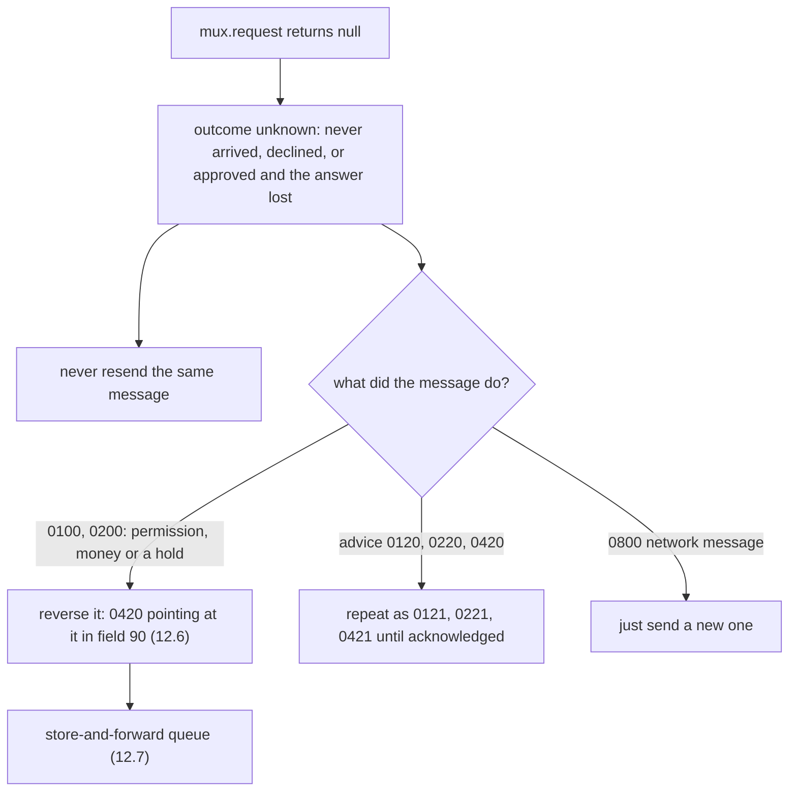

Once the purchase is reversed, the late approval from 12.2.1 needs nothing more.

## 12.6 A Reversal Points Back at the Original

A reversal must tell the host which transaction to undo. In ISO 8583:1987 that is field 90, Original
Data Elements. A builder, with the per-link STAN sequencer it uses:

```java
package com.example.jpos.client.reversal;

import org.jpos.iso.ISOUtil;
import org.jpos.space.Space;
import org.jpos.space.SpaceUtil;

/** One STAN sequence per outbound link: 000001 .. 999999, then 000001 again. */
public final class StanSequencer {
    private final Space<String, Object> space;
    private final String key;

    public StanSequencer(Space<String, Object> space, String link) {
        this.space = space;
        this.key = "stan." + link;
    }

    public String next() {
        long n = SpaceUtil.nextLong(space, key);
        return ISOUtil.zeropad(((n - 1) % 999999) + 1, 6);
    }
}
```

```java
package com.example.jpos.client.reversal;

import org.jpos.iso.ISODate;
import org.jpos.iso.ISOException;
import org.jpos.iso.ISOMsg;
import org.jpos.iso.ISOUtil;

import java.time.Clock;
import java.util.Date;
import java.util.TimeZone;

public final class ReversalBuilder {
    /** What the host needs to find the original and undo it. Never 35, 52 or 55. */
    private static final int[] COPIED = { 2, 3, 4, 12, 13, 14, 22, 32, 33, 37, 41, 42, 49 };

    private final StanSequencer stans;
    private final String reversalMti;                   // "0420", or "0400" if the network says so
    private final Clock clock;

    public ReversalBuilder(StanSequencer stans, String reversalMti, Clock clock) {
        this.stans = stans;
        this.reversalMti = reversalMti;
        this.clock = clock;
    }

    public ISOMsg reversalOf(ISOMsg original) throws ISOException {
        ISOMsg rev = (ISOMsg) original.clone(COPIED);
        rev.setMTI(reversalMti);
        rev.set(7, ISODate.getDateTime(Date.from(clock.instant()), TimeZone.getTimeZone("UTC")));
        rev.set(11, stans.next());                      // a new message on the link
        rev.set(90, field90(original));                 // ...that points at the original
        return rev;
    }

    static String field90(ISOMsg o) throws ISOException {
        return o.getMTI()
                + ISOUtil.zeropad(o.getString(11), 6)
                + ISOUtil.zeropad(o.getString(7), 10)
                + ISOUtil.zeropad(o.hasField(32) ? o.getString(32) : "", 11)
                + ISOUtil.zeropad(o.hasField(33) ? o.getString(33) : "", 11);
    }
}
```

We reverse the purchase from 12.5, which went out as STAN `000125` at `1105143000` from acquirer
`123456`, with a track 2 in field 35:

```text
MTI 0420  11=000126  7=1105143012
90  020000012511051430000000012345600000000000
35? false
```

Field 90 is easier to read split up:

```text
0200  000125  1105143000  00000123456  00000000000
MTI   STAN    field 7     field 32     field 33
```

**The reversal has its own STAN** (`000126`), because it is a new message on the link. If it carried
the original's STAN, a host that detects duplicates by terminal and STAN would take it for a second
copy of the original. The original's STAN is in field 90, where the host looks for it.

**It copies only what the host needs.** Track 2, the PIN block and the chip data (fields 35, 52 and
55) don't belong in a message that may sit in a queue for hours.

The builder works from the original request, so store each request before you send it.

> **Networks differ.** Some want 0400 instead of 0420, some want the original STAN in field 11,
> and many want a reason code. These change the builder; the rules of this unit stay the same.

<!-- practice 2 -->

## 12.7 A Reversal Must Outlive the Process and Wait Its Turn

A reversal that exists only in memory disappears with the process, and the cardholder's money stays
with the merchant until someone notices. It also can't be sent just once: the link may be down, or
the host may not answer. It needs a store-and-forward queue (SAF), here on a Space queue:

```java
package com.example.jpos.client.reversal;

import org.jpos.iso.ISOException;
import org.jpos.iso.ISOMsg;
import org.jpos.iso.MUX;
import org.jpos.space.Space;

/** Reversals waiting for the host: one sender, oldest first, kept until answered. */
public final class ReversalSaf {
    private final Space<String, Object> sp;             // persistent in production, e.g. "je:saf"
    private final String queue;

    public ReversalSaf(Space<String, Object> sp, String queue) {
        this.sp = sp;
        this.queue = queue;
    }

    public void add(ISOMsg reversal) {
        sp.out(queue, reversal);                        // (1) stored before anyone is told
    }

    public boolean isEmpty() {
        return sp.rdp(queue) == null;
    }

    /** One attempt for the oldest reversal. True when the host has answered it. */
    public synchronized boolean sendHead(MUX mux, long timeout) throws ISOException {
        ISOMsg head = (ISOMsg) sp.rdp(queue);           // (2) read, don't take
        if (head == null || !mux.isConnected())
            return false;
        if (mux.request(head, timeout) != null) {       // (3) returns only when this try is over
            sp.inp(queue);                              // answered: now it may go
            return true;
        }
        if (!head.isRetransmission()) {                 // (4) every later try is a repeat
            ISOMsg repeat = (ISOMsg) head.clone();
            repeat.setRetransmissionMTI();
            sp.inp(queue);
            sp.push(queue, repeat);                     // (5) back at the FRONT of the line
        }
        return false;
    }
}
```

We queue two reversals and let the host drop the first two attempts:

```java
TestHost host = new TestHost(sp, "host-send", "host-receive").then(TestHost.DROP, TestHost.DROP);
ReversalSaf saf = new ReversalSaf(sp, "saf.host");
saf.add(msg("0420", 41, "29110001", 11, "000126"));
saf.add(msg("0420", 41, "29110001", 11, "000127"));
for (int i = 1; !saf.isEmpty(); i++)
    System.out.println("attempt " + i + ": " + saf.sendHead(mux, 500));
```

```text
attempt 1: false
attempt 2: false
attempt 3: true
attempt 4: true
host saw 0420 11=000126
host saw 0421 11=000126
host saw 0421 11=000126
host saw 0420 11=000127
```

**(1) Stored first.** The reversal goes into the queue before the payment service reports
"reversed" to anyone. In production the space is persistent (`je:saf` is the Berkeley DB space
that ships with jPOS). Here one process queues a reversal and exits, and the next one reads it:

```text
queued, process exits
after restart: 0420 11=000126
```

**(2) Read, don't take.** The reversal stays in the queue while it is being sent. If the process
dies in the middle of `request`, the reversal is still there after the restart. Take it out first
(`inp`), and a crash at the wrong moment loses it for good.

**(3) One try at a time.** `request` returns only when this attempt is over, and `synchronized`
keeps a second sender out. So the next attempt, an 0421 with the same key as the 0420, never
overlaps the previous one, which would be a duplicate key (12.3).

**(4) A repeat only after a real attempt.** The MTI becomes 0421 only after an 0420 has actually
gone out. When the link was down, nothing was sent, and the reversal is still a first attempt.

**(5) Push, not out.** The repeat goes back to the front of the queue. With `out` it would go to the
back, and the reversal for 000127 would overtake it. During a long outage the oldest reversal, the
one a cardholder has been waiting for the longest, would keep being pushed back.

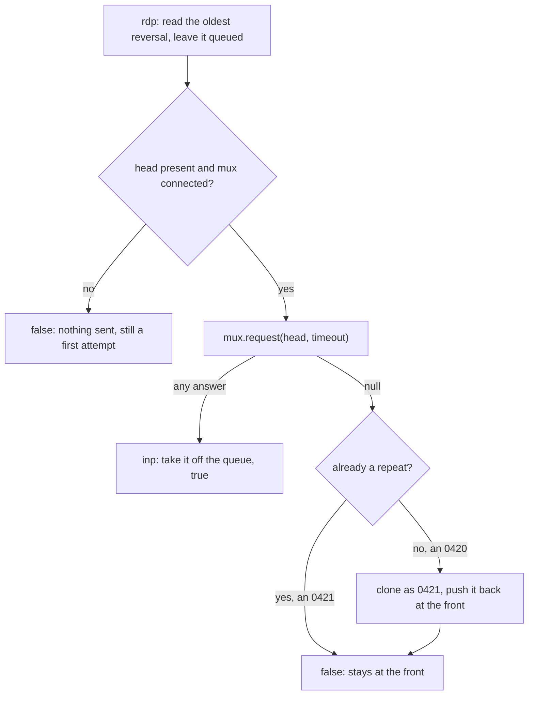

In most networks any answer acknowledges the reversal, whatever field 39 says, because the host has
seen it (check your network's spec for codes that ask for a retry). Don't quietly delete a reversal
the host never answers: alert someone when it has been retrying longer than the network allows. The
queue holds PANs, so protect it like the transaction database.

<!-- practice 3 -->

<!-- practice 4 -->

## 12.8 Summary

- **A response finds its request through a key** made of the out queue, the MTI without its last
  digit (with the response digit mapped down) and the key fields. A field the host doesn't echo
  unchanged breaks every match.
- **Only one request per key can wait.** "Duplicate key" means something upstream let two live
  requests share a key. The usual cause is a STAN that isn't numbered per outbound link.
- **Each timeout guards its own wait.** The request timeout must end before the caller gives up.
  Servers need a read timeout, and echoes must come more often than it fires.
- **`null` means unknown, and unknown means reverse.** Resending turns a lost answer into a double
  charge.
- **A reversal is a new message** with its own STAN, pointing at the original through field 90.
- **A reversal is stored before anyone is told**, read rather than taken while it is sent, repeated
  only after a real attempt, and kept at the front of the line.

## 12.9 Reference

**The QMUX key in 2.1.7:** out queue, `.`, three mapped MTI digits, then the key fields in order.
Field 41 is padded to 16 characters, field 11 to 6 digits (12 when the MTI starts with `2`). A
missing key field is skipped. With none present, the message is not sent.

**`<mtimapping>`** has three strings, one per MTI digit. The default is
`0123456789 0123456789 0022446689`.

**Timeouts and keep-alives in a 2.1.7 client and server:**

| Setting | Where | Default | Fires when | Effect |
|---|---|---|---|---|
| `connect-timeout` | channel `<property>` | same as `timeout` | a `connect()` takes too long | the attempt fails; the adaptor retries after `reconnect-delay` |
| `timeout` | channel `<property>` (client or QServer) | 300000 ms | no byte is read for that long | the socket is closed; a client reconnects, a server session ends. `0` disables it |
| `<reconnect-delay>` | ChannelAdaptor element | 10000 ms | after a failed connect or a dropped link | wait before the next connect; also the idle period for `<keep-alive>` |
| `<keep-alive>yes` | ChannelAdaptor element | no | nothing sent for `reconnect-delay` ms | a zero-length frame is written |
| `keep-alive` | channel `<property>` | false | OS-defined idle time | TCP `SO_KEEPALIVE` probes |
| `<timeout>` | ChannelAdaptor element | 0 (none) | a received message waits that long in the adaptor's `<out>` (the MUX's `<in>`) | it expires from the queue unread |
| `request(m, timeout)` | QMUX or MUXPool argument | none; you choose | no matching response in time | returns `null`; an unsent request also expires from `<out>` |
| unhandled TTL | QMUX, fixed | 120000 ms | a message sits in `<unhandled>` | it expires |
| `timeout` | `QueryHost` participant property | 30000 ms | the upstream request times out | the transaction is marked "host unreachable" |
| `pause-timeout` | TransactionManager property | 0 (none) | a paused transaction is not resumed in time | it is resumed and, by default, aborted |

**Field 90 (ISO 8583:1987, n 42):**

| Positions | Content |
|---|---|
| 1-4 | original MTI |
| 5-10 | original STAN (field 11) |
| 11-20 | original transmission date and time (field 7, MMddhhmmss) |
| 21-31 | original acquiring institution ID (field 32), zero-filled on the left |
| 32-42 | original forwarding institution ID (field 33), zero-filled on the left |

## 12.10 Challenges

These have no single answer. Work them out on paper or with the test host.

1. Your network requires an answer to a 0200 within 25 seconds, your terminals give up after 30,
   and the host occasionally answers at 28. Pick a request timeout. What happens to the purchases
   the host answers between your timeout and second 28, and who pays for them if nothing is done?
2. Run the duplicate-key example with 300 terminals behind the gateway, each picking a random STAN
   for each purchase, and 20 purchases in flight at any moment. How often does a collision happen?
   Compare your measurement with the birthday problem.
3. Two gateway instances share one upstream link and both send through it. How do you keep their
   STANs unique without a shared counter, and what does your scheme cost when one instance
   restarts?
4. The SAF stores whole reversals, PANs included. Design a SAF that stores only a reference to a
   row in the transaction database. What gets simpler, and what new way of failing did you add?

## 12.11 Design Note: Why Not a Transaction ID?

Many systems give each transaction a unique ID and pass it everywhere. ISO 8583 doesn't. A message
identifies itself by who sent it (fields 32 and 41), a short sequence number (11) and a timestamp
(7). Everything in this unit follows from that choice: keys built from several fields, duplicate
keys when the sequence repeats, and field 90 to point back at an original.

A transaction crosses several
institutions that share no database and no clock, over links each of them operates separately. A
global ID would need an authority that all of them trust to hand IDs out. A six-digit counter per
link needs nothing: each sender numbers its own messages, and the link plus the date make the
number unique enough. Terminals with very little memory could do that, and nobody had to agree on
anything beyond the format.

The price is paid at every hop that relays messages. A switch has to renumber each message for its
own outbound link and remember the mapping to restore the original numbers on the way back. That is
the gateway problem from 12.3.1, and the fix there was the standard's own answer.

Field 37, the retrieval reference number, is the closest the 1987 standard comes to a transaction
ID, and the acquirer assigns it. Networks add their own trace identifiers in private fields. You
will meet both. Neither replaces the per-link STAN for correlation.


# 13. Packagers in Depth

The acquirer's new link is binary: numbers travel as BCD, two digits to a byte. You took the
acquirer's field table, copied jPOS's `iso87binary.xml`, changed the rows that differed, and wrote
round-trip tests. They all pass. On the first day of certification every keyed purchase goes
through, but swiped purchases are declined for some cards with "invalid card data". The same cards
work on the old ASCII link, and nothing on your side reports an error.

The seven rules, one per section heading, cover how a packager turns a message into bytes, how to
build one from a specification, and how to find the wrong field when the bytes disagree. Every
output is from jPOS 2.1.7.

## 13.1 The Bytes Carry No Field Boundaries, Only the Packager Knows Them

A packager is a list with one **field packager** per field number. To pack, it writes the MTI with
entry 0, the bitmap with entry 1, then each field that is present with its own entry, in ascending
order, back to back. The acquirer's echo test, written as that list in Java:

```java
package com.example.jpos.client.packager;

import org.jpos.iso.IFB_BITMAP;
import org.jpos.iso.IFB_NUMERIC;
import org.jpos.iso.IF_CHAR;
import org.jpos.iso.ISOBasePackager;
import org.jpos.iso.ISOException;
import org.jpos.iso.ISOFieldPackager;
import org.jpos.iso.ISOMsg;
import org.jpos.iso.ISOUtil;

/** The four fields of the host's echo test, in its binary layout. */
public class EchoPackager extends ISOBasePackager {

    public EchoPackager() {
        ISOFieldPackager[] f = new ISOFieldPackager[71];      // index = field number
        f[0]  = new IFB_NUMERIC(4, "MTI", true);         // true: see 13.4
        f[1]  = new IFB_BITMAP(16, "BITMAP");
        f[7]  = new IFB_NUMERIC(10, "TRANSMISSION DATE AND TIME", true);
        f[11] = new IFB_NUMERIC(6, "STAN", true);
        f[41] = new IF_CHAR(8, "TERMINAL ID");
        f[70] = new IFB_NUMERIC(3, "NETWORK MANAGEMENT CODE", true);
        setFieldPackager(f);
    }

    public static void main(String[] args) throws ISOException {
        ISOMsg echo = new ISOMsg("0800");
        echo.setPackager(new EchoPackager());
        echo.set(7, "1105103000");
        echo.set(11, "000001");
        echo.set(41, "29110001");
        echo.set(70, "301");
        System.out.print(ISOUtil.hexdump(echo.pack()));
    }
}
```

```text
0000  08 00 82 20 00 00 00 80  00 00 04 00 00 00 00 00  ... ............
0010  00 00 11 05 10 30 00 00  00 01 32 39 31 31 30 30  .....0....291100
0020  30 31 03 01                                       01..
```

The bytes `00 00 01` at offset 0x17 are field 11. How would the host know that?

| Offset | Bytes | Read with | Meaning |
|---|---|---|---|
| 0x00 | `08 00` | `IFB_NUMERIC` 4 | MTI `0800`, two digits per byte |
| 0x02 | `82 20 00 00 00 80 00 00` | `IFB_BITMAP` | bits 1, 7, 11 and 41 (bit 1: a second bitmap follows) |
| 0x0A | `04 00 00 00 00 00 00 00` | | second bitmap: bit 70 |
| 0x12 | `11 05 10 30 00` | `IFB_NUMERIC` 10 | field 7, `1105103000` |
| 0x17 | `00 00 01` | `IFB_NUMERIC` 6 | field 11, `000001` |
| 0x1A | `32 39 31 31 30 30 30 31` | `IF_CHAR` 8 | field 41, `29110001` as ASCII text |
| 0x22 | `03 01` | `IFB_NUMERIC` 3 | field 70, `301` |

The bitmap says which fields are present, not where they start. The host finds field 11 at 0x17
only because its own list says that field 7 is ten BCD digits, five bytes. A host whose list differs
in one field reads every field after it from the wrong place (13.7).

The same message under the two stock layouts in the jPOS jar, loaded with `GenericPackager` (13.6):

```text
EchoPackager:     36 bytes
iso87binary.xml:  36 bytes, same bytes: true
iso87ascii.xml:   63 bytes
080082200000008000000400000000000000110510300000000129110001301
```

The `ISOMsg` is the same in all three cases. It holds values, not formats (unit c6). The format is
all in the packager, and the two ends of a link agree on it only by building the same list from the
same specification. jPOS's stock Java packagers (`ISO87APackager`, `ISO87BPackager` and the others)
fill such a list in a constructor like the one above.

## 13.2 A Field Packager's Name Spells Out the Specification's Row

A specification describes each field in one row: `n 12` for a twelve-digit amount, `n..19 LLVAR`
for a PAN of up to 19 digits behind a two-digit length, `b 64` for eight bytes, plus a note on how
digits and characters travel. jPOS has a class for almost every combination, and its name spells it
out: `IF`, the encoding, `_`, the length rule, the type. Four values, each packed by the classes a
specification might ask for:

```java
// show(p, c) prints p.pack(c) in hex
ISOField amount = new ISOField(4, "2500");
show(new IFA_NUMERIC(12, "AMOUNT"), amount);
show(new IFB_NUMERIC(12, "AMOUNT", true), amount);
show(new IFE_NUMERIC(12, "AMOUNT"), amount);
```

```text
IFA_NUMERIC  303030303030303032353030
IFB_NUMERIC  000000002500
IFE_NUMERIC  F0F0F0F0F0F0F0F0F2F5F0F0
IFA_LLNUM    313634313131313131313131313131313131
IFB_LLNUM    164111111111111111
IF_CHAR      5431202020202020
IFE_CHAR     E3F1404040404040
IFA_BINARY   30313233343536373839414243444546
IFB_BINARY   0123456789ABCDEF
```

The PAN, a terminal ID and a PIN block are packed the same way as the amount.

- **The letter after `IF` is the encoding.** `A` writes ASCII digits, characters and lengths, one
  byte per digit; bytes behind an ASCII length (`IFA_LLLBINARY`) stay raw bytes. `B` writes BCD for
  numbers and lengths, two digits per byte. `E` writes EBCDIC, where `0` is `F0` and
  a space is `40`. A plain `IF_` copies characters as they are, with no length prefix.
- **The middle part is the length rule.** Nothing means fixed length, padded to it (zeros on the
  left for numbers, spaces on the right for text). `L`, `LL`, `LLL` and `LLLL` mean a variable length with
  a prefix of that many digits.
- **The last part is the type**: `NUMERIC` or `NUM` for digits, `CHAR` for text, `BINARY` for bytes.

`B` means BCD, not "binary data". Bytes are the `BINARY` part, and `IFA_BINARY` writes them as hex
text: the eight bytes of a PIN block become sixteen characters. The stock `iso87ascii.xml` does this
with field 52 (unit c6). A host whose specification says `b 64` for field 52 reads the first eight
characters as the PIN block, and every field after it from the wrong place.

### 13.2.1 Classes Are Combinations, and You Can Make Your Own

Most of these classes are three small parts put together: a **padder** that fills a fixed field, an
**interpreter** that turns characters into bytes, and a **prefixer** that writes the length. In the
2.1.7 sources, `IFB_LLNUM` is `NullPadder` + `BCDInterpreter` + `BcdPrefixer.LL`, and `IF_CHAR` is
`RightTPadder.SPACE_PADDER` + `LiteralInterpreter` + `NullPrefixer`.

When no stock class has the combination a specification asks for, combine the parts yourself. Say
a host wants the merchant's city as variable text with a BCD length and EBCDIC characters:

```java
package com.example.jpos.client.packager;

import org.jpos.iso.BcdPrefixer;
import org.jpos.iso.EbcdicInterpreter;
import org.jpos.iso.ISOException;
import org.jpos.iso.ISOField;
import org.jpos.iso.ISOStringFieldPackager;
import org.jpos.iso.ISOUtil;
import org.jpos.iso.NullPadder;

/** LL text with a BCD length and EBCDIC characters: no stock class does both. */
public class BcdLengthEbcdicText extends ISOStringFieldPackager {

    public BcdLengthEbcdicText() {
        super(NullPadder.INSTANCE, EbcdicInterpreter.INSTANCE, BcdPrefixer.LL);
    }

    public BcdLengthEbcdicText(int len, String description) {
        super(len, description, NullPadder.INSTANCE, EbcdicInterpreter.INSTANCE, BcdPrefixer.LL);
    }

    public static void main(String[] args) throws ISOException {
        BcdLengthEbcdicText p = new BcdLengthEbcdicText(25, "MERCHANT CITY");
        byte[] packed = p.pack(new ISOField(43, "OSLO"));
        System.out.println(ISOUtil.hexString(packed));
        ISOField back = new ISOField(43);
        p.unpack(back, packed, 0);
        System.out.println(back.getValue());
    }
}
```

```text
04D6E2D3D6
OSLO
```

`04` is the BCD length and `D6 E2 D3 D6` is `OSLO` in EBCDIC. The no-argument constructor is for
the XML: `GenericPackager` creates the class named in `class=` with it, then sets the length and name
from the attributes.

## 13.3 A Length Prefix Counts Digits or Bytes, and Only the Specification Says Which

The PAN row says `n..19 LLVAR, BCD length`. `IFB_LLNUM` writes the sixteen digits of
`4111111111111111` as `16` followed by eight bytes: the prefix counts **digits**. `IFB_LLCHAR`
writes the same PAN as `16` followed by sixteen ASCII characters: there the prefix counts
**bytes**. Both have a BCD length, and both look right to someone reading "LLVAR, BCD length".

Suppose our packager picked `IFB_LLCHAR` and the host uses `IFB_LLNUM`. The host unpacks a purchase
for 25.00:

```java
GenericPackager ours = new GenericPackager("jar:packager/acquirer.xml");
ours.setFieldPackager(2, new IFB_LLCHAR(19, "PAN"));      // our reading of "n..19 LLVAR, BCD length"
GenericPackager host = new GenericPackager("jar:packager/acquirer.xml");
```

```text
sent:  0200702000000080000016343131313131313131313131313131310000000000000025000007313239313130303031
host:  unpacked 39 of 47
host read 2=3431313131313131 3=313131 4=313131313100 11=000000
```

The host read `16`, took sixteen digits (eight bytes) as the PAN, and started field 3 in the middle
of our PAN, so its amount is `313131313100` and its STAN `000000`. Nothing threw. `unpack` stopped
after the last field in the bitmap and returned 39 of 47. The eight bytes left over produce only a
log warning, and only if the packager has a logger.

On a real host this purchase fails the PAN check and comes back as a format error or an invalid
card, so someone notices. When the misread fields pass the checks, the host records a value you
never sent.

A prefix also limits the length. A field packager for text or numbers refuses a value longer than
its length (unit c2). One for bytes doesn't:

```text
IFB_LLLBINARY(255), 300 bytes: packs 302 bytes
IFB_LLBINARY(99), 100 bytes: prefix 00, 101 bytes
```

Three hundred bytes of chip data go out in a field limited to 255. A hundred bytes behind a two-digit BCD prefix go out with the length `00`, and the host reads an empty field
followed by a hundred bytes of nonsense. In the 2.1.7 source, `ISOBinaryFieldPackager.pack` checks
the length only for fixed fields. Check variable binary fields yourself before you set them.

## 13.4 An Odd Number of BCD Digits Needs a Filler, on the Same Side at Both Ends

BCD puts two digits in a byte. `301` has three, so it needs two bytes and one filler nibble, and
the filler can go on either side: `03 01` or `30 10`. The class name doesn't say which; the `pad`
argument does (`pad="true"` in the XML puts the filler on the left).

Our layout had `pad="true"` on field 35, the track 2 data, which is what declined the swiped
purchases. The acquirer's has `pad="false"`, as `iso87binary.xml` does. Two cards, packed by us and
read by the host:

```text
24 characters  sent 4111111111111111=2512101
                host reads 4111111111111111=2512101
                we read back 4111111111111111=2512101
33 characters  sent 5555555555554444=2612101000000000
                host reads 05555555555554444=261210100000000
                we read back 5555555555554444=2612101000000000
```

A track 2 with an even number of characters has no filler, so that card works. One with an odd
number gets the filler in front. The host expects it at the end, so it reads our filler as the
first digit and drops our last digit. The card number it sees is the seventeen digits
`05555555555554444`, and it declines. Whether a track 2 has an odd length depends on what the issuer
wrote on the stripe, so it looks like a card problem, not a packager problem.

On a fixed field the mistake is just as quiet. Field 70 `301`, packed with the filler on the right
and read with the filler on the left, arrives as `010`:

```text
field 70 301 packed right 3010, read left: 010
```

In the stock binary layouts, fixed numeric fields put the filler on the left and variable ones (the
PAN, track 2) on the right. Your specification decides. Only values with an odd number of digits
show it, so a twelve-digit amount never will.

BCD has no letters. `BCDInterpreter` turns each character into a nibble by subtracting the
character `0`. The track 2 separator `=` gives the nibble `D`, as the specifications intend. A
letter gives a number too big for a nibble, which can change its own digit and the one next to it.
A literal `D` in a track 2 string from a terminal becomes `4`:

```text
track 2 with D: 24411111111111111142512101
read back: 411111111111111142512101
```

The separator is gone, with no error. Normalise track 2 to `=` before you set it. jPOS's
`GenericValidatingPackager` has a `validate` method that checks field contents against validators
declared in its XML, but in the 2.1.7 source `pack` never calls it, so your code would have to.

## 13.5 A Round Trip Can't Check the Layout; the Specification's Sample Can

The test that passed before certification day:

```java
@Test
void aSwipedPurchaseSurvivesARoundTrip() throws ISOException {
    ISOMsg m = new ISOMsg("0200");
    m.setPackager(packager);
    m.set(11, "000732");
    m.set(35, "5555555555554444=2612101000000000");
    ISOMsg back = new ISOMsg();
    back.setPackager(packager);
    back.unpack(m.pack());
    assertEquals(m.getString(35), back.getString(35));   // (1)
}
```

It uses the 33-character track 2 that the host misread. Why did it pass?

Line (1) compares what our packager wrote with what our packager read. A packager that puts the
filler on the wrong side puts it there both times, and reads it back correctly. A round trip
catches a packager that can't read its own output, not one that departs from the specification,
because the specification isn't in the test.

Most specifications include sample messages as hex, the specification's own bytes. A test built
from one checks your layout against theirs:

```java
package com.example.jpos.client.packager;

import static org.junit.jupiter.api.Assertions.assertEquals;

import org.jpos.iso.ISOException;
import org.jpos.iso.ISOMsg;
import org.jpos.iso.ISOUtil;
import org.jpos.iso.packager.GenericPackager;
import org.junit.jupiter.api.Test;

class AcquirerPackagerTest {
    private final GenericPackager packager;

    AcquirerPackagerTest() throws ISOException {
        packager = new GenericPackager("jar:packager/acquirer.xml");
    }

    /** Sample 3 of the acquirer's specification: a swiped purchase, as the host expects it. */
    static final String SAMPLE = "0200" + "3020000020800000" + "000000" + "000000004750" + "000733"
            + "33" + "5555555555554444D26121010000000000" + "3239313130303031";

    @Test
    void theSpecificationsSampleReadsAsDocumented() throws ISOException {
        byte[] sample = ISOUtil.hex2byte(SAMPLE);
        ISOMsg m = new ISOMsg();
        m.setPackager(packager);
        assertEquals(sample.length, m.unpack(sample), "bytes left over");
        assertEquals("000000004750", m.getString(4));
        assertEquals("000733", m.getString(11));
        assertEquals("5555555555554444=2612101000000000", m.getString(35));
        assertEquals("29110001", m.getString(41));
        assertEquals(SAMPLE, ISOUtil.hexString(m.pack()));
    }
}
```

Both tests, run once with the acquirer's layout and once with ours:

```text
== right
PASS aSwipedPurchaseSurvivesARoundTrip
PASS theSpecificationsSampleReadsAsDocumented
== wrong
PASS aSwipedPurchaseSurvivesARoundTrip
FAIL theSpecificationsSampleReadsAsDocumented: org.opentest4j.AssertionFailedError: expected: <5555555555554444=2612101000000000> but was: <555555555554444=26121010000000000>
```

The sample test:

- **reads bytes someone else wrote**, so a wrong prefix or filler shows up as a wrong value;
- **checks that the whole sample was used.** `unpack` returns the number of bytes it read, and
  13.3 showed a misread that leaves bytes over without an error;
- **packs the message again and compares the bytes**, which catches a difference that reading
  hides, such as a different filler value.

To build a packager for a new link:

1. Copy the closest stock layout (`iso87ascii.xml`, `iso87binary.xml`, `iso93ascii.xml` or
   `iso93binary.xml`, all inside the jPOS jar) into your project under a new name.
2. Change every row whose encoding, length rule, length or filler differs from the specification.
3. Write one test per sample message, before you connect to anything. If the specification has no
   samples, ask the host for a hex trace of each message type you send and receive.

<!-- practice 1 -->

## 13.6 The XML Names the Same Classes, and Is Read From the Classpath

`GenericPackager` reads the list from an XML file. Each `isofield` names a field packager class and
its arguments, so the XML says what the Java constructor in 13.1 says and packs the same bytes. The
acquirer's layout, cut down to the fields this unit uses:

```xml
<?xml version="1.0" encoding="UTF-8"?>
<!DOCTYPE isopackager PUBLIC
        "-//jPOS/jPOS Generic Packager DTD 1.0//EN"
        "http://jpos.org/dtd/generic-packager-1.0.dtd">
<isopackager>
  <isofield id="0"  length="4"  name="MTI"  pad="true"  class="org.jpos.iso.IFB_NUMERIC"/>
  <isofield id="1"  length="16" name="BITMAP"           class="org.jpos.iso.IFB_BITMAP"/>
  <isofield id="2"  length="19" name="PAN"  pad="false" class="org.jpos.iso.IFB_LLNUM"/>
  <isofield id="3"  length="6"  name="PROCESSING CODE" pad="true" class="org.jpos.iso.IFB_NUMERIC"/>
  <isofield id="4"  length="12" name="AMOUNT" pad="true" class="org.jpos.iso.IFB_NUMERIC"/>
  <isofield id="11" length="6"  name="STAN" pad="true" class="org.jpos.iso.IFB_NUMERIC"/>
  <isofield id="35" length="37" name="TRACK 2" pad="false" class="org.jpos.iso.IFB_LLNUM"/>
  <isofield id="41" length="8"  name="TERMINAL ID" class="org.jpos.iso.IF_CHAR"/>
  <isofieldpackager id="48" length="999" name="ADDITIONAL DATA"
      class="org.jpos.iso.IFB_LLLBINARY"
      packager="org.jpos.iso.packager.GenericSubFieldPackager"
      emitBitmap="true" bitmapField="0">
    <isofield id="0" length="8"  name="SUB-FIELD BITMAP" class="org.jpos.iso.IFB_BITMAP"/>
    <isofield id="1" length="3"  name="ORDER CHANNEL"    class="org.jpos.iso.IF_CHAR"/>
    <isofield id="2" length="25" name="ORDER REFERENCE"  class="org.jpos.iso.IFB_LLCHAR"/>
    <isofield id="3" length="2"  name="INSTALMENTS"      pad="true" class="org.jpos.iso.IFB_NUMERIC"/>
  </isofieldpackager>
  <isofield id="70" length="3"  name="NETWORK MANAGEMENT CODE" pad="true" class="org.jpos.iso.IFB_NUMERIC"/>
</isopackager>
```

Prefer the XML for a real link. It can be compared with the specification's table row by row, and
changing a row needs no Java.

Field 48 is the sub-field form from unit c6, with a bitmap of its own: sub-field 0, named by
`bitmapField="0"`, is an eight-byte bitmap, so sub-fields can be left out. A message with sub-fields
1 and 3 and no 2:

```text
020000200000000100000004780012A00000000000000045434D06
48.1=ECM 48.2=null 48.3=06
```

Field 48 is `0012` (twelve bytes follow), the bitmap `A000000000000000` (bits 1 and 3), `ECM`,
then `06`. With `emitBitmap="false"`, as in unit c6, every sub-field is always written, in order.

### 13.6.1 Where the File Comes From

The name you give `GenericPackager` (or the channel's `packager-config` property) is read in one of
two ways. With the `jar:` prefix, the rest is a resource on the classpath: the stock files inside
the jPOS jar, or yours under `src/main/resources/packager/`. Without it, the name is a file path,
relative to the directory the JVM was started in. The same layout loaded both ways, from the project
directory and then from `/`, the way a service manager often starts a process:

```java
for (String name : new String[] { "jar:packager/acquirer.xml", "cfg/acquirer.xml" }) {
    try {
        new GenericPackager(name);
        System.out.println(name + ": loaded");
    } catch (ISOException e) {
        System.out.println(name + ": " + e.getMessage() + ", " + e.getNested());
    }
}
```

```text
# from the project directory
jar:packager/acquirer.xml: loaded
cfg/acquirer.xml: loaded
# from /
jar:packager/acquirer.xml: loaded
cfg/acquirer.xml: Error reading cfg/acquirer.xml, java.io.FileNotFoundException: /cfg/acquirer.xml (No such file or directory)
```

On a server that starts the process from somewhere else, the plain path fails, the channel can't be
configured in Q2, and the link never comes up. Use `jar:`
and ship the layout inside your jar, versioned with the code that depends on it.

`GenericPackager` validates the file against the DOCTYPE, so it is required. Its `http` address is
never fetched: jPOS resolves it to a copy of the DTD inside its own jar, so loading works offline.

## 13.7 An Unpack Error Points Past the Field That Is Wrong

When the host's answer won't unpack, the exception names a field, and that field is usually fine.
Two echoes in the stock ASCII layout, whose sender wrote field 11 with five digits instead of six,
then with seven:

```java
package com.example.jpos.client.packager;

import org.jpos.iso.ISOException;
import org.jpos.iso.ISOMsg;
import org.jpos.iso.packager.GenericPackager;

import java.nio.charset.StandardCharsets;

/** Two echoes whose field 11 has the wrong width, read with iso87ascii.xml. */
public class ShiftedEcho {
    public static void main(String[] args) throws ISOException {
        GenericPackager packager = new GenericPackager("jar:packager/iso87ascii.xml");
        String head = "0800" + "8220000000800000" + "0400000000000000" + "1105103000";
        read(packager, head + "00001" + "29110001" + "301");      // field 11 one digit short
        read(packager, head + "0000001" + "29110001" + "301");    // field 11 one digit long
    }

    static void read(GenericPackager packager, String wire) {
        ISOMsg msg = new ISOMsg();
        msg.setPackager(packager);
        try {
            int consumed = msg.unpack(wire.getBytes(StandardCharsets.US_ASCII));
            System.out.println("unpacked " + consumed + " of " + wire.length() + " bytes, no error");
        } catch (ISOException e) {
            System.out.println(e.getMessage());
        }
        System.out.println("  11=" + msg.getString(11) + "  41=" + msg.getString(41) + "  70=" + msg.getString(70));
    }
}
```

```text
org.jpos.iso.IFA_NUMERIC: Problem unpacking field 70 (java.lang.RuntimeException: Required 3 but just got 2 bytes) unpacking field=70, consumed=60
  11=000012  41=91100013  70=null
unpacked 63 of 64 bytes, no error
  11=000000  41=12911000  70=130
```

The first error names field 70, which is fine. Field 11 took six characters, the five it had and
the first digit of field 41. Field 41 started one character late, and field 70 ran out of bytes.
The fields read before the failure are still in the message, and the first one with a wrong value,
field 11, is where the fault is.

The second echo raises no error. Every field after 11 is read one character early, field 70 comes
out as `130`, and one byte is left over. Your code gets an echo with code `130` and answers it as
an unknown code.

When an unpack fails, or succeeds with odd values:

1. Find the first wrong value among those read, in field order. Ignore the field the exception
   names.
2. Check that field's row against the specification: encoding, length rule, length, filler.
3. Compare the bytes used with the bytes received. Bytes left over mean a misread even when
   nothing threw.
4. Turn the bytes into a test (unit c17 shows how to get them from a dump or a log) and fix the
   layout until the test reads every field as the specification says.

If the first bytes don't look like an MTI, look at the channel first. A length header or a TPDU
that the channel didn't strip (unit c3) shifts every field, the MTI too.

<!-- practice 2 -->

<!-- practice 3 -->

## 13.8 Summary

- **The bytes carry no field boundaries.** A packager is a list of field packagers, and the
  receiver finds each field only by applying the same list. One differing field misreads every
  field after it.
- **A field packager's name spells out the row**: the encoding (`A`, `B`, `E`), the length rule
  and the type. `B` means BCD, not binary data, and `IFA_BINARY` sends bytes as hex text.
- **A length prefix counts digits or bytes.** In jPOS a BCD prefix counts digits for the `NUM`
  classes and bytes for `CHAR` and `BINARY`; the specification says which the host means. The wrong
  choice can unpack without an error and leave bytes over. Variable binary fields don't check
  their maximum.
- **An odd number of BCD digits has a filler**, and its side is the `pad` setting, the one part of
  a row the name leaves out. A wrong side breaks only values with an odd number of digits, so it
  looks like a problem with particular cards.
- **A round trip can't check the layout**, because the packager reads back what it wrote. A
  test built from the specification's sample bytes, checking every value, the bytes used and the
  bytes packed again, can.
- **The XML names the same classes** and packs the same bytes. Load it with `jar:` from the
  classpath, because a plain path depends on where the process was started.
- **An unpack error names a field after the wrong one.** Find the first field whose value is
  wrong, and treat bytes left over as an error.

## 13.9 Reference

**Reading a field packager's name:**

| Part | Value | Meaning |
|---|---|---|
| encoding | `A` | ASCII digits, characters and length prefixes; bytes stay raw behind an ASCII length, except in `IFA_BINARY` |
| | `B` | BCD digits and BCD length prefixes; text stays as it is (`IFB_LLCHAR`) |
| | `E` | EBCDIC characters and prefixes |
| | none (`IF_CHAR`) | characters as they are, fixed length, no prefix |
| | mixed (`IFEB_LLNUM`, `IFEA_LLCHAR`, ...) | one encoding for the prefix, another for the data |
| length rule | none | fixed; numbers padded with zeros on the left, text with spaces on the right |
| | `L`, `LL`, `LLL`, `LLLL` | variable, prefix of that many digits |
| type | `NUMERIC`, `NUM` | digits; a BCD prefix counts digits |
| | `CHAR` | text; a prefix counts bytes |
| | `BINARY` | bytes; `IFA_BINARY` writes them as hex text, `IFB_BINARY` as they are |
| | `BITMAP` | the bitmap |
| | `AMOUNT` | a `C` or `D` sign, then digits |

**From a specification row to a class** (`pad` only matters for an odd number of digits):

| Specification | ASCII link | Binary link |
|---|---|---|
| MTI, n 4 | `IFA_NUMERIC` 4 | `IFB_NUMERIC` 4, `pad="true"` |
| bitmap, b 64 | `IFA_BITMAP` 16 | `IFB_BITMAP` 16 |
| n 6, fixed | `IFA_NUMERIC` 6 | `IFB_NUMERIC` 6, `pad="true"` |
| n..19, LLVAR | `IFA_LLNUM` 19 | `IFB_LLNUM` 19, `pad="false"` |
| z..37 track 2, LLVAR | `IFA_LLNUM` 37 | `IFB_LLNUM` 37, `pad="false"` |
| ans 8, fixed | `IF_CHAR` 8 | `IF_CHAR` 8 (`IFE_CHAR` for an EBCDIC host) |
| ans..999, LLLVAR | `IFA_LLLCHAR` 999 | `IFB_LLLCHAR` 999 |
| b 64, fixed | `IFA_BINARY` 8 (hex text) | `IFB_BINARY` 8 |
| b..255, LLLVAR | `IFA_LLLBINARY` 255 | `IFB_LLLBINARY` 255 |

**What a field packager checks in 2.1.7:** text and numeric fields refuse a value longer than their
length. Fixed binary fields refuse any other length. Variable binary fields check nothing, and a
BCD prefix too short for the length silently drops its high digits. None of the field packagers on
this page checks content: a letter in a BCD field becomes a digit.

**`isopackager` attributes:**

| Attribute | Default | Meaning |
|---|---|---|
| `maxValidField` | 128 | highest field number accepted |
| `bitmapField` | 1 | the field that holds the bitmap (0 in a sub-field layout with its own bitmap) |
| `emitBitmap` | true | whether a bitmap is written; false for sub-fields that always come in order |
| `firstField` | after the bitmap | first field to pack and unpack, for sub-field layouts without a bitmap |
| `thirdBitmapField` | none | the field that carries a third bitmap, when a network puts it in a data element |
| `headerLength` | 0 | bytes before the MTI that the packager keeps as the header (headers usually belong to the channel) |

**`isofield` attributes:** `id` (field number; 0 the MTI, 1 the bitmap), `length` (fixed length,
or the maximum of a variable field; for a bitmap, its largest size in bytes), `name` (shown in logs and
errors), `class` (the field packager), `pad` (BCD filler on the left when `true`), `token` (for
tagged-field packagers). `isofieldpackager` adds `packager`, usually
`org.jpos.iso.packager.GenericSubFieldPackager`, and takes the `isopackager` attributes for the
inside of the field.

**Packagers that are not wire formats:** `XMLPackager` writes a message as the `<isomsg>` XML that
`dump` prints. It suits simulators, test fixtures and links between your own components, never a
card network.

## 13.10 Challenges

These have no single answer.

1. Your specification has no sample messages and the host team takes a week to send traces. What
   can you test about your layout in the meantime, and what can't you know until the traces arrive?
2. Take `iso87binary.xml` and the acquirer's table, and decide for each difference whether a sample
   with typical values would reveal it. Which differences need a sample built for the purpose (an
   odd-length field, a maximum-length field, every optional field present)?
3. A host sends EBCDIC text but BCD numbers, and one of its fields is a BCD length followed by
   EBCDIC text. Write that layout. Which rows need a class of your own, and how do you test that
   class on its own?
4. A gateway reads messages from terminals with one layout and sends them to the host with another.
   Which fields can change their bytes on the way through without changing their value, and which
   values can't survive the trip at all?

## 13.11 Design Note: Why a Packager Is Built From Small Parts

jPOS could have described a field with data, `{encoding: BCD, length: LL, type: numeric}`, and
interpreted it. Instead each combination is a class, and most classes are three small objects put
together: a padder, an interpreter and a prefixer. A network that does something odd, like a BCD
length in front of EBCDIC text, costs one small class and no change to jPOS. The same parts are
reused across a hundred combinations, and a field packager keeps no per-message state, so one
packager can serve every channel and thread.

The price is in the names. There are more than a hundred `IF*` classes in 2.1.7, and a name gives
the encoding, the length rule and the type, but not the side of a BCD filler, which is a constructor
argument, or whether a binary field checks its maximum, which is only in the source. A layout can
look right row by row and still be wrong in a way that only bytes from the other side reveal.


# 14. MUXPool and High Availability

The host runs two data centres, and you have one link to each, with a `MUXPool` in front of them
(unit c4). At 14:02 the link to data centre B drops while a purchase is on it. The pool sends the
next purchases to A, and the dashboard stays green. The purchase that was on B came back `null`.
Someone suggests sending it again, since the pool will now pick A.

Was the cardholder charged? Where does the reversal go, and what does A make of it? The answers
come down to five rules, one per section heading.

## 14.1 Links You Can Take Down

A pool never touches a socket. It asks each member whether it is connected, and a QMUX with
`<ready>` answers by looking for its adaptor's ready entry in the Space (unit c4). So a test
can run real QMUXes and a real `MUXPool` in one JVM, with unit c12's test host behind each QMUX,
and take a link down by removing its ready entry.

```java
// not-compiled: uses TestHost from unit c12
package com.example.jpos.client.ha;

import com.example.jpos.client.testhost.TestHost;
import org.jdom2.Element;
import org.jpos.core.SimpleConfiguration;
import org.jpos.q2.iso.MUXPool;
import org.jpos.q2.iso.QMUX;
import org.jpos.space.LocalSpace;
import org.jpos.space.SpaceFactory;

import java.util.Date;

/** Links in one JVM: a real QMUX per link, a test host behind each, and a real MUXPool in front. */
public final class Links {
    public final LocalSpace<String, Object> sp;
    private final String space;
    private final String[] muxes;
    private final TestHost[] hosts;

    /** Link 0 uses the unit c4 names (host-mux, host-send, ...), link 1 adds "-b", link 2 "-c". */
    @SuppressWarnings("unchecked")
    public Links(String space, int count) throws Exception {
        this.space = space;
        this.sp = (LocalSpace<String, Object>) SpaceFactory.getSpace(space);
        this.muxes = new String[count];
        this.hosts = new TestHost[count];
        for (int i = 0; i < count; i++) {
            String s = i == 0 ? "" : "-" + (char) ('a' + i);
            muxes[i] = "host-mux" + s;
            Element e = new Element("mux");
            e.addContent(new Element("space").setText(space));
            e.addContent(new Element("in").setText("host" + s + "-receive"));
            e.addContent(new Element("out").setText("host" + s + "-send"));
            e.addContent(new Element("ready").setText("host-channel" + s + ".ready"));
            e.addContent(new Element("unhandled").setText("host" + s + "-unhandled"));
            QMUX mux = new QMUX();                       // what Q2 does with 20_host_mux.xml
            mux.setName(muxes[i]);
            mux.setPersist(e);
            mux.setConfiguration(new SimpleConfiguration());
            mux.init();
            mux.start();
            hosts[i] = new TestHost(sp, "host" + s + "-send", "host" + s + "-receive");
        }
    }

    public TestHost host(int i) { return hosts[i]; }
    public String mux(int i) { return muxes[i]; }

    /** The adaptor connects: a new ready Date, as ChannelAdaptor writes it. */
    public void up(int i) { sp.put(ready(i), new Date()); }
    public void down(int i) { sp.inp(ready(i)); }
    /** What a sign-on manager writes after an approved sign-on (unit c11). */
    public void signOn(int i) { sp.put(muxes[i] + ".enabled", sp.rdp(ready(i))); }
    public String ready(int i) { return "host-channel" + (i == 0 ? "" : "-" + (char) ('a' + i)) + ".ready"; }

    /** Deploys a MUXPool over every link, as Q2 does with 25_host_pool.xml. */
    public MUXPool pool(String name, String strategy, boolean checkEnabled, Element... extra) throws Exception {
        Element e = new Element("mux");
        e.addContent(new Element("muxes").setText(String.join(" ", muxes)));
        if (strategy != null) e.addContent(new Element("strategy").setText(strategy));
        e.addContent(new Element("space").setText(space));
        for (Element x : extra) e.addContent(x);
        SimpleConfiguration cfg = new SimpleConfiguration();
        if (checkEnabled) cfg.put("check-enabled", "true");
        MUXPool p = new MUXPool();
        p.setName(name);
        p.setPersist(e);
        p.setConfiguration(cfg);
        p.init();
        p.start();
        return p;
    }
}
```

`pool(...)` builds the element Q2 reads from a descriptor like this one:

```xml
<mux name="host-pool" class="org.jpos.q2.iso.MUXPool" logger="Q2">
  <muxes>host-mux host-mux-b</muxes>
  <strategy>round-robin</strategy>
  <property name="check-enabled" value="true"/>
</mux>
```

Every output in this unit comes from the jPOS 2.1.7 `MUXPool` and QMUX deployed this way.

## 14.2 A Pool Chooses a Link Once per Request

A round-robin pool sends the opening's purchase to `host-mux-b`, whose host answers 1.5 seconds
late. The client waits one second, gets `null`, and tries again through the pool:

```java
links.host(1).then(1500);                    // the host behind host-mux-b answers late
ISOMsg p = purchase("29110001", "000201");
ISOMsg r = pool.request(p, 1000);
r = pool.request(p, 1000);                   // try again: the pool picks a link afresh
```

```text
try 1: null
try 2: 0210 39=00
host-mux   received 0200 11=000201 and approved it
host-mux-b received 0200 11=000201 and approved it
```

The second try looked like a success, and the cardholder paid twice: the resend of unit c12. With
one link it double-charges too, once the slow host gets to it. A pool makes it look safe, because
the retry may go to a healthy link and be approved at once.

The pool picks a member when `request` is called and hands it the message. From then on the
member's QMUX does the waiting. If that link drops or the host stays silent, the member returns
`null` at the timeout, and the pool passes the `null` up without moving the request. It has no way
to tell a request that never arrived from an approval that got lost, any more than a single QMUX
can.

New purchases stop going to a dead link, so a pool means fewer unknown outcomes, but the ones
already on that link stay unknown. A `null` from the pool is reversed, never resent, whatever the
strategy (unit c12).

The response comes back on the link that carried the request, because each QMUX matches only its
own traffic (the out queue is part of the key, unit c12). A request still in a member's send
queue when its link drops waits there until the link comes back or the request expires (unit c4);
the pool doesn't take it back.

## 14.3 A Link Is Usable When It Is Connected and Signed On

The pool acts on a single signal per member: **usable** or not. It reads that signal on every
request, so a link joins or leaves the rotation from one request to the next.

Without `check-enabled`, usable means `isConnected()`. Many hosts refuse traffic on a connection
until the acquirer has signed on (unit c11), so a connected link is not enough. With
`check-enabled`, a QMUX member is usable only while the entry `<mux-name>.enabled` holds the very
object stored under its ready key. Two links, both connected, under a primary-secondary pool with
and without `check-enabled`:

```text
without check-enabled:
both connected, none signed on     isConnected=true  -> host-mux
with check-enabled:
both connected, none signed on     isConnected=false -> nobody
host-mux-b signed on               isConnected=true  -> host-mux-b
host-mux signed on                 isConnected=true  -> host-mux
host-mux reconnected               isConnected=true  -> host-mux-b
enabled copy: equals=true same=false
host-mux enabled with a copy       isConnected=true  -> host-mux-b
host-mux signed on again           isConnected=true  -> host-mux
```

In the "reconnected" line, `host-mux` had signed on, its link dropped, and the adaptor
reconnected. Nobody told the pool, and it stopped using the link anyway. The adaptor writes a new
`Date` as the ready entry on every connect. The enabled mark still holds the old one, and the pool
compares the two with `==`, so the old sign-on no longer counts.

An equal copy fails too: a `Date` with the same time is `equals`, but it is not the ready
object. For a QMUX with one `<ready>` name, a sign-on manager that writes `Boolean.TRUE`, a
fresh `Date` or a copy keeps its link out of the pool for good. One that writes the ready object it
signed on with (as `signOn` does above) gets it in. (With several `<ready>` names the pool only
checks that the mark exists; see the reference table.)

The pool compares the two entries in its own `<space>`. If the adaptors write their ready entries
to another space, both lookups return `null`, `null == null` is true, and `check-enabled` silently
lets every connected link through. Leave `<space>` out, or name the adaptors' space.

A link whose host process hangs stays connected at TCP level, and the pool keeps sending to it.
Unit c11's read timeout, echoes more often than that timeout, and a sign-on manager that removes
`<mux>.enabled` when an echo fails turn that failure into the signal. A host that stops answering
then leaves the rotation within one echo interval plus the echo's own timeout.

`isConnected()` on the pool is true while any member is usable, so as an alarm it stays quiet
while one of two links is out. An alarm should name the members the pool is skipping.

<!-- practice 1 -->

## 14.4 The Strategy Decides Where Traffic Goes When a Link Fails

Three links, all usable at first. Each line sends requests with STANs from 000001 and shows which
link received which STAN. In the first line `host-mux` goes down after two requests and comes back
after four. The "split on 41" line sends two requests each from terminals 29110001, 29110002 and
29110003; the next line sends four from 29110001 alone:

```text
primary-secondary:      host-mux [000001 000002 000005 000006] -b [000003 000004]        -c []
round-robin, all up:    host-mux [000003 000006]        -b [000001 000004]        -c [000002 000005]
round-robin, -b down:   host-mux [000002 000004 000006] -b []                     -c [000001 000003 000005]
split on 41:            host-mux [000003 000004]        -b [000005 000006]        -c [000001 000002]
split on 41, -c down:   host-mux [000002 000004]        -b [000001 000003]        -c []
split, 41=GW000001:     host-mux [000003]               -b [000001]               -c [000002]
```

**`primary-secondary`** takes the first usable member in `<muxes>` order. Request 5 went back to
`host-mux` the moment it was up again: failback has no hold-down period. A flapping primary drags all
traffic with it; with `check-enabled` it returns only after signing on again. It is also the
default, and any `<strategy>` text the pool doesn't recognise selects it, so a typo in
`round-robin` silently gives you active/standby.

**`round-robin`** keeps one counter for the pool and increments it before using it, so the first
request goes to the second member. In the third line, with `-b` down, `host-mux` and `-c` got
three requests each. A simpler rule, "start at the counter and take the next usable member", would
give `-c` both its own turn and `-b`'s, two requests out of three. The 2.1.7 pool increments the
counter once more for every member it skips, which spreads a dead member's share evenly. Under load the shares are only roughly equal, because many threads move
the counter at once.

**`split-by-divisor`** with `<split-field>` sends a message to member number `value % size`, here
terminal ID modulo 3. Terminal 29110001 always lands on `-c`, while that member is usable. With `-c`
down, its requests went round-robin to the other two, one each. A field that is missing or not all
digits, such as `GW000001`, goes round-robin as well. So this strategy can't pin a terminal's
traffic to one link.

**`round-robin-with-override`** keeps chosen MTIs on a named link while that link is usable, and
otherwise sends them round-robin (14.6).

### 14.4.1 Spot the Problem: Eight Months of Uptime

A switch has run a round-robin pool of three links for 250 days at about 100 requests a second.
Today two purchases in three fail before they are sent, and the third always goes to the first link.
The same pool, with its private counter set close to its limit by reflection:

```text
counter at 2147483646, request 1: sent to another member
counter at 2147483646, request 2: ArrayIndexOutOfBoundsException: Index -2 out of bounds for length 3
counter at 2147483646, request 3: ArrayIndexOutOfBoundsException: Index -1 out of bounds for length 3
counter at 2147483646, request 4: sent to host-mux
counter at 2147483646, request 5: ArrayIndexOutOfBoundsException: Index -2 out of bounds for length 3
counter at 2147483646, request 6: ArrayIndexOutOfBoundsException: Index -1 out of bounds for length 3
```

The counter is an `int`. After 2^31 increments it wraps to a negative number, and `counter % size`
in Java keeps the sign, so the index is negative unless the remainder happens to be 0. That stays so
until the counter climbs back above zero, another 2^31 increments later. At 100 a second, 2^31
requests take about 249 days, and skipped members and idle polling (14.5) add increments of their
own.

A planned restart before that point resets the counter. A router of your own avoids it with
`Math.floorMod`, as in 14.6.

## 14.5 With Nothing Usable, the Pool Spends the Request's Own Time

Both links are down, and a request arrives with a 200 ms timeout. Then a link comes up 300 ms into
a request that may wait 5 seconds:

```text
none usable, timeout 200:  null after 1000 ms, hosts received 0
isConnected():             false after 0 ms
link up at 300 ms:         0210 after 1000 ms
```

When no member is usable, the pool sleeps one second and looks again, until the deadline has
passed. It checks the deadline only after the sleep, so a 200 ms request returns after a whole
second. A link that comes up during the sleep is noticed at the next look, and the time spent
waiting comes out of the request's budget: the pool turns the timeout into a deadline at the start
and hands the member only what is left.

This `null` means nothing was sent, so there is nothing to reverse, but the caller can't tell it
from the `null` of 14.2. Ask the pool's `isConnected()` first, as unit c4 did with a single
QMUX: it answers at once, you can report "host unavailable", and every `null` that `request`
returns afterwards means an unknown outcome. A member can still drop between the check and the
request. You then reverse a purchase that was never sent, which costs one message and is safe.

Keep request timeouts well above a second, or the polling eats most of them.

The other entry points end differently when nothing is usable. `send(m)` throws `No available MUX`
after one second, and the asynchronous `request` throws `No MUX available` once its timeout has
passed, rounded up to whole seconds, without calling the listener (2500 ms became 3000 ms in our
run). `request(m, 0)` does not just send. With two usable links:

```text
request(m, 0):             hosts received 2 copies of 000403 (host-mux [000402 000403], host-mux-b [000403])
```

In 2.1.7 a zero timeout makes the pool call `send(m)` first, and then fall into the normal path with
a deadline of "now". Within the same millisecond, that path hands the message to a member again.
Both copies are queued without an expiry, so on a link that drops they wait until it is back. When
you mean to send without waiting, call `send`.

<!-- practice 2 -->

<!-- practice 4 -->

## 14.6 A Follow-Up That Must Reach Its Original's Host Needs a Router of Your Own

A reversal refers to an earlier message. Whether it must travel on the original's link depends on
what is behind the links:

- several connections to one host instance: any link works, and the reversal queue of unit c12 can
  send through the pool;
- several host instances that share their state at once, such as two front ends on one database:
  any link works too;
- instances that don't share state, or share it late, such as two data centres that replicate
  asynchronously: the reversal must reach the data centre that saw the original.

Take the third case with the opening's purchase. Data centre B approved it, and the answer was
lost. The link to B is down. The test host for each data centre approves purchases and reverses
only what it has a record of, answering `25` (original not found) otherwise. The pool uses
`round-robin-with-override` with `<follower-override>0420 0421</follower-override>`, and the test
puts the original link's adaptor name, `host-channel-b`, into the field that
`<original-channel-field>` names. A real application would first have to learn that name: the pool
doesn't say which member it chose.

```text
override pool
purchase:          null
reversal, -b down: 0430 39=25
data centre A saw: [0420 11=000502 -> 25]
data centre B saw: [0200 11=000501 -> 00 (answer lost)]
```

With `-b` down, the override fell back to round-robin and sent the reversal to A, which had never
seen the purchase. In most networks any answer acknowledges a reversal (unit c12), so the queue
deleted it. B still holds an approved purchase
that nobody will reverse, and the cardholder's money stays with the merchant until someone finds it
at reconciliation.

Here the follow-up must go back to the original's link, and when that link is down it must wait
in the queue. The 2.1.7 pool has no hook for a choice of your own (later releases add one). The
`MUX` interface is small, though, so a class of your own can implement it, wrap the members, and
take the pool's place under its name:

```java
package com.example.jpos.client.ha;

import org.jpos.iso.ISOException;
import org.jpos.iso.ISOMsg;
import org.jpos.iso.ISOResponseListener;
import org.jpos.iso.MUX;
import org.jpos.space.Space;

import java.util.concurrent.atomic.AtomicInteger;

/** Round-robin for new requests; a reversal goes back to its original's link, or waits. */
public class StickyRouter implements MUX {
    private final Space<String, Object> routes;         // persistent in production
    private final long routeTtl;                         // longer than the reversal window
    private final MUX[] members;
    private final AtomicInteger next = new AtomicInteger();

    public StickyRouter(Space<String, Object> routes, long routeTtl, MUX... members) {
        this.routes = routes;
        this.routeTtl = routeTtl;
        this.members = members.clone();
    }

    @Override
    public ISOMsg request(ISOMsg m, long timeout) throws ISOException {
        MUX member = route(m);
        return member == null ? null : member.request(m, timeout);   // null: nothing was sent
    }

    @Override
    public void request(ISOMsg m, long timeout, ISOResponseListener l, Object handBack)
            throws ISOException {
        member(m).request(m, timeout, l, handBack);
    }

    @Override
    public void send(ISOMsg m) throws ISOException, java.io.IOException {
        member(m).send(m);
    }

    @Override
    public boolean isConnected() {
        for (MUX member : members)
            if (member.isConnected())
                return true;
        return false;
    }

    private MUX member(ISOMsg m) throws ISOException {
        MUX member = route(m);
        if (member == null)
            throw new ISOException("no usable member");
        return member;
    }

    private MUX route(ISOMsg m) throws ISOException {
        boolean reversal = m.getMTI().startsWith("04") && m.hasField(90);
        if (reversal) {
            Integer index = (Integer) routes.rdp(originalOf(m));
            if (index != null)                                       // (1) known original:
                return members[index].isConnected() ? members[index] : null;   // its link, or wait
        }
        int start = next.getAndIncrement();
        for (int i = 0; i < members.length; i++) {
            int j = Math.floorMod(start + i, members.length);        // (2) survives the wrap
            if (members[j].isConnected()) {
                if (!reversal)
                    routes.put(idOf(m), j, routeTtl);                // (3) remember the route
                return members[j];
            }
        }
        return null;
    }

    /** Terminal, STAN and transmission time: how a reversal names its original. */
    static String idOf(ISOMsg m) {
        return "route." + m.getString(41) + "." + m.getString(11) + "." + m.getString(7);
    }

    static String originalOf(ISOMsg reversal) {
        String de90 = reversal.getString(90);
        return "route." + reversal.getString(41) + "." + de90.substring(4, 10)
                + "." + de90.substring(10, 20);
    }
}
```

The same story through `StickyRouter` (an earlier purchase went to A, so this one goes to B):

```text
StickyRouter
purchase:          null
reversal, -b down: null
reversal, -b up:   0430 39=00
data centre A saw: [0200 11=000500 -> 00]
data centre B saw: [0200 11=000501 -> 00 (answer lost), 0420 11=000502 -> 00]
```

**(1) Its link, or wait.** While B is down, `request` returns `null` and sends nothing. The reversal
queue of unit c12 sees no answer and keeps the reversal, and the next attempt after B is back
reaches it. Test a router like this with the original's link down: one that fails over passes every test
in which all links stay up.

**(2) The index survives the wrap.** `Math.floorMod` keeps it between 0 and the member count when
the counter goes negative, the failure of 14.4.1.

**(3) The route is remembered under the original's identity**, the way a reversal states it: field
41, and the STAN and transmission time from field 90 (positions 5-10 and 11-20, unit c12). The
reversal's own STAN and time are new and match nothing. The routes live in a Space with a TTL
longer than the network's reversal window, so they don't grow for ever; a persistent space keeps
them across a restart. A reversal whose route is unknown (it expired, or the original went out
before a restart with a transient space) goes round-robin here. If your hosts can't take that,
return `null` for it instead, and decide what alerts on reversals that never leave the queue.

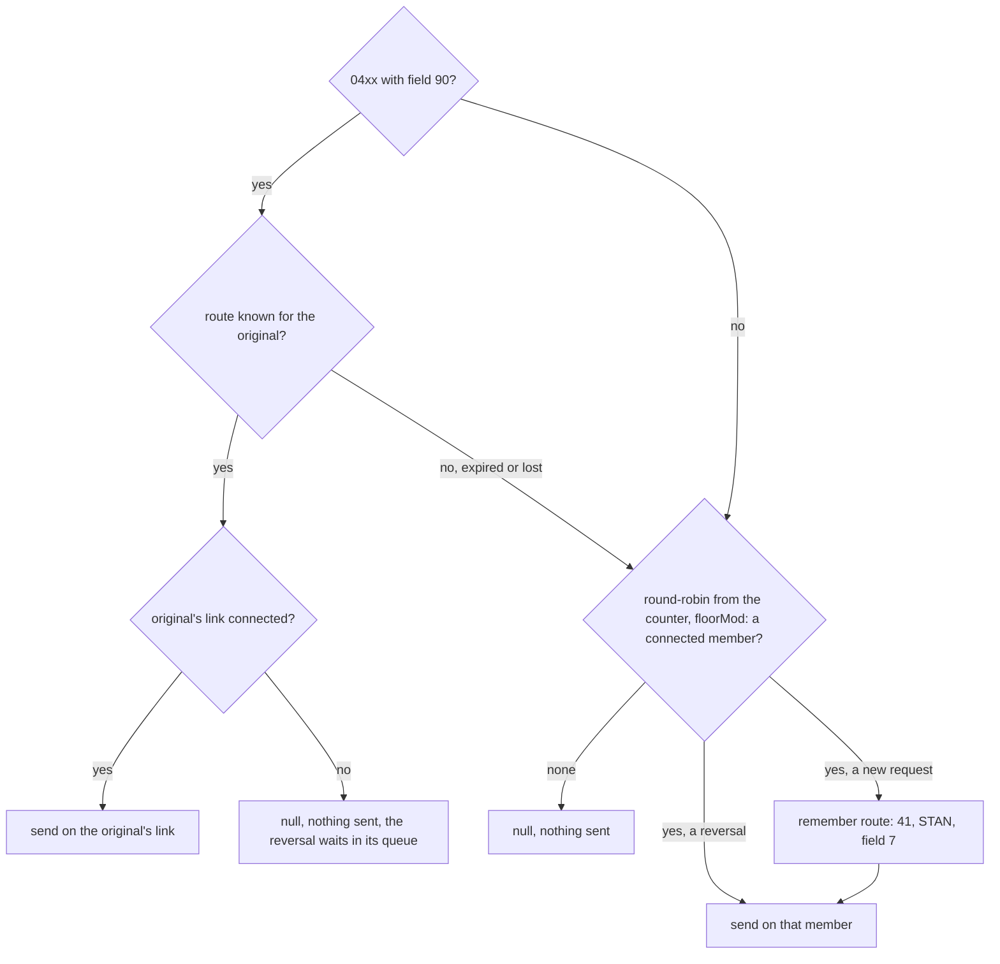

Usability here is `isConnected()`. To keep unsigned links out as well, test the enabled mark the way
`check-enabled` does (14.3), in the adaptors' space, before choosing a member.

Your code sets field 11 before the router or the pool picks a link, so the STAN can't come from
the chosen link's sequence. Use one sequence for the pool, such as `stan.host-pool` (unit c4), and
every STAN is unique on every member. A network that wants the
STANs on each connection to run without gaps needs the STAN set after the choice, inside a router
like this one.

<!-- practice 3 -->

## 14.7 Summary

- **A pool chooses a link once per request.** It never moves a request a member has taken, so a
  `null` is still an unknown outcome to reverse. A retry through the pool is a second purchase,
  often on another link that approves it at once.
- **Usable means connected, and with `check-enabled` signed on over this connection.** The enabled
  mark must be the very ready object, so a reconnect takes the link out until it signs on again. A
  hung host leaves the rotation only if read timeouts, echoes and the sign-on manager say so.
- **The strategy decides where traffic goes on failure.** `primary-secondary` fails back at once;
  `round-robin` spreads a dead member's share evenly, and its 2.1.7 counter breaks most requests
  after 2^31 increments; `split-by-divisor` and the override fall back to round-robin when their
  member is down.
- **With nothing usable, the pool polls once a second inside the request's own budget** and returns
  `null` with nothing sent. Check `isConnected()` first, and never call `request(m, 0)`.
- **A follow-up that must reach its original's host needs a router of your own**, which remembers
  each original's link and makes the follow-up wait while that link is down. The STAN is set before
  the choice, so the pool uses one sequence.

## 14.8 Reference

**What `MUXPool` 2.1.7 reads:**

| Element | Meaning |
|---|---|
| `<muxes>` | member names, looked up as `mux.<name>` once at initialisation; a missing name fails the deployment, so the pool's file sorts after its members (`25_`); redeploy the pool after a member changes (unit c4) |
| `<strategy>` | `primary-secondary` (default, also for any unknown text), `round-robin`, `round-robin-with-override`, `split-by-divisor` |
| `<space>` | where `check-enabled` reads the ready and enabled entries; default space if absent. Must be the adaptors' space: elsewhere both entries are `null`, which compare equal, and every connected link passes |
| `<property name="check-enabled">` | `true` adds the sign-on test below |
| `<split-field>` | field whose numeric value picks the member for `split-by-divisor` |
| `<follower-override>` | MTIs that `round-robin-with-override` keeps on their original's link, e.g. `0420 0421` |
| `<original-channel-field>` | field holding the ChannelAdaptor name (not the QMUX name) of the original's link; the member whose QMUX `<in>` is that adaptor's `<out>` is used if usable. A name that is not registered, or a member that is not a QMUX, makes the pool return no member at all (`null`, nothing sent). The field travels with the message: a packager with no definition for it fails the pack (`null field N packager`), so remove it in an outgoing filter or use a field the host ignores |

**Usable in 2.1.7:**

| Member | Usable when |
|---|---|
| any `MUX`, no `check-enabled` | `isConnected()` |
| a non-QMUX member (a pool of pools), with `check-enabled` | `isConnected()` |
| QMUX with one `<ready>` name, `check-enabled` | `isConnected()` and `<mux-name>.enabled` `==` the ready entry |
| QMUX with several `<ready>` names, `check-enabled` | `isConnected()` and `<mux-name>.enabled` present, whatever it holds |

**Entry points when nothing is usable:**

| Call | Result |
|---|---|
| `request(m, timeout)` | polls every second until the deadline, so at least one second, then returns `null`; nothing sent |
| `request(m, timeout, listener, handBack)` | polls the same way, then throws `ISOException("No MUX available")`; the listener is not called |
| `send(m)` | looks once, sleeps a second, then throws `ISOException("No available MUX")` |
| `isConnected()` | answers at once: true when any member is usable |
| `request(m, 0)` | calls `send(m)` and then the normal path: the message can go out twice, both copies without an expiry |

**The counter.** `round-robin`, the fallback of `split-by-divisor` and of the override share one
`int` counter. It is incremented once per round-robin choice (for the other two, only when they fall
back), once per skipped member, and once per member on every one-second poll while nothing is
usable. Past 2^31 it is negative, and every choice whose remainder is not 0 fails: `round-robin`
throws `ArrayIndexOutOfBoundsException`, while the other two catch the exception, log it and return
no member, so `request` returns `null` with nothing sent.

**JMX.** The pool's MBean shows `getMuxNames()` and `getStrategy()` (0 primary-secondary,
1 round-robin, 2 round-robin-with-override, 3 split-by-divisor). The members' QMUX counters (unit
c11) show where traffic actually went.

## 14.9 Challenges

1. Your primary link drops for a few seconds about once an hour. Compare `primary-secondary` with
   and without `check-enabled`, and with `round-robin`: how many requests move during each blip, and
   how many unknown outcomes does each choice produce?
2. A round-robin pool of four links runs at 400 requests a second, and one link is down for 20
   minutes every night with nothing usable for one minute of that. How long until the counter wraps?
   Work it out, then decide when to schedule restarts.
3. Two data centres replicate within 3 seconds. Is that "sharing state" for reversals? Which
   reversals could still arrive before their original is known, and what would you measure to
   decide between the pool and a router of your own?
4. `StickyRouter` keeps routes in a Space. Design the same memory as a column in the transaction
   table instead. What becomes simpler, and what happens to a reversal whose original's row has not
   been written yet?

## 14.10 Design Note: Why the Pool Knows Only "Usable"

`MUXPool` knows nothing about hosts or data centres, only one bit per member: usable or not
(14.3). Writing the bit is someone else's job: the adaptor writes the ready entry, and the sign-on
manager writes and removes the enabled mark.

That split keeps the pool under 300 lines in 2.1.7. The adaptor and the sign-on manager need not
know the pool exists; they only follow its convention, the `<mux-name>.enabled` key and the
identity rule. A failure the pool should react to needs a component that turns it into
the bit, not a change to the pool.

The price is that the pool cannot link a message to an earlier one. It can route an MTI to a named
link, but it doesn't know which link carried a reversal's original, and it returns the same `null`
for "not sent" and "not answered". Those decisions need the application's knowledge, and in 2.1.7
the only place to put that knowledge is a `MUX` of your own in front of, or instead of, the pool.


# 15. The Logon Lifecycle

At 02:00 the host's operators start their weekly maintenance. They send an 0800 with code 002 on
link A, signing the link off from their side, and for the next twenty minutes the host refuses
every sign-on. The client runs the sign-on manager and the echo responder of unit c11, with two
links behind a pool that has `check-enabled`.

At 07:30 someone notices that since 02:00 half of all purchases have been declined with 91. Every
one of them went to link A. The maintenance ended more than five hours earlier.

Unit c11 built the lifecycle a client starts: sign on, echo, sign off. The rest of it is started by
the host or goes wrong on the way, in five rules, one per section from 15.1 to 15.5.

## 15.1 The Host Starts Network Messages Too, and Each One Needs Its Own Answer

The examples run a real Q2 with unit c11's descriptors against c11's test host on 127.0.0.1, which
can now also refuse sign-ons for a while, miss an echo, answer purchases late and send its own
0800s. It declines purchases with 91 until a connection signs on, and answers echoes either way.
Links A and B sit behind a round-robin pool with `check-enabled`. A purchase goes out about every
250 ms, and the manager echoes every 4 seconds.

The 02:00 night, compressed: host A signs off at 1.0 s and refuses sign-ons for the next 8 seconds:

```text
   1.0 s  host A: sent 0800 70=002 11=000042
   1.5 s  host-mux-unhandled: 0800 70=002
   3.5 s  host A so far: purchases approved 2, declined 5; sign-ons refused 0
   5.5 s  host A so far: purchases approved 2, declined 9; sign-ons refused 0
   7.5 s  host A so far: purchases approved 2, declined 13; sign-ons refused 0
   9.5 s  host A so far: purchases approved 2, declined 17; sign-ons refused 0
  11.5 s  host A so far: purchases approved 2, declined 21; sign-ons refused 0
  13.5 s  host A so far: purchases approved 2, declined 25; sign-ons refused 0
```

The maintenance ended at 9 s. Why did nothing change?

The 002 is a request, not an answer, so QMUX hands it straight to its request listeners. c11's
responder takes only echoes, so the 002 went on to `<unhandled>` and expired there two minutes
later, unanswered. The adaptor doesn't read it either, and the connection stays open. The manager's
logon mark still holds this connection's ready object, so `decide` says "signed on", the host
answers every echo, and the enabled mark stays. The pool keeps sending A its share of the purchases,
and the host declines each one, because for the host the session is over. That lasts until the logon
mark expires, a day after the last sign-on.

The answer to a host's 0800 depends on what it asks:

```java
package com.example.jpos.client.link;

import org.jpos.core.Configurable;
import org.jpos.core.Configuration;
import org.jpos.iso.ISOException;
import org.jpos.iso.ISOMsg;
import org.jpos.iso.ISORequestListener;
import org.jpos.iso.ISOSource;
import org.jpos.space.Space;
import org.jpos.space.SpaceFactory;
import org.jpos.space.SpaceUtil;

import java.io.IOException;

/** Course code: answers the 0800s a host starts on one link. Replaces c11's responder. */
public class NetworkRequestHandler implements ISORequestListener, Configurable {
    protected Space<String, Object> sp;
    protected String muxName;

    @Override
    public void setConfiguration(Configuration cfg) {
        sp = SpaceFactory.getSpace(cfg.get("space", ""));
        muxName = cfg.get("mux", "host-mux");
    }

    @Override
    public boolean process(ISOSource source, ISOMsg m) {
        try {
            if (!m.getMTI().startsWith("080") || !m.isRequest())
                return false;                                 // (1) not ours: next listener
            ISOMsg reply = (ISOMsg) m.clone(0, 7, 11, 70);    // (2) never the whole request
            reply.setResponseMTI();
            reply.set(39, resultFor(m));
            source.send(reply);
            return true;
        } catch (ISOException | IOException e) {
            return false;
        }
    }

    protected String resultFor(ISOMsg m) {
        switch (m.hasField(70) ? m.getString(70) : "") {
            case "301":                                       // the host's echo
            case "001":                                       // the host signs on to us
                return "00";
            case "002":                                       // (3) the host signs off
                SpaceUtil.wipe(sp, muxName + ".enabled");     //     no new traffic, now
                SpaceUtil.wipe(sp, muxName + ".logon");       //     and our side signs on again
                return "00";
            default:
                return "12";                                  // (4) unknown: refuse, never approve
        }
    }
}
```

**(1) Only requests of its own kind**, 0800 and its repeat 0801. A late 0210, or the host's answer to
something, must go on to the next listener and to `<unhandled>`, as in unit c11.

**(2) A list of fields, not a copy.** A request can carry fields the host never expects back. A key
change carries a key (15.5).

**(3) A host sign-off removes both marks.** Without the enabled mark, the pool sends nothing more
to the link from the next request on. Without the logon mark, the manager's `decide` sees a
connection that never signed on and signs on again. Remove only the enabled mark, and the link
stays out of the pool until the logon mark expires, the same trap unit c11 showed for its own stop.

**(4) A function you don't know is refused.** An approval tells the host that you did what it
asked. `12` stands for whatever refusal code your network's specification gives.

The handler replaces c11's responder in `20_host_mux.xml`. QMUX creates it and passes it the
properties:

```xml
<mux class="org.jpos.q2.iso.QMUX" name="host-mux" logger="Q2">
  <in>host-receive</in>
  <out>host-send</out>
  <ready>host-channel.ready</ready>
  <unhandled>host-mux-unhandled</unhandled>
  <request-listener class="com.example.jpos.client.link.NetworkRequestHandler">
    <property name="mux" value="host-mux"/>
  </request-listener>
</mux>
```

The same night with the handler:

```text
   1.0 s  host A: sent 0800 70=002 11=000042
   1.0 s  host A: got 0810 39=00 on connection 1
   1.5 s  host-mux-unhandled: empty
   1.5 s  host A: 0800 70=001 on connection 1 -> 39=91
   2.6 s  host A: 0800 70=001 on connection 1 -> 39=91
   3.5 s  host A so far: purchases approved 2, declined 0; sign-ons refused 2
   3.6 s  host A: 0800 70=001 on connection 1 -> 39=91
   4.6 s  host A: 0800 70=001 on connection 1 -> 39=91
   5.5 s  host A so far: purchases approved 2, declined 0; sign-ons refused 4
   5.6 s  host A: 0800 70=001 on connection 1 -> 39=91
   6.6 s  host A: 0800 70=001 on connection 1 -> 39=91
   7.5 s  host A so far: purchases approved 2, declined 0; sign-ons refused 6
   7.6 s  host A: 0800 70=001 on connection 1 -> 39=91
   8.6 s  host A: 0800 70=001 on connection 1 -> 39=91
   9.5 s  host A so far: purchases approved 2, declined 0; sign-ons refused 8
   9.6 s  host A: 0800 70=001 on connection 1 -> 39=00
  11.5 s  host A so far: purchases approved 6, declined 0; sign-ons refused 8
  13.5 s  host A so far: purchases approved 10, declined 0; sign-ons refused 8
```

A left the pool the moment the 002 arrived, and no purchase was declined: B carried everything until
A's sign-on was accepted at 9.6 s. The cost is a refused sign-on every second.

Hosts also send **advices**: an 0820 reports something that has already happened, such as a cutover
to a new business day. There is nothing to refuse, so on most networks an advice and its repeat 0821
are acknowledged with an 0830 and `39=00`. `setResponseMTI` maps both:

```text
0820 isRequest true, setResponseMTI -> 0830
0821 isRequest true, setResponseMTI -> 0830
```

The handler above leaves 0820s to the next listener, so they end on `<unhandled>`, and a host that
wants them acknowledged repeats each one as an 0821. If your host sends advices, add a branch for
them.

The listener runs on the adaptor's receiver, the thread that put the message on the QMUX's `<in>`
queue. Nothing else is read from the link while it works, so anything slow, such as a call to a
hardware security module across the network, delays every answer behind it.

> **Networks differ.** Links on ISO 8583:1993 or later use 1804 and 1814, and a function code in
> field 24 instead of field 70, with codes of their own. The rules of this unit stay the same.

## 15.2 A Refused Sign-On Waits Longer Each Time

After a refusal, wait before the next sign-on. Double the wait after each further refusal, stop at a
cap, and start from the beginning after a success. Host A's sign-on lines and two of its counts on
the same night, with a wait of 1 second after the first refusal and a cap of 8 seconds:

```text
   1.0 s  host A: sent 0800 70=002 11=000042
   1.0 s  host A: got 0810 39=00 on connection 1
   1.5 s  host A: 0800 70=001 on connection 1 -> 39=91
   2.5 s  host A: 0800 70=001 on connection 1 -> 39=91
   4.5 s  host A: 0800 70=001 on connection 1 -> 39=91
   8.5 s  host A: 0800 70=001 on connection 1 -> 39=91
  15.5 s  host A so far: purchases approved 2, declined 0; sign-ons refused 4
  16.5 s  host A: 0800 70=001 on connection 1 -> 39=00
  21.5 s  host A so far: purchases approved 12, declined 0; sign-ons refused 4
```

Four refusals instead of eight, at waits of 1, 2, 4 and 8 seconds. The host was ready again at 9 s,
though, and A came back at 16.5 s. The cap is also the longest a link can stay out after its host
has recovered.

With c11's loop, which asks on every pass, a twenty-minute maintenance window puts about 1200
refused sign-ons in the host's log, and as many lines in yours. With a wait of 5 seconds doubling to
a cap of 5 minutes, it is about ten, and the link is back at most 5 minutes after the host. With
another link in the pool the cap costs little; on a link that carries traffic alone, choose a
smaller one.

A sign-on that gets no answer at all counts as a refusal too. Its timeout (30 seconds by default,
unit c11) already spaces the attempts out, and the wait adds to it. The manager keeps two values per
link: refusals in a row, and the earliest time of the next attempt. The LOGON branch of c11's `step`
skips the link until that time, and a success clears both. Log a change of state, from signed on to
refused and back, not every attempt.

### 15.2.1 Spot the Problem: Doubling by Shifting

The obvious way to double is a shift:

```java
static long delay(long base, long max, int refusals) {
    return Math.min(base << (refusals - 1), max);       // base, 2 x base, 4 x base, ...
}
```

It passes a test with ten refusals. Does it pass one with a hundred? Beside it is a version that
doubles step by step and stops at the cap, both with a base of 5 seconds and a cap of 5 minutes. The
hours are the time the step-by-step version has spent waiting by then:

```text
refusal  1 after  0.00 h: shift    5000 ms, step by step   5000 ms
refusal  2 after  0.00 h: shift   10000 ms, step by step  10000 ms
refusal  3 after  0.00 h: shift   20000 ms, step by step  20000 ms
refusal  4 after  0.01 h: shift   40000 ms, step by step  40000 ms
refusal  5 after  0.02 h: shift   80000 ms, step by step  80000 ms
refusal  6 after  0.04 h: shift  160000 ms, step by step 160000 ms
refusal  7 after  0.09 h: shift  300000 ms, step by step 300000 ms
refusal  8 after  0.17 h: shift  300000 ms, step by step 300000 ms
...
refusal 51 after  3.75 h: shift  300000 ms, step by step 300000 ms
refusal 52 after  3.84 h: shift -7187745005283311616 ms, step by step 300000 ms
refusal 53 after  3.92 h: shift  300000 ms, step by step 300000 ms
refusal 64 after  4.84 h: shift       0 ms, step by step 300000 ms
refusal 65 after  4.92 h: shift    5000 ms, step by step 300000 ms
refusal 66 after  5.00 h: shift   10000 ms, step by step 300000 ms
```

From refusal 52 the shift no longer fits in a `long`: the delay turns negative, `Math.min` keeps it,
and the next pass signs on at once. Java uses only the low six bits of a shift count, so refusal 64
shifts by 63 and gives 0, and refusal 65 shifts by 0 and starts again at 5 seconds. Every 64
refusals the client sends a burst of sign-ons.

Double step by step instead, and stop doubling once the cap is reached. Then no refusal count can
produce more than the cap.

<!-- practice 1 -->

## 15.3 One Lost Echo Is Not a Dead Host

c11's manager took a link out after one unanswered echo. Instead, count the failures in a row, and
take the link out only at a limit. Here host A misses a single echo. The manager echoes every 3
seconds with a timeout of 2 seconds, with a limit of 1 (c11) and then 2:

```text
   0.0 s  host A: will miss the next echo
   3.5 s  host A: 0800 70=301 on connection 1 -> no answer
   5.5 s  host-mux.enabled removed
   6.5 s  host A: 0800 70=001 on connection 1 -> 39=00
   6.5 s  host-mux.enabled written again
  10.5 s  host A: 0800 70=301 on connection 1 -> 39=00
  12.0 s  purchases with no answer: 0; host A sign-ons: 2
```

```text
   0.0 s  host A: will miss the next echo
   2.5 s  host A: 0800 70=301 on connection 1 -> no answer
   5.5 s  host A: 0800 70=301 on connection 1 -> 39=00
   8.5 s  host A: 0800 70=301 on connection 1 -> 39=00
  12.0 s  purchases with no answer: 0; host A sign-ons: 1
```

With a limit of 1 a healthy link left the pool, signed on again, and came back a second later. B
took the traffic for that second; with a single link, nothing could be sent in it. Echoes do get
lost on a busy host, and with a limit of 1 each one costs that much.

After a failed echo the echo mark is still absent, so the next pass echoes again, not an echo
interval later: failures in a row come one timeout plus one pass of the loop apart. One answered
echo sets the count back to zero. A count of failures in total would sooner or later take a healthy
link out over lost echoes spread across a week.

Now host A's application hangs, while 10 purchases a second go through the pool, half of them to A.
With limits of 1, 2 and 3:

```text
   0.0 s  host A: the application hangs
   4.5 s  host-mux.enabled removed
  14.0 s  purchases with no answer: 22; host A sign-ons: 1
```

```text
   0.0 s  host A: the application hangs
   8.5 s  host-mux.enabled removed
  14.0 s  purchases with no answer: 43; host A sign-ons: 1
```

```text
   0.0 s  host A: the application hangs
  10.5 s  host-mux.enabled removed
  16.0 s  purchases with no answer: 53; host A sign-ons: 1
```

Until the limit is reached the link stays in the pool, and every purchase sent to it is an unknown
outcome that has to be reversed (unit c12). Each failure the limit allows adds one echo timeout,
plus a pass, of that. With c11's default timeout of 30 seconds and a limit of 3, that is more than a
minute and a half of purchases sent to a dead host, on top of the wait for the first echo, which can
be a whole echo interval.

Size the limit by what is behind the link. With another link to fail over to, use 1 or 2: a false
alarm costs a second of rerouting. On a single link, taking it out stops all traffic, so allow a
little more.

<!-- practice 2 -->

## 15.4 Drain a Link Before You Sign It Off

c11's stop takes the link out of the pool, signs it off and forgets the session, in that order, and
does nothing about requests already on the link. Here Q2 is stopped for a release while a purchase
waits for an answer that the host sends after 1.5 seconds. Q2 undeploys in reverse file-name order:
the manager (`30_`) first, then the QMUX (`20_`), then the adaptor (`10_`):

```text
   0.0 s  host: 0200 11=000701 on connection 1, will answer 39=00 in 1500 ms
   0.3 s  Q2 shutting down
   0.3 s  host: 0800 70=002 on connection 1 -> 39=00
   0.3 s  Q2 stopped
   1.5 s  host: answer to 11=000701 lost: the connection is closed
   5.0 s  purchase -> null
```

Who has the money?

The host approved the purchase, and its answer found the connection closed. The caller waited out
its 5-second timeout, got `null`, and by unit c12's rule has to reverse a purchase that went
through, while the cardholder is told it failed. On a busy link a stop does that to every purchase
in flight, several at each release.

So wait between taking the link out and signing it off. QMUX counts the requests still waiting for
an answer: `getRXPending()`. Disable the link first, so nothing new arrives, then pause until that
count is zero, checking before the first pause so an idle link signs off at once. Bound the wait: a
request that never gets an answer counts until its own timeout ends, so the longest request timeout
plus a margin is enough (QMUX can hold a request up to 10 seconds past its timeout when an answer
races with it). The same stop with a drain of up to 10 seconds:

```text
   0.0 s  host: 0200 11=000701 on connection 1, will answer 39=00 in 1500 ms
   0.3 s  Q2 shutting down
   1.5 s  host: answered 11=000701
   1.5 s  purchase -> 0210 39=00
   1.6 s  host: 0800 70=002 on connection 1 -> 39=00
   1.6 s  Q2 stopped
```

Q2 waited for the manager's stop before it undeployed the QMUX and the adaptor, so the answer came
back over a live connection. The order is now **disable, drain, sign off, forget**. When the bound
runs out with requests still pending, sign off anyway and log how many were left, since each of them
is going to be reversed. To take one link out for maintenance without stopping the process, run the
same four steps for that link and stop its adaptor afterwards.

<!-- practice 3 -->

## 15.5 A New Key Is Acknowledged Only Once It Is Installed

Unit c7 imported a PIN key received under the ZMK and checked it by its check value. On many
networks that key arrives in a network message. Here the host sends an 0800 with code 161, and field
48 holds the new key under the ZMK (32 hex digits) followed by its check value (6 hex digits). The
handler of 15.1 refuses code 161, so a subclass installs the key:

```java
package com.example.jpos.client.link;

import org.jpos.iso.ISOMsg;
import org.jpos.iso.ISOUtil;
import org.jpos.security.SMAdapter;
import org.jpos.security.SMException;
import org.jpos.security.SecureDESKey;
import org.jpos.util.NameRegistrar;

import java.util.Arrays;

/**
 * Course code: also answers this network's key change, an 0800 with 70=161 whose field 48 holds
 * the new PIN key under the ZMK (32 hex digits) and its check value (6 hex digits).
 */
public class ZpkChangeHandler extends NetworkRequestHandler {
    @Override
    protected String resultFor(ISOMsg m) {
        if ("161".equals(m.getString(70)))
            return installed(m) ? "00" : "12";       // 00 only once the key is in place
        return super.resultFor(m);
    }

    private boolean installed(ISOMsg m) {
        try {
            @SuppressWarnings("unchecked")
            SMAdapter<SecureDESKey> hsm = (SMAdapter<SecureDESKey>) NameRegistrar.get("hsm");
            SecureDESKey zmk = (SecureDESKey) NameRegistrar.get("zmk." + muxName);
            String f48 = m.getString(48);
            byte[] underZmk = ISOUtil.hex2byte(f48.substring(0, 32));
            byte[] checkValue = ISOUtil.hex2byte(f48.substring(32, 38));
            SecureDESKey zpk = hsm.importKey(SMAdapter.LENGTH_DES3_2KEY, SMAdapter.TYPE_ZPK,
                    underZmk, zmk, true);
            if (!Arrays.equals(zpk.getKeyCheckValue(), checkValue))
                return false;                        // damaged, or not the key announced
            sp.put("zpk." + muxName, zpk);           // where the PIN translation reads it
            return true;
        } catch (NameRegistrar.NotFoundException | SMException | RuntimeException e) {
            return false;                            // the old key stays in use
        }
    }
}
```

The security module is c7's `hsm`, and the ZMK, under the module's LMK, was registered at start-up
by whatever loads your keys. The host sends two key changes, and the second is damaged on the way:

```text
   0.0 s  host: new ZPK, check value C93580
   0.0 s  host: sent 0800 70=161 11=000051
   0.0 s  host: got 0810 39=00 on connection 1
   0.5 s  client: zpk.host-mux check value C93580
   0.5 s  host: new ZPK, check value 92EA9A (field 48 damaged on the way)
   0.5 s  host: sent 0800 70=161 11=000052
   0.5 s  host: got 0810 39=12 on connection 1
   1.0 s  client: zpk.host-mux check value C93580
```

The 0810 with `00` is the host's signal to switch. From the moment the network defines (at once,
from the next message, or after a confirmation), the host translates PINs to the new key. Answer
`00` before the key is stored, and a failed import leaves the host on a key you don't have: every
PIN purchase is declined 55, as in unit c7, and to the host it looks like your fault. So the handler
imports, compares the check value, stores, and only then answers. When anything fails, the answer is
a refusal and the old key stays, so PIN traffic continues under it.

The handler above overwrites the previous key. A host that may still send messages under it for a
while needs the previous key kept as well, until no request in flight can be using it. Field 48
never goes back to the host: the answer is built from fields 7, 11 and 70 (15.1). Keep it out of
the logs too, even though it is encrypted. The `wipe` list of the `ProtectedLogListener` (unit c8)
covers the message, but the 2.1.7 security module logs its own `s-m-operation` event for every
import, with the encrypted key in it, to whatever logger the `hsm` has.

> **Networks differ.** Some let the client ask for a new key with an 0800 and send the key in the
> 0810. The code, the field, the layout and the moment the new key becomes active are all in your
> network's specification.

<!-- practice 4 -->

## 15.6 The Lifecycle Is a Handful of States, and the Marks Say Which

Unit c11 kept the lifecycle as marks in the Space and decided each pass from them. Drawn as states
of one link, with the section that owns each transition:

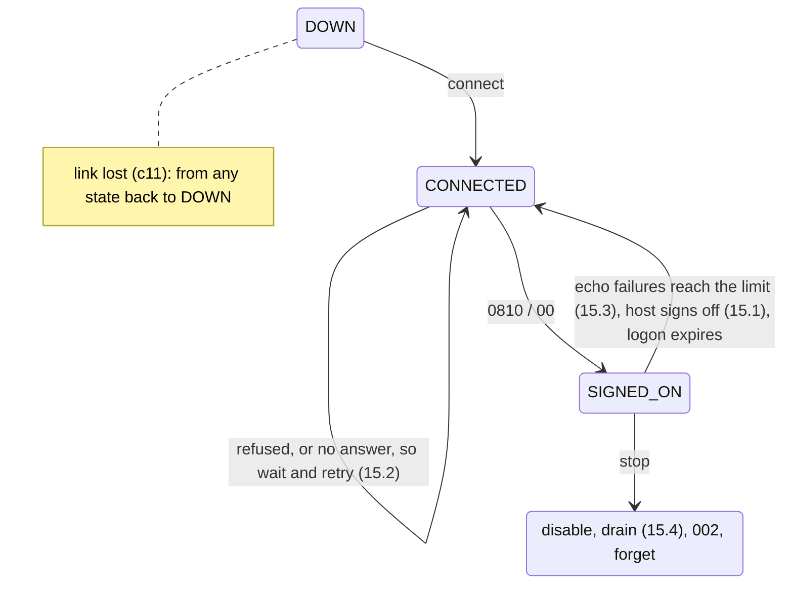

| State | Ready entry | `<mux>.logon` | `<mux>.enabled` | Pool uses the link |
|---|---|---|---|---|
| DOWN | absent | absent, or another connection's object | absent | no |
| CONNECTED | a new `Date` | absent, or another connection's object | absent | no |
| SIGNED_ON | the `Date` | the same `Date` | the same `Date` | yes |
| stopping | the `Date` | the same `Date` | absent | no |

Answered echoes keep a link in SIGNED_ON. A key change (15.5) and a host sign-on (`001` from the
host) change no mark.

`LifecycleManager`, the class our runs deployed, is c11's `LogonManager` with the changes of 15.2
to 15.4. It reads four new properties:

```xml
<logon-manager name="host-logon" class="com.example.jpos.client.link.LifecycleManager" logger="Q2">
  <property name="mux" value="host-mux"/>
  <property name="stan-space" value="je:stan"/>
  <property name="stan-key" value="stan.host"/>
  <property name="timeout" value="30000"/>
  <property name="echo-interval" value="300000"/>
  <property name="logon-interval" value="86400000"/>
  <property name="retry-base" value="5000"/>
  <property name="retry-max" value="300000"/>
  <property name="echo-failure-limit" value="2"/>
  <property name="drain-time" value="45000"/>
</logon-manager>
```

<!-- practice 5 -->

## 15.7 Summary

- **The host starts network messages too.** Answer each 0800 by its function, through the `source`
  you are given and from a list of fields. A host sign-off removes the enabled and logon marks, so
  the pool stops at once and the manager signs on again. Unknown functions are refused; advices are
  acknowledged with an 0830.
- **A refused sign-on waits longer each time**, doubling up to a cap and starting over after a
  success. The cap is also how long a link may stay out after its host recovers. A shift that
  doubles overflows after a few hours of outage.
- **One lost echo is not a dead host.** Count failures in a row. Each failure the limit allows
  keeps a dead host in the pool for one more echo timeout, and every purchase sent there is
  reversed.
- **Drain before you sign off**: disable, wait (bounded) until `getRXPending()` is zero, sign off,
  forget. A stop without the drain turns approvals in flight into reversals.
- **A new key is acknowledged only once it is installed**: import, compare the check value, store,
  then answer `00`. A failure is refused and the old key stays.

## 15.8 Reference

**Network management MTIs (ISO 8583:1987):**

| MTI | Meaning | Answered by |
|---|---|---|
| `0800` / `0801` | network management request / its repeat | `0810` |
| `0820` / `0821` | network management advice / its repeat | `0830`, usually `39=00` |

**Field 70 codes** (n 3). `001`, `002` and `301` are common to most specifications. The others are
examples; your network's specification is the authority:

| Code | Meaning | Usually sent by |
|---|---|---|
| `001` | sign-on | the acquirer after each connect; some hosts too |
| `002` | sign-off | either side, before a planned stop |
| `301` | echo test | either side, while the link is quiet |
| `161` | key change | network-specific |
| `162` | new key or key verification | network-specific |
| `201` | cutover to a new business day | the host, often as an 0820 |

**What the client answers:**

| Received | Answer | Also |
|---|---|---|
| `0800` or `0801` / `301` | `0810`, `39=00` | nothing |
| `0800` or `0801` / `001` | `0810`, `39=00` | nothing |
| `0800` or `0801` / `002` | `0810`, `39=00` | remove `<mux>.enabled` and `<mux>.logon` |
| `0800` or `0801` key change | `0810`, `00` once the key is stored, else a refusal | never send the key back |
| `0800` or `0801`, other code | `0810` with your network's refusal code | nothing more |
| `0820` / `0821` | `0830`, usually `39=00` | act on it, such as a cutover |
| anything else | nothing: return `false` | the next listener or `<unhandled>` gets it |

**The manager's new properties** (in addition to unit c11's):

| Property | Example | Meaning |
|---|---|---|
| `retry-base` | 5000 ms | the wait after the first refused sign-on |
| `retry-max` | 300000 ms | the cap on that wait |
| `echo-failure-limit` | 2 | failed echoes in a row before the link is taken out |
| `drain-time` | 45000 ms: the longest request timeout plus a margin | the longest the stop waits for requests in flight |

`QMUX.getRXPending()` is the number of requests waiting for an answer on that QMUX, from
`request` and from asynchronous requests alike. It drops when the answer arrives or the request's
timeout ends.

## 15.9 Challenges

1. Your host answers echoes in 200 ms on a normal day and in up to 12 seconds during its batch
   window at 23:00. Choose the echo timeout and the limit for a pool of two links, and for a single
   link. What does each choice cost at 23:00, and on the night the host really dies?
2. Forty clients sign on to the same host, all with the same base and cap. The host restarts. Draw
   when their sign-ons arrive. What would adding a random part to each wait change, and how would
   you test it without a clock?
3. A release stops Q2 with `drain-time` 90 seconds while the host is hung. What does the operator
   see during those 90 seconds, and what would you log at the end so the reversals that follow are
   no surprise?
4. A host changes the PIN key every day at 02:00, and its 0810 means "switch now". List the
   messages in flight at that moment whose PIN blocks are under the old key, and decide how long the
   client keeps that key.

## 15.10 Design Note: Why Management Travels With the Payments

The 0800s share the link with the purchases: the same adaptor, the same QMUX, the same STAN sequence
and the same host application. Much of this unit is the price of that choice. A slow echo looks the
same as a slow purchase, a sign-off can overtake a purchase that went out first, and a key change
arrives in the middle of traffic that depends on the old key.

A separate management channel would avoid that, but for the lifecycle of a link the shared path is
the point. An echo that comes back proves that the path a purchase takes can carry a message right
now, which is what the pool needs to know. An echo on another channel would prove only that the
other channel works. A sign-on, too, is tied to the connection it travels on, which is what lets
unit c11 compare one object with another to know which connection is signed on.

# 16. Simulators and Test Harnesses

Certification with the acquirer is booked for two slots of three hours each. The acquirer's script
has forty cases. Card `5555555555554444` must be declined with `05`. A purchase over 500.00 must
be declined with `51`, and one of exactly 500.00 approved. For 777.00 the acquirer's test host
stays silent, and the client has to reverse the purchase before the case passes. 888.00 is
approved after 1.5 seconds. Each failed case costs slot time, and a third slot costs money.

Before the first slot the team runs the same cases every night against a simulator on 127.0.0.1,
and they pass. In the first slot the silent-host case fails: the client never sent a reversal. The
simulator had answered 777.00 with `51` every night, so the reversal path had never run.

A simulator, a proxy or a test harness can disagree with the real host while the build stays
green. This unit's five rules:

1. A simulator's rules are data, and the first rule that matches decides.
2. A listener runs on the session's thread, so a late answer is scheduled, never slept.
3. The simulator is a witness: ask it what the client sent.
4. A proxy may answer only for a request that never left.
5. A scripted case grades every field and reports every failure.

Unit c10's stand-ins live inside the test. The tools here run beside the system while you develop
and certify it. Every output comes from jPOS 2.1.7, with the simulator, the client's `host-channel`
and its `host-mux` deployed by one Q2 in one JVM.

## 16.1 A Simulator's Rules Are Data, and the First Rule That Matches Decides

A simulator that a team shares gets a new case every week. If its behaviour is code, each new case
waits for a developer, a build and a redeploy. If it is a table in the deploy descriptor, the tester
adds a line.

The team's nightly table has one rule per line: conditions, an arrow, actions.

```text
pan=5555555555554444             -> rc=05
mti=0200 amount=50001-99999999   -> rc=51
mti=0200 amount=77700-77700      -> silent
mti=0200 pcode=31                -> rc=00 54=1001840C000000012345
any                              -> rc=00 38=A1B2C3
```

Amounts are in minor units, as in field 4, and a range includes both of its ends. Which rule
answers a purchase of 777.00?

The simulator tries the rules from the top, and the first match answers. 777.00 is inside
`50001-99999999`, so the second rule answers `51` and the third never runs. Six requests, against
that table and then with the silent rule moved to the top (card's first digits, field 3, field 4,
answer):

```text
silent rule last:
  4111  000000  000000012000  0210 39=00 38=A1B2C3
  5555  000000  000000012000  0210 39=05
  4111  000000  000000050000  0210 39=00 38=A1B2C3
  4111  000000  000000050001  0210 39=51
  4111  000000  000000077700  0210 39=51
  4111  310000  000000000000  0210 39=00 54=1001840C000000012345
silent rule first:
  4111  000000  000000012000  0210 39=00 38=A1B2C3
  5555  000000  000000012000  0210 39=05
  4111  000000  000000050000  0210 39=00 38=A1B2C3
  4111  000000  000000050001  0210 39=51
  4111  000000  000000077700  silent
  4111  310000  000000000000  0210 39=00 54=1001840C000000012345
```

The first run is the nightly one: it answers every request, so the silent case never happens.

Why not let the most specific rule win? A tester can't check "most specific" by eye: is a card
rule more specific than an amount range? First-match can be checked by reading from the top. So put
exceptions first, ranges after them, and `any` last.

The simulator is an `ISORequestListener`, like unit c10's `LoopbackHost`. `QServer` creates it
with its no-arg constructor and hands it its `<property>` elements through `Configurable`:

```java
package com.example.jpos.client.sim;

import org.jpos.core.Configurable;
import org.jpos.core.Configuration;
import org.jpos.core.ConfigurationException;
import org.jpos.iso.ISOException;
import org.jpos.iso.ISOMsg;
import org.jpos.iso.ISORequestListener;
import org.jpos.iso.ISOSource;
import org.jpos.space.Space;
import org.jpos.space.SpaceFactory;

import java.util.ArrayList;
import java.util.LinkedHashMap;
import java.util.List;
import java.util.Map;
import java.util.concurrent.Executors;
import java.util.concurrent.ScheduledExecutorService;
import java.util.concurrent.TimeUnit;

/** A host simulator driven by an ordered table of rules: the first rule that matches answers. */
public class RuleHost implements ISORequestListener, Configurable {
    private static final List<String> CONDITIONS = List.of("any", "mti", "pan", "pcode", "amount");

    record Rule(String text, Map<String, String> when, Map<String, String> then) { }

    private final List<Rule> rules = new ArrayList<>();
    private final ScheduledExecutorService later = Executors.newSingleThreadScheduledExecutor(r -> {
        Thread t = new Thread(r, "rule-host-late");
        t.setDaemon(true);
        return t;
    });
    private Space<String, Object> sp;
    private String seen;                                 // queue of what the host received

    @Override
    public void setConfiguration(Configuration cfg) throws ConfigurationException {
        rules.clear();
        for (String text : cfg.getAll("rule"))          // a repeated property, in order
            rules.add(parse(text));
        sp = SpaceFactory.getSpace(cfg.get("space", "tspace:default"));
        seen = cfg.get("seen", null);
    }

    static Rule parse(String text) throws ConfigurationException {
        String[] sides = text.split("->");
        if (sides.length != 2)
            throw new ConfigurationException("rule without '->': " + text);
        Map<String, String> when = words(sides[0]), then = words(sides[1]);
        for (String k : when.keySet())
            if (!CONDITIONS.contains(k))
                throw new ConfigurationException("unknown condition '" + k + "' in: " + text);
        for (Map.Entry<String, String> a : then.entrySet())
            if (!a.getKey().matches("rc|silent|late|\\d+") || a.getValue().isEmpty() != a.getKey().equals("silent"))
                throw new ConfigurationException("bad action '" + a.getKey() + "' in: " + text);
        if (!then.containsKey("rc") && !then.containsKey("silent"))
            throw new ConfigurationException("rule needs rc= or silent: " + text);
        return new Rule(text.trim(), when, then);
    }

    private static Map<String, String> words(String s) {
        Map<String, String> m = new LinkedHashMap<>();
        for (String w : s.trim().split("\\s+")) {
            String[] kv = w.split("=", 2);
            m.put(kv[0], kv.length > 1 ? kv[1] : "");
        }
        return m;
    }

    static boolean matches(Rule rule, ISOMsg m) throws ISOException {
        for (Map.Entry<String, String> c : rule.when().entrySet()) {
            String v = c.getValue();
            boolean ok = switch (c.getKey()) {
                case "mti" -> v.equals(m.getMTI());
                case "pan" -> v.equals(m.getString(2));
                case "pcode" -> m.hasField(3) && m.getString(3).startsWith(v);
                case "amount" -> {                       // lo-hi in minor units, both ends included
                    String[] r = v.split("-");
                    long amount = Long.parseLong(m.getString(4));
                    yield amount >= Long.parseLong(r[0]) && amount <= Long.parseLong(r[1]);
                }
                default -> true;                         // any
            };
            if (!ok)
                return false;
        }
        return true;
    }

    /** The first rule that matches, or null. */
    Rule decide(ISOMsg m) throws ISOException {
        for (Rule rule : rules)
            if (matches(rule, m))
                return rule;
        return null;
    }

    @Override
    public boolean process(ISOSource source, ISOMsg m) {
        try {
            if (!m.isRequest())
                return false;                            // a response is not ours to answer
            if (seen != null)
                sp.out(seen, m.clone(), 60000L);         // what the client sent, kept for a minute
            Rule rule = decide(m);
            if (rule == null)
                return false;                            // let the next listener try
            if (rule.then().containsKey("silent"))
                return true;                             // handled: the host says nothing
            ISOMsg r = (ISOMsg) m.clone();               // never change the request itself
            r.setResponseMTI();
            r.unset(35, 45, 52, 55);                     // no card secrets in an answer
            for (Map.Entry<String, String> a : rule.then().entrySet()) {
                if (a.getKey().equals("rc")) r.set(39, a.getValue());
                else if (a.getKey().matches("\\d+")) r.set(Integer.parseInt(a.getKey()), a.getValue());
            }
            long late = Long.parseLong(rule.then().getOrDefault("late", "0"));
            if (late > 0)
                later.schedule(() -> send(source, r), late, TimeUnit.MILLISECONDS);
            else
                send(source, r);
            return true;
        } catch (ISOException | NumberFormatException e) {
            return false;                                // no MTI, or an amount that isn't a number
        }
    }

    private static void send(ISOSource source, ISOMsg r) {
        try {
            if (source.isConnected())
                source.send(r);
        } catch (Exception e) {
            // the client went away; a real host would log it
        }
    }
}
```

The answer is a clone, so the request the session holds is unchanged (unit c10 showed what a
stand-in that answers with the request itself hides). A `silent` rule returns `true`: handled, by
saying nothing. When no rule matches, `process` returns `false` and `ISOServer`
offers the message to its next listener, so end the table with `any`.

Amounts are compared as numbers: field 4 is twelve zero-padded digits and the bounds are not, so
as text `000000077700` would sort below `50001`.

**A rule that can't be read stops the deploy.** Suppose a tester types `amout=` in the over-limit
rule. A parser that skips unknown words reads the rule as "every 0200 gets `51`". One that
skips the whole rule approves every purchase over 500.00, and the nightly run stays green until the
over-limit case meets the real host. `parse` refuses instead:

```text
refused: unknown condition 'amout' in: mti=0200 amout=50001-99999999 -> rc=51
refused: bad action 'rc' in: pan=5555555555554444 -> rc 05
refused: rule without '->': pan=5555555555554444 rc=05
```

Each rule is one repeated `rule` property, and `cfg.getAll("rule")` returns them in descriptor
order:

```xml
<server name="host-simulator" class="org.jpos.q2.iso.QServer" logger="Q2">
  <attr name="port" type="java.lang.Integer">${sim.port:8000}</attr>
  <channel class="org.jpos.iso.channel.ASCIIChannel" logger="Q2" realm="host-simulator"
           packager="org.jpos.iso.packager.GenericPackager">
    <property name="packager-config" value="jar:packager/iso87ascii.xml"/>
  </channel>
  <request-listener class="com.example.jpos.client.sim.RuleHost" logger="Q2">
    <property name="seen" value="host-simulator.seen"/>
    <property name="rule" value="pan=5555555555554444             -> rc=05"/>
    <property name="rule" value="mti=0200 amount=77700-77700      -> silent"/>
    <property name="rule" value="mti=0200 amount=88800-88800      -> rc=00 late=1500"/>
    <property name="rule" value="mti=0200 amount=50001-99999999   -> rc=51"/>
    <property name="rule" value="mti=0420                         -> rc=00"/>
    <property name="rule" value="any                              -> rc=00 38=A1B2C3"/>
  </request-listener>
</server>
```

The rest of the unit runs this simulator, saved as `deploy/50_host_simulator.xml`. With `amout=`
in it, Q2 deploys the file and the `QServer` fails to start:

```text
    error starting service
      org.jpos.core.ConfigurationException: unknown condition 'amout' in: mti=0200 amout=50001-99999999   -> rc=51
```

Nothing listens on the port, the client's link never comes up, and the client reports
`isConnected: false`. The nightly run fails at its first case, with the rule's text in the log.

Use the real host's channel class and packager. A simulator with an easier wire format hides the framing and packing problems you most want to find before certification.

<!-- practice 1 -->

## 16.2 A Listener Runs on the Session's Thread, So a Late Answer Is Scheduled

For the slow 888.00 case, the obvious simulator sleeps:

```java
if ("000000088800".equals(m.getString(4)))
    Thread.sleep(1500);                    // "the host is slow today"
```

The client, with a one-second timeout, sends the 888.00 purchase and, while it waits, a purchase
of 120.00 on the same connection. When does 120.00 get its answer?

```text
000101 (888.00): null at 1000 ms
000102 (120.00): null at 1000 ms
```

Both timed out. `ISOServer` gives each connection a session. The session reads one message, calls
the listeners on its own thread, and reads the next only when `process` has returned. While the
listener sleeps, 120.00 sits unread in the socket, and its answer leaves after the first, 1.5
seconds late too.

The same two purchases against `RuleHost`, whose rule for 888.00 is `late=1500`:

```text
000101 (888.00): null at 1000 ms
000102 (120.00): 0210 39=00 at 0 ms
```

`process` hands the late answer to a scheduler and returns, so the session reads 120.00 at once.
The answer to 888.00 still arrives after 1.5 seconds, and QMUX, with nobody waiting for it, puts it
on `host-unhandled` (unit c12).

With the sleep, one slow case became two unknown outcomes. A client that reverses on `null`
(unit c12) sends two reversals where the script expects one, and the failing case is 120.00, which
had nothing to do with the slow host. In a load run (unit c10) every session that meets a slow case
stops reading, so the run measures the simulator instead of the system. Keep sleeps out of a
simulator's listeners.

Two other faults:

- **Every answer slow.** jPOS 2.1.7's `org.jpos.iso.filter.DelayFilter` sleeps for its `delay`
  property, in milliseconds, each time a message passes. On the simulator's channel, outgoing, it
  delays every answer. It sleeps in the sending thread, on a server the session's, so it blocks the
  session as `Thread.sleep` does. Use it to size timeouts
  against a uniformly slow host, and `late` rules for one slow case.
- **The connection drops mid-purchase.** In `process`, the `ISOSource` is the session's channel, so
  a `drop` action is `((ISOChannel) source).disconnect()` followed by `return true`.

```xml
<channel class="org.jpos.iso.channel.ASCIIChannel" logger="Q2" realm="host-simulator"
         packager="org.jpos.iso.packager.GenericPackager">
  <property name="packager-config" value="jar:packager/iso87ascii.xml"/>
  <filter class="org.jpos.iso.filter.DelayFilter" direction="outgoing">
    <property name="delay" value="1500"/>
  </filter>
</channel>
```

With this channel in the simulator, both purchases above came back `null` at 1000 ms.

<!-- practice 2 -->

## 16.3 The Simulator Is a Witness: Ask It What the Client Sent

A test that checks only what the client reports can pass a client that does the wrong thing. Two
clients each send a 0200 with a one-second timeout. When no answer comes, the first sends the same
0200 again:

```java
static String retrying(MUX mux, ISOMsg p) throws Exception {
    ISOMsg r = mux.request(p, 1000);
    if (r == null) r = mux.request(p, 1000);
    return r == null ? "NO_ANSWER" : "00".equals(r.getString(39)) ? "APPROVED" : "DECLINED";
}
```

The second, `reversing`, sends an 0420 that points at the purchase through field 90, as unit c12
builds it. Both run against the 888.00 rule. Then the test takes the next two requests the
simulator received from its `seen` queue:

```java
Space<String, Object> sp = SpaceFactory.getSpace();          // the default Space, as RuleHost's
for (int i = 0; i < 2; i++) {
    ISOMsg m = (ISOMsg) sp.in("host-simulator.seen", 2000);     // waits for it, at most 2 s
    System.out.println("  host saw " + m.getMTI() + " 11=" + m.getString(11)
        + (m.hasField(90) ? " 90=" + m.getString(90) : ""));
}
```

```text
retrying:  APPROVED
  host saw 0200 11=000301
  host saw 0200 11=000301
reversing: NO_ANSWER
  host saw 0200 11=000311
  host saw 0420 11=000312 90=020000031111061015000000012345600000000000
```

The retrying client reports `APPROVED`. When the first `request` returned `null`, QMUX released
its key, so the resend was accepted and sent. It has the same key, so the *first* attempt's
approval, arriving at 1.5 seconds, matched the resend, which was still waiting. The host received
two purchases and approved both. The cardholder paid twice, and a test that asserts "approved" passes.

Only the simulator knows what crossed the wire, so the test asks it. `RuleHost` writes a clone of
every request it receives to the queue named by its `seen` property, in the default Space. A test
in the same JVM takes them in arrival order.

- **Take with a timeout.** `sp.in(key, 2000)` returns `null` after two seconds when the client sent
  nothing, so the test fails instead of hanging.
- **Let the records expire.** Each clone goes in with a lifetime of 60 seconds, so a simulator that
  runs all week doesn't keep every request it ever saw. The clones hold clear test PANs and live
  only in memory.

## 16.4 A Proxy May Answer Only for a Request That Never Left

To see what your client and the acquirer's test host say to each other, put a recording proxy
between them: a `QServer` your client connects to, whose listener forwards each request through a
QMUX to the test host, relays the answer, and logs both.

### 16.4.1 Spot the Problem: The Proxy That Helped

A first version has no answer to relay in two situations, and answers both the same way:

```java
package com.example.jpos.client.sim;

import org.jpos.core.Configurable;
import org.jpos.core.Configuration;
import org.jpos.iso.ISOMsg;
import org.jpos.iso.ISORequestListener;
import org.jpos.iso.ISOSource;
import org.jpos.iso.MUX;
import org.jpos.util.NameRegistrar;

/** The proxy that "helps": it answers 91 whenever it has nothing better. */
public class EagerProxy implements ISORequestListener, Configurable {
    private String muxName;
    private long timeout;

    @Override
    public void setConfiguration(Configuration cfg) {
        muxName = cfg.get("mux", "upstream-mux");
        timeout = cfg.getLong("timeout", 30000L);
    }

    @Override
    public boolean process(ISOSource source, ISOMsg request) {
        try {
            MUX mux = NameRegistrar.getIfExists("mux." + muxName);
            ISOMsg response = mux != null && mux.isConnected()
                ? mux.request(request, timeout)                // (1)
                : null;
            if (response == null) {                            // (2)
                response = (ISOMsg) request.clone();
                response.setResponseMTI();
                response.set(39, "91");                        // (3) "the switch is down, try later"
            }
            source.send(response);
        } catch (Exception e) {
            // ignored in this version
        }
        return true;
    }
}
```

The client waits three seconds and the proxy one. What happens to the 888.00 purchase, which the
host approves after 1.5 seconds?

```text
EagerProxy, proxy waits 1000 ms, client waits 3000 ms
  client 000401: 0210 39=00 at 0 ms
  client 000402: 0210 39=91 at 1000 ms
  upstream-unhandled: 0210 11=000402 39=00
```

The client was told `91` at one second, a decline. Half a second later the host approved the
purchase, and its approval landed on the proxy's `upstream-unhandled` queue, where nobody reads it.
At a real counter the cardholder is told the payment failed, pays another way, and finds both
payments on the statement. The client got an answer, so it has nothing to reverse.

The mistake is at (2), which treats two situations as one. When the link is down, (1) sent
nothing, the host knows nothing of the purchase, and `91` is true. When `request` returns `null`,
the purchase has left, and the proxy knows as little as a client whose request timed out (unit
c12). It must not answer, so that the client's own timeout fires and the client reverses.

`RecordingProxy` keeps the two apart:

```java
package com.example.jpos.client.sim;

import org.jpos.core.Configurable;
import org.jpos.core.Configuration;
import org.jpos.iso.ISOMsg;
import org.jpos.iso.ISORequestListener;
import org.jpos.iso.ISOSource;
import org.jpos.iso.MUX;
import org.jpos.util.LogEvent;
import org.jpos.util.LogSource;
import org.jpos.util.Logger;
import org.jpos.util.NameRegistrar;

/** Sits between a client and a test host: forwards each request, relays the answer, logs both. */
public class RecordingProxy implements ISORequestListener, Configurable, LogSource {
    private String muxName;
    private long timeout;
    private Logger logger;
    private String realm;

    @Override
    public void setConfiguration(Configuration cfg) {
        muxName = cfg.get("mux", "upstream-mux");
        timeout = cfg.getLong("timeout", 30000L);
    }

    @Override
    public boolean process(ISOSource source, ISOMsg request) {
        LogEvent ev = new LogEvent(this, "proxy");
        ev.addMessage(request);                          // the ISOMsg itself: the logger masks it
        try {
            MUX mux = NameRegistrar.getIfExists("mux." + muxName);
            if (mux == null || !mux.isConnected()) {     // (1) nothing has left
                ISOMsg r = (ISOMsg) request.clone();
                r.setResponseMTI();
                r.set(39, "91");                         // issuer or switch inoperative
                source.send(r);
                ev.addMessage("upstream down, answered 91");
                return true;
            }
            ISOMsg response = mux.request(request, timeout);
            if (response == null) {                      // (2) it left, and the host may have approved it
                ev.addMessage("no answer upstream, nothing sent to the client");
                return true;
            }
            ev.addMessage(response);
            source.send(response);                       // (3) exactly as the host sent it
        } catch (Exception e) {
            ev.addMessage(e);
        } finally {
            Logger.log(ev);
        }
        return true;
    }

    @Override public void setLogger(Logger logger, String realm) { this.logger = logger; this.realm = realm; }
    @Override public String getRealm() { return realm; }
    @Override public Logger getLogger() { return logger; }
}
```

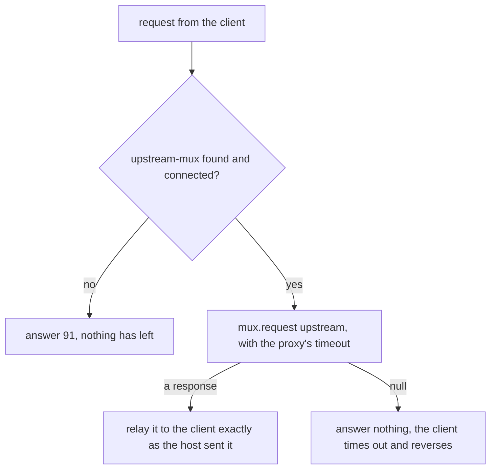

It is still not right with a one-second wait:

```text
RecordingProxy, proxy waits 1000 ms, client waits 3000 ms
  client 000401: 0210 39=00 at 0 ms
  client 000402: null at 3000 ms
  upstream-unhandled: 0210 11=000402 39=00
```

The client now reverses, which is safe. But the approval came at 1.5 seconds, while the client was
still waiting, but after the proxy had given up. A purchase that would have gone through became a
reversal. The client decides how long to wait, so the proxy must wait at least as
long:

```text
RecordingProxy, proxy waits 5000 ms, client waits 3000 ms
  client 000401: 0210 39=00 at 0 ms
  client 000402: 0210 39=00 at 1500 ms
```

**What the proxy records is not what it forwards.** The host needs the PAN, and the client needs the
answer exactly as the host sent it, so (3) relays the host's message untouched. The record is the
`LogEvent`, which carries the `ISOMsg` objects themselves, so the `ProtectedLogListener` at the
front of the `Q2` logger (unit c8, with `protect` covering field 2) masks a copy before any writer
sees it. The request shows as `outgoing` because the event is logged at the end, after the upstream
channel has sent the same object on:

```text
<log realm="proxy" at="2026-11-06T12:51:42.131643850" lifespan="2ms">
  <proxy>
    <isomsg direction="outgoing">
      <!-- org.jpos.iso.packager.GenericPackager[jar:packager/iso87ascii.xml] -->
      <field id="0" value="0200"/>
      <field id="2" value="411111______1111"/>
      <field id="3" value="000000"/>
      <field id="4" value="000000012000"/>
      <field id="7" value="1106101500"/>
      <field id="11" value="000401"/>
      <field id="32" value="123456"/>
      <field id="41" value="29110001"/>
    </isomsg>
```

Masking field 2 in the forwarded message instead would make the host decline every purchase as an
invalid card. Logging the message as a string would put the PAN in clear on disk.

Toward the test host the proxy is an ordinary client: a `ChannelAdaptor` named `upstream-channel`
with queues `upstream-send` and `upstream-receive`, like unit c1's `host-channel`, and this QMUX:

```xml
<mux name="upstream-mux" class="org.jpos.q2.iso.QMUX" logger="Q2">
  <in>upstream-receive</in>
  <out>upstream-send</out>
  <ready>upstream-channel.ready</ready>
  <unhandled>upstream-unhandled</unhandled>
</mux>
```

The server your client connects to names the listener, the QMUX and the wait:

```xml
<server name="proxy-server" class="org.jpos.q2.iso.QServer" logger="Q2">
  <attr name="port" type="java.lang.Integer">${proxy.port:8001}</attr>
  <channel class="org.jpos.iso.channel.ASCIIChannel" logger="Q2" realm="proxy-client-side"
           packager="org.jpos.iso.packager.GenericPackager">
    <property name="packager-config" value="jar:packager/iso87ascii.xml"/>
  </channel>
  <request-listener class="com.example.jpos.client.sim.RecordingProxy" logger="Q2" realm="proxy">
    <property name="mux" value="upstream-mux"/>
    <property name="timeout" value="${proxy.timeout:30000}"/>
  </request-listener>
</server>
```

### 16.4.2 One QMUX Serves Every Client of the Proxy

Two testers point their clients at one proxy. Both use the lab's terminal ID, `29110001`, and
both number STANs from the start of the day. While the first tester's 888.00 purchase waits for the
host, the second sends a purchase with the same STAN:

```text
Duplicate key 'upstream-send.0200000000029110001000501.req' detected
RESULT first client:  0210 39=00
RESULT second client: nothing within 3000 ms
```

The proxy's QMUX builds its key from the MTI and fields 41 and 11 (unit c12), and it can't tell the two clients
apart. It refused the second request, and the proxy logged the exception and sent nothing. The second
tester sees a host that didn't answer.

A recording proxy shouldn't renumber STANs the way unit c12's gateway does, because then what it
records is no longer what the client sent. Give each client its own terminal ID, or run one proxy
per client.

`mux.request` also blocks the session thread (16.2), so requests on one connection are answered
one at a time. Separate clients don't wait on each other, since each connection has its own
session.

> **Test links only.** A proxy on a production link holds every PAN that crosses it, and it falls
> under the same card-data controls as the systems on both sides.

<!-- practice 3 -->

## 16.5 A Scripted Case Grades Every Field and Reports Every Failure

A certification case is data: a request, and what its answer must carry. The answer can fail in
several fields at once, and the analyst reading the report has one slot to fix them in. A test that
asserts field by field stops at the first failure. A grader that collects every difference reports
them all in one run.

The expected values take four forms: a literal (`00`), `*` for "present, any value" (38 on an
approval), `-` for "absent" (38 on a decline), and `=` for "the request's value echoed" (11, 41):

```java
package com.example.jpos.client.sim;

import java.util.ArrayList;
import java.util.List;
import java.util.Map;
import java.util.TreeMap;

import org.jpos.iso.ISOException;
import org.jpos.iso.ISOMsg;
import org.jpos.iso.ISOUtil;

/** Grades a response field by field: a literal, "*" present, "-" absent, "=" echoed. */
public final class CaseGrader {
    private CaseGrader() { }

    public static List<String> grade(ISOMsg request, Map<Integer, String> expect, ISOMsg response)
            throws ISOException {
        if (response == null)
            return List.of("no response");
        List<String> failures = new ArrayList<>();
        for (Map.Entry<Integer, String> e : new TreeMap<>(expect).entrySet()) {   // field order
            int f = e.getKey();
            String want = e.getValue();
            String got = f == 0 ? response.getMTI() : response.getString(f);
            if (want.equals("*") && got == null)
                failures.add(f + ": expected a value, got none");
            else if (want.equals("-") && got != null)
                failures.add(f + ": expected none, got " + show(f, got));
            else if (want.equals("=") && (got == null || !got.equals(request.getString(f))))
                failures.add(f + ": expected echo " + show(f, request.getString(f)) + ", got " + show(f, got));
            else if (!want.matches("[*=-]") && !want.equals(got))
                failures.add(f + ": expected " + show(f, want) + ", got " + show(f, got));
        }
        return failures;
    }

    private static String show(int field, String value) {
        if (value == null) return "none";
        return field == 2 || field == 35 ? ISOUtil.protect(value) : value;   // reports get pasted
    }
}
```

The script sends each case through the client's `host-mux` to the simulator of 16.1, and takes
every STAN from one counter, so no case repeats a key and each one can be found in both logs:

```java
MUX mux = NameRegistrar.get("mux.host-mux", 10000);     // the client's QMUX, deployed by Q2
AtomicLong stan = new AtomicLong(700);                    // one counter: no key repeats
for (Case c : script) {
    ISOMsg request = new ISOMsg("0200");
    request.set(2, c.pan()); request.set(3, c.pcode()); request.set(4, c.amount());
    request.set(11, ISOUtil.zeropad(stan.incrementAndGet(), 6)); request.set(41, "29110001");
    ISOMsg response = mux.request(request, 2000);
    List<String> failures = CaseGrader.grade(request, c.expect(), response);
    System.out.printf("%-19s %s%n", c.name(), failures.isEmpty() ? "OK" : "FAIL " + failures);
}
```

```text
approved purchase   OK
declined card       OK
limit is inclusive  OK
over the limit      OK
wrong expectation   FAIL [2: expected 411111______1111, got 555555______4444, 38: expected a value, got none, 39: expected 00, got 05]
```

Each `Case` holds a name, the card, field 3, field 4 and the expectations. The last case is wrong
on purpose: it expects an approval, and the Visa PAN in field 2, for the card the table declines. The report lists all three differences in field order, and the card numbers in it
are protected, because reports get pasted into tickets.

A `null` response is one failure, `no response`, not one line per expected field. A case that
expects silence, like 777.00, runs outside this loop: it passes when the simulator's `seen` queue
shows the reversal (16.3).

Run the same script against the simulator on every build, and against the acquirer's test host in
the certification slot. When the two disagree, the simulator is the one to fix.

<!-- practice 4 -->

## 16.6 Summary

- **A simulator's rules are data, and the first rule that matches decides.** Put exceptions above
  ranges and `any` last. Compare amounts as numbers, and refuse a rule you can't read, so a typo
  fails the deploy instead of quietly approving.
- **A listener runs on the session's thread.** A sleep delays every later request on the
  connection. Schedule a late answer, use `DelayFilter` for a uniformly slow host, and keep the
  simulator out of a load run's measurements.
- **The simulator is a witness.** A client can report the right outcome and still double-charge.
  Assert on what the simulator received, take with a timeout, and let the records expire.
- **A proxy may answer only for a request that never left.** `91` when the link is down, silence
  when the host didn't answer, a wait at least as long as the client's, the host's answer relayed
  untouched and only the log copy masked. Its one QMUX needs distinct keys from all its clients.
- **A scripted case grades every field and reports every failure,** in field order, with card
  numbers protected and a missing answer as one failure.

## 16.7 Reference

**`RuleHost` rule syntax** (conditions, `->`, actions; words separated by spaces):

| Condition | Matches when |
|---|---|
| `any` | always |
| `mti=0200` | the MTI is exactly that |
| `pan=...` | field 2 is exactly that |
| `pcode=31` | field 3 starts with those digits |
| `amount=lo-hi` | field 4, as a number of minor units, is from `lo` to `hi`, both included |

| Action | Effect |
|---|---|
| `rc=NN` | answer with `NN` in field 39 |
| `NN=value` | also set field `NN` in the answer |
| `silent` | answer nothing, and report the request as handled |
| `late=ms` | send the answer that many milliseconds later, from a scheduler |

**What a stand-in exercises** (the first three are unit c10's):

| Stand-in | Lives | Exercises |
|---|---|---|
| fake `MUX` | inside the test | the client's decisions |
| real QMUX + queue host | inside the test | keys and matching |
| `ISOServer` on 127.0.0.1 + embedded Q2 | inside the test | your descriptors, packager and channel |
| rule-table simulator | a `QServer` beside the system | scripted cases, by people and by builds |
| recording proxy | a `QServer` between client and test host | what two real parties exchange |

**What a proxy sends the client:**

| Upstream | Sent to the host? | Proxy sends |
|---|---|---|
| answered | yes | the host's answer, unchanged |
| no answer within the proxy's wait | yes | nothing; the client times out and reverses |
| link down | no | a copy of the request with the response MTI and `39=91` |

## 16.8 Challenges

1. The acquirer's script has a case in which the host answers after 25 seconds and your client
   waits 20. Write the rule, then say what the case's expected result is: the answer, the reversal,
   or both, and how the harness checks each.
2. Your QA team wants the simulator to decline the third purchase of the day on any card. What
   state does `RuleHost` need for that, where would you keep it so that two sessions agree, and what
   does a restart of the simulator do to the case?
3. The simulator runs from a descriptor that QA edits. How would you stop a table whose `any` rule is
   not last from deploying at all, and is a rule that can never match always a mistake?
4. A partner asks you to put the recording proxy in front of their certification endpoint for a
   week. List what it holds in memory and on disk, and what you would change before agreeing.

## 16.9 Design Note: A Simulator Built From Your Own Parts

The simulator is built from the same jPOS pieces as the client: a `QServer`, the channel class and
packager from the acquirer's specification, and a listener. That makes it cheap: there is no second
tool to learn.

It also shares the client's blind spots. If the packager you copied into the simulator misreads a field, the
client and the simulator misread it the same way, and every case passes (unit c13 showed a
round-trip test failing the same way). The same holds for anything else the two share: a
misunderstanding of the specification written into the rule table is checked only against itself.
It finds faults in the client's behaviour (declines, silence, late answers, reversals), not
differences between your reading of the specification and the acquirer's.

So keep two sources of truth. The specification's sample messages, packed and compared byte for
byte, check the packager. The acquirer's test host, in the certification slot, checks everything
else once. The simulator sits between them and makes the slot short, because every case has
already run every night.


# 17. The Debugging Toolbox

The acquirer's support desk opens a ticket. Their host rejected your purchase with STAN 000913 at
10:15 with code 30, format error, and they attach the bytes it received, dumped with the Unix tool
`hexdump -C`. You want a failing test built from their bytes, so that nobody has to argue about what
the message "looked like".

You paste the attachment into a test, read it with `ISOUtil.decodeHexDump`, unpack it with your
packager, and the packager blames field 62. The purchase has no field 62.

Getting from the evidence you are handed to a message you can test and compare, without putting card
data in the log, comes down to six rules, one per section heading.

## 17.1 A Dump Is Evidence Only When It Reads Back to the Bytes It Shows

The attachment, the same 99 bytes as our client packed them, and what our packager makes of each:

```java
package com.example.jpos.client.debug;

import org.jpos.iso.ISOException;
import org.jpos.iso.ISOMsg;
import org.jpos.iso.ISOUtil;
import org.jpos.iso.packager.GenericPackager;

/** The rejected purchase, as the support desk's dump and as jPOS's own, read back. */
public class ReadTicket {
    /** What the support desk attached: their host's bytes, dumped with `hexdump -C`. */
    static final String TICKET = """
        00000000  30 32 30 30 37 32 32 30  30 34 30 30 30 30 38 30  |0200722004000080|
        00000010  31 30 30 30 31 36 34 31  31 31 31 31 31 31 31 31  |1000164111111111|
        00000020  31 31 31 31 31 31 30 30  30 30 30 30 30 30 30 30  |1111110000000000|
        00000030  30 30 30 30 34 37 35 30  31 31 30 36 31 30 31 35  |0000475011061015|
        00000040  30 30 30 30 30 39 31 33  30 32 31 32 39 31 31 30  |0000091302129110|
        00000050  30 30 31 30 31 32 33 34  35 36 37 38 39 41 42 43  |0010123456789ABC|
        00000060  44 45 46                                          |DEF|
        00000063
        """;

    /** The same 99 bytes, as our client packed them. */
    static final byte[] WIRE = ISOUtil.hex2byte(
              "3032303037323230303430303030383031303030313634313131313131313131"
            + "3131313131313030303030303030303030303030343735303131303631303135"
            + "3030303030393133303231323931313030303130313233343536373839414243"
            + "444546");

    public static void main(String[] args) throws ISOException {
        GenericPackager packager = new GenericPackager("jar:packager/iso87ascii.xml");

        byte[] fromTicket = ISOUtil.decodeHexDump(TICKET);
        System.out.println("ticket:      " + fromTicket.length + " bytes, starts " + ISOUtil.hexString(fromTicket, 0, 6));
        read(packager, fromTicket);

        String ours = ISOUtil.hexdump(WIRE);
        System.out.println("jPOS layout: " + ISOUtil.decodeHexDump(ours).length + " bytes");
        read(packager, ISOUtil.decodeHexDump(ours));

        String gap = ours.lines().filter(l -> !l.startsWith("0030"))      // a line lost in an e-mail
                .reduce("", (a, b) -> a + b + "\n");
        System.out.println("line 0030 lost: " + ISOUtil.decodeHexDump(gap).length + " bytes");
        read(packager, ISOUtil.decodeHexDump(gap));
    }

    static void read(GenericPackager packager, byte[] bytes) {
        ISOMsg m = new ISOMsg();
        m.setPackager(packager);
        try {
            int used = m.unpack(bytes);
            System.out.println("  unpacked " + used + " of " + bytes.length + ": 4=" + m.getString(4)
                + " 11=" + m.getString(11) + " 49=" + m.getString(49));
        } catch (ISOException e) {
            System.out.println("  " + e.getMessage());
        }
    }
}
```

`ISOUtil.hexdump` (unit c8) writes a four-digit offset, eight digits only past 64 KiB. What will
`decodeHexDump` do with an offset of eight digits?

```text
ticket:      125 bytes, starts 000000003032
  org.jpos.iso.IFA_LLLCHAR: Problem unpacking field 62 (org.jpos.iso.ISOException: Invalid character found. Expected digit.) unpacking field=62, consumed=56
jPOS layout: 99 bytes
  unpacked 99 of 99: 4=000000004750 11=000913 49=null
line 0030 lost: 83 bytes
  org.jpos.iso.IFA_BINARY: Problem unpacking field 52 (java.lang.ArrayIndexOutOfBoundsException: Index 83 out of bounds for length 83) unpacking field=52, consumed=83
```

`decodeHexDump` knows one layout, the one `ISOUtil.hexdump` writes: four characters of offset, two
spaces, then up to sixteen hex pairs. Given eight digits of offset, it strips nothing and reads each
line's offset as four bytes of data, the final `00000063` line included. It also takes at most
sixteen pairs from a line, so it drops the last real byte of every full line. The 99 bytes become
125 (99, less 6 dropped, plus 8 offsets of 4 bytes). They begin with four zero bytes where the MTI
should be, and the packager fails at field 62, which the host never saw.

A dump with a line missing is worse, because nothing about it looks wrong. Lines go missing when a
dump is copied out of a mail client or a chat window. `decodeHexDump` joins the 83 bytes left, and
the packager blames field 52, the PIN block. Neither error is the real problem, which 17.3 finds:
the purchase has no currency code (`49=null`).

Ask the acquirer about field 62 and they answer that there is no field 62, and the ticket has lost a
round trip between two companies. A dump from outside needs a reader that checks it:

- **Each line's offset is the number of bytes read before it.** That catches a missing or
  repeated line on the spot: `0030` right after `0010` means 16 bytes were lost.
- **Bytes come from their columns.** The text column is never data, even when it looks like hex:
  a field holding the text `AB 12 CD` shows exactly that in the text column.
- **The layout is recognised, not assumed.** Four or eight digits of offset, a text column with or
  without bars, a final line with only the offset (`00000063` is the length, 99, in hex).

Our own logs need the same care. When a channel can't unpack what it read, its `receive` event ends
with the bytes (17.6 shows the whole event), and the writer indents only the first line:

```text
    --- data ---
    0000  30 31 31 30 37 30 32 30  30 30 30 30 30 32 38 30  0110702000000280
0010  30 30 30 30 31 36 34 31  31 31 31 31 31 31 31 31  0000164111111111
```

Copied as it stands, the indent hides the offset from `decodeHexDump`, which reads two bytes of the
offset as data and drops the line's last byte: these two lines decode to 33 bytes, starting `0000`,
instead of 32. A reader that skips leading spaces handles it, and the offsets prove nothing was lost
on the way.

<!-- practice 1 -->

## 17.2 A Logged Message Gives Back the Bytes Only After You Put Back What the Log Masked

Our own log of the same purchase, written through `ProtectedLogListener` as in unit c8, is a second
piece of evidence. `XMLPackager` reads the `<isomsg>` block that `ISOMsg.dump` writes, so the log
seems to hold the message already. What will the masked fields do when it is packed again?

```java
package com.example.jpos.client.debug;

import java.nio.charset.StandardCharsets;
import java.util.Arrays;

import org.jpos.iso.ISOException;
import org.jpos.iso.ISOMsg;
import org.jpos.iso.ISOUtil;
import org.jpos.iso.packager.GenericPackager;
import org.jpos.iso.packager.XMLPackager;

/** The rejected purchase as our own log wrote it, packed again. */
public class FromTheLog {
    static final String LOGGED = """
        <isomsg direction="outgoing">
          <!-- org.jpos.iso.packager.GenericPackager[jar:packager/iso87ascii.xml] -->
          <field id="0" value="0200"/>
          <field id="2" value="411111______1111"/>
          <field id="3" value="000000"/>
          <field id="4" value="000000004750"/>
          <field id="7" value="1106101500"/>
          <field id="11" value="000913"/>
          <field id="22" value="021"/>
          <field id="41" value="29110001"/>
          <field id="52" value="AA55AA55" type="binary"/>
        </isomsg>
        """;

    public static void main(String[] args) throws ISOException {
        GenericPackager packager = new GenericPackager("jar:packager/iso87ascii.xml");
        ISOMsg m = new ISOMsg();
        m.setPackager(new XMLPackager());
        m.unpack(LOGGED.getBytes(StandardCharsets.UTF_8));
        System.out.println("(1) pack() as read: " + new String(m.pack(), StandardCharsets.UTF_8).lines().findFirst().get());

        m.setPackager(packager);
        try {
            m.pack();
        } catch (ISOException e) {
            System.out.println("(2) with our packager: " + e.getMessage());
        }

        m.set(52, ISOUtil.hex2byte("0123456789ABCDEF"));                // (3) a test PIN block
        byte[] bytes = m.pack();
        System.out.println("(3) PIN block put back: " + bytes.length + " bytes, same as sent: "
            + Arrays.equals(ReadTicket.WIRE, bytes) + ", field 2 on the wire: " + m.getString(2));

        m.set(2, "4111111111111111");                                     // (4) the test card
        System.out.println("(4) card put back: same as sent: " + Arrays.equals(ReadTicket.WIRE, m.pack()));
    }
}
```

```text
(1) pack() as read: <isomsg>
(2) with our packager: error packing field 52
(3) PIN block put back: 99 bytes, same as sent: false, field 2 on the wire: 411111______1111
(4) card put back: same as sent: true
```

(1) The message still has the `XMLPackager` it was unpacked with, so `pack()` writes XML again.
Set your own packager first.

(2) The wiped PIN block comes back as the four bytes `AA55AA55`, and field 52 must be eight. This
error at least tells you what the log took away.

(3) The masked card number fails silently. `411111______1111` has the right length, and the numeric
field packager doesn't check that a value is digits when it packs, so the message packs to 99 bytes,
but not the ones that were sent. A test built from them reproduces a message nobody sent, and if it
passes, you close the ticket on the wrong evidence.

(4) With a test card in field 2 and a test PIN block in 52, the bytes are the ones that left. They
match exactly here because our purchase carried those test values. For a production ticket, put back
test values of the same length: every length, prefix and position then stays as the host saw it, and
that is what a format error is about.

For every field your `protect` and `wipe` lists name, put a test value back before you pack. Don't
ask for the unmasked log instead; that only moves the card data into your test suite.

## 17.3 Two Messages Are Compared Field by Field, and Binary Fields by Content

The same terminal had a purchase approved yesterday, and the support desk sent its bytes too. What
is different about today's?

The quick answer compares the values of both messages' fields with `equals`:

```text
-- equals() on every value
-1: {2, 3, 4, 7, 11, 22, 41, 49, 52} != {2, 3, 4, 7, 11, 22, 41, 52}
4: 000000002500 != 000000004750
7: 1105100200 != 1106101500
11: 000871 != 000913
49: 978 != null
52: [B@244038d0 != [B@5680a178
```

Two of those six lines are noise. An unpacked message keeps the bitmap it read under key -1, and the
bitmap only restates which fields are present. Field 52's value is a `byte[]`, and two arrays are
`equals` only when they are the same object, so equal PIN blocks are reported as different. With
twenty fields and a few binary ones, the real difference hides among false ones. Had the card
numbers differed, both would have gone into the ticket in clear.

A diff that handles each of those:

```java
package com.example.jpos.client.debug;

import java.util.ArrayList;
import java.util.Arrays;
import java.util.List;
import java.util.Map;
import java.util.Set;
import java.util.TreeSet;

import org.jpos.iso.ISOComponent;
import org.jpos.iso.ISOMsg;
import org.jpos.iso.ISOUtil;

/** Field-by-field differences between two messages, safe to paste into a ticket. */
public final class MessageDiff {
    private static final Set<String> PROTECT = Set.of("2", "35", "45");
    private static final Set<String> WIPE = Set.of("52", "55");

    private MessageDiff() { }

    public static List<String> diff(ISOMsg a, ISOMsg b) {
        List<String> out = new ArrayList<>();
        diff("", a, b, out);
        return out;
    }

    @SuppressWarnings("unchecked")
    private static void diff(String prefix, ISOMsg a, ISOMsg b, List<String> out) {
        Set<Integer> fields = new TreeSet<>();
        if (a != null) fields.addAll(((Map<Integer, ?>) a.getChildren()).keySet());
        if (b != null) fields.addAll(((Map<Integer, ?>) b.getChildren()).keySet());
        fields.remove(-1);                                    // the bitmap is the packager's business
        for (int f : fields) {
            String path = prefix + f;
            ISOComponent ca = a == null ? null : a.getComponent(f);
            ISOComponent cb = b == null ? null : b.getComponent(f);
            if ((ca == null || ca instanceof ISOMsg) && (cb == null || cb instanceof ISOMsg)) {
                diff(path + ".", (ISOMsg) ca, (ISOMsg) cb, out);
                continue;
            }
            Object va = ca == null ? null : value(ca);
            Object vb = cb == null ? null : value(cb);
            boolean same = va instanceof byte[] && vb instanceof byte[]
                ? Arrays.equals((byte[]) va, (byte[]) vb)
                : va != null && va.equals(vb);
            if (!same)
                out.add(path + ": " + show(path, va) + " != " + show(path, vb));
        }
    }

    private static Object value(ISOComponent c) {
        try {
            return c.getValue();
        } catch (Exception e) {
            return null;
        }
    }

    private static String show(String path, Object v) {
        if (v == null) return "(absent)";
        if (WIPE.contains(path)) return "[WIPED]";
        String s = v instanceof byte[] ? ISOUtil.hexString((byte[]) v) : v.toString();
        return PROTECT.contains(path) ? ISOUtil.protect(s) : s;
    }
}
```

On the same two purchases, and then on two messages built in a test with a nested field 48 and
different cards:

```text
-- MessageDiff
4: 000000002500 != 000000004750
7: 1105100200 != 1106101500
11: 000871 != 000913
49: 978 != (absent)
-- MessageDiff, two messages built in a test
2: 411111______1111 != 555555______4444
48.2: ORD-7731 != ORD-7732
```

The amount, the transmission time and the STAN differ on every purchase. Field 49 is the
difference that matters: today's purchase went out without its currency code, and that is the
format error.

- **The bitmap is left out.** It is recomputed at pack time.
- **Binary values compare by content**, with `Arrays.equals`, and print as hex.
- **A nested message is compared sub-field by sub-field**, with a dotted path (`48.2`). `ISOMsg`
  doesn't override `equals`, so comparing two nested messages as values would always report them
  different.
- **Card data stays protected**, because a diff goes into tickets: fields 2, 35 and 45 go through
  `ISOUtil.protect`, and the PIN block and chip data (52, 55) are only reported as different,
  never shown.

<!-- practice 2 -->

## 17.4 Each View of the Bytes Answers a Different Question

When the diff is empty and the host still says the bytes are wrong, the problem is in bytes that
aren't fields: framing around the message, or a character set the host reads differently. `ISOUtil`
has a view for each:

```java
package com.example.jpos.client.debug;

import org.jpos.iso.ISOUtil;

public class ByteViews {
    public static void main(String[] args) {
        byte[] framed = ISOUtil.concat(new byte[] { 0x02 }, "0800".getBytes());
        framed = ISOUtil.concat(framed, new byte[] { 0x03, 0x1C });

        System.out.println(ISOUtil.hexString(framed));            // compact, for assertions
        System.out.println(ISOUtil.dumpString(framed));           // control bytes by name
        System.out.print(ISOUtil.hexdump(framed));                // offset, hex, printable text

        byte[] ebcdic = ISOUtil.asciiToEbcdic("0800 T1");
        System.out.print(ISOUtil.hexdump(ebcdic));                // text column is meaningless
        System.out.print(ISOUtil.hexDump(ebcdic, 0, ebcdic.length, ISOUtil.EBCDIC));
    }
}
```

```text
0230383030031C
{STX}0800{ETX}{FS}
0000  02 30 38 30 30 03 1C                              .0800..
0000  F0 F8 F0 F0 40 E3 F1                              ....@..
000000:  F0 F8 F0 F0 40 E3 F1                              |  0800 T1
```

- **`hexString`** is one unbroken string: the form for an assertion or a value in a ticket.
- **`dumpString`** keeps the printable characters and names the control bytes. On a link that frames
  messages with `STX` and `ETX`, it shows whether the frame is there, where `hexdump`'s text column
  shows dots.
- **`hexdump`** reads every byte as ASCII in its text column, so for an EBCDIC peer a message that
  is fine looks corrupt.
- **`hexDump` with a character set** (capital D) reads the text column as EBCDIC (`ISOUtil.EBCDIC`,
  code page IBM1047), and the message reads `0800 T1`. Its layout is different (a decimal offset, a
  bar before the text), so use it for reading and `hexdump` for anything you will paste back into a
  test.

For the bytes the channel read next to the message it made of them,
`org.jpos.iso.filter.DebugFilter` adds them to the `receive` event of every message the channel
unpacks. It is a raw incoming filter, so the channel hands it the header and the image:

```xml
<channel class="org.jpos.iso.channel.ASCIIChannel" logger="Q2" realm="host-channel"
         packager="org.jpos.iso.packager.GenericPackager">
  <property name="host" value="127.0.0.1"/>
  <property name="port" value="8000"/>
  <property name="packager-config" value="jar:packager/iso87ascii.xml"/>
  <filter class="org.jpos.iso.filter.DebugFilter" direction="incoming"/>
</channel>
```

We ran an `ASCIIChannel` with this filter against a peer on 127.0.0.1 that sent one 0110, with
`ProtectedLogListener` in front of the writer:

```text
  <receive>
    <isomsg direction="incoming">
      <!-- org.jpos.iso.packager.GenericPackager[jar:packager/iso87ascii.xml] -->
      <field id="0" value="0110"/>
      <field id="2" value="411111______1111"/>
      <field id="3" value="000000"/>
      <field id="4" value="000000004750"/>
      <field id="11" value="000913"/>
      <field id="39" value="30"/>
      <field id="41" value="29110001"/>
    </isomsg>
    <image>
0000  30 31 31 30 37 30 32 30  30 30 30 30 30 32 38 30  0110702000000280
0010  30 30 30 30 31 36 34 31  31 31 31 31 31 31 31 31  0000164111111111
0020  31 31 31 31 31 31 30 30  30 30 30 30 30 30 30 30  1111110000000000
0030  30 30 30 30 34 37 35 30  30 30 30 39 31 33 33 30  0000475000091330
0040  32 39 31 31 30 30 30 31                           29110001
    </image>
  </receive>
```

The message is masked, but the image shows the card number in clear, across the end of line 0010 and
the start of line 0020. 17.6 deals with it.

## 17.5 ISOUtil's Helpers Fail Quietly Where You Expect an Error

Several `ISOUtil` helpers don't complain when a value doesn't fit:

```java
package com.example.jpos.client.debug;

import java.util.BitSet;

import org.jpos.iso.ISOException;
import org.jpos.iso.ISOUtil;

public class Helpers {
    public static void main(String[] args) {
        for (long sent : new long[] { 999_999, 1_000_000, 1_000_001 })      // a counter that never wraps
            System.out.println("message " + sent + ": STAN " + ISOUtil.zeropad(sent, 6));
        try {
            ISOUtil.zeropad(Long.toString(1_000_000), 6);
        } catch (ISOException e) {
            System.out.println("zeropad(String): " + e.getMessage());
        }

        System.out.println(ISOUtil.protect("4111111111111111=28121010000000000000"));

        BitSet fields = ISOUtil.hex2BitSet("7220040000801000".getBytes(), 0, 64);
        System.out.println(fields);
        String bits = ISOUtil.bitSet2String(fields);
        System.out.println(bits.substring(0, 24) + "  first 1 at index " + bits.indexOf('1'));

        System.out.println(ISOUtil.calcLUHN("555555555555444"));            // check digit for a test BIN
    }
}
```

```text
message 999999: STAN 999999
message 1000000: STAN 000000
message 1000001: STAN 000001
zeropad(String): invalid len 7/6
411111______1111=____________________
{2, 3, 4, 7, 11, 22, 41, 52}
001110010001000000000010  first 1 at index 2
4
```

**`zeropad(long, len)` keeps the last `len` digits.** A STAN counter that nobody wrapped sends its
millionth message as `000000`, then `000001`, `000002`: the numbers the host saw a million messages
earlier. If an earlier request with the same terminal and STAN is still waiting, you get the
duplicate keys of unit c12; if not, a host that checks for duplicates declines a purchase it has
never seen. `zeropad(String, len)` refuses the same value. Use the `String` form where a value that
doesn't fit is a bug, and the `long` form only where wrapping is what you mean, and then wrap on
purpose (unit c12 wraps from 999999 to 000001).

**On a track 2, `protect` masks everything after the separator** (`=`, or `D`): the expiry date
and the service code go too. A protected log can never show you a track 2 problem, so that one
needs a test card. (A track 1, with `^`, follows other rules; check what your log shows of
field 45.)

**`bitSet2String` starts at bit 0**, which is not a field. The character at index *n* stands for
field *n*, so the first `1` above, at index 2, is field 2. Count from one and you read every field
one number too high.

`calcLUHN` is the one you can rely on: it gives the check digit for the digits you pass, which is
how a test BIN becomes a valid test card. `5555555555554444` is `555555555555444` plus `4`.

## 17.6 Raw Bytes in the Log Are Text, So a Filter of Your Own Has to Withhold Them

`ProtectedLogListener` masks the `ISOMsg` objects of an event and no text (unit c8). A channel puts
raw bytes into its `receive` event in two forms that are not `ISOMsg` objects: DebugFilter's image
above, and a dump when a reply can't be unpacked. The same 0110, sent with its last byte missing:

```text
  <receive>
    <iso-exception>
      org.jpos.iso.IF_CHAR: Problem unpacking field 41 (java.lang.StringIndexOutOfBoundsException: Range [64, 64 + 8) out of bounds for length 71) unpacking field=41, consumed=64
      ...
    </iso-exception>
    --- data ---
    0000  30 31 31 30 37 30 32 30  30 30 30 30 30 32 38 30  0110702000000280
0010  30 30 30 30 31 36 34 31  31 31 31 31 31 31 31 31  0000164111111111
0020  31 31 31 31 31 31 30 30  30 30 30 30 30 30 30 30  1111110000000000
0030  30 30 30 30 34 37 35 30  30 30 30 39 31 33 33 30  0000475000091330
0040  32 39 31 31 30 30 30                              2911000
  </receive>
```

The event holds no message, only the exception, the string `--- data ---` and the hex dump as a
second string (and `--- header ---` with its dump when the channel has a header). DebugFilter's
image is an `org.jpos.util.Dumpable`. Neither is an `ISOMsg`, so `ProtectedLogListener` passes both
through, card number included. The number is split across two lines of the text column, `4111111111`
and `111111`, so a scan of the log for sixteen digits in a row reports it clean. Every message your
side can't unpack puts its card number, if it carries one, into a log that was assessed as masked.

A listener is one method, `LogEvent log(LogEvent ev)`. This one withholds both kinds:

```java
package com.example.jpos.client.debug;

import java.util.List;

import org.jpos.util.Dumpable;
import org.jpos.util.LogEvent;
import org.jpos.util.LogListener;

/** Withholds raw message bytes that a channel logs as text, which ProtectedLogListener cannot mask. */
public class RawDataScrubber implements LogListener {
    public static final String WITHHELD = "[raw bytes withheld]";

    @Override
    public LogEvent log(LogEvent ev) {
        List<Object> payload = ev.getPayLoad();
        synchronized (payload) {
            for (int i = 0; i < payload.size(); i++) {
                Object o = payload.get(i);
                if (o instanceof Dumpable)                          // DebugFilter's <image>, <header>
                    payload.set(i, WITHHELD);
                else if (("--- data ---".equals(o) || "--- header ---".equals(o)) && i + 1 < payload.size())
                    payload.set(i + 1, WITHHELD);                   // BaseChannel's dump after a failed unpack
            }
        }
        return ev;                                                  // keep the chain going
    }
}
```

```xml
<logger name="Q2" class="org.jpos.q2.qbean.LoggerAdaptor">
  <log-listener class="org.jpos.util.ProtectedLogListener">
    <property name="protect" value="2 35 45"/>
    <property name="wipe" value="52 55"/>
  </log-listener>
  <log-listener class="com.example.jpos.client.debug.RawDataScrubber"/>
  <log-listener class="org.jpos.util.SimpleLogListener"/>
</logger>
```

The same two runs with the scrubber after `ProtectedLogListener`:

```text
    --- data ---
    [raw bytes withheld]
  </receive>
```

```text
      <field id="41" value="29110001"/>
    </isomsg>
    [raw bytes withheld]
  </receive>
```

The markers stay, so the log still shows that bytes were withheld, and the masked message is as
`ProtectedLogListener` left it. Any listener you write needs four properties:

- **It returns the event.** A listener that returns `null` stops the chain, and no writer after it
  sees the event.
- **It replaces entries in the list and leaves the objects alone**, as `ProtectedLogListener` does
  with its masked copy. Masking the `ISOMsg` itself would change a message your code still holds,
  such as a response the MUX handed back or a request kept for a reversal.
- **It holds the list's lock while it walks it**, as `ProtectedLogListener` does, because the
  component that created the event may still be adding to it.
- **It sits after `ProtectedLogListener` and before every writer.** A filter protects only the
  listeners after it.

You lose the bytes of a failed unpack, which 17.1 needs to build a test. Get them from the peer's
trace, or from a test link with a test card where the scrubber is off.

### 17.6.1 Spot the Problem: One Line per Event

The operations team ships the log to a platform that reads one event per line.
`org.jpos.util.FlatLogListener` renders the event, removes the line breaks, and passes a one-line
event on (`combine-spaces` also folds runs of spaces). Someone adds it at the top of the chain, and
later a realm filter to keep only the sender:

```xml
<logger name="Q2" class="org.jpos.q2.qbean.LoggerAdaptor">
  <log-listener class="org.jpos.util.FlatLogListener">          <!-- (1) -->
    <property name="combine-spaces" value="true"/>
  </log-listener>
  <log-listener class="org.jpos.util.ProtectedLogListener">     <!-- (2) -->
    <property name="protect" value="2 35 45"/>
    <property name="wipe" value="52 55"/>
  </log-listener>
  <log-listener class="org.jpos.util.RealmLogFilter">           <!-- (3) -->
    <enabled>client.sender</enabled>
  </log-listener>
  <log-listener class="org.jpos.util.SimpleLogListener"/>
</logger>
```

Every listener in it is a stock jPOS class with the usual settings. What reaches the platform?

Nothing. We built chains of these listeners in several orders and logged one purchase from the realm
`client.sender` through each:

```text
flat, protect, writer:
<log realm="client.sender" at="..."> <send> <isomsg> <field id="0" value="0200"/> <field id="2" value="4111111111111111"/> <field id="4" value="000000004750"/> <field id="11" value="000913"/> </isomsg> </send></log>
protect, flat, writer:
<log realm="client.sender" at="..."> <send> <isomsg> <field id="0" value="0200"/> <field id="2" value="411111______1111"/> <field id="4" value="000000004750"/> <field id="11" value="000913"/> </isomsg> </send></log>
protect, flat, realm filter, writer:
(nothing written)
protect, realm filter, flat, writer:
<log realm="client.sender" at="..."> <send> <isomsg> <field id="0" value="0200"/> <field id="2" value="411111______1111"/> <field id="4" value="000000004750"/> <field id="11" value="000913"/> </isomsg> </send></log>
```

`FlatLogListener` doesn't pass the event on. It passes a new, frozen event that holds only text:
no `ISOMsg` for (2) to mask, and no source, so no realm for (3) to keep. With (1) first and no
realm filter, the platform gets every card number in clear. With the realm filter added after
(1), it gets nothing at all.

**A listener can only work on objects that are still in the event.** Filters that look at messages
or realms come first, `FlatLogListener` after them, and the writers last. The same holds for
anything that turns the event into text, such as the SLF4J bridge of unit c8.

<!-- practice 3 -->

<!-- practice 4 -->

## 17.7 Summary

- **A dump is evidence only when it reads back to the bytes it shows.** `decodeHexDump` reads one
  layout and checks nothing: a `hexdump -C` dump or a lost line gives other bytes, and the
  packager then blames a field that is fine. Check every line's offset and read bytes from their
  columns.
- **A logged message gives back the bytes only after you put back what the log masked.** A wiped
  binary field fails to pack, a masked card number packs silently into different bytes, and a
  message read from XML still has `XMLPackager` until you set yours.
- **Compare two messages field by field**: without the bitmap, binary values by content, nested
  fields by path, card data protected. Comparing values with `equals` reports equal binary fields
  as different.
- **Pick the view for the question**: `hexString` for assertions, `dumpString` for framing,
  `hexdump` for text you paste back, `hexDump` with a character set for EBCDIC, DebugFilter for
  the bytes beside the message.
- **ISOUtil's helpers fail quietly**: `zeropad(long)` cuts a STAN to `000000`, `protect` hides
  the whole of track 2 after the separator, `bitSet2String` counts from bit 0.
- **Raw bytes in the log are text.** A failed unpack and DebugFilter put card numbers into the log
  past `ProtectedLogListener`. Withhold them with a listener that replaces list entries and returns
  the event, placed after the masking filter and before `FlatLogListener` and every writer.

## 17.8 Reference

**ISOUtil for debugging (2.1.7):**

| Method | Gives | Watch for |
|---|---|---|
| `hexString(byte[])` | one upper-case hex string | |
| `hex2byte(String)` | bytes from a hex string | |
| `dumpString(byte[])` | printable characters, control bytes by name (`{STX}`, `{ETX}`, `{FS}`, `{CR}`) | |
| `hexdump(byte[])` | four-digit hex offset (eight past 64 KiB), sixteen hex pairs (extra space after eight), ASCII text column | the text column reads every byte as ASCII |
| `hexDump(byte[], offset, len, charset)` | six-digit decimal offset, hex, a bar and the text in the given character set | a different layout from `hexdump` |
| `decodeHexDump(String)` | bytes from `hexdump`'s layout | no checks: other layouts and missing lines decode silently |
| `asciiToEbcdic`, `ebcdicToAscii` | IBM1047 conversion | |
| `str2bcd`, `bcd2str` | BCD conversion; `padLeft` sets the filler side (unit c13) | |
| `zeropad(String, len)` | left-padded with zeros | throws when the value is longer than `len` |
| `zeropad(long, len)` | left-padded with zeros | keeps only the last `len` digits |
| `protect(String)` | first six and last four digits, the rest `_` | on a track 2, masks everything after `=` or `D`; a track 1 (`^`) follows other rules |
| `hex2BitSet(byte[], offset, bits)` | the set of field numbers in a hex bitmap | |
| `bitSet2String(BitSet)` | one character per bit | starts at bit 0, which is not a field |
| `calcLUHN(String)` | the Luhn check digit for the digits given | |

**Where raw bytes reach the log:**

| Source | Payload entry | Masked by `ProtectedLogListener` |
|---|---|---|
| a channel's `receive` after a failed unpack | strings `--- header ---` and `--- data ---`, each followed by a `hexdump` string | no |
| `DebugFilter` on a channel | `Dumpable` entries `<header>` and `<image>` | no |
| a packager with `packager-logger` (unit c8) | the whole message as a hex string, then `<pack>` and `<unpack>` field values | no |
| `ISOUtil.hexdump` in your own code | a string | no |

**Order of a logger's listeners:** masking filters (`ProtectedLogListener`, then filters such as
`RawDataScrubber`), then `RealmLogFilter`, then `FlatLogListener`, then the writers.

**Choosing the tool:**

| Symptom | First tool | Then |
|---|---|---|
| a ticket with a dump | a checked dump reader (17.1) | unpack with your packager, diff against a message that worked (17.3) |
| a ticket about a message in your own log | `XMLPackager`, test values put back (17.2) | pack and compare with the host's bytes |
| host says "format error" | a diff against an approved message or the specification's sample (17.3, unit c13) | the row of the first differing field (unit c13) |
| your side can't unpack a reply | the peer's trace or a test link | the first wrong field (unit c13) |
| fields agree, host disagrees about the bytes | `dumpString`, `hexDump` with EBCDIC, `DebugFilter` on a test link (17.4) | the channel's framing and header (unit c3) |
| an event is missing from the log | the event's source and logger (unit c8) | the order of the listeners (17.6.1) |
| card data in the log | the payload entries that aren't `ISOMsg` (17.6) | a scrubber after `ProtectedLogListener` |

## 17.9 Challenges

These have no single answer.

1. The support desk can send its traces only as screenshots of their tool, which shows decimal
   offsets and no text column. What can a reader still check, and what evidence would you ask for
   instead?
2. Pick the fields that differ on every purchase in your network (17.3 had 4, 7 and 11). Which of
   them could also be the cause of a format error, and how would a diff that ignores them hide it?
3. `DebugFilter` adds a hex dump of every message it receives to the log. Measure the log volume
   of a test link with and without it at 50 messages a second, and decide how long you could leave
   it on.
4. `RawDataScrubber` recognises the channel's dump by the exact strings `--- data ---` and
   `--- header ---`. What happens after a jPOS upgrade that changes them, and what test in your
   build would notice before production does?

## 17.10 Design Note: Why the Log Is a Format a Packager Can Read

jPOS writes messages to the log as `<isomsg>` blocks, the format `XMLPackager` reads and writes,
rather than in a format meant only for people. A block can be read back into a message, as 17.2 did,
and a simulator or a test can replay it with no parsing code of its own.

One cost is card data: the log has to be masked, so every block needs repair before it means
anything on the wire. The other is size: a line of XML per field, for every message of the day.

The listener chain follows from the same choice. Listeners receive objects, not text, so a filter
can mask a message and leave the rest of the event alone, but only while the objects are still
there, which is why 17.6.1 puts every flattening step after the filters.
