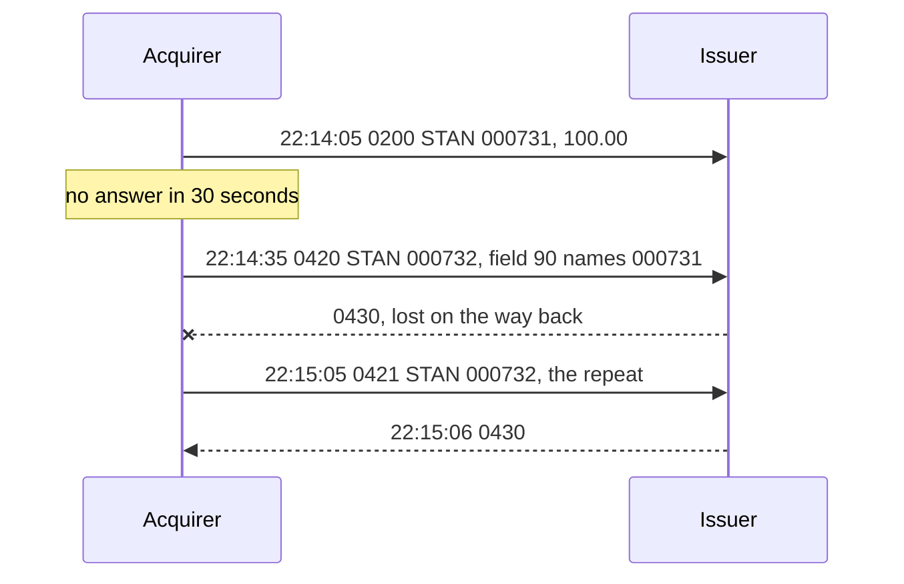
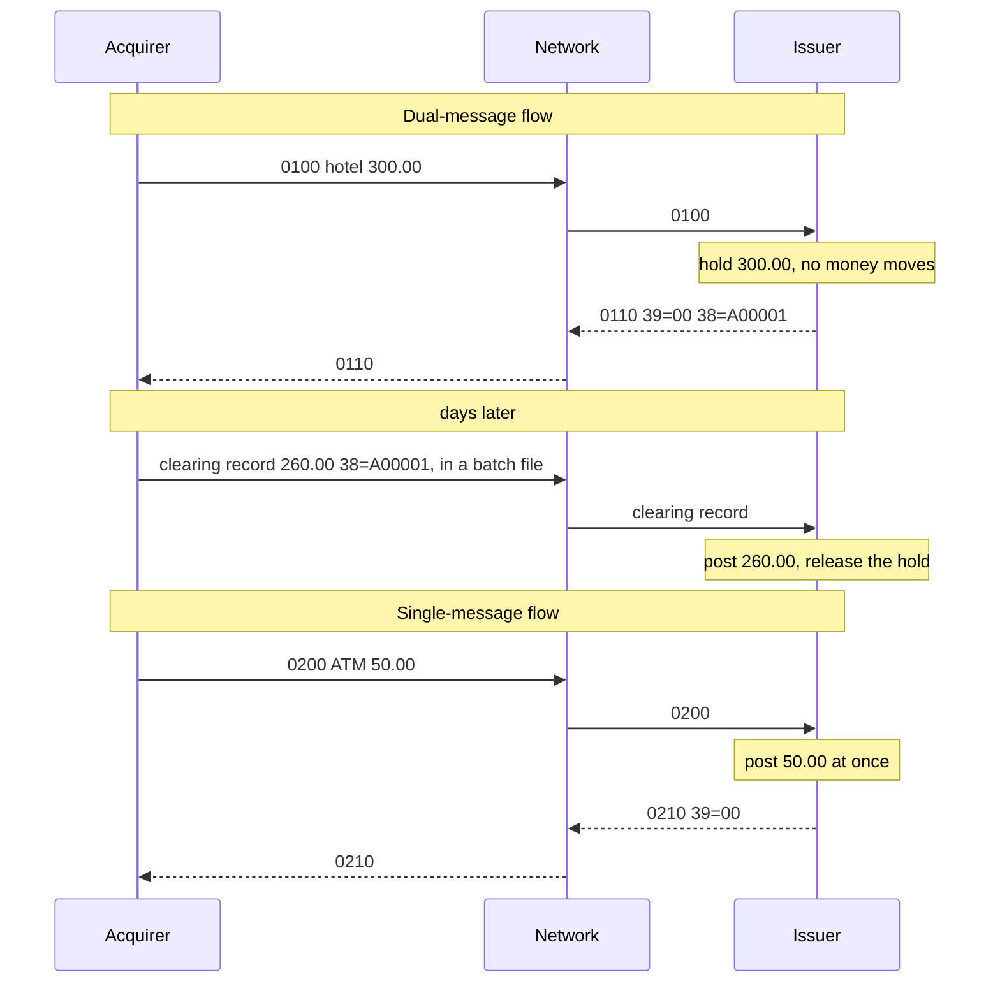
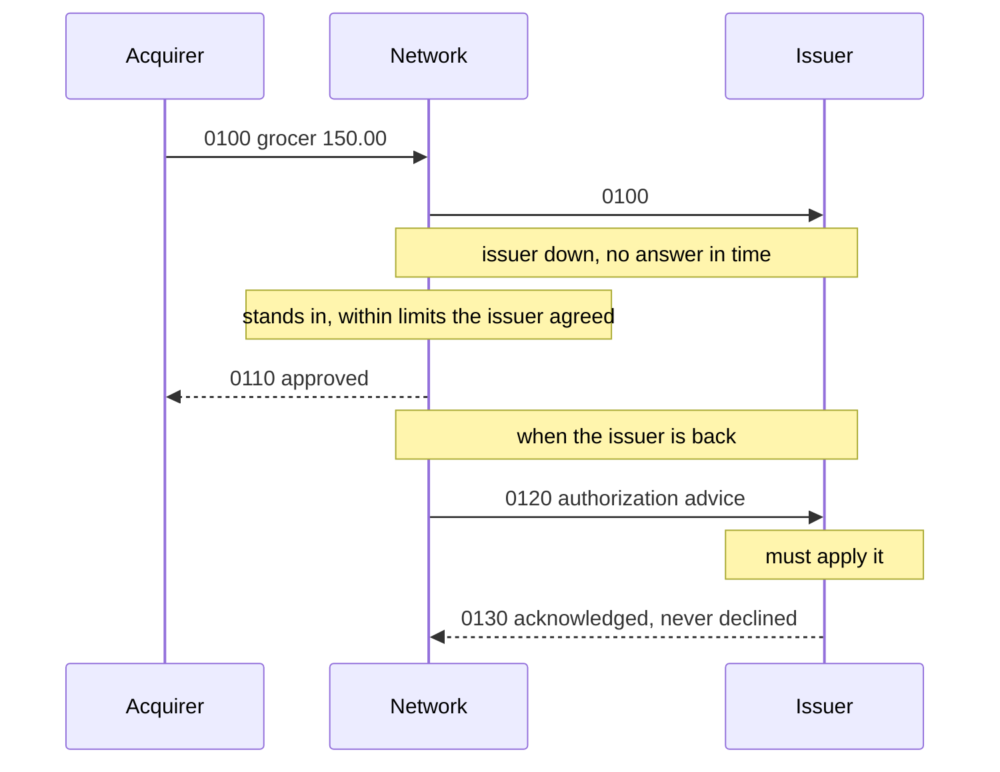
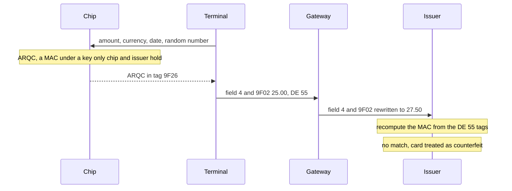
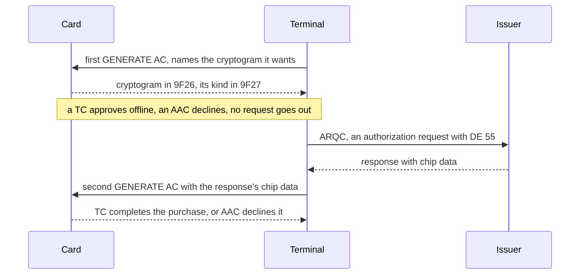
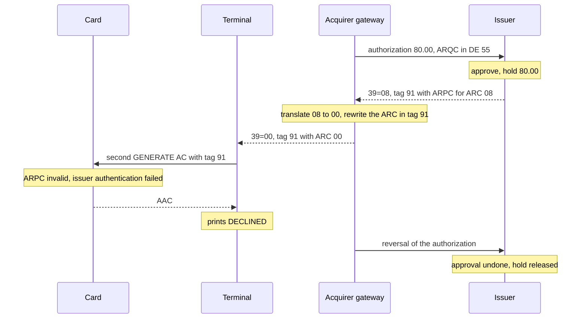
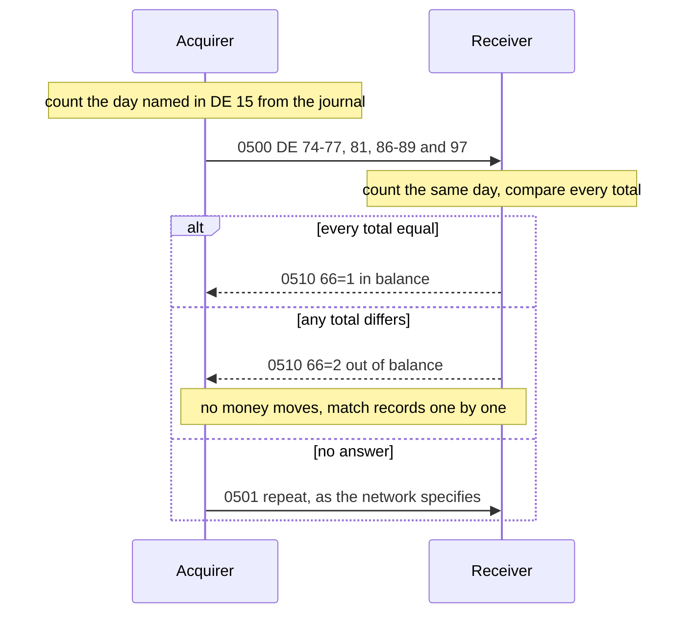
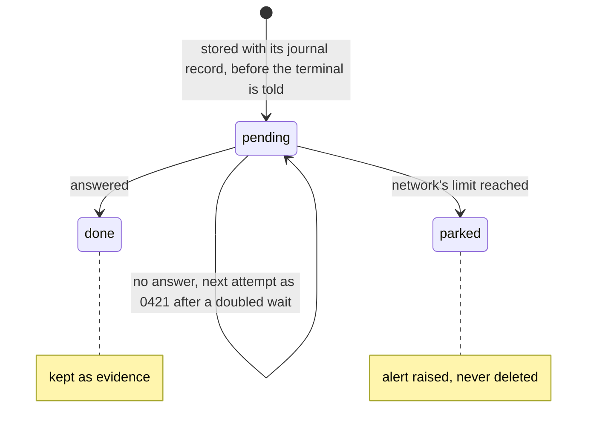

## 1. Introduction to ISO-8583

A team's authorization client has run for years against one processor. A second acquirer signs on,
and its specification also says "ISO 8583", so the plan gives the new link a day. The acquirer's
host rejects the first message because it can't read it.

ISO 8583 is the international standard for the messages behind card payments: purchases, ATM
withdrawals, refunds, balance inquiries, and the messages that cancel or confirm them. What it
promises, and what it leaves to each link, comes down to five rules, one per section heading, the
last two about jPOS. The examples run on jPOS 2.1.7, an open-source Java library for
ISO 8583 (section 1.4).

### 1.1. A Message Is an MTI, a Bitmap and the Fields the Bitmap Announces

A message has three parts: the Message Type Indicator (MTI), four digits that say what the message
is; a bitmap that says which data elements, or fields, are present; and the fields themselves, such
as the card number, the amount and the terminal. This program builds an authorization request,
packs it into the bytes that would go on the wire, and reads them back:

```java
package com.example.jpos.intro;

import org.jpos.iso.ISOException;
import org.jpos.iso.ISOMsg;
import org.jpos.iso.ISOUtil;
import org.jpos.iso.packager.GenericPackager;

import java.nio.charset.StandardCharsets;

public class FirstMessage {

    public static void main(String[] args) throws ISOException {
        GenericPackager packager = new GenericPackager("jar:packager/iso87ascii.xml");

        ISOMsg request = new ISOMsg();
        request.setPackager(packager);
        request.setMTI("0100");                 // 1987 authorization request
        request.set(2, "4111111111111111");     // primary account number (a test PAN)
        request.set(3, "000000");               // processing code: purchase
        request.set(4, "000000010000");         // amount: 100.00, in minor units
        request.set(7, "0701131415");           // transmission date and time, MMDDhhmmss
        request.set(11, "000001");              // system trace audit number (STAN)
        request.set(41, "29110001");            // card acceptor terminal ID
        request.set(49, "840");                 // currency: US dollar

        byte[] wire = request.pack();
        String pan = request.getString(2);
        String text = new String(wire, StandardCharsets.US_ASCII);
        System.out.println(wire.length + " bytes: " + text.replace(pan, ISOUtil.protect(pan)));

        ISOMsg received = new ISOMsg();
        received.setPackager(packager);
        received.unpack(wire);
        System.out.println("MTI " + received.getMTI()
                + "  PAN " + ISOUtil.protect(received.getString(2))
                + "  amount " + received.getString(4)
                + "  STAN " + received.getString(11));
    }
}
```

```text
83 bytes: 0100722000000080800016411111______1111000000000000010000070113141500000129110001840
MTI 0100  PAN 411111______1111  amount 000000010000  STAN 000001
```

`GenericPackager` reads `iso87ascii.xml`, a description of each field's wire format that ships
inside the jPOS jar; the `jar:` prefix loads it from the classpath. Split up, the 83 bytes are:

```text
0100              MTI
7220000000808000  bitmap: fields 2, 3, 4, 7, 11, 41, 49
16                length of field 2
411111______1111  field 2, PAN
000000            field 3, processing code
000000010000      field 4, amount
0701131415        field 7, transmission date and time
000001            field 11, STAN
29110001          field 41, terminal ID
840               field 49, currency
```

The 1987 edition defines 128 fields, and this request uses seven. The bitmap has one bit per field,
written here as 16 hexadecimal characters for fields 1 to 64 (bit 1 set means a second bitmap
follows, for fields 65 to 128), and only the fields whose bit is set
follow, in field-number order. Some fields have a fixed length: field 4 is always 12 digits, in the
currency's minor unit with no decimal point, so 100.00 is `000000010000`. Others vary and carry
their own length, like the `16` in front of the card number.

So no field has a fixed position. Add field 22 (how the card was read) and field 41 moves:

```text
without field 22: field 41 starts at offset 72, bitmap 7220000000808000
with field 22:    field 41 starts at offset 75, bitmap 7220040000808000
```

A reader that takes field 41 from offset 72 works until the first message with a field 22, then
reads the wrong terminal. To find any field, it has to read the bitmap and walk every field before
it.

The program prints the card number only through `ISOUtil.protect`, which keeps the first six and
the last four digits. Never print or log a clear PAN, track data, CVV or PIN block, even in a test
program: a log that holds card numbers falls under the card industry's security rules, and so does
every copy of it. Unit c8 covers how jPOS masks them in its logs.

### 1.2. The Standard Fixes What a Field Means, and Each Link Fixes Its Bytes

The same 0100, packed by the two 1987 packagers that ship with jPOS, and each result read by the
other packager:

```text
iso87ascii.xml   83 bytes: 0100722000000080800016411111______1111000000000000010000070113141500000129110001840
  read by the other: org.jpos.iso.ISOException: Field length 3134 too long. Max: 104
iso87binary.xml  47 bytes: 0100722000000080800016411111______111100000000000001000007011314150000013239313130303031383430
  read by the other: org.jpos.iso.ISOException: Field length 29 too long. Max: 19
```

The ASCII message is text. The binary one, printed in hexadecimal, puts two digits in each byte
(binary-coded decimal, BCD) and the bitmap in 8 raw bytes, so it needs 47 bytes. Fields 41 and 49
stay text, which is why its hex ends in `3239313130303031383430`. The fields and their meanings are
the same, yet neither packager can read the other's message, and the errors blame a field length
rather than the encoding.

ISO 8583 defines what each field means and its format in the abstract: field 4 is twelve digits.
It doesn't say how a digit is written. Each network publishes a specification, its *dialect*, that
fixes the encoding (ASCII, BCD, binary or EBCDIC), which fields it requires, what goes in the
private fields, and how a few fields differ from the standard. The transport is outside the message
altogether: the TCP connection, the length header in front of each message, any network header,
TLS. jPOS keeps the two apart too: a packager for the message, a channel for the transport. Unit
c3 shows channels in jPOS.

The team in the opening packed ASCII for a host that expected binary, and fixing that leads to the
next difference: the length header, the required fields, the private fields. Plan a link from the
network's specification, not from the standard's name. What the standard does fix is meaning, so a
developer who knows ISO 8583 reads a new network's specification as a list of differences.

### 1.3. The First MTI Digit Names the Edition, and Editions Disagree on Fields

The standard has been revised several times, and the first digit of the MTI says which edition a
message follows:

| MTI version digit | Meaning |
|---|---|
| `0` | ISO 8583:1987 |
| `1` | ISO 8583:1993 |
| `2` | ISO 8583:2003 |
| `3`–`7` | reserved by ISO |
| `8` | national use |
| `9` | private use |

This course uses 1987 messages (`0100`, `0200`, `0400`, `0800`) unless a section says otherwise.

A client written for a 1987 link treats `00` in field 39 as an approval, and moves to a network on
the 1993 edition. Fields 24, 25 and 39 as jPOS's packagers for the two editions describe them, and a
1993 approval checked the 1987 way:

```text
field 24  1987: NETWORK INTERNATIONAL IDENTIFIEER (3) 1993: Function code (3)
field 25  1987: POINT OF SERVICE CONDITION CODE (2)  1993: Message reason code (4)
field 39  1987: RESPONSE CODE (2)                    1993: Action code (3)
1993 response: MTI 1210, field 39 = 000
"00".equals(field 39): false
1987 packager: error packing field 39
```

In 1993 field 39 became a three-digit action code, and `000` is an approval. Field 24 became a
function code that says what a message asks for, and field 25 a four-digit reason code. The client
reports every approval as a decline. The issuer has approved and holds the funds. The cashier says
the card was refused, and the client sends no reversal, because a decline needs none. A cardholder
who pays again with another card now carries two holds. A test that uses the 1987 packager never
packs a `000`, since that packager refuses it: test with the network's own field definitions.

The 2003 edition (digit `2`) introduced *composite* fields, which hold several independent sections called datasets, beside the
*primitive* fields (one value) and the *constructed* ones (fixed sub-fields) of earlier editions.
The current edition, ISO 8583:2023, builds more fields as composites; unit 17 covers it. Take the
version digit of a 2023 message from your network's specification.

> **In jPOS 3.** jPOS 2.1.7 has no packager for datasets: its TLV packagers help, but your code
> maps the datasets.
> jpos.org says jPOS 3.0.2 adds packagers that read datasets as sub-fields; unit s13 lists what
> changes in jPOS 3.

### 1.4. jPOS Is AGPL: Network Users of Your Modified Version Are Offered Its Source

jPOS gives you the message model (`ISOMsg`), packagers that turn a message into bytes and back,
and channels that frame messages on a TCP connection.

A processor patches one of jPOS's channel classes to fit its acquirer's header, and runs the result
as a service that merchants' systems connect to. It never ships the software to anyone. Does it
owe anyone the patch?

jPOS is licensed under the GNU Affero General Public License, version 3 (AGPL v3); the jar carries
the full text as `JPOS_LICENSE`. The plain GPL's obligations start when you distribute copies, which this
processor never does. The AGPL adds section 13: if you modify the program and users interact with
your version over a network, you must offer those users its source. The trigger is the
modification, not whether the service is paid: unmodified jPOS carries no such offer. The merchants'
systems may be such users. If you can't meet those terms, the jPOS project offers a commercial licence. Settle it
with your legal team before you ship.

### 1.5. This Course Runs jPOS 2.1.7, and jpos.org Describes jPOS 3

The course and its practices use jPOS 2.1.7 on Java 17 with Maven (`org.jpos:jpos:2.1.7`). The
2.1.x series is jPOS's maintenance ("tail") line, which gets only critical fixes; its latest release
is 2.1.9. jPOS 3.x is the current line, and it needs Java 23 or later. The documentation on jpos.org describes 3.x. A call from a
jpos.org example, compiled against 2.1.7:

```text
jpos3/FromTheDocs.java:6: error: cannot find symbol
        msg.with(3, "000000").with(11, "000001");   // a jPOS 3 call, as jpos.org's blog shows it
           ^
  symbol:   method with(int,String)
  location: variable msg of type ISOMsg
1 error
```

When something from jpos.org doesn't compile or doesn't behave as described, check whether it is
3.x. Unit s13 lists the differences.

<!-- practice 1 -->

### 1.6. Summary

- **A message is an MTI, a bitmap and the fields the bitmap announces.** A field's position depends
  on every field before it, so a reader walks the bitmap instead of using offsets.
- **The standard fixes meanings, and each link fixes the bytes.** The dialect sets the encoding and
  the fields, the transport sets the framing. Two "ISO 8583" systems are not compatible until one
  maps to the other's specification.
- **The first MTI digit names the edition, and fields change between editions.** A 1993 approval is
  `000` in field 39, and a 1987 check reads it as a decline.
- **jPOS is AGPL v3.** A modified version that users reach over a network must offer them its
  source, or you need a commercial licence.
- **The course runs jPOS 2.1.7.** jpos.org describes 3.x, and its examples may not compile here.

### 1.7. Reference

**Packagers in the jPOS 2.1.7 jar** (load with `jar:packager/<file>`):

| File | Edition | Encoding |
|---|---|---|
| `iso87ascii.xml` | 1987 | ASCII digits, hex-ASCII bitmap |
| `iso87binary.xml` | 1987 | BCD numeric fields, ASCII text fields, binary bitmap |
| `iso93ascii.xml` | 1993 | ASCII digits, hex-ASCII bitmap |
| `iso93binary.xml` | 1993 | BCD numeric fields, ASCII text fields, binary bitmap |
| `cmf.xml` | jPOS Common Message Format | BCD digits, binary bitmap; see unit 17 |

**Fields that changed meaning from 1987 to 1993** (as the packagers above name them):

| Field | 1987 | 1993 |
|---|---|---|
| 24 | network international identifier, 3 digits | function code, 3 digits |
| 25 | point of service condition code, 2 digits | message reason code, 4 digits |
| 39 | response code, 2 characters (`00` approved) | action code, 3 digits (`000` approved) |

### 1.8. Challenges

1. Open `iso87binary.xml` from the jPOS jar and find three fields whose encoding differs from
   `iso87ascii.xml` in a way other than digits versus BCD. What would a host that used each one
   make of a message from the other?
2. A gateway relays between a 1993 acquirer and a 1987 issuer. Besides field 39, which fields must
   it translate, and which 1993 fields have no 1987 equivalent?
3. Your tests pack every message with `iso87ascii.xml`, and production uses the network's binary
   packager. List the bugs those tests cannot find.
4. An internal switch, built on a modified jPOS, is reached only by your company's own systems. Who
   are the "users interacting with it over a network" in the AGPL's sense, and what would change if
   a partner bank connected to it?

### 1.9. Design Note: Why a Bitmap?

A message could name each field it carries, with a tag and a length in front of each value, as chip
data and the 2023 datasets do. ISO 8583 instead puts one bit per possible field at the front, and
each field's format lives in a table both sides hold. For a message with a dozen fields out of 128,
that costs 16 characters of bitmap, or 8 bytes in binary (twice that when a field above 64 is
present), and nothing per field except the length of
the variable ones.

The price is that a message can't be read without the table. A reader can't skip a field it doesn't
know, because only the table says how long it is, and one wrong entry misreads every field after it.
That is what the two packagers in 1.2 did to each other's messages, and why each network's dialect
has to be written down field by field.


## 2. ISO-8583 Message Structure

A terminal vendor sends its first test purchase, and the host's log says it could not unpack the
message: "Problem unpacking field 42". The vendor's message has no field 42. Unit 1 showed what a
message is made of: an MTI, a bitmap, and the fields the bitmap announces. To answer the ticket you
read those parts by hand, bit by bit, with four rules, one per section heading. Every output below
comes from jPOS 2.1.7 and its 1987 packagers, `iso87ascii.xml` and `iso87binary.xml`.

### 2.1. The MTI's Four Digits Say Edition, Class, Function and Origin

The four digits are read one at a time. In `0430`, `0` is the 1987 edition (unit 1), `4` the
reversal class, `3` an advice response (an advice reports something that already happened), and the
last `0` says it comes from the acquirer. A receiver routes on the MTI before it reads any field.

A response adds 1 to the third digit, and a repeat sets the fourth: an `0420` that got no
acknowledgement goes again as `0421`. A repeat is answered like the original, so both get `0430`.
Unit 4 shows how jPOS derives these MTIs and which messages may be repeated.

### 2.2. Bit n Says Field n Is Present, Counted From 1 at the Leftmost Bit

The primary bitmap has 64 bits. Bit 1 is the most significant bit of the first byte, and bit 64
the least significant bit of the last. A purchase with fields 2, 3, 4, 11 and 41, byte by byte:

```java
package com.example.jpos.structure;

import org.jpos.iso.ISOMsg;
import org.jpos.iso.ISOUtil;
import org.jpos.iso.packager.GenericPackager;

import java.util.BitSet;

/** The primary bitmap of a purchase, byte by byte. */
public class BitCount {
    public static void main(String[] args) throws Exception {
        ISOMsg m = new ISOMsg("0200");
        m.setPackager(new GenericPackager("jar:packager/iso87ascii.xml"));
        for (int f : new int[] { 2, 3, 4, 11, 41 }) m.set(f, "0");
        m.pack();                                           // computes the bitmap
        BitSet bits = (BitSet) m.getValue(-1);
        byte[] bytes = ISOUtil.bitSet2byte(bits, 8);
        for (int b = 0; b < 8; b++) {
            String binary = String.format("%8s", Integer.toBinaryString(bytes[b] & 0xFF)).replace(' ', '0');
            StringBuilder fields = new StringBuilder();
            for (int bit = b * 8 + 1; bit <= b * 8 + 8; bit++)
                if (bits.get(bit)) fields.append(' ').append(bit);
            System.out.printf("bits %2d-%-2d  %s %s  %s%n", b * 8 + 1, b * 8 + 8,
                    binary.substring(0, 4), binary.substring(4), ISOUtil.hexString(bytes, b, 1) + fields);
        }
    }
}
```

```text
bits  1-8   0111 0000  70 2 3 4
bits  9-16  0010 0000  20 11
bits 17-24  0000 0000  00
bits 25-32  0000 0000  00
bits 33-40  0000 0000  00
bits 41-48  1000 0000  80 41
bits 49-56  0000 0000  00
bits 57-64  0000 0000  00
```

Fields 2, 3 and 4 are the second, third and fourth bits of the first byte, `0111 0000`, which is
`70` in hex. Field 11 is the third bit of the second byte, `20`. Each byte becomes two hex digits,
and the bitmap reads `7020000000800000`. jPOS computes it from the fields you set when it packs the
message, and keeps it as field -1.

#### 2.2.1. Spot the Problem: The Vendor's First Purchase

The vendor's purchase carries the same five fields: the test card `4111111111111111` behind its
length prefix `16`, processing code `000000`, an amount of 25.00, STAN `000417` and terminal
`29110001`. Its bitmap is `3810000000400000`. Which bits does it set?

`38` is `0011 1000`: bits 3, 4 and 5. `10` is bit 12, and `40` in the sixth byte is bit 42. Every
field moved one bit to the right, because the vendor's code counts bits from 0. The host trusts the
bitmap and reads each field with the definition of the next one. A program packed the purchase
correctly, swapped in the vendor's bitmap, and unpacked it field by field:

```text
bitmap sent: 3810000000400000
field 3  164111
field 4  111111111111
field 5  000000000000
field 12 002500
field 42 fails: 14 characters left
with field 37: unpacked, 77 of 82 characters read, field 4 = 111111111111
```

The length prefix and the first digits of the card number became a processing code, and the card
number became an amount of 1,111,111,111.11. The host noticed only because it ran out of characters
at field 42, which is 15 long. The last line is the same purchase with a retrieval reference number
(field 37) added: it unpacks without an error, and the five characters left over raise nothing.

With a new sender, check the bitmap of its first messages by hand against the fields it says it
sends.

### 2.3. Bit 1 Announces a Second Bitmap, So It Is Never a Field

Fields 65 to 128 need a second, *secondary* bitmap of 64 more bits. Bit 1 of the primary bitmap
says whether it follows. An echo test carries field 70, the network management code:

```java
package com.example.jpos.structure;

import org.jpos.iso.ISOMsg;
import org.jpos.iso.packager.GenericPackager;

/** An echo test needs field 70, so it carries two bitmaps. */
public class Secondary {
    public static void main(String[] args) throws Exception {
        GenericPackager packager = new GenericPackager("jar:packager/iso87ascii.xml");
        ISOMsg echo = new ISOMsg("0800");
        echo.setPackager(packager);
        echo.set(7, "1106093000");
        echo.set(11, "000418");
        echo.set(70, "301");
        String wire = new String(echo.pack());
        System.out.println(wire.substring(0, 4) + " " + wire.substring(4, 20) + " "
                + wire.substring(20, 36) + " " + wire.substring(36));
    }
}
```

```text
0800 8220000000000000 0400000000000000 1106093000000418301
```

`82` is `1000 0010`: bit 1, so a second bitmap follows, and bit 7. In the second bitmap, `04` is
its sixth bit, field 64 + 6 = 70. A receiver that ignored bit 1 would read `0400000000` as field 7.

Field 64 still fits the primary bitmap, so a message whose last field is 64, often the MAC, has
one bitmap.

Tables of the 1987 edition list field 1 as the secondary bitmap, and some developers set it to ask
for one. In jPOS that sets bit 1 and writes no second bitmap:

```java
package com.example.jpos.structure;

import org.jpos.iso.ISOMsg;
import org.jpos.iso.packager.GenericPackager;

/** Setting field 1 by hand: bit 1 goes out, the second bitmap does not. */
public class FieldOne {
    public static void main(String[] args) throws Exception {
        GenericPackager packager = new GenericPackager("jar:packager/iso87ascii.xml");
        ISOMsg m = new ISOMsg("0200");
        m.setPackager(packager);
        m.set(1, "1");                       // "a secondary bitmap follows"
        m.set(3, "000000");
        m.set(4, "000000002500");
        m.set(11, "000419");
        m.set(41, "29110001");
        byte[] wire = m.pack();
        String s = new String(wire);
        System.out.println(s.substring(0, 4) + " " + s.substring(4, 20) + " " + s.substring(20));

        ISOMsg received = new ISOMsg();
        received.setPackager(packager);
        try {
            received.unpack(wire);
        } catch (Exception e) {
            System.out.println(e.getMessage());
        }
    }
}
```

```text
0200 B020000000800000 00000000000000250000041929110001
org.jpos.iso.IFA_NUMERIC: Problem unpacking field 4 (java.lang.RuntimeException: Required 12 but just got 10 bytes) unpacking field=4, consumed=42
```

`B0` sets bit 1, so the receiver took the next sixteen characters, field 3 and most of the
amount, as the secondary bitmap, and ran out of characters in field 4. Never set field 1: the
packager sets bit 1 from the fields the message carries.

Bit 65, the first bit of the secondary bitmap, works like bit 1: on the few networks that use
fields 129 to 192, it announces a third, *tertiary* bitmap, and field 65 carries no data.

> **jPOS 2.1.7's iso87 packagers stop at two bitmaps.** `iso87ascii.xml` defines field 65 as an
> ordinary one-byte field and sets bit 65 only when you put something in it. A network with a
> tertiary bitmap needs a packager configured for one (unit c13).

<!-- practice 1 -->

### 2.4. The Same Bits Travel as 8 Bytes or as 16 Characters

A specification lists the bitmap as `b 64`: 64 bits. A link sends them either as 8 raw bytes or as
16 hexadecimal characters, one character per four bits. The echo test from 2.3, packed both ways:

```java
package com.example.jpos.structure;

import org.jpos.iso.ISOMsg;
import org.jpos.iso.ISOUtil;
import org.jpos.iso.packager.GenericPackager;

/** One echo test, packed by the hex-ASCII and the binary packager. */
public class Encodings {
    public static void main(String[] args) throws Exception {
        GenericPackager ascii = new GenericPackager("jar:packager/iso87ascii.xml");
        GenericPackager binary = new GenericPackager("jar:packager/iso87binary.xml");
        ISOMsg echo = new ISOMsg("0800");
        echo.set(7, "1106093000");
        echo.set(11, "000418");
        echo.set(70, "301");

        echo.setPackager(ascii);
        byte[] a = echo.pack();
        echo.setPackager(binary);
        byte[] b = echo.pack();
        System.out.println("iso87ascii,  " + a.length + " bytes, as text: " + split(new String(a)));
        System.out.println("iso87binary, " + b.length + " bytes, in hex:  " + split(ISOUtil.hexString(b)));

        ISOMsg received = new ISOMsg();
        received.setPackager(ascii);
        try {
            received.unpack(b);                       // binary bytes, read as hex-ASCII
        } catch (Exception e) {
            System.out.println("binary read as ascii: " + e.getMessage());
        }
    }

    /** MTI, two bitmaps, fields 7, 11 and 70. */
    static String split(String s) {
        return String.join(" ", s.substring(0, 4), s.substring(4, 20), s.substring(20, 36),
                s.substring(36, 46), s.substring(46, 52), s.substring(52));
    }
}
```

```text
iso87ascii,  55 bytes, as text: 0800 8220000000000000 0400000000000000 1106093000 000418 301
iso87binary, 28 bytes, in hex:  0800 8220000000000000 0400000000000000 1106093000 000418 0301
binary read as ascii: Index 28 out of bounds for length 28 consumed=4
```

The binary packager writes the same bits as 8 bytes per bitmap, and the numeric fields as two digits per
byte, so the message is about half as long. Nothing in the bytes says which form was used: the
ASCII packager took the binary message's first four bytes as the MTI and failed on the bitmap.

Each network's specification sets the form, link by link; both packagers here are 1987. When a new
link fails on its first message, compare the bitmap of a captured message with the specification
before you suspect any field.

<!-- practice 2 -->

### 2.5. Summary

- **The MTI's digits say edition, class, function and origin.** A response adds 1 to the third
  digit, a repeat sets the fourth, and a repeat is answered like the original.
- **Bit n says field n is present, counted from 1 at the leftmost bit.** A bitmap off by one bit
  turns the card number into an amount, and the message may still unpack.
- **Bit 1 announces the secondary bitmap and bit 65 a tertiary one.** Neither is a field: set the
  fields, never field 1, and let the packager set bit 1.
- **The bitmap travels as 8 bytes or as 16 characters,** as the link's specification says. A
  receiver can't tell the other form from the bytes; it fails or misreads.

### 2.6. Reference

**MTI digits (1987 edition, with later additions):**

| Digit | Values |
|---|---|
| 1, version | `0` 1987, `1` 1993, `2` 2003; `3`-`7` reserved for ISO, `8` national use, `9` private use |
| 2, class | `1` authorization, `2` financial, `3` file actions, `4` reversal and chargeback, `5` reconciliation, `6` administrative, `7` fee collection, `8` network management; `0` and `9` reserved |
| 3, function | `0` request, `1` request response, `2` advice, `3` advice response, `4` notification and `5` its acknowledgement (1993), `6` instruction and `7` its acknowledgement (2003); `8`-`9` reserved |
| 4, origin | `0` acquirer, `1` acquirer repeat, `2` issuer, `3` issuer repeat, `4` other, `5` other repeat; `6`-`9` reserved |

ISO 8583-2 and 8583-3 are parts of the standard (registration of institution codes and
maintenance), not versions. For the 2023 edition, take the version digit from your network's
specification.

**Bitmaps:**

| Bitmap | Announces fields | Present when | Its first bit |
|---|---|---|---|
| primary | 1-64 | always | bit 1: a secondary bitmap follows |
| secondary | 65-128 | bit 1 is set | bit 65: a tertiary bitmap follows |
| tertiary | 129-192 | bit 65 is set | - |

**The bitmap in jPOS 2.1.7:**

| Wire form | Field packager | Packagers | Size per bitmap |
|---|---|---|---|
| hex-ASCII | `IFA_BITMAP` | `iso87ascii.xml`, `ISO87APackager` | 16 characters |
| binary | `IFB_BITMAP` | `iso87binary.xml`, `ISO87BPackager` | 8 bytes |

`ISOMsg` keeps the bitmap as field -1, a `java.util.BitSet`, computed when the message is packed
and read from the wire when it is unpacked. Before the first `pack`, field -1 is `null`; whether a
message will need a secondary bitmap is `getMaxField() > 64`.

### 2.7. Challenges

1. A network's specification shows a sample message as a hex dump. How do you tell from its first
   20 bytes whether the bitmap is binary or hex-ASCII, and what would you still have to take from
   the specification?
2. The shifted purchase with field 37 in 2.2.1 unpacked without an error. Which checks after
   unpacking would have refused it, and which of them would a host run anyway?
3. A host logs every bitmap it receives. Write the query that finds senders whose messages carry
   field 1 or field 65 as data, and say what each finding means.
4. Your host receives an `0421` repeat. What must it remember about the `0420` it may already have
   answered, and for how long?

### 2.8. Design Note: Why Is the Second Bitmap Optional?

The 1987 edition could have given every message one 128-bit bitmap. Instead the primary bitmap
covers fields 1 to 64, and bit 1 says whether a second one follows. A purchase, which rarely needs
a field above 64, saves 8 bytes, or 16 characters on a hex-ASCII link, on every message. On the slow
lines of the 1980s that saving was worth a bit every receiver must check first.

The price is a bit that means something different from all the others. Every reader has to branch
on it before it can find the first field, and every writer has to keep it consistent with the
fields that follow, which is the trap 2.3 shows when field 1 is set by hand. The 1993 edition kept
the design, and the tertiary bitmap repeats the scheme at bit 65. Support for that third bitmap is
rarer than for the second: jPOS 2.1.7's own 1987 packagers don't have it.


## 3. Data Elements

A merchant's purchases start failing on the day its payment gateway is upgraded. The acquirer's host
logs that it cannot unpack DE 48, and the upgrade didn't touch DE 48. The fault is in another field.

Data elements (DEs, "fields") carry what a transaction needs: the card, the amount, the terminal,
the time, the result. In a message they follow the bitmap (unit 2) with nothing between them, no
tags and no separators. We follow ISO 8583:1987 as jPOS's `iso87ascii.xml` and `iso87binary.xml`
packagers define it; where your network's specification differs, it wins. Six rules, one per section
heading.

### 3.1. A Field's Format Is All the Receiver Has to Find Where It Ends

Every field has a format. `n6` is six digits, always six. `ans8` is eight letters, digits or special
characters. `n..19` is up to 19 digits behind a two-digit length prefix (an **LLVAR**), and
`ans...999` up to 999 characters behind a three-digit prefix (an **LLLVAR**). A purchase packed with
`iso87ascii.xml`:

```java
import org.jpos.iso.ISOException;
import org.jpos.iso.ISOMsg;
import org.jpos.iso.packager.GenericPackager;

public class Wire {
    public static void main(String[] args) throws ISOException {
        ISOMsg m = new ISOMsg("0200");
        m.setPackager(new GenericPackager("jar:packager/iso87ascii.xml"));
        m.set(2, "5555555555554444");   // n..19
        m.set(4, "000000002500");       // n12
        m.set(11, "000731");            // n6
        m.set(41, "29110001");          // ans8
        System.out.println(new String(m.pack()));
    }
}
```

```text
0200502000000080000016555555555555444400000000250000073129110001
```

Split up:

```text
0200  5020000000800000  16 5555555555554444  000000002500  000731  29110001
MTI   bitmap            DE 2: length, PAN    DE 4          DE 11   DE 41
```

The receiver reads `16` and takes 16 digits for DE 2, then twelve for DE 4 and six for DE 11,
because its packager's table says so. Nothing in the bytes marks where a field ends, so the sender's
table must say the same.

DE 43, the merchant's name and location, is where the two tables most often disagree. In the 1987
edition it is fixed `ans 40`. The 1993 edition made it `ans..99`, an LLVAR. Suppose the upgraded
gateway writes DE 43 the 1993 way and the host reads it the 1987 way:

```java
import org.jpos.iso.IFA_LLCHAR;
import org.jpos.iso.ISOException;
import org.jpos.iso.ISOMsg;
import org.jpos.iso.packager.GenericPackager;

/** A sender that writes DE 43 the 1993 way (LLVAR), a receiver that reads it the 1987 way (fixed 40). */
public class Edition {
    public static void main(String[] args) throws ISOException {
        GenericPackager sender = new GenericPackager("jar:packager/iso87ascii.xml");
        sender.setFieldPackager(43, new IFA_LLCHAR(99, "CARD ACCEPTOR NAME/LOCATION"));
        GenericPackager receiver = new GenericPackager("jar:packager/iso87ascii.xml");

        ISOMsg m = new ISOMsg("0200");
        m.setPackager(sender);
        m.set(4, "000000002500");
        m.set(11, "000731");
        m.set(41, "29110001");
        m.set(43, "CORNER BAKERY LONDON GB");
        m.set(48, "MERCHANT REF 77");
        m.set(49, "826");
        byte[] wire = m.pack();
        System.out.println("sent from DE 41 on: " + new String(wire).substring(38));  // after MTI, bitmap, DE 4, DE 11

        ISOMsg r = new ISOMsg();
        r.setPackager(receiver);
        try {
            r.unpack(wire);
            for (int f : new int[] { 4, 11, 41, 43, 48, 49 })
                System.out.println("DE " + f + " = [" + r.getString(f) + "]");
        } catch (ISOException e) {
            System.out.println("receiver: " + e.getMessage());
            System.out.println("DE 43 as the receiver read it: [" + r.getString(43) + "]");
        }
    }
}
```

```text
sent from DE 41 on: 2911000123CORNER BAKERY LONDON GB015MERCHANT REF 77826
receiver: org.jpos.iso.IFA_LLLCHAR: Problem unpacking field 48 (org.jpos.iso.ISOException: Invalid character found. Expected digit.) unpacking field=48, consumed=86
DE 43 as the receiver read it: [23CORNER BAKERY LONDON GB015MERCHANT REF]
```

The host took 40 characters for DE 43: the length prefix `23`, the name, and most of DE 48. Then it
looked for DE 48's three-digit length and found ` 77`. The error names DE 48, which the gateway
wrote correctly. A team that trusts the error message spends the day on DE 48, while every purchase
that carries a DE 43 is rejected.

So when a receiver can't unpack field *n*, check the fields before *n* first, starting with those
whose format changed between editions (the Reference marks DE 12, 22, 25, 39 and 43).

### 3.2. A Short Value Is Padded, a Long One Is Refused, and Nothing Else Is Checked

A fixed field always fills its width. When jPOS packs, it pads numeric fields with zeros on the
left and text fields with spaces on the right. A developer sets the amount to `"50"`, meaning fifty,
and the terminal ID to `"T1"`:

```java
import org.jpos.iso.ISOException;
import org.jpos.iso.ISOMsg;
import org.jpos.iso.packager.GenericPackager;

public class Padding {
    public static void main(String[] args) throws ISOException {
        GenericPackager packager = new GenericPackager("jar:packager/iso87ascii.xml");
        ISOMsg m = new ISOMsg("0200");
        m.setPackager(packager);
        m.set(4, "50");                       // meant as fifty
        m.set(11, "42");
        m.set(41, "T1");
        show(m, packager);

        m.set(4, "123.45");                   // a decimal point in a numeric field
        show(m, packager);

        m.set(42, "0000000012345678");        // 16 characters for ans15
        try {
            m.pack();
        } catch (ISOException e) {
            System.out.println("refused: " + e.getMessage());
        }
    }

    static void show(ISOMsg m, GenericPackager packager) throws ISOException {
        ISOMsg back = new ISOMsg();           // what the receiver unpacks
        back.setPackager(packager);
        back.unpack(m.pack());
        System.out.println("4=[" + back.getString(4) + "] 11=[" + back.getString(11)
                + "] 41=[" + back.getString(41) + "]");
    }
}
```

```text
4=[000000000050] 11=[000042] 41=[T1      ]
4=[000000123.45] 11=[000042] 41=[T1      ]
refused: error packing field 42
```

DE 4 is in minor units with no decimal point, so `000000000050` is 0.50. The merchant's fifty-euro
sale goes out as a request for fifty cents, and nothing fails on the way. Set amounts as whole minor
units (`5000` for 50.00) and let the packager pad them.

Padding on the other side would change the value: zeros on the right would make 50 into
500000000000. Spaces on the right are harmless in text, but they are still there after unpacking.
The receiver's DE 41 is `T1` and six spaces, and `"T1".equals(msg.getString(41))` is false.

A value that is too long is refused, never cut: the nested exception says `Field length 16 too long.
Max: 15`. jPOS refuses it only when it packs, which behind a QMUX happens on the channel adaptor's
thread, far from the code that set the field. Check lengths where you build the message.

Length is all jPOS checks. `123.45` went into an ASCII numeric field, dot and all, and letters would
have gone in too. The host may reject the dot or misread it, and neither is the sale you meant.
Validate characters before you set a field.

<!-- practice 1 -->

### 3.3. The Packager Decides the Bytes, So Both Peers Need the Same One

`n..19` says "digits, with a two-digit length". It doesn't say how a digit or a length becomes
bytes. That is the packager's choice, and three are common. The same PAN through each of them:

```java
import org.jpos.iso.IFA_LLNUM;
import org.jpos.iso.IFB_LLLNUM;
import org.jpos.iso.IFB_LLNUM;
import org.jpos.iso.IFE_LLNUM;
import org.jpos.iso.ISOException;
import org.jpos.iso.ISOField;
import org.jpos.iso.ISOFieldPackager;
import org.jpos.iso.ISOUtil;

public class Prefixes {
    public static void main(String[] args) throws ISOException {
        show(new IFA_LLNUM(19, "PAN"), "4111111111111111");          // ASCII digits
        show(new IFB_LLNUM(19, "PAN", true), "4111111111111111");    // BCD
        show(new IFE_LLNUM(19, "PAN"), "4111111111111111");          // EBCDIC digits
        show(new IFB_LLNUM(19, "PAN", true), "4111111111111111111"); // BCD, 19 digits
        show(new IFB_LLLNUM(999, "LLL", true), "12345");             // BCD, three-digit prefix
    }

    static void show(ISOFieldPackager p, String value) throws ISOException {
        byte[] b = p.pack(new ISOField(2, value));
        System.out.printf("%-10s %2d bytes  %s%n", p.getClass().getSimpleName(), b.length, ISOUtil.hexString(b));
    }
}
```

```text
IFA_LLNUM  18 bytes  313634313131313131313131313131313131
IFB_LLNUM   9 bytes  164111111111111111
IFE_LLNUM  18 bytes  F1F6F4F1F1F1F1F1F1F1F1F1F1F1F1F1F1F1
IFB_LLNUM  11 bytes  1904111111111111111111
IFB_LLLNUM  5 bytes  0005012345
```

ASCII and EBCDIC write one byte per digit, prefix included. BCD packs two digits into a byte, so its
LL prefix is one byte and its LLL prefix two. The BCD prefix counts **digits**, not bytes: `16`
announces 16 digits in 8 bytes, and `19` announces 19 digits in 10, the spare half-byte filled with
`0`. Whether the filler goes on the left or the right is another packager setting.

A peer that reads a BCD prefix as a byte count takes 19 bytes for that PAN instead of 10, and every
field after it is wrong, as in 3.1. Agree on the packager, not only on the formats, and compare it
byte for byte with the specification's sample messages. Unit c13 shows how jPOS packagers are built.

### 3.4. A Field's Type Decides How You Read Its Value

The letters in a format name the characters allowed (the Reference lists them).

**Numeric** values are strings of digits. Parse an amount into a `long` of minor units, never a
`double`. DE 7, the transmission date and time, has no year, so `ISODate.parseISODate` picks the
year that puts the date closest to now.

**Track data** (`z`) is digits plus a separator between the PAN and the expiry date. On the stripe
the separator is the half-byte `D`; written as text it is `=`. A terminal application builds Track 2
with `D`, and the link packs DE 35 in BCD. What does the issuer receive?

```java
import org.jpos.iso.IFA_LLNUM;
import org.jpos.iso.IFB_LLNUM;
import org.jpos.iso.ISOException;
import org.jpos.iso.ISOField;
import org.jpos.iso.ISOFieldPackager;
import org.jpos.iso.ISOUtil;

/** Track 2 with '=' and with 'D', through a BCD and an ASCII field packager, packed and read back. */
public class Track2 {
    public static void main(String[] args) throws ISOException {
        for (String t2 : new String[] { "5555555555554444=3012101", "5555555555554444D3012101" }) {
            round(new IFB_LLNUM(37, "TRACK 2", true), t2);
            round(new IFA_LLNUM(37, "TRACK 2"), t2);
        }
    }

    static void round(ISOFieldPackager p, String value) throws ISOException {
        byte[] b = p.pack(new ISOField(35, value));
        ISOField back = new ISOField(35);
        p.unpack(back, b, 0);
        System.out.printf("%-9s set %s  wire %s  read %s%n", p.getClass().getSimpleName(), value,
                ISOUtil.hexString(b), back.getValue());
    }
}
```

```text
IFB_LLNUM set 5555555555554444=3012101  wire 245555555555554444D3012101  read 5555555555554444=3012101
IFA_LLNUM set 5555555555554444=3012101  wire 3234353535353535353535353535343434343D33303132313031  read 5555555555554444=3012101
IFB_LLNUM set 5555555555554444D3012101  wire 24555555555555444443012101  read 555555555555444443012101
IFA_LLNUM set 5555555555554444D3012101  wire 3234353535353535353535353535343434344433303132313031  read 5555555555554444D3012101
```

The BCD packager turns `=` into the half-byte `D` and back. A `D` character it packs as the digit
`4`, so the separator is gone: the issuer receives 24 digits and no way to tell where the PAN ends.
Always set `=` in the `ISOMsg`. An ASCII packager sends whichever character you set, and peers send
either, so accept both when parsing.

**Binary** fields (`b`) give their length in bits: `b64` is 8 bytes, as for DE 52, the PIN block.
jPOS keeps them as `byte[]`; `getBytes` returns the bytes and `getString` returns them as
hexadecimal text. An ASCII packager writes such a field as hex characters (`IFA_BINARY`) or as raw
bytes behind a length (`IFA_LLLBINARY`). Check which one your specification means.

Never print a PAN, a track or a PIN block. `ISOUtil.protect` masks a PAN for display, and units c8
and s8 set up a logger that masks for you.

### 3.5. Which Fields Must Be Present Depends on the MTI and the Network

Only the MTI and the primary bitmap are in every message. Everything else depends on the message:

- an `0800` echo test carries no PAN and no amount, only DE 7, DE 11 and DE 70;
- an `0100` card-present authorization may carry Track 2 (DE 35) instead of DE 2, because the PAN
  is inside the track;
- an `0110` must echo the fields the network lists (typically DE 3, 4, 7, 11, 37 and 41) and add
  DE 39.

A network's specification has a table with one row per field and one column per MTI. Each cell is
**M** (mandatory), **C** (conditional: required when something else holds, such as DE 2 when there
is no Track 2) or **O** (optional). A validator built from one list of "required fields" for every
message refuses the network's own echo tests, or lets a response without DE 39 through. Build the
checks per MTI from that table.

In jPOS an absent field costs no exception: `hasField(n)` says whether it is there, and
`getString(n)` returns `null` when it isn't.

<!-- practice 3 -->

### 3.6. DE 55 Is a List of Tag-Length-Value Objects, Read as Bytes

When a chip card is used, the terminal sends the card's cryptogram and the data around it in
DE 55, as a list of **BER-TLV** objects with nothing between them. Each object is:

- a **tag** of one or more bytes. When the low five bits of the first byte are all ones (`0x1F`),
  the tag continues in the next byte, and it keeps going while the byte just read has its top bit
  set. `95` is a one-byte tag, `9F26` and `5F2A` are two-byte tags, `DF8101` has three;
- a **length**: one byte for 0 to 127, otherwise `81` followed by one length byte or `82` followed
  by two;
- the **value**: exactly that many bytes.

The stock `iso87ascii.xml` still calls DE 55 "reserved ISO" and packs it as text, with
`IFA_LLLCHAR`. Network specifications define it as binary (`iso87binary.xml` uses
`IFB_LLLBINARY`). Through the stock packager the bytes arrive unchanged, but the field comes back
as a different type:

```java
import org.jpos.iso.ISOException;
import org.jpos.iso.ISOMsg;
import org.jpos.iso.ISOUtil;
import org.jpos.iso.packager.GenericPackager;
import org.jpos.tlv.TLVList;
import org.jpos.tlv.TLVMsg;

public class Tlv {
    public static void main(String[] args) throws ISOException {
        byte[] icc = ISOUtil.hex2byte(
                "9F2608A1B2C3D4E5F6A7B8"   // 9F26, 8 bytes: application cryptogram
              + "9F360200A1"               // 9F36, 2 bytes: transaction counter
              + "95050000008000");         // 95, 5 bytes: terminal verification results

        ISOMsg sent = new ISOMsg("0100");
        sent.setPackager(new GenericPackager("jar:packager/iso87ascii.xml"));
        sent.set(55, icc);
        ISOMsg got = new ISOMsg();
        got.setPackager(new GenericPackager("jar:packager/iso87ascii.xml"));
        got.unpack(sent.pack());
        System.out.println("before packing: getString(55) = " + sent.getString(55));
        System.out.println("after unpacking: getString(55) has " + got.getString(55).length()
                + " characters, getBytes(55) " + got.getBytes(55).length + " bytes");

        TLVList tlv = new TLVList();
        tlv.unpack(got.getBytes(55));
        for (TLVMsg t : tlv.getTags())
            System.out.println(Integer.toHexString(t.getTag()).toUpperCase()
                    + " len=" + t.getValue().length + " value=" + ISOUtil.hexString(t.getValue()));
        System.out.println("ATC: " + tlv.getString(0x9F36));
    }
}
```

```text
before packing: getString(55) = 9F2608A1B2C3D4E5F6A7B89F360200A195050000008000
after unpacking: getString(55) has 23 characters, getBytes(55) 23 bytes
9F26 len=8 value=A1B2C3D4E5F6A7B8
9F36 len=2 value=00A1
95 len=5 value=0000008000
ATC: 00A1
```

On the message you built, DE 55 is a `byte[]` and `getString` gives 46 hex characters. On the
message you received, it is text, and `getString` gives the 23 raw bytes as characters. Code that
parses hex from `getString(55)` passes every unit test built on `set(55, bytes)` and fails on the
first real message. `getBytes(55)` returns the same 23 bytes in both cases. `TLVList` (in
`org.jpos.tlv`) splits them, and refuses a list whose last object claims more bytes than are left.

The cryptogram is not a secret like a PIN, but DE 55 can also hold track-equivalent data (tag `57`),
so keep the whole field out of logs. Unit 18 goes through the EMV tags.

> **ISO 8583:2023.** The 2023 edition builds several fields (among them DE 34, 43 and 104) from
> **datasets**: a 1-byte dataset identifier, a 2-byte big-endian length and the content, repeated,
> with BER-TLV or bitmapped elements inside. DE 55 stays plain BER-TLV. jPOS 2.1.7 reads such a
> field only as opaque binary; jPOS 3 reads datasets natively (unit s13). Unit 17 covers them.

<!-- practice 2 -->

### 3.7. Summary

- **A field's format is all the receiver has to find where it ends.** One field written in the
  wrong format shifts every field after it, and the error names a later, correct field. DE 43 is
  fixed 40 in 1987 and LLVAR in 1993.
- **A short value is padded, a long one is refused, and nothing else is checked.** `"50"` in DE 4
  is 0.50, unpacked text keeps its trailing spaces, and characters are yours to validate.
- **The packager decides the bytes.** ASCII, BCD and EBCDIC write the same field differently, and a
  BCD prefix counts digits. Peers must share the packager, not only the formats.
- **A field's type decides how you read it.** Amounts as minor units in a `long`, `=` in Track 2,
  binary fields with `getBytes`.
- **Mandatory fields depend on the MTI and the network.** Check each message against its column of
  the specification's table.
- **DE 55 is BER-TLV, read as bytes.** Tags and lengths can be longer than one byte, and what
  `getString(55)` returns depends on where the message came from.

### 3.8. Reference

**Key data elements, 1987 edition.** "jPOS class" is the field packager `iso87ascii.xml` assigns
(unit c13 explains the names). Networks rename and reuse some fields, such as DE 48 and DE 55.

| DE | name | format (1987) | jPOS class (iso87ascii) | notes |
|---|---|---|---|---|
| 2 | Primary account number (PAN) | n..19 | `IFA_LLNUM` 19 | sensitive: mask in logs |
| 3 | Processing code | n6 | `IFA_NUMERIC` 6 | digits 1–2 transaction type (00 purchase, 01 cash, 20 refund, 31 balance inquiry), 3–4 from-account, 5–6 to-account |
| 4 | Amount, transaction | n12 | `IFA_NUMERIC` 12 | minor units, no decimal point: `000000012345` = 123.45 |
| 7 | Transmission date and time | n10 MMDDhhmmss | `IFA_NUMERIC` 10 | in UTC |
| 11 | Systems trace audit number (STAN) | n6 | `IFA_NUMERIC` 6 | one increasing sequence per link, 000001–999999 |
| 12 | Time, local transaction | n6 hhmmss | `IFA_NUMERIC` 6 | 1993: n12 YYMMDDhhmmss |
| 13 | Date, local transaction | n4 MMDD | `IFA_NUMERIC` 4 | |
| 14 | Date, expiration | n4 YYMM | `IFA_NUMERIC` 4 | sensitive with the PAN |
| 18 | Merchant type (MCC) | n4 | `IFA_NUMERIC` 4 | e.g. 5411 grocery |
| 22 | POS entry mode | n3 | `IFA_NUMERIC` 3 | 1993: an12 POS data code |
| 25 | POS condition code | n2 | `IFA_NUMERIC` 2 | 1993: n4 message reason code |
| 32 | Acquiring institution ID code | n..11 | `IFA_LLNUM` 11 | |
| 35 | Track 2 data | z..37 | `IFA_LLNUM` 37 | sensitive: never log or store |
| 37 | Retrieval reference number (RRN) | an12 | `IF_CHAR` 12 | |
| 38 | Authorization ID response | an6 | `IF_CHAR` 6 | the approval code |
| 39 | Response code | an2 | `IF_CHAR` 2 | `00` approved; 1993: n3 action code |
| 41 | Card acceptor terminal ID | ans8 | `IF_CHAR` 8 | e.g. `29110001` |
| 42 | Card acceptor ID code | ans15 | `IF_CHAR` 15 | e.g. `000000001234567` |
| 43 | Card acceptor name/location | ans40 | `IF_CHAR` 40 | fixed in 1987; 1993: ans..99 LLVAR |
| 48 | Additional data, private | ans...999 | `IFA_LLLCHAR` 999 | sub-fields need a sub-field packager (unit c13) |
| 49 | Currency code, transaction | n3 | `IF_CHAR` 3 | ISO 4217 numeric, `840` = USD |
| 52 | PIN data | b64 | `IFA_BINARY` 8 | 8 bytes, sent as 16 hex characters in ASCII packagers; never log |
| 55 | Reserved ISO (EMV data in practice) | ans...999 | `IFA_LLLCHAR` 999 | binary BER-TLV in network specifications |
| 64, 128 | Message authentication code | b64 | `IFA_BINARY` 8 | |
| 70 | Network management information code | n3 | `IFA_NUMERIC` 3 | 001 sign-on, 002 sign-off, 301 echo |
| 90 | Original data elements | n42 | `IFA_NUMERIC` 42 | used by reversals (unit 4) |

**Type codes:**

| code | allowed | example |
|---|---|---|
| `n` | digits 0–9 | DE 4 (n12) |
| `a` | letters | rarely alone |
| `s` | special characters: space and punctuation | combined, as in `ans` |
| `an` | letters and digits | DE 37 (an12), DE 39 (an2) |
| `ans` | letters, digits and special characters | DE 41, 42, 43 |
| `b` | binary, length in bits | DE 52 (b64 = 8 bytes) |
| `z` | track data: digits and the separator | DE 35 |
| `x+n` | `C` (credit) or `D` (debit), then digits | DE 28 to DE 31 (fees), `D00000100`; `IFA_AMOUNT` / `IFB_AMOUNT` |

**Length prefixes in jPOS:**

| encoding | LLVAR / LLLVAR numeric | prefix size | prefix counts |
|---|---|---|---|
| ASCII digits | `IFA_LLNUM` / `IFA_LLLNUM` | 2 / 3 bytes | characters |
| BCD | `IFB_LLNUM` / `IFB_LLLNUM` | 1 / 2 bytes | digits |
| EBCDIC digits | `IFE_LLNUM` / `IFE_LLLNUM` | 2 / 3 bytes | characters |

**Padding by hand:** `ISOUtil.zeropad("42", 6)` gives `000042`, `ISOUtil.strpad("T1", 8)` gives
`T1` and six spaces, `ISOUtil.zeropad(12345L, 12)` gives `000000012345`, and
`ISOUtil.zeropad("1234567", 6)` throws `ISOException: invalid len 7/6`.

**Dates:** `ISODate.getDateTime(date, TimeZone.getTimeZone("UTC"))` produces DE 7 (MMddHHmmss),
`ISODate.parseISODate(s, tz)` reads it, and `ISODate.formatDate(date, pattern)` covers other
patterns. There is no `ISOUtil.formatDate`.

### 3.9. Challenges

1. Your acquirer sends a specification with 60 fields. How would you find, before the first test
   message, every field whose format differs from `iso87ascii.xml`, and what would you do with
   each?
2. A terminal sends amounts in a currency with three minor digits. Where in your system does the
   number of minor digits come from, and what goes wrong if only the terminal knows it?
3. Your receiver trims trailing spaces from every text field after unpacking. Name a field where
   that loses information, and decide whether to trim at all.
4. Two peers agree on `n..19` for DE 2, but one uses BCD with the filler on the left and the other
   on the right. Which PANs come through intact, and what test would catch the others?

### 3.10. Design Note: Why Fields Have No Tags

ISO 8583 puts fields back to back and lets a bitmap say which are present. A bitmap of 8 bytes
announces 64 fields (16 characters in ASCII), and a fixed field spends nothing on a length or a
tag: the purchase in 3.1 is 64 bytes. The price is that the receiver needs a table to read the message, and one wrong entry in
it spoils everything after that field, as 3.1 shows.

A tagged format, such as the BER-TLV inside DE 55, labels every value with its tag and length. A
reader can skip what it doesn't know, fields can come in any order, and a new one breaks nothing.
The price is two or more bytes per value, and a reader that handles tags and lengths of variable
size. For open-ended data such as chip data, specifications put TLV inside one field, and the 2023
edition does the same for more fields.


## 4. Message Type Indicators (MTIs)

A host's log for terminal `29110001`, one evening:

| Time | MTI | STAN | Amount |
|---|---|---|---|
| 22:14:05 | `0200` | `000731` | 100.00 |
| 22:14:35 | `0420` | `000732` | |
| 22:15:05 | `0421` | `000732` | |
| 22:15:06 | `0430` | `000732` | |

The purchase got no answer. Did the cardholder pay? Each message's first four digits, its Message
Type Indicator (MTI), say what it is, what answers it, and what approving it commits. Reading the
log takes four rules, one per section heading.

### 4.1. The Third Digit Pairs Every Message With Its Answer

The third digit, the function, says where a message sits in an exchange: `0` a request, `1` its
response, `2` an advice (a report of something already done, 4.3), `3` the advice's response. jPOS derives the answer's MTI with `setResponseMTI`. What
answers an `0420`, and what answers its repeat, the `0421`?

```java
package com.example.iso.mti;

import org.jpos.iso.ISOException;
import org.jpos.iso.ISOMsg;

public class Pairs {
    public static void main(String[] args) throws ISOException {
        for (String mti : new String[] { "0100", "0200", "0120", "0220", "0400", "0420", "0421", "0800", "1804" }) {
            ISOMsg m = new ISOMsg(mti);
            m.setResponseMTI();
            System.out.println(mti + " -> " + m.getMTI());
        }
        try {
            new ISOMsg("0110").setResponseMTI();
        } catch (ISOException e) {
            System.out.println("0110 -> " + e.getMessage());
        }
    }
}
```

```text
0100 -> 0110
0200 -> 0210
0120 -> 0130
0220 -> 0230
0400 -> 0410
0420 -> 0430
0421 -> 0430
0800 -> 0810
1804 -> 1814
0110 -> not a request - can't set response MTI
```

The answer keeps the first two digits and adds one to the third. An advice gets an advice
response: `0420` → `0430`, never `0410`. The fourth digit loses its repeat mark, because the answer
is to the message, not to one attempt at sending it: `0421` → `0430` too. A response has no answer,
and jPOS refuses to make one.

The MTI pairs kinds of message, not transactions. Ten terminals on one link get ten `0210`s, so a
response belongs to your request only when it also carries the request's STAN (field 11) and
terminal ID (field 41). Take the next `0210` on the link as yours, and one cardholder's approval is
reported on another's purchase. Unit c12 shows this in jPOS.

> **Later editions.** The pairs hold in 1993 and 2003: `1804` is answered by `1814`. The Reference
> maps this unit's MTIs to their later counterparts.

<!-- practice 1 -->

### 4.2. The Second Digit Says What an Approval Commits

The second digit is the class: `1` authorization, `2` financial, `4` reversal, `8` network
management. An `0100` and an `0200` built from the same fields and packed with `iso87ascii.xml`
(the PAN masked for printing):

```text
0100722000000080800016411111______1111000000000000010000110622140500073129110001840
0200722000000080800016411111______1111000000000000010000110622140500073129110001840
length 83 and 83, different at offset 1
```

Only the second byte differs, the class digit, and it decides what an approval does:

- an approved `0100` places a **hold** on the amount. The money moves later, when the acquirer
  clears the transaction (unit 7). Credit card purchases mostly work this way;
- an approved `0200` **posts** the debit at once. ATM withdrawals and PIN debit purchases work this
  way;
- an `0800` touches no account. Field 70 says what it does, such as `301`, echo test.

A fuel pump asks for 100.00 before the customer fills up, and the customer takes 35.00. As an
`0100`, the 100.00 is a hold, a completion advice (`0220`) carries 35.00, and the rest is
released. Sent as an `0200` on a link that accepts it, 100.00 is debited at once. Until a second
message gives 65.00 back, the cardholder has paid for fuel they never took.

An echo with no answer needs no clean-up, because it committed nothing; the next one is a new
message.

### 4.3. An Advice Reports What Already Happened, So It Is Repeated Until It Is Acknowledged

An advice tells the receiver about something already decided: a network's stand-in approval
(`0120`), a completion or an offline purchase (`0220`), a reversal (`0420`). The receiver can't
decline it; it acknowledges it. Until the acknowledgement arrives, the sender sends the advice
again as a repeat. `setRetransmissionMTI` changes the fourth digit from `0` to `1` and nothing
else, STAN included, so the receiver can tell that it has seen this message before. With a new
STAN, the repeat of an `0220` would look like a second completion and could be posted twice.

> **jPOS 2.1.7 assumes the acquirer.** `setRetransmissionMTI` writes `1` into the fourth digit
> whatever was there, so an issuer's `0422` becomes `0421` instead of `0423`. On the issuer side,
> set the repeat MTI yourself.

#### 4.3.1. Spot the Problem: The Dispatcher That Ignored a Repeat

An issuer's host dispatches each incoming message on its MTI:

```java
switch (in.getMTI()) {
    case "0100":
    case "0200": return respond(in, "00");
    case "0420": return respond(in, "00");   // (1) undo the purchase, acknowledge
    default:     return null;                 // (2) not one of ours
}
```

`respond` clones the message, calls `setResponseMTI` and sets field 39. One night the `0430` for a reversal is lost on its way back to the acquirer. What happens next?

```text
first dispatcher:
  0420 11=000732 -> 0430 39=00 (lost on the way back)
  0421 11=000732 -> nothing
  0421 11=000732 -> nothing
  0421 11=000732 -> nothing
```

The repeat matches no case and falls into (2). The acquirer repeats until its limit, then parks the
reversal for someone to look at (unit 20), though the issuer applied it long ago. If the issuer
was down for the `0420` itself, every attempt it sees is an `0421`, the reversal is
never applied, and the cardholder pays for a purchase the terminal reported as failed.

Dispatch on the class and function, digits 2 and 3, and let `setResponseMTI` build the answer. The
same reversal, then an `0600` and a late `0810`:

```java
switch (in.getMTI().substring(1, 3)) {
    case "10":
    case "20": return respond(in, "00");
    case "12":
    case "22":
    case "42": return respond(in, "00");      // an advice or its repeat: acknowledge
    default:   return in.isRequest() ? respond(in, "12") : null;
}
```

```text
fixed dispatcher:
  0420 11=000732 -> 0430 39=00 (lost on the way back)
  0421 11=000732 -> 0430 39=00
0600 -> 0610 39=12
0810 -> null
```

An unsupported request gets error `12`, invalid transaction (unit 9), so its sender isn't left
waiting. `isRequest` is true for any even third digit, so an unknown advice gets that answer too. A
response nobody waits for, such as a late `0810`, gets no answer; log it.
The issuer still has to notice that it already applied `000732` before it undoes the purchase a
second time; unit 20 builds that.

### 4.4. A Request Without an Answer Is Reversed, Never Sent Again

The `0200` in the opening got no answer in 30 seconds. Either it never reached the issuer, or the
issuer declined it, or the issuer approved it and the answer was lost. The acquirer can't tell
which. Send the `0200` again, and in the third case it is a second purchase: an issuer that doesn't
look for duplicates approves it, and the cardholder pays twice.

A **reversal** says "if you approved this, undo it". It changes nothing in the first two cases and
gives the money back in the third. It goes as an `0400` request or, more often, an `0420` advice,
and either way it is a new message that points back at the original:

```java
package com.example.iso.mti;

import org.jpos.iso.ISOException;
import org.jpos.iso.ISOMsg;
import org.jpos.iso.ISOUtil;

public class ReversalBuilder {
    /** What identifies the card, the amount, the acquirer and the merchant. Never 35, 52 or 55. */
    private static final int[] COPIED = { 2, 3, 4, 32, 33, 37, 41, 42, 49 };

    /** A new 0420 that reverses {@code original}, sent with its own STAN and time. */
    public static ISOMsg reversalOf(ISOMsg original, String stan, String now) throws ISOException {
        ISOMsg rev = (ISOMsg) original.clone(COPIED);
        rev.setMTI("0420");
        rev.set(7, now);
        rev.set(11, stan);
        rev.set(90, original.getMTI()
                + ISOUtil.zeropad(original.getString(11), 6)
                + ISOUtil.zeropad(original.getString(7), 10)
                + ISOUtil.zeropad(original.hasField(32) ? original.getString(32) : "", 11)
                + ISOUtil.zeropad(original.hasField(33) ? original.getString(33) : "", 11));
        return rev;
    }

    public static void main(String[] args) throws ISOException {
        ISOMsg purchase = new ISOMsg("0200");
        purchase.set(2, "4111111111111111");
        purchase.set(3, "000000");
        purchase.set(4, "000000010000");
        purchase.set(7, "1106221405");
        purchase.set(11, "000731");
        purchase.set(32, "123456");
        purchase.set(35, "4111111111111111=28121010000000000000");
        purchase.set(41, "29110001");

        ISOMsg rev = reversalOf(purchase, "000732", "1106221435");
        System.out.println(rev.getMTI() + "  11=" + rev.getString(11) + "  7=" + rev.getString(7)
                + "  4=" + rev.getString(4) + "  35 copied: " + rev.hasField(35));
        System.out.println("90=" + rev.getString(90) + " (" + rev.getString(90).length() + " digits)");
        System.out.println("original still " + purchase.getMTI() + " 11=" + purchase.getString(11));
    }
}
```

```text
0420  11=000732  7=1106221435  4=000000010000  35 copied: false
90=020000073111062214050000012345600000000000 (42 digits)
original still 0200 11=000731
```

**It has its own STAN and time**, because it is a new message on the link. The issuer finds the
original through field 90, not field 11.

**Field 90, original data elements, names the original** in 42 digits:

```text
0200  000731  1106221405  00000123456  00000000000
MTI   STAN    field 7     field 32     field 33
```

**It copies only what identifies the transaction.** Track 2 (field 35), the PIN block (52) and chip
data (55) stay out of a message that may wait in a queue for hours.

The `0420` at 22:14:35 reversed purchase `000731`. Its `0430` was lost, the `0421` repeated it with
the same STAN, and the `0430` at 22:15:06 closed it. Whatever the issuer did with the purchase, the cardholder hasn't paid for it.



> **Networks differ.** Most networks want an `0420` after a timeout; some want an `0400`, the
> original's STAN in field 11, a reason code, or more of the original's fields. Unit 7 places reversals in the transaction flow, and unit
> c12 builds and queues them in jPOS.

<!-- practice 2 -->

<!-- practice 3 -->

### 4.5. Summary

- **The third digit pairs every message with its answer**: request `0` with response `1`, advice
  `2` with advice response `3`, and a repeat is answered like the original. A response is yours only
  if it also carries your STAN and terminal ID.
- **The second digit says what an approval commits**: an `0100` holds, an `0200` posts, an `0800`
  touches no account. The wrong class takes the wrong amount from the cardholder.
- **An advice is acknowledged, never declined, and repeated until it is.** A receiver that
  dispatches on the whole MTI ignores the repeats and leaves the sender repeating.
- **A request without an answer is reversed, never resent.** The reversal is a new message with its
  own STAN that names the original in field 90.

### 4.6. Reference

**The 1987 MTIs of this unit:**

| Request or advice | Answer | Meaning |
|---|---|---|
| `0100` | `0110` | authorization: approval places a hold |
| `0120` | `0130` | authorization advice, e.g. a stand-in decision |
| `0200` | `0210` | financial request: approval posts the debit |
| `0220` | `0230` | financial advice, e.g. a completion or an offline purchase |
| `0400` | `0410` | reversal request |
| `0420` | `0430` | reversal advice |
| `0421` | `0430` | repeat of an `0420` |
| `0800` | `0810` | network management; field 70: `001` sign-on, `002` sign-off, `301` echo |

**The same messages in later editions:**

| Purpose | 1987 | 1993 | 2003 |
|---|---|---|---|
| authorization | `0100` / `0110` | `1100` / `1110` | `2100` / `2110` |
| financial request | `0200` / `0210` | `1200` / `1210` | `2200` / `2210` |
| financial advice | `0220` / `0230` | `1220` / `1230` | `2220` / `2230` |
| reversal advice | `0420` / `0430` | `1420` / `1430` | `2420` / `2430` |
| network management | `0800` / `0810` | `1804` / `1814`, function code in field 24 | `2800` / `2810` (jPOS CMF) |

**Field 90, original data elements (1987, n 42):**

| Positions | Content |
|---|---|
| 1-4 | original MTI |
| 5-10 | original STAN (field 11) |
| 11-20 | original transmission date and time (field 7, MMDDhhmmss) |
| 21-31 | original acquiring institution ID (field 32), zero-filled on the left |
| 32-42 | original forwarding institution ID (field 33), zero-filled on the left |

### 4.7. Challenges

1. A hotel takes an `0100` for three nights and the guest stays two. Which messages follow, and
   what does the cardholder see on their account in between?
2. Your issuer receives an `0420` for a purchase it never saw, and the purchase arrives a second
   later. What should each message do, and what must the host remember to get it right?
3. A network sends you `0620` administrative advices, which your dispatcher has no case for. Should
   it acknowledge them, answer with an error, or log them, and what does each choice cost the
   sender?

### 4.8. Design Note: Why Four Digits in Front?

The MTI puts a message's purpose before its bitmap, so a receiver knows what it holds before it
parses a single field. A switch can route on four digits, and it can answer a message it doesn't
support with the matching response MTI without knowing its fields.

Four digits can't name every message: the 1987 edition puts what a network message does in field 70
and leaves the rest to each network. The 1993 edition added field 24, the function code, so the MTI
names a family of messages and a field names the exact one; a 1993 echo test is `1804` with field
24 = `831`. A receiver now reads two places to know what it holds.


## 5. Visa-specific Implementation

A processor has run a binary link to a domestic switch for years, and now it connects to Visa's
test system. Its reader expects the MTI right after a four-byte length, as the domestic switch
sends it. It takes the first frame from Visa for an MTI `1601` and gives up on field 35, which the
message doesn't carry.

Visa's interface specifications are confidential, available to Visa's clients and to the processors
that connect for them. This unit uses only public information and what jPOS 2.1.7 ships for Visa
links, and the outputs come from jPOS 2.1.7. Four rules change on a Visa link, one per section
heading.

### 5.1. On a BASE I Link, a Header Sits Between the Length and the MTI

BASE I, Visa's authorization service, puts a four-byte length prefix and a 22-byte header in front
of every message. jPOS's `VAPChannel` writes that frame and `Base1Packager` writes the message. This
program sends one `0100` to a socket on 127.0.0.1 and captures the bytes:

```java
package com.example.iso.visa;

import org.jpos.iso.ISOMsg;
import org.jpos.iso.ISOUtil;
import org.jpos.iso.channel.VAPChannel;
import org.jpos.iso.header.BASE1Header;
import org.jpos.iso.packager.Base1Packager;

import java.io.ByteArrayOutputStream;
import java.io.InputStream;
import java.net.InetAddress;
import java.net.ServerSocket;
import java.net.Socket;
import java.util.Arrays;

/** What VAPChannel writes for one 0100: captured by a socket on 127.0.0.1. */
public class Frame {
    static final String PAN = "4111111111111111";

    public static ISOMsg purchase() throws Exception {
        ISOMsg m = new ISOMsg("0100");
        m.set(2, PAN);
        m.set(3, "000000");
        m.set(4, "000000010000");
        m.set(7, "0701131415");
        m.set(11, "000001");
        m.set(41, "29110001");
        m.set(49, "840");
        return m;
    }

    public static byte[] capture(ISOMsg m) throws Exception {
        try (ServerSocket server = new ServerSocket(0, 1, InetAddress.getLoopbackAddress())) {
            VAPChannel channel = new VAPChannel("127.0.0.1", server.getLocalPort(), new Base1Packager());
            channel.setSrcId("654321");          // our station (a placeholder)
            channel.setDstId("123456");          // the network's station (a placeholder)
            channel.connect();
            try (Socket peer = server.accept()) {
                channel.send(m);
                channel.disconnect();
                InputStream in = peer.getInputStream();
                ByteArrayOutputStream out = new ByteArrayOutputStream();
                in.transferTo(out);
                return out.toByteArray();
            }
        }
    }

    static String hex(byte[] b, int from, int to) {
        return ISOUtil.hexString(Arrays.copyOfRange(b, from, to)).replace(PAN, ISOUtil.protect(PAN));
    }

    public static void main(String[] args) throws Exception {
        byte[] wire = capture(purchase());
        System.out.println(wire.length + " bytes on the wire");
        System.out.println("prefix   " + hex(wire, 0, 4));
        System.out.println("header   " + hex(wire, 4, 26));
        System.out.println("message  " + hex(wire, 26, wire.length));
        BASE1Header h = new BASE1Header(Arrays.copyOfRange(wire, 4, 26));
        System.out.println("header length " + h.getHLen() + ", format " + h.getFormat()
                + ", total length " + (((wire[7] & 0xFF) << 8) | (wire[8] & 0xFF))
                + ", destination " + h.getDestination() + ", source " + h.getSource());

        // A reader that expects the MTI right after the length
        ISOMsg wrong = new ISOMsg();
        wrong.setPackager(new Base1Packager());
        try {
            wrong.unpack(Arrays.copyOfRange(wire, 4, wire.length));
            System.out.println("read from byte 4:  MTI " + wrong.getMTI() + ", fields " + fields(wrong));
        } catch (Exception e) {
            System.out.println("read from byte 4:  MTI " + wrong.getMTI() + ", " + e.getMessage());
        }
        ISOMsg right = new ISOMsg();
        right.setPackager(new Base1Packager());
        right.unpack(Arrays.copyOfRange(wire, 26, wire.length));
        System.out.println("read from byte 26: MTI " + right.getMTI() + ", fields " + fields(right)
                + ", terminal " + right.getString(41));
    }

    static String fields(ISOMsg m) {
        StringBuilder s = new StringBuilder();
        for (int i = 2; i <= m.getMaxField(); i++)
            if (m.hasField(i)) s.append(s.length() == 0 ? "" : " ").append(i);
        return s.toString();
    }
}
```

```text
72 bytes on the wire
prefix   00440000
header   16010200441234566543210000000000000000000000
message  0100722000000080800010411111______11110000000000000100000701131415000001F2F9F1F1F0F0F0F10840
header length 22, format 2, total length 68, destination 123456, source 654321
read from byte 4:  MTI 1601, org.jpos.iso.IFB_LLHNUM: Problem unpacking field 35 (org.jpos.iso.ISOException: Field length 128 too long. Max: 37) unpacking field=35, consumed=29
read from byte 26: MTI 0100, fields 2 3 4 7 11 41 49, terminal 29110001
```

Split up, the 72 bytes are:

```text
0044 0000             length 68 (header and message), then two zero bytes
16                    header length, 22
01 02                 header format, text format
0044                  total length again, 68
123456 654321         destination and source station IDs, in BCD
00 ... 00             round-trip control, flags, status, batch number, reserved, user information
0100                  MTI, in BCD
7220000000808000      bitmap, 8 bytes
10 411111______1111   field 2: length 0x10 (16) in binary, then the PAN in BCD
...                   fields 3 to 11 in BCD
F2F9F1F1F0F0F0F1      field 41, 29110001 in EBCDIC
0840                  field 49, 840 in BCD
```

The PAN's length differs from unit 3's BCD prefix: `Base1Packager` writes sixteen as the binary
byte `10`.

The destination and source are station IDs that Visa assigns. A `VAPChannel` configured from a
descriptor swaps them when it sends back a message it received.

The domestic reader from the opening takes the MTI from the byte after the length. Here that byte
is the header's length, so it reads MTI `1601`, takes the rest of the header for a bitmap, and fails
on a field 35 that isn't there.

The network also sends frames with a length of zero, which jPOS calls polls. `VAPChannel` writes each
one back and keeps reading (the run in 5.2 shows it). A reader that treats a zero length as an error
drops a healthy link; one that treats it as a message hands an empty message to the application.

### 5.2. A Rejected Message Comes Back Behind a Longer Header, With No Field 39

An issuer that refuses a purchase answers it: an `0110` with a response code in field 39 (unit 9).
Visa's network can also refuse a message before any issuer sees it, for instance a malformed field.
jPOS models that as a *reject*: the network sends your message back behind a 26-byte reject header,
in front of the original 22-byte one. The reject header's format byte has its top bit set (another
header follows), and its last four bytes hold a bitmap and a reject code. Built from the 5.1 frame,
with a made-up code:

```java
static byte[] rejected(byte[] frame, String rejectCode) {
    byte[] original = Arrays.copyOfRange(frame, 4, frame.length);   // 22-byte header + message
    byte[] reject = new byte[26];
    System.arraycopy(original, 0, reject, 0, 22);
    reject[0] = 26;                                  // this header's length
    reject[1] = (byte) 0x81;                         // high bit: another header follows
    byte[] code = ISOUtil.str2bcd(rejectCode, true);
    reject[22] = (byte) 0x80;                        // header bitmap: reject data present
    reject[23] = 0;
    reject[24] = code[0];
    reject[25] = code[1];
    // ... then the length prefix, the reject header and the original frame
```

A `VAPChannel` receives a poll and then that frame:

```text
poll sent 00000000, channel wrote back 00000000
received MTI 0100, STAN 000001, field 39 present: false
header 48 bytes, first says 26, rejected: true, reject code 0151
```

Your own `0100` comes back, with your STAN and no field 39. The refusal shows only in the 48 bytes
of header, which `(BASE1Header) m.getISOHeader()` returns: `isRejected()` and the reject code, whose
meaning the specification lists.

A client that waits for the answer to its STAN and checks field 39 finds nothing there and reports
"declined". The cardholder tries another card, the same broken field is rejected again, and the log
shows a run of declines while no issuer has seen a single purchase. Check the header for a reject
before you look for field 39, and log the reject code: it points at the field to fix.

> **Your specification decides.** The layout here follows jPOS's `BASE1Header` and `VAPChannel`.
> Take the reject header, its codes and what the network returns behind it from your specification.

<!-- practice 1 -->

### 5.3. The MTI and the Processing Code Together Name the Transaction

Visa runs two kinds of processing on one network. In the dual-message style, an authorization
(`0100`) goes online to BASE I, and the financial details follow later in a clearing batch through
BASE II. In the single-message style, Visa's Single Message System (SMS) takes one `0200` that
authorizes and clears together, which is usual for ATMs and PIN debit (unit 7 follows both flows).

Field 3, the processing code, says what kind of transaction it is. Its six digits are two for the
type, two for the account the money comes from and two for the account it goes to, `00` when
unspecified. The types you meet first:

| Field 3, first two digits | Transaction |
|---|---|
| `00` | purchase of goods or services |
| `01` | cash withdrawal or cash advance |
| `20` | refund, a credit to the cardholder |
| `30`, `31` | funds or balance inquiry, depending on the network |

A gateway's daily report sees four messages from terminal `29110001`. Which of them are purchases?

| MTI | Field 3 | Amount |
|---|---|---|
| `0100` | `000000` | 42.00 |
| `0200` | `003000` | 18.50 |
| `0420` | `000000` | 30.00 |
| `0200` | `200000` | 18.50 |

The first two. Their class digits say authorization and financial, and `003000` differs from
`000000` only in the from-account digits. The third is a reversal of an earlier purchase: class 4
says it undoes an earlier message, and its field 3 repeats what that message was. The fourth is a
refund.

A report that reads field 3 alone counts the reversal as a third purchase: 30.00 of sales that
the merchant has given back. One that compares the whole field with `000000` misses the second purchase.

A refund is a new transaction, not an undo. A merchant who takes back two of five items a week after
the sale sends a refund for those two, with its own amount and STAN. A reversal points back at a
message whose outcome is still open (unit 4), and a week after the sale the purchase has been
cleared. Cancelling a sale before it is cleared, a *void*, usually goes to the network as a reversal
(unit 7).

<!-- practice 2 -->

### 5.4. A Private Field Can Hold a Message of Its Own, Laid Out by This Release's Specification

Most fields keep their ISO 8583 meaning on Visa. Visa's own data goes into the private-use fields,
and some of those hold a message with its own bitmap. In jPOS's `Base1Packager`, fields 126 and 127
are such fields:

```java
package com.example.iso.visa;

import org.jpos.iso.ISOMsg;
import org.jpos.iso.ISOUtil;
import org.jpos.iso.packager.Base1Packager;

/** Field 126 in jPOS's Base1Packager: a field that holds a message with its own bitmap. */
public class Field126 {

    static byte[] pack(ISOMsg m) throws Exception {
        m.setPackager(new Base1Packager());
        return m.pack();
    }

    static ISOMsg base() throws Exception {
        ISOMsg m = new ISOMsg("0100");
        m.set(3, "000000");
        m.set(11, "000002");
        return m;
    }

    public static void main(String[] args) throws Exception {
        ISOMsg m = base();
        ISOMsg f126 = new ISOMsg(126);
        f126.set(5, "261231");                     // sub-field 5, "Process By Date" in this packager
        m.set(f126);
        byte[] b = pack(m);
        System.out.println("structured " + ISOUtil.hexString(b));

        ISOMsg back = new ISOMsg();
        back.setPackager(new Base1Packager());
        back.unpack(b);
        System.out.println("read back: 126.5 = " + back.getString("126.5")
                + ", 126 is a message: " + (back.getComponent(126) instanceof ISOMsg));

        ISOMsg flat = base();
        flat.set(126, "261231");                   // the same value, set as if 126 were text
        try {
            byte[] f = pack(flat);
            System.out.println("flat       " + ISOUtil.hexString(f));
            ISOMsg r = new ISOMsg();
            r.setPackager(new Base1Packager());
            r.unpack(f);
            System.out.println("flat read back: 126.5 = " + r.getString("126.5"));
        } catch (Exception e) {
            System.out.println("flat: " + e);
        }
    }
}
```

```text
structured 0100A02000000000000000000000000000040000000000020E0800000000000000F2F6F1F2F3F1
read back: 126.5 = 261231, 126 is a message: true
flat       0100A020000000000000000000000000000400000000000206323631323331
flat: org.jpos.iso.ISOException: Index 6 out of bounds for length 6 consumed=24
```

Field 126 starts after field 11's `000002`: a length byte `0E` (14), an 8-byte bitmap of its own
with bit 5 set, and sub-field 5 in EBCDIC. The same six characters set as plain text pack without a
complaint, as `06` and six ASCII bytes. The receiver reads field 126 as a bitmap and sub-fields,
finds six bytes where the bitmap needs eight, and fails with an error that names no field. A test
that only packs the message passes; one that also unpacks it fails.

These layouts change: Visa, like Mastercard, publishes mandated message changes on a regular
schedule, usually twice a year. `Base1Packager` names its field 126 sub-fields after an older
layout, such as "Cardholder Cert Serial Number", and leaves fields 62 and 63 as plain bytes for you
to split. Write the packager for your
link from the current specification and test it against the network's sample messages. Keep the
mapping between your own message and Visa's in one component, so a release changes that component
and not every application behind it.

<!-- practice 3 -->

### 5.5. Summary

- **On a BASE I link, a header sits between the length and the MTI.** The length counts the header
  too, a zero length is a poll to answer, and a reader that expects the MTI after the length misreads
  the whole message.
- **A rejected message comes back behind a longer header, with no field 39.** Check the header
  before field 39, or a network reject is reported as a decline and its cause is lost.
- **The MTI and the processing code together name the transaction.** The class digit says
  authorization, financial or reversal, field 3's first two digits say purchase, cash or refund, and
  the account digits change neither. A refund is a new credit, not a reversal.
- **A private field can hold a message of its own, laid out by this release's specification.** A
  sub-message set as text packs and fails at the receiver, and a layout copied once is wrong after
  the next release.

### 5.6. Reference

**The BASE I header, as jPOS 2.1.7's `BASE1Header` lays it out:**

| Bytes | Content |
|---|---|
| 0 | header length (22; 26 for a reject header) |
| 1 | header format; top bit set when another header follows |
| 2 | text format |
| 3–4 | total length, header and message |
| 5–7 | destination station ID, 6 digits in BCD |
| 8–10 | source station ID, 6 digits in BCD |
| 11 | round-trip control information |
| 12–13 | BASE I flags |
| 14–16 | message status flags |
| 17 | batch number |
| 18–20 | reserved |
| 21 | user information |
| 22–23 | reject header only: header bitmap |
| 24–25 | reject header only: reject code, 4 digits in BCD |

**`VAPChannel` properties in 2.1.7:**

| Property | Default | Meaning |
|---|---|---|
| `srcid` | `000000` | your station ID, written as the source |
| `dstid` | `000000` | the network's station ID, written as the destination |
| `header-format` | `2` | the text format byte of the header it writes |
| `reply-keepalive` | `true` | write each zero-length poll back |
| `swap-direction` | `true` (`false` for a channel built in code and never configured) | swap source and destination when sending a message it received |
| `debug-poll` | `false` | log each poll |

**Fields of note in jPOS's `Base1Packager`:**

| Field | Packager | Content |
|---|---|---|
| 2 | `IFB_LLHNUM` 19 | PAN: a binary length byte, then BCD digits |
| 41, 42, 43 | `IFE_CHAR` 8, 15, 40 | terminal ID, card acceptor ID, name and location, in EBCDIC |
| 48 | `IFB_LLHBINARY` 99 | additional data, private use |
| 62 | `IFB_LLHBINARY` 59 | payment service fields |
| 63 | `IFB_LLHBINARY` 255 | SMS private-use fields |
| 126 | `ISOMsgFieldPackager` | a sub-message with an 8-byte bitmap (`Base1_BITMAP126`) |
| 127 | `ISOMsgFieldPackager` | a sub-message of fixed sub-fields (file update data) |

### 5.7. Challenges

1. A capture from a Visa link holds a frame whose prefix says `005A` and whose header starts `1A81`.
   Where does the message start, and what would you look for in the header before you read field 39?
2. Your client handles polls correctly, and the link carries no traffic between 02:00 and 06:00.
   What would you want to know from the specification about who polls whom, and what an unanswered
   poll costs?
3. A refund arrives for a card your system has never seen, because the purchase went through
   another acquirer. Which fields would you check before you credit the cardholder, and which would
   you need from the network?
4. Next spring's release adds a sub-field to field 126. List every place in your code that has to
   change, then design the code so that the list has one entry.

### 5.8. Design Note: Why a Bitmap Inside a Field?

ISO 8583:1987 has 128 fields, and a network that wants to carry more data has two choices: give new
meaning to fields it doesn't use, or nest. Field 126 nests: inside one private field it has a bitmap
and a table of sub-fields, the same scheme as the message around it.

Nesting lets a network add data in a release without a new field number. A sub-field that a message
doesn't carry costs one bit, and a receiver that has the new table reads the new sub-field the way it
reads any other.

The cost is the one unit 1 described for the whole message: a reader can't skip what its table
doesn't describe. Without the current table nobody can read past an unknown sub-field, and a sender
and a receiver on different releases misread each other's field 126 while the rest of the message
is fine.

## 6. Mastercard-specific Implementation

A processor's Visa link works (unit 5), and the next project is a Mastercard connection. The team
writes a packager for it, and every unit test passes: each message packs and reads back with the
same fields. On the first session with the network's test system, the analyst on the call says
the host can't read them.

Mastercard's interface specifications are confidential and go to its customers and their
processors. This unit uses only what is publicly described, and the specification for your
connection governs wherever it says otherwise. Four rules follow, one per section heading. Every
output is from jPOS 2.1.7.

### 6.1. A Mastercard Message Is EBCDIC Characters Behind a Binary Bitmap

A Mastercard link is described as EBCDIC: the MTI, the numeric and text fields and the
length prefixes are EBCDIC characters, one byte each, and only the bitmap is binary. In jPOS that is
a `GenericPackager` file of `IFE_` field classes with an `IFB_BITMAP`. This one,
`cfg/mastercard-ebcdic.xml`, covers a small authorization with the 1987 lengths; a real file takes
every field from your specification:

```xml
<?xml version="1.0" encoding="UTF-8"?>
<!DOCTYPE isopackager SYSTEM "genericpackager.dtd">
<isopackager>
  <isofield id="0" length="4" name="MTI" class="org.jpos.iso.IFE_NUMERIC"/>
  <isofield id="1" length="16" name="BITMAP" class="org.jpos.iso.IFB_BITMAP"/>
  <isofield id="2" length="19" name="PAN" class="org.jpos.iso.IFE_LLNUM"/>
  <isofield id="3" length="6" name="PROCESSING CODE" class="org.jpos.iso.IFE_NUMERIC"/>
  <isofield id="4" length="12" name="AMOUNT, TRANSACTION" class="org.jpos.iso.IFE_NUMERIC"/>
  <isofield id="7" length="10" name="TRANSMISSION DATE AND TIME" class="org.jpos.iso.IFE_NUMERIC"/>
  <isofield id="11" length="6" name="STAN" class="org.jpos.iso.IFE_NUMERIC"/>
  <isofield id="41" length="8" name="TERMINAL ID" class="org.jpos.iso.IFE_CHAR"/>
  <isofield id="42" length="15" name="CARD ACCEPTOR ID" class="org.jpos.iso.IFE_CHAR"/>
  <isofield id="49" length="3" name="CURRENCY CODE" class="org.jpos.iso.IFE_NUMERIC"/>
</isopackager>
```

An 0100 for 25.00, packed by this file; the same message is also packed by jPOS's
`iso87binary.xml` for comparison:

```java
ISOMsg m = new ISOMsg("0100");
m.set(2, "5555555555554444");               // Mastercard test PAN
m.set(3, "000000");
m.set(4, "000000002500");                   // 25.00
m.set(11, "000731");
m.set(41, "29110001");
m.setPackager(new GenericPackager("cfg/mastercard-ebcdic.xml"));
byte[] wire = m.pack();
```

One column per part: MTI, bitmap, fields 2, 3, 4, 11 and 41, with the PAN's middle digits masked.

```text
mastercard-ebcdic, 62 bytes: F0F1F0F0 7020000000800000 F1F6F5F5F5F5F5F5____________F4F4F4F4 F0F0F0F0F0F0 F0F0F0F0F0F0F0F0F2F5F0F0 F0F0F0F7F3F1 F2F9F1F1F0F0F0F1
iso87binary, 39 bytes: 0100 7020000000800000 16555555______4444 000000 000000002500 000731 3239313130303031
```

The MTI is `F0F1F0F0`, and the amount takes twelve bytes. The binary packager writes digits in BCD, two to a byte, so its MTI is the two bytes
`01 00`. The bitmap is the same 8 bytes in both. Field 41 is text in both and still differs: EBCDIC
`F2F9…` against ASCII `3239…`.

Unit 5's Visa packager writes text in EBCDIC but numbers in BCD. A host that expects the layout
above reads its first four bytes, `01 00 70 20`, as the MTI and refuses the session's first message.

> **Clearing is another format.** Authorizations travel online in the 1987 messages this unit
> packs. Mastercard's clearing files are commonly described as following the 1993 edition, with
> MTIs such as `1240` and `1442`, so they need 1993 field definitions (unit 1). Unit 7 shows where
> clearing fits in the flow.

### 6.2. A Packager That Reads Its Own Messages Back Proves Nothing

The team in the opening built its layout from `iso87binary.xml`, turning each numeric `IFB_` class
into its `IFE_` twin and keeping `IFB_BITMAP`. Field 41 there is `IF_CHAR`, which has no `B` to
replace, so this line came through unchanged:

```xml
<isofield id="41" length="8" name="TERMINAL ID" class="org.jpos.iso.IF_CHAR"/>
```

Their tests pack a message and unpack it with the same file. The purchase from 6.1, tested that
way, then compared with the bytes of 6.1, standing in for the specification's sample:

```text
round trip with the team's layout: 5 of 5 fields equal
same length as the sample: true
first difference at byte 54: sample F2F9F1F1F0F0F0F1, ours 3239313130303031
field 41 as the host reads it: "\u0016\u0099\u0091\u0091\u0090\u0090\u0090\u0091"
```

Only field 41 differs: it went out in ASCII. The host reads those eight bytes as EBCDIC and gets control characters instead of `29110001`, so its
terminal lookup finds nothing for any message from that terminal.

A round trip can't catch this, because the same wrong class packs and unpacks and the two mistakes
cancel. Only bytes from outside your code can: the specification's sample messages. Copy a sample's
hex dump into a test and compare byte for byte:

```java
package com.example.jpos.mastercard;

import org.jpos.iso.ISOMsg;
import org.jpos.iso.ISOUtil;
import org.jpos.iso.packager.GenericPackager;
import org.junit.jupiter.api.Test;

import static org.junit.jupiter.api.Assertions.assertArrayEquals;

class SampleMessageTest {
    /** The specification's sample 0100, copied from its hex dump (here, the bytes of 6.1). */
    static final String SAMPLE = "F0F1F0F0" + "7020000000800000"
            + "F1F6" + "F5F5F5F5F5F5F5F5F5F5F5F5F4F4F4F4"
            + "F0F0F0F0F0F0" + "F0F0F0F0F0F0F0F0F2F5F0F0" + "F0F0F0F7F3F1" + "F2F9F1F1F0F0F0F1";

    @Test
    void purchaseMatchesTheSample() throws Exception {
        ISOMsg m = new ISOMsg("0100");
        m.set(2, "5555555555554444");
        m.set(3, "000000");
        m.set(4, "000000002500");
        m.set(11, "000731");
        m.set(41, "29110001");
        m.setPackager(new GenericPackager("cfg/mastercard-ebcdic.xml"));

        assertArrayEquals(ISOUtil.hex2byte(SAMPLE), m.pack());
    }
}
```

With the team's file, it fails at byte 54, the first byte of field 41 (`F2` is -14 as a Java byte,
`32` is 50):

```text
purchaseMatchesTheSample  FAILED: array contents differ at index [54], expected: <-14> but was: <50>
```

With the file from 6.1, it passes. Write one such test for every sample message in the
specification.

<!-- practice 1 -->

### 6.3. A Frame Is a Two-Byte Binary Length, Then the Message

TCP delivers a stream of bytes, so each message travels behind its length, which belongs to the
transport rather than the message (unit 1). Mastercard links are commonly described with a two-byte
binary length and no other header. Here jPOS's `PostChannel` sends the 0100 from 6.1 to a plain
socket that prints what arrives:

```text
first 6 bytes: 003EF0F1F0F0  length 003E = 62, message bytes after the length: 62, more: false
```

`00 3E` is 62, the length of the message alone, and the MTI follows at once. The team's domestic
link used `ASCIIChannel`, which writes the length as four ASCII digits. Both mismatches:

```text
ASCIIChannel host: org.jpos.iso.ISOException: Invalid message length .>..
PostChannel host, after 2005 ms: java.net.SocketTimeoutException: Read timed out
```

An `ASCIIChannel` host reads `00 3E F0 F1` as four digits and refuses them. The other direction is
worse: a `PostChannel` host reads the first two ASCII digits, `30 30`, as a length of 12336 bytes and
waits for bytes that never come, until its read timeout fires (two seconds in this run). Meanwhile the client gets
no answer, and a purchase without an answer has to be reversed (unit 4).

jPOS has no channel named after Mastercard because none is needed: `PostChannel` writes two
big-endian length bytes and, unless you give it a header, nothing else. Q2 deploys it like any
channel, in `deploy/10_host_channel.xml`:

```xml
<channel-adaptor name="host-channel" class="org.jpos.q2.iso.ChannelAdaptor" logger="Q2">
  <channel class="org.jpos.iso.channel.PostChannel"
           packager="org.jpos.iso.packager.GenericPackager"
           logger="Q2" realm="mastercard-channel">
    <property name="packager-config" value="cfg/mastercard-ebcdic.xml"/>
    <property name="host" value="127.0.0.1"/>
    <property name="port" value="8000"/>
  </channel>
  <in>host-send</in>
  <out>host-receive</out>
  <reconnect-delay>10000</reconnect-delay>
</channel-adaptor>
```

Confirm in your specification that the length counts only the message, and whether your connection
puts anything else in front of it. Unit c3 shows channels in jPOS.

### 6.4. Field 48 Is Read Tag by Tag, and an Unknown Tag Must Not Stop the Message

Field 48, "additional data, private use", is a container on a Mastercard link. It is generally
described as a one-character transaction category code (TCC), then subelements, each a two-digit
tag, a two-digit length and that many characters. The tags and their meanings are in the
specification. jPOS reads this shape with
`MasterCardEBCDICSubFieldPackager`, declared inside the layout file:

```xml
<isofieldpackager id="48" length="999" name="ADDITIONAL DATA - PRIVATE" class="org.jpos.iso.IFE_LLLBINARY"
                  packager="org.jpos.iso.packager.MasterCardEBCDICSubFieldPackager">
  <isofield id="0" length="1" name="TRANSACTION CATEGORY CODE" class="org.jpos.iso.IFEMC_TCC"/>
  <isofield id="42" length="99" name="SUBELEMENT 42" class="org.jpos.iso.IFEPE_LLCHAR"/>
  <isofield id="61" length="99" name="SUBELEMENT 61" class="org.jpos.iso.IFEPE_LLCHAR"/>
</isofieldpackager>
```

Field 48 itself is `IFE_LLLBINARY`: an EBCDIC length, then the bytes the subfield packager has
already written in EBCDIC. `IFE_LLLCHAR` would convert them a second time (the category code `D9`
goes out as `FD`), and the message would still read back, as in 6.2. `IFEMC_TCC` takes the first
character as the category code (subfield 0) only when it is a letter or a space, since some messages
carry none.

A field 48 with category code `R` and subelements 42 and 61, then the same field after a release
adds subelement 33 in front. Both fields are read at 42's old offset and by the packager above
(`consumed` counts the bytes before field 48):

```text
field 48 as text: 017R4203210610500000
  fixed offsets, 42 = 210
  by tag: TCC R, 42 = 210, 61 = 00000
field 48 as text: 025R3304AB124203210610500000
  fixed offsets, 42 = AB1
  by tag: Unsupported sub-field 33 unpacking field 48 unpacking field=48, consumed=62
```

The fixed-offset reader takes `AB1` for subelement 42 without any error, and every decision that
uses 42 is now made on another subelement's data. The packager finds 42 by its tag wherever it is,
but it refuses a tag it has no definition for, and the whole message with it.

Mastercard publishes mandated changes on a regular release schedule, so plan for tags you have
never seen. Declaring every tag from 01 to 99 with `IFEPE_LLCHAR` keeps the ones you don't use as
text:

```text
every tag declared: TCC R, 33 = AB12, 42 = 210, 61 = 00000
```

You can also declare field 48 as plain EBCDIC text and split it in your own code, keeping what you
don't know. Either way, keep the meaning of each tag in one mapping between your internal format
and the network's, so that a release changes that mapping and not every application behind it.

<!-- practice 2 -->

<!-- practice 3 -->

### 6.5. Summary

- **A Mastercard message is EBCDIC characters behind a binary bitmap.** A packager borrowed from a
  BCD link sends an MTI the host can't read.
- **A packager that reads its own messages back proves nothing.** A wrong class packs and unpacks
  its own bytes. Compare every message with the specification's samples, byte for byte.
- **A frame is a two-byte binary length, then the message.** An ASCII length on either side gets
  the first frame refused or leaves the host waiting for bytes that never come.
- **Field 48 is read tag by tag.** Fixed offsets misread after the next release, and a packager
  missing one tag refuses the whole message. Declare every tag, or split the field in code.

### 6.6. Reference

**Fields with a Mastercard-specific role**, as publicly described:

| Field | Role |
|---|---|
| 48 | additional data, private use: a transaction category code, then tag-length-value subelements |
| 61 | point-of-service data: whether the cardholder and the card were present, the terminal's capabilities and location |
| 63 | network data: the network's reference for the transaction; keep it from the authorization response, since later messages may need it |

**jPOS 2.1.7 classes for an EBCDIC link:**

| Class | Writes |
|---|---|
| `IFE_NUMERIC` | fixed digits, one EBCDIC byte each, zero-filled on the left (`2500` in 12: `F0…F0F2F5F0F0`) |
| `IFE_CHAR` | fixed text in EBCDIC, filled with EBCDIC spaces (`T1` in 8: `E3F1404040404040`) |
| `IFE_LLNUM`, `IFE_LLLNUM` | two or three EBCDIC length digits, then EBCDIC digits |
| `IFE_LLLBINARY` | three EBCDIC length digits, then the bytes as given |
| `IFB_BITMAP` | the bitmap, 8 binary bytes per bitmap |
| `MasterCardEBCDICSubFieldPackager` | field 48: an optional category code, then subelements by tag |
| `IFEMC_TCC` | the category code: one EBCDIC character, read only when it is a letter or a space |
| `IFEPE_LLCHAR` | one subelement: EBCDIC tag (2), EBCDIC length (2), EBCDIC data |
| `PostChannel` | the frame: a two-byte big-endian length, then the message (a header only if you set one) |

### 6.7. Challenges

1. Your specification has three sample messages, one with a field above 64. What does that third
   sample check that the other two can't, and which mistake in a packager would only it catch?
2. Field 48 on your link has 40 defined tags, and you use three. Compare declaring all 99, declaring
   field 48 as text and splitting it in code, and declaring only your three: what does each do on
   the day a release adds a tag?
3. A switch relays between a Mastercard link and an internal ASCII link. Which conversions happen at
   the boundary, and could any field pass through as the same bytes?
4. Your Visa and Mastercard links each have a packager file. List what the two share, and decide
   whether a shared base file is worth having.

### 6.8. Design Note: Why Tags Inside a Bitmapped Message?

ISO 8583 announces fields with a bitmap and keeps each field's format in a table both sides hold
(unit 1). The standard fixes that table, so a network can't add a field number for a new program.
Field 48 is the way out. Inside one field the network defines a small format of its own, and makes
it tag-length-value, so it can add a subelement in any release without touching the bitmap or the
standard.

A tagged format grows safely only if every receiver skips unknown tags using the sender's length.
A receiver that reads at fixed offsets, or refuses a tag it hasn't declared, turns the network's
addition into an outage on release day.


## 7. Transaction Flow

A cardholder's banking app, one week:

| When | Merchant | Amount | Status |
|---|---|---|---|
| Monday 21:40 | Harbour Hotel | 300.00 | pending |
| Tuesday 08:15 | ATM withdrawal | 50.00 | posted |
| Tuesday 11:50 | Corner Grocer | 150.00 | pending |
| Thursday | Harbour Hotel | 260.00 | posted, and the 300.00 line is gone |

The ATM took the money at once; the hotel took less than it asked for, three days later. The
grocer's purchase was approved while the bank's own host was down. Who decided each line, and which
message moved the money? Five rules, one per section heading.

### 7.1. A Payment Crosses Four Parties, and Each Hop Is a Link of Its Own

The card is read at a **merchant**'s terminal. The terminal's request goes to the **acquirer**, the
merchant's bank or a processor working for it. The acquirer passes it to a **card network** (Visa,
Mastercard, a domestic scheme), which picks the **issuer**, the cardholder's bank, from the card
number's leading digits. The issuer approves or declines, and the answer goes back the same way.

The issuer approves or declines the purchase; the acquirer and the network can decline it on
their own checks, and approve it only in the cases of 7.4. Each hop is a separate ISO 8583 link
with its own specification: its own packager, header and private fields (units 1 and 5). Every hop
rebuilds the message and passes on only the fields its specification defines. An acquirer
that puts a loyalty tag for the issuer into field 48 sees it arrive nowhere unless the network's
specification carries that tag. The issuer decides without it, often with no error on either side.

Each hop also waits for the next. The network gives the issuer a few seconds; when the issuer is
down or slow, the network may decide in its place (7.4). The acquirer's own timeout has to cover
the whole path.

### 7.2. An Approval Holds the Money in the Dual-Message Flow and Moves It in the Single-Message Flow

Unit 4 showed that an approved `0100` places a hold and an approved `0200` posts the debit. An
issuer keeps two numbers for an account: the **ledger**, the money posted, and what is
**available**, the ledger minus open holds. A model of the opening's account, starting at 500.00:

```java
case "0100":                                       // approve: hold
    if (amount > available()) return answer(in, "51", null);
    String code = String.format("A%05d", ++codes);
    holds.put(code, amount);
    return answer(in, "00", code);
case "0200":                                       // approve: post
    if (amount > available()) return answer(in, "51", null);
    ledger -= amount;
    return answer(in, "00", String.format("A%05d", ++codes));
```

The hotel's `0100`, the ATM's `0200`, and Thursday's clearing record for the hotel:

```text
start                                        ledger  500.00  available  500.00
0100 300.00 hotel  -> 0110 39=00 38=A00001   ledger  500.00  available  200.00
0200  50.00 ATM    -> 0210 39=00             ledger  450.00  available  150.00
clearing A00001 260.00                       ledger  190.00  available  190.00
```

In the **dual-message flow** the `0100` only asks for permission. The issuer holds 300.00 and returns an approval code in field 38. No money has moved. Days later the
acquirer sends the **clearing** record, usually in a batch file to the network rather than as an
online message. It carries the final amount and the approval code that ties it to the `0110`. The issuer posts 260.00 and releases the whole hold (unit 19 takes clearing
apart). Credit card purchases mostly work this way, and it suits merchants whose amount isn't final at
the counter: hotels, car rentals, fuel and tips. On some links an advice carries the final amount
online first, as the fuel pump's completion did in unit 4; the money still moves with clearing.

In the **single-message flow** the `0200` carries everything needed to authorize and to post, and
the issuer posts at once. There is no clearing record per transaction. ATM withdrawals and PIN debit
purchases usually work this way.



When an approval is taken for a payment:

- **The merchant never sends the clearing.** A terminal whose batch is never closed has approvals
  and nothing else. After some days, set by the issuer and the network's rules, the issuer drops the
  uncleared hold. The cardholder has the goods, and a merchant that presents the sales late risks
  having them charged back as unauthorized.
- **The acquirer clears the authorized amount.** The hotel's guest is charged 300.00 for a 260.00
  stay, and gets the 40.00 back only by a refund or a dispute (7.5).

In the single-message flow the online message is the financial record. An approved `0200` whose
answer is lost is a debit already posted, which is why unit 4 reverses it at once.

### 7.3. Settlement Moves One Net Amount per Institution, Days After the Purchases

Clearing says who owes whom; **settlement** pays it. The network adds up each member's cleared
transactions for the settlement day and instructs the settlement banks to move one net amount per
member. Three banks, each both an acquirer and an issuer, with eight cleared purchases between them
(fees left out):

```text
8 purchases, gross 970.50
  Bank A pays       93.00
  Bank B pays      101.50
  Bank C receives  194.50
```

Each purchase is owed to its acquirer and owed by its issuer. Eight purchases worth 970.50 become
three transfers, and 194.50 moves. The acquirer then pays each merchant its day's sales, less a
service charge that includes the interchange fee the issuer keeps out of each purchase.

A merchant who checks each sale against the bank's deposits matches nothing. What can be checked is totals: the online `05xx` reconciliation messages of the 1987 edition let
the two ends of a link agree on counts and amounts, and move no money themselves (unit 19).

### 7.4. A Decision Taken Elsewhere Arrives as an Advice, and the Issuer Must Apply It

Two parties may approve a purchase without asking the issuer. When the issuer doesn't answer in
time, the network may **stand in**: it decides within limits the issuer agreed beforehand, then
reports each decision with an authorization advice, `0120`. And a terminal may approve a small
purchase offline, below its floor limit; that one reaches the issuer as a clearing record, or as a
`0220` advice on links that use them. Unit 4 showed that an advice is acknowledged, never declined.



#### 7.4.1. Spot the Problem: The Advice Nobody Recorded

The grocer's 150.00 from the opening was a stand-in approval, reported at 12:05 when the issuer's
host was back. After the ATM withdrawal, 150.00 is available. The issuer's handler for stand-in
advices:

```java
ISOMsg onStandIn(ISOMsg in, long amount) throws ISOException {
    return answer(in, "00", null);           // (1) acknowledge; we never approved it, so nothing to hold
}
```

Half an hour later the cardholder spends 120.00 in a shop. What does the issuer answer?

```text
first handler:
  0120 150.00 stand-in -> 0130 39=00 available  150.00
  0100 120.00          -> 0110 39=00 available   30.00
  after clearing                     ledger     -80.00
```

The issuer approved 120.00 against money already spent. Line (1) acknowledges the advice but
records nothing. When everything clears, the account is 80.00 overdrawn, on a card that has no
overdraft. The issuer is exposed: the network's stand-in decision binds it, and the 120.00 was its
own approval.

Hold the amount under the network's approval code, which the clearing record will carry:

```java
ISOMsg onStandIn(ISOMsg in, long amount) throws ISOException {
    holds.put(in.getString(38), amount);         // as if we had approved it
    return answer(in, "00", null);
}
```

```text
fixed handler:
  0120 150.00 stand-in -> 0130 39=00 available    0.00
  0100 120.00          -> 0110 39=51 available    0.00
  after clearing                     ledger      40.00
```

An advice above what is available is applied too, and the account goes below zero. Stand-in
limits keep that small.

<!-- practice 1 -->

### 7.5. What Undoes a Transaction Depends on How Far It Has Gone

| The purchase is | Undo it with | Sent by | Where |
|---|---|---|---|
| approved, but the answer was lost or the terminal could not finish | a reversal, `0420` (unit 4) | acquirer | the online link, at once |
| approved and cancelled by the cashier the same day, a **void** | a reversal, usually | acquirer | the online link, before clearing |
| cleared, and the goods are returned | a **refund**, a new credit with its own STAN (unit 5) | merchant, through the acquirer | a new transaction |
| cleared, and the cardholder disputes it | a **chargeback** | issuer | the network's dispute process, in clearing |

A reversal of an `0100` releases the hold; a reversal of an `0200` gives the money back. Either
works only within a window the network's rules set: for an `0100`, typically before it is cleared,
for an `0200`, typically the same business day. Some terminal protocols carry a void as a processing code of its own, and the acquirer's
host turns it into a reversal on the network link.

Suppose a merchant's system answers every return with an `0420`, as it does for voids. A customer
brings goods back a week after the purchase cleared. The reversal is past the window: the network
declines it or matches it to nothing, depending on its rules. The cleared purchase stands. The
merchant's records say "reversed", while the cardholder still sees the charge. The cardholder
disputes it, and the issuer charges it back. The merchant gives back the sale as it meant to, and pays a chargeback fee on top.

A dispute runs in stages: the issuer's **chargeback** with a reason code, the acquirer's
**representment** with the merchant's evidence, and, when they still disagree, a decision by the
network. All of it happens in clearing files and the networks' dispute systems, not on the online
link. Each network sets its own stages and reason codes.

> **Editions differ.** The 1993 edition defines chargeback messages in its `14xx` class, and
> Mastercard's clearing files use `1442` for a chargeback. The 1987 edition's `04xx` class defines
> reversals only.

<!-- practice 2 -->

### 7.6. Summary

- **A payment crosses four parties, and each hop is a link of its own.** The issuer decides,
  except in stand-in, and only what the next link's specification defines gets across.
- **An approval holds the money in the dual-message flow and moves it in the single-message flow.**
  The clearing record carries the final amount and releases the hold. Without it the hold lapses
  and nothing is paid; with the authorized amount instead of the final one, the cardholder is
  overcharged.
- **Settlement moves one net amount per institution**, days later. No purchase appears in a
  transfer of its own; totals are what can be reconciled.
- **A decision taken elsewhere arrives as an advice, and the issuer must apply it.** An advice that
  is acknowledged and not recorded leaves available too high, and the next approval overdraws the
  account.
- **What undoes a transaction depends on how far it has gone**: a reversal while it is open, a
  refund or a chargeback once it has cleared.

### 7.7. Reference

**The two flows, step by step (1987 MTIs):**

| Step | Dual-message | Single-message |
|---|---|---|
| decide | `0100` / `0110`: a hold, approval code in field 38 | `0200` / `0210`: posted at once |
| decided elsewhere (stand-in, offline) | `0120` / `0130`, or only the clearing record | `0220` / `0230` |
| final amount | the clearing record, in a batch file | the `0200` itself |
| cancel while open | `0420` / `0430`, or `0400` / `0410` | the same |
| agree totals | `05xx` | `05xx` |
| move the money | settlement, one net amount per institution | the same |
| dispute | chargeback, representment, network decision, in clearing | per network |

**What the account model of 7.2 and 7.4 does with each message:**

| Message | Ledger | Available |
|---|---|---|
| approved `0100` | unchanged | lower by the amount (a hold) |
| approved `0200` | lower by the amount | lower by the amount |
| `0120` stand-in advice | unchanged | lower by the amount, never declined |
| clearing record | lower by the final amount | the hold for that approval code is released |

### 7.8. Challenges

1. A restaurant takes an `0100` for the bill and the customer adds a 15% tip afterwards. What
   amount goes into clearing, and what should the issuer do when it is above the held amount?
2. Your issuer stands in for itself: while the core banking system is down, the authorization host
   approves up to 50.00 per purchase from a copy of each balance taken at midnight. What must happen
   when the core comes back, and how much can one card overspend?
3. In the netting of 7.3, Bank A fails to pay its 93.00. Who is short, by how much, and what could
   the network have required of its members beforehand?

### 7.9. Design Note: Why Two Flows?

The dual-message flow lets the amount be fixed after the decision. A hotel, a fuel pump or a
restaurant knows the final amount only later, so the online message asks for permission and a
cheaper batch carries the final amount. The cost is two records per purchase that have to be matched,
holds that lapse when the second record never comes, and final amounts that differ from what was
approved.

The single-message flow suits the counter where the amount is final: an ATM, a PIN debit purchase.
One message decides and posts, and nothing waits for a batch. Here the price is paid on the online link:
every message on it is money, so a lost answer is a posted debit, and the reversals and advices
that repair it have to reach the issuer however long that takes (unit 20).


# 8. Security and Encryption

A purchase on terminal `29110001` was declined, and a support engineer attaches the host's log line
to a ticket for the terminal vendor. It holds field 2, the card number, in full; field 35, the
card's track 2; field 52 as sixteen hex digits; and field 64. The vendor replies that field 52 is
encrypted, so nothing secret is in the ticket, and asks what field 64 is for when the link already
runs TLS.

The vendor is wrong on both counts. What protects a card message, and what each protection leaves
open, comes down to seven rules, one per section heading.

## 8.1. Track Data, PIN Blocks and Security Codes Are Never Kept, and a Card Number Only Unreadable

A card message carries two kinds of card data. The card number identifies an account. The track,
the card security code and the PIN block prove that the card, or its holder, is present. Once the
purchase is answered, the second kind has done its job and is deleted. The card number may be kept
in a form nobody can read, encrypted for example, and is shown only masked:

```java
package com.example.iso.security;

import org.jpos.iso.ISOUtil;

/** What ISOUtil.protect leaves of a card number and of a track 2. */
public class ProtectDemo {
    public static void main(String[] args) {
        for (String s : new String[] { "4111111111111111", "5555555555554444", "4111111111111111=28121010000000000000" })
            System.out.println(s.length() + " chars -> " + ISOUtil.protect(s));
    }
}
```

```text
16 chars -> 411111______1111
16 chars -> 555555______4444
37 chars -> 411111______1111=____________________
```

`ISOUtil.protect` keeps the first six digits, which name the issuer's range, and the last four,
which the cardholder recognises. On a track it also blanks everything after the `=`, the expiry date and
service code included.

| Field | Holds | After the answer |
|---|---|---|
| 2 | card number (PAN) | keep only unreadable (encrypted, truncated or tokenised); show masked |
| 35, 45 | track 2, track 1 | never keep |
| 52 | PIN block | never keep, even encrypted |
| 55 | chip data (may hold the PAN, and track-equivalent data in tag `57`) | keep only what clearing needs, never tag `57` |
| CVV2 / CVC2 | card security code, in a network's private field | never keep |

Why delete what is encrypted? Track 2 is enough to write a working magnetic stripe. Copied with it
into a new magnetic-stripe purchase, the encrypted PIN block of the same purchase can pass the
issuer's PIN check without anyone knowing the PIN, until its key changes. The ticket holds both,
and under PCI DSS, the card industry's security standard (unit 13), it is card data, as are its
backups, the mail that announced it and every other copy.

jPOS can mask these fields in its log (unit c8). Unit s9 stores a card number so that it can be
found again without being readable.

## 8.2. A PIN Block Mixes the PIN With the Card Number Before It Is Encrypted

Field 52 is 8 bytes. The PIN pad builds them from the PIN and the card number, as ISO 9564
**format 0** says, and encrypts the result at once:

- the **PIN field**: `0` for the format, the PIN length as one hex digit, the PIN, and `F` up to
  16 digits;
- the **PAN field**: `0000` and the 12 rightmost digits of the card number, without its last digit,
  the check digit;
- the block is the PIN field XOR the PAN field.

```java
package com.example.iso.security;

import java.security.SecureRandom;

import org.jpos.iso.ISOUtil;

/** Clear ISO 9564 PIN blocks, as a PIN pad builds them just before it encrypts them. */
public final class PinBlocks {
    private static final SecureRandom RANDOM = new SecureRandom();

    private PinBlocks() { }

    /** Format 0: the PIN field, padded with F, XOR the PAN field. */
    public static String format0(String pin, String pan) {
        return xor(pinField('0', pin, "F"), panField(pan));
    }

    /** Format 1: the PIN field padded with random hex digits. No card number. */
    public static String format1(String pin) {
        return pinField('1', pin, "0123456789ABCDEF");
    }

    /** Format 3: format 0 with random fill from A to F. */
    public static String format3(String pin, String pan) {
        return xor(pinField('3', pin, "ABCDEF"), panField(pan));
    }

    /** The format digit, the PIN length as one hex digit, the PIN, then fill to 16 digits. */
    static String pinField(char format, String pin, String fill) {
        if (pin.length() < 4 || pin.length() > 12 || !ISOUtil.isNumeric(pin, 10))
            throw new IllegalArgumentException("a PIN is 4 to 12 digits");
        StringBuilder field = new StringBuilder()
                .append(format)
                .append(Integer.toHexString(pin.length()).toUpperCase())
                .append(pin);
        while (field.length() < 16)
            field.append(fill.charAt(RANDOM.nextInt(fill.length())));
        return field.toString();
    }

    /** 0000, then the 12 rightmost digits of the card number without its check digit. */
    static String panField(String pan) {
        if (pan.length() < 13 || pan.length() > 19 || !ISOUtil.isNumeric(pan, 10))
            throw new IllegalArgumentException("a card number is 13 to 19 digits");
        return "0000" + pan.substring(pan.length() - 13, pan.length() - 1);
    }

    static String xor(String a, String b) {
        return ISOUtil.hexString(ISOUtil.xor(ISOUtil.hex2byte(a), ISOUtil.hex2byte(b)));
    }
}
```

PIN `2468` on the two test cards, before encryption:

```text
card 4111111111111111  PIN field 042468FFFFFFFFFF  PAN field 0000111111111111  block 042479EEEEEEEEEE
card 5555555555554444  PIN field 042468FFFFFFFFFF  PAN field 0000555555555444  block 04243DAAAAAAABBB
```

The same PIN gives a different block on each card. To read it, the issuer's hardware security
module (HSM, 8.4) decrypts the block, XORs in the PAN field of the message's card number, and checks
for a `0`, a length from 4 to 12, that many digits and `F` fill. A block moved to another card's
message fails the check or yields another PIN.

### 8.2.1. Spot the Problem: The PIN Pad That Passed Certification

A PIN pad vendor builds the PAN field like this:

```java
String panField = "0000" + pan.substring(pan.length() - 12);    // (1)
```

The pads pass certification, where every PIN test used card `4111111111111111`. In production
nearly every PIN purchase is declined. Why?

Line (1) keeps the check digit. On `4111111111111111` that changes nothing, because the digits are
all ones. On `5555555555554444`, and on almost any real card, it shifts the digits, and the issuer
XORs back a PIN field with an `E` in its fill:

```text
card 4111111111111111  pad uses 0000111111111111  issuer XORs back 042468FFFFFFFFFF
card 5555555555554444  pad uses 0000555555554444  issuer XORs back 042468FFFFFFEFFF
```

jPOS's software security module, given the same blocks encrypted, reads `2468` from the first and
refuses the second:

```text
5555555555554444 check digit kept: org.jpos.security.SMException: PIN Block Error - invalid padding
```

The issuer answers with a PIN-block error, or, when the shift lands in the PIN digits, a wrong
PIN. Test PIN handling with cards whose last 13 digits are not all the same, and compare your blocks
with a security module's, never only with your own code.

## 8.3. Format 0 Gives the Same Block Every Time, So Format 3 Adds Random Fill

Encrypting takes a key. This class does triple DES on one 8-byte block, with a double-length key:

```java
package com.example.iso.security;

import java.security.GeneralSecurityException;

import javax.crypto.Cipher;
import javax.crypto.spec.SecretKeySpec;

import org.jpos.iso.ISOUtil;

/** Triple DES, ECB, one 8-byte block at a time, under a double-length (16-byte) key. */
public final class Tdes {
    private Tdes() { }

    public static String encrypt(String keyHex, String blockHex) throws GeneralSecurityException {
        return run(Cipher.ENCRYPT_MODE, keyHex, blockHex);
    }

    public static String decrypt(String keyHex, String blockHex) throws GeneralSecurityException {
        return run(Cipher.DECRYPT_MODE, keyHex, blockHex);
    }

    private static String run(int mode, String keyHex, String blockHex) throws GeneralSecurityException {
        byte[] k = ISOUtil.hex2byte(keyHex);
        byte[] k24 = new byte[24];                       // K1 K2 K1
        System.arraycopy(k, 0, k24, 0, 16);
        System.arraycopy(k, 0, k24, 16, 8);
        Cipher c = Cipher.getInstance("DESede/ECB/NoPadding");
        c.init(mode, new SecretKeySpec(k24, "DESede"));
        return ISOUtil.hexString(c.doFinal(ISOUtil.hex2byte(blockHex)));
    }
}
```

The same cardholder enters PIN `2468` on card `5555555555554444` for two purchases. Under the
test key `0123456789ABCDEFFEDCBA9876543210` (the X9.24-1 test key of 8.5, used here as a PIN key),
what does field 52 carry each time?

```text
purchase 1  format 0: DEA9D4A1C55F51B0  format 1: E4014586EF2C2BBE  format 3: 08F34EEFA4BCFDDD
purchase 2  format 0: DEA9D4A1C55F51B0  format 1: 1C56F64F19C0196E  format 3: 1D85930441053D42
format 0, other card 4111111111111111: 906B8F9163FF5DB8
```

A format 0 block depends only on the PIN and 12 digits of the card number, so under one key the
same PIN on the same card always sends the same field 52, and so do two cards whose 12 digits agree.
Whoever learns the PIN behind one block, or watches field 52 in a log, recognises it in every equal
block without the key.

- **Format 3** fills the PIN field with random digits from `A` to `F` instead of `F`, so every
  purchase sends a different block. The reader ignores the fill, beyond checking that it is `A` to
  `F`.
- **Format 1** fills with random digits and leaves the card number out. It is for devices that
  don't know the card number, and its block isn't tied to a card.

The PIN pad and the receiver must agree on the format; after decrypting, the receiver checks the
first digit before it reads anything else.

> **Format 4.** For AES keys, ISO 9564 adds format 4: a 16-byte block in which the PIN field and
> the card number are combined by encrypting, XORing and encrypting again. Field 52 holds 8 bytes,
> so a network that adopts it says where the block goes.

> **In jPOS 2.1.7.** The security module reads ISO formats 0 and 1 under its own constant names
> (`FORMAT01` is ISO format 0), and has neither format 3 nor 4. Unit c7 shows this in jPOS.

<!-- practice 1 -->

## 8.4. Every Key Is Encrypted Under the Key Above It, and Known by Its Check Value

No whole key, whether for PINs, for MACs (8.6) or between institutions, is ever stored in clear.
Each is kept encrypted under the key one level up:

- the **LMK** (local master key) sits at the top, inside a hardware security module (HSM), and
  never leaves it. Every other key the system stores is a cryptogram under the LMK, usable only by
  handing it back to the HSM;
- **key-encrypting keys** protect keys in transit: a **ZMK** (zone master key) between two
  institutions, a **TMK** (terminal master key) between a host and one terminal;
- **working keys** protect the data and change often: a **ZPK** or **TPK** for PIN blocks between
  institutions or with a terminal, a **ZAK** or **TAK** for MACs;
- a **BDK** sits at the top of its own branch: DUKPT (8.5) derives PIN keys from it.

A ZMK is created once, in a key ceremony. Two or three people each bring one clear **component**,
and the HSM XORs them into the key, so no single person ever knows it. Working keys then travel
under the ZMK, usually in an `0800` key-change message; the field depends on the network.

How do two parties check that they hold the same key, without showing it? Each computes its **check
value** (KCV): a block of zeros encrypted under the key, of which the first 3 bytes are kept.

```java
static String checkValue(String keyHex) throws Exception {
    return Tdes.encrypt(keyHex, "0000000000000000").substring(0, 6);
}
```

Our ceremony, and the same one with the third digit of the first component typed as `3` instead of
`2`:

```text
key  = first XOR second = DEFCDEB8FEDCBE50E6EE8C8E888E8C8E  check value D8F119
with one digit mistyped:  DEECDEB8FEDCBE50E6EE8C8E888E8C8E  check value ABBBE6
```

jPOS's software security module, given the same components, accepted both and reported the same
two check values; only the check value shows the difference.

If nobody compares `ABBBE6` with the other institution's `D8F119`, every working key imported under
this ZMK is wrong, and every PIN purchase fails at the issuer with a PIN-block error. Compare check
values after every ceremony and key change, never the key's bytes: under two HSMs' LMKs the same key
has different bytes.

## 8.5. DUKPT Gives Every Purchase Its Own Key, Derived From a Serial Number Sent Beside the PIN

An acquirer with a hundred thousand PIN pads would need a hundred thousand PIN keys, each loaded and
changed separately. **DUKPT** (Derived Unique Key Per Transaction, ANSI X9.24-1) needs one secret
per group of pads, the **base derivation key** (BDK).

Each pad is loaded once with an **initial key**, derived from the BDK and the pad's **key serial
number** (KSN). The KSN is 10 bytes: a key set ID, the pad's ID, and a 21-bit counter that the pad
advances for every PIN. Each PIN is encrypted under the key that belongs to the current counter
value, and the KSN travels with it, in clear. The host's HSM derives the same key from the BDK:

```java
package com.example.iso.security;

import java.security.GeneralSecurityException;
import java.util.Arrays;

import javax.crypto.Cipher;
import javax.crypto.spec.SecretKeySpec;

import org.jpos.iso.ISOUtil;

/** ANSI X9.24-1 triple-DES DUKPT: the PIN key for one key serial number (KSN), from the BDK. */
public final class Dukpt {
    private static final byte[] KEY_MASK = ISOUtil.hex2byte("C0C0C0C000000000C0C0C0C000000000");
    private static final byte[] PIN_VARIANT = ISOUtil.hex2byte("00000000000000FF00000000000000FF");

    private Dukpt() { }

    /** The key the PIN pad was loaded with: the BDK applied to the KSN with its counter cleared. */
    public static byte[] initialKey(byte[] bdk, byte[] ksn) throws GeneralSecurityException {
        byte[] data = Arrays.copyOf(ksn, 8);
        data[7] &= (byte) 0xE0;                               // clear the counter's top 5 bits
        byte[] ipek = new byte[16];
        System.arraycopy(tdes(bdk, data), 0, ipek, 0, 8);
        System.arraycopy(tdes(ISOUtil.xor(bdk, KEY_MASK), data), 0, ipek, 8, 8);
        return ipek;
    }

    /** The PIN encryption key for this KSN: one one-way step per counter bit that is set. */
    public static byte[] pinKey(byte[] bdk, byte[] ksn) throws GeneralSecurityException {
        byte[] key = initialKey(bdk, ksn);
        byte[] register = Arrays.copyOfRange(ksn, 2, 10);     // the right 8 bytes of the KSN...
        register[5] &= (byte) 0xE0;                           // ...with the 21-bit counter cleared
        register[6] = 0;
        register[7] = 0;
        int counter = ((ksn[7] & 0x1F) << 16) | ((ksn[8] & 0xFF) << 8) | (ksn[9] & 0xFF);
        for (int bit = 0x100000; bit > 0; bit >>= 1) {
            if ((counter & bit) != 0) {
                register[5] |= (byte) (bit >> 16);
                register[6] |= (byte) (bit >> 8);
                register[7] |= (byte) bit;
                key = oneWay(key, register);
            }
        }
        return ISOUtil.xor(key, PIN_VARIANT);
    }

    private static byte[] oneWay(byte[] key, byte[] data) throws GeneralSecurityException {
        byte[] result = new byte[16];
        System.arraycopy(half(ISOUtil.xor(key, KEY_MASK), data), 0, result, 0, 8);
        System.arraycopy(half(key, data), 0, result, 8, 8);
        return result;
    }

    private static byte[] half(byte[] key, byte[] data) throws GeneralSecurityException {
        byte[] right = Arrays.copyOfRange(key, 8, 16);
        Cipher des = Cipher.getInstance("DES/ECB/NoPadding");
        des.init(Cipher.ENCRYPT_MODE, new SecretKeySpec(Arrays.copyOf(key, 8), "DES"));
        return ISOUtil.xor(des.doFinal(ISOUtil.xor(data, right)), right);
    }

    private static byte[] tdes(byte[] key16, byte[] data) throws GeneralSecurityException {
        return ISOUtil.hex2byte(Tdes.encrypt(ISOUtil.hexString(key16), ISOUtil.hexString(data)));
    }
}
```

Three purchases with PIN `1234` on one pad, using the standard's published test BDK
`0123456789ABCDEFFEDCBA9876543210` and test card number `4012345678909`:

```text
initial key 6AC292FAA1315B4D858AB3A3D7D5933A
KSN FFFF9876543210E00001  PIN key 042666B49184CF5C68DE9628D0397B36  field 52 1B9C1845EB993A7A
KSN FFFF9876543210E00002  PIN key C46551CEF9FD244FAA9AD834130D3B38  field 52 10A01C8D02C69107
KSN FFFF9876543210E00003  PIN key 0DF3D9422ACA561A47676D07AD6BAD05  field 52 18DC07B94797B466
```

These are the standard's test vectors, and jPOS's software security module, given the BDK and each
KSN, reads `1234` from all three blocks.

The same clear block went out under three keys, so DUKPT also hides equal PINs. The KSN is no
secret: without the BDK it yields nothing. Each step is one-way, so a key taken from a pad today
doesn't give the keys of its earlier purchases. The BDK, though, unlocks every pad loaded from it,
so it exists only inside HSMs: the acquirer's, and the one at the facility that loads the pads.

> **Networks differ.** The network decides where the KSN travels: field 53, a private field or a
> chip tag. AES DUKPT (ANSI X9.24-3) derives AES keys with another algorithm and a longer KSN.

## 8.6. A MAC Proves the Bytes Were Not Changed, and Hides None of Them

A **message authentication code** (MAC) is 8 bytes computed from the message and a key that the
sender and receiver share (a ZAK or TAK). The receiver computes it again; if the two differ, the
message was changed or came from someone without the key. It goes in the message's last field:
field 64, or field 128 when a secondary bitmap is present (unit 2).

With triple-DES keys most networks use ISO 9797-1 MAC algorithm 3, the ANSI X9.19 **retail MAC**:

```java
package com.example.iso.security;

import java.security.GeneralSecurityException;
import java.util.Arrays;

import javax.crypto.Cipher;
import javax.crypto.spec.SecretKeySpec;

/** ISO 9797-1 MAC algorithm 3, the ANSI X9.19 "retail MAC", with zero padding (padding method 1). */
public final class RetailMac {
    private RetailMac() { }

    public static byte[] mac(byte[] key16, byte[] data) throws GeneralSecurityException {
        if (key16.length != 16)
            throw new IllegalArgumentException("a double-length (16-byte) key is required");
        SecretKeySpec left = new SecretKeySpec(Arrays.copyOfRange(key16, 0, 8), "DES");
        SecretKeySpec right = new SecretKeySpec(Arrays.copyOfRange(key16, 8, 16), "DES");
        byte[] padded = Arrays.copyOf(data, Math.max(8, (data.length + 7) / 8 * 8));

        Cipher des = Cipher.getInstance("DES/ECB/NoPadding");
        des.init(Cipher.ENCRYPT_MODE, left);
        byte[] chain = new byte[8];
        for (int off = 0; off < padded.length; off += 8) {   // (1) CBC under the left half
            for (int i = 0; i < 8; i++)
                chain[i] ^= padded[off + i];
            chain = des.doFinal(chain);
        }
        des.init(Cipher.DECRYPT_MODE, right);                 // (2) decrypt under the right half
        chain = des.doFinal(chain);
        des.init(Cipher.ENCRYPT_MODE, left);                  // (3) encrypt under the left half
        return des.doFinal(chain);
    }
}
```

The data is padded with zero bytes to a multiple of 8. Each 8-byte block is XORed into the result
so far and encrypted with single DES under the key's left half (1), so the result depends on every
byte. Steps (2) and (3) bring in the right half once, at the end, so the MAC depends on all 16
bytes of the key while the long chain runs at single-DES cost.

The X9.19 test vector first, then a purchase of 45.00, packed as ASCII ISO 8583:1987 (unit 3), and
the same purchase after someone on the way changed field 4 to 450.00:

```text
X9.19 vector: A1C72E74EA3FA9B6
purchase of 45.00:  MAC 93D783C7A453A563  over 70 bytes
same, 450.00:       MAC C0B5B031E3B045FA
bytes as sent: 0200702000000080000016411111______111100000000000000450000041729110001
```

Without the key, whoever changed the amount can't compute the matching MAC, so the receiver
refuses the message. Without a MAC, the altered message is well-formed and the host approves
450.00.

The last line shows the bytes the MAC was computed over, with the card number masked for print. A
MAC hides none of them.

Compare a received MAC with `MessageDigest.isEqual`, which takes as long whether the MACs differ
in the first byte or the last. A comparison that stops at the first difference tells an attacker
how many leading bytes they got right.

> **Networks differ.** Each network's specification says which bytes are MACed (often the packed
> message up to the MAC field, with the MAC's bit already set), how they are padded, and how many
> bytes of the MAC are sent.

<!-- practice 2 -->

## 8.7. TLS Protects One Connection, and the PIN Block and the MAC Protect the Message

TLS encrypts one connection. At its end, often a load balancer in front of the host, the bytes
come out in clear, and the message is logged, queued and passed to the next link in clear.

The PIN block stays encrypted throughout: each party translates it from the incoming key to the
outgoing key inside its HSM, and the clear PIN exists only in there. The receiving application
checks the MAC with the key it shares with the sender, which proves that no load balancer, queue or
program in between changed the message. TLS adds what those two lack: the rest of the message, the
card number included, is unreadable on the wire. A link to a network typically uses all three;
units c3 and s3 set up TLS in jPOS.

In the opening's ticket, fields 35 and 52 together let someone repeat the purchase with its PIN
check, field 2 had to be masked, and field 64 tells the host that the message is the one its sender
MACed.

<!-- practice 3 -->

## 8.8. Summary

- **Track data, PIN blocks and security codes are never kept, and a card number only unreadable.**
  An encrypted PIN block kept beside a track lets a copied purchase pass the PIN check.
- **A PIN block mixes the PIN with the card number before it is encrypted.** Format 0 XORs the PIN
  field with 12 digits of the card number, check digit excluded; a PAN field shifted by one digit
  breaks PIN purchases on almost every card.
- **Format 0 gives the same block every time.** Equal PINs on a card show as equal field 52 values
  to anyone without the key; format 3 adds random fill.
- **Every key is encrypted under the key above it and known by its check value.** Compare check
  values after every ceremony and key exchange; a mistyped component is otherwise accepted.
- **DUKPT gives every purchase its own key.** The host derives it from the BDK and the KSN in the
  message, so the BDK must stay inside HSMs.
- **A MAC proves the bytes were not changed, and hides none of them.** Compare it in constant time.
- **TLS protects one connection.** The PIN block and the MAC keep protecting the message where TLS
  has ended.

## 8.9. Reference

**ISO 9564 PIN block formats:**

| Format | PIN field | Combined with the card number | Size | jPOS 2.1.7 `SMAdapter` |
|---|---|---|---|---|
| 0 | `0`, length, PIN, `F` fill | XOR `0000` + 12 digits before the check digit | 8 bytes | `FORMAT01` |
| 1 | `1`, length, PIN, random fill | no | 8 bytes | `FORMAT05` |
| 3 | `3`, length, PIN, random `A`–`F` fill | as format 0 | 8 bytes | none |
| 4 | AES; see the side note in 8.3 | by encryption | 16 bytes | none |

**Key types:**

| Key | Protects | Shared between |
|---|---|---|
| LMK | every key the system stores | nobody: it never leaves the HSM |
| ZMK | keys exchanged with another institution | two institutions |
| TMK | keys loaded into a terminal | a host and one terminal |
| ZPK / TPK | PIN blocks | institutions / a terminal and its host |
| ZAK / TAK | MACs | institutions / a terminal and its host |
| BDK | DUKPT PIN pads | the acquirer's HSM and the facility that loads the pads |

**Check value:** encrypt 8 zero bytes under the key and keep the first 3 bytes.

**DUKPT KSN (triple DES):** 10 bytes, of which the last 21 bits are the counter. With the counter
cleared it names the initial key.

**Test values on this page:** `0123456789ABCDEFFEDCBA9876543210` is the BDK of the X9.24-1 vectors
and the key of the X9.19 vector, and 8.3 uses it as a PIN key too; the X9.19 MAC of
`Now is the time for all ` is `A1C72E74EA3FA9B6`; the DUKPT vectors are in 8.5.

## 8.10. Challenges

1. Your log must help support find a purchase without holding card data. Which fields would you
   keep, in what form, and how would support find all purchases on one card?
2. Your terminals send format 0 and the network asks for format 3. Where can the conversion
   happen, and what does each party need to change?
3. Your PIN pads are loaded from one BDK. Estimate how many pads, and how many years of PINs, depend
   on it, and decide when you would replace it and how.
4. A partner proposes MACing only fields 2, 4, 11 and 41 instead of the whole message. Which changes
   to a message would then pass unnoticed, and do any of them matter?

## 8.11. Design Note: Why the Keys Live in a Box

Everything on this page could run in the application: the triple DES, the XOR and the derivation
are a few dozen lines of Java. The standards put them in an HSM instead, a device built to erase
its keys when tampered with, and let the application hold only keys encrypted under the HSM's LMK.

The application then reads no PIN at all; it asks the box, through a narrow set of commands:
translate this block from key A to key B, check this MAC, import this key. A breach of the
application yields cryptograms that are useless without the box.

Every PIN and every MAC is then a call to the HSM, which needs capacity and a spare. Each HSM model
has its own commands, so the application needs an adapter per vendor; jPOS has one interface for
all of them (unit c7). And the keys at the top of the hierarchy enter the box only through
ceremonies with people, components and check values.


## 9. Error Handling and Response Codes

A prepaid card with 50.00 left on it pays for 80.00 of groceries. The issuer answers with an `0110`
whose field 39 is `10`. The terminal prints APPROVED, and the cashier bags all of it. Was that
right? What field 39 says, and who has to act on it, comes down to five rules, one per section
heading.

### 9.1. Several Codes Approve, and a Partial Approval Covers Only Part of the Amount

In the 1987 edition the issuer's decision is field 39, the **response code**, two characters. Four
common codes approve:

| Code | Meaning | What the acquirer must do |
|---|---|---|
| `00` | approved | complete the sale |
| `08` | honour with identification | complete it once the cashier has checked the cardholder's ID |
| `10` | approved for a partial amount | collect the rest some other way |
| `11` | approved (VIP) | complete the sale |

`10` is the grocery case: the issuer approved 50.00, and the cardholder owes 30.00 more (which
field carries the approved amount depends on the network). Read as a full approval, the merchant
hands over 80.00 of goods and is paid 50.00. Read as a decline, the cashier asks for another card
while the issuer holds 50.00 that no sale will use, until the hold expires or a reversal (unit 4)
releases it. Asking the issuer again for the full 80.00 doesn't help: the card has nothing more to
give. If the cardholder walks away from a partial approval, reverse it.

`08` read as a decline is the same trap for the whole amount: the issuer has committed the funds,
the goods stay in the shop, and nobody reverses, because a decline needs no reversal.

### 9.2. A Decline Is Final for Its Request, and Its Code Says Who Could Change the Answer

A terminal resends any declined purchase once, "in case the network hiccupped". The issuer answers
`55`, incorrect PIN. What does the resend achieve?

The same request gets the same decision. With `55` it also costs something: the issuer counts each
wrong PIN it checks, so the resend is one more failed try, and at the issuer's limit the answer is
`75` and the PIN is blocked. Only a new attempt, with a new STAN, can get a different decision, and
the code says whether one makes sense:

- **the cardholder**: `51` insufficient funds, `54` expired card, `55` incorrect PIN, `61` and `65`
  withdrawal limits. Another card, another amount or the right PIN may succeed;
- **the merchant**: `04` and `07` pick up card, `41` lost card, `43` stolen card. Decline, and keep
  the card if the acquirer's procedure says so;
- **a phone call**: `01` and `02`, refer to card issuer. The issuer wants the merchant to call
  before it decides;
- **nobody**: `05` do not honour, `57` not permitted to the cardholder.

### 9.3. An Error Code Reports a Failure, Not a Decision About the Card

Some codes say the request could not be decided, and whose failure that was:

- **the sender's message**: `30` format error, and often `12` invalid transaction and `13` invalid
  amount. Sent again unchanged, it fails again; a developer has to fix the mapping;
- **the other side's systems**: `91` issuer or switch inoperative, `96` system malfunction. The card
  may be fine, and a new transaction a minute later may be approved;
- **the keys**: `63` security violation. It can mean keys out of step after a key change, or an
  attack. Alert whoever manages the keys (unit 8), and don't retry.

Read as declines, these hide what went wrong. After a release that breaks one field, every purchase
comes back `30`, cardholders blame their cards, and no alert reaches the people who could fix it.

A response with no field 39, or with a code that is not on the network's list, decides nothing.
Treat it like no answer: unit c9 reverses it.

### 9.4. Later Editions Put the Category in the First Digit

Field 39 in jPOS's packagers for 1987, 1993 and its own format, CMF, which follows the 2003
edition; then some CMF result codes and whether jPOS counts each as a success:

```text
iso87ascii.xml  field 39: 2, RESPONSE CODE
iso93ascii.xml  field 39: 3, Action code
cmf.xml         field 39: 4, Action code
0000  success  APPROVED
0002  success  APPROVED_PARTIAL
1016  failure  NOT_SUFFICIENT_FUNDS
2008  failure  LOST_CARD
4000  success  REVERSAL_ACCEPTED
8000  success  NET_ACCEPTED
9001  success  ADVICE_ACCEPTED
9107  failure  ISSUER_NOT_AVAILABLE
```

As in the 1993 edition, a CMF **action code** names its category in the first digit: `0`
approved, `1` and `2` denied, `4` reversals, `8` network management, `9` other answers, errors
among them. The 1987 codes have no such structure: `08` approves and `07` keeps the card.

The first digit is not "success or failure". `4000` accepts a reversal, `8000` a network message
and `9001` an advice. A sender that treats every code outside `0` as a failure keeps resending a
reversal the receiver applied long ago, then parks it for someone to look at. In 1987 the same
acknowledgements are `00`.

### 9.5. A Gateway Between Editions Translates Each Code From Both Lists

A gateway connects 1987 terminals to a processor that answers with CMF's four-digit codes. Its
first version keeps the last two digits, since `0000` becomes `00`. A second version uses a table
built from both specifications and falls back on the category for
codes the table lacks:

```java
String rc = TABLE.get(actionCode);
if (rc != null)
    return rc;
switch (actionCode.charAt(0)) {
    case '1': return "05";                     // a denial we can't name: do not honour
    case '9': return "96";                     // an error we can't name (9000, 9001 are in the table)
    default:  return null;                     // e.g. an approval we can't read in full
}
```

Which of these does the first version get wrong?

```text
upstream                    last two  table
0000 APPROVED               00        00
0002 APPROVED_PARTIAL       02        10
1016 NOT_SUFFICIENT_FUNDS   16        51
2008 LOST_CARD              08        41
9107 ISSUER_NOT_AVAILABLE   07        91
0003 APPROVED_VIP           03        null
1035 CLOSED_ACCOUNT         35        05
9111 ISSUER_TIMEOUT         11        96
```

Every row after the first. In 1987, `08` is "honour with identification", so a lost card is
approved once the thief shows an ID. `11` approves, so an issuer that timed out approves the
purchase at the terminal while nobody upstream has. `07` is "pick up card", so while the issuer is
down, every cardholder's card is kept. `02` turns a partial approval into a referral, `03` (invalid
merchant) turns an approval into a decline, `35` tells the merchant to keep a card that is merely
on a closed account, and `16`, "approved, update track 3" in 1987, turns
insufficient funds into an approval.

The editions number their codes independently, so a translation is a table. A code the table lacks
can still be placed by its first digit when that says denial (`1`) or error (`9`). An approval
can't: it may be partial, and passed on as `00` it gives goods away. For it, and for any code the
gateway can't place, the terminal gets `96` and the purchase is reversed upstream.

<!-- practice 1 -->

<!-- practice 2 -->

### 9.6. Summary

- **Several codes approve**, and `10` covers only part of the amount. An approval read as a decline
  commits money that nothing gives back.
- **A decline is final for its request.** Resending gets the same answer, and a resent `55` is one
  more wrong PIN. The code says whether the cardholder, the merchant or a phone call could change it.
- **An error code reports a failure, not a decision.** `30` means fix your message, `91` and `96`
  a new transaction later, `63` an alert about the keys. A missing code decides nothing.
- **Later editions put the category in the first digit**, and acceptances such as `4000` sit
  outside category `0`.
- **A gateway translates each code from a table.** Digits don't line up between editions; a denial
  or error off the table falls back on its category, and an approval it can't read is reversed.

### 9.7. Reference

**Common ISO 8583:1987 response codes** (the network's list is the one that counts):

| Code | Meaning | Group |
|---|---|---|
| `00` | approved | approval |
| `08` | honour with identification | approval |
| `10` | approved for partial amount | approval |
| `11` | approved (VIP) | approval |
| `01`, `02` | refer to card issuer; `02`: special condition | referral |
| `04`, `07` | pick up card; `07`: special condition | pick-up |
| `41`, `43` | lost card, stolen card | pick-up |
| `05` | do not honour | decline |
| `51` | insufficient funds | decline |
| `54` | expired card | decline |
| `55` | incorrect PIN | decline |
| `57` | not permitted to cardholder | decline |
| `61`, `65` | exceeds withdrawal amount, frequency limit | decline |
| `75` | PIN tries exceeded | decline |
| `12` | invalid transaction | error: the request |
| `13` | invalid amount | error: the request |
| `30` | format error | error: the request |
| `68` | response received too late | error: the network |
| `91` | issuer or switch inoperative | error: the network |
| `96` | system malfunction | error: the network |
| `63` | security violation | error: keys |

**First digit of a CMF action code (jPOS 2.1.7, `org.jpos.rc.CMF`):** `0` approved, `1` denied
(authorization), `2` denied (financial), `3` file actions, `4` reversals, `5` reconciliation, `6`
administrative, `7` fee collection, `8` network management, `9` other answers and errors.

### 9.8. Challenges

1. A fuel pump asks for 100.00 and gets `10` for 60.00. What should the pump let the customer take,
   and which message tells the issuer what was actually taken (unit 4)?
2. The processor's next release adds six codes your gateway's table lacks. How would you notice,
   before a cardholder does, that one reached the fallback?
3. A switch answers `68`, response received too late, to a purchase it gave up waiting for. What
   does the acquirer know about the money, and what should it do?

### 9.9. Design Note: Why Two Characters Became Four Digits

In 1987 approvals, declines and errors share one unordered list, so a code one side adds means
nothing to the other until both update. The later editions' first digit lets a receiver act on a
code it has never seen. The cost is a second numbering, and a table in every gateway between them.


## 10. Testing and Certification

Your acquirer has booked two three-hour sessions on the card network's test host and sent the
network's script: 52 cases, from an approved purchase to the reversal of one whose answer never came.
In the first session case 9 fails. The analyst says your amount arrived as `000000015.00`. Your log
says `15.00`. Who is right, and what should have been true before the session started? Six rules,
one per section heading.

Networks own their certification programmes and change them. This unit covers what most host
certifications share and reproduces no network's specification; your network's current
documentation and your acquirer contact decide what you must test.

### 10.1. Certification Proves One Host Link Against One Network's Specification

Three things get certified:

- **The terminal and its chip software.** EMVCo approves the card reader (level 1) and the EMV
  kernel (level 2). Each network then tests the terminal together with the acquirer's host behind
  it, using its own test cards (level 3).
- **The host interface.** An acquirer, processor or switch shows that its messages follow the
  network's specification: the fields each MTI carries, how they are encoded, how reversals and
  advices behave, and how sign-on, echo and key exchange work. This is the certification an ISO
  8583 developer usually takes part in.
- **Security.** PIN handling, key management and the systems that hold card data are assessed
  under separate PCI programmes, such as PCI PIN and PCI DSS (unit 13). None of them tests messages.

A processor whose terminals run an approved EMV kernel, and which passed its last PCI DSS
assessment, is about to connect to a second network. Does any of that count?

None of it covers the new link. The kernel approval is about the terminal, the assessment about how
card data is kept. Even a host certification with the first network says nothing about the second,
because each hop is a link of its own with its own specification (unit 7): its own header, private
fields and encodings (units 5 and 6). The network switches on live traffic only after its own
script has passed on its own test host.

### 10.2. Your Own Suite Runs Every Case Before the Test Host Sees One

A host certification usually runs like this:

1. The network sends its message specification and a test script: cases such as "approved
   purchase", "purchase with wrong PIN", "reversal of an approved purchase", "echo test", each with
   what you send and what must come back.
2. You connect to the network's test host, over a VPN or a leased line, with test keys and test
   cards the network supplies.
3. You run the cases, often while an analyst watches the network's side, and you keep the evidence
   of each one (10.5).
4. The analyst reviews the results. Failed cases are fixed and run again, in a later session.

A bug found in a session costs a second session. Sessions are booked weeks ahead and last a few
hours, and the test host is sometimes down or behaves differently between sessions. A packager
error found with the analyst watching ends the useful part of the session; every later case waits
for the next booking.

So the whole script runs against your own simulator of the network, on every build, before the
first session. Unit c10 shows this in jPOS with stand-ins inside the tests, unit c16 with a
simulator that runs beside the system and grades every field of each case, and unit s11 for the
server side. When the simulator and the test host disagree, the test host's answer is the one that
counts: find out why, then fix the simulator.

A functional suite proves that each case gets the right answer. It says nothing about a few hundred
transactions a second against a slow database. Load tests are a separate job (unit c10).

### 10.3. A Case Is a Request Template and Every Field Its Answer Must Carry

A case from a script, written as data a program can run:

```text
case 14  reversal of an approved purchase
setup    test card A approves; the host answers this case's 0200 late
send     0200  2=<test card A> 3=000000 4=000000004250 41=29110001
         11, 7, 37 generated for this run
expect   no 0210 within the timeout
then     0420 naming that 0200 in field 90 (unit 4), expect 0430 39=00
```

It has four parts. The **setup** names what the case needs: a card the host declines, a host that
answers late. The **request** is a template, and the fields that must be unique per message are
generated each time it runs. The **expectation** grades the answer field by field: the MTI, field
39, the fields that must come back unchanged (11, 37, 41), and the fields that must be there or
must not (38 present on an approval, absent on a decline). The **side effect** is what has to happen next,
here a reversal.

Keeping each case as a recorded message and replaying it unchanged fails on the second run: the STAN and field 7 repeat what the host already saw, and a host
that checks for duplicates answers `94`, duplicate transmission. The case then tests the
duplicate check instead of the purchase.

Grading on field 39 alone fails too. Say the host you certify is an issuer's, and it answers an
approval with a STAN of its own instead of the request's. Field 39 says `00`, and your suite
passes. In production nothing pairs that answer with its request (unit 4): the acquirer times out
and reverses a purchase your host approved.

### 10.4. A Test Card Is Issued for Testing, and the Luhn Check Only Says It Is Well Formed

The network issues its own test cards for certification, sometimes physical chip cards, with keys
and expected results that match its test host. For your own suites this course uses two numbers
that payment processors publish for testing, `4111111111111111` and `5555555555554444`.

Both pass the **Luhn check**: the last digit is computed from the others, so that one mistyped
digit, or most swaps of two neighbours, can be refused before the number goes anywhere. jPOS
computes that digit with `ISOUtil.calcLUHN`, and a number is valid when its last digit is the one
computed from the rest:

```text
4111111111111111  valid   published test number, Visa range
5555555555554444  valid   published test number, Mastercard range
4111111111111121  INVALID one digit mistyped
5555555555545444  INVALID two neighbouring digits swapped
check digit for 555555555555444: 4
```

The check digit says nothing about who the card belongs to: real cards pass it too.

A made-up number usually fails the check, and the host answers `14`, invalid card number,
before anything the case was meant to test has run. A number generated under a network's prefix
with a correct check digit passes, and it may be a real cardholder's. Your own card, used "just
once" to see whether the link works, is worse: once a real card number is in a log, a hex dump or a
ticket, every copy of it is card data under PCI DSS (unit 13).

<!-- practice 1 -->

### 10.5. The Evidence Is the Bytes That Left, Kept as Text and Found by STAN

The code that built case 9, cut down to the fields that matter, then what the team's masked log kept
and the bytes that left:

```java
m.set(2, "4111111111111111");
m.set(3, "000000");
m.set(4, "15.00");                       // the amount as the checkout page formats it
m.set(11, "000731");
m.set(41, "29110001");
```

```text
-- what the log kept --
<field id="0" value="0200"/>
<field id="2" value="411111______1111"/>
<field id="3" value="000000"/>
<field id="4" value="15.00"/>
<field id="11" value="000731"/>
<field id="41" value="29110001"/>
-- what left --
0000  30 32 30 30 37 30 32 30  30 30 30 30 30 30 38 30  0200702000000080
0010  30 30 30 30 31 36 34 31  31 31 31 31 31 31 31 31  0000164111111111
0020  31 31 31 31 31 31 30 30  30 30 30 30 30 30 30 30  1111110000000000
0030  30 30 30 31 35 2E 30 30  30 30 30 37 33 31 32 39  00015.0000073129
0040  31 31 30 30 30 31                                 110001
```

The analyst is right. The log shows the message as the program built it, and the packager padded
the short value to twelve characters on the way out without checking that it holds digits (unit 3).
The network's host read `000000015.00` as an amount and refused it with `13`, invalid amount.

So keep a hex dump of every message, from every session, as text. Text can be pasted into a ticket
and read back into bytes (unit c17 does it in jPOS); a screenshot can't. Number the messages with
one increasing STAN per link, wrapping after 999999 (unit c12), so that the analyst's "STAN 000731" finds the same message
in your logs.

The dump also shows field 2 in clear. Masking applies to the log, not to the bytes, so a dump is
safe to hand over only because the card in it is a test card.

### 10.6. The Certified Build Is the One That Goes Live

A month after certification, a team upgrades its ISO 8583 library and changes the definition of one
field in its packager, "to tidy it up". Neither touches the business logic. Must the network know?

The network certified bytes, and either change can alter them. Unit 1 packed one message with two
packagers and got two different messages. A field that is now padded on the other side, or whose
length prefix now counts bytes instead of characters, goes live untested, and the network rejects
every message that carries it. Your own suite may not notice: a simulator built on the same library
changes with it.

Certify a specific build, and deploy that same build to the test host and to production; only the
host, the port and the keys differ, in configuration kept per environment. After a change to the
library version, a packager definition or the channel, ask the network whether you must certify
again.

### 10.7. Summary

- **Certification proves one host link against one network's specification.** An EMV approval, a
  PCI assessment or another network's certification does not cover it, and the network switches on
  live traffic only after its own script passes.
- **Your own suite runs every case before the test host sees one.** Test-host sessions are scarce,
  and a bug found in one costs another session. A functional suite is not a load test.
- **A case is a request template and every field its answer must carry.** A replayed message
  repeats its STAN and tests the duplicate check; a case graded on field 39 alone passes answers
  nothing can pair with their requests.
- **A test card is issued for testing.** The Luhn check only catches typing errors. A real card
  number in a log or a dump puts every copy of it under PCI DSS.
- **The evidence is the bytes that left**, kept as text dumps and found by STAN. The log shows what
  the program built, not what the host received.
- **The certified build is the one that goes live.** A library, packager or channel change can
  change the bytes, so ask the network before you ship it.

### 10.8. Reference

**What gets certified:**

| What | Who decides | How |
|---|---|---|
| card reader (EMV level 1), EMV kernel (level 2) | EMVCo | lab approval of the terminal |
| terminal with its acquirer host (level 3) | each network | the network's test cards and script |
| host interface (acquirer, processor, switch) | each network | the network's script on its test host |
| PIN handling, key management, card data | PCI programmes | assessments and audits (unit 13) |

**The parts of a case:**

| Part | Holds |
|---|---|
| setup | the card, the account or the host behaviour the case needs |
| request | a template; STAN (11), transmission time (7) and RRN (37) generated per run |
| expectation | MTI, field 39, fields echoed (11, 37, 41), fields present or absent (38) |
| side effect | a reversal sent, a ledger entry, a log line without a clear card number |

**Response codes (1987 edition) that a certification run often meets:**

| Code | Meaning | Usual cause in a test |
|---|---|---|
| `13` | invalid amount | an amount that is not digits, or out of the allowed range |
| `14` | invalid card number | a made-up or mistyped card number |
| `30` | format error | a field the host can't parse |
| `94` | duplicate transmission | a request replayed with the STAN and time of an earlier one |

### 10.9. Challenges

1. The network's script has 52 cases and you get two three-hour sessions. Which cases would you run
   first in the first session, and why?
2. Your simulator approves a purchase that the network's test host declines with `05`. Before you
   change the simulator, how do you find out whether the simulator or your reading of the
   specification is wrong?
3. A tester needs 2000 distinct card numbers for a load run against your own simulator. Where do
   they come from, given what 10.4 says about generated numbers?
4. Your team ships a new build every week. Which changes would you agree with the network to
   announce, and which would you treat as needing a new certification?

### 10.10. Design Note: Why the Network Tests Your Messages

The network publishes its specification, so why doesn't it trust you to read it? Because the
specification is prose and tables, and two careful teams read it differently: whether a length
counts bytes or characters, whether an optional field may be absent or must be sent empty, what an
advice's answer must echo. Each reading is reasonable, and only one matches the network's own
code. A test host that runs that code settles the question once, before thousands of members send
live traffic to it.

The price is that the test host becomes the only judge, and it is scarce. That is why the script
belongs in your own build: the session can only confirm what your simulator already shows, and the
simulator is right only as far as you have read the specification right.


## 11. Best Practices for ISO-8583 Development

Your switch passed certification last month (unit 10), and every message it sends is right byte for
byte. This month it paid a Tokyo cardholder 150,000 yen back for a 1,500-yen purchase. It sent your
bank's own cards out to the card network. And one Saturday, while a single issuer was slow, the
terminals of every bank timed out. No message was malformed. Each failure came from the code around
the messages, and four rules, one per section heading, would have prevented them.

The jPOS habits the old version of this unit taught, from masked logs to JVM flags, are now in the
c and s units; the Reference says where.

### 11.1. An Amount Counts Minor Units, and Its Currency Says How Many Make One

Field 4 holds `000000001500`. How much money is that?

Field 4 counts the minor units of the currency in field 49, and the currency decides how many minor
units make one: a dollar has 100 cents, the yen has no smaller unit, and a Kuwaiti dinar has 1,000
fils. jPOS's `ISOCurrency` takes the number of decimals of each ISO 4217 code from Java's currency
list, then from `ISOCurrency.properties` files on the classpath, which can change an entry:

```java
ISOCurrency.parseFromISO87String("000000001500", "414");       // field 4 -> BigDecimal
ISOCurrency.toISO87String(new BigDecimal("1500"), "392");       // BigDecimal -> field 4
```

```text
4=000000001500 49=840 USD  decimals 2  amount 15.00
4=000000001500 49=978 EUR  decimals 2  amount 15.00
4=000000001500 49=392 JPY  decimals 0  amount 1500
4=000000001500 49=414 KWD  decimals 3  amount 1.500

refund of 1500 JPY, times 100       4=000000150000
refund of 1500 JPY, 392 decimals    4=000000001500
charge of 1.500 KWD, times 100      4=000000000150
charge of 1.500 KWD, 414 decimals   4=000000001500
12.345 USD, 840 decimals            java.lang.ArithmeticException: Rounding necessary
0.29 USD through a double           4=000000000028
```

The opening's refund was typed as 1500 yen, and
the refund code multiplied by 100, as it always had for dollars. The cardholder was credited 150,000
yen and the merchant was debited as much. The same habit in Kuwait charges 0.150 dinar for a
purchase of 1.500: the merchant is paid a tenth of the price, and no cardholder complains.

`toISO87String` refuses 12.345 dollars instead of rounding it. A third decimal in dollars is a bug
upstream, and rounding would hide it. The last line is why unit 3 keeps amounts out of `double`:
0.29 has no exact binary form, `0.29 * 100` is 28.999999999999996, and the cast keeps 28.

Convert once, at the edge where amounts enter or leave the switch, with the decimals of the
currency the message names. Fields 5 and 6 carry their own currencies in fields 50 and 51
(Reference).

<!-- practice 1 -->

### 11.2. A Card Goes to the Destination of Its Longest Matching Prefix

A switch decides where an authorization goes from the first digits of the card number, the issuer
identification number or BIN. Its routing table maps prefixes to destinations: a card network, a
processor, or the bank's own authorization system for the cards it issued itself (**on-us** cards).
Which destination gets `4111111111111111` from this table?

```java
package com.example.iso.habits;

import java.util.Map;

/** Card prefix -> destination, read by every authorization and replaced whole on reload. */
public class BinTable {
    private volatile Map<String, String> routes = Map.of();

    public void reload(Map<String, String> fresh) {
        routes = Map.copyOf(fresh);                  // readers see the old table or the new one
    }

    public String destinationFor(String pan) {
        Map<String, String> r = routes;              // one table for the whole lookup
        for (int len = pan.length(); len > 0; len--) {
            String dest = r.get(pan.substring(0, len));
            if (dest != null)
                return dest;
        }
        return null;
    }

    String firstSix(String pan) {
        return routes.get(pan.substring(0, 6));
    }
}
```

```java
table.reload(Map.of(
        "411111",   "visa",          // the network's range
        "41111111", "on-us",         // our own bank's cards, inside it
        "555555",   "mastercard"));
```

```text
411111______1111  first six: visa        longest prefix: on-us
555555______4444  first six: mastercard  longest prefix: mastercard
```

Many tables are keyed by the first six digits, because for decades a BIN had six. Under that
lookup the bank's own cards, issued under the eight-digit `41111111`, match the network's `411111`
and go out to the network. The bank pays network fees to approve its own customers. When the
link to the network is down, its cardholders are turned away at its own terminals, while its own
host is up.

The longest matching prefix decides: try the whole number, then one digit less, until an entry
matches, whatever the prefix lengths and the order of the entries.

> **Eight-digit BINs.** ISO/IEC 7812-1 lengthened issuer identification numbers from six digits to
> eight in its 2017 edition, and the card networks moved over in the years after. Expect routing
> files that mix six- and eight-digit entries, and check which lengths your network's files carry.

The table is reference data. It changes a few times a week and every authorization reads it. Read
from the database per message, every slow query delays an answer (11.3).
Load it at startup, keep it in memory, and replace it whole: `reload` copies the new entries into a
new map and swaps one reference, so a lookup sees the old table or the new one, never half of each.
Card data, balances and authorization results are not reference data and don't belong in such a
cache.

<!-- practice 2 -->

### 11.3. Capacity Is Sized From the Busiest Second, and Judged by the Slowest Answers

The year's average says nothing about the rate the switch must carry. Take the busiest hour you
expect and divide by 3600. Multiply by the burst factor, the ratio of the busiest second to the
average second within that hour, which last year's logs give you.

That rate times the answer time is the number of authorizations in flight at once. Each holds a
**session**, one of the fixed number of places a switch has for requests waiting on an answer (in
jPOS, the TransactionManager's limit on active transactions, unit s9), and a cardholder waits on
it. For 180,000 authorizations in the busiest hour and a burst factor of 3:

```text
average 50/s, peak 150/s
answers in  0.3 s ->    45 in flight at the peak
answers in  1.0 s ->   150 in flight at the peak
answers in  8.0 s ->  1200 in flight at the peak
```

The same traffic needs 45 sessions while the host answers in 0.3 seconds, and 1,200 when it answers
in 8. Then the answer times, 1,000 of them from one day:

```text
mean 0.78 s, median 0.3 s, 99th percentile 31.0 s, after 30 s: 15 of 1000
```

By its mean the switch is quick. The 99th percentile is 31 seconds, and terminals give up at 30.
Each of those 15 purchases ends at the terminal with no answer, so its outcome is unknown and it is
reversed (unit 4). Sending it again would risk a second charge, since the issuer may have approved
the first. At 150 a second, 1.5% is over two reversals a second, added when the switch is
busiest. Report the median and the 99th percentile next to the throughput, and compare the
percentile with the terminal's timeout.

Slow answers usually come from work the answer doesn't need. Settlement files, ad-hoc reports and
statement runs built from the online tables compete with authorizations for the same rows and
disks. Keep on the authorization path only what
decides the answer: parse, check, look up in memory, decide or forward, record, reply. Reports read
a copy of the database, and batch work runs outside the online system.

### 11.4. A Slow Destination Gets a Limit of Its Own, and Past It an Immediate 91

A switch with 100 sessions forwards to three issuers. At the peak A gets 90 requests a second, B
45 and C 15. A and B answer in 0.3 seconds. On a Saturday C slows to 8. Whose cardholders wait?

We simulated one minute of that traffic in 10 ms steps and followed every request until it was
answered. The terminal gives up after 30 seconds. First with one pool for everybody, then with at
most 20 of C's requests in flight:

```text
one pool for every issuer
  A  in time  4689   too late   710   91 at once    0
  B  in time  2343   too late   356   91 at once    0
  C  in time   590   too late   310   91 at once    0
  C's first answer too late: a request that arrived at second 39
  B's first answer too late: a request that arrived at second 52
  A's first answer too late: a request that arrived at second 52
at most 20 in flight for C
  A  in time  5399   too late     0   91 at once    0
  B  in time  2699   too late     0   91 at once    0
  C  in time   160   too late     0   91 at once  740
```

Each of C's requests holds a session for 8 seconds,
so every second brings 135 × 0.3 + 15 × 8 = 160.5 session-seconds of work for 100 sessions. The
pool fills with C's requests, and A's and B's queue behind them for longer every second. C's
answers are too late from second 39, and A's and B's from second 52. A and B are healthy, their cardholders see
timeouts, and each timeout becomes a reversal that adds more work.

With the limit, C can't hold more than 20 sessions, and every answer from A and B is in time. The
740 requests of C's beyond the limit are answered at once with `91`, issuer or switch inoperative. None of them needs a
reversal, since none reached the issuer.

Why `91` and not a decline such as `05`? The issuer never saw these purchases. A decline says the
issuer refused the card. `91` is an error, not a decision about the card (unit 9): the cardholder
may try again in a minute, and a network that stands in for its issuers (unit 7) may decide within
the limits C agreed.

Set each limit from 11.3's arithmetic. C normally has 15 × 0.3, about 5, requests in flight, so 20
leaves room for a burst and still stops a slowdown from spreading. The slot must be freed however
the request ends, with an answer, a timeout or an exception. A slot kept after an exception is lost
for good, and after enough of them the limit refuses everything C sends, even once C has recovered.

<!-- practice 3 -->

<!-- practice 4 -->

### 11.5. Summary

- **An amount counts minor units, and its currency says how many make one.** Multiplying by 100
  pays a yen refund a hundred times over and charges a tenth of a dinar price; a `double` loses
  cents.
- **A card goes to the destination of its longest matching prefix.** A six-digit lookup sends
  eight-digit ranges to the wrong place, such as the bank's own cards to the network. The table
  lives in memory and is replaced whole.
- **Capacity is sized from the busiest second and judged by the slowest answers.** In-flight
  requests are rate times answer time. A mean hides the answers that come after the terminal's
  timeout, and each of those becomes a reversal.
- **A slow destination gets a limit of its own, and past it an immediate `91`.** Without one, a
  single slow issuer fills the shared sessions and every bank's terminals time out.

### 11.6. Reference

**Amount fields (ISO 8583:1987):**

| Field | Name | Its currency |
|---|---|---|
| 4 | amount, transaction | field 49, currency code, transaction |
| 5 | amount, settlement | field 50, currency code, settlement |
| 6 | amount, cardholder billing | field 51, currency code, cardholder billing |

Each amount is 12 digits of minor units with no decimal point.

**Decimals of some currencies, as jPOS 2.1.7 reads them (`ISOCurrency.getCurrency(code).getDecimals()`):**

| Code | Currency | Decimals |
|---|---|---|
| 840, 978, 826 | USD, EUR, GBP | 2 |
| 392, 410, 152, 352 | JPY, KRW, CLP, ISK | 0 |
| 414, 048, 788 | KWD, BHD, TND | 3 |

**Sizing arithmetic:**

| Quantity | How |
|---|---|
| average rate | authorizations in the busiest hour / 3600 |
| peak rate | average rate × burst factor (busiest second / average second, from logs) |
| in flight | peak rate × answer time |
| limit per destination | its rate × its normal answer time, with room for a burst |

**Seven beliefs to check a design against**, paraphrased from "Seven Fallacies of jPOS
applications", a July 2007 post on the jPOS blog by the project's author:

| Belief | Where the course answers it |
|---|---|
| our single point of failure is very reliable | unit c14 |
| the online system can do batch work in real time | 11.3 |
| replication and clustering make the database trustworthy | unit c14 |
| the database is never the bottleneck, so nothing is cached | 11.2, 11.3 |
| reports can run on the online database | 11.3 |
| peaks and slow endpoints sort themselves out | 11.4 |
| careful coding makes tests unnecessary | units 10, c10, s11 |

**Where the jPOS-side practices are:**

| Practice | Unit |
|---|---|
| `ProtectedLogListener` first in the logger | c8, s8 |
| `debug-context` off in production | s1 |
| one participant instance for every session | s1, s15 |
| request and read timeouts, echoes | c11, c12 |
| several links behind a `MUXPool` | c14 |
| JVM and GC settings | s17 |

### 11.7. Challenges

1. Your switch converts a cardholder's euros into yen for field 6. Where in that conversion can a
   minor unit be gained or lost, and who should get it?
2. The network's routing file arrives every night with 400,000 prefixes. How would you check a new
   file before `reload` swaps it in, and what do you do with a file that fails the check?
3. Last year's busiest second had 410 authorizations, and the busiest hour 290,000. What burst
   factor does that give, and why might next year's be higher?
4. An issuer's normal answer time is 0.3 seconds, but it answers balance enquiries in 2. Should
   its limit count both kinds of request together?

### 11.8. Design Note: Why Field 4 Has No Decimal Point

The 1987 standard could have sent `15.00`. It sends `000000001500` and leaves the decimals to the
currency in field 49. A fixed-width field of digits packs the same way for every currency: twelve
ASCII digits, or six bytes of BCD (unit 3), with no separator to choose between a point and a comma.
Sums of minor units are exact, which matters for the totals that two institutions reconcile (unit 7).

The cost is that field 4 means nothing alone. Every program that shows, converts or compares an
amount needs field 49 and a table of decimals, and both ends must use the same table. Store the
currency code next to every amount you keep, or the stored amount can't be read back.


## 12. Integration with Payment Gateways

A gateway sits between web shops that call its REST API with JSON and an acquirer's ISO 8583 link.
It also forwards some terminals' purchases to a third-party gateway that speaks only REST. Its
first month in production brought four tickets:

| Ticket | What happened |
|---|---|
| 1 | A Tokyo shop's terminal sold an item for 2500 yen, and the third-party gateway charged 25 yen |
| 2 | An advice for a purchase on 30 December, delivered on 2 January, was dated 30 December of the new year |
| 3 | A debit terminal refunded 25.00, and the cardholder was charged 25.00 |
| 4 | A web shop's HTTP client timed out, retried, and the customer paid twice |

Every mapping had passed its tests. The fixes come down to five rules, one per section heading.

### 12.1. Each Endpoint Maps Into One Internal Format and Out of It

Every message that enters the gateway is mapped into one internal format first. The business logic
works only on that format, and each destination maps out of it. Here the internal format is a record
of full values:

```java
package com.example.iso.gateway;

import java.math.BigDecimal;
import java.time.LocalDateTime;

/** The gateway's internal format: full values, no wire formats. */
public record Payment(Type type, BigDecimal amount, String currency, LocalDateTime localTime, String terminal) {
    public enum Type { PURCHASE, REFUND }
}
```

A refund arrives from a 1987 terminal as fields 3, 4, 12, 13, 41 and 49 (`200000`,
`000000002500`, `183000`, `1230`, `29110001`, `840`), mapped two seconds later on a UTC clock. The
same refund arrives from a web shop as JSON (`"refund"`, `"25.00"`, `"USD"`, `"2026-12-30T18:30:00"`,
`"29110001"`). Each goes through its own mapping:

```text
from the 0200: Payment[type=REFUND, amount=25.00, currency=USD, localTime=2026-12-30T18:30, terminal=29110001]
from the JSON: Payment[type=REFUND, amount=25.00, currency=USD, localTime=2026-12-30T18:30, terminal=29110001]
equal: true
```

The two wire forms can't be compared with each other, and every rule the gateway applies (limits,
routing, the duplicate check of 12.5) would otherwise have to read both. In the record, the
decisions of 12.2 to 12.4 have been taken: where the decimal point goes, which year it is, which
kind of transaction.

Suppose the gateway has four kinds of source (1987 terminals, the REST API, a 1993 network link, a
batch file) and three destinations. Mapped pair by pair, that is twelve mappings, each deciding
amounts, dates and codes for itself. A fix for ticket 1 has to be found and repeated in every
mapping that carries yen, and the one nobody remembers keeps charging a hundredth of the price.
With an internal format there are seven mappings, one per endpoint, and a new endpoint adds one.

jPOS publishes its own internal format, the **Common Message Format** (CMF), based on the 2003
edition and released under a Creative Commons licence; 2.1.7 ships its packager as
`jar:packager/cmf.xml`. Whether you adopt it or write your own, packagers and channels only move
bytes, and the integration work is in the mappings, whether the other side speaks JSON, XML or SOAP.

> **CMF version 3**, an early-access draft at the time of writing, follows the dataset model of
> ISO 8583:2023 (unit 17).

### 12.2. An Amount Is Minor Units, and the Currency Says Where the Point Goes

Field 4 holds the amount in the currency's smallest unit, with no decimal point. The currency code
in field 49 says how many of those digits are decimals: two for US dollars, none for yen, three for
Bahraini dinars. jPOS's `ISOCurrency` knows the exponent of each currency:

```java
BigDecimal assumed = new BigDecimal(de4).movePointLeft(2);
BigDecimal byCurrency = ISOCurrency.parseFromISO87String(de4, de49);
```

```text
4=000000002500 49=840   two decimals assumed: 25.00   by currency: 25.00
4=000000002500 49=392   two decimals assumed: 25.00   by currency: 2500
4=000000002500 49=048   two decimals assumed: 25.00   by currency: 2.500
```

Ticket 1 is the middle line: the original mapping divided every amount by 100. It also charges a
dinar purchase ten times its price.

In the other direction, a JSON amount becomes field 4. Read into a `double`, it loses cents:

```text
"amount": 19.99  double: 1998   BigDecimal: 000000001999
"amount": 0.29   double: 28   BigDecimal: 000000000029
"amount": 1.15   double: 114   BigDecimal: 000000000115
19.99 in 392: Rounding necessary
```

The double nearest to 19.99 is a little less than 19.99, so 100 times it is a little less than
1999, and the cast to `long` drops the fraction. Keep the amount a `BigDecimal` from the JSON parser
to the field. `ISOCurrency.toISO87String` then refuses an amount with more decimals than the
currency has: 19.99 yen is an error, not 1999 yen or 20.

`ISOCurrency` takes most of its table from the JDK, which also lists codes that are not money. Field 49 =
`999` means "no currency", with an exponent of -1:

```text
49=999   by currency: 25000
```

So the currencies a gateway accepts are its own list, checked before the amount is read (12.4).

### 12.3. A Date Without a Year Takes the Year Nearest to the Clock You Pass In

Field 13, the local transaction date, is `MMDD`, and field 12 is `hhmmss`. Field 7, the
transmission time, has no year either. A REST API wants a full date, so the mapping has to choose
the year. Three ways to choose it, applied to two messages from a terminal on UTC:

```text
13+12=1230183000, mapped at 2027-01-02T09:00:00Z
  year of now          2027-12-30T18:30
  ahead -> last year   2026-12-30T18:30
  ISODate, nearest     2026-12-30T18:30
13+12=0101000005, mapped at 2026-12-31T23:59:58Z
  year of now          2026-01-01T00:00:05
  ahead -> last year   2026-01-01T00:00:05
  ISODate, nearest     2027-01-01T00:00:05
```

The first message is ticket 2: an advice that waited in the terminal's store-and-forward queue
(unit 20) since 30 December. The year of the clock dates it 362 days in the future. A third-party
gateway that refuses future dates refuses the advice, and the terminal repeats it until someone fixes the year. A
gateway that accepts it books the purchase in the wrong year, where reconciliation (unit 19) can't
find it.

"A date still ahead of now is last year" fixes the first message and keeps the second wrong. The
terminal's clock runs seven seconds ahead, so it stamps a purchase 00:00:05 on 1 January while the
gateway's clock still says 31 December. The year of the clock puts it in the past year, and the
rule, seeing a date seven seconds ahead, moves it there too.

`ISODate.parseISODate(mmddhhmmss, nowMillis, timeZone)` tries the previous, the current and the next year,
and keeps the one nearest to `now`. It is wrong only for a date more than six months away, which an
online message doesn't carry. Fields 12 and 13 are the terminal's local time, so compare in the
terminal's time zone.

Pass the clock in instead of reading it inside the mapping, so a test can map a message at
23:59:58 on 31 December.

### 12.4. A Value With No Entry in the Table Is Refused, Never Guessed

Codes map through explicit tables: the processing code, the currency, the third-party gateway's
status. A value a table lacks is refused. Here are the first version and the table that replaced
it, on five processing codes:

```java
static Payment.Type firstVersion(String pcode) {
    return "200000".equals(pcode) ? Payment.Type.REFUND : Payment.Type.PURCHASE;
}
```

```java
private static final Map<String, Payment.Type> TYPES = Map.of(
        "00", Payment.Type.PURCHASE,
        "20", Payment.Type.REFUND);

Payment.Type type = TYPES.get(m.getString(3).substring(0, 2));
if (type == null)
    throw new ISOException("no mapping for processing code " + m.getString(3));
```

```text
field 3  meaning                      first version  table
000000   purchase                     PURCHASE       PURCHASE
200000   refund                       REFUND         REFUND
200020   refund to a cheque account   PURCHASE       REFUND
010000   cash advance                 PURCHASE       refused
310000   balance inquiry              PURCHASE       refused
```

Field 3 has three parts: two digits for the transaction type, two for the account the money comes
from, two for the account it goes to. A debit terminal that names the cardholder's cheque account
sends its refund as `200020`. The first version compared all six digits, found no match, and sent
a sale. That is ticket 3. The cardholder was charged 25.00 instead of credited, a difference of
50.00, while the merchant's report says "refunded". The cash advance and the balance inquiry went
out as sales too.

The table keys on the transaction type and refuses the rest. The terminal gets a decline (`12`,
invalid transaction), and the cash advance waits until someone adds an entry for it.

The reply comes back through a table too. The third-party gateway's statuses map to field 39 through a
table built from both specifications, as unit 9 does for response codes. A status the table lacks
gets `96`, and the payment is cancelled at the gateway, since it may have been an approval. Copy
none of the gateway's error text into the response: free-text fields such as 44 reach the terminal
and the acquirer's logs, and the text can hold a stack trace, an SQL error or a card number.

<!-- practice 1 -->

### 12.5. A Retried Call Carries the Same Idempotency Key, So It Is Applied Once

A web shop's call to `POST /payments` times out. The shop can't tell whether the payment happened,
just like the ISO sender in unit 4. The usual answer in REST payment APIs is the **idempotency key**: the shop makes a unique
value for each payment, sends it in a header such as `Idempotency-Key`, and sends the same value when
it retries. The gateway applies the first call with a key and answers every later one with the
stored outcome:

```java
Result pay(String key, Payment p) throws ISOException {
    Entry mine = new Entry(p);
    Entry earlier = byKey.putIfAbsent(key, mine);     // (1) one caller wins the key
    if (earlier != null) {
        if (!earlier.payment.equals(p))                // (2) same key, another payment
            return new Result("REFUSED", null);
        return earlier.result;                         // (3) what the first call got
    }
    mine.result = send(p);                             // (4) one 0200, with the link's next STAN
    return mine.result;
}
```

In each run the host approves the 0200 for 25.00, the answer to the shop is lost, and the shop
retries:

```text
no key, retry:        Result[status=APPROVED, approvalCode=A00002]  host approved 2
key k-41c9, retry:    Result[status=APPROVED, approvalCode=A00001]  host approved 1
key k-41c9, 30.00:    Result[status=REFUSED, approvalCode=null]  host approved 1
```

Without a key, the retry is a second purchase. That is ticket 4. With the key, the retry gets the
first call's approval code, and the host saw one purchase.

Unit 4 forbade resending an 0200 because an ISO host makes no promise about a second copy. With a
key, the receiver makes that promise: it remembers each key and what came of it. So the shop may
retry, and the gateway behind it still never resends the 0200.

**(1) Claim the key atomically.** If two retries arrive at the same moment, and each looks for the
key before either saves it, both go to the host:

```text
look, then save:  0200s sent 2
claim atomically: 0200s sent 1
```

An `Entry` starts with the status `IN_PROGRESS`, so a retry that finds the key while the first
call still waits gets that answer and tries again later. In a database, a unique constraint on the
key column makes the claim.

**(2) Same key, another payment: refused.** A shop that reuses a key by mistake would otherwise get
the first payment's approval for a payment that was never sent.

**(3) The stored outcome, whatever it was.** When the host doesn't answer at step (4), the gateway reverses
the 0200 (unit 4) and stores "failed" under the key. A retry gets "failed", not a second 0200. To
try again, the shop sends a new payment with a new key.

Store the key with what the network knows the transaction by: the STAN (field 11), the retrieval
reference number (field 37), the terminal and the time. A reversal, a refund or a dispute will need them.

When your switch is the REST client, for the terminals behind the third-party gateway, the same rule
applies from the other side. Send a key with each payment, keep it with the ISO request, and after a
timeout repeat the call with the same key: the stored outcome tells you what happened. A gateway API
with no idempotency key and no way to cancel a payment leaves no safe move after a timeout. Check for
both before you integrate with it. Unit c1 shows a Spring application that starts Q2 and sends
through its MUX.

<!-- practice 2 -->

<!-- practice 3 -->

### 12.6. Summary

- **Each endpoint maps into one internal format and out of it.** Decisions about amounts, dates
  and codes are taken once per endpoint. Pairwise mappings repeat them, and a fix misses one path.
- **An amount is minor units, and the currency says where the point goes.** Two decimals assumed
  turns 2500 yen into 25; a `double` loses cents; `999` has an exponent of -1.
- **A date without a year takes the year nearest to the clock you pass in.** The year of the clock
  dates a delayed advice a year ahead, and "ahead means last year" dates a fast terminal's message a
  year back.
- **A value with no entry in the table is refused.** A default branch turned a refund into a
  charge. An unknown reply status gets `96` and a cancellation, and the gateway's error text stays
  out of the response.
- **A retried call carries the same idempotency key.** The gateway claims each key atomically,
  refuses it for another payment and answers retries with the stored outcome, failures included.
  Toward the host it still sends one 0200 per key.

### 12.7. Reference

**Fields a gateway converts (1987 edition):**

| Field | Wire form | Internal value | Watch for |
|---|---|---|---|
| 3 processing code | n 6: type, from account, to account | a transaction type | map on the first two digits; refuse unknown types |
| 4 amount | n 12, minor units | `BigDecimal` with the currency's scale | exponent from field 49; never `double` |
| 7 transmission date and time | n 10, `MMDDhhmmss`, UTC | an instant | no year |
| 12 local time | n 6, `hhmmss` | part of a local date-time | the terminal's time zone |
| 13 local date | n 4, `MMDD` | part of a local date-time | no year: nearest to the clock |
| 14 expiration date | n 4, `YYMM` | a year and a month | many APIs want `MM/YY` |
| 49 currency code | n 3, numeric | an ISO 4217 currency | accept only the gateway's list |

**Currency exponents from `ISOCurrency` (jPOS 2.1.7, JDK data):** `840` USD 2, `978` EUR 2, `392`
JPY 0, `152` CLP 0, `048` BHD 3, `414` KWD 3, `999` XXX -1.

**REST operations and their ISO 8583 counterparts:**

| REST call | ISO 8583 | Retried how |
|---|---|---|
| `POST /payments` with an idempotency key | `0100` or `0200` | same key; the gateway never resends |
| cancel a payment whose outcome is unknown | `0420` reversal | repeated as `0421` until acknowledged |
| refund | `0200` with processing code `20xxxx` | a new key, a new STAN |
| capture of an authorized amount | clearing, or `0220` on some links | per network |

### 12.8. Challenges

1. Your gateway keeps idempotency keys for 24 hours. A shop's nightly job retries every failed call
   from the past week with its original key. What does the job get on the second night, and what
   should the gateway answer?
2. The business wants cash-back purchases (`09` in field 3) next month. What has to change in the
   internal format, in the table of 12.4, and on the third-party gateway's side?
3. Two of the shop's servers, behind a load balancer, send the same key 50 ms apart. Trace both
   calls through a gateway whose keys live in a database with a unique constraint, including the
   moment the second call arrives.
4. Field 7 is in UTC, and field 13 is the terminal's local date. For a terminal in
   Auckland, when do the two disagree about the day, and which one should the internal format keep?

### 12.9. Design Note: Why REST Retries and ISO 8583 Reverses

Both protocols face a sender that got no answer and doesn't know whether the money moved. They
keep the record that settles it on different sides.

ISO 8583 puts it on the sender. A host promises nothing about a second copy of a request, so the sender undoes
instead of asking again. It has to keep each request until it knows the outcome, build a reversal
that points back through field 90, and keep that reversal in a queue until the host acknowledges it
(units 4 and 20). The host stays simple, and every sender carries the machinery.

REST with idempotency keys puts it on the receiver. The receiver keeps every key and its outcome for
as long as retries may come, under a unique constraint, so a sender only needs to remember the key.
The receiver's key store grows with its traffic.

A gateway between the two carries both. It keeps keys for the shops in front and reverses toward the
acquirer behind, and it stores one record per payment: the key, the outcome, and the STAN the
reversal will need.


# 13. Compliance and Regulations

A gateway team prepares for its first PCI DSS assessment and lists the systems that hold card data:
the jPOS switch and the transaction database. The assessor asks how the list was made, and then
asks for the files behind the reversal queue. Every reversal from last night was answered, and the
queue is empty. Is that disk part of the assessment, and was the list right?

What the card industry's standard and the data protection laws ask of a jPOS system comes down to
seven rules, one per section heading.

> **Who decides.** This unit is not legal or compliance advice. The PCI Security Standards Council
> (PCI SSC) publishes the standard and its guidance; those documents, your acquirer and your
> Qualified Security Assessor (QSA) decide what applies to you. The jPOS project publishes a free
> PCI DSS 4.0.1 compliance guide for jPOS-based systems on jpos.org, useful beside the council's
> documents.

## 13.1. PCI DSS Covers Every System That Touches Card Data, and Every System That Can Reach One

The Payment Card Industry Data Security Standard is written by the PCI SSC, which the card schemes
founded, and the schemes enforce it through their contracts: your acquirer requires it of you. It
applies to the **cardholder data environment** (CDE), the systems that store, process or transmit
card data, and to every system that is connected to the CDE or can affect its security.

Pause on the team's list. The switch sends its log to a central log server. Administrators reach
the switch through a jump host. A CI server builds and deploys it. Which of these are in scope?

All three. The log server receives whatever the switch logs, card numbers included if the masking
is wrong. The jump host and the CI server hold no card data, but whoever controls them controls the
switch: the CI server can ship a build that copies every card number it sees.

The team counted only systems that store card numbers, so the other three got no controls: no
multi-factor login, no patching deadline, no log review. An attacker who takes the CI server takes
the switch, and an assessor who finds the three reports a gap in the scope.

Every system in scope must meet every applicable requirement, so the most a developer can do for
compliance is keep card data out of systems:

- mask card numbers before a log line leaves the process (unit c8);
- replace card numbers with tokens wherever the number itself isn't needed (unit 14);
- cut the network paths, so that a system that holds no card data also can't reach one that does.
  The assessor will want to see that this separation was tested.

Card data that crosses an open network must be encrypted: unit 8 shows what TLS protects, and
units c3 and s3 set it up in jPOS, where 2.1.7 checks certificates only when `serverauth` is set.

> **Versions.** At the time of writing PCI DSS 4.0.1 (June 2024) is in force. Version 3.2.1 was
> retired in 2024, and the requirements that 4.0 introduced as "future-dated" apply since 31 March
> 2025. Check the current text before relying on a detail.

## 13.2. A Card Number Is Recognised by Its Length and Its Check Digit

Teams know where card data is meant to be; a search finds where it is. A card number has 13 to 19
digits, and its last digit is the Luhn check digit of unit 10, which `ISOUtil.calcLUHN` computes:

```java
package com.example.iso.compliance;

import java.util.ArrayList;
import java.util.List;
import java.util.regex.Matcher;
import java.util.regex.Pattern;

import org.jpos.iso.ISOUtil;

/** Finds card numbers in text: 13 to 19 digits in a row whose last digit is a valid check digit. */
public final class PanScan {
    private static final Pattern RUN = Pattern.compile("(?<![0-9])[0-9]{13,19}(?![0-9])");

    private PanScan() { }

    /** Every card number in the text, masked, so the report is not one more copy. */
    public static List<String> find(String text) {
        List<String> found = new ArrayList<>();
        Matcher m = RUN.matcher(text);
        while (m.find())
            if (checkDigitValid(m.group()))
                found.add(ISOUtil.protect(m.group()));
        return found;
    }

    static boolean checkDigitValid(String digits) {
        int last = digits.length() - 1;
        return ISOUtil.calcLUHN(digits.substring(0, last)) == digits.charAt(last);
    }
}
```

Seven lines from logs and files, each with what the scan reported:

```text
14:30:00.125 0200 11=000125 41=29110001 2=411111______1111     -> []
retry body {"pan":"5555555555554444","amount":"000000005000"}  -> [555555______4444]
35=4111111111111111=28121010000000000000                       -> [411111______1111]
45=B4111111111111111^CARDHOLDER/TEST^2812101                   -> [411111______1111]
order 4111111111111112 shipped                                 -> []
rrn+stan 531012345678000125                                    -> [531012________0125]
rrn+stan 531012345679000125                                    -> []
```

The masked number in the first line is no longer a run of digits. The request body kept by a retry
store holds a card number. So do both tracks: the run ends at `=` or `^` and starts after the `B`
of track 1. A pattern written with word boundaries (`\b`) would miss track 1, because `B` and `4`
are both word characters. The order number has 16 digits and fails the check digit.

The last two lines are a retrieval reference number and a STAN run together, and one passes: the
check digit passes one random run of digits in ten, and unit 14's tokens pass by design. A scan's
hits are places to look at, not verdicts, and it reports them masked so that the report doesn't
become one more store of card numbers.

<!-- practice 1 -->

## 13.3. Card Data Ends Up Where Nobody Meant to Store It

Unit 8 says what may be kept once a purchase is answered: track data, security codes and PIN
blocks never, not even encrypted; the card number only in a form nobody can read.

The reversal queue of unit c12 runs on a persistent space, Berkeley DB
(`je:`), so that reversals survive a restart. We built one reversal by cloning the whole purchase,
and one from the fields a reversal needs, as unit c12's builder does. Each was queued and then
taken out, as when the host answers. Then we scanned the store's data file with `PanScan`, once as
it is and once with the top bit of every byte flipped, and also searched it for the track's expiry
and the PIN block's bytes:

```text
clone: queued, then taken out; taken true, queue empty true
  00000000.jdb as is:           card numbers [], track 2 false, PIN block false
  00000000.jdb top bit flipped: card numbers [411111______1111, 411111______1111], track 2 true, PIN block true
listed: queued, then taken out; taken true, queue empty true
  00000000.jdb as is:           card numbers [], track 2 false, PIN block false
  00000000.jdb top bit flipped: card numbers [411111______1111], track 2 false, PIN block false
```

The queue is empty both times, and the file still holds the reversal; the clone shows two card
numbers, field 2 and the one inside track 2. Berkeley DB appends to a log: taking an entry out
appends a deletion, and the old bytes stay until its cleaner deletes the file. It does that only
once most of the file is dead records, and never to the file being written, so a small queue in one
file can keep them for a long time. Every backup taken in the meantime has them as well.

The plain scan found nothing because Berkeley DB's persistence API, which the `je:` space uses,
stores a byte array with the top bit of each byte flipped, so that negative byte values sort before
positive ones: the digit `4` (`0x34`) is written as `0xB4`. A scan that reads only text would have
reported this file clean. Scan each store in the form it writes, and test the scanner on a store
you have filled yourself.

The cloned reversal kept track 2 and a PIN block on disk after the authorization was over, which
unit 8 forbids, in a file nobody had listed, and in its backups. The reversal built from listed
fields left only the card number, and that still has to be unreadable at rest, so the queue's disk
and its backups are in scope either way.

The same thing happens wherever a message is kept "just for a moment": a retry store that keeps
the request instead of its outcome (unit 12 keeps only the outcome), a log, a heap or core dump of a
process that held messages, a capture from certification testing. The Reference lists them.

## 13.4. A Stored Card Number Names the Key That Opens It

Unit s9 stores card numbers encrypted with AES-GCM and finds them through an HMAC under a second
key. Keys are replaced when your key policy's period ends, and at once when one may have leaked or
a person who could reach it leaves. What happens to the million rows already encrypted under it?

If every row is encrypted under "the key", a rotation means re-encrypting every row at once, or
leaving rows that no key opens. So each record carries the id of its key:

```java
package com.example.iso.compliance;

import java.nio.charset.StandardCharsets;
import java.security.GeneralSecurityException;
import java.security.SecureRandom;
import java.util.Arrays;

import javax.crypto.Cipher;
import javax.crypto.SecretKey;
import javax.crypto.spec.GCMParameterSpec;

/** Encrypts card numbers under one data key, and labels each record with that key's id. */
public final class PanSealer {
    /** What is stored: the id of the key that opens it, then the IV and the ciphertext. */
    public record Sealed(String keyId, byte[] ivAndCiphertext) { }

    private static final int IV_BYTES = 12;
    private final String keyId;
    private final SecretKey key;                       // from a keystore or an HSM, never the code
    private final SecureRandom random = new SecureRandom();

    public PanSealer(String keyId, SecretKey key) {
        this.keyId = keyId;
        this.key = key;
    }

    public Sealed seal(String pan) throws GeneralSecurityException {
        byte[] iv = new byte[IV_BYTES];
        random.nextBytes(iv);                          // a new IV for every record
        Cipher c = Cipher.getInstance("AES/GCM/NoPadding");
        c.init(Cipher.ENCRYPT_MODE, key, new GCMParameterSpec(128, iv));
        byte[] ct = c.doFinal(pan.getBytes(StandardCharsets.US_ASCII));
        byte[] out = Arrays.copyOf(iv, IV_BYTES + ct.length);
        System.arraycopy(ct, 0, out, IV_BYTES, ct.length);
        return new Sealed(keyId, out);
    }

    public String open(Sealed s) throws GeneralSecurityException {
        if (!keyId.equals(s.keyId()))
            throw new GeneralSecurityException("sealed under " + s.keyId() + ", this is " + keyId);
        byte[] in = s.ivAndCiphertext();
        Cipher c = Cipher.getInstance("AES/GCM/NoPadding");
        c.init(Cipher.DECRYPT_MODE, key, new GCMParameterSpec(128, in, 0, IV_BYTES));
        return new String(c.doFinal(in, IV_BYTES, in.length - IV_BYTES), StandardCharsets.US_ASCII);
    }
}
```

A card stored under `pan-2025`, then a rotation to `pan-2026` and a second card stored under it.
Each record is opened by the key its label names. Then a mislabelled record is simulated by giving
the old record the new label, and finally the old record is re-encrypted under the new key:

```text
pan-2025 record opens: 1111
pan-2026 record opens: 4444
old record labelled pan-2026: javax.crypto.AEADBadTagException: Tag mismatch
re-encrypted: pan-2026, opens: 1111
```

New records use the new key at once, and old ones keep opening through their label while a
background job re-encrypts them. When no record names `pan-2025` any more, that key is destroyed,
unless your policy keeps it for decryption only. Once it is gone, the old records in backups can no
longer be read, which is also a way to erase them. A record under the wrong label is refused,
because GCM checks a tag, so it never yields wrong digits. The HMAC lookup key is separate and
doesn't change with the data key, so the index of unit s9 survives the rotation.
Rotating the lookup key means computing every lookup value again.

Key management also needs:

- **Keys are never in code**, in configuration in the repository, or in logs. Use an HSM or a key
  management service; otherwise a keystore whose password comes from the environment (unit s9).
- **PIN keys live only in an HSM**, and the clear PIN only inside it (unit 8).
- **The keys that protect other keys need two or more people** to rebuild, from separate components
  (unit 8): split knowledge and dual control.
- **A process holds its data keys in memory.** Turn off core dumps and swap on the hosts in the CDE,
  and treat a heap dump as card data.

<!-- practice 2 -->

## 13.5. A Scanner Finding Is a Question, and the Answer Is Written Down

PCI DSS expects you to find and fix vulnerabilities in your code and in the libraries you ship. Two
weeks before a certification, the dependency scanner marks a library that jPOS pulls in as critical.
Do you upgrade tonight?

The scanner answers whether the component can be vulnerable somewhere, under some conditions. You
need to know whether this system is exposed. Work through the finding in order:

1. **Is it confirmed?** The scanner may have matched the wrong artifact or version.
2. **Is the vulnerable code reachable** from your application at all?
3. **Is it exposed?** Who can reach it from the network, and with what privileges?
4. **What does exploiting it require**, and are those conditions present in your deployment?
5. **Which controls already apply**: network separation, input validation, no untrusted XML?
6. **What does the change itself risk**, close to a certification or a peak season?

Then decide. A finding that applies is patched now, or patched soon by overriding the vulnerable
version in Maven's `dependencyManagement` instead of waiting for a jPOS release. When triage shows
the finding doesn't apply to this system, it is deferred, with a written risk acceptance that names
an owner, a review date and the event that would reopen it; closing it instead means nobody looks
again when the exposure changes. A critical patch for a finding that applies is expected within
about a month of its release, and a risk acceptance doesn't lift that.

A rushed upgrade or override can change serialization, TLS defaults or the classpath in the payment
path a few days before certification. A deferral that lives only in someone's memory ("we never
call that parser") is what an assessor writes up as a finding.

## 13.6. Every Identity in the CDE Is Personal and Limited, an AI Agent's Too

PCI DSS asks for a unique identity for every person and every process with access, rights limited
to what each needs, and multi-factor authentication for all access into the CDE, for
administrative access other than at the console, and for remote access from outside. On a jPOS
node:

- operators log in with personal accounts, never shared ones, and service accounts are separate from
  human accounts, with only the rights the service needs;
- management interfaces (JMX, the Q2 command line, any web console) listen only on a management
  network and require a login;
- the files under `deploy/` and `cfg/` are readable only by the service account and its
  administrators, because they name keys and endpoints;
- every administrative action is logged, in logs that can't be changed afterwards.

An operator sets up an AI agent to read the switch's log every night and restart the channel
adaptor when the link hangs. It runs on the operator's laptop, with the operator's SSH keys and VPN
session. One night it reads a support ticket whose text tells it to copy a file to an outside
address. Whose rights does it act with?

The operator's, all of them. Any text an agent reads can carry instructions (prompt injection), so
an agent holding a person's credentials puts all they can reach within an attacker's reach. PCI DSS
4.0.1 says nothing specific about AI agents; its requirements still apply if you treat one as a
privileged system component:

- it runs on a dedicated host, with its own identity on each system it uses;
- its credentials are read-only wherever possible, and a person confirms every change to production;
- every tool call is logged with its time, tool, parameters (masked) and outcome;
- the tool servers it calls, such as MCP servers, are software in scope: inventoried, scanned, and
  checking their inputs;
- the model provider and the chat channel that carries its instructions become third-party service
  providers, and card data is masked before it reaches a model.

## 13.7. Data Protection Law Covers the Same Records and Can Ask for the Opposite

PCI DSS is enforced by contract; data protection laws are law, and cover all personal data, a
transaction history included.

Under the EU's GDPR, a cardholder asks an acquirer to erase everything it holds about them. The
card schemes, accounting law and anti-money-laundering rules require transaction records to be kept
for years. Do you delete the rows?

Deleting them breaks the retention obligations; refusing the whole request may break the law.
Deciding what is erased, and what is kept under which obligation, is the job of your legal and
compliance team. The system's job is to be able to carry out their decision:

- find every piece of data about a person, in logs, queues and backups too. The keyed lookup of
  unit s9 finds a card's encrypted records without storing its number in clear. A masked number
  can't: its six and four digits are shared by many cards;
- keep identifying data apart from transaction data where you can, and pseudonymise with keyed
  values, not plain hashes, which unit s9 reverses in a quarter of a second;
- make retention periods configuration, not code;
- export a person's data, and erase what no retention obligation covers.

GDPR also asks you to keep only what a stated purpose needs: a switch rarely needs the cardholder's
name once the purchase is answered. The Reference lists other laws; most share this core, and some
countries also require payment data to stay within their borders.

<!-- practice 3 -->

## 13.8. Summary

- **PCI DSS covers every system that touches card data and every system that can reach one.** A
  scope drawn around storage alone leaves the log server, the jump host and the CI server without
  controls; keeping card data out of systems is what makes scope small.
- **A card number is recognised by its length and its check digit.** A scan confirms the scope, its
  hits are places to look at (one random run in ten passes), and its report is masked.
- **Card data ends up where nobody meant to store it.** A reversal taken out of a Berkeley DB queue
  stays in the file and its backups, in a form a plain text scan misses; build reversals from the
  fields they need.
- **A stored card number names the key that opens it.** New records use the new key, old ones open
  through their label until they are re-encrypted, and the lookup key rotates separately.
- **A scanner finding is a question, and the answer is written down.** Triage it, then patch,
  override, or, when it doesn't apply, defer with a risk acceptance an assessor can read.
- **Every identity in the CDE is personal and limited.** An AI agent gets its own host, identity and
  read-only rights, because whatever it reads can instruct it.
- **Data protection law covers the same records and can ask for the opposite.** Legal decides
  between erasure and retention; the system must be able to find, export and erase a person's data.

## 13.9. Reference

**Places card data hides:**

| Place | What it holds | What to do |
|---|---|---|
| store-and-forward queue (unit c12) | the queued message; in a persistent space, also on disk after it is taken out | build reversals and advices from the fields they need; the store and its backups are in scope |
| retry and idempotency stores (unit 12) | a copy of the request, to answer a repeat | keep the outcome and the identifiers, not the request |
| logs (unit c8) | whatever is logged as text | mask in the logger, and log messages, not strings built from them |
| heap and core dumps | everything the process held, keys included | disable core dumps and swap on CDE hosts; handle heap dumps as card data |
| certification and test captures | traffic, often with tracks and PIN blocks | keep them inside the CDE and delete them when the test ends |
| support tickets and chat | what people paste or type | scan them; mask on entry |

**Data protection laws (examples):**

| Law | Where | Notes |
|---|---|---|
| GDPR | European Union | minimisation, purpose and storage limitation, data subjects' rights, breach notification within short deadlines |
| CCPA, amended by the CPRA | California | rights to know, delete, correct and opt out of sale or sharing; a service provider supports the business's requests under contract |
| LGPD | Brazil | comparable to GDPR |
| PIPEDA and provincial laws | Canada | comparable principles |
| PDPA | Singapore | comparable principles |
| DPDP Act | India | comparable principles |

## 13.10. Challenges

1. Draw your own system's scope: the CDE, the systems that store, process or transmit card data,
   then every system that can reach it or affect its security. Which single change would take the
   most systems out of scope?
2. Run a scanner like `PanScan` over a day of your logs and over a copy of each persistent store.
   How many hits are card numbers, and how would you cut the false ones without missing tracks?
3. Your data key is rotated yearly and a table holds 200 million encrypted card numbers. How long
   does the background re-encryption take, and what does it lock while it runs?
4. A cardholder's erasure request arrives for data that is also in last month's backups. What can
   be erased now, what only when the backup expires, and how do you show that it happened?

## 13.11. Design Note: Why the Standard Is Drawn Around Scope

PCI DSS doesn't ask whether a company is secure. It asks which systems are in scope and checks
every requirement on each of them. That makes the work countable: an assessor can sample a system,
look at its controls and write down what is missing. It also makes architecture a control: a system
that never sees a card number, and can't reach one that does, needs none of the requirements.

The cost lands on the few systems that remain. A token vault holds every card number of every
merchant behind it, and a network separation that keeps the rest out of scope has to be tested,
because one forgotten route brings everything behind it back into scope.


## 14. Advanced Topics

A web shop's order table leaks: 40,000 card numbers, each with its expiry date. What can a thief do
with them? That depends on what else an authorization carries besides the card number, and on
whether the shop had to keep the numbers at all. Five rules, one per section heading.

> **Moved.** This unit once also covered the 2023 datasets (now unit 17), chip data in depth (unit
> 18), high availability (unit c14) and TransactionManager sessions (units s4 and s15).

### 14.1. A Chip Purchase Carries a Cryptogram Over Its Own Data, So Nobody on the Path May Change That Data

A card number printed on plastic can be copied by anyone who has seen it. A chip can't be copied the
same way: for each purchase it computes a cryptogram, the ARQC in tag `9F26` of DE 55 (unit 3). The
cryptogram is a MAC (unit 8) under a key that only the chip and its issuer hold. It covers the
amount, the currency, the date, the transaction type, a random number from the terminal, the card's
transaction counter and a few more values, each of them also a tag in DE 55. The issuer recomputes
the MAC from the tags it receives. A match proves that this card took part in this purchase, and
that the values it covered arrived as the card saw them. A thief with the leaked table has no chip
and no key.

A restaurant's gateway adds a 2.50 tip to a 25.00 chip purchase before forwarding it. Someone has
noticed that field 4 and tag `9F02` (the amount) should agree, so the gateway updates both:

```java
ISOMsg up = (ISOMsg) sent.clone();          // the gateway adds a 2.50 tip
up.set(4, "000000002750");
TLVList icc = new TLVList();                 // ...and keeps DE 55 "consistent"
icc.unpack(up.getBytes(55));
icc.deleteByTag(0x9F02);
icc.append(0x9F02, "000000002750");
up.set(55, icc.pack());
```

In the program, a retail MAC (ISO 9797-1 algorithm 3) under a test key stands in for the card's
cryptogram. Each run prints the cryptogram as received, then whether the issuer's recomputation
matches it:

```text
as the terminal sent it
  field 4 000000002500   9F02 000000002500
  cryptogram 014D2FF614B2F9AB  recomputed by the issuer: matches
tip written into field 4 and 9F02
  field 4 000000002750   9F02 000000002750
  cryptogram 014D2FF614B2F9AB  recomputed by the issuer: DOES NOT MATCH
tip written into field 4 only
  field 4 000000002750   9F02 000000002500
  cryptogram 014D2FF614B2F9AB  recomputed by the issuer: matches
```

The issuer finds each covered value by its tag, so their order in DE 55 doesn't matter: the
gateway's code moved `9F02` to the end, and only its new value broke the match. The rewritten `9F02`
breaks the cryptogram, and an issuer that checks it treats the card as
counterfeit: most decline every tipped chip purchase in the restaurant. Changing field 4 alone keeps
the cryptogram intact, because the cryptogram can't see field 4, but it asks the issuer to approve
27.50 on a card that agreed to 25.00. The issuer's comparison of field 4 with `9F02` catches that
(unit 18). The tip belongs in the completion or the clearing record, as the
network's rules say (unit 19), not in the authorization.



DE 55 also carries the terminal's own checks (tag `95`), which the issuer reads together with field
22, the way the card number was read (chip, contactless, or magnetic stripe after the chip failed).
Nobody on the path changes a tag the cryptogram covers. Pass DE 55 on as it came, unless the
network's specification tells you how to re-wrap it.

### 14.2. A 3-D Secure Result Rides in the Authorization, and a Hop That Drops It Drops the Proof

Online there is no chip, and 3-D Secure proves the cardholder instead. Before the shop asks for the
authorization, the issuer authenticates the customer: from device and purchase data alone, or, when
it wants more, with a challenge in its app or a code. The
result comes back to the shop as a few values:

- the **ECI** (electronic commerce indicator), which says whether the cardholder was authenticated;
- the **authentication value** (CAVV at Visa, AAV at Mastercard), a cryptogram the issuer can
  verify;
- the **directory server transaction ID** and the protocol version.

The shop's gateway must put these into the authorization, and every hop after it must keep them.
This gateway copies a fixed list of fields upstream, a list written when it carried only
card-present traffic. The 3-D Secure values sit in field 48, in a layout made up for
this example, and `22=812` is this network's code for an e-commerce purchase:

```java
static final int[] COPIED = { 2, 3, 4, 7, 11, 12, 13, 14, 22, 25, 37, 41, 42, 49 };
```

```text
from the web shop: 22=812 48=EC00202AV028kAbCdEfGhIjKlMnOpQrStUvWxYz=DS036f25084f0-5b16-4c0a-ae5d-b24808a95e4bVR0052.2.0
forwarded with COPIED: 2=555555______4444 22=812 48 ABSENT
forwarded with COPIED_WITH_48: 2=555555______4444 22=812 48 present
```

The customer did authenticate, but the authentication happened outside the authorization, and the
authorization is all the issuer gets. It sees an e-commerce purchase with no result attached. Where
the law requires strong customer authentication online, as in the European Economic Area, the
issuer usually declines it with a code that asks for authentication, unless an exemption applies.
Elsewhere it may approve. Under most networks' rules a fraud chargeback on an authenticated (or
attempted) purchase falls on the issuer, and on an unauthenticated one on the merchant, whatever
the amount: what decides it is whether the result reached the issuer in the authorization. So the thief
with the leaked table can still buy at shops that skip 3-D Secure and don't ask for the CVV2, and
those shops pay.

The authentication value proves one authentication for one purchase. Treat it like authentication
data and keep it out of logs (unit 8).

> **Networks differ.** Each network defines where the 3-D Secure values go in its 1987-based
> messages, often a private field with tagged subfields. On a 2023 link they go in the datasets
> of DE 34 (unit 17). Take the layout from your network's specification.

### 14.3. A Token Is Random, Shaped Like a Card Number Under a BIN of Its Own

The shop in the opening kept card numbers so that returning customers could pay with one click. It
needed something that leads back to the card, not the card number itself. A **token** replaces the
card number in every system that doesn't need the number: the shop's database, its logs, its
analytics. A vault keeps the card number, sealed, and maps each token to it.

```java
package com.example.iso.advanced;

import org.jpos.iso.ISOUtil;

import java.security.SecureRandom;

/** Random 16-digit tokens under a range reserved for tokens, with a correct check digit. */
public final class TokenGenerator {
    private final String tokenBin;
    private final SecureRandom random = new SecureRandom();

    public TokenGenerator(String tokenBin) {
        if (!tokenBin.matches("\\d{6,8}"))
            throw new IllegalArgumentException("token BIN must be 6 to 8 digits");
        this.tokenBin = tokenBin;
    }

    public String next() {
        StringBuilder sb = new StringBuilder(tokenBin);
        while (sb.length() < 15)
            sb.append(random.nextInt(10));                 // nothing here comes from the card
        return sb.append(ISOUtil.calcLUHN(sb.toString())).toString();
    }
}
```

Three tokens under the made-up token BIN `990001`:

```text
9900010811949446  check digit ok
9900019699817039  check digit ok
9900012320294322  check digit ok
```

**Nothing in a token comes from the card.** The obvious shortcut, encrypting the card number or
hashing it, gives a value that can be turned back. Whoever holds the key decrypts every token at
once. Unit s9 showed that an unkeyed hash of a card number whose BIN and last four digits are
known is reversed by trying about 100,000 candidates, in a quarter of a second. A token that keeps the card's last four digits gives part
of the number away; the vault can keep them as display data instead. With random digits, the leaked
token table is only a list of numbers, and the vault holds the only map back.

**The token looks like a card number** so that every system on the way accepts it: field 2, a
database column sized for 16 digits, the Luhn check that unit 10 described. **The BIN is reserved
for tokens.** Without it, a random 16-digit number with a correct check digit can be a real card
number: if a token escapes into a system that doesn't recognise it, the number is routed to the
issuer of that range and can be approved against a stranger's card. A range your network has
assigned for tokens can't collide with a real card, and any system can see from the first digits
that it holds a token. The `990001` above is made up.

> **Network tokens.** The tokens on this page belong to a merchant's or gateway's vault and are
> turned back into card numbers before anything goes to the network. Card networks also issue tokens
> of their own (EMVCo payment tokens), which travel to the network in field 2, usually with a
> cryptogram, and are turned back by the network's or issuer's token service. The design rules are the same.

### 14.4. A Token Belongs to the Requestor It Was Issued To

One customer pays at a bookshop and at a florist, both through the same gateway. Should both shops
get the same token for that card?

A single token per card is tempting: it works like a customer ID that every shop shares. But then a
token leaked from the bookshop pays at the florist, and anyone holding both shops' data can follow
the customer from one to the other. So the vault issues tokens per **requestor**, the party that
asked for them. It finds an existing token through the keyed lookup value of unit s9, never through
the card number:

```java
String a1 = vault.tokenize("bookshop", "4111111111111111");
String a2 = vault.tokenize("bookshop", "4111111111111111");
String b1 = vault.tokenize("florist", "4111111111111111");
```

```text
bookshop, first purchase:  9900010746498386
bookshop, second purchase: 9900010746498386
florist:                   9900019874249727
```

The bookshop gets the same token on every purchase, so one-click checkout and refunds keep working.
The florist gets a different one. When the gateway receives a token, it uses it only for the
requestor it was issued to.

<!-- practice 1 -->

### 14.5. Only the Component That Builds the Network Message May Turn a Token Back Into a Card Number

The bookshop's developers ask for the right to detokenize: their refund screen wants to show the full
card number.

That undoes the whole design. The thief who breaks into the bookshop's app now calls detokenize with
the app's own credentials and gets every card number back. The app and its database are back in PCI
DSS scope (unit 13). Tokenization is worth something only if it changes where card numbers can
be read. So detokenizing is a separate permission, held by one component: the one that builds the
ISO 8583 request for the network, here called the station. It acts for one requestor at a time:

```java
Set<String> station = Set.of("DETOKENIZE");
Set<String> shopApp = Set.of("TOKENIZE", "REVOKE");
```

```text
station for bookshop, bookshop's token -> 411111______1111
station for florist, bookshop's token  -> ISOException: unknown token
bookshop's own app, its own token      -> SecurityException: caller may not detokenize
station for bookshop, after revoke     -> ISOException: unknown token
bookshop, next purchase:   9900014607903054
```

The shop app may create and revoke tokens, and show display data kept beside them, such as the last
four digits and the expiry date. A token the vault doesn't know, one revoked, or one presented
for another requestor gets the same refusal, and the transaction stops before anything reaches the
issuer. After a revoke the card gets a new token. The CVV is never stored, so no detokenization can
return it.

The card number still leaves the vault for each authorization, but only to the station, inside the
systems that are in PCI DSS scope anyway.

<!-- practice 2 -->

### 14.6. Summary

- **A chip purchase carries a cryptogram over its own data.** Anything that changes a value the
  cryptogram covers makes the issuer see a counterfeit card, so DE 55 passes through unchanged.
- **A 3-D Secure result rides in the authorization.** A hop that drops it turns an authenticated
  purchase into an unauthenticated one: declined where the law requires authentication, and a
  fraud chargeback for the merchant elsewhere.
- **A token is random, under a BIN of its own.** A token derived from the card number can be turned
  back; one outside a reserved range can be a real card number.
- **A token belongs to its requestor.** A token leaked from one merchant pays nowhere else, and
  tokens don't link a customer across merchants.
- **Only the component that builds the network message may detokenize.** A merchant app that can
  detokenize puts every card number back in reach of a breach.

### 14.7. Reference

**Chip-related fields (common ISO 8583:1987 usage; each network defines its codes):**

| Field | Content | Chip values |
|---|---|---|
| 22 | POS entry mode, n3 | `05x` chip, `07x` contactless chip, `80x` magnetic stripe after a failed chip read (fallback), `90x` full magnetic stripe; third digit: PIN capability |
| 23 | card sequence number, n3 | from tag `5F34`; tells apart cards with the same number |
| 52 | PIN block | when the PIN is verified online (unit 8) |
| 55 | ICC data, BER-TLV (unit 3) | passed through unchanged |

**Tags in nearly every chip authorization:**

| Tag | Name | Note |
|---|---|---|
| `9F26` | application cryptogram | the ARQC in a request |
| `9F27` | cryptogram information data | which kind of cryptogram |
| `9F10` | issuer application data | issuer-specific data from the card |
| `9F37` | unpredictable number | from the terminal |
| `9F36` | application transaction counter | increases with every transaction |
| `95` | terminal verification results | the terminal's checks |
| `82` | application interchange profile | what the card supports |
| `9F02`, `5F2A`, `9A`, `9C` | amount, currency, date, type | covered by the cryptogram; must agree with the ISO fields |
| `91`, `71`, `72` | issuer authentication data, issuer scripts | in the response |

**3-D Secure values in an authorization:**

| Value | Holds | Common values |
|---|---|---|
| ECI | how the cardholder was authenticated | Visa `05` authenticated, `06` attempted, `07` none; Mastercard `02`, `01`, `00` |
| authentication value | CAVV (Visa), AAV (Mastercard) | a 20-byte cryptogram, often sent in base64 |
| DS transaction ID | the 3-D Secure 2 transaction | a UUID; replaced the XID of version 1 |
| protocol version | the 3-D Secure version | for example `2.2.0` |

**What a token vault keeps per token:** the requestor, the card number sealed (unit s9), and the
card's keyed lookup value, filed under that requestor. A new draw that is already taken is drawn
again. Display data (last four digits, expiry) may be
kept beside it; the CVV never.

### 14.8. Challenges

1. A restaurant adds tips after the card has left the reader. Find out how one network you know
   expects the final amount to reach the issuer, and what tolerance it allows between the
   authorization and the final amount.
2. Your vault issues 16-digit tokens under one 8-digit token BIN. How many tokens can it issue
   before a new draw collides more than one time in a hundred, and what do you do before that?
3. A merchant wants to move from your gateway to another one and asks for its customers' card
   numbers. Which design choices in this unit make that easy, and which make it hard?
4. A subscription service charges every month without the customer present. Which of this unit's
   proofs can such a charge carry, and what does the issuer rely on instead?

### 14.9. Design Note: Why Tokens Look Like Card Numbers

A token could be anything, a UUID or a random string. Many gateways make it a number of card length
with a correct check digit because of everything already built around card numbers. Field 2, the
card-number columns of databases, the validation in checkout forms and reports expect (usually
sixteen) digits that pass the Luhn check. A token in that shape replaces the card
number without changing any of them, and a merchant can switch to tokens system by system.

The price is that a token can be mistaken for a card. Length and check digit can't tell a token
from a card number; only the reserved BIN can. Assessors have to check which systems see which
ranges, and a token range that overlaps a real one turns a harmless number into someone's card.
Some gateways choose the other side of the trade: tokens that deliberately fail the Luhn check, or
contain letters, so nothing can take them for cards, at the cost of changing every system that
stores them.


# 15. Troubleshooting and Common Issues

A payment switch went live with a new release on Saturday. On Monday morning three tickets are
waiting:

| Ticket | What happened |
|---|---|
| 1 | The acquirer's analyst writes that purchase STAN 000731 from terminal 29110001, sent at 10:15:00 on 7 November, was rejected with `30`, format error |
| 2 | Every purchase from the new terminal 29110007 times out, while the acquirer's portal shows each one approved and then reversed |
| 3 | Saturday's total for the shop's terminals agrees with the acquirer's settlement report to the cent, yet one merchant is 30.00 short and one cardholder was charged 30.00 for a purchase the terminal reported as failed |

None of them says what is wrong. Getting from a ticket to the cause comes down to four
rules, one per section heading. Every output comes from jPOS 2.1.7, with messages packed by
`iso87ascii.xml`. Units c17 and s8 show the jPOS tools for the same work.

## 15.1. A Message Is Named by Its Terminal, STAN and Transmission Time, and the Time Is UTC

Before reading any bytes, find ticket 1's message in your own log: it says which code built the
message and what it was meant to carry. The switch runs in Berlin and stamps its log in local time.
Searched by the STAN, by the analyst's time, and by fields 41, 11 and 7 together, the log gives:

```text
STAN 000731:
  2026-11-06 11:02:41  0200 41=29110001 11=000731 7=1106100241 12=110241
  2026-11-06 11:02:42  0210 41=29110001 11=000731 7=1106100241 12=110241 39=00
  2026-11-07 10:15:00  0200 41=29110002 11=000731 7=1107091500 12=101500
  2026-11-07 10:15:01  0210 41=29110002 11=000731 7=1107091500 12=101500 39=00
  2026-11-07 11:15:00  0200 41=29110001 11=000731 7=1107101500 12=111500
  2026-11-07 11:15:01  0210 41=29110001 11=000731 7=1107101500 12=111500 39=30
our log at 10:15:
  2026-11-07 10:15:00  0200 41=29110002 11=000731 7=1107091500 12=101500
  2026-11-07 10:15:01  0210 41=29110002 11=000731 7=1107091500 12=101500 39=00
41=29110001 11=000731 7=1107101500:
  2026-11-07 11:15:00  0200 41=29110001 11=000731 7=1107101500 12=111500
  2026-11-07 11:15:01  0210 41=29110001 11=000731 7=1107101500 12=111500 39=30
```

The STAN alone finds three purchases and their answers. Each terminal numbers its own messages and
restarts at 000001 every morning, so every busy terminal sends a 000731 every day.

The analyst's time finds an approved purchase from another terminal. The analyst read 10:15:00 from
field 7, the transmission date and time, which the standard keeps in UTC (GMT in the 1987 text).
The log's 10:15 is Berlin time, an hour ahead in November. Fields 12 and 13 hold the terminal's
local time, so a search on them fails the same way. Answer the analyst from that line, "our
purchase was approved", and the ticket goes back and forth for a day while every purchase like
000731 keeps failing.

Terminal, STAN and transmission time together find one request and its response. A response echoes
fields 11 and 41, most networks echo 7 as well, and the MTI tells the two apart. A reversal names
its original in field 90 (unit 4) by MTI, STAN and transmission time, with the acquirer and
forwarder IDs (fields 32 and 33) in place of the terminal.

Field 11 names a message on one link only. The acquirer's host forwards the purchase to the network
under a STAN of its own (unit c12), so the issuer's staff won't find 000731. Ask them by the
retrieval reference number, field 37, which the acquirer's side assigns (the terminal or the
acquirer's host) and the hops after it usually pass on unchanged. The Reference lists what a ticket should carry, in either direction.

<!-- practice 1 -->

## 15.2. A Rejected Message Is Compared With Approved Ones by the Shape of Each Field

The analyst attached the bytes (unit 10). Read them back with your
packager. Code `30` doesn't say which field the host disliked, so compare the message with one the
host approved: a purchase from another terminal twelve minutes earlier, after the same release.
Comparing the values of every field gives:

```text
values differ: [2, 4, 7, 11, 12, 22, 37, 41, 42, 43]
```

All ten would differ between two healthy purchases as well: another card, amount, time, entry mode,
terminal and merchant. A format error is about the form of a value, so compare each field's shape
instead: whether it is there, its length, and what kind of characters it holds.

```java
static String shape(String v) {
    if (v == null)
        return "absent";
    String kind = v.chars().allMatch(c -> c >= '0' && c <= '9') ? "digits"
            : v.chars().allMatch(c -> c >= 0x20 && c <= 0x7E) ? "text" : "other";
    return kind + " " + v.length();
}
```

```text
shapes differ: [43]
  43: text 40 -> other 40
43 on the wire: 434146C920414D
```

Field 43, the merchant's name and location, now holds a character outside printable ASCII. The
release started sending names as the merchants typed them, and this one is `CAFÉ AM SEE`. The
packager wrote `É` as the single byte `C9` (ISO-8859-1), because it checks lengths and never
characters (unit 3). Field 43 is `ans`, and specifications take its special characters from
printable ASCII, so the host refuses `C9`. Every merchant with an accent in its name was rejected
all weekend. The others were approved, which is why the release passed its tests.

Compare with the nearest approved message: the same release, the same kind of purchase. A message
from before the release differs in everything the release changed.

If the host's packager parses your bytes differently from your own, its error names a field after
the wrong one (unit 3). Start from the first field whose shape changed.

<!-- practice 2 -->

## 15.3. A Missing Answer Is Placed by the Last Log That Saw the Message

For ticket 2, a longer timeout or sending each purchase again are the obvious fixes. Before
changing anything, find the last log that shows the message. An unanswered request stopped in one
of four places:

- **It never left.** Your log shows it built but no bytes written: the link was down, or the
  packager refused a value (unit 3). The host knows nothing of it, so there is nothing to undo, and
  once the cause is fixed the purchase can go as a new message.
- **It was lost between the two logs**, on the way to the host or on the way back. Your log shows
  the bytes written, and the host's shows nothing, or an answer you never received.
  A host's log that shows an answer sent says nothing about your side until your own log shows it
  arrived.
- **The host received it and never answered.** Its log shows the request and nothing after it.
- **The answer reached you and nothing took it.** It arrived after your timeout, or it didn't match
  the request it answers.

In the last three the request left, and nobody on your side knows what the issuer decided. The
purchase is reversed (unit 4) in all three, even when the host's log turns out to show nothing: a
reversal of a purchase the host never saw is acknowledged and changes nothing. The switch has to
reverse at the timeout, long before anyone can read another company's log. The place decides what you
fix: the link, the host, your timeout (unit c12), or the way you pair answers with requests.

### 15.3.1. Spot the Problem: The Terminal Whose Approvals Never Arrived

The switch pairs each answer with its request on the MTI and fields 41, 11 and 37 (unit c12 shows
why a link adds 37). A purchase from an older terminal and one from terminal 29110007, each with
the acquirer's answer. The key starts with the MTI without its last digit, mapped so that 0200 and
0210 share it:

```text
old terminal  request  0200 41=29110001 11=000733 37=631010000733 key 020|29110001|000733|631010000733
              response 0210 41=29110001 11=000733 37=631010000733 key 020|29110001|000733|631010000733  paired
new terminal  request  0200 41=29110007 11=000412 37=-            key 020|29110007|000412
              response 0210 41=29110007 11=000412 37=631010000412 key 020|29110007|000412|631010000412  NOT PAIRED
```

Why does the second answer never find its request?

The older terminals fill field 37 themselves. The new model leaves it out, as the acquirer's
specification allows, and the acquirer's host assigns a reference number in its answer. The
request's key has two pairing fields and the response's has three. The approval arrives within a
second, matches no waiting request and is dropped. The purchase times out and is reversed: the
host undoes an approval, the cardholder is told the payment failed, and the merchant loses every
sale on that terminal. Neither obvious fix helps: a longer timeout changes nothing, and sending again would add a second
purchase whenever an answer really was lost.

Compare the request as it left with the response as it arrived, on the pairing fields. A field the
response adds, drops or rewrites (a reference number assigned by the host, trailing spaces trimmed
from field 37, a STAN renumbered by a hop) breaks the pairing. Pair only on fields that every
request carries and the other side echoes unchanged. QMUX also leaves absent fields out of its key
(unit c12).

## 15.4. A Difference in Totals Is Explained Transaction by Transaction, Even When the Totals Agree

Ticket 3: Saturday's total for the shop's terminals agrees with the acquirer's settlement report. Is Saturday right?

The two lists, matched by terminal and retrieval reference number, in euros:

```text
ours    147.50
theirs  147.50
29110001/631010000802  ours  80.00  theirs  50.00
29110003/631010000804  ours   none  theirs  30.00
```

Two transactions are wrong, by 30.00 in opposite directions, and the totals hide both:

- **802** was answered `10`, a partial approval of 50.00 out of 80.00 (unit 9). The switch booked
  the requested amount and told the terminal "approved". The issuer charged the card 50.00, since the
  switch's booking moves no money, so the merchant handed over 80.00 of goods and will be paid 50.00.
- **804** timed out, and the switch queued a reversal that never reached the host. The terminal
  showed "failed", the cardholder paid another way, and the issuer charged the card for 30.00 as
  well.

A day that balances can hold any number of such pairs, so match every transaction every day, not
only on days whose totals differ. The key is the terminal with the RRN, because an RRN is unique only
within the system that assigned it (unit 19). The size of a difference usually points at its cause; the
Reference lists the common ones. Unit 19 matches clearing files the same way.

<!-- practice 3 -->

## 15.5. Summary

- **A message is named by its terminal, STAN and transmission time.** STANs repeat across terminals
  and days, and field 7 is UTC while your log and fields 12 and 13 are local, so a search on any
  one of them can find another message. Across hops, ask by the RRN.
- **A rejected message is compared with approved ones by shape**: presence, length and kind of
  characters. Values differ between any two purchases; a shape no approved message has is the
  format error.
- **A missing answer is placed by the last log that saw it.** A request that left is reversed
  wherever it stopped, and the place says what to fix. An answer that adds or changes a pairing
  field matches nothing and looks like silence.
- **A difference in totals is explained transaction by transaction.** Equal totals can hide
  differences that cancel, so match every day by terminal and RRN.

## 15.6. Reference

**What names what (1987 edition):**

| Field | Names | Scope |
|---|---|---|
| 11, STAN | a message and its response | one link; each terminal numbers its own, many restart daily, wraps after 999999 |
| 7, transmission date and time | when the sender sent this message | UTC, `MMDDhhmmss`, no year |
| 12, 13, local time and date | when the purchase happened | the terminal's time zone |
| 41 + 11 + 7 | one message in your log | the request and its response; the MTI tells them apart |
| MTI + 11 + 7 + 32 + 33 | one message across institutions | what field 90 copies to name an original (unit 4) |
| 37, retrieval reference number | the transaction | assigned on the acquirer's side, kept by later hops; unique within the system that assigned it |
| 38, approval code | the issuer's approval | links a completion or a dispute to it |

**Where an unanswered request stopped:**

| Last log that shows it | The purchase | What to fix |
|---|---|---|
| yours, built but no bytes written | nothing to undo; send it as a new message | the link, or the value the packager refused |
| yours, bytes written; nothing in the host's | reverse | the link |
| the host's, request received | reverse | the host |
| the host's, answer sent; nothing in yours | reverse | the link |
| yours, answer received late or unpaired | reverse | your timeout (unit c12), or the pairing fields |

**What a difference on one transaction usually means:**

| Difference | Usual cause |
|---|---|
| requested minus approved amount | a partial approval (`10`) booked at the requested amount |
| the whole amount, only in the network's report | an approval after your timeout, never reversed, or a reversal that never arrived |
| the whole amount, only in your records | a late approval booked after its reversal |
| a factor of 10, 100 or 1000 | the wrong currency exponent (units 11 and 12) |
| twice the amount | a repeat applied as a second purchase (units 4 and 20) |

**What a ticket carries, whichever side writes it:**

- the message's MTI, terminal (41), STAN (11) and transmission time (7, in UTC), and the RRN (37);
- the bytes that left as a text hex dump (unit 10), not a screenshot or a whole network capture;
- test cards only, or the card data masked before the dump leaves the cardholder data environment
  (unit 13);
- what was expected and what came back: field 39, or nothing;
- the specification release, the packager in use, and what changed recently.

## 15.7. Challenges

1. An analyst writes only "STAN 000731, about 10:15". On your busiest day, how many messages could
   that be, and what would you ask for before you search?
2. A host echoes fields 11 and 41 but rewrites field 37 in some answers. Which fields would you pair
   on, and what would you log so that the next missing answer is placed in minutes?
3. Comparing shapes flags field 2 because approved purchases carry 16-digit cards and the rejected
   one a 19-digit card. How would you collect the shapes seen in a week of approved traffic without
   storing a card number?
4. Your team reconciles only when the totals differ. Estimate from your own traffic how many
   offsetting pairs like 802 and 804 go unseen in a month, and who pays for each.

## 15.8. Design Note: Why a Purchase Carries Three Dates

A purchase at 00:30 on 1 November in Berlin carries three dates. Fields 12 and 13 say 00:30 on 1
November, the terminal's clock, the time printed on the receipt. Field 7 says 23:30 on 31 October,
in UTC, the one clock every party on the path can compare. Field 15, the settlement date, names the
network's business day, which its cutover time decides (unit 19).

Each date answers a different party's question. The cardholder disputes by the receipt, the
networks trace a message by its transmission time, and money moves by the settlement date. A single
date would follow one party's clock, and every other party would convert it in its own way.

Every search has to know which date it holds, and a report that mixes them puts purchases on the wrong day.
None of the three carries a year (unit 12).


## 16. Future of ISO-8583

A new partner processor offers three ways to connect: its ISO 8583:1987 link, "the same messages
as JSON" over a socket, and ISO 20022 "in the coming years". The team likes JSON. A colleague adds
that with a request/response API the reversal queue can go. The bank behind the partner asks when
the card link moves to ISO 20022. Five rules, one per section heading. Every output is from jPOS 2.1.7.

### 16.1. Another Syntax Changes the Packager, Not the Messages

One 0800 echo goes out three times: through `XMLChannel` and `ASCIIChannel` with jPOS's
`XMLPackager`, then through `ASCIIChannel` with the 1987 ASCII packager. A socket prints the bytes
that arrive:

```java
wire(new XMLChannel(new XMLPackager()));
wire(new ASCIIChannel(new XMLPackager()));
wire(new ASCIIChannel(new GenericPackager("jar:packager/iso87ascii.xml")));
```

```text
-- XMLChannel, XMLPackager --
<isomsg>
  <!-- org.jpos.iso.packager.XMLPackager -->
  <field id="0" value="0800"/>
  <field id="7" value="1106143000"/>
  <field id="11" value="000417"/>
  <field id="70" value="301"/>
</isomsg>

-- ASCIIChannel, XMLPackager --
0197<isomsg>
  <!-- org.jpos.iso.packager.XMLPackager -->
  <field id="0" value="0800"/>
  <field id="7" value="1106143000"/>
  <field id="11" value="000417"/>
  <field id="70" value="301"/>
</isomsg>

-- ASCIIChannel, iso87ascii --
00550800822000000000000004000000000000001106143000000417301
```

The packager turns the message into bytes; the channel only marks where one message ends.
`XMLChannel` reads lines until the closing `</isomsg>`, and `ASCIIChannel` puts a length, four
digits by default, in front of whatever the packager produced, XML included. A partner who wants XML behind a
length header needs no new code, only a different pair in the channel's configuration (unit c3).
jPOS 2.1.7 ships `XMLPackager` and `XMLChannel` but no JSON packager. JSON on a link means one class
that implements `ISOPackager`, paired with a channel whose framing the partner agreed to.

A JSON 0200 means what it meant in unit 4: with no answer, its outcome is unknown. A team that drops the reversal queue
because the new API "answers every request" resends or forgets that purchase on the first timeout,
and the cardholder pays twice, or pays for a sale the merchant reported as failed. Reversals,
advices, the response codes of unit 9 and the certification of unit 10 depend on the messages, not
the syntax. That is why JSON lives at the edges: a web API in front, ISO 8583 to
the network, and a gateway that maps between them (unit 12).

> **Editions.** The 2023 edition keeps the MTI, the bitmap and
> numbered fields, and builds more fields from datasets (unit 17). The edition of a link is a
> packager definition, chosen from the network's specification; jPOS 3 adds dataset packagers
> (unit s13).

### 16.2. JSON Has No Type for Fixed-Width Text or Raw Bytes

Your host sends its 0210 answers to the partner as JSON, written by a mapping that types every
all-digit value as a JSON number. The partner's parser reads each number back as text, and its
system packs the result for the 1987 link to its terminals:

```text
{"3": 0, "4": 2500, "11": 417, "37": 731542, "38": 4417, "39": 0, "41": 29110001}
field  sent            on the 1987 link
3      "000000"        "000000"
4      "000000002500"  "000000002500"
11     "000417"        "000417"
37     "000000731542"  "731542      "
38     "004417"        "4417  "
39     "00"            "0 "
41     "29110001"      "29110001"
```

A JSON number has no width, so its leading zeros are gone before the message leaves. The numeric
fields 3, 4 and 11 come back only because the 1987 packager pads numbers with zeros on the left.
Fields 37, 38 and 39 are alphanumeric, padded with spaces on the right. The response code `00`
arrives as `0 `, which is in no network's table, so the terminal shows a decline while the
issuer holds the funds. The retrieval reference number no longer matches the one in your records,
and a reversal or a dispute that quotes it finds nothing.

A PIN block put into a JSON string as text is corrupted:

```text
field 52 sent:          0412AC89B6E1F0D7
field 52 as JSON text:  0412EFBFBDEFBFBDEFBFBDEFBFBDEFBFBDEFBFBD
```

Six of its eight bytes don't form valid UTF-8 sequences, and each became the three-byte replacement character.
The host's security module gets 20 bytes where it expects 8, and the PIN can't be verified.

So every value travels as a JSON string, character for character, and a binary field as hex with a
marker the other side reads, such as a `b` after the field number, the convention of an
unfinished `JSONPackager` kept in the jPOS 2.1.7 sources. Build the text with an encoder
that escapes `"` and `\`: a merchant name with a quote in it otherwise ends the string early.

<!-- practice 1 -->

### 16.3. An XML Parser That Accepts a DOCTYPE Reads Files for the Sender

jPOS 2.1.7 has two XML packagers. `XML2003Packager` extends `XMLPackager`, reads field 72 as binary,
and changes three settings of the XML parser. A partner sends this echo request, and each packager unpacks it on a host where a file
called `keys.properties` sits in the working directory:

```text
<!DOCTYPE isomsg [<!ENTITY x SYSTEM "keys.properties">]>
<isomsg>
  <field id="0" value="0800"/>
  <field id="11" value="000418"/>
  <field id="48">&x;</field>
</isomsg>
XMLPackager      org.xml.sax.SAXParseException; lineNumber: 1; columnNumber: 10; DOCTYPE is disallowed when the feature "http://apache.org/xml/features/disallow-doctype-decl" set to true.
XML2003Packager  field 48 = zmk.component=EXAMPLE-ONLY-0123456789ABCDEF
```

Can you see what happened? The first line declares an entity whose value is the content of a file,
and field 48 refers to it. `XMLPackager` refuses any document with a DOCTYPE. `XML2003Packager`
turns that check off in its constructor, "for backward compatibility", so the parser opens the file
and puts its content into field 48. A server that answers echoes by cloning the request sends field
48 back to the sender. An entity can point at an internal URL just as well.

Message text is input from another system, even on an authenticated link, so the parser has to
refuse DOCTYPE declarations and external entities. Use `XMLPackager`, and if you need another
format, subclass it without turning those features back on.

> **In jPOS 3.** Version 3.0.2 stops `XML2003Packager` from re-enabling DOCTYPE declarations and
> external entities (unit s13).

### 16.4. ISO 20022 Models the Business First, and It Carries Account-to-Account Payments

ISO 20022 isn't a message format but a method for defining financial messages. It has a business
model of the parties, accounts and amounts involved, message definitions built from that model, and
syntaxes that represent them: mostly XML, with JSON and ASN.1 also defined. A registration process
adds new messages and elements, and the same dictionary serves payments, securities, trade and
cards. A message names its parties, the purpose of a payment and its remittance information in
structured elements, where ISO 8583 has numbered fields of fixed meaning and private fields for
the rest.

It has become the main standard for account-to-account payments in most high-value and real-time
gross settlement systems, instant payment schemes, and cross-border payments between banks, which have
largely moved off the older SWIFT MT messages. ISO 20022 also defines card messages, from the
acceptor to the acquirer and from the acquirer to the issuer. Card authorization between
acquirers, networks and issuers is still overwhelmingly ISO 8583. This changes faster than course
material, so check the networks you connect to.

A card platform planned around an ISO 20022 link that your networks don't offer needs a
translation layer you can't certify with them.

### 16.5. A Bridge Between the Standards Decides, Field by Field, What the Other Side Lacks

A gateway that receives both standards translates between them. Amounts are the easy part. ISO
20022 writes an amount as a decimal with the alphabetic currency code:

```text
4=000000002500 49=840  ->  <Amt Ccy="USD">25.00</Amt>
4=000000002500 49=392  ->  <Amt Ccy="JPY">2500</Amt>
4=000000002500 49=048  ->  <Amt Ccy="BHD">2.500</Amt>
```

`ISOCurrency` gives both the number of decimals (unit 12) and the alphabetic code. The other direction is
harder. An ISO 20022 message names the merchant in structured elements; the 1987 field 43 has 40
characters for the name and location:

```text
field 43, 51 characters: Example Hardware and Garden Supplies Springfield US
pack: error packing field 43
```

The packager refuses the message on the first merchant with a long name. Someone has
to decide what to cut, and how the network wants the name, the town and the country laid out in 40
characters. Going the other way, a translation into ISO 20022 has to find data that an ISO 8583
message never carried, such as a structured address, or decide to leave it out.

Write the mapping field by field with the other party. Map through your internal format so each
side needs one mapping (unit 12). Test it with real messages from both sides, then certify it like
any other interface.

> **Carrying instead of translating.** Version 3 of the jPOS Common Message Format, an early draft
> at the time of writing, reserves field 114 for a complete ISO 20022 document carried beside an
> ISO 8583 message, so a switch can pass both without a translation layer.

<!-- practice 2 -->

### 16.6. Summary

- **Another syntax changes the packager, not the messages.** In jPOS the packager encodes and the
  channel frames; reversals, advices, response codes and certification come along unchanged.
- **JSON has no type for fixed-width text or raw bytes.** Digit fields typed as numbers lose their
  zeros, so `00` arrives as `0 `; bytes put in as text are corrupted. Every value is a string, and
  binary fields travel as hex.
- **An XML parser that accepts a DOCTYPE reads files for the sender.** `XML2003Packager` in 2.1.7
  resolves external entities; `XMLPackager` refuses them.
- **ISO 20022 models the business first and carries account-to-account payments.** Card
  authorization between acquirers, networks and issuers stays on ISO 8583 for now.
- **A bridge decides, field by field, what the other side lacks.** The packager refuses what
  doesn't fit; the mapping, agreed with the other party, decides what is cut or added.

### 16.7. Reference

**ISO 8583 and ISO 20022:**

| | ISO 8583 | ISO 20022 |
|---|---|---|
| what it defines | the physical message | a business model, message definitions, syntaxes |
| structure | MTI, bitmap, numbered fields | named, nested elements |
| new data | a free field number or a private field (2023: datasets) | registration of new elements and messages |
| syntax | binary, ASCII or EBCDIC, per link | mostly XML; JSON and ASN.1 defined |
| amount | minor units, numeric currency code | decimal, alphabetic currency code |
| main use today | card authorization, reversal and clearing messages between acquirers, networks and issuers | account-to-account, high-value, instant and cross-border payments |

**XML and JSON in jPOS 2.1.7:**

| Class | Does | Watch for |
|---|---|---|
| `XMLPackager` | the `<isomsg>` format of jPOS logs | refuses DOCTYPE and external entities |
| `XML2003Packager` | the same format, field 72 binary | re-enables DOCTYPE and external entities |
| `XMLChannel` | frames by the closing `</isomsg>` | no length header |
| JSON | no packager in 2.1.7 | values as strings, binary as hex |

**Ways to adopt ISO 20022 beside ISO 8583:**

| Approach | What it means |
|---|---|
| phased | new flows on ISO 20022 first, existing ones later |
| translation | a layer between the two, internal systems on one format |
| parallel | both stacks side by side, each for the traffic it suits |
| carrying | an ISO 20022 document inside an ISO 8583 message (CMF v3 field 114) |
| replacement | rebuild on ISO 20022; only where ISO 8583 is going away |

### 16.8. Challenges

1. A partner wants your messages as JSON over HTTP instead of a socket. What does HTTP give you
   that a channel doesn't, and what does a timeout on `POST` mean for a 0200?
2. Design the JSON names for a message with a nested field, such as a field 127 with subfields.
   How does a reader tell a subfield from a field, and a binary value from a text one?
3. Your switch must accept XML from a partner whose messages carry a DOCTYPE they won't remove.
   What would you accept, and where would you check it?
4. Pick one ISO 20022 element that has no ISO 8583 field, such as a structured remittance
   reference. Where could a 1987 link carry it, and who has to agree?

### 16.9. Design Note: Why ISO 8583 Outlives Its Replacements

ISO 8583 has often been called obsolete. Its syntax was never what kept networks on it. A card network is a contract between thousands of
institutions about what an approval, a reversal and an advice mean, how long each side waits, and
who pays when an answer is lost. Every member has built and certified systems against that
contract, and a new syntax would make each of them do it again for little new behaviour.

ISO 20022 was adopted where it brought something the old formats lacked, such as structured data about
the parties of a credit transfer. Card authorization already had its answers in ISO 8583, extended
by private fields and now by datasets. The cost is the translation between the two standards, paid by
each gateway and bank that works in both.


## 17. ISO 8583:2023 and Datasets

A gateway forwards e-commerce purchases on a link that follows the 2023 edition. It finds dataset
`01` in DE 34 by looking for the first byte `01` and reading the two bytes after it as a length.
In certification DE 34 held only that dataset, and every case passed. On Monday the network starts
putting a dataset the gateway has never seen in front of dataset `01`:

```text
DE 34  010009DF0106A1B2C3D4E5F6
  search: 0x01 = DF0106A1B2C3D4E5F6
DE 34  740007C0000100020531010009DF0106A1B2C3D4E5F6
  search: 0x01 = 0531
```

The gateway now forwards `0531` to the issuer as the content of dataset `01`, and nothing in it
fails. Which part of its reader was wrong, and what should it have done with dataset `74`? Seven
rules, one per section heading, answer that.

The 2023 standard is a paid ISO document, and each network that adopts it publishes its own
specification on top of it. The dataset identifiers and tags on this page are illustrative. Some
follow the draft of version 3 of the jPOS Common Message Format (CMF) as jpos.org describes it, and
the `DF01`, `DF02` tags are made up. Your network's specification decides. jPOS 2.1.7 has no
dataset classes: everything here works on the bytes of a binary field, with `org.jpos.tlv.TLVList`
doing the splitting.

### 17.1. A Composite Field Is a Row of Datasets, and Each Announces Its Own Length

Unit 1 introduced three kinds of data element. A **primitive** element holds one value, such as
the STAN. A **constructed** element has fixed sub-elements in fixed places, such as DE 90 (unit 4).
A **composite** element holds one or more **datasets**, one after another, in the order the sender
chooses. Each dataset has the same envelope:

```text
+------------+---------------------+-----------------------------+
| identifier | length              | content                     |
| 1 byte     | 2 bytes, big-endian | exactly "length" bytes      |
+------------+---------------------+-----------------------------+
```

Here is a DE 49 with two datasets, packed by the 2.1.7 `cmf.xml` packager with DE 49 redefined as
a plain binary field:

```java
GenericPackager datasets = new GenericPackager("jar:packager/cmf.xml");
datasets.setFieldPackager(49, new IFB_LLLLBINARY(9999, "Verification data, as datasets"));
```

```text
wire:   2100002000000000800000000000073100150100055F2A020978710004C0000102
```

After the MTI `2100`, the bitmap (bits 11 and 49) and a 12-digit STAN come the bytes of DE 49:

```text
0015                       field prefix: 15 bytes follow
01 0005 5F2A 02 0978       dataset 01, 5 bytes: TLV element 5F2A, 2 bytes, 0978
71 0004 C0000102           dataset 71, 4 bytes: a bitmap and the elements it announces
```

Three lengths are nested here. The field prefix counts every
byte of every dataset. A dataset length counts that dataset's content only, without its identifier
and its own two bytes, so a dataset holds at most 65535 bytes. Inside a TLV dataset, each element's
BER length counts its value (unit 3). They must agree. A dataset length that runs past the field's
end, or a TLV length that runs past its dataset's end, means the data is damaged. A reader that
goes on anyway takes bytes from the next dataset, or the next field, and gives them a meaning they
don't have.

Why an envelope on every dataset? In the 1987 edition new information needed a free field number or
a private field (DE 48, 62, 63) with a layout each network invented. A composite field gives it a
standard place, and because each dataset says how long it is, a reader can step over one it doesn't
know. So the standard can add datasets without new field numbers or breaking older readers.

### 17.2. The Identifier's Range Says How to Read a Dataset, and Only the Field's Definition Says What It Holds

| identifier | content |
|---|---|
| `00` | not an identifier |
| `01` to `70` | TLV dataset: BER-TLV elements, in any order |
| `71` to `FE` | bitmap dataset: a bitmap, the elements it announces, optional TLV elements after them |
| `FF` | not an identifier |

The range tells a reader how the content is encoded even for a dataset it has never heard of. A
reader that knows nothing about dataset `05` in DE 34 still knows it is TLV and can list its
elements. The value says what the data means, and that meaning is defined per field: dataset `71`
in DE 49 and dataset `71` in DE 34 are unrelated. A check written as `id < 0x70` reads
dataset `70` as a bitmap dataset, and no test notices until a network sends dataset `70`.

A bitmap dataset works like a small ISO message: the bitmap says which elements are present, and
the elements follow in bit order, each in the format its definition gives. The bitmap doesn't say
where one element ends and the next starts; only the formats do, as with a message's fields (unit
2). So a reader without the definition can separate a bitmap dataset from its neighbours by its
length, and can do nothing more with it. jpos.org describes the CMF v3 bitmap as two bytes with a
continuation bit that extends it. Take the exact layout from your network's
specification and test it against the network's sample messages.

`cmf.xml` in jPOS 2.1.7 already defines DE 49, as "Verification data". Can it read the
2023 DE 49 above? Unpacking that wire with the unchanged `cmf.xml`:

```text
cmf.xml, DE 49: bitmap {8, 22, 24, 26, 28, 29, 30, 31, 32, 35, 37, 39, 47, 53, 56, 58, 59, 60, 61}, sub-fields with a value: 0
```

There is no error. The 2.1.7 `cmf.xml` describes an older CMF, where DE 49 is a sub-message
(`GenericSubFieldPackager`) that starts with a bitmap (8 bytes, 16 when its first bit is set). It
took the first 8 bytes, the envelope of dataset `01` and its element, as that bitmap, found none
of its six sub-fields announced, and dropped the rest. Compare a packager's layout with the
specification byte for byte, even when its field number and name match.

Dataset identifier `71` has nothing to do with EMV tag `71`, issuer script template 1 (unit 18),
which sits one level down. A tool that looks for `71` in a hex dump without
walking the structure confuses them.

### 17.3. DE 55 Is Composite but Has No Envelope

DE 55 is a composite field in the 2023 edition, and it is the exception: it carries the raw BER-TLV
list from the card and the terminal, exactly as in unit 3, with no identifier and no dataset
length. The chip data is produced by the card and the EMV kernel, the card's cryptogram covers much
of it (unit 14), and chip systems already read it as raw TLV. Wrapping it would change the bytes
of every chip transaction. jpos.org reports that jPOS
3.0.2's dataset-aware packager writes DE 55 byte for byte as the old `cmf.xml` does.

What happens when a reader gets the level wrong? DE 55 read as datasets, and DE 34 read
as plain BER-TLV:

```text
DE 55 as datasets: BAD TLV FORMAT: tag (9f) length (9736) exceeds available data
DE 34 as BER-TLV: BAD TLV FORMAT: (8) remaining bytes are not enough to get tag id of length (95)
DE 55 as BER-TLV: 3 elements, 9F36 = 004C
```

Tag `9F26` became identifier `9F` with a length of `2608`, 9736 bytes. Dataset `01` became tag
`01` with length `00`; the length's second byte `09` became a tag, and `DF` a length announcing 95
more length bytes. Both were refused only because the lengths overran; with other bytes the reader
returns garbage. A reader must know which fields have an envelope. Keep that list in
configuration, next to the packager, rather than in each caller.

### 17.4. A Reader Walks the Envelopes, Steps Over What It Doesn't Know and Refuses What Overruns

The opening gateway's reader:

```java
static byte[] search(byte[] field, int id) {
    for (int i = 0; i + 3 <= field.length; i++) {
        if ((field[i] & 0xFF) == id) {                           // (1)
            int len = ((field[i + 1] & 0xFF) << 8) | (field[i + 2] & 0xFF);
            return java.util.Arrays.copyOfRange(field, i + 3, i + 3 + len);   // (2)
        }
    }
    return null;
}
```

Line (1) accepts the byte `01` wherever it appears. On Monday it first appears inside the content
of dataset `74`, as its third byte. The two bytes after it are `00 02`, so (2) returns the next two
bytes, `0531`. This reader can't refuse anything: when a length runs past the end, `copyOfRange`
pads the result with zeros. Only an envelope's
first byte is an identifier, and the only way to know where an envelope starts is to start at the
first one and skip each by its length.

A `TLVList` can do the walk. Its builder takes a fixed tag size and a fixed length size, which turn
off the BER rules, and a dataset envelope is exactly a TLV with a one-byte tag and a two-byte
big-endian length. A second, ordinary `TLVList` reads the content of a TLV dataset:

```java
package com.example.iso.datasets;

import org.jpos.iso.ISOUtil;
import org.jpos.tlv.TLVList;
import org.jpos.tlv.TLVMsg;

import java.util.ArrayList;
import java.util.List;

public final class DatasetReader {

    /** One dataset of a composite field: its identifier and its content bytes. */
    public record Dataset(int id, byte[] content) {
        public boolean isTlv() { return id >= 0x01 && id <= 0x70; }
    }

    private DatasetReader() { }

    /** Splits a composite field (never DE 55) into its datasets, in wire order. */
    public static List<Dataset> split(byte[] field) {
        TLVList envelopes = TLVList.TLVListBuilder.createInstance()
                .fixedTagSize(1)                 // the identifier
                .fixedLengthSize(2)              // the length, big-endian
                .build();
        envelopes.unpack(field);                 // refuses a length that runs past the end
        List<Dataset> datasets = new ArrayList<>();
        for (TLVMsg m : envelopes.getTags()) {
            if (m.getTag() == 0x00 || m.getTag() == 0xFF)
                throw new IllegalArgumentException("invalid dataset identifier " + m.getTag());
            datasets.add(new Dataset(m.getTag(), m.getValue()));
        }
        return datasets;
    }

    /** The BER-TLV elements of a TLV dataset. */
    public static TLVList elements(Dataset ds) {
        if (!ds.isTlv())
            throw new IllegalArgumentException(String.format(
                    "dataset 0x%02X is a bitmap dataset: read it with its definition", ds.id()));
        TLVList tlv = new TLVList();
        tlv.unpack(ds.content());
        return tlv;
    }

    public static void main(String[] args) {
        byte[] de49 = ISOUtil.hex2byte("010005" + "5F2A020978" + "710004" + "C0000102");
        for (Dataset ds : split(de49)) {
            System.out.printf("dataset 0x%02X, %d bytes, %s%n", ds.id(), ds.content().length,
                    ds.isTlv() ? "TLV" : "bitmap");
            if (ds.isTlv())
                for (TLVMsg e : elements(ds).getTags())
                    System.out.printf("  tag %X = %s%n", e.getTag(), ISOUtil.hexString(e.getValue()));
            else
                System.out.println("  content " + ISOUtil.hexString(ds.content()));
        }
        try {
            split(ISOUtil.hex2byte("010009" + "5F2A020978"));
        } catch (IllegalArgumentException e) {
            System.out.println("dataset 0x01 claims 9 bytes, 5 follow: " + e.getMessage());
        }
    }
}
```

```text
dataset 0x01, 5 bytes, TLV
  tag 5F2A = 0978
dataset 0x71, 4 bytes, bitmap
  content C0000102
dataset 0x01 claims 9 bytes, 5 follow: BAD TLV FORMAT: tag (1) length (9) exceeds available data
```

Walking Monday's DE 34 this way steps over dataset `74` by its seven bytes and returns
`DF0106A1B2C3D4E5F6` for dataset `01`. The reader checks `00` and `FF` itself, because a fixed-size
`TLVList` takes any byte as a tag.

The two `TLVList` modes treat padding differently. In BER mode `TLVList` skips `00` and `FF` bytes
before a tag, because ISO/IEC 7816 uses them as padding. In fixed-size mode it skips nothing:

```text
BER, DF020105 0000: 1 element(s)
envelope, 010004DF020105 0000: BAD TLV FORMAT: (1) remaining bytes are not enough to get tag id of length (2)
envelope, 010004DF020105 000000: invalid dataset identifier 0
```

Inside a TLV dataset, the two zero bytes vanish without a trace. That is right for chip data and can
hide a sender's bug in a dataset. After the last dataset, they are refused.

- **Refuse** a dataset whose length runs past the end of the field, and never cut it to what is
  left. Refuse identifiers `00` and `FF`; meeting one usually means padding or a walk that lost its
  place.
- **Step over** a dataset whose identifier is valid but unknown to you. A reader that refuses
  unknown datasets breaks the day the network adds one, as this network did on Monday.
- **Decide** what a repeated identifier means (first wins, or refuse) from the specification, and
  write a test for it.

A refused field should end in a decline with the network's format-error code, and the raw bytes
stay out of the log: DE 34 and DE 49 can carry authentication values and card verification data.
Wipe them in the `ProtectedLogListener` configuration (unit c8) as you wipe DE 55.

### 17.5. A Path Names One Element at One Level

Code that works with datasets needs a name for one element. jPOS 3.0.2's `ISOMsg` accepts dotted
paths (jpos.org), and the notation is useful in 2.1.7 code too, because each part names one level.
The two-part path to a dataset's content is this course's addition:

| path | means |
|---|---|
| `55.0x9F26` | DE 55, the TLV element with tag `9F26` |
| `49.0x01` | DE 49, the content of dataset `01` |
| `49.0x01.0x5F2A` | DE 49, dataset `01`, the TLV element with tag `5F2A` |
| `49.0x71.2` | DE 49, dataset `71`, bitmap element 2 |

The second part depends on the field. In `55.0x9F26` it is a tag, because DE 55 has no dataset
level; in `49.0x01` it is a dataset identifier. The third part depends on the dataset: a tag when
the identifier is in the TLV range, an element number when it is in the bitmap range, and an
element number can only be resolved with the dataset's definition. In 2.1.7 code, a resolver
without that definition should refuse such a path instead of guessing, and should treat an absent
field, dataset or tag as absent rather than as an error: the caller decides whether the message
needed it.

> **In jPOS 3.** jpos.org says 3.0.2 adds `ISODatasetField`, `DatasetPackager` and a `cmfv3.xml`
> packager, and that `getBytes`, `getString` and `with` take these paths directly. None of them
> exists in 2.1.7. Unit s13 lists what changes in jPOS 3.

<!-- practice 1 -->

### 17.6. A Writer Encodes Every Length Itself, Because the Packager Sees Only Bytes

In 2.1.7 the packager carries a composite field as plain bytes: an `IFB_LLLLBINARY` in `cmf.xml`
for DE 34, 55, 71 and 104, set with `set(34, bytes)`. Every length inside is the
application's. The writer below puts each element's tag, BER length and value into the content,
then the identifier and the two-byte length in front:

```java
package com.example.iso.datasets;

import org.jpos.iso.ISOException;
import org.jpos.iso.ISOMsg;
import org.jpos.iso.ISOUtil;
import org.jpos.iso.packager.GenericPackager;
import org.jpos.tlv.TLVList;
import org.jpos.tlv.TLVMsg;

import java.io.ByteArrayOutputStream;

public final class DatasetWriter {
    private final ByteArrayOutputStream out = new ByteArrayOutputStream();

    /** Appends one TLV dataset holding the elements of {@code tlv}, in their order. */
    public DatasetWriter tlvDataset(int id, TLVList tlv) {
        if (id < 0x01 || id > 0x70)
            throw new IllegalArgumentException("TLV dataset identifiers are 0x01 to 0x70");
        ByteArrayOutputStream content = new ByteArrayOutputStream();
        for (TLVMsg element : tlv.getTags())
            content.writeBytes(element.getTLV());       // tag, BER length, value
        return dataset(id, content.toByteArray());
    }

    /** Appends one dataset whose content is already encoded, such as a bitmap dataset. */
    public DatasetWriter dataset(int id, byte[] content) {
        if (id < 0x01 || id > 0xFE)
            throw new IllegalArgumentException("dataset identifiers are 0x01 to 0xFE");
        if (content.length > 0xFFFF)
            throw new IllegalArgumentException("a dataset holds at most 65535 bytes");
        out.write(id);
        out.write(content.length >> 8);                 // two bytes, big-endian
        out.write(content.length & 0xFF);
        out.writeBytes(content);
        return this;
    }

    public byte[] toBytes() {
        return out.toByteArray();
    }

    public static void main(String[] args) throws ISOException {
        TLVList request = new TLVList()
                .append(0xDF01, "A1B2C3D4E5F6")
                .append(0xDF02, "05");
        byte[] de34 = new DatasetWriter().tlvDataset(0x01, request).toBytes();
        System.out.println("DE 34: " + ISOUtil.hexString(de34));

        GenericPackager cmf = new GenericPackager("jar:packager/cmf.xml");
        ISOMsg msg = new ISOMsg("2100");
        msg.setPackager(cmf);
        msg.set(11, "000000000731");
        msg.set(34, de34);
        byte[] wire = msg.pack();
        System.out.println("wire:  " + ISOUtil.hexString(wire));

        ISOMsg back = new ISOMsg();
        back.setPackager(cmf);
        back.unpack(wire);
        DatasetReader.Dataset ds = DatasetReader.split(back.getBytes(34)).get(0);
        System.out.println("DF02 after the round trip: " + DatasetReader.elements(ds).getString(0xDF02));
    }
}
```

```text
DE 34: 01000DDF0106A1B2C3D4E5F6DF020105
wire:  21000020000040000000000000000731001601000DDF0106A1B2C3D4E5F6DF020105
DF02 after the round trip: 05
```

The field prefix `0016` counts 16 bytes, the dataset length `000D` counts 13, and the TLV lengths
`06` and `01` count 6 and 1. The packager wrote only the first.

Why not `TLVList.pack()`, which encodes a whole list? In 2.1.7 it writes into a fixed buffer of
516 bytes. Two 300-byte elements:

```text
pack(): java.nio.BufferOverflowException
writer: 613 bytes, dataset length 0262
```

Chip data in DE 55 rarely gets that long, so `pack()` passes chip tests. `getTLV()` encodes one
element at a time and writes the long length forms (`81 xx`,
`82 xx xx`) when a value reaches 128 bytes. An encoder that always writes one length byte passes
short test values and corrupts any value of 128 bytes or more.

Test the writer by reading its output back with your reader, and against the network's sample
messages.

<!-- practice 2 -->

### 17.7. The Same Field Number Means Different Things on a 1987 Link and a 2023 Link

Few systems will speak the 2023 edition on every link at once. A switch receives one edition from
its acquirers and sends another to each network, and some field numbers change meaning between
them. In 1987, DE 43 is a fixed 40-character name and location and DE 49 is a three-digit
currency code (unit 3). In the 2023 layout both are composites, and DE 49 holds verification
datasets. A field number means something only together with the edition, and the edition comes
from the link's specification, not from the message.

So a switch never copies a field from one side to the other because the numbers match. A 1987
DE 49 of `840` copied as text into a 2023 DE 49 reaches a dataset reader as three bytes:

```text
1987 DE 49 "840" as datasets: BAD TLV FORMAT: tag (38) length (13360) exceeds available data
```

The character `8` became identifier `38`, and `40` a length of 13360. Refused here, misread when
the bytes fit, as in 17.3. The currency travels where the 2023 specification puts it: in the CMF v3
draft, as jpos.org shows it, tag `5F2A` in dataset `01` of DE 49. (The 2.1.7 `cmf.xml` packs it
inside the amount field, with `IFB_AMOUNT2003`.) Map through your internal format, as unit 12 does
with its record.

Data that a 1987 network sends in a private field with its own sub-field layout, such as the
3-D Secure values of unit 14, belongs in a dataset of DE 34 on a 2023 link. Write that mapping per
network, with test messages from both sides.

DE 55 crosses unchanged: it has no envelope in either edition, and the issuer checks the
cryptogram over values inside it (unit 14).

Keep the edition in configuration too. In 2.1.7 the composite fields are `IFB_LLLLBINARY` in the
packager XML, and the dataset logic lives in one class. Moving to a dataset-aware packager later
then replaces that class, not every caller.

### 17.8. Summary

- **A composite field is a row of datasets**, each a one-byte identifier, a two-byte big-endian
  length that counts its content, and the content. The field prefix, the dataset lengths and the
  TLV lengths must agree, or the data is damaged.
- **The identifier's range says how to read a dataset**: `01`–`70` TLV, `71`–`FE` bitmap, `00`
  and `FF` invalid. Its meaning, and a bitmap dataset's elements, come from the field's
  definition. A packager that names the field right can still have the wrong layout.
- **DE 55 has no envelope.** Read at the wrong level, chip data and datasets give errors or
  garbage, so the list of enveloped fields belongs in configuration.
- **A reader walks the envelopes.** Searching for an identifier finds it inside other datasets.
  Unknown datasets are stepped over by their length; overruns and `00`/`FF` are refused.
- **A path names one element at one level**, and what its second and third parts mean depends on
  the field and on the dataset's range. Absent is not an error.
- **A writer encodes every length itself.** The packager sees bytes; `TLVList.pack()` throws
  `BufferOverflowException` past 516 bytes in 2.1.7, and a dataset can hold 65535.
- **A field number means something only with its edition.** Map between 1987 and 2023 links
  through an internal format, and pass DE 55 through unchanged.

### 17.9. Reference

**The dataset envelope:** identifier (1 byte), length of the content (2 bytes, big-endian,
0 to 65535), content.

**Identifiers:**

| identifier | kind |
|---|---|
| `00`, `FF` | invalid |
| `01`–`70` | TLV dataset |
| `71`–`FE` | bitmap dataset |

**Lengths in a composite field:**

| level | written by | counts |
|---|---|---|
| field prefix | the field packager (`IFB_LLLLBINARY`: four BCD digits) | every byte of every dataset |
| dataset length | the application | the dataset's content |
| TLV length | the application | one element's value: one byte up to 127, `81 xx` up to 255, `82 xx xx` up to 65535 |

**Composite fields** that jpos.org names for the 2023 edition: DE 34 (electronic commerce data),
43 (card acceptor data), 49 (verification data), 55 (ICC data, no envelope), 71, and 104
(transaction-specific data). Your network's specification has the full list.

**jPOS 2.1.7 and datasets:**

| need | 2.1.7 |
|---|---|
| carry a composite field | `IFB_LLLLBINARY` (or the prefix the specification gives), `getBytes`/`set(n, byte[])` |
| split the envelopes | `TLVList.TLVListBuilder`, `fixedTagSize(1)`, `fixedLengthSize(2)` |
| read a TLV dataset or DE 55 | `new TLVList()`, `unpack` |
| encode one element | `TLVMsg.getTLV()` |
| encode a list over 516 bytes | not `TLVList.pack()` |
| DE 43 and DE 49 in `cmf.xml` | older CMF sub-messages with their own bitmap, not datasets |

### 17.10. Challenges

1. Your network sends DE 34 with the same identifier twice in one message. Its specification is
   silent. Which do you choose, first wins, last wins or refuse, and what does each cost when the
   network's next release makes the repeat meaningful?
2. A bitmap dataset may end with TLV elements after its bitmapped ones. Without the definition, a
   reader can't find where the bitmapped part ends. How would you design a test suite that catches
   a definition that is one byte off?
3. Measure the cost of the envelope: for a DE 34 of four datasets with two short elements each,
   what share of the bytes is envelope and BER overhead? Would a fixed layout have been worth the
   loss of extensibility?
4. A fraud team wants to search the logs for one tag across all datasets. The fields are wiped from
   the log. What would you log instead, and where?

### 17.11. Design Note: Why Every Dataset Carries Its Length

A bitmap already tells a reader which elements are present, so why put a length on every dataset
as well? Because the bitmap only works for a reader that knows the formats. A message's bitmap is
enough because both ends hold the same packager. A dataset added in next year's release has no
definition in this year's code. Only its length lets old code step over it.

The cost is three bytes per dataset and a second place where a length can lie. Every level of
nesting is a level where a reader must check that the inner length fits inside the outer one. The
1987 design avoided this with fixed layouts and a different field number for each new thing, and
ran out of numbers. Private fields solved that by letting each network invent its own layout,
which no general reader can parse. The 2023 envelope is a compromise between the two: a fixed
outer shape that any reader can walk, and inside it a layout that only the field's definition
explains.

DE 55 shows where the compromise stops. Its contents had a self-describing format, BER-TLV, long
before 2023, so an envelope would have added nothing a reader needs.


## 18. EMV and DE 55 in Depth

A cardholder pays 80.00 by chip. The issuer approves, and the acquirer's host logs the approval. The
terminal prints DECLINED, the merchant keeps the goods, and the next morning the cardholder's banking
app shows 80.00 held. Every host on the path did what its code says. What went wrong, and who has to
put it right?

DE 55 carries the exchange between card, terminal and issuer, and the answer is in it. Unit 3
split DE 55 into tag-length-value objects, and unit 14 showed what the card's cryptogram proves and
why nobody on the path may change the data it covers. Six rules follow, one per section heading.
EMVCo defines the common part; your scheme's documents define its cryptogram versions, its layout of
tag `9F10` and its own tags.

### 18.1. Only an ARQC Asks the Issuer, and the Card Keeps the Last Word

Once the terminal has read the card and run its own checks (the Reference lists the steps), it asks
the card for a cryptogram. This is the first GENERATE AC command, and the terminal names the
cryptogram it wants. The card applies its own risk rules and may answer with that one or a more
cautious one, never a bolder one. It puts the cryptogram in tag `9F26` and says which one it is in the
top two bits of tag `9F27`, the cryptogram information data:

- **ARQC** (bits `10`): the card wants the issuer to decide. The terminal sends an authorization
  request with DE 55.
- **TC** (bits `01`): the card approves offline. No request goes out; the TC reaches the issuer later,
  in clearing (unit 19).
- **AAC** (bits `00`): the card declines, and the purchase ends at the counter.

After the issuer answers an ARQC, the terminal gives the card the response's chip data and asks a
second time. At this second GENERATE AC the card returns a TC to complete the purchase or an AAC to
decline it. After an issuer decline the card must decline too, but after an approval it can still
decline. Section 18.6 shows what that costs.



Here is the chip data of the 80.00 purchase, printed with the tag names jPOS 2.1.7 knows, followed
by four values of `9F27`:

```java
package com.example.iso.emv;

import org.jpos.emv.EMVStandardTagType;
import org.jpos.emv.UnknownTagNumberException;
import org.jpos.iso.ISOUtil;
import org.jpos.tlv.TLVList;
import org.jpos.tlv.TLVMsg;

/** Prints the chip data of an authorization request with tag names, then reads 9F27. */
public final class ChipDataInspector {
    private ChipDataInspector() { }

    static String name(int tag) {
        try {
            return EMVStandardTagType.forCode(tag).getTagShortDescription();
        } catch (UnknownTagNumberException e) {
            return "(not an EMV standard tag)";
        }
    }

    static String cryptogram(int cid) {
        switch (cid & 0xC0) {                       // bits 8-7 only
            case 0x80: return "ARQC: the card asks the issuer";
            case 0x40: return "TC: the card approves";
            case 0x00: return "AAC: the card declines";
            default:   return "reserved";
        }
    }

    public static void main(String[] args) {
        byte[] de55 = ISOUtil.hex2byte(
                  "9F2608" + "8B4D8C050AD395EF"
                + "9F270180"
                + "9F100706011203A00000"
                + "9F3704C1D2E3F4"
                + "9F36020021"
                + "95050000008000"
                + "9A03261106"
                + "9C0100"
                + "9F0206000000008000"
                + "9F0306000000000000"
                + "9F1A020826"
                + "5F2A020826"
                + "82021980"
                + "5F340101"
                + "DF7103010203");             // a scheme's own tag
        TLVList tlv = new TLVList();
        tlv.unpack(de55);
        for (TLVMsg t : tlv.getTags())
            System.out.printf("%-4X %-40s %s%n", t.getTag(), name(t.getTag()), ISOUtil.hexString(t.getValue()));

        System.out.println();
        for (int cid : new int[] { 0x80, 0x40, 0x00, 0x0B })
            System.out.printf("9F27=%02X  %-31s  == 0x00? %b%n", cid, cryptogram(cid), cid == 0x00);
    }
}
```

```text
9F26 Application Cryptogram                   8B4D8C050AD395EF
9F27 Cryptogram Information Data              80
9F10 Issuer Application Data                  06011203A00000
9F37 Unpredictable Number                     C1D2E3F4
9F36 Application Transaction Counter (ATC)    0021
95   Terminal Verification Results            0000008000
9A   Transaction Date                         261106
9C   Transaction Type                         00
9F02 Amount, Authorised (Numeric)             000000008000
9F03 Amount, Other (Numeric)                  000000000000
9F1A Terminal Country Code                    0826
5F2A Transaction Currency Code                0826
82   Application Interchange Profile          1980
5F34 Application Primary Account Number (PAN) Sequence Number 01
DF71 (not an EMV standard tag)                010203

9F27=80  ARQC: the card asks the issuer   == 0x00? false
9F27=40  TC: the card approves            == 0x00? false
9F27=00  AAC: the card declines           == 0x00? true
9F27=0B  AAC: the card declines           == 0x00? false
```

Most of DE 55 is what the card computed its cryptogram over, because the issuer needs the same inputs
to check it (18.4). The rest says what the terminal and the card saw (18.3).

Bit 4 of `9F27` asks the terminal to send the issuer an advice (a report of what happened), and bits
3 to 1 give a reason (Reference). So `0B`, at the second GENERATE AC, is an AAC that asks for an advice
because issuer authentication failed. Code that tests `cid == 0x00` for a decline files that card's
decline as something else. Compare the top two bits only.

`EMVStandardTagType.forCode` throws a checked `UnknownTagNumberException` for a tag it doesn't list.
Scheme tags such as `DF71` are normal, so catch it. DE 55 can also hold the PAN (tag `5A`) and
track-equivalent data (tag `57`): outside a test, print tag names and lengths, never values, and wipe
DE 55 in logs (unit c8).

### 18.2. Chip Values Are BCD Digits, and Each Must Agree With the ISO Field It Mirrors

Four values travel twice in a chip authorization: in the ISO fields, which every host reads, and in
DE 55, where the cryptogram covers them.

| tag | ISO field (1987) | they agree when |
|---|---|---|
| `9F02` amount, authorised | DE 4 | the 12 digits are equal |
| `5F2A` transaction currency | DE 49 | `5F2A` is `0` followed by the three digits of DE 49 |
| `9C` transaction type | DE 3 | `9C` equals the first two digits of DE 3 |
| `9A` transaction date, YYMMDD | DE 13, MMDD | the last four digits of `9A` equal DE 13 |

The restaurant in unit 14 changed field 4 and left `9F02` alone. The cryptogram still matched,
because it doesn't cover field 4, and only this comparison shows that the card agreed to a different
amount. Issuers and networks run this check. An acquirer that runs it too finds its own bugs before
certification. Here is the amount of a 125.50 purchase, read three ways:

```java
package com.example.iso.emv;

import org.jpos.iso.ISOException;
import org.jpos.iso.ISOMsg;
import org.jpos.iso.ISOUtil;
import org.jpos.tlv.TLVList;

import java.math.BigInteger;

/** The amount in DE 55 against field 4, read three ways. */
public final class ChipFieldCheck {
    private ChipFieldCheck() { }

    public static void main(String[] args) throws ISOException {
        ISOMsg msg = new ISOMsg("0100");
        msg.set(4, "000000012550");                          // 125.50
        msg.set(55, ISOUtil.hex2byte(
                  "9F2608" + "D49F0206A1B2C3D4"             // a cryptogram that contains 9F 02 06
                + "9F0206000000012550"));

        TLVList tlv = new TLVList();
        tlv.unpack(msg.getBytes(55));
        byte[] amount = tlv.getValue(0x9F02);                // found by parsing
        String hex = ISOUtil.hexString(msg.getBytes(55));
        int at = hex.indexOf("9F0206");                      // found by searching the text

        System.out.println("field 4                 " + msg.getString(4));
        System.out.println("9F02 as BCD digits      " + ISOUtil.hexString(amount));
        System.out.println("9F02 as a binary number " + new BigInteger(1, amount));
        System.out.println("9F02 found by searching " + hex.substring(at + 6, at + 18));
    }
}
```

```text
field 4                 000000012550
9F02 as BCD digits      000000012550
9F02 as a binary number 75088
9F02 found by searching A1B2C3D49F02
```

EMV writes its numeric values (format `n`) as BCD: two decimal digits per byte, so the bytes `00 00
00 01 25 50` hold the digits `000000012550`. `ISOUtil.hexString` gives you those digits. Read the six
bytes as a binary number and 125.50 becomes 750.88. A host that does this reports every chip
purchase as tampered with, and if it declines on a mismatch, it declines them all.

Searching the hex text is the subtler bug. A cryptogram is eight random-looking bytes, and here it
happens to contain `9F 02 06`, so the search took part of the cryptogram for the amount. Random
bytes contain that pattern only about once in a million purchases, so no test finds it, and
production declines a purchase now and then that nobody can reproduce. Find a tag by parsing the
list, as unit 3 does.

Both amounts are minor units of the same currency (unit 11), so 1500 yen is `000000001500` in both.
Compare only what both sides carry: a tag or a field that is missing is a matter for the message's
mandatory-field rules (unit 3), not a disagreement.

<!-- practice 1 -->

### 18.3. The TVR Says What the Terminal Saw, and Tag 9F10 What the Card Saw

The **terminal verification results** (tag `95`) are five bytes of flags the terminal sets during
the transaction: one byte for offline data authentication, one for processing restrictions, one for
cardholder verification, one for its risk management, one for issuer authentication and scripts. The
Reference lists the flags. jPOS 2.1.7 names each one with a method:

```java
package com.example.iso.emv;

import org.jpos.emv.IssuerApplicationData;
import org.jpos.emv.TerminalVerificationResults;
import org.jpos.iso.ISOUtil;

/** Reads a TVR with jPOS and by hand, then lets jPOS guess the layout of two 9F10 values. */
public final class TerminalAndCard {
    private TerminalAndCard() { }

    public static void main(String[] args) {
        byte[] tvr = ISOUtil.hex2byte("4000008000");
        TerminalVerificationResults t = new TerminalVerificationResults(tvr);
        System.out.println("TVR " + ISOUtil.hexString(tvr));
        System.out.println("  sdaFailed()                    " + t.sdaFailed());
        System.out.println("  offlineDataProcNotPerformed()  " + t.offlineDataProcNotPerformed());
        System.out.println("  transactionExceedsFloorLimit() " + t.transactionExceedsFloorLimit());
        System.out.println("  byte 1, \"bit 7\" as 1 << 7      " + ((tvr[0] & (1 << 7)) != 0));
        System.out.println("  byte 1, bit 7 as EMV counts    " + ((tvr[0] & 0x40) != 0));

        for (String hex : new String[] { "06011203A00000", "0110A04000220000000000000000000000FF" }) {
            IssuerApplicationData iad = new IssuerApplicationData(hex);
            System.out.println("9F10 " + hex + "  guessed " + iad.getFormat()
                    + ", CVN " + iad.getCryptogramVersionNumber()
                    + ", CVR " + iad.getCardVerificationResults());
        }
    }
}
```

```text
TVR 4000008000
  sdaFailed()                    true
  offlineDataProcNotPerformed()  false
  transactionExceedsFloorLimit() true
  byte 1, "bit 7" as 1 << 7      false
  byte 1, bit 7 as EMV counts    true
9F10 06011203A00000  guessed VIS, CVN 12, CVR 03A00000
9F10 0110A04000220000000000000000000000FF  guessed M_CHIP, CVN 10, CVR A04000220000
```

When a chip purchase is declined in testing, read the TVR first. This one says the card's static
data failed authentication and the amount was over the terminal's floor limit. The EMV books number bits from 8, the leftmost and most significant, down to 1. So
"byte 1, bit 7" is the mask `0x40`. Write it as `1 << 7` and you test `0x80`, which is bit 8,
"offline data authentication was not performed". A risk rule meant to decline cards that failed
authentication then fires on a different condition and lets every real failure through. Use the
named methods, or masks written as EMV counts.

The **issuer application data** (tag `9F10`) is data the card adds for its issuer, in a layout each
scheme defines. It usually holds a key index, the **cryptogram version number** (CVN), which tells the
issuer how to check the cryptogram, and the **card verification results** (CVR): whether the card
checked a PIN offline, which cryptogram it returned, whether its last online transaction failed issuer
authentication. `IssuerApplicationData` guesses the layout from the length and, for some layouts, the
first bytes, and takes the CVN and the CVR from different positions for each. Use the guess when
debugging, and take the real layout from the scheme. `CVRMastercard` decodes Mastercard's CVR.

### 18.4. A Valid Cryptogram Proves the Card, Not That the Request Is New

The issuer checks the ARQC in its HSM (unit 8), because its keys exist in clear only there; outside,
they are stored encrypted under the HSM's master key, the LMK:

1. From its issuer master key for cryptograms (IMK-AC), the PAN and the PAN sequence number (tag
   `5F34`, DE 23), the HSM derives the key of this one card. EMV calls this master key derivation,
   and option A is the common method.
2. From the card key and the transaction counter (`9F36`), it derives a session key for this
   transaction. Whether there is a session key, and how it is derived, depends on the CVN: the
   sample card's CVN `12` (18) uses EMV's common session key.
3. It computes a MAC (ISO 9797-1 algorithm 3, as in unit 14) over the covered data, in the order the
   card's CVN defines, and compares it with `9F26`.
4. If they match, it computes the response cryptogram, the ARPC (18.5).

jPOS's `SMAdapter` does all four in `verifyARQCGenerateARPC`, which returns the ARPC, or `null` when
the cryptogram is wrong:

```java
package com.example.iso.emv;

import org.jpos.emv.IssuerApplicationData;
import org.jpos.iso.ISOUtil;
import org.jpos.security.ARPCMethod;
import org.jpos.security.MKDMethod;
import org.jpos.security.SKDMethod;
import org.jpos.security.SMAdapter;
import org.jpos.security.SMException;
import org.jpos.security.SecureDESKey;
import org.jpos.tlv.TLVList;

import java.io.ByteArrayOutputStream;

/** The issuer's cryptogram check: the HSM verifies the ARQC and, if it holds, returns the ARPC. */
public class ArqcCheck {
    /** The data the cryptogram covers, in order. Which tags, and their order, come from the scheme. */
    static final int[] COVERED = { 0x9F02, 0x9F03, 0x9F1A, 0x95, 0x5F2A, 0x9A, 0x9C, 0x9F37, 0x82, 0x9F36 };

    private final SMAdapter<SecureDESKey> hsm;
    private final SecureDESKey imkAc;              // issuer master key for cryptograms, under the LMK

    public ArqcCheck(SMAdapter<SecureDESKey> hsm, SecureDESKey imkAc) {
        this.hsm = hsm;
        this.imkAc = imkAc;
    }

    static byte[] coveredData(TLVList chip) {
        ByteArrayOutputStream data = new ByteArrayOutputStream();
        for (int tag : COVERED) {
            byte[] value = chip.getValue(tag);
            if (value == null)
                throw new IllegalArgumentException("DE 55 lacks tag " + Integer.toHexString(tag).toUpperCase());
            data.writeBytes(value);
        }
        IssuerApplicationData iad = new IssuerApplicationData(chip.getValue(0x9F10));
        data.writeBytes(ISOUtil.hex2byte(iad.getCardVerificationResults()));   // the card's own view
        return data.toByteArray();
    }

    /** The ARPC for response code {@code arc}, or null when the cryptogram does not verify. */
    public byte[] verify(String pan, String panSequence, TLVList chip, byte[] arc) throws SMException {
        return hsm.verifyARQCGenerateARPC(MKDMethod.OPTION_A, SKDMethod.EMV_CSKD, imkAc,
                pan, panSequence, chip.getValue(0x9F26), chip.getValue(0x9F36), chip.getValue(0x9F37),
                coveredData(chip), ARPCMethod.METHOD_1, arc, null);
    }
}
```

To have a card, we let jPOS's software security module play one. Its `calculateARQC` is protected
and documented as an entry point for simulators, so a subclass exposes it. The keys are test keys
that everyone knows:

```java
package com.example.iso.emv;

import org.jpos.core.ConfigurationException;
import org.jpos.core.SimpleConfiguration;
import org.jpos.security.MKDMethod;
import org.jpos.security.SKDMethod;
import org.jpos.security.SMAdapter;
import org.jpos.security.SMException;
import org.jpos.security.SecureDESKey;
import org.jpos.security.jceadapter.JCESecurityModule;

/**
 * A software security module that can also play the card: calculateARQC is jPOS's entry point for
 * simulators. Test keys only, never real cards.
 */
public final class TestCard extends JCESecurityModule {
    public static final String TEST_IMK_AC = "0123456789ABCDEFFEDCBA9876543210";   // known to everyone

    public static TestCard module() throws ConfigurationException {
        SimpleConfiguration cfg = new SimpleConfiguration();
        cfg.put("provider", "org.bouncycastle.jce.provider.BouncyCastleProvider");
        cfg.put("rebuildlmk", "true");                  // a fresh LMK in memory; nothing is written
        TestCard m = new TestCard();
        m.setConfiguration(cfg);
        return m;
    }

    public SecureDESKey imkAc() throws SMException {
        return formKEYfromClearComponents(SMAdapter.LENGTH_DES3_2KEY, SMAdapter.TYPE_MK_AC, TEST_IMK_AC);
    }

    /** What the card computes at GENERATE AC. */
    public byte[] arqc(String pan, String psn, byte[] atc, byte[] un, byte[] data) throws SMException {
        return calculateARQC(MKDMethod.OPTION_A, SKDMethod.EMV_CSKD, imkAc(), pan, psn, atc, un, data);
    }
}
```

The card, with PAN sequence number (PSN) `01`, computes the ARQC of the 80.00 purchase. The issuer verifies the request three
times: as sent, when the same bytes arrive a second time, and after a switch on the way dropped
DE 23. It keeps the last counter it verified for each card:

```java
byte[] arqc = card.arqc(pan, psn, chip.getValue(0x9F36), chip.getValue(0x9F37), ArqcCheck.coveredData(chip));
...
String sentPsn = c[1];                           // what reached the issuer
byte[] arpc = issuer.verify(pan, sentPsn, chip, arc);
```

```text
card:   9F26=8B4D8C050AD395EF 9F36=0021
issuer: as sent    PSN 01   ARPC F4ED0F130210687F  ATC new
issuer: sent again PSN 01   ARPC F4ED0F130210687F  ATC already seen
issuer: DE 23 lost PSN null ARPC null              ATC -
```

**The copy verifies.** The cryptogram covers the counter and the terminal's unpredictable number, and
a copy carries both unchanged, so the HSM computes the same MAC and accepts the same bytes again.
Anyone who captured one authorization could replay it from another merchant. The cryptographic check
that catches it is the issuer's own record: the last ATC it verified for this card. A legitimate
repeat (an 0101 after a timeout) carries the same counter too, so match repeats of a message you
have already seen (by STAN and RRN) first. Any other counter that repeats or goes backwards is a
replay or a cloned card. A large jump can be honest, after offline purchases, and the issuer's rules decide how
large is too large. The ATC is binary (format `b`), not BCD: `0021` is 33.

Record the counter only after the cryptogram verified. A forged request carrying ATC `FFFF` fails
the HSM, but a host that stored its counter first now refuses every genuine purchase on that card.

**The card key needs the PAN sequence number.** Two cards with the same PAN, an old one and its
replacement, have different keys because their sequence numbers differ. jPOS's software module treats
a missing sequence number as `00`, so a switch that drops DE 23 fails every card with PSN `01` and
passes every test card with `00`.

**`null` is a decline.** The same input gives the same answer, so retrying it is pointless, and
approving in its place (stand-in) approves exactly the cards the check exists to stop. Networks
define a response code for a cryptogram failure.

<!-- practice 2 -->

### 18.5. The Response Carries the ARPC in Tag 91 and the Scripts as TLV Inside TLV

The issuer's answer can carry chip data of its own, in the DE 55 of the 0110 or 0210:

- **Tag `91`, issuer authentication data.** In method 1 it is the 8-byte ARPC followed by the 2-byte
  **authorisation response code** (ARC), such as ASCII `00`. The ARPC is the ARQC combined with the
  ARC and encrypted with the card's key for this transaction, so the card can see that its own issuer
  saw this ARQC and gave this answer. Method 2, chosen by the cryptogram version, has another layout
  (Reference).
- **Issuer scripts**: commands for the card, such as unblocking a PIN or the application, or changing
  a limit. Template `71` runs before the second GENERATE AC, so it can change the card's decision in
  this purchase. Template `72` runs after it, for the next purchase. Inside a template come an
  optional script identifier (`9F18`, 4 bytes) and one or more commands (`86`), each protected by a MAC
  that the issuer's HSM computes (`SMAdapter.generateSM_MAC`).

A template is a constructed object: bit 6 of its first tag byte (`0x20`) is set, and its value is a
TLV list itself. `TLVList` doesn't descend into it, so you pack the inner list and append it as the
template's value. We put the ARPC from 18.4 into tag `91` and add a script for after the final
GENERATE AC:

```java
package com.example.iso.emv;

import org.jpos.iso.ISOException;
import org.jpos.iso.ISOMsg;
import org.jpos.iso.ISOUtil;
import org.jpos.tlv.TLVList;

/** The chip data of an 0110: the ARPC for the card, and one script for after the final GENERATE AC. */
public final class IssuerResponseData {
    private IssuerResponseData() { }

    public static void main(String[] args) throws ISOException {
        byte[] arpc = ISOUtil.hex2byte("F4ED0F130210687F");   // from the issuer's HSM, 18.4
        byte[] arc = ISOUtil.hex2byte("3030");               // response code "00" in ASCII

        TLVList script = new TLVList()
                .append(0x9F18, "00000001")                   // script identifier
                .append(0x86, "8418000008" + "0102030405060708"); // APPLICATION UNBLOCK, then its MAC

        TLVList chip = new TLVList()
                .append(0x91, ISOUtil.concat(arpc, arc))       // issuer authentication data
                .append(0x72, script.pack());                 // a template: TLV inside TLV

        ISOMsg response = new ISOMsg("0110");
        response.set(39, "00");
        response.set(55, chip.pack());
        System.out.println("DE 55 " + ISOUtil.hexString(response.getBytes(55)));

        TLVList back = new TLVList();
        back.unpack(response.getBytes(55));
        TLVList inside = new TLVList();
        inside.unpack(back.getValue(0x72));                   // the template's value is a list again
        System.out.println("72 holds " + inside.getTags().size() + " elements, script "
                + inside.getString(0x9F18));

        TLVList longer = new TLVList()
                .append(0x86, new byte[70]).append(0x86, new byte[70]);   // two longer commands
        byte[] template = new TLVList().append(0x72, longer.pack()).pack();
        System.out.println("a 72 holding two 70-byte commands starts "
                + ISOUtil.hexString(template, 0, 4) + ", " + template.length + " bytes in all");
    }
}
```

```text
DE 55 910AF4ED0F130210687F303072169F180400000001860D84180000080102030405060708
72 holds 2 elements, script 00000001
a 72 holding two 70-byte commands starts 72819086, 147 bytes in all
```

Split up, that is `91 0A` and ten bytes (the ARPC, then `3030`), then `72 16` and 22 bytes, which are
`9F18 04 00000001` and `86 0D` followed by the 13-byte command. The template's length counts its
encoded elements, tags and lengths included, not only the command bytes. Write `72 0D` instead and
the template ends in the middle of the `86` element: the terminal can't parse it, and the script
never runs. The second template holds 144 bytes, so its length takes the long form, `81 90`, as in
unit 3.

The terminal reports how the scripts went in byte 5 of this purchase's TVR and, on many networks,
in a script results tag (often `9F5B`). Both reach the issuer in a later message about this purchase,
such as the clearing record, an advice or a reversal. A script whose result never comes back is
usually sent again. Terminals and networks limit how many script
bytes a response may carry, so keep scripts short.

<!-- practice 3 -->

### 18.6. A Card That Declines After an Approval Leaves an Approval to Reverse

Back to the 80.00 purchase. The issuer approved it with response code `08`, "honour with
identification", and built tag `91` for the ARC `08`. The acquirer's gateway translates `08` to `00`
for its terminals, which know only `00` (unit 9), and to keep DE 55 "consistent" it rewrote the ARC
inside tag `91` as well. The card checks tag `91` by computing the ARPC itself, from its own key and
the ARC it received:

```java
byte[] arc = Arrays.copyOfRange(t91, 8, 10);
boolean ok = Arrays.equals(Arrays.copyOf(t91, 8), arpc(card, arc));
```

```text
as the issuer sent it  ARC 08, ARPC valid
ARC rewritten to 00    ARC 00, ARPC invalid
tag 91 dropped         no ARPC to check
```

With the ARC rewritten, the ARPC no longer matches: to the card, the answer did not come from its
issuer. Issuer authentication has failed, the terminal records that in byte 5 of the TVR, and at
the second GENERATE AC the card applies the rule its issuer gave it. Many cards are set to decline
then, and this one returned an AAC. The terminal printed DECLINED.

The issuer has approved 80.00 and holds it against the cardholder's balance. Only the acquirer knows
the purchase failed, so it must undo the approval with a **reversal**
for the authorization (unit 4; unit c12 builds one), as for any approval the merchant could not
complete. Many networks want the card's final cryptogram and TVR in the DE 55 of that reversal, or of
an advice, so the issuer can see why. Sending the authorization again doesn't help: the card's
decline is final, and a new request would be a second purchase while the first approval still holds
the money. Without the reversal, the hold stays until it expires, and the
cardholder calls the bank.



A hop that drops DE 55 from the response, like the gateway in unit 14 that copies a fixed list of
fields, leaves the card no ARPC, and whether it then declines depends on its issuer's settings. Pass
DE 55 through unchanged in both directions. Translate DE 39 if your terminals need it, and leave tag
`91` alone.

> **Contactless.** Most contactless kernels produce the cryptogram in one tap, and the card leaves
> the field before the answer arrives. There is no second GENERATE AC, so a tag `91` or a script in
> the response, template `71` or `72` alike, usually can't reach the card in this purchase, and the issuer's answer stands.
> DE 22 says contactless chip (`07x` in common 1987 usage, unit 14), and the issuer verifies the
> cryptogram as for contact. Each scheme's kernel adds tags of its own.

> **Fallback.** When the chip can't be read, the terminal may read the magnetic stripe of the same
> card (DE 22 `80x`). Such a request carries no DE 55 and no cryptogram, so issuers treat it as high
> risk, and many decline it.

### 18.7. Summary

- **Only an ARQC asks the issuer, and the card keeps the last word.** The top two bits of `9F27` say
  which cryptogram the card made; testing the whole byte misfiles cryptograms whose low bits are set.
- **Chip values are BCD digits, and each must agree with its ISO field.** `9F02`, `5F2A`, `9C` and
  `9A` mirror DE 4, DE 49, DE 3 and DE 13. Read as binary or found by searching the hex, they report
  mismatches that aren't there.
- **The TVR says what the terminal saw, and `9F10` what the card saw.** EMV numbers bits from 8 down
  to 1, and the layout of `9F10` belongs to the scheme.
- **A valid cryptogram proves the card, not that the request is new.** A replayed request verifies
  again; only the last ATC verified per card catches it. A missing PAN sequence number fails every
  card that has one, and a failed cryptogram is a decline.
- **The response carries the ARPC in tag `91` and scripts as TLV inside TLV.** A template's length
  counts its encoded elements.
- **A card that declines after an approval leaves an approval to reverse.** A hop that changes or
  drops tag `91` can make the card refuse its issuer's answer, and the acquirer must then reverse.

### 18.8. Reference

**From card insertion to the first GENERATE AC (contact):**

| step | what happens |
|---|---|
| application selection | terminal and card agree on an application, identified by its AID (tag `84`) |
| initiate application processing | the card returns its application interchange profile (`82`) and the records to read |
| read application data | PAN, expiry, risk data, and the lists of data the card wants for its cryptograms (CDOL1, CDOL2) |
| offline data authentication | the terminal checks that the issuer signed the card's data (SDA) or certified the card's key (DDA, CDA) |
| cardholder verification | the card's CVM list chooses offline PIN, online PIN (DE 52, unit 8), signature or none |
| terminal risk management | floor limit, random selection for online; the results go into the TVR (`95`) |
| terminal action analysis | the terminal reads the TVR against its own and the issuer's action codes and chooses the cryptogram to ask for |
| first GENERATE AC | the card gets the CDOL1 data and answers with the requested cryptogram or a more cautious one |

**Cryptogram information data (`9F27`):**

| bits | meaning |
|---|---|
| 8–7 | `10` ARQC (go online), `01` TC (approved), `00` AAC (declined), `11` reserved |
| 6–5 | payment-system specific |
| 4 | advice required |
| 3–1 | reason: `000` none, `001` service not allowed, `010` PIN try limit exceeded, `011` issuer authentication failed |

**Tags in an authorization request:**

| tag | name | source | format | why the issuer needs it |
|---|---|---|---|---|
| `9F26` | application cryptogram | card | b8 | the ARQC |
| `9F27` | cryptogram information data | card | b1 | which cryptogram |
| `9F10` | issuer application data | card | b, up to 32 | CVN, CVR, counters |
| `9F36` | application transaction counter | card | b2 | session key, replay check |
| `82` | application interchange profile | card | b2 | covered; what the card supports |
| `84` | dedicated file name (AID) | card | b, 5 to 16 | which application |
| `5F34` | PAN sequence number | card | n2 | card key derivation; also DE 23 |
| `9F02` | amount, authorised | terminal | n12 | covered; equals DE 4 |
| `9F03` | amount, other | terminal | n12 | covered (cashback) |
| `9F1A` | terminal country code | terminal | n3 | covered |
| `95` | terminal verification results | terminal | b5 | covered; what the terminal saw |
| `5F2A` | transaction currency code | terminal | n3 | covered; `0` + DE 49 |
| `9A` | transaction date | terminal | n6 YYMMDD | covered; ends with DE 13 |
| `9C` | transaction type | terminal | n2 | covered; first two digits of DE 3 |
| `9F37` | unpredictable number | terminal | b4 | covered; freshness |
| `9F33`, `9F34`, `9F35` | terminal capabilities, CVM results, terminal type | terminal | b3, b3, n2 | risk rules |

Format `b` is binary; `n` is BCD, two digits per byte, padded with zeros on the left. Which tags are
covered, and in which order, is set by the cryptogram version.

**Terminal verification results (`95`), bit 8 = leftmost:**

| byte | area | flags (bit) |
|---|---|---|
| 1 | offline data authentication | not performed (8), SDA failed (7), ICC data missing (6), card on exception file (5), DDA failed (4), CDA failed (3) |
| 2 | processing restrictions | different application versions (8), expired application (7), not yet effective (6), service not allowed (5), new card (4) |
| 3 | cardholder verification | not successful (8), unrecognised CVM (7), PIN try limit exceeded (6), PIN required but no PIN pad (5), PIN not entered (4), online PIN entered (3) |
| 4 | terminal risk management | floor limit exceeded (8), lower (7) and upper (6) consecutive offline limit exceeded, selected randomly (5), merchant forced online (4) |
| 5 | issuer authentication and scripts | default TDOL used (8), issuer authentication failed (7), script failed before (6) and after (5) the final GENERATE AC |

**Tag `91`, issuer authentication data (8 to 16 bytes):**

| method | content |
|---|---|
| 1 | ARPC (8 bytes), then the ARC (2 bytes): 10 bytes |
| 2 | ARPC (4 bytes), card status update (4 bytes), then up to 8 bytes of proprietary data |

Some networks also want the ARC as tag `8A` in the response, or derive it from DE 39 themselves.

**Script templates:** `71` before and `72` after the second GENERATE AC; inside, `9F18` (4 bytes,
optional), then one `86` per command.

**jPOS 2.1.7:** `TLVList` and `TLVMsg` (`org.jpos.tlv`) split and build the list. `TLVList.pack()`
fails past 516 bytes, which a response's DE 55 rarely reaches (concatenating each `TLVMsg.getTLV()` has no limit). In the
2023 edition DE 55 stays raw BER-TLV, without the dataset envelope other composite fields have (unit 17).
`EMVStandardTagType`, `TerminalVerificationResults`, `IssuerApplicationData` and `CVRMastercard`
(`org.jpos.emv`) name tags and flags. `SMAdapter.verifyARQC`, `generateARPC`,
`verifyARQCGenerateARPC` and `generateSM_MAC` run in the HSM, with `MKDMethod`, `SKDMethod` and
`ARPCMethod` choosing the derivations.

### 18.9. Challenges

1. Your issuer sees ATC jumps of 40 or more on about one card in a thousand. Which of them are
   offline purchases and which might be clones? Decide what data you would need, and what threshold
   you would set.
2. A network lets the issuer answer a contactless purchase with a script that the card can only
   receive at its next contact purchase. Design how the issuer keeps the script pending, and decide
   when it gives up.
3. Your acquirer host could check `9F02` against DE 4 itself, or leave it to the issuer. Count what
   each choice costs when a terminal model starts sending a wrong `9F02` for every tipped purchase.
4. Write down every place in your switch that copies a field list, translates a value or rebuilds
   DE 55. For each one, decide whether it can change a byte the card or the issuer checks.

### 18.10. Design Note: Why the Card Has the Last Word

EMV was designed for a time when many terminals were offline most of the day. A card had to be able
to approve or decline by itself, so it carries its own counters, its own limits and its own risk
rules, and the issuer can change them only through scripts. The online exchange keeps part of that
design: an issuer decline is final, but an issuer approval still needs the card's agreement, and the
ARPC is how the card knows the approval is genuine.

The cost is that two parties decide one purchase. When the card declines what the issuer approved,
the terminal follows the card while the issuer has already reserved the money, and every such case
needs a reversal that the acquirer has to send and the issuer has to match. Contactless dropped the
second GENERATE AC for speed, and with it, in most purchases, the card's chance to disagree.


## 19. Clearing and Reconciliation

On Monday morning the network's settlement report credits an acquirer 18,412.50 for Friday. The
acquirer's journal says Friday's approvals came to 18,473.00. No message was lost on any link. Was
the missing 60.50 never presented, counted on another day, or counted by other rules?

Unit 7 placed clearing, settlement and the `05xx` messages in a payment's flow; this unit follows
the records behind them, in five rules, one per section heading. The message types and fields are
the ISO 8583 editions', and your network's specification and settlement agreement decide the rest.
Every output comes from a program run against jPOS 2.1.7.

### 19.1. A Clearing Record Carries the Final Amount and the Approval It Completes

In the dual-message flow an approval moves no money (unit 7). After the sale the acquirer sends one
**clearing record**, a presentment, per transaction, usually in a file at the end of the merchant's
day. The issuer posts it and releases the hold the approval placed. To do the second, it has to
know which approval the record completes.

A restaurant authorizes a dinner at 120.00, and the guest adds a tip, so 138.00 is presented. The
acquirer builds the record from its journal: the request, the response and the final amount. The
issuer is unit 7's account model, which posts a clearing record and releases the hold whose approval
code the record carries:

```java
void clear(long amount, String approvalCode) {
    ledger -= amount;
    if (approvalCode != null) holds.remove(approvalCode);   // the hold this record completes
}
```

We run the dinner twice. In the first run the clearing system copies field 38 from the journal; in
the second it rebuilds the records from the terminal's batch file, which has no approval code:

```text
record with field 38:
  0100 120.00 dinner        -> 0110 39=00 38=A00017  ledger  500.00  available  380.00
  clearing record: 2=411111______1111 4=000000013800 49=840 37=631012000417 38=A00017 41=29110001
  clearing 138.00                              ledger  362.00  available  362.00
  0100 300.00 next morning  -> 0110 39=00 38=A00018
record without field 38:
  0100 120.00 dinner        -> 0110 39=00 38=A00017  ledger  500.00  available  380.00
  clearing record: 2=411111______1111 4=000000013800 49=840 37=631012000417 38=none 41=29110001
  clearing 138.00                              ledger  362.00  available  242.00
  0100 300.00 next morning  -> 0110 39=51
```

Without field 38 the issuer posts 138.00 and can't tell which hold it completes, so the 120.00 hold
stays until it lapses, days later by the network's rules. Until then the cardholder can spend 120.00
less than the account holds, and the next morning's purchase of 300.00 is declined. A presentment
the issuer can't tie to an approval may also be charged back as unauthorized, and the acquirer
passes that loss to the merchant.

So the record carries, besides the card, the amount, the date and the merchant:

- the **approval code** (DE 38) and the network's own trace identifier from the authorization
  response, which tie it to the approval;
- the **terminal and the retrieval reference number** (DE 41 and 37), by which the acquirer finds
  the sale in its own records (19.5);
- for a chip sale, the chip data (DE 55) with the card's cryptogram (unit 18), which for an offline
  approval is the issuer's only proof that the card approved;
- an **acquirer reference number** (ARN), which the acquirer assigns when it clears the sale and
  which every later dispute quotes. In 1993-based layouts it travels in DE 31, *acquirer reference
  data*.

The presented amount may differ from the authorized one: the tip of unit 14, the hotel's minibar,
the fuel pump that authorized 100.00 and delivered 61.40. Each network sets how far the two may
differ before a new authorization is needed.

Clearing records travel in files on the network's schedule, not on the authorization link, and the
network sends files back: acknowledgements, rejected records, chargebacks and settlement reports.
The files carry full card numbers, so they belong to the cardholder data environment (unit 13). jPOS 2.1.7
has no clearing component. A jPOS application keeps the journal the records are built from, and a
`DirPoll` (unit s17) can pick up the files that come back.

> **Networks differ.** The file layouts are the networks'. Some are built from 1993-edition
> messages, as Mastercard's are (unit 7); others use fixed-length records of their own.

On a single-message link there is no clearing record: the approved `0200` posts at once and is the
record the network settles from (unit 7). Every `0200`, advice and reversal on that link changes what
the acquirer is paid, and the totals of 19.3 are the first check before the money moves.

### 19.2. A Transaction Belongs to the Business Day That the Network's Cutover Gives It

A network's business day ends at its **cutover**, a time of day in the network's own time zone.
A transaction after it belongs to the next business day, and weekends and the network's holidays
roll forward to the next day it settles. That day is the **settlement date**, DE 15: `MMDD` in the
1987 edition, `YYMMDD` in the 1993 one.

The opening's acquirer is on a network whose cutover is 18:00 in New York. One of its purchases, for
18.50, was made on Friday 6 November at 18:00:30 New York time. Its reconciliation dated
transactions by its servers' UTC calendar date, with weekends rolled to Monday. Here are five
instants through that calendar, through an 18:00 cutover at a fixed UTC-5, and through the network's
own calendar, with Thanksgiving, 26 November, as a holiday:

```java
public LocalDate businessDate(Instant when) {
    ZonedDateTime local = when.atZone(zone);          // America/New_York, never the server's zone
    LocalDate date = local.toLocalDate();
    if (!local.toLocalTime().isBefore(cutover))
        date = date.plusDays(1);                      // at or after 18:00: the next day
    while (!isBusinessDay(date))
        date = date.plusDays(1);                      // weekends and the network's holidays
    return date;
}
```

```text
instant               New York      UTC, 00:00  -05:00, 18:00  New York, 18:00
2026-11-06T22:59:59Z  Fri 17:59:59  1106        1106           1106
2026-11-06T23:00:30Z  Fri 18:00:30  1106        1109           1109
2026-11-07T15:00:00Z  Sat 10:00:00  1109        1109           1109
2026-11-25T23:30:00Z  Wed 18:30:00  1125        1127           1127
2026-07-07T22:30:00Z  Tue 18:30:00  0707        0707           0708
```

The server's calendar put the 18.50 on Friday, and the network put it on Monday. Friday's totals at
the two ends differ by 18.50, and Monday's by 18.50 the other way. Neither day reconciles, although
both ends hold every message. The same calendar puts Wednesday's purchases between 18:00 and 19:00
on Wednesday, when the network, closed on Thursday, settles them on Friday.

The fixed offset is right all winter. From March to November New York is UTC-4, so a fixed UTC-5
puts every purchase between 18:00 and 19:00 local time on the day before (the last line). Both ends
have to apply the same three details:

- the zone is the network's, with its daylight saving time, not the server's or a fixed offset;
- the cutover moment itself belongs to the next day (here) or to the day before, as the network
  writes it down;
- the holidays are the network's, which need not be the country's.

Often the host sets DE 15 in its response, since only the host knows which side of its cutover the
request arrived on. The acquirer records that value and counts by it, and computes the date itself
only where no host has answered yet, as for an advice in its store-and-forward queue (unit 20). DE 15 in the 1987 layout has no year, so take the year nearest to the transaction, as unit 12
does for field 13.

A message that crosses the cutover counts on its own day. An `0420` queued at 17:59 for one of
Friday's purchases and delivered at 18:02 carries Monday's DE 15. Both ends count the purchase on
Friday and the reversal on Monday, so reconciliation compares days, not transactions. Some networks
have their own rules for late reversals; follow them at both ends.

<!-- practice 1 -->

### 19.3. Both Ends Count the Day by the Same Rules, and a Reversal Is Counted in Fields of Its Own

After the cutover the two ends of a link can compare what they counted, with an `0500`
reconciliation request and its `0510` answer. The request carries counts and amounts per category:
credits and debits, each with its reversals, and authorizations (Reference). "Debit" and "credit"
are from the cardholder's side: a purchase debits the account, a refund credits it.

The acquirer counts from its journal. Each entry is a request with the DE 39 and DE 15 of its
answer; reversals are written once acknowledged and carry no DE 39. One acquirer's journal for Friday, with DE 90 shortened:

```text
0200 3=000000 4=000000010000 15=1106 39=00
0200 3=000000 4=000000002500 15=1106 39=00
0200 3=000000 4=000000009900 15=1106 39=51
0200 3=200000 4=000000001500 15=1106 39=00
0100 3=000000 4=000000020000 15=1106 39=00
0420 3=000000 4=000000002500 15=1106 90=0200000042...
0421 3=000000 4=000000002500 15=1106 90=0200000042...
0200 3=000000 4=000000004000 15=1109 39=00
```

Four rules decide which entries count, and where:

- only the entries whose DE 15 is the day being reconciled, so the last purchase waits for Monday;
- only approved requests and acknowledged reversals, since the declined 99.00 moved nothing;
- an approved `0100` counts in DE 81 and nowhere else, because it moved no money;
- a reversal counts once, in the reversal fields, and the debit it reverses stays counted. The
  `0420` and its repeat `0421` name the same original in DE 90, so they are one reversal:

```java
if (mti.startsWith("04")) {                      // 0420 / 0421, acknowledged
    if (!reversed.add(m.getString(90)))
        continue;                                // a repeat of one counted already
    if (credit) { crRev++; crRevAmt += amount; } else { dbRev++; dbRevAmt += amount; }
}
```

The day counted by those rules, and by two counters that each break one of them:

```text
DE                     74  75  76  77  81      86   87      88     89  97
by the rules            1   0   2   1   1    1500    0   12500   2500  C8500
reversal subtracted     1   0   1   0   1    1500    0   10000      0  C8500
repeat counted again    1   0   2   2   1    1500    0   12500   5000  C6000
```

The counter that subtracts the reversal from the debits arrives at the same net, C8500, with four
other fields different. The receiver answers it "out of balance" (19.4), and both ends spend the
morning on a day where no money differs. The separate fields are there to say where two ends
disagree: a missing debit is a purchase one side never saw, a missing debit reversal is a reversal
that never arrived.

The counter that counts the `0421` again lowers the net by 25.00, as if the purchase had been
reversed twice. Repeats are normal on any link, because an advice is repeated until it is
acknowledged (units 4 and 20).

Sum amounts as `long` minor units of their own currency (unit 11); a link that settles in several
currencies keeps one set of totals per currency.

<!-- practice 2 -->

### 19.4. The Receiver Compares Every Total, Because Equal Nets Can Hide Different Counts

The acquirer sends its totals for the day named in DE 15. The receiver counts the same day from its
own records and answers with a **settlement code** in DE 66: `1` in balance, `2` out of balance, `3`
error (the usual 1987 values; each network publishes its own list). The comparison, and the sign of
DE 97:

```java
m.set(97, (t.net() >= 0 ? "C" : "D") + ISOUtil.zeropad(Math.abs(t.net()), 16));
// ... and on the receiving side, against the request built from its own totals:
for (int f : TOTALS)                              // 74-77, 81, 86-89 and 97
    inBalance &= own.getString(f).equals(request.getString(f));
```

The `0500` for 19.3's day, packed with jPOS's `iso87ascii.xml`, and the answers of three receivers:

```text
net 8500, packed 198 bytes
<isomsg>
  <!-- org.jpos.iso.packager.GenericPackager[jar:packager/iso87ascii.xml] -->
  <field id="0" value="0500"/>
  <field id="7" value="1106230500"/>
  <field id="11" value="000101"/>
  <field id="15" value="1106"/>
  <field id="32" value="123456"/>
  <field id="50" value="840"/>
  <field id="74" value="0000000001"/>
  <field id="75" value="0000000000"/>
  <field id="76" value="0000000002"/>
  <field id="77" value="0000000001"/>
  <field id="81" value="0000000001"/>
  <field id="86" value="0000000000001500"/>
  <field id="87" value="0000000000000000"/>
  <field id="88" value="0000000000012500"/>
  <field id="89" value="0000000000002500"/>
  <field id="97" value="C0000000000008500"/>
</isomsg>
host missed the reversal:    66=2
host subtracted the reversal: 66=2  (its net 8500)
host counted by the rules:   66=1
```

The first receiver never got the reversal, so its DE 77, 89 and 97 differ. The second saw every
message and subtracted the reversal. Its net equals the acquirer's, and only the counts show that
the two ends counted differently. A receiver that compared DE 97 alone would answer `1`, and the two
ends would go on counting by different rules.

DE 97 is a sign followed by 16 digits, and jPOS packs it with `IFA_AMOUNT`, which expects that
form. Which party `C` and `D` refer to is each network's definition; here `C` means the sender of the
totals is owed the net.

What does a `2` change? No money moves with an `0510`, and neither side's totals are corrected.
Settlement pays by the network's records, and the `2` tells both ends to find the transactions
behind the difference (19.5). It is no reason to reverse anything, since a reversal is for a
request whose outcome is unknown (unit 4), and no reason to send the `0500` again: it has been
answered, and a recount gives the same totals until a record changes. Only an `0500` that gets no
answer is sent again, as the network specifies, often as an `0501` repeat. It asks about records and
moves no money, so unit 4's rule that an unanswered request is reversed doesn't apply.



> **Editions differ.** The 1993 edition uses `1500` to `1530`. DE 24, the function code, tells a
> final reconciliation from a checkpoint during the day, DE 28 is the reconciliation date and DE 29
> an indicator, and the verdict is an action code in DE 39. DE 66 holds original fees there.

> **Networks differ.** Many networks never send `05xx` online and reconcile only through
> settlement reports in files. The counting rules of 19.3 apply to those reports too.

<!-- practice 3 -->

### 19.5. Matching Puts Every Record in One Category, and Each Category Has an Owner

Totals say that Friday is out of balance, not which transactions. To find them, match records one by
one: the approvals against the presentments, the presentments against the network's
acknowledgements, and on a single-message link the journal against the network's settlement report.
Unit 15 matches every day, even when the totals agree, because differences that offset each other
vanish from a total.

A match needs a key that both records carry. For the acquirer that is the terminal (DE 41) with the
RRN (DE 37), because an RRN is unique per terminal, not across the network.
DE 38 ties a presentment to its approval, DE 90 a reversal to its original, and the ARN a dispute to
its presentment. Approvals from one merchant's terminals against the clearing file, with the last
three digits of each RRN:

```java
String key() {
    return terminal + "/" + rrn;              // an RRN is unique per terminal, not globally
}
```

```text
                       41/37           ours  theirs
MATCHED                29110001/101  100.00  100.00
AMOUNT_DIFFERS         29110002/101   36.00   41.40
MATCHED                29110001/102   25.00   25.00
DUPLICATE_PRESENTMENT  29110001/102   25.00   25.00
NOT_AUTHORIZED         29110001/199       -   13.00
NOT_PRESENTED          29110001/103   42.00       -
```

Keyed on the RRN alone, the two sales numbered 101 share one key. Run that way, terminal 29110001's
approval of 100.00 vanished from the report, terminal 29110002's 36.00 was paired with a presentment
of 100.00, and its own presentment of 41.40 came out as a duplicate.

Each category has an owner:

- **Amount differs.** A tip within the network's tolerance is normal. Beyond it the presentment may
  be refused or charged back.
- **Duplicate presentment.** The same sale submitted twice charges the cardholder twice. The
  acquirer has to catch it before the file leaves; otherwise the cardholder disputes it and it
  returns as a chargeback.
- **Not authorized.** A presentment with no approval on record: an offline sale below the floor
  limit, an error, or fraud. Without an approval the acquirer has nothing to answer a chargeback
  with.
- **Not presented.** An approval the merchant never cleared. The other 42.00 of the opening's 60.50 is one: terminal
  29110001 approved it and its batch was never closed. The merchant isn't paid, and the cardholder's
  hold lapses by itself.

Disputes arrive the same way, as new records on a later day. A chargeback quotes the ARN, carries a
reason code, and debits the acquirer in the clearing and settlement of the day it arrives, not of the
sale (unit 7 gives the stages). Several common reasons are this section's categories, found by the
issuer instead of the acquirer: duplicate processing, no authorization, an amount other than the one
approved. The acquirer answers from its journal: the approval code, the RRN, the STAN and
transmission time, and proof that a reversal was sent when an outcome was unknown. A reversal that
never got through, parked by its store-and-forward queue (unit 20), is settled the same way: the
acquirer usually raises an adjustment through the network's exception process, another new record
on a later day.

<!-- practice 4 -->

<!-- practice 5 -->

### 19.6. Summary

- **A clearing record carries the final amount and the approval it completes.** Without DE 38 and
  the network's trace identifier the issuer posts the sale and keeps the hold, and the presentment
  can be charged back as unauthorized.
- **A transaction belongs to the business day the network's cutover gives it**: in the network's
  zone with its daylight saving time, with the cutover moment counted as the network writes it,
  weekends and network holidays rolled forward, and the host's DE 15 when it sends one. A server's
  calendar day puts purchases near the cutover on another day, and both days fail to reconcile.
- **Both ends count by the same rules**: that day's DE 15 only, approved requests and acknowledged
  reversals only, authorizations outside the money fields, and each reversal once, in fields of its
  own.
- **The receiver compares every total**, because equal nets can hide different counts. A `2` in
  DE 66 moves no money; it starts the search for the transactions.
- **Matching puts every record in one category** on a key both sides carry, the terminal with the
  RRN. Every category but "matched" has an owner, and what the acquirer misses comes back as a
  chargeback.

### 19.7. Reference

**What a clearing record usually carries** (the network's layout decides):

| Item | From | Used for |
|---|---|---|
| card number | DE 2 | posting |
| final amount and currency | the sale; DE 4 and 49 as authorized | posting; compared with the authorized amount |
| transaction date | DE 13 | the cardholder's statement |
| merchant and its category | DE 42, 18 | the statement; fees |
| approval code | DE 38 of the response | releasing the hold; proof of authorization |
| network trace identifier | the network's private field in the response | tying the record to the authorization |
| terminal and RRN | DE 41, 37 | the acquirer's own matching |
| chip data and cryptogram | DE 55 | proof that the card approved, the only one for an offline approval |
| acquirer reference number | assigned at clearing (1993: DE 31) | disputes |

**DE 15, settlement date:** n 4 `MMDD` in `iso87ascii.xml`, n 6 `YYMMDD` in `iso93ascii.xml`.

**1987 reconciliation MTIs:** `0500` / `0510` request and answer, `0520` / `0530` advice and
acknowledgement, `0521` repeat of an `0520`.

**1987 totals fields** (numeric, zero-padded on the left):

| Field | Content | Format |
|---|---|---|
| 74 / 75 | credits number / credits reversal number | n 10 |
| 76 / 77 | debits number / debits reversal number | n 10 |
| 78 / 79 | transfers number / transfer reversals number | n 10 |
| 80 / 81 | inquiries number / authorizations number | n 10 |
| 82 / 83 | credits, processing fee / transaction fee amount | n 12 |
| 84 / 85 | debits, processing fee / transaction fee amount | n 12 |
| 86 / 87 | credits amount / credits reversal amount | n 16 |
| 88 / 89 | debits amount / debits reversal amount | n 16 |
| 97 | net settlement amount | x+n 16 |
| 50 | settlement currency code | n 3 |
| 66 | settlement code, in the answer | n 1 |

**Where each journal entry counts** (the rules of 19.3):

| Entry | Counts in |
|---|---|
| approved `0200`, purchase | 76, 88 |
| approved `0200`, refund (processing code `20`) | 74, 86 |
| approved `0100` | 81 only |
| acknowledged `0420` with its repeats, once | 77, 89 for a purchase; 75, 87 for a refund |
| declined, or DE 15 of another day | nowhere |

**Exceptions and who acts:**

| Category | Usual cause | Who acts |
|---|---|---|
| amount differs | a tip, a final amount, a keying error | acquirer, against the network's tolerance |
| duplicate presentment | a batch sent twice | acquirer, before the file leaves |
| not authorized | an offline sale, an error, fraud | acquirer, with the merchant |
| not presented | a batch never closed | merchant; the hold lapses at the issuer |

### 19.8. Challenges

1. Your network moves its cutover from 18:00 to 17:00 New York time from next Monday. Which days'
   totals does the change touch, what do you deploy when, and how do you test it before Monday?
2. Your `0510` for Friday says `2`, and the difference is one debit of 18.50 and nothing else. Which
   mistakes of 19.2 and which categories of 19.5 could explain it, and which records do you pull
   first?
3. A terminal resets its RRN counter after maintenance and reuses `631010000101` in the same week.
   What happens in the matcher of 19.5, and which field would you add to the key?
4. A merchant asks why a sale approved at 120.00 shows as 138.00 on the statement and why, for three
   days, the cardholder's available balance was 120.00 lower. Write the answer from the records the
   acquirer holds.

### 19.9. Design Note: Why Totals Before Transactions?

The `05xx` exchange compares a few numbers, not a list of transactions. Each end counts from its own
records, independently, and one online message says within seconds whether a day needs work. A
list of every transaction would be large, would travel in files, and would arrive after the money
had moved.

Totals show only that two ends differ, not where, and two differences of opposite sign cancel
(unit 15). The categories narrow the search: credits and debits, each with its reversals, so a
difference in DE 77 alone points at reversals before anyone opens a file.


## 20. Store-and-Forward and Reversals

At 19:20 on a Friday the acquirer's link to the card network drops, and it stays down for 40
minutes. 37 purchases were in flight and got no answer, so 37 reversals wait to go out. Behind
them, the fuel pumps report 212 completions while the link is down. At 20:00 the link is back. What does the acquirer send, in what order and
how fast, and what does the issuer do with a completion it receives twice? Six rules, one per
section heading, hold for any implementation; units c12 and s12 show them in jPOS.

### 20.1. A SAF Holds Reports of Decisions Already Taken, Never a Request

A store-and-forward queue (SAF) keeps the messages the other side must hear about, however long
that takes, and sends them when it can. Offered nine messages, this admission check stores three:

```java
String mti = m.getMTI();
if (mti.charAt(2) == '0')
    return "a request asks for a decision";
if (mti.charAt(2) != '2')
    return "not an advice";
if (mti.charAt(3) != '0')
    return "a repeat is made when sending, not stored";
for (int f : PROOF)                                    // 35, 45, 52: track 2, track 1, PIN block
    if (m.hasField(f))
        return "field " + f + " proves the card";
return null;
```

```text
0200                refused: a request asks for a decision
0100                refused: a request asks for a decision
0210                refused: not an advice
0420                stored
0421                refused: a repeat is made when sending, not stored
0220                stored
0120                stored
0420 with field 35  refused: field 35 proves the card
0220 with field 52  refused: field 52 proves the card
```

What it stores are advices (unit 4): a reversal (`0420`), a completion or an offline purchase
(`0220`), a stand-in decision (`0120`). Each reports something already decided, and the receiver
can't refuse it, only acknowledge it. So it is safe to deliver late, and safe to deliver more than
once if the receiver recognises the copies (20.6).

A request asks for a decision. Suppose a shop's `0200` at 19:20 had been queued. It goes out
at 20:00 and is approved, but the terminal showed "failed" 40 minutes earlier and the customer paid
cash. The card is charged for goods already paid for, and a request queued twice is two purchases.
A request that can't be sent fails at once. One that was sent and got no answer is reversed, and the
reversal goes into the SAF.

Timeouts aren't the only source of reversals. An approval the merchant didn't use is reversed
rather than left to expire:
an answer that came after the terminal gave up (unit c12 shows where QMUX puts it), a chip card that
declined after the issuer approved (unit 18), a partial approval the cardholder walked away from
(unit 9). Some networks also take a partial reversal, an `0420` whose field 95, replacement
amounts, carries the amount that stands.

The repeat digit belongs to an attempt, not to the message (unit 4), so the queue keeps the first
form and the sender sets the digit (20.3).

Entries wait for hours, on disk and in backups. What proves the card (track data, the PIN block,
the card security code) is never kept (unit 8), and the check refuses such an entry instead of
stripping it. A reversal with track 2 in it means the code that built it copied the whole purchase;
fix that code. Chip data goes in only as far as the network asks for it (unit 18). The
card number is stored unreadable, and unit 13 shows that an entry taken out of a queue can stay in
the store's file.

> **Networks differ.** Some send reversals as `0400` requests and deliver them through the SAF too,
> repeated as `0401`. The admission check then accepts `0400` as well, and the other rules apply
> unchanged.

### 20.2. An Entry Is Stored Before Anyone Is Told, and Leaves Only When It Is Acknowledged

After a timeout the acquirer stores the reversal, records in its journal that the purchase is being
reversed, and tells the terminal that the purchase failed. Does the order matter when all three take
a few milliseconds? We modelled a 42.00 purchase that the host approved and whose answer was lost:
the process dies after one step, and after the restart the queue is delivered.

```text
tell, store, journal
  crash after tell           queue empty     journal no answer        cardholder pays 42.00
  crash after store          queue reversal  journal no answer        cardholder charge undone
  crash after journal        queue reversal  journal reversal queued  cardholder charge undone
journal, store, tell
  crash after journal        queue empty     journal reversal queued  cardholder pays 42.00
  crash after store          queue reversal  journal reversal queued  cardholder charge undone
  crash after tell           queue reversal  journal reversal queued  cardholder charge undone
store+journal, tell
  crash after store+journal  queue reversal  journal reversal queued  cardholder charge undone
  crash after tell           queue reversal  journal reversal queued  cardholder charge undone
```

A crash right after telling the terminal leaves the cardholder paying for a purchase the terminal
showed as failed, with no reversal anywhere to undo it. A crash after storing and before telling is
harmless: the terminal times out, which it also shows as a failure, and the reversal goes out after
the restart. Store first, then tell.

The journal is the second trap. Written before the queue, it can say "reversal queued" when nothing
is queued, and the people who reconcile trust it (unit 19). Written after, it can miss a reversal
that is on its way. Put the entry and the journal record in one database transaction, so that they
exist together or not at all. Stored means it survives the process and the machine: committed to
disk, not held in memory or in a buffer the operating system hasn't written yet. Unit c12 keeps the
queue in a persistent jPOS Space, and unit s12 shows what such a space hands back.

An entry leaves the queue only when the receiver has answered it. Taken out before it is sent, it
is lost by a crash during the send (unit c12). A late `0210` that arrives while its reversal waits
doesn't cancel the reversal either: the terminal has shown "failed", and the customer paid another
way or left.

Keep acknowledged entries, marked as done, for as long as the journal: a dispute asks for proof
that the reversal went out (unit 19).

<!-- practice 1 -->

### 20.3. Every Later Attempt Is a Repeat, and the Wait Grows Until a Reconnect Cuts It Short

The first transmission carries the stored MTI. Every later one is the repeat, `0421`, with the same
STAN and field 7 (unit 4). Only an attempt that went out counts: while the link is down nothing is
sent, and the next attempt is still a first one. Each attempt ends, with an answer or a timeout,
before the next starts, so the receiver never has two copies in flight.

How soon after a failure? A host that didn't answer is often overloaded or cut off from the issuer
behind it, and then every acquirer on the network is repeating to it. Each queue that tries again every few
seconds adds load when the host can least take it. The usual schedule doubles the wait after each
failure, from a base up to a cap. Here the base is 30 seconds, the cap 300 and the limit eight
attempts. The host never answers reversal `000318`, and the link drops at 500 seconds:

```text
t=   0s  0420 000318  no answer, next in 30 s
t=  30s  0421 000318  no answer, next in 60 s
t=  90s  0421 000318  no answer, next in 120 s
t= 210s  0421 000318  no answer, next in 240 s
t= 450s  0421 000318  no answer, next in 300 s
t= 500s  link down; t= 620s link up, head due at once
t= 620s  0421 000318  no answer, next in 300 s
t= 920s  0421 000318  no answer, next in 300 s
t=1220s  0421 000318  no answer: parked after 8 attempts, stored as 0420
t=1220s  0220 000319  answered
```

A reconnect makes the head due at once, because the host may be reachable again, and networks
usually expect the pending advices before new traffic. It doesn't reset the count: at 620
seconds the reversal is still a repeat, and the wait after it follows from six failures.

If a reconnect reset the count, a link that drops every few minutes would give the head fresh
attempts each time. The head would never reach the limit of 20.4, and every entry behind it would
wait.

### 20.4. After the Network's Limit an Entry Is Parked and Reported, Never Deleted

In the run, the reversal is parked after its eighth attempt, still in its stored form, and the
completion behind it goes out in the same second. Networks limit how long an advice may be repeated,
by a number of attempts or a time window.

Delete a parked reversal of a purchase that was posted or cleared, and the cardholder keeps paying
for a purchase the terminal reported as failed. Nobody notices until the cardholder disputes it and
the issuer charges it back (unit 7), with a fee for the merchant. Repeat it forever instead, and the
head blocks the link: the completions behind it can miss their clearing.

A parked entry keeps its message and its history, and raises an alert with what operations needs to
find the transaction: field 90, or the STAN and field 7, the amount, the last error and the masked
card number. The attempt count is stored with the entry, so a restart doesn't hand out fresh
attempts. What follows depends on how far the transaction has gone (unit 7). An authorization that
is never cleared lets its hold lapse. A posted `0200` usually needs an adjustment through the
network's exception process (unit 19).



<!-- practice 2 -->

### 20.5. One Sender per Link Delivers Entries in the Order They Were Decided

Each link has one queue and one sender, which takes the head and nothing else. While the head waits
for its next attempt, the entries behind it wait too. Why hold up a completion because a reversal
ahead of it is stuck?

Two entries can be about one transaction: a pump's completion, and its reversal after the cashier
voided the sale. Here they are delivered in order, then swapped. The left column is a host that applies
whatever it receives, the right one the host of 20.6:

```text
in the order decided
  arrives          naive host           applies each once
  0220 000412      posted               posted
  0420 000413      reversed             reversed
  balance          0.00                 0.00
the reversal overtakes
  arrives          naive host           applies each once
  0420 000413      nothing to reverse   nothing to reverse, remembered
  0220 000412      posted               reversed before it came
  balance          61.30                0.00
```

Swapped, the reversal finds nothing to undo, and the completion that follows is posted and stays.
The cardholder pays 61.30 for a sale the cashier voided. A sender can't assume that the host at the
other end remembers reversals.

Two senders on one queue, as two threads or two nodes of a cluster, take the same head. The receiver
gets the same reversal twice as a first transmission, and the sender records two outcomes for one
entry. Give each link's queue to one node, or lock the link's entries in the shared database before
sending. A lock held inside one process doesn't stop a second node.

Order is kept per link only. Two links have two queues and two schedules, so a network that is down
doesn't hold up another.

### 20.6. The Receiver Applies Each Advice Once, by an Identity Its Repeats Share

Everything above delivers each advice at least once. When the issuer's `0230` is lost, the acquirer
can't know that the completion was applied, so it sends the `0221`. A crash after sending and before
recording the answer sends the same entry again after the restart. Exactly-once delivery isn't
possible over a link that can lose an answer, so applying each advice once is the receiver's job.

The receiver needs an identity that a repeat shares and another transaction doesn't. The identity
has the layout of field 90, with the repeat digit cleared:

```java
static String identity(ISOMsg m) throws ISOException {
    return withoutRepeat(m.getMTI()
            + ISOUtil.zeropad(m.getString(11), 6)
            + ISOUtil.zeropad(m.getString(7), 10)
            + ISOUtil.zeropad(m.hasField(32) ? m.getString(32) : "", 11)
            + ISOUtil.zeropad(m.hasField(33) ? m.getString(33) : "", 11));
}

static String withoutRepeat(String s) {
    int d = s.charAt(3) - '0';
    return s.substring(0, 3) + (d - d % 2) + s.substring(4);
}
```

- The **MTI without its repeat digit**: an `0221` is its `0220`, while an `0220` and an `0420` are two
  messages.
- The **STAN** wraps, so **field 7** separates two uses of one STAN on different days.
- **Fields 32 and 33**, because two acquirers can use the same STAN at the same moment.

Because the layout is field 90's, a reversal finds its original with one lookup. The same evening at
both hosts: completion `000412` for 61.30 and its repeat, purchase `000415` for 18.00 and its
reversal `000416`, reversal `000418` arriving before its purchase `000417` for 25.00, and a 9.00
completion from a second acquirer, marked `B`, with the same STAN and field 7:

```text
a busy evening
  arrives          naive host           applies each once
  0220 000412      posted               posted
  0221 000412      posted               duplicate
  0200 000415      posted               posted
  0420 000416      reversed             reversed
  0421 000416      reversed             already reversed
  0420 000418      nothing to reverse   nothing to reverse, remembered
  0200 000417      posted               reversed before it came
  0220 000412 B    posted               posted
  balance          138.60               70.30
```

The naive host posts the repeated completion a second time, refunds the reversed purchase twice,
and posts purchase `000417` after its reversal had come and gone. The other keeps two memories: the
identities it posted, and the identities that reversals named. A reversal that found nothing is
remembered, because its original may still come, delayed on another connection. That original is
never posted: an advice is acknowledged without effect, a request is declined. Every copy gets its
answer, duplicate or not, or the sender repeats it until its limit.

The identities are kept longer than the longest time a sender may go on repeating, then purged:
field 7 has no year, and STANs come round. Two sessions that handle the same repeat at the same
moment must not both post it. In a database, a unique constraint on the identity decides.

> **Networks differ.** Some give every transmission a new STAN or a new field 7. The identity then
> uses what a repeat keeps, such as the retrieval reference number (field 37) with the terminal
> (field 41) and the acquirer (field 32).

<!-- practice 3 -->

<!-- practice 4 -->

### 20.7. Summary

- **A SAF holds reports of decisions already taken, never a request.** A queued request is charged
  long after the terminal said "failed". The queue keeps the first form of an advice and nothing
  that proves the card.
- **An entry is stored before anyone is told, and leaves only when it is acknowledged.** Tell first
  and a crash leaves an approval nobody reverses. Write the entry and the journal in one
  transaction, and never withdraw a reversal because a late approval came.
- **Every later attempt is a repeat, and the wait grows until a reconnect cuts it short.** Fast
  retries load a host that is already failing; a reconnect that resets the count never lets the
  head reach its limit.
- **After the network's limit an entry is parked and reported, never deleted.** A deleted reversal
  is found only as a dispute; a head repeated forever blocks the link.
- **One sender per link delivers entries in the order they were decided.** A reversal that
  overtakes its completion leaves the completion posted at a host that doesn't remember reversals.
- **The receiver applies each advice once, by an identity its repeats share.** Field 90's layout
  without the repeat digit finds duplicates and originals, and a remembered reversal keeps a late
  original from being posted.

### 20.8. Reference

**What a SAF accepts (1987 MTIs):**

| Message | Stored | Why |
|---|---|---|
| `0100`, `0200` | no | asks for a decision; after a timeout its reversal is stored |
| `0110`, `0210`, `0430` and other responses | no | a response |
| `0120`, `0220`, `0420` | yes | reports a decision already taken |
| `0121`, `0221`, `0421` | no | the repeat digit is set when sending |
| `0400` | only where the network delivers reversals as requests | repeated as `0401` |
| anything with fields 35, 45, 52, or a card security code in the network's private field | no | refused, not stripped |

**What an entry keeps:**

| Item | Why |
|---|---|
| link | one queue and one sender per link |
| sequence number | the order the entries were decided |
| message in its stored form, card number unreadable | what is sent, with the repeat digit set from the second attempt |
| identity of the original (field 90 for a reversal) | for operations and disputes |
| attempts, time of the first attempt | the network's limit survives a restart |
| time of the next attempt | the schedule |
| state: pending, done, parked | done is kept as evidence; parked raises an alert |
| last error | for the alert |

**A retry schedule:** the wait after failure *n* is base × 2<sup>n−1</sup>, at most the cap. A
reconnect makes the head due at once and keeps its count. The limit is the network's, in attempts
or in time.

**The receiver's identity:** field 90's layout (unit 4's Reference), the fourth MTI digit made even,
kept longer than the longest repeat period.

### 20.9. Challenges

1. Your network allows a reversal to be repeated for 24 hours, and your issuer purges identities
   after 12. Trace a reversal whose `0430` is lost at hour 11 and whose repeats get through at hour
   13. What fixes it, and on whose side?
2. Two acquirer nodes share one database and one network link. Design the claim that makes one of
   them the link's sender, and say what happens to the head's attempt when that node dies halfway.
3. Choose a base, a cap and a limit for a link whose request timeout is 30 seconds and whose
   network wants reversals delivered within 4 hours. How many attempts does an 8-hour outage of the
   issuer's host cost, and how many does a 2-minute one?
4. A pump's terminal has its own SAF of completions toward the acquirer, and the acquirer has one
   toward the network. Where can a completion be duplicated, and who removes each duplicate?

### 20.10. Design Note: Why Delivery Is at Least Once

A sender that gets no answer can't tell a lost message from a lost acknowledgement. It can send
again and risk a duplicate, or stop and risk a loss. Money can't be lost silently, so ISO 8583 sends
again, as many times as the network allows, and marks each copy with the repeat digit.

The cost lands on the receiver. It has to recognise a copy among messages that look alike for every
acquirer it serves, remember what it applied for as long as any sender may still repeat it, and
remember reversals for transactions it hasn't seen. The two sides are coupled through one number,
the length of the repeat period, which belongs to neither of them and is set by the network's rules.

The protocol could have given each message a global ID. It identifies a message by its sender and a
short counter instead (unit c12's design note), so the receiver's duplicate check is built from
the same fields as field 90.

