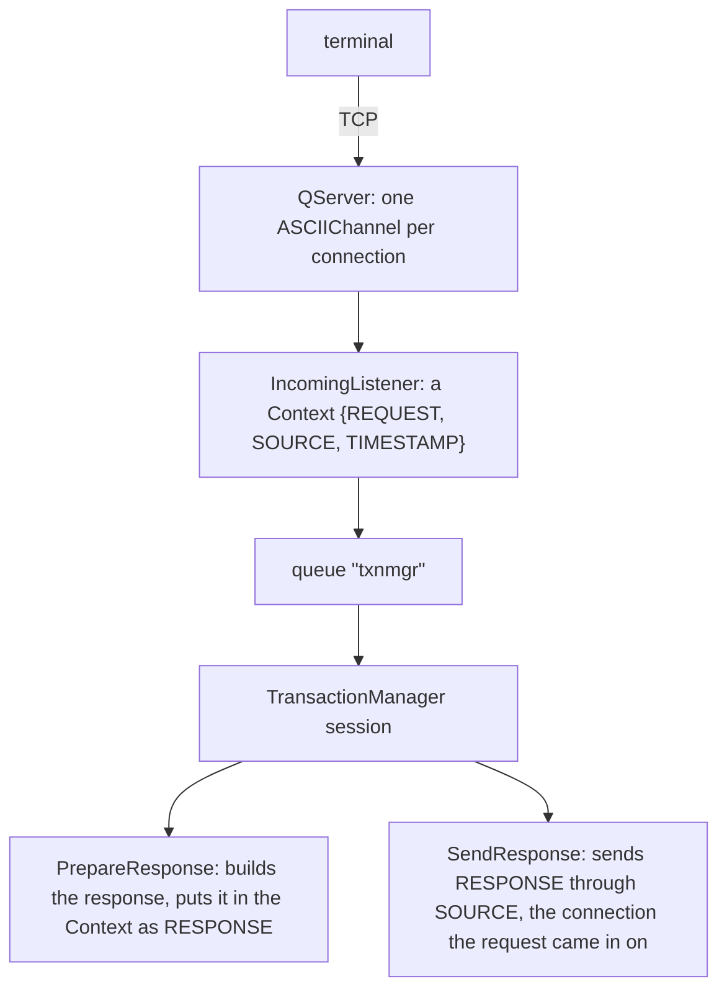
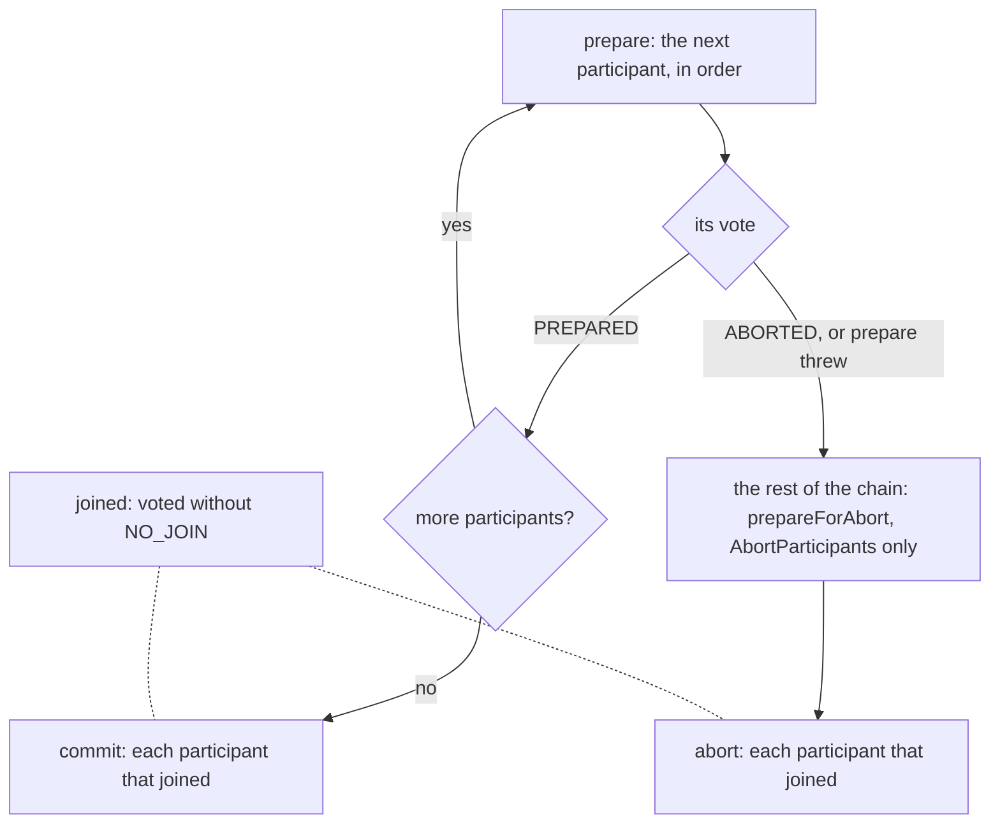
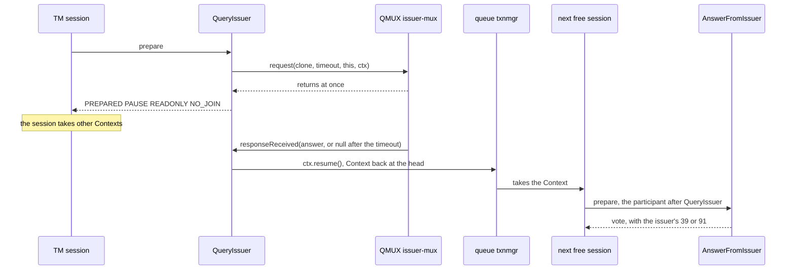
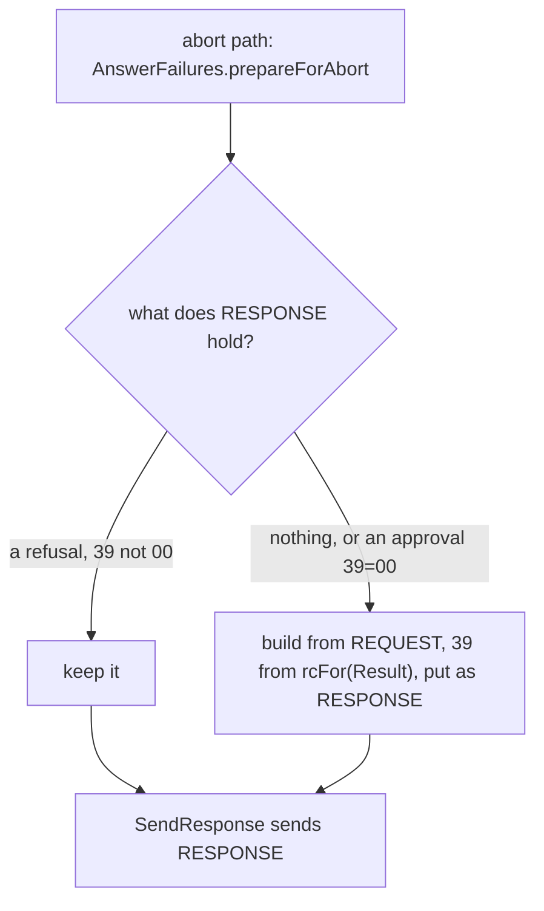
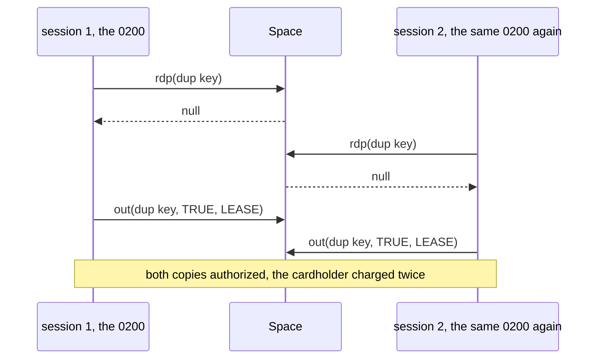
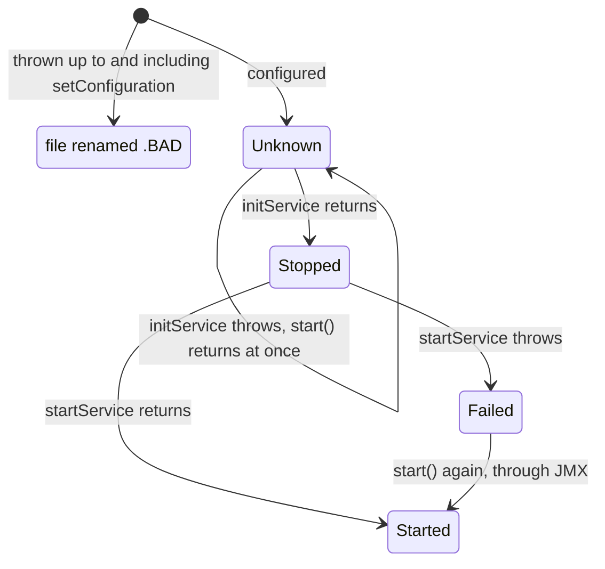
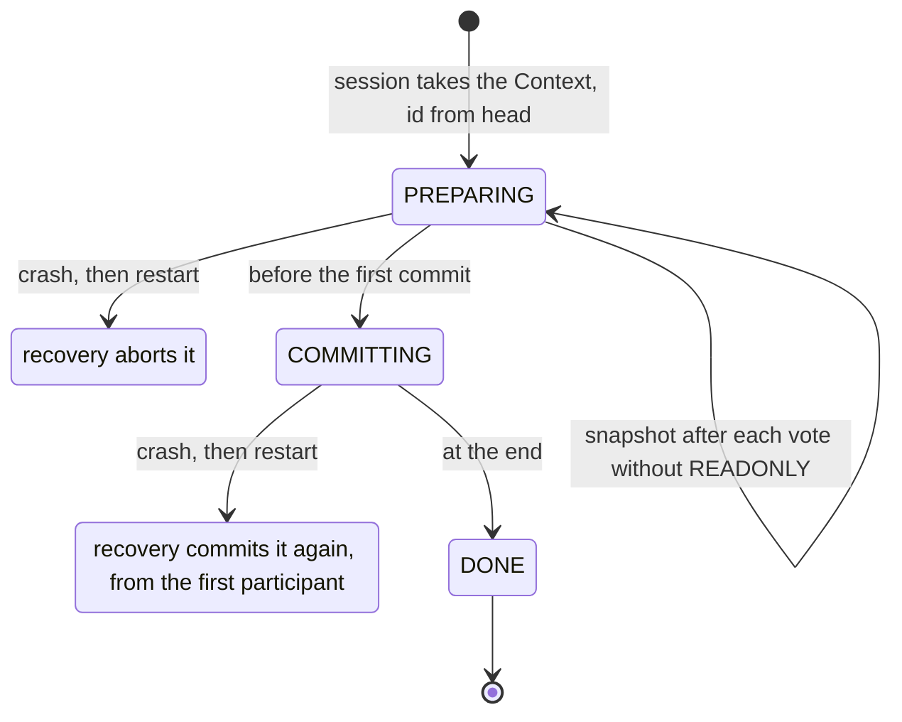
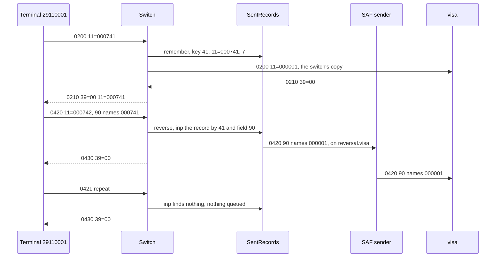
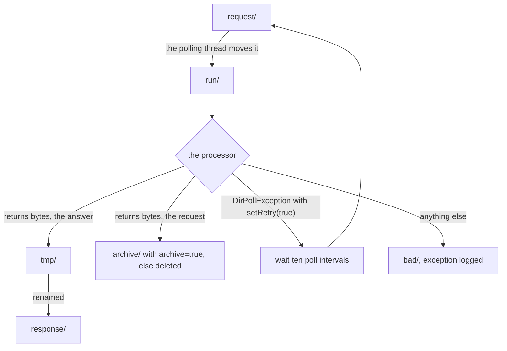

# jPOS Server: Basic Setup

Your new server is up. Q2 has logged every descriptor as deployed, and port 8000 accepts
connections. A terminal sends its first echo, waits twenty seconds, and gets nothing back. Where
did the 0800 go?

Between the socket and the answer a request passes four components: QServer, `IncomingListener`,
the TransactionManager and `SendResponse`. Any of them can drop it without stopping the server,
and the terminal sees the same silence whichever one did. This unit builds the server that the rest
of the series grows, and shows how to find, from the log alone, the step that dropped a request. It
has six rules, one per section heading.

Unit c1 covers what the client and the server share: how Q2 deploys `deploy/`, `${...}` values,
the `NameRegistrar` and the masking logger. This unit uses the same `00_logger.xml`.

> **Versions.** The course runs on jPOS 2.1.7, Java 17 and Maven, the combination the practices
> are graded on. 2.1.x is jPOS's maintenance ("tail") line and 2.1.9 is its latest release. jPOS
> 3.x is the current line; it needs Java 23 or later and its tooling is Gradle-based. Unit s13
> lists what changes there.

> **Licence.** jPOS is licensed under the GNU AGPL v3, and Q2 says so when it starts. If
> users reach your modified server over a network, the AGPL requires you to offer them its source.
> The jPOS project sells a commercial licence for those who can't.

## 1.1 A Request Crosses Four Components, and the Log Shows Each Step

The server is three descriptors and one class of our own:

```text
iso-server/
├── pom.xml                       the build (in the reference at the end of the unit)
├── deploy/
│   ├── 00_logger.xml             the masking logger of unit c1
│   ├── 30_txnmgr.xml             the TransactionManager and its participants
│   └── 50_server.xml             the QServer: the port, the channel, the listener
├── cfg/default.yml               values for ${...} (optional)
├── log/                          must exist
└── src/main/java/com/example/jpos/server/participant/PrepareResponse.java
```

`deploy/50_server.xml`:

```xml
<qserver name="iso-server" class="org.jpos.q2.iso.QServer" logger="Q2">
  <attr name="port" type="java.lang.Integer">${iso.server.port:8000}</attr>
  <channel class="org.jpos.iso.channel.ASCIIChannel"
           packager="org.jpos.iso.packager.GenericPackager" logger="Q2">
    <property name="packager-config" value="jar:packager/iso87ascii.xml"/>
  </channel>
  <request-listener class="org.jpos.iso.IncomingListener" logger="Q2">
    <property name="queue" value="txnmgr"/>
    <property name="timeout" value="15000"/>
  </request-listener>
</qserver>
```

`deploy/30_txnmgr.xml`:

```xml
<txnmgr name="txnmgr" class="org.jpos.transaction.TransactionManager" logger="Q2">
  <property name="queue" value="txnmgr"/>
  <property name="sessions" value="${txnmgr.sessions:2}"/>
  <property name="debug-context" value="false"/>
  <participant class="com.example.jpos.server.participant.PrepareResponse" logger="Q2">
    <property name="unsupported-rc" value="12"/>
  </participant>
  <participant class="org.jpos.transaction.participant.SendResponse" logger="Q2"/>
</txnmgr>
```

A request takes this path:



QServer accepts connections and creates a channel for each from the `<channel>` template. It
passes each message it reads to the request listener without understanding or answering it.
`IncomingListener` wraps it in a `Context`, a map that travels with the transaction: the message
under `REQUEST`, the connection under `SOURCE`, the arrival time under `TIMESTAMP`. It puts the
Context into the `txnmgr` queue of a Space, and returns. A TransactionManager session takes the
Context from the queue and runs the participants listed in its descriptor, in order. The last one,
`SendResponse`, ships with jPOS: it writes whatever the others left under `RESPONSE` back to
`SOURCE`.

Every example in the unit uses this terminal:

```java
package com.example.jpos.server.testing;

import org.jpos.iso.ISOException;
import org.jpos.iso.ISOMsg;
import org.jpos.iso.channel.ASCIIChannel;
import org.jpos.iso.packager.GenericPackager;

import java.io.IOException;
import java.net.SocketTimeoutException;

/** A terminal for trying a server by hand: one connection, one request at a time. */
public final class TestTerminal implements AutoCloseable {
    private final ASCIIChannel channel;

    public TestTerminal(String host, int port) throws ISOException, IOException {
        channel = new ASCIIChannel(host, port, new GenericPackager("jar:packager/iso87ascii.xml"));
        channel.connect();
    }

    /** Sends a request and returns the next message that arrives, or null after timeout ms. */
    public ISOMsg send(ISOMsg request, int timeout) throws ISOException, IOException {
        channel.setTimeout(timeout);
        channel.send(request);
        try {
            return channel.receive();
        } catch (SocketTimeoutException e) {
            return null;                                 // the channel has closed its socket
        }
    }

    @Override
    public void close() throws IOException {
        channel.disconnect();
    }
}
```

It takes the next frame as the answer, which is safe only with one request at a time on the
connection (unit c3). We started Q2 from `/iso-server` and sent an echo, then a purchase, each from
terminal `29110001` on a new connection:

```text
0800 000101: 0810 39=00 11=000101 41=29110001
0200 000102: 0210 39=12 11=000102 41=29110001
```

The echo was approved and the purchase refused with `12` (invalid transaction), because this
server only answers network messages so far. The log for the echo, trimmed to the three entries
that matter:

```text
<log realm="channel/127.0.0.1:58820" at="2026-11-06T23:13:13.584519283" lifespan="10ms">
  <receive>
    <isomsg direction="incoming">
      <field id="0" value="0800"/>
      <field id="7" value="1106093000"/>
      <field id="11" value="000101"/>
      <field id="41" value="29110001"/>
      <field id="70" value="301"/>
    </isomsg>
  </receive>
</log>
<log realm="channel/127.0.0.1:58820" at="2026-11-06T23:13:13.594220130">
  <send>
    <isomsg direction="outgoing">
      <field id="0" value="0810"/>
      <field id="7" value="1106093000"/>
      <field id="11" value="000101"/>
      <field id="39" value="00"/>
      <field id="41" value="29110001"/>
      <field id="70" value="301"/>
    </isomsg>
  </send>
</log>
<log realm="org.jpos.transaction.TransactionManager" at="2026-11-06T23:13:13.595318277" lifespan="9ms">
  <commit>
    txnmgr-0:idle:1
            prepare: c.e.j.s.p.PrepareResponse PREPARED NO_JOIN
            prepare: o.j.t.p.SendResponse PREPARED READONLY
             commit: o.j.t.p.SendResponse
```

The connection's channel logged the `<receive>` and the `<send>`. The TransactionManager logged
one event per transaction, when the transaction ended: which session ran it (`txnmgr-0`), its
number (`1`), and how each participant voted (1.4 explains the votes). That gives you three
checkpoints for any request. A `<receive>` with no TransactionManager event means the request never
reached a session. A TransactionManager event with no `<send>` means the participants ran and
nothing was sent. No `<receive>` at all points at the connection or the packager instead.

The descriptors are numbered so that the TransactionManager (`30_`) is started before the server
(`50_`) opens its port; unit c1 explains the order.

## 1.2 The Listener and the TransactionManager Meet Only in a Queue

The QServer descriptor names no TransactionManager, and the TransactionManager knows nothing about
servers. All they share is a queue name, `txnmgr`, in the default Space (neither descriptor sets a
`space` property, so both use the same one). A Space with another name, `tspace:switch` for
instance, is another Space with queues of its own, so the name and the Space must both match.

Someone renames the TransactionManager's queue to `txn`, to match a naming scheme, and forgets
`50_server.xml`. Both files deploy without a complaint. The terminal waits 20 seconds:

```text
0800 000201: no answer after 20162 ms
```

The log has the channel's `<receive>` for the echo, and then nothing: no TransactionManager event,
no `<send>`. The listener put the Context into `txnmgr`, where no session reads, and moved on. After
the listener's `timeout`, 15 seconds here, the Context expired from the queue unread.

On the terminal's side this is the case of unit c12. An echo that times out is a link problem. A
purchase that times out has an unknown outcome, so the terminal's acquirer reverses it and may
try again, and every purchase after it does the same. The reversals arrive at a server that
processed nothing, and they too go into the queue no session reads.

The listener's `timeout` is the longest a request may wait for a free session; the participants'
own time comes on top. Keep the two together shorter than the terminal's timeout, so that a request
nobody took in time is dropped instead of being answered after the terminal gave up. When a
`<receive>` has no TransactionManager event after it, compare the `queue` of the two descriptors
first.

## 1.3 A Component That Fails to Deploy Leaves Q2 Running, and Says So Once

### 1.3.1 Spot the Problem: The Package Rename

During a refactoring, a search-and-replace renames the package `participant` to `participants` in
every file. The participant class itself is never moved, so `30_txnmgr.xml` now says:

```xml
<participant class="com.example.jpos.server.participants.PrepareResponse" logger="Q2">
  <property name="unsupported-rc" value="12"/>
</participant>
```

Q2 starts and logs, as usual:

```text
deploy: /iso-server/deploy/30_txnmgr.xml
deploy: /iso-server/deploy/50_server.xml
listening on port 8000
```

The terminal connects, sends its echo, and gets nothing after 20 seconds. The deploy directory still
holds `30_txnmgr.xml` under its own name. Where did the echo go?

Q2 deployed the file and called the TransactionManager's `init`, which creates the participants
and could not load the class. The failure is one warning:

```text
<log realm="org.jpos.transaction.TransactionManager" at="2026-11-06T19:01:00.750206724">
  <warn>
    init
    <iso-exception>
      com.example.jpos.server.participants.PrepareResponse
      ...
Caused by: java.lang.ClassNotFoundException: com.example.jpos.server.participants.PrepareResponse
```

`QBeanSupport`, the base class of every QBean in jPOS, catches whatever `init` or `start` throws,
logs it as a warning and carries on. The TransactionManager was never started. It started no
sessions (the two `start Thread` entries of a good start are missing), and it never registered its
name. QServer, in the next file, started normally and fed the queue that nobody reads. From the
terminal, this looks exactly like 1.2.

Q2 renames a descriptor only when it can't read the file or can't build and configure the
component. With the closing tag of a `<property>` removed from `30_txnmgr.xml`, Q2 logs the parse
error and renames the file:

```text
Tidying /iso-server/deploy/30_txnmgr.xml out of the way, by adding .BAD
```

A failure inside `init` or `start` leaves the file as it is. **After every deploy, search
the log for `<warn>` before you send anything.** A test that deploys your own descriptors (unit c10)
and waits for the TransactionManager by name, `NameRegistrar.get("txnmgr", 10000)`, fails at
startup instead of at the first terminal.

## 1.4 A Participant Decides in `prepare`, and an Abort Still Answers

`PrepareResponse`, the participant the server runs:

```java
package com.example.jpos.server.participant;

import org.jpos.core.Configurable;
import org.jpos.core.Configuration;
import org.jpos.iso.ISOException;
import org.jpos.iso.ISOMsg;
import org.jpos.transaction.Context;
import org.jpos.transaction.ContextConstants;
import org.jpos.transaction.TransactionParticipant;

import java.io.Serializable;

/** Approves 0800 network messages and refuses everything else, with a response either way. */
public class PrepareResponse implements TransactionParticipant, Configurable {
    /** The fields a response copies from its request; unit s2 explains the list. */
    private static final int[] ECHOED = { 0, 2, 3, 4, 7, 11, 12, 13, 32, 37, 41, 42, 49, 70 };

    private String refusal;                              // configuration only: see 1.5

    @Override
    public void setConfiguration(Configuration cfg) {
        refusal = cfg.get("unsupported-rc", "12");
    }

    @Override
    public int prepare(long id, Serializable context) {
        Context ctx = (Context) context;
        ISOMsg request = ctx.get(ContextConstants.REQUEST.toString());
        try {
            ISOMsg response = (ISOMsg) request.clone(ECHOED);  // (1) STAN and terminal ID included
            response.setResponseMTI();
            boolean network = "0800".equals(request.getMTI());
            response.set(39, network ? "00" : refusal);
            ctx.put(ContextConstants.RESPONSE.toString(), response);   // (2) before the vote
            return network ? PREPARED | NO_JOIN : ABORTED;             // (3)
        } catch (ISOException e) {
            ctx.log(e);
            return ABORTED;
        }
    }
}
```

The TransactionManager calls `prepare` on each participant in the order of the descriptor, and
each one votes. `PREPARED` means "go on". `ABORTED` means "this transaction fails", and from then on
only participants that implement `AbortParticipant` are called. When every participant has voted,
the TransactionManager calls `commit` on the ones that joined, or `abort` if anyone voted
`ABORTED`, again only on the ones that joined. A participant joins unless its vote includes
`NO_JOIN`, "don't call me again for this transaction"; `READONLY` means "I changed
nothing in the Context". The TransactionManager builds one instance of each participant from the
descriptor, through its public no-argument constructor, and passes it the nested `<property>`
values through `setConfiguration`.

`SendResponse`'s `prepare` only checks that the connection is still there, and it joins, so it
sends in `commit` or in `abort`. Because it is an `AbortParticipant`, it is still asked to join
after an `ABORTED` vote, through `prepareForAbort`. For the 0200 of 1.1 the TransactionManager
logged:

```text
  <abort>
    txnmgr-1:idle:2
            prepare: c.e.j.s.p.PrepareResponse ABORTED
    prepareForAbort: o.j.t.p.SendResponse
              abort: c.e.j.s.p.PrepareResponse
              abort: o.j.t.p.SendResponse
```

`PrepareResponse` voted plain `ABORTED`, without `NO_JOIN`, so it joined and got an `abort` call
that does nothing. The terminal got its `0210` with `12`, and only because of (2): the response is
in the Context *before* the participant votes.

The mistake is to think that a refused request has nothing to send. This participant votes
`ABORTED` first and builds a response only for what it approves:

```java
if (!"0800".equals(request.getMTI()))
    return ABORTED;                                  // "nothing to answer"
```

The echo still works. The purchase:

```text
0800 000501: 0810 39=00 11=000501 41=29110001
0200 000502: no answer after 20009 ms
```

The TransactionManager event is the same as above, line for line. `SendResponse` ran on the abort
path, found no `RESPONSE`, and sent nothing. It notes that in the Context's own log, which is
printed only with the Context dump that 1.6 turns off, so the channel's log is where you see it: a
`<receive>` with no `<send>`. On the terminal's side, a refusal the server decided in a millisecond
became 20 seconds of waiting and an unknown outcome, so the acquirer reverses a purchase that never
went through.

- **(1) The response is a copy of listed fields of the request.** `clone(ECHOED)` copies only the
  fields named in `ECHOED`, among them the STAN (field 11) and the terminal ID (field 41), which
  are what the terminal's multiplexer matches it by (unit c12). A response built as a new, empty
  message matches nothing on the other side, and the terminal times out as if it had never been
  sent. A full `clone()` would send track 2 and the PIN block back to the terminal (unit s2). The
  copy also leaves the request in the Context as it arrived, for the participants after this one
  and for the log.
- **(3) The vote says what is left to do.** The approved echo votes `PREPARED | NO_JOIN`: it has
  nothing to commit or undo. Work that must happen only if the whole transaction succeeds, such as
  writing a row, belongs in `commit`, which runs only after every participant has voted
  `PREPARED`. A participant later in the chain may still abort, and what `prepare` already wrote
  would then stay written.

<!-- practice 1 -->

## 1.5 One Participant Serves Every Session

The descriptor asks for two sessions, two threads that each take a Context from the queue and run
the whole chain. How many `PrepareResponse` objects are there?

The TransactionManager creates each participant once, when it is initialised, and every
session calls the same object. So everything that belongs to one transaction lives in local
variables or in the Context, and fields hold configuration only.

### 1.5.1 Spot the Problem: The Terminal Check

`PrepareResponse` grows a check: only known terminals get `00`. The check reads a table, which
takes about 50 ms:

```java
package com.example.jpos.server.participant;

import org.jpos.iso.ISOException;
import org.jpos.iso.ISOMsg;
import org.jpos.iso.ISOUtil;
import org.jpos.transaction.Context;
import org.jpos.transaction.ContextConstants;
import org.jpos.transaction.TransactionParticipant;

import java.io.Serializable;

/** PrepareResponse plus a terminal check, with the request kept in a field. */
public class TerminalCheck implements TransactionParticipant {
    private static final int[] ECHOED = { 0, 2, 3, 4, 7, 11, 12, 13, 32, 37, 41, 42, 49, 70 };
    private ISOMsg request;                                  // (1)

    @Override
    public int prepare(long id, Serializable context) {
        Context ctx = (Context) context;
        request = ctx.get(ContextConstants.REQUEST.toString());
        try {
            boolean known = isKnown(request.getString(41)); // (2) about 50 ms
            ISOMsg response = (ISOMsg) request.clone(ECHOED); // (3)
            response.setResponseMTI();
            response.set(39, known ? "00" : "03");
            ctx.put(ContextConstants.RESPONSE.toString(), response);
            return PREPARED | NO_JOIN;
        } catch (ISOException e) {
            return ABORTED;
        }
    }

    private boolean isKnown(String terminal) {
        ISOUtil.sleep(50);                                   // stands in for a database query
        return terminal.startsWith("2911");
    }
}
```

Every test passes, one request at a time. In production, two terminals send an echo at the same
moment, each on its own connection. Can you see what each of them receives?

```text
terminal 29110001 sent 11=000731, got 0810 39=00 11=000731 41=29110001
terminal 29110002 sent 11=000412, got 0810 39=00 11=000731 41=29110001
```

Both sessions wrote the field at (1). While terminal `29110002`'s session waited at (2), terminal
`29110001`'s session replaced the request, and each session built its response at (3) from
whatever the field held by then. `SendResponse` sent each response to the right connection,
because `SOURCE` came from the Context, but terminal `29110002`'s response was a copy of the other
terminal's message. We ran it four times, and every time one of the terminals got the other's
answer; which one depended on timing.

Terminal `29110002`'s multiplexer can't match an answer with another STAN and terminal ID, so the
request times out, and for a purchase the acquirer reverses it. With purchases, the answer would
also carry the other terminal's amount and card number. Nothing in the log flags it: every
transaction was answered, and only a reader who compares each `<send>` with its `<receive>` would
notice.

The fix is a local variable instead of the field. **A participant's fields hold what came from
`setConfiguration`, and nothing that came from a Context.**

<!-- practice 2 -->

## 1.6 The Transaction Trace Dumps What the Log Filter Can't Mask

`30_txnmgr.xml` above sets `debug-context` to `false`. We removed that line and sent a
purchase with the test card `4111111111111111`, through the masking logger of unit c1. The
channel's `<receive>` is masked:

```text
      <field id="2" value="411111______1111"/>
      <field id="35" value="411111______1111=____________________"/>
```

The TransactionManager's event for the same transaction is not:

```text
  <abort>
    txnmgr-0:idle:1
    <context>
      TIMESTAMP: Fri Nov 06 19:33:12 UTC 2026
      SOURCE: org.jpos.iso.channel.ASCIIChannel@274a20d7
      REQUEST: 
       <isomsg direction="incoming">
         <field id="0" value="0200"/>
         <field id="2" value="4111111111111111"/>
         ...
         <field id="35" value="4111111111111111=28121010000000000000"/>
```

`ProtectedLogListener` masks a message only when the message itself is in the log event (unit c8
shows the same trap with a client-side object). Here the event holds the Context, and the
TransactionManager turns the whole event into text before any listener sees it, so there is no
message left to mask. In 2.1.7 the TransactionManager adds the Context to every transaction's event
unless `debug-context` is `false`; when it isn't set, it follows `debug`, which is on by default. So
by default every purchase writes its card number and track 2 in clear to `log/q2.log`, and to
wherever the log is shipped, while the channel's `<receive>` entries look properly masked.

With `debug-context` set to `false`, the event keeps the participant trace and the timings of 1.1
and loses the dump. Turn the dump on only on a test system with test cards. Unit s8 covers what a
participant itself may log.

<!-- practice 3 -->

## 1.7 Summary

- **A request crosses four components:** QServer's channel receives it, `IncomingListener` puts a
  Context in a queue, a TransactionManager session runs the participants, and `SendResponse`
  answers through `SOURCE`. The channel's `<receive>` and `<send>` and the TransactionManager's
  event tell you which step dropped it.
- **The listener and the TransactionManager share only a queue name and a Space.** A mismatch
  deploys cleanly, and every request expires unread while terminals time out and reverse.
- **A component that fails in `init` or `start` leaves Q2 running** and logs one warning. Only a
  file Q2 can't read, build or configure is renamed `.BAD`. Check the log for `<warn>` after every deploy.
- **A participant decides in `prepare` and puts its response in the Context before it votes.**
  `SendResponse` answers on the commit path and the abort path; a refusal without a response
  leaves the terminal waiting. Build the response from the request, and leave durable work to
  `commit`.
- **One instance of each participant serves every session.** Per-transaction state in a field
  sends one terminal's answer to another.
- **The Context dump is not masked.** Set `debug-context` to `false`.

## 1.8 Reference

**`pom.xml`** for the server. The two plugins build a jar whose main class is Q2 and copy the
dependencies into `target/lib/`:

```xml
<?xml version="1.0" encoding="UTF-8"?>
<project xmlns="http://maven.apache.org/POM/4.0.0"
         xmlns:xsi="http://www.w3.org/2001/XMLSchema-instance"
         xsi:schemaLocation="http://maven.apache.org/POM/4.0.0 https://maven.apache.org/xsd/maven-4.0.0.xsd">
  <modelVersion>4.0.0</modelVersion>
  <groupId>com.example.jpos</groupId>
  <artifactId>iso-server</artifactId>
  <version>1.0.0</version>

  <properties>
    <project.build.sourceEncoding>UTF-8</project.build.sourceEncoding>
    <maven.compiler.release>17</maven.compiler.release>
  </properties>

  <dependencies>
    <dependency>
      <groupId>org.jpos</groupId>
      <artifactId>jpos</artifactId>
      <version>2.1.7</version>
    </dependency>
    <dependency>
      <groupId>org.junit.jupiter</groupId>
      <artifactId>junit-jupiter</artifactId>
      <version>5.14.4</version>
      <scope>test</scope>
    </dependency>
  </dependencies>

  <build>
    <plugins>
      <plugin>
        <groupId>org.apache.maven.plugins</groupId>
        <artifactId>maven-dependency-plugin</artifactId>
        <version>3.6.1</version>
        <executions>
          <execution>
            <phase>package</phase>
            <goals><goal>copy-dependencies</goal></goals>
            <configuration>
              <outputDirectory>${project.build.directory}/lib</outputDirectory>
              <includeScope>runtime</includeScope>
            </configuration>
          </execution>
        </executions>
      </plugin>
      <plugin>
        <groupId>org.apache.maven.plugins</groupId>
        <artifactId>maven-jar-plugin</artifactId>
        <version>3.3.0</version>
        <configuration>
          <archive>
            <manifest>
              <mainClass>org.jpos.q2.Q2</mainClass>
              <addClasspath>true</addClasspath>
              <classpathPrefix>lib/</classpathPrefix>
            </manifest>
          </archive>
        </configuration>
      </plugin>
    </plugins>
  </build>
</project>
```

**Running it.** During development, run `org.jpos.q2.Q2` as the main class with the project root
as the working directory. For a packaged run, put the jar, `lib/`, `deploy/` and `cfg/` in one
directory, create `log/`, and start it from there:

```text
iso-server-1.0.0/
├── iso-server-1.0.0.jar     Main-Class: org.jpos.q2.Q2, Class-Path: lib/...
├── lib/                     jpos-2.1.7.jar and its dependencies
├── deploy/
├── cfg/
└── log/
```

```bash
java -Xms512m -Xmx512m -jar iso-server-1.0.0.jar
```

Q2 switches used in this course: `-d <dir>` another deploy directory, `-E <name>` the environment
(`cfg/<name>.yml`; with `-E prod` and `sessions: 4` under `txnmgr:` in `cfg/prod.yml`, the
TransactionManager started four sessions), `--help` for the rest. Set `-Xms` equal to `-Xmx`, and
leave out JVM flags copied from pre-Java 17 guides: an unknown `-XX` flag stops the JVM.

**Descriptor elements and properties used in this unit (2.1.7):**

| Where | Name | Meaning |
|---|---|---|
| QServer | `<attr name="port">` | TCP port to listen on |
| QServer | `<channel>` | template for the channel of each accepted connection |
| QServer | `<request-listener>` | receives each incoming message; several may be listed |
| `IncomingListener` | `queue` | queue the Context is written to (required) |
| `IncomingListener` | `space` | Space of that queue; default: the default Space |
| `IncomingListener` | `timeout` | ms the Context may wait in the queue; default 15000 |
| TransactionManager | `queue` | queue its sessions read (required) |
| TransactionManager | `space` | Space of that queue; default: the default Space |
| TransactionManager | `sessions` | number of session threads; default 1 |
| TransactionManager | `debug` | write one event per transaction; default true |
| TransactionManager | `debug-context` | add the whole Context to that event; default: same as `debug` |
| TransactionManager | `<participant class="...">` | one participant, in chain order, with nested `<property>` values |
| `SendResponse` | `source`, `response` | Context keys it reads; default `SOURCE`, `RESPONSE` |

**Participant votes:** `PREPARED` go on; `ABORTED` the transaction fails; `| NO_JOIN` no
`commit`/`abort` call for this participant; `| READONLY` the Context was not changed. A participant
that throws from `prepare` is logged and counted as `ABORTED`.

## 1.9 Challenges

These have no single answer.

1. Your terminals give up after 30 seconds and your participants call a host that answers within
   10. Choose the listener's `timeout` and the number of sessions for a peak of 50 requests per
   second. What happens to the request that waits longest when one host call takes 25 seconds?
2. Write a startup check that fails the deployment when the TransactionManager isn't running or
   when the listener's queue doesn't match the TransactionManager's. Where does it run: in a test,
   in a QBean, or in the deployment pipeline? What can each of them see?
3. The participant of 1.5.1 needs its terminal table, and loading it takes a minute. Where do you
   load it so that every session shares it safely, and what happens to requests that arrive during
   the first minute?
4. Operations want the Context dump back for one terminal that is being debugged in production.
   What would you log instead, and how do you keep card data out of it?

## 1.10 Design Note: Why a Queue Between the Server and the TransactionManager?

QServer could have called the participants itself, on the thread that read the message. jPOS puts
a Space queue between them instead, and you pay for it: two descriptors that must agree on a name,
and a failure mode (1.2) that throws nothing.

In return the two sides are sized separately. QServer gives each connection a thread from its pool
(at most 100 by default, `maxSessions`), and most connections of a terminal network are idle most of
the time. The TransactionManager runs as many sessions as the back end can take, perhaps a few
dozen. The queue absorbs the difference: a burst from a hundred terminals waits in the queue instead
of opening a hundred database connections. Anything that writes a Context into the queue feeds the
same chain, such as a second QServer on another port with another framing, or a test that has no
socket at all, which is how this unit's practices run. And the listener's `timeout` puts a limit on
the wait that the queue adds. Nothing checks the pairing, though, so the three checkpoints of 1.1
are how you find a broken one.


# 2. ISO-8583 Message Handling

A new server goes live with one acquirer's terminals. Its log shows an 0210 with `39=00` going back
for every 0200, yet every purchase fails at the counter: the terminals' client waits its full
timeout, gets `null`, and sends an 0420 reversal (unit c12). By evening the server has approved and
then reversed every sale of the day.

The answers reached the client but matched no waiting request and went to its unhandled queue,
because nothing in them said which request they answered. This unit's five rules, one per section
heading, cover the messages a server reads, answers and starts.

## 2.1 A Client You Can Point at Your Code

Only the client's QMUX can judge your server's answer, so the test bench is that QMUX, in the same
JVM, joined to your code only by the wire format:

```java
package com.example.jpos.server.testclient;

import org.jdom2.Element;
import org.jpos.core.SimpleConfiguration;
import org.jpos.iso.ISOException;
import org.jpos.iso.ISOMsg;
import org.jpos.iso.ISOPackager;
import org.jpos.q2.iso.QMUX;
import org.jpos.space.LocalSpace;
import org.jpos.space.SpaceFactory;
import org.jpos.space.SpaceListener;

import java.util.ArrayList;
import java.util.List;

/** A real QMUX client whose requests reach your answering code through the wire format. */
public final class ClientRig implements SpaceListener<String, Object> {
    /** The code under test: given a request as the server's channel reads it, the answer or null. */
    public interface Server {
        ISOMsg answer(ISOMsg request) throws ISOException;
    }

    private final LocalSpace<String, Object> sp;
    private final QMUX mux;
    private final ISOPackager clientSide, serverSide;
    private final Server server;
    private final List<ISOMsg> received = new ArrayList<>();

    @SuppressWarnings("unchecked")
    public ClientRig(String name, ISOPackager clientSide, ISOPackager serverSide, Server server)
            throws Exception {
        this.sp = (LocalSpace<String, Object>) SpaceFactory.getSpace("tspace:" + name);
        this.clientSide = clientSide;
        this.serverSide = serverSide;
        this.server = server;
        Element cfg = new Element("mux");                       // as in the client's QMUX descriptor
        cfg.addContent(new Element("space").setText("tspace:" + name));
        cfg.addContent(new Element("in").setText("host-receive"));
        cfg.addContent(new Element("out").setText("host-send"));
        cfg.addContent(new Element("unhandled").setText("host-unhandled"));
        mux = new QMUX();
        mux.setName(name);
        mux.setPersist(cfg);
        mux.setConfiguration(new SimpleConfiguration());
        mux.init();
        mux.start();
        sp.addListener("host-send", this);
    }

    /** What the client's code calls: null when no matching answer came in time. */
    public ISOMsg request(ISOMsg m, long timeout) throws ISOException {
        return mux.request(m, timeout);
    }

    /** The string the client's QMUX matches an answer to its request by (unit c12). */
    public String keyOf(ISOMsg m) throws ISOException {
        return mux.getKey(m);
    }

    /** An answer that reached the client but matched no waiting request. */
    public ISOMsg unhandled() {
        return (ISOMsg) sp.inp("host-unhandled");
    }

    /** The requests exactly as the server's code was handed them. */
    public synchronized List<ISOMsg> received() {
        return new ArrayList<>(received);
    }

    @Override
    public void notify(String queue, Object value) {
        ISOMsg sent = (ISOMsg) sp.inp(queue);
        if (sent == null)
            return;
        try {
            ISOMsg request = travel(sent, clientSide, serverSide);   // what the server's channel reads
            synchronized (this) {
                received.add(request);
            }
            ISOMsg response = server.answer(request);
            if (response != null)
                sp.out("host-receive", travel(response, serverSide, clientSide));
        } catch (ISOException | RuntimeException e) {            // no answer goes back
            System.out.println("server side: " + e.getMessage());
        }
    }

    /** Packs with one end's packager and unpacks with the other's, as a TCP link would. */
    public static ISOMsg travel(ISOMsg m, ISOPackager from, ISOPackager to) throws ISOException {
        ISOMsg out = (ISOMsg) m.clone();
        out.setPackager(from);
        byte[] wire = out.pack();
        ISOMsg in = new ISOMsg();
        in.setPackager(to);
        in.unpack(wire);
        return in;
    }
}
```

Requests are packed with the client's packager and unpacked with the server's, and answers go the
other way. The QServer and its socket are unit s3's. Every output comes from this rig on jPOS 2.1.7,
for a purchase from terminal `29110001`. Outputs show only the fields that matter, `-` marks an
absent field, and where no answering code is shown it is 2.5's `ResponseBuilder`.

## 2.2 The Server Reads With Its Packager, the Client With Its Own

In a Q2 server your code doesn't create the packager: the QServer's descriptor names one, and each
connection's channel uses it to unpack requests and pack responses:

```xml
<channel class="org.jpos.iso.channel.ASCIIChannel"
         packager="org.jpos.iso.packager.GenericPackager"
         logger="Q2">
  <property name="packager-config" value="jar:packager/iso87ascii.xml"/>
</channel>
```

Your code receives what that packager read. The client set fields 4 and 11 without padding:

```text
client set:  0200 4=2500 11=731 41=29110001
server got:  0200 4=000000002500 11=000731 41=29110001
client got:  0210 11=000731 39=00 41=29110001
```

The client's packager padded both on the wire (unit c2), so store and compare what the server got,
not what the client set. The answer carries `000731` back, and QMUX pads the client's field 11 the
same way in its key (unit c12), so the two match.

Now the server's descriptor names `iso93ascii.xml`, the 1993 layout, while the clients keep the 1987
one. Does the server read the next purchase?

```text
server got:  0200 4=000000002500 11=000732 41=29110001 42=000000001234567 49=840
client got:  null after 1000 ms
unhandled:   0210 11=000732 39=00 41=02911000 42=100000000123456 49=784
```

It does, field for field: the two layouts encode every field this purchase carries (2, 3, 4, 7, 11,
14, 35, 41, 42 and 49) into the same bytes. They differ elsewhere, including field 39: two
characters in 1987, a three-digit action code in 1993. The request has no field 39, but the response
does, so the server packs `000`, the client reads `00`, and the leftover `0` shifts every later
field. Field 41 comes back as `02911000`, the answer matches nothing, and the client gets `null`,
then reverses.

The server's log looks clean, because it logs what its own packager read and wrote. Only the client
sees the damage, so test what the client gets back, as this rig does, or compare the bytes with the
specification's samples (unit c13). Both ends must agree on every field either of them sends.

## 2.3 The Client Finds Your Answer by the Fields You Echo

The responder from the opening problem:

```java
ISOMsg response = new ISOMsg("0210");
response.set(11, request.getString(11));      // (1) so the client knows which purchase
response.set(38, "A1B2C3");
response.set(39, "00");
return response;
```

The rig prints the key the client's QMUX made for its request and for the answer:

```text
built from scratch:
  client got:   null
  request key:  host-send.0200000000029110001000742
  answer key:   host-send.020000742
  on the client's unhandled queue: true
```

Read the default key from the left (unit c12): the out queue `host-send` and a dot, the MTI's first
three digits with the response digit mapped down (`021` becomes `020`), field 41 padded to 16
characters, then field 11. The answer has no field 41, so its key matches nothing. Line (1) copies
the STAN, but the client needs every field of its key, unchanged, including the retrieval reference
number on a link whose QMUX sets `<key>41, 11, 37</key>`.

Nor can the server give the response its own STAN. A STAN numbers the sender's message (unit c2),
and a response is the second half of the client's:

```text
STAN from the server's own counter:
  client got:   null
  request key:  host-send.0200000000029110001000743
  answer key:   host-send.0200000000029110001000017
  on the client's unhandled queue: true
```

Either way the server later receives an 0420 that undoes its own approval.

Start the response from the request and copy the fields that identify it:

```text
ResponseBuilder:
  client got:   0210 11=000744 39=00 41=29110001
  request key:  host-send.0200000000029110001000744
  answer key:   host-send.0200000000029110001000744
  on the client's unhandled queue: false
```

The builder is in 2.5. The network's specification lists the fields to echo per message type, and
every list has to include every field of the client's key.

## 2.4 `setResponseMTI` Answers Every Kind of Request

`ISOMsg.setResponseMTI()` computes the response MTI from the request's:

```text
0100 -> 0110   0200 -> 0210   0220 -> 0230   0420 -> 0430   0421 -> 0430   0800 -> 0810
```

It adds one to the third digit and keeps the fourth digit's origin but drops the repeat flag, so the
0421 repeat of a reversal gets an 0430. The client's key uses only the MTI's first three digits
(unit c12), so the 0430 matches the 0421.

A participant (unit s4) written for purchases often sets the MTI by hand. Then an advice arrives:

```java
ISOMsg response = new ResponseBuilder().respond(request, "00", "A1B2C3");
response.setMTI("0210");                       // "we answer purchases"
```

The second line is from a responder that copies fields 0, 11 and 41, sets 39 and forgets the MTI:

```text
0220 answered with 0210: null, unhandled 0210 11=000751
0200 answered with 0200: null, unhandled 0200 11=000752
0220 with ResponseBuilder: 0230 11=000753 39=00
```

The client keyed its 0220 with `022`, and an 0210's key starts with `020`, so it matches nothing
even with every field echoed. The unacknowledged advice goes out again as an 0221, as often as the
client's store-and-forward allows (unit c12). In the second line the 0200 that comes back is a
request to QMUX, and by default QMUX matches only responses.

`setResponseMTI` fails loudly in the two ways it can be misused:

```text
clone without field 0: MTI not available
setResponseMTI on a response: not a request - can't set response MTI
```

The first is a partial clone whose field list left out field 0, the MTI. The second is a message
turned around twice.

<!-- practice 3 -->

## 2.5 A Response Copies What Identifies the Request, and Leaves the Request Alone

The two shortcuts are to clone the whole request and change what differs, or to turn the request
itself into the response. In a Q2 server the request object is the one the `IncomingListener` put
into the TransactionManager's Context under `REQUEST` (unit s4):

```text
clone() and change:
  client got:          0210 has 2 11 14 35 38 39 41
  request afterwards:  0200 has 2 11 14 35 41
answer in place:
  client got:          0210 has 2 11 14 35 38 39 41
  request afterwards:  0210 has 2 11 14 35 38 39 41
ResponseBuilder:
  client got:          0210 has 2 11 38 39 41
  request afterwards:  0200 has 2 11 14 35 41
```

**A full clone sends the card back.** Field 35 is track 2 from the stripe, and field 14 the expiry
date. Both cross the link into the client's logs and stores, and while your server's logger may wipe
track 2, the client's may only mask the PAN. A PIN block (52) or chip data (55) would go back too,
and none of them helps the client match or act on the answer.

**Answering in place destroys the request.** The Context's `REQUEST` becomes an 0210 with a response
code, so the transaction log records a response where the request should be, and a later participant
checking for a purchase sees `0210`. The card data goes back as well.

A response is a new message built from a short list:

```java
package com.example.jpos.server;

import org.jpos.iso.ISOException;
import org.jpos.iso.ISOMsg;

/** Answers a request: what identifies it goes back, the card's secrets stay behind. */
public final class ResponseBuilder {
    /** Echoed into the response; field 0 must be here, or there is no MTI to turn around. */
    private static final int[] ECHOED = { 0, 2, 3, 4, 7, 11, 12, 13, 32, 37, 41, 42, 49, 70 };

    public ISOMsg respond(ISOMsg request, String responseCode, String approvalCode)
            throws ISOException {
        ISOMsg response = (ISOMsg) request.clone(ECHOED);   // a new message; the request stays as it is
        response.setResponseMTI();                          // 0200 -> 0210, 0220 -> 0230, 0421 -> 0430
        response.set(39, responseCode);
        if ("00".equals(responseCode))
            response.set(38, approvalCode);
        return response;
    }
}
```

`clone(int...)` copies into a new message only the listed fields the request has, so a request
carrying something unexpected can't leak it. The approval code (38) goes only with an approval. A
decline with response code 51 comes out as:

```text
decline 51:  0210 has 2 11 39 41
```

Many networks' lists include the PAN (field 2), which goes back in clear: the message carries the
real value, and only the log masks it (units c2 and s8).

<!-- practice 1 -->

## 2.6 A Message the Server Starts Is a Fresh Copy, Numbered by the Server

Messages with no request to start from, such as an echo to a quiet client or a new working key, take
their constant fields from a template. The tempting version uses one 0800 template, with field 70
naming the network message:

```java
ISOMsg keyChange(String key) throws ISOException {
    ISOMsg m = template;                       // (1)
    m.set(11, ISOUtil.zeropad(++stan, 6));
    m.set(48, key);
    m.set(70, "161");
    return m;
}
```

`echo()` is the same with `70=301` and no field 48. The server sends a key change, then an echo:

```text
key change: 0800 11=000001 48=8F1C0D2A5B6E7F90 70=161
next echo:  0800 11=000002 48=8F1C0D2A5B6E7F90 70=301
key change now: 0800 11=000002 48=8F1C0D2A5B6E7F90 70=301  (same object: true)
```

Line (1) hands out the template itself, so the echo, and every later 0800, carries the key change's
field 48. The two are also one object: a key change still queued when the echo is built goes out as
an echo, and the key never changes. Under load, two threads fill in the same object at once.

Each message is a copy of the template, with the varying fields set on the copy. `clone()` copies
the field map, so a field set on the copy never reaches the template:

```java
package com.example.jpos.server;

import org.jpos.iso.ISOException;
import org.jpos.iso.ISOMsg;
import org.jpos.iso.ISOUtil;
import org.jpos.space.Space;
import org.jpos.space.SpaceUtil;

import java.time.Clock;
import java.time.ZoneOffset;
import java.time.format.DateTimeFormatter;

/** The network messages the server starts on one link, each built from a fresh copy. */
public final class ServerMessages {
    private static final DateTimeFormatter FIELD_7 = DateTimeFormatter.ofPattern("MMddHHmmss");

    private final ISOMsg template = new ISOMsg();      // what every 0800 of this server carries
    private final Space<String, Object> space;
    private final String stanKey;
    private final Clock clock;

    public ServerMessages(String institutionId, Space<String, Object> space, String link, Clock clock)
            throws ISOException {
        template.setMTI("0800");
        template.set(33, institutionId);
        this.space = space;
        this.stanKey = "stan." + link;
        this.clock = clock;
    }

    public ISOMsg echo() throws ISOException {
        ISOMsg m = fromTemplate();
        m.set(70, "301");
        return m;
    }

    public ISOMsg keyChange(String keyUnderZoneKey) throws ISOException {
        ISOMsg m = fromTemplate();
        m.set(48, keyUnderZoneKey);
        m.set(70, "161");
        return m;
    }

    private ISOMsg fromTemplate() throws ISOException {
        ISOMsg m = (ISOMsg) template.clone();          // the template itself never leaves this class
        m.set(7, clock.instant().atZone(ZoneOffset.UTC).format(FIELD_7));
        m.set(11, nextStan());
        return m;
    }

    /** The server's own sequence for this link: 000001 .. 999999, then 000001 again. */
    String nextStan() {
        long n = SpaceUtil.nextLong(space, stanKey);
        return ISOUtil.zeropad((n - 1) % 999999 + 1, 6);
    }
}
```

```text
key change: 0800 7=1106101500 11=000001 48=8F1C0D2A5B6E7F90 70=161
next echo:  0800 7=1106101500 11=000002 48=- 70=301
```

Here the server is the sender, so it numbers the message from its own sequence, as a client does
(unit c2). All kinds share one sequence per link, because the client answers each with the same
STAN, and two messages in flight with one number could not be told apart. The clock is passed in so
a test can fix it, and field 7 is in GMT.

> **Networks differ.** The field 70 codes (`301` echo, `161` key change here), where a new key
> travels (field 48, 53 or 96) and which fields every network message carries are the network's
> choice.

To put such a message on a connection, a 2.1.7 QServer with an `<in>` element sends whatever arrives
on that Space queue to the last connected session by default (`<send-request>` chooses `LAST`, `ALL`
or `RR`).

<!-- practice 2 -->

## 2.7 Summary

- **The server reads with its packager, the client with its own.** Fields arrive padded to full
  width. A layout that differs only in fields the requests don't carry reads every request
  correctly and garbles every answer, so test what the client gets back.
- **The client finds the answer by the fields you echo:** the mapped MTI, field 41, field 11 and
  any key field it adds. A response built from scratch or renumbered by the server matches
  nothing, and the approved purchase ends as `null` and a reversal.
- **`setResponseMTI` answers every kind of request**, repeats included. A hand-written `0210`
  leaves every advice unacknowledged.
- **A response copies a short list of fields into a new message.** A full clone sends track 2
  back, and answering in place overwrites the Context's request.
- **A message the server starts is a copy of a template**, numbered from the server's own sequence
  for the link. A handed-out template collects every message's fields.

## 2.8 Reference

**`setResponseMTI()` in 2.1.7:** the third digit goes up by one; the fourth digit becomes `2`
for `2`/`3`, `4` for `4`/`5`, and `0` for anything else. It throws `ISOException` when the message has no
MTI or is already a response. `setRetransmissionMTI()` sets the fourth digit to `1`.

**`clone` in 2.1.7:**

| Call | What the copy has |
|---|---|
| `clone()` | every field, in a field map of its own, so `set` on the copy doesn't change the original. Nested messages (sub-fields) and the header are copied; plain field objects are shared |
| `clone(int... fields)` | only the listed fields that the original has; field 0 only if listed. The header object, if any, is shared with the original |
| `clone(String... paths)` | only the listed field paths, such as `"48.1"` |

**Stock layouts in the 2.1.7 jar**, loaded with the `jar:` prefix (unit c13):

| File | Edition | Numbers | Bitmap |
|---|---|---|---|
| `packager/iso87ascii.xml` | 1987 | ASCII digits | 16 hex characters per 64 bits |
| `packager/iso87binary.xml` | 1987 | BCD | 8 bytes per 64 bits |
| `packager/iso93ascii.xml` | 1993 | ASCII digits | 16 hex characters per 64 bits |
| `packager/iso93binary.xml` | 1993 | BCD | 8 bytes per 64 bits |
| `packager/cmf.xml` | jPOS Common Message Format (unit s16) | BCD | 8 bytes per 64 bits |

**Some fields that differ between `iso87ascii.xml` and `iso93ascii.xml`:**

| Field | 1987 | 1993 |
|---|---|---|
| 12 | local time, n 6 | local date and time, n 12 |
| 13 | local date, n 4 | effective date, n 4 |
| 35 | track 2, `IFA_LLNUM` | track 2, `IFA_LLCHAR` |
| 39 | response code, an 2 | action code, n 3 |

## 2.9 Challenges

1. Your network's specification lists the fields to echo for 0100, 0200, 0220 and 0420, and the
   lists differ. Where do the lists live in your code, and how does a test catch a message type
   that has none?
2. A client configures its QMUX with `<key>41, 11, 37</key>`, and your server assigns field 37 for
   requests that arrive without one. What does the client's key look like for its request and for
   your answer, and what do you change?
3. The 1987 and 1993 layouts agree on every field your terminals send today. A new terminal model
   sends field 12. What does the server read, and what test would have caught the wrong
   `packager-config` on the first day?
4. Two threads build server-initiated messages from one `ServerMessages`. Which of its parts are
   safe to share, and which would break if the space were a plain `HashMap` counter?

## 2.10 Design Note: Why Does the Response Repeat the Request?

An ISO 8583 response has no "in reply to" field. It repeats enough of the request for the sender to
recognise it. The responder needs no memory of what it was asked, so any thread of the server can
answer, as long as the answer goes back on the connection the request came in on.

The price is that the protocol can't tell a wrong answer from a missing one. A response with one
field dropped or renumbered raises no error on either side. It shows up as a timeout on the client,
in someone else's log.


# 3. Server Channel Management

Monday, 09:10. Terminals restarted over the weekend can't reach the server: "connection refused".
Terminals that never disconnected still send purchases and get answers. The server's CPU is idle and
the TransactionManager's queue is empty. On Friday a new firewall went in between the stores and the
data centre. Where did the server's capacity go?

Everything the server knows about a terminal comes through one connection. The QServer of unit s1
decides how long a connection lives, who reads from it, who answers on it and who may open one, in
six rules, one per section heading.

## 3.1 Every Connection Holds a Thread Until It Closes

The server's descriptor, `deploy/50_server.xml`:

```xml
<qserver name="iso-server" class="org.jpos.q2.iso.QServer" logger="Q2">
  <attr name="port" type="java.lang.Integer">8000</attr>
  <attr name="maxSessions" type="java.lang.Integer">250</attr>
  <channel class="org.jpos.iso.channel.ASCIIChannel"
           packager="org.jpos.iso.packager.GenericPackager" logger="Q2">
    <property name="packager-config" value="jar:packager/iso87ascii.xml"/>
    <property name="timeout" value="360000"/>
  </channel>
  <request-listener class="org.jpos.iso.IncomingListener" logger="Q2">
    <property name="queue" value="txnmgr"/>
    <property name="timeout" value="15000"/>
  </request-listener>
</qserver>
```

For each accepted connection QServer clones the `<channel>` and runs a **session** on a thread from
its pool. The session loops on `receive()` and hands each message to the listeners. It ends only
when something throws: the client closes the connection, a frame can't be read, nothing arrives for
`timeout` milliseconds, or a listener throws. `maxSessions` (default 100) sizes that pool, so it is
also the most connections the server holds at once.

We deployed a server with `maxSessions` 3 and `timeout` 0, which disables the read timeout. Three
terminals connect, send an echo and go silent. A fourth tries to connect every two seconds:

```text
    20 ms  terminal 29110001: 0810 11=000101 41=29110001 39=00, then silence
    47 ms  terminal 29110002: 0810 11=000102 41=29110002 39=00, then silence
    59 ms  terminal 29110003: 0810 11=000103 41=29110003 39=00, then silence
    65 ms  terminal 29110004: ConnectException: Connection refused
  2069 ms  terminal 29110004: ConnectException: Connection refused
  4080 ms  terminal 29110004: ConnectException: Connection refused
  6084 ms  terminal 29110004: ConnectException: Connection refused
  8088 ms  terminal 29110004: ConnectException: Connection refused
```

Why "refused", and not a connection that waits for a free thread? When the pool has no thread left,
the 2.1.7 `ISOServer` closes its listening socket, so the operating system refuses every new
connection at once. The server checks the pool four times a second and opens the port again when a
session ends. While it waits, it logs a warning once a minute:

```text
<log realm="iso-server.server" at="2026-11-06T13:23:29.441156027">
  <warn>
    pool exhausted ServerSocket[addr=0.0.0.0/0.0.0.0,localport=42909]
    <thread-pool name="iso-server-ThreadPool-0">
      <jobs>3</jobs>
      <size>3</size>
      <max>3</max>
```

The connections that hold the threads keep working, which is why the old terminals in the opening
still transact.

The three silent terminals stand in for terminals behind that firewall. A firewall that drops an
idle flow tells neither side, so the server can't tell a terminal that went away from one with
nothing to say. The terminal reconnects on a new connection (unit c12 tells it from the client's
side), and the old session stays. Each reconnect leaves a dead session holding a thread, until one
Monday morning the last thread is taken. From then on, only the terminals that never needed to
reconnect can transact.

The read timeout ends a dead session. The same run with `timeout` set to 3000:

```text
    15 ms  terminal 29110001: 0810 11=000101 41=29110001 39=00, then silence
    30 ms  terminal 29110002: 0810 11=000102 41=29110002 39=00, then silence
    42 ms  terminal 29110003: 0810 11=000103 41=29110003 39=00, then silence
    50 ms  terminal 29110004: ConnectException: Connection refused
  2063 ms  terminal 29110004: ConnectException: Connection refused
  4068 ms  terminal 29110004: 0810 11=000104 41=29110004 39=00
```

Each silent session logged `<io-timeout/>` and `<session-end/>` about 3 seconds after its last
message, and the port opened again. A real server uses minutes. Without the property the channel's
default is 300000 ms (five minutes), so the pile-up needs `timeout` set to 0 or to something very
long, and both turn up in descriptors copied from project to project. Agree the value with the
clients: longer than their echo interval, so that a quiet but healthy terminal is never cut off
(units c11 and c12), and shorter than the firewall's idle limit.

Size `maxSessions` from the number of terminals or hosts that connect, plus room for reconnects: a
client that reconnects before the server notices its old connection is gone holds two sessions for a
while. `maxSessions` doesn't limit throughput, because the work happens in the TransactionManager's
sessions (unit s1), not in these threads.

> **In jPOS 3.** QServer runs each session on a virtual thread, and its log reports a number of
> permits instead of a thread pool. An idle connection costs much less there, but a dead one still
> counts until something ends it.

## 3.2 The First Listener That Returns `true` Owns the Message

A session hands every message it reads to the `<request-listener>`s, in the order of the
descriptor. Each one is an `ISORequestListener` with a single method,
`boolean process(ISOSource source, ISOMsg m)`. `source` is the connection the message arrived on,
and `source.send(response)` answers on it. Returning `true` means "mine" and stops the chain;
`false` passes the message to the next listener. A listener that throws ends the whole session,
so catch what can go wrong inside it.

`IncomingListener` (unit s1) always returns `true`, so it comes last. A listener before it can
answer cheap messages itself, as this one does for echoes:

```java
package com.example.jpos.server.listener;

import org.jpos.iso.ISOMsg;
import org.jpos.iso.ISORequestListener;
import org.jpos.iso.ISOSource;
import org.jpos.util.Log;

/** Answers 0800 echo tests itself; everything else goes to the next listener. */
public class EchoListener extends Log implements ISORequestListener {

    @Override
    public boolean process(ISOSource source, ISOMsg m) {
        try {
            if (!"0800".equals(m.getMTI()) || !"301".equals(m.getString(70)))
                return false;                      // not an echo: the next listener gets it
            ISOMsg r = (ISOMsg) m.clone();         // the request stays as it arrived
            r.setResponseMTI();
            r.set(39, "00");
            source.send(r);
            return true;
        } catch (Exception e) {
            warn("echo reply failed", e);          // logged under the descriptor's logger and realm
            return true;                           // ours, even unanswered: never pass it on to be answered again
        }
    }
}
```

QServer creates it with its no-argument constructor and, because it extends `org.jpos.util.Log`,
gives it the `logger` and `realm` of its element:

```xml
<request-listener class="com.example.jpos.server.listener.EchoListener" logger="Q2" realm="echo"/>
<request-listener class="org.jpos.iso.IncomingListener" logger="Q2">
  <property name="queue" value="txnmgr"/>
  <property name="timeout" value="15000"/>
</request-listener>
```

An echo and a purchase from terminal `29110001`, against this chain and against a server whose
only listener is the `EchoListener`:

```text
listeners: echo, incoming
  0800 000201: 0810 11=000201 41=29110001 39=00
  0200 000202: 0210 11=000202 41=29110001 39=00
listeners: echo
  0800 000201: 0810 11=000201 41=29110001 39=00
  0200 000202: no answer after 3000 ms
```

In the second run the `EchoListener` returned `false` for the purchase, nobody came after it, and
the session dropped the message. The log holds its `<receive>` and nothing else. Without a listener
at the end that takes everything, messages vanish this way.

### 3.2.1 Spot the Problem: The Audit Listener

Compliance wants a record of every request the server receives. Someone writes a listener and puts
it first, so that nothing escapes the record:

```java
package com.example.jpos.server.listener;

import org.jpos.iso.ISOMsg;
import org.jpos.iso.ISORequestListener;
import org.jpos.iso.ISOSource;
import org.jpos.util.Log;

/** Records every request for the audit trail. */
public class AuditListener extends Log implements ISORequestListener {

    @Override
    public boolean process(ISOSource source, ISOMsg m) {
        try {
            info("audit " + m.getMTI() + " " + m.getString(41) + " " + m.getString(11));  // (1)
            return true;                                                                // (2)
        } catch (Exception e) {
            warn("audit failed", e);
            return false;
        }
    }
}
```

The chain is now audit, echo, incoming. What does the terminal get?

```text
listeners: audit, echo, incoming
  0800 000201: no answer after 3000 ms
  0200 000202: no answer after 3000 ms
```

Line (2) reads as "recorded successfully", but to the session it means "this message is mine".
Nothing after the audit listener runs. The log shows each `<receive>` and each audit entry from line
(1), and no error. The terminal times out on every echo and purchase, and the client reverses each
purchase it can't confirm (unit c12).

A listener that answers a message and returns `false` passes it on, so the request is answered
twice: by the listener and by the TransactionManager behind `IncomingListener`.

**Return `true` exactly when this listener has taken charge of the message**, and `false` for
everything else. A listener that only watches, like the audit one, returns `false`.

<!-- practice 1 -->

## 3.3 A Listener Holds Up Its Own Connection

Only the session thread that called `process` reads that connection, so nothing more is read from
it until `process` returns.

This listener checks each purchase against a table of blocked cards and answers it itself. Under
load the query takes two seconds:

```java
package com.example.jpos.server.listener;

import org.jpos.iso.ISOMsg;
import org.jpos.iso.ISORequestListener;
import org.jpos.iso.ISOSource;
import org.jpos.iso.ISOUtil;
import org.jpos.util.Log;

/** Checks the card against a blocked-card table and answers the purchase itself. */
public class CardCheckListener extends Log implements ISORequestListener {

    @Override
    public boolean process(ISOSource source, ISOMsg m) {
        try {
            if (!"0200".equals(m.getMTI()) || !m.hasField(2))
                return false;
            boolean blocked = isBlocked(m.getString(2));    // a table lookup, 2 seconds under load
            ISOMsg r = (ISOMsg) m.clone();
            r.setResponseMTI();
            r.set(39, blocked ? "62" : "00");
            source.send(r);
            return true;
        } catch (Exception e) {
            warn("card check failed", e);
            return true;
        }
    }

    private boolean isBlocked(String pan) {
        ISOUtil.sleep(2000);                                 // stands in for the slow query
        return pan.startsWith("5555");
    }
}
```

Terminal A sends two purchases back to back on its connection. At the same moment terminal B sends
one on its own connection:

```text
  2023 ms  B got 0210 11=000501 41=29110002 39=00
  2020 ms  A got 0210 11=000301 41=29110001 39=00
  4025 ms  A got 0210 11=000302 41=29110001 39=00
```

B's purchase took two seconds, its own lookup. A's second purchase took four: it sat unread in the
connection while the session waited for A's first lookup. A terminal that sends faster than the
listener answers builds a queue in its socket, where each request waits for all the ones before it.
Once the wait passes the terminal's timeout, its purchases end in reversals (unit c12). The other
terminals are fine, so it looks like one faulty terminal, usually the busiest.

The fix is unit s1's: the listener only hands the message off. `IncomingListener` puts it in a queue
and returns at once, and the TransactionManager's sessions do the slow work. The same lookup as a
participant, with four TransactionManager sessions:

```text
  2016 ms  B got 0210 11=000501 41=29110002 39=00
  2016 ms  A got 0210 11=000302 41=29110001 39=00
  2019 ms  A got 0210 11=000301 41=29110001 39=00
```

Each purchase now takes its own two seconds. A's answers came back in a different order from its
requests. A client's QMUX doesn't mind, because it matches each answer by its key (unit c12).

In the first run, A's and B's lookups ran at the same time in one `CardCheckListener` object.
QServer creates each `<request-listener>` once, and every session calls that one instance,
concurrently. As with participants (unit s1), a listener's fields hold configuration, and nothing
about the message in hand.

<!-- practice 2 -->

## 3.4 A Frame the Server Can't Unpack Ends the Connection

After a firmware update, a terminal sends the amount (field 4) with 10 digits instead of 12. The
frame's length is right, since the terminal counts what it sends, but the packager reads every
field after field 4 from the wrong place. The terminal sends that purchase and then an echo on the
same connection:

```text
sent: 0200 11=000401 with a 10-digit amount, then 0800 11=000402
    24 ms  read: end of stream, the server closed the connection
```

The server answered neither. The session logged `<session-error>` with the unpack exception
(`Problem unpacking field 41`) and closed the connection, so the valid echo right behind the bad
frame was never read. On the client side (unit c3) a channel that hits a bad frame throws and keeps
its socket. A server session, by default, ends on any `ISOException` from `receive()`.

The server-level property `ignore-iso-exceptions` changes that. It goes directly under
`<qserver>`, not inside `<channel>`:

```xml
<property name="ignore-iso-exceptions" value="true"/>
```

With it, the same two frames give:

```text
sent: 0200 11=000401 with a 10-digit amount, then 0800 11=000402
    36 ms  read: 0810 11=000402 41=29110001 39=00
```

The session logged the exception and read on. This is safe on a length-prefixed channel such as
`ASCIIChannel`: the channel reads the whole frame before it unpacks anything, so the next frame
still starts in the right place. The bad purchase still gets no answer and the terminal still has to
reverse it, but the requests behind it survive. Without the property, every request in flight on
that connection is lost with the connection, and the terminal reconnects only to send the next bad
frame. On a channel with no length, such as `PADChannel`, nothing marks where the next message
starts, so closing is the only way to get back in step.

The same log entry also holds the card number. Before it throws, the channel logs a hex dump of
the frame it could not unpack:

```text
    --- data ---
    0000  30 32 30 30 37 32 32 30  30 30 30 30 30 30 38 30  0200722000000080
0010  30 30 30 30 31 36 34 31  31 31 31 31 31 31 31 31  0000164111111111
0020  31 31 31 31 31 31 30 30  30 30 30 30 30 30 30 30  1111110000000000
```

That is the card number `4111111111111111` in clear, in a log whose `ProtectedLogListener` masks
fields 2 and 35. It masks the fields of a message, and a frame that never became a message is only
bytes to it. In 2.1.7 the channel writes this dump for every unpack failure, with or without
`ignore-iso-exceptions`, and a broken terminal can write hundreds of card numbers into the log
before anyone looks. Treat the server's log as card data: who can read it, where it is shipped and
how long it is kept (unit s8 covers what a server logs).

## 3.5 The Server Picks the Connection for a Message It Starts

Most traffic is a client's request and the server's answer on the same connection, through the
`source` the listener was given. Some messages start at the server: a key change, a sign-off, an
echo of its own (unit s2 builds them). Which connection does such a message go out on?

QServer has a built-in way: an `<in>` element names a Space queue, and QServer sends whatever
appears there.

```xml
<qserver name="iso-server" class="org.jpos.q2.iso.QServer" logger="Q2">
  <attr name="port" type="java.lang.Integer">8000</attr>
  <channel class="org.jpos.iso.channel.ASCIIChannel"
           packager="org.jpos.iso.packager.GenericPackager" logger="Q2">
    <property name="packager-config" value="jar:packager/iso87ascii.xml"/>
  </channel>
  <in>server-send</in>
  <request-listener class="com.example.jpos.server.listener.EchoListener" logger="Q2" realm="echo"/>
</qserver>
```

Two terminals connect, `29110001` first, and each sends an echo. Then the server's code puts a key
change addressed to `29110001` (field 41) in `server-send`:

```text
terminal 29110001 connects: 0810 11=000601 41=29110001 39=00
terminal 29110002 connects: 0810 11=000602 41=29110002 39=00
server sends 0800 70=161 for terminal 29110001
  terminal 29110001 receives: nothing
  terminal 29110002 receives: 0800 11=900001 41=29110001 70=161
```

QServer doesn't read field 41. Its `<send-request>` element picks the connection: the default,
`LAST`, is the connection accepted most recently, and the others are `ALL` (every connection) and
`RR` (each in turn). None of them looks at the message. That is fine with a single host connected.
With terminals, the wrong device gets another terminal's key change. The terminal it was meant for
keeps its old key, and the one that got it either rejects it or installs a key that isn't its own,
and then its PIN blocks fail to verify.

The server already knows which connection belongs to which terminal: each request arrives with its
field 41 and its `source`. A listener placed first can remember, for each terminal ID, the `source`
of its latest message, and return `false` so the message goes on to the rest of the chain. To send,
look the terminal up, check that its connection is still open (`source.isConnected()`), and call
`source.send`. The same run, with the server's code calling such a listener's `send` instead of
writing to `<in>`:

```text
terminal 29110001 connects: 0810 11=000601 41=29110001 39=00
terminal 29110002 connects: 0810 11=000602 41=29110002 39=00
server sends 0800 70=161 for terminal 29110001
  terminal 29110001 receives: 0800 11=900001 41=29110001 70=161
  terminal 29110002 receives: nothing
```

A terminal that reconnects arrives on a new `source`, so keep the latest one. A terminal with no
open connection can't be reached. The server keeps the message and retries when the terminal is
back, or gives up and says so, but never sends it elsewhere.

<!-- practice 3 -->

## 3.6 A TLS Server Checks Client Certificates Only With `serverauth`

TLS sits in the socket, not in the channel: QServer gets its listening socket from a
`<server-socket-factory>`, and the channel frames and packs as before. Terminals prove who they are
with a client certificate, and `clientauth` requires one:

```xml
<qserver name="iso-server-tls" class="org.jpos.q2.iso.QServer" logger="Q2">
  <attr name="port" type="java.lang.Integer">8443</attr>
  <server-socket-factory class="org.jpos.iso.GenericSSLSocketFactory">
    <property name="keystore" value="cfg/server.jks"/>
    <property name="storepassword" value="${KEYSTORE_PASSWORD}"/>
    <property name="keypassword" value="${KEYSTORE_PASSWORD}"/>
    <property name="clientauth" value="true"/>
    <property name="serverauth" value="true"/>
    <property name="addEnabledProtocol" value="TLSv1.3"/>
    <property name="addEnabledProtocol" value="TLSv1.2"/>
  </server-socket-factory>
  <channel class="org.jpos.iso.channel.ASCIIChannel"
           packager="org.jpos.iso.packager.GenericPackager" logger="Q2">
    <property name="packager-config" value="jar:packager/iso87ascii.xml"/>
    <property name="timeout" value="360000"/>
  </channel>
  <request-listener class="org.jpos.iso.IncomingListener" logger="Q2">
    <property name="queue" value="txnmgr"/>
  </request-listener>
</qserver>
```

What is `serverauth` for on a server? We gave the server a keystore with its own key and the
certificate of one known terminal, and let three terminals connect: the known one, a stranger with a
self-signed certificate the server has never seen, and one with no certificate.

```text
server: clientauth=true, serverauth=false
  known     -> 0810 11=000701 41=29110001 39=00
  stranger  -> 0810 11=000701 41=29110001 39=00
  nocert    -> SSLHandshakeException: (certificate_required) Received fatal alert: certificate_required
server: clientauth=true, serverauth=true
  known     -> 0810 11=000701 41=29110001 39=00
  stranger  -> SSLHandshakeException: (certificate_required) Received fatal alert: certificate_required
  nocert    -> SocketException: Broken pipe
```

The terminal without a certificate was refused both times; the stranger got in whenever
`serverauth` was off. `clientauth` makes a certificate mandatory, and `serverauth` decides whether
it is verified. The 2.1.7 factory builds a trust manager from its keystore only when `serverauth`
is true. Otherwise it installs one that accepts any certificate, the same behaviour unit c3 shows
on the client side.

With `serverauth` on, the stranger above didn't even send its certificate: the server announced
which issuers it trusts, and the stranger's JDK found no match. A client written to present its
certificate anyway gets the server's own verdict:

```text
serverauth=true, stranger presenting its certificate -> SSLHandshakeException: (certificate_unknown) Received fatal alert: certificate_unknown
serverauth=false, stranger presenting its certificate -> 0810 11=000702 41=29110001 39=00
```

Without `serverauth`, anyone who can make a key pair can pass for a terminal. For mutual TLS set
both, and put in the keystore the certificates, or better the CA, of the terminals you accept.

The passwords come from the environment: Q2 replaces `${KEYSTORE_PASSWORD}` when it deploys the
descriptor. Without the `storepassword` and `keypassword` properties, the factory falls back to the
system properties `jpos.ssl.storepass` and `jpos.ssl.keypass`, whose default is the literal
`password`.

> **A socket factory ignores `bind-address`.** We added `bind-address` 127.0.0.1 to the TLS server
> above, and its listening socket was `0.0.0.0:44307`, every interface. The same property on a
> plain QServer gave `127.0.0.1:34063`. In 2.1.7 `ISOServer` applies `bind-address` and `backlog`
> only when it creates the socket itself. `allow` and `deny` are checked per connection after the
> accept, so they still work behind TLS.

<!-- practice 4 -->

## 3.7 Summary

- **Every connection holds a thread until it closes.** A connection that a firewall dropped
  silently ends only through the read timeout. Without one, dead sessions fill `maxSessions`, and
  then the server closes its port and refuses every new terminal.
- **The first listener that returns `true` owns the message.** A listener that returns `true`
  without answering swallows everything behind it; one that answers and returns `false` gets the
  request answered twice. A message nobody claims is dropped, with only its `<receive>` logged.
- **A listener holds up its own connection**, because its session thread is the only reader. Slow
  work belongs in the TransactionManager. One listener instance serves every connection, so it
  keeps no per-message state in fields.
- **A frame the server can't unpack ends the connection** and loses the requests behind it, unless
  `ignore-iso-exceptions` is set. Either way, the hex dump in the log shows the card number in
  clear.
- **The server picks the connection for a message it starts.** QServer's `<in>` queue sends to the
  last connection by default. Address a terminal through the `source` it last used.
- **`clientauth` requires a certificate, and `serverauth` checks it.** Set both for mutual TLS. A
  socket factory ignores `bind-address`.

## 3.8 Reference

**QServer descriptor in 2.1.7:**

| Element | Meaning |
|---|---|
| `<attr name="port">` | listening port; QServer doesn't start without it |
| `<attr name="minSessions">` / `maxSessions` | threads created at start (default 1) and the most connections at once (default 100) |
| `<channel class packager>` | the template cloned for each connection; nested `<property>` elements configure the channel and the packager |
| `<property>` under `<qserver>` | server-level settings, below |
| `<request-listener class>` | an `ISORequestListener`, created once with its no-argument constructor, asked in declaration order |
| `<connection-listener class>` | an `ISOServerEventListener`, told about connections accepted and closed |
| `<server-socket-factory class>` | how the listening socket is made; TLS goes here |
| `<space>` | the Space for `<in>` and `<out>`; default: the default Space |
| `<in>` | a queue whose messages QServer sends to a connection chosen by `<send-request>` |
| `<send-request>` | `LAST` (default; the connection accepted most recently), `ALL` or `RR` |
| `<out>` | a queue that receives every incoming message; QServer then acts as a last listener that always returns `true` |

**Server-level properties:**

| Property | Default | Meaning |
|---|---|---|
| `ignore-iso-exceptions` | false | log an unpack error and keep reading, instead of ending the session |
| `allow`, `deny` | none | an address, or a prefix ending in `*`; repeatable. With only `allow`, everything else is denied. A denied connection is closed after a random 1 to 5 s delay |
| `bind-address` | all interfaces | listen on one address; ignored with a `<server-socket-factory>` |
| `backlog` | the operating system's | connections the system queues before they are accepted; ignored with a `<server-socket-factory>` |
| `keep-channels` | false | on shutdown, leave open connections open |
| `pool-exhaustion-warning` | true | log `pool exhausted` once a minute while every session is busy |

**Channel property** `timeout`: read timeout in ms for every connection, default 300000, `0`
disables it. When it fires, the session ends.

**Log entries of a QServer session** (realm `<name>.server.session/<address>:<port>` unless noted):

| Entry | Means |
|---|---|
| `<session-start/>` | a connection was accepted |
| `<io-timeout/>` (realm `channel/...`) | the read timeout fired; the session ends |
| `<session-error>` | an unexpected exception from `receive()` or from a listener, for example an unpack error; the session ends |
| `<session-end/>` | the connection is closed and its thread is free |
| `access denied, ip=...` | `allow` or `deny` refused the connection |
| `pool exhausted` (realm `<name>.server`) | every session is busy; the port is closed until one ends |

**`GenericSSLSocketFactory` on a server:** `keystore` (JKS; default `~/.keystore`),
`storepassword`, `keypassword`, `clientauth` (require a client certificate), `serverauth` (check
certificates against the keystore; default false, which accepts any certificate), and the
repeatable `addEnabledProtocol` and `addEnabledCipherSuite`. `SunJSSESocketFactory` is a deprecated
subclass.

## 3.9 Challenges

1. A firewall drops idle flows after 30 minutes, your terminals echo every 10 minutes, and a few
   hundred of them are switched off every night without closing their connections. Choose
   `timeout` and `maxSessions`. How many dead sessions does the server hold at 03:00, and how long
   does each one last?
2. Write the listener chain for a server that answers echoes itself, records every request for
   audit, and queues the rest for the TransactionManager. Which listener comes first, and what
   does each return? What does the audit record miss when a frame fails to unpack?
3. The terminal directory of 3.5 lives in one JVM. You run two servers behind a load balancer. How
   does a key change reach a terminal connected to the other server, and what happens to it while
   the terminal is reconnecting?
4. A terminal vendor can't put client certificates in its devices for another six months. What can
   `allow`, `deny` and the network do in the meantime, and what can't they?

## 3.10 Design Note: Why a Thread per Connection?

In 2.1.x each connection gets a thread that only waits in `receive()`. One thread reads one
connection in order, so a listener never sees two messages from the same connection at once, a
slow peer slows only itself, and the code is plain blocking I/O with no callbacks.

A thread is not cheap, so the pool is bounded, and the bound turns dead connections into refused
ones; jPOS relies on the read timeout to end them. A thread that waits in `receive()` can't do
anything else, so any work a listener does stops its connection; jPOS puts a queue between the
listener and the TransactionManager (unit s1).

jPOS 3 keeps the model and changes the thread: with virtual threads, thousands of mostly idle
connections cost little memory. A dead connection still has to be noticed, though, and a listener
still holds up its connection.


# 4. Transaction Processing

At ten past three a cardholder's 60.00 of groceries is declined with `61`, "exceeds amount
limit". Her card allows 500.00 a day, and she hasn't bought anything today. Before lunch she tried
a jacket for 300.00 and shoes for 150.00, both declined with `51` because her account holds 120.00.
Our participant that counts each purchase against the daily limit counted those two as well, and
nothing gave the amounts back.

Unit s1 showed how a participant votes in `prepare` and how `SendResponse` answers on either path.
This unit covers what happens after the votes, and how long a transaction holds a session, in six
rules, one per section heading from 4.2.

## 4.1 A Server You Can Feed Without a Socket

QServer hands each message to its request listener, with the channel it came in on (the
`ISOSource` to answer through), and `IncomingListener` does the rest. A terminal that calls a real
`IncomingListener` itself, as its own source, takes the same path as one on a socket:

```java
package com.example.jpos.server.testing;

import org.jpos.core.ConfigurationException;
import org.jpos.core.SimpleConfiguration;
import org.jpos.iso.ISOMsg;
import org.jpos.iso.ISOSource;
import org.jpos.iso.IncomingListener;

import java.util.concurrent.BlockingQueue;
import java.util.concurrent.LinkedBlockingQueue;
import java.util.concurrent.TimeUnit;

/** A terminal with no socket: it hands each request to a real IncomingListener, as QServer does. */
public final class DirectTerminal implements ISOSource {
    private final IncomingListener listener = new IncomingListener();
    private final BlockingQueue<ISOMsg> answers = new LinkedBlockingQueue<>();

    public DirectTerminal(String queue) throws ConfigurationException {
        SimpleConfiguration cfg = new SimpleConfiguration();
        cfg.put("queue", queue);                         // the TransactionManager's queue
        listener.setConfiguration(cfg);
    }

    /** Sends one request and returns the server's answer, or null after wait ms. */
    public ISOMsg request(ISOMsg m, long wait) throws InterruptedException {
        listener.process(this, m);                       // Context {REQUEST, SOURCE, TIMESTAMP}
        return answers.poll(wait, TimeUnit.MILLISECONDS);
    }

    @Override
    public void send(ISOMsg m) {                         // SendResponse answers here
        answers.add(m);
    }

    @Override
    public boolean isConnected() {
        return true;
    }
}
```

The other side is a real Q2, started in the same JVM on a `deploy/` directory that holds the
logger of unit s1 and a TransactionManager descriptor:

```java
q2 = new Q2("deploy");
q2.start();
NameRegistrar.get("txnmgr", 20000);
```

`NameRegistrar.get` waits up to 20 seconds for the TransactionManager, which registers only if it
deployed. Every output in this unit, and every practice, runs this way on jPOS 2.1.7, with the real
TransactionManager and `SendResponse`.

## 4.2 A Participant Hears the Outcome Only If It Joined

The descriptor behind the groceries story has two participants that decide and one that answers:

```xml
<txnmgr name="txnmgr" class="org.jpos.transaction.TransactionManager" logger="Q2">
  <property name="queue" value="txnmgr"/>
  <property name="sessions" value="2"/>
  <property name="debug-context" value="false"/>
  <participant class="com.example.jpos.server.participant.ReserveDailyLimit" logger="Q2"/>
  <participant class="com.example.jpos.server.participant.Authorize" logger="Q2">
    <property name="available" value="12000"/>
  </participant>
  <participant class="org.jpos.transaction.participant.SendResponse" logger="Q2"/>
</txnmgr>
```

`ReserveDailyLimit` adds each purchase to the card's total for the day and declines with `61`
when the total would pass 500.00. `Authorize` stands in for the account check and declines with
`51` above 120.00. Both build answers with `Responses.reply`, and the totals live in a shared
`DailyTotals`; both are in the Reference. The first `ReserveDailyLimit` (it ran as
`demo.LeakyReserveDailyLimit`) ended its `prepare` like this:

```java
if (!totals.reserve(request.getString(2), amount)) {
    ctx.put(RESPONSE.toString(), Responses.reply(request, "61"));
    return ABORTED | NO_JOIN;
}
return PREPARED | NO_JOIN;           // "my part went fine"
```

Both votes say `NO_JOIN`: the participant had done its part and seemed to have nothing left to
do. The cardholder's day, all on `4111111111111111`, with the card's total after each answer:

```text
purchase 000000030000: 0210 39=51   total today: 30000
purchase 000000015000: 0210 39=51   total today: 45000
purchase 000000006000: 0210 39=61   total today: 45000
```

Which participants does the trace of the first purchase name after the votes?

```text
  <abort>
    txnmgr-0:idle:1
            prepare: d.LeakyReserveDailyLimit PREPARED NO_JOIN
            prepare: c.e.j.s.p.Authorize ABORTED NO_JOIN
    prepareForAbort: o.j.t.p.SendResponse
              abort: o.j.t.p.SendResponse
```

Only `SendResponse` got an `abort` call: after the votes, the TransactionManager calls `commit` or
`abort` only on the participants that joined. `NO_JOIN` doesn't mean "I'm done"; it means "don't
tell me how this ends". A participant that changed something outside the Context in `prepare` must
hear the outcome, because on the abort path it is the only one that knows what to undo.

The participant joins when it reserves, and leaves the amount in the Context for its `abort`:

```java
package com.example.jpos.server.participant;

import com.example.jpos.server.limits.DailyTotals;
import org.jpos.core.Configurable;
import org.jpos.core.Configuration;
import org.jpos.core.ConfigurationException;
import org.jpos.iso.ISOMsg;
import org.jpos.transaction.Context;
import org.jpos.transaction.TransactionParticipant;
import org.jpos.util.NameRegistrar;

import java.io.Serializable;

import static org.jpos.transaction.ContextConstants.REQUEST;
import static org.jpos.transaction.ContextConstants.RESPONSE;

/** Counts each purchase against the card's daily limit, and gives it back if the purchase fails. */
public class ReserveDailyLimit implements TransactionParticipant, Configurable {
    private static final String RESERVED = "RESERVED";
    private DailyTotals totals;                               // a shared service, not a request

    @Override
    public void setConfiguration(Configuration cfg) throws ConfigurationException {
        try {
            totals = NameRegistrar.get(cfg.get("totals", "daily-totals"));
        } catch (NameRegistrar.NotFoundException e) {
            throw new ConfigurationException("no daily totals registered", e);
        }
    }

    @Override
    public int prepare(long id, Serializable context) {
        Context ctx = (Context) context;
        ISOMsg request = ctx.get(REQUEST.toString());
        try {
            long amount = Long.parseLong(request.getString(4));
            if (!totals.reserve(request.getString(2), amount)) {
                ctx.put(RESPONSE.toString(), Responses.reply(request, "61"));  // exceeds limit
                return ABORTED | NO_JOIN;                  // (1) nothing reserved, nothing to undo
            }
            ctx.put(RESERVED, amount);                     // (2) what abort has to give back
            return PREPARED;                               // (3) joins: abort must reach us
        } catch (Exception e) {
            ctx.log(e);
            return ABORTED | NO_JOIN;
        }
    }

    @Override
    public void abort(long id, Serializable context) {
        Context ctx = (Context) context;
        Long amount = ctx.get(RESERVED);
        if (amount != null) {
            ISOMsg request = ctx.get(REQUEST.toString());
            totals.release(request.getString(2), amount);
        }
    }
}
```

The same day:

```text
purchase 000000030000: 0210 39=51   total today: 0
purchase 000000015000: 0210 39=51   total today: 0
purchase 000000006000: 0210 39=00   total today: 6000
```

```text
            prepare: c.e.j.s.p.ReserveDailyLimit PREPARED
            prepare: c.e.j.s.p.Authorize ABORTED NO_JOIN
    prepareForAbort: o.j.t.p.SendResponse
              abort: c.e.j.s.p.ReserveDailyLimit
              abort: o.j.t.p.SendResponse
```

Joining depends on the flag, not on the vote: a participant that votes `ABORTED` also hears the
abort unless it says `NO_JOIN`, as (1) does, and one that throws from `prepare` counts as a plain
`ABORTED` and joins too. Had (1) voted plain `ABORTED`, `abort` would reach a
participant that reserved nothing. The `RESERVED` check would save the total; an unchecked `abort`
would subtract the amount of every purchase the limit declined.

With the leak, the cardholder notices first, at the till, and the total stays wrong until the
daily reset. The log shows nothing wrong: every transaction ended the way its votes said.

<!-- practice 1 -->

## 4.3 After an Abort, Only Abort Participants Are Asked

For a card-testing alert (a stolen card number tried again and again until something goes
through), the fraud team wants declines counted per card. The counting participant joins every
transaction, counts in `abort`, and goes after `Authorize` in the chain of 4.2, once every decision
is made:

```xml
<participant class="com.example.jpos.server.participant.Authorize" logger="Q2">
  <property name="available" value="12000"/>
</participant>
<participant class="com.example.jpos.server.participant.DeclineMonitor" logger="Q2"/>
<participant class="org.jpos.transaction.participant.SendResponse" logger="Q2"/>
```

Three purchases on `5555555555554444`, all larger than the account can pay:

```text
purchase 000000019900: 0210 39=51
purchase 000000014900: 0210 39=51
purchase 000000012900: 0210 39=51
declines counted: 0
```

Unit s1 showed the reason in `SendResponse`: once a participant votes `ABORTED`, the
TransactionManager offers the rest of the chain only to participants that implement
`AbortParticipant`. The monitor was a plain participant, so its `prepare` never ran, it never
joined, and its `abort` was never called; the trace names only `ReserveDailyLimit` and
`SendResponse`. (The counts are a `ConcurrentHashMap`, registered under `declines` before Q2
starts, since every session updates it.)

The fix implements `AbortParticipant` instead of `TransactionParticipant`:

```java
package com.example.jpos.server.participant;

import org.jpos.core.Configurable;
import org.jpos.core.Configuration;
import org.jpos.core.ConfigurationException;
import org.jpos.iso.ISOMsg;
import org.jpos.transaction.AbortParticipant;
import org.jpos.transaction.Context;
import org.jpos.util.NameRegistrar;

import java.io.Serializable;
import java.util.Map;

import static org.jpos.transaction.ContextConstants.REQUEST;

/** Counts declined purchases per card, for the fraud team's card-testing alert. */
public class DeclineMonitor implements AbortParticipant, Configurable {
    private Map<String, Integer> declines;                   // a shared service, found by name

    @Override
    public void setConfiguration(Configuration cfg) throws ConfigurationException {
        try {
            declines = NameRegistrar.get(cfg.get("counts", "declines"));
        } catch (NameRegistrar.NotFoundException e) {
            throw new ConfigurationException("no decline counts registered", e);
        }
    }

    @Override
    public int prepare(long id, Serializable context) {
        return PREPARED | READONLY;                          // joins: it wants the outcome
    }

    @Override
    public void abort(long id, Serializable context) {
        ISOMsg request = ((Context) context).get(REQUEST.toString());
        declines.merge(request.getString(2), 1, Integer::sum);
    }
}
```

```text
declines counted: 3
```

The end of the trace, after `Authorize` voted `ABORTED`:

```text
    prepareForAbort: c.e.j.s.p.DeclineMonitor
    prepareForAbort: o.j.t.p.SendResponse
              abort: c.e.j.s.p.ReserveDailyLimit
              abort: c.e.j.s.p.DeclineMonitor
              abort: o.j.t.p.SendResponse
```

On the abort path the TransactionManager calls `prepareForAbort`, whose default in
`AbortParticipant` calls `prepare`. That is fine here, since this `prepare` decides nothing. A
participant whose `prepare` does real work, such as reserving an amount, would do it on aborted
transactions too; override `prepareForAbort` when the two paths need different things.

The plain monitor placed at the top of the chain, ahead of `ReserveDailyLimit`, also counted all
three: it was prepared before anyone aborted, and it joined. A participant sees every outcome if it
comes before every participant that can abort, or if it implements `AbortParticipant`.



With the plain monitor after `Authorize`, the alert never fires: a card under attack shows zero
declines while the attacker works through amounts until one is approved.

## 4.4 Commit Cannot Change the Outcome

Settlement reconciles the day against a journal of approvals. `RecordApproval` joins when the
response says `00` and writes the line in `commit`, as unit s1 recommends for work that must happen
only if the whole transaction succeeds. It sits between `Authorize` and `SendResponse`:

```java
@Override
public void commit(long id, Serializable context) {
    ISOMsg response = ((Context) context).get(RESPONSE.toString());
    journal.accept(response.getString(41) + " " + response.getString(11) + " " + response.getString(4));
}
```

The journal's disk is full, and every write throws. A purchase of 27.50:

```text
purchase: 0210 39=00
journal lines: 0
```

```text
  <warn>
    COMMIT: 1
    <exception name="java.io.IOException: No space left on device">
```

```text
  <commit>
    txnmgr-0:idle:1
            prepare: c.e.j.s.p.ReserveDailyLimit PREPARED
            prepare: c.e.j.s.p.Authorize PREPARED NO_JOIN
            prepare: c.e.j.s.p.RecordApproval PREPARED READONLY
            prepare: o.j.t.p.SendResponse PREPARED READONLY
             commit: c.e.j.s.p.ReserveDailyLimit
             commit: c.e.j.s.p.RecordApproval
             commit: o.j.t.p.SendResponse
```

By the time `commit` runs, every participant has voted `PREPARED`, and the TransactionManager
won't go back on that. An exception from `commit` becomes a warning, and the next participant's
`commit` runs. In 2.1.7 the calls go in declaration order, so `SendResponse`, declared last, sent
the approval after `RecordApproval` had failed. `abort` is called in the same order and treats
exceptions the same way.

The terminal printed a receipt, the money moved, and the journal has no line. Settlement is short
by 27.50, and by every approval after it until someone frees the disk; the only trace is one
`<warn>` per purchase.

Do what can fail in `prepare`, in a form `abort` can undo, while a failure can still become a
decline; `commit` only makes it final. A failure after `Authorize` has put its `00` in `RESPONSE`
becomes a decline only if something replaces that `00`; otherwise the abort path sends it
(unit s10). With a database, that means writing the row in `prepare` inside an open database transaction
and committing it in `commit` (unit s9). A database commit can still fail, much more rarely, and
then the TransactionManager can only log it, which is one reason settlement reconciles at all.

> **In jPOS 3** `commit` and `abort` are called in reverse declaration order.

## 4.5 The Context Is Keyed by Strings

`ContextConstants` is an enum, and after `import static ...ContextConstants.REQUEST` the shorter
call compiles:

```java
ISOMsg request = ctx.get(REQUEST);
```

The Context is a map with `Object` keys, and `IncomingListener` stored the request under the
string `"REQUEST"`. The enum constant is a different key:

```text
get(REQUEST.toString()): 0200
get(REQUEST):            null
```

With that line in `Authorize` (it ran as `demo.EnumKeyAuthorize`, followed only by
`SendResponse`), a purchase:

```text
purchase: no answer after 10000 ms
```

```text
            prepare: d.EnumKeyAuthorize ABORTED NO_JOIN
    prepareForAbort: o.j.t.p.SendResponse
              abort: o.j.t.p.SendResponse
```

The `NullPointerException` from `request.getString(4)` fell into `Authorize`'s own `catch`, which
logged it to the Context and voted `ABORTED | NO_JOIN` with no response set. The Context's log is
printed only with the Context dump, which unit s1 turned off, so the log shows an abort and no
warning. Every terminal waits out its timeout, and the acquirer then reverses each purchase.

Write `REQUEST.toString()` everywhere, or keep the names in `static final String` constants. The
same goes for your own keys: `"RESERVED"` above is a string, and a key you `put` with a typo is a
key nobody `get`s.

## 4.6 A Session Is Busy for the Whole Transaction

The server now forwards purchases to the card issuer's host through a QMUX, `issuer-mux` (the
client side of unit c12). Visa's issuer answers at once; today Mastercard's takes two seconds for
every answer. The obvious participant asks and waits:

```java
ISOMsg response = mux.request((ISOMsg) request.clone(), timeout);   // the session waits here
if (response != null)
    ctx.put("ISSUER_RESPONSE", response);
```

After it, `AnswerFromIssuer` builds the response from the issuer's field 39, or `91` (issuer
unavailable) when there was none, and votes. The TransactionManager runs four sessions. Eight
Mastercard purchases arrive within 50 ms, each from its own terminal, and 100 ms later one Visa
purchase. How long does the Visa purchase wait?

```text
Mastercard 29110011: 0210 39=00 after 2000 ms
Mastercard 29110012: 0210 39=00 after 2000 ms
Mastercard 29110013: 0210 39=00 after 2000 ms
Mastercard 29110014: 0210 39=00 after 2000 ms
Mastercard 29110015: 0210 39=00 after 4000 ms
Mastercard 29110016: 0210 39=00 after 3900 ms
Mastercard 29110017: 0210 39=00 after 3900 ms
Mastercard 29110018: 0210 39=00 after 3900 ms
Visa       29110019: 0210 39=00 after 3800 ms
```

A session takes a Context from the queue and keeps it until the last `commit` or `abort` returns.
While `mux.request` waits, the session's thread waits with it. The first four Mastercard purchases
held all four sessions for two seconds, the next four took them for the next two, and the Visa
purchase waited in the queue behind them. Each transaction's event shows the queue at the moment
it ended: `outstanding` counts the Contexts that no session has taken yet.

```text
     in-transit=2/4, head=5, tail=1, paused=0, outstanding=5, active-sessions=4/4, ...
```

Four sessions, each held two seconds, finish two Mastercard purchases a second. We sent four a
second, plus one Visa purchase a second, for 20 seconds:

```text
Visa sent at  0 s: answered after 0 ms
Visa sent at  1 s: answered after 1200 ms
Visa sent at  2 s: answered after 2200 ms
...
Visa sent at 13 s: answered after 13200 ms
Visa sent at 14 s: answered after 14200 ms
Visa sent at 15 s: no answer
Visa sent at 16 s: answered after 14700 ms
Visa sent at 17 s: no answer
Visa sent at 18 s: answered after 14700 ms
Visa sent at 19 s: no answer
Mastercard answered: 71 of 80
```

The wait grows by a second every second. After 15 seconds it reaches the listener's `timeout`
(15000 ms by default, unit s1), and Contexts start to expire from the queue before any session
takes them. From then on the server answers some requests 14.7 seconds late and the others never,
whatever their brand. Acquirers reverse the purchases their terminals gave up on, and the reversals
join the same queue.

`max-sessions` lets the TransactionManager add sessions when the queue grows. In 2.1.7 each one is a
platform thread, and a slow host holds every one you add. Size the sessions from the time a
transaction holds one, and put a timeout shorter than the terminal's on every call a participant
makes.

## 4.7 `PAUSE` Gives the Session Back While You Wait

QMUX can also call you back instead of blocking: `mux.request(m, timeout, listener, handBack)`
returns at once and later calls `listener.responseReceived(response, handBack)`, with `null` once
the timeout passes. A participant that returns `PAUSE` tells the TransactionManager to set the
transaction aside and free the session. `ctx.resume()` puts the Context back at the head of the
queue, and the next free session continues with the participant after the one that paused:

```java
package com.example.jpos.server.participant;

import org.jpos.core.Configurable;
import org.jpos.core.Configuration;
import org.jpos.iso.ISOException;
import org.jpos.iso.ISOMsg;
import org.jpos.iso.ISOResponseListener;
import org.jpos.iso.MUX;
import org.jpos.transaction.Context;
import org.jpos.transaction.TransactionParticipant;
import org.jpos.util.NameRegistrar;

import java.io.Serializable;

import static org.jpos.transaction.ContextConstants.REQUEST;

/** Asks the issuer's host and gives the session back while the host thinks. */
public class QueryIssuer implements TransactionParticipant, ISOResponseListener, Configurable {
    static final String ISSUER_RESPONSE = "ISSUER_RESPONSE";
    private String muxName;
    private long timeout;

    @Override
    public void setConfiguration(Configuration cfg) {
        muxName = cfg.get("mux", "issuer-mux");
        timeout = cfg.getLong("timeout", 10000);
    }

    @Override
    public int prepare(long id, Serializable context) {
        Context ctx = (Context) context;
        ISOMsg request = ctx.get(REQUEST.toString());
        MUX mux = NameRegistrar.getIfExists("mux." + muxName);
        if (mux == null || !mux.isConnected())
            return PREPARED | READONLY | NO_JOIN;                        // no answer: 91 follows
        try {
            mux.request((ISOMsg) request.clone(), timeout, this, ctx);   // (1) returns at once
            return PREPARED | PAUSE | READONLY | NO_JOIN;                // (2) the session is free
        } catch (ISOException e) {
            ctx.log(e);
            return PREPARED | READONLY | NO_JOIN;
        }
    }

    /** Called by the MUX, on its own thread, with the answer or with null after the timeout. */
    @Override
    public void responseReceived(ISOMsg response, Object handBack) {
        Context ctx = (Context) handBack;                                // (3) this transaction's Context
        if (response != null)
            ctx.put(ISSUER_RESPONSE, response);
        ctx.resume();                                                    // (4) back into the queue
    }
}
```

The same nine purchases and four sessions:

```text
Mastercard 29110011: 0210 39=00 after 2000 ms
...
Mastercard 29110018: 0210 39=00 after 2000 ms
Visa       29110019: 0210 39=00 after 0 ms
```

The Visa purchase's event, written while the eight Mastercard purchases were paused:

```text
            prepare: c.e.j.s.p.QueryIssuer PREPARED PAUSE READONLY NO_JOIN
            prepare: c.e.j.s.p.AnswerFromIssuer PREPARED NO_JOIN
            prepare: o.j.t.p.SendResponse PREPARED READONLY
             commit: o.j.t.p.SendResponse
     in-transit=8/9, head=10, tail=1, paused=8, outstanding=0, active-sessions=4/4, ...
```

Under the 20-second load of 4.6, all 80 Mastercard purchases were answered, and every Visa
purchase in under 100 ms. A paused transaction holds no thread, so the limit is now the issuer and
the MUX's timeout.

- **(1) and (2): the vote is cast before the answer exists.** `PREPARED | PAUSE` says "go on when
  I resume". This participant can't change its vote once the issuer answers, so a participant
  after it decides, here `AnswerFromIssuer`.
- **(3): the callback finds its transaction through `handBack`.** One `QueryIssuer` serves every
  session (unit s1), and dozens of transactions may be paused in it at once. A field holding
  "the current Context" would hold whichever transaction paused last.
- **(4): every callback resumes, the empty one too.** When the timeout passes, QMUX calls the
  listener's `expired`, which by default calls `responseReceived(null, ...)`.



With the issuer silent and a 3-second timeout:

```text
purchase: 0210 39=91 after 3000 ms
```

`AnswerFromIssuer` found no issuer response and answered `91`. A MUX that isn't deployed or isn't
connected gets the same answer at once, from the check before (1). A transaction that is never
resumed stays paused, and its terminal waits out its own timeout; the TransactionManager's
`pause-timeout` property, when set, resumes it on the abort path after that many milliseconds.

jPOS's own `org.jpos.transaction.participant.QueryHost` does this, pausing while its
`continuations` property is true, the default. It picks the MUX from a destination
in the Context and reports a timeout through `ctx.getResult()`; unit s5
uses it. `Join` is the other tool for waiting: it runs the participants nested in it in parallel,
for independent slow steps such as a call to an HSM and a database lookup.

> **In jPOS 3** sessions run on virtual threads. A blocked session costs little, and `PAUSE` is
> deprecated.

<!-- practice 2 -->

<!-- practice 3 -->

## 4.8 Summary

- **A participant hears the outcome only if it joined.** One that changes something outside the
  Context in `prepare` joins and undoes it in `abort`; with `NO_JOIN` what it reserved leaks. One
  that votes `ABORTED` joins too, unless it says `NO_JOIN`.
- **After an abort, only abort participants are asked.** Plain participants later in the chain are
  never prepared and never hear the abort. `prepareForAbort` calls `prepare` unless you override it.
- **Commit cannot change the outcome.** An exception in `commit` is a warning, and the approval
  still goes out. Do what can fail in `prepare`, in a form `abort` can undo.
- **The Context is keyed by strings.** `ctx.get(REQUEST)` returns `null`; use `REQUEST.toString()`.
- **A session is busy for the whole transaction.** Sessions divided by the time each transaction
  holds one is the throughput. Past it the queue grows until the listener's timeout drops requests,
  slow and fast alike.
- **`PAUSE` gives the session back.** The callback finds its Context through `handBack` and always
  resumes, and a participant after the paused one decides.

## 4.9 Reference

**Votes** (`org.jpos.transaction.TransactionConstants`, combined with `|`):

| Value | Meaning |
|---|---|
| `PREPARED` | go on; the transaction commits if everyone says so |
| `ABORTED` (0) | the transaction aborts |
| `NO_JOIN` | no `commit` or `abort` call for this participant |
| `READONLY` | the Context was not changed, so it is not snapshotted after this participant |
| `FAIL` | `ABORTED \| READONLY \| NO_JOIN` |
| `PAUSE` | free the session until `ctx.resume()` |
| `RETRY` | with `ABORTED`: neither `commit` nor `abort`; the Context is queued again after `retry-interval` |

**Who is called (2.1.7):** until someone aborts, `prepare` on each participant in order; after
that, only `prepareForAbort` on `AbortParticipant`s. Then `commit` (everyone `PREPARED`) or `abort`
on those that joined, in declaration order. A throw from `prepare` counts as `ABORTED` and joins; a
throw from `prepareForAbort` counts as `ABORTED | NO_JOIN`; a throw from `commit` or `abort` is
logged and the next participant is called.

**Participant lifecycle:** created once, from `class`, with its public no-argument constructor;
then `setLogger` if it is a `LogSource`, `setTransactionManager(TransactionManager)` if it has that
method, and `setConfiguration` if it is `Configurable`. A `ConfigurationException` there stops the
TransactionManager from starting (unit s1). `destroy()` is called at stop if it implements
`org.jpos.util.Destroyable`. On a session thread, `TransactionManager.getContext()` and `getId()`
return the current transaction's Context and id.

**Context keys used by jPOS 2.1.7 components** (`ContextConstants`, as strings):

| Key | Put by | Holds |
|---|---|---|
| `REQUEST`, `SOURCE`, `TIMESTAMP` | `IncomingListener` | the request, where to answer, when it arrived |
| `RESPONSE` | your participants | what `SendResponse` sends |
| `TX` | your database participants | an open database transaction; `SendResponse` refuses to send while it is set (unit s9) |
| `DESTINATION` | `SelectDestination` | the name `QueryHost` turns into a MUX (unit s5) |

`ctx.put(key, value)` stores a transient entry. `ctx.put(key, value, true)` also stores it in the
persistent map, which is the part a persistent space keeps; never put card data there.

**TransactionManager properties used or mentioned in this unit:**

| Property | Default | Meaning |
|---|---|---|
| `queue` | required | the Space queue its sessions read |
| `sessions` | 1 | sessions started at boot |
| `max-sessions` | `sessions` | ceiling on all sessions, including those added when the queue grows |
| `threshold` | `sessions / 2` | queued Contexts above which extra sessions start |
| `debug`, `debug-context`, `profiler` | true, `debug`, `debug` | the per-transaction event, the Context dump, the timings; turning on either of the last two turns on `debug` |
| `pause-timeout` | 0 (none) | resume a paused transaction after this many ms |
| `abort-on-pause-timeout` | true | resume it on the abort path |
| `retry-interval`, `retry-timeout` | 5000, 60000 | for `RETRY` |
| `call-selector-on-abort` | true | ask a `GroupSelector` even on the abort path (unit s5) |

**The event's status line:** `in-transit` active transactions (paused ones included) over
`head - tail`; `head` and `tail` the next and the oldest unfinished transaction ids; `paused`;
`outstanding` Contexts queued and not yet taken; `active-sessions` running over `max-sessions`.

**The other classes of the examples.** The reply helper, which units s5 and s9 use as well:

```java
package com.example.jpos.server.participant;

import org.jpos.iso.ISOException;
import org.jpos.iso.ISOMsg;

public final class Responses {
    private Responses() { }

    /** A reply to {@code request} carrying response code {@code rc} in field 39. */
    public static ISOMsg reply(ISOMsg request, String rc) throws ISOException {
        ISOMsg r = (ISOMsg) request.clone();
        r.setResponseMTI();
        r.set(39, rc);
        r.unset(14, 35, 45, 52, 55, 64);   // expiry, tracks, PIN block, chip data, the request's MAC
        return r;
    }
}
```

The daily totals, registered with `NameRegistrar.register("daily-totals", new DailyTotals(50000))`
before Q2 starts:

```java
package com.example.jpos.server.limits;

import java.util.HashMap;
import java.util.Map;

/** Today's total per card, in minor units, against one daily limit. Shared by every session. */
public final class DailyTotals {
    private final Map<String, Long> totals = new HashMap<>();
    private final long limit;

    public DailyTotals(long limit) {
        this.limit = limit;
    }

    /** Adds the amount to the card's total, unless that would pass the limit. */
    public synchronized boolean reserve(String card, long amount) {
        long now = totals.getOrDefault(card, 0L);
        if (now + amount > limit)
            return false;
        totals.put(card, now + amount);
        return true;
    }

    public synchronized void release(String card, long amount) {
        totals.merge(card, -amount, Long::sum);
    }

    public synchronized long total(String card) {
        return totals.getOrDefault(card, 0L);
    }
}
```

The account check that `Authorize` stands in for:

```java
package com.example.jpos.server.participant;

import org.jpos.core.Configurable;
import org.jpos.core.Configuration;
import org.jpos.core.ConfigurationException;
import org.jpos.iso.ISOMsg;
import org.jpos.transaction.Context;
import org.jpos.transaction.TransactionParticipant;

import java.io.Serializable;

import static org.jpos.transaction.ContextConstants.REQUEST;
import static org.jpos.transaction.ContextConstants.RESPONSE;

/** Stands in for the account check: approves what the account can pay, declines the rest with 51. */
public class Authorize implements TransactionParticipant, Configurable {
    private long available;

    @Override
    public void setConfiguration(Configuration cfg) throws ConfigurationException {
        available = cfg.getLong("available", -1);
        if (available < 0)
            throw new ConfigurationException("'available' must be set");
    }

    @Override
    public int prepare(long id, Serializable context) {
        Context ctx = (Context) context;
        ISOMsg request = ctx.get(REQUEST.toString());
        try {
            if (Long.parseLong(request.getString(4)) > available) {
                ctx.put(RESPONSE.toString(), Responses.reply(request, "51"));  // insufficient funds
                return ABORTED | NO_JOIN;
            }
            ISOMsg response = Responses.reply(request, "00");
            response.set(38, String.format("%06d", id % 1000000));          // approval code
            ctx.put(RESPONSE.toString(), response);
            return PREPARED | NO_JOIN;
        } catch (Exception e) {
            ctx.log(e);
            return ABORTED | NO_JOIN;
        }
    }
}
```

## 4.10 Challenges

1. The daily limit of 4.2 lives in memory. Move it to a database table. Where does the reservation
   happen, what does `commit` do now, and what happens to a reservation when the server dies
   between `prepare` and `abort`?
2. Your issuer answers in 300 ms on a normal day and in 8 seconds on a bad one. Terminals give up
   after 30 seconds and the peak is 200 purchases a second. How many sessions do you need with a
   blocking participant, and what limits you with `PAUSE`?
3. `DeclineMonitor` counts declines. The fraud team now wants to refuse the card after the fifth
   decline in an hour, before the sixth attempt reaches the issuer. Where in the chain does the
   check go, and what does it vote?
4. `RecordApproval` failed with only a warning. Design the alert: what do you watch, and how soon
   would you have known about the full disk?

## 4.11 Design Note: Why Does the TransactionManager Ask Twice?

A TransactionManager could run each participant once and stop at the first failure. jPOS asks in
two rounds instead, the way a database coordinates a distributed commit: first every participant
says whether it can, then each one that joined is told what happened.

The reason is the late decline. In an authorization the step that says no is often not the first:
the limit and the card are fine, and then the account check or the issuer declines. Every step
before it may have changed something, such as a reserved amount, a counter or a row, and each has
to undo exactly what it did. Two rounds let each participant keep its undo next
to its own work, and the TransactionManager only has to remember who joined.

The price is discipline the TransactionManager can't enforce. It doesn't know what a participant
changed, so it believes the flags: after `NO_JOIN` it never calls that participant again, and after
`READONLY` it skips the snapshot. And once everyone has voted `PREPARED` it has no way back, so a
`commit` that fails can only be logged.


# 5. Visa and Mastercard Specific Processing

Your server authorizes Visa purchases. Next month it takes Mastercard as well: Mastercard
purchases must carry fields 48 and 61, they go to another host, and the Visa path, which works,
must not change. The quick way is an `if` on the card number in each participant that differs. A
year later six participants have one, one of them tests `pan.startsWith("5")`, and every
Mastercard that starts with a 2 is declined at the counter with 15, "no such issuer".

jPOS puts brand rules in the descriptor instead. A participant called a **group selector** names a
**group** of participants declared in the TransactionManager, which runs that group for this one
transaction. Six rules, one per section heading, route each card to its brand's checks and network.

> **Networks differ.** The field lists here illustrate the mechanism. The real requirements are in
> each network's specifications.

Every output comes from jPOS 2.1.7 run as unit s4 runs its server: Q2 deploys the unit's
descriptors in the same JVM, and unit s4's `DirectTerminal` hands each request to a real
`IncomingListener`, with no socket. The purchases come from terminal `29110001`. An answer line
names the request, then shows the answer's MTI, response code (39) and STAN (11).

## 5.1 A Selector Names a Group, and the Group Runs Where the Selector Stands

The server's TransactionManager:

```xml
<txnmgr name="txnmgr" class="org.jpos.transaction.TransactionManager" logger="Q2">
  <property name="queue" value="txnmgr"/>
  <property name="sessions" value="2"/>
  <property name="debug-context" value="false"/>

  <participant class="org.jpos.transaction.participant.CheckFields" logger="Q2">
    <property name="mandatory" value="CARD PCODE 4 7 11 41"/>
    <property name="optional" value="22 25 42 43 48 49 61"/>
  </participant>
  <participant class="org.jpos.transaction.participant.SelectDestination" logger="Q2">
    <endpoint destination="visa">4</endpoint>
    <endpoint destination="mastercard">51..55 2221..2720</endpoint>
  </participant>
  <participant class="org.jpos.transaction.participant.Switch" logger="Q2">
    <property name="txnname" value="DESTINATION"/>
    <property name="visa" value="visa"/>
    <property name="mastercard" value="mastercard"/>
    <property name="unknown" value="unknown"/>
  </participant>
  <participant class="com.example.jpos.server.participant.Approve" logger="Q2"/>
  <participant class="com.example.jpos.server.participant.AnswerFailures" logger="Q2"/>
  <participant class="org.jpos.transaction.participant.SendResponse" logger="Q2"/>

  <group name="visa">
    <participant class="com.example.jpos.server.participant.RequireFields" logger="Q2" realm="visa">
      <property name="fields" value="22 25 42 43"/>
    </participant>
  </group>
  <group name="mastercard">
    <participant class="com.example.jpos.server.participant.RequireFields" logger="Q2" realm="mastercard">
      <property name="fields" value="22 42 43 48 61"/>
    </participant>
  </group>
  <group name="unknown">
    <participant class="com.example.jpos.server.participant.Decline" logger="Q2" realm="unknown">
      <property name="rc" value="15"/>   <!-- no such issuer -->
    </participant>
  </group>
</txnmgr>
```

The `<group>` elements don't run on their own. A participant that implements `GroupSelector`
names them, with one method more than a plain participant:

```java
// not-compiled: org.jpos.transaction.GroupSelector as declared in jPOS 2.1.7
public interface GroupSelector extends TransactionParticipant {
    String select(long id, Serializable context);
}
```

After the selector's `prepare`, the TransactionManager calls `select`, puts the named group's
participants into the chain right after the selector, and carries on with the rest of the chain.
The selector here is jPOS's `Switch`. It reads the Context entry named by `txnname`, here
`DESTINATION`, and returns the property of that name, or the `unknown` property when there is
none. `SelectDestination`, one step earlier, set `DESTINATION` by comparing the card number with
its `<endpoint>` ranges (5.2). `Approve` stands in for unit s4's authorizer and approves whatever
reaches it. `Decline` answers every request with its `rc`. `RequireFields` (5.4) declines a
request that lacks one of its `fields`, and `AnswerFailures` (5.5) answers failures that other
participants only reported.

Six purchases, one at a time:

```text
visa             0210 39=00 11=000501
mc-without-61    0210 39=30 11=000502
mc-2-series      0210 39=00 11=000503
bad-check-digit  0210 39=14 11=000504
discover         0210 39=15 11=000505
visa-with-12     0210 39=30 11=000506
```

In what order did the participants run for the second purchase, the Mastercard without field 61?

```text
            prepare: o.j.t.p.CheckFields PREPARED READONLY NO_JOIN
            prepare: o.j.t.p.SelectDestination PREPARED READONLY NO_JOIN
            prepare: o.j.t.p.Switch PREPARED READONLY NO_JOIN
           selector: 'mastercard'
            prepare: c.e.j.s.p.RequireFields:mastercard ABORTED NO_JOIN
    prepareForAbort: c.e.j.s.p.AnswerFailures
    prepareForAbort: o.j.t.p.SendResponse
              abort: o.j.t.p.SendResponse
```

The group ran where `Switch` stands, before `Approve`, although the file declares it at the end.
`RequireFields:mastercard` aborted, so `Approve` never ran (after an abort only abort participants
are asked, unit s4), and `SendResponse` sent the 30 that `RequireFields` had put in the Context.
The name after the colon is the descriptor's `realm`, which tells the Visa and Mastercard instances
of `RequireFields` apart in the log.

A selector may return several names, separated by spaces or commas, and their groups run in that
order. With `<property name="visa" value="visa contactless"/>` and a `contactless` group holding
one more `RequireFields`:

```text
           selector: 'visa contactless'
            prepare: c.e.j.s.p.RequireFields:visa PREPARED READONLY NO_JOIN
            prepare: c.e.j.s.p.RequireFields:contactless PREPARED READONLY NO_JOIN
            prepare: c.e.j.s.p.Approve PREPARED NO_JOIN
```

**The selector also selects on the abort path.** The card with a bad check digit:

```text
            prepare: o.j.t.p.CheckFields ABORTED READONLY NO_JOIN
           selector: 'unknown'
    prepareForAbort: c.e.j.s.p.AnswerFailures
    prepareForAbort: o.j.t.p.SendResponse
              abort: o.j.t.p.SendResponse
```

`CheckFields` aborted, so neither `SelectDestination` nor `Switch` was prepared. The
TransactionManager still called `Switch`'s `select`, because its `call-selector-on-abort` property
is `true` unless you set it to `false`. With no `DESTINATION` in the Context, `Switch` fell back to
`unknown`. The `Decline` in that group is a plain participant, so it was skipped, and the 14 came
from `AnswerFailures`. Abort participants in the selected group would have been asked, which is
what the setting is for: a brand's group can carry its own work for failed transactions. A
selector you write can therefore have `select` called when its own `prepare` never ran, and must
cope with a Context that holds nothing it put there.

## 5.2 The BIN Table Is Configuration, and the Most Specific Range Wins

The leading digits of a card number, the BIN (bank identification number), say which network and
which issuer it belongs to. `SelectDestination` maps them to destinations: `4` means every number
that starts with 4, `51..55` every number that starts with 51 to 55. The opening's bug as
configuration is `<endpoint destination="mastercard">5</endpoint>`:

```text
mc               0210 39=00 11=000501
mc-2-series      0210 39=15 11=000502
```

The test card `2223000048400011` is a Mastercard: Mastercard also issues numbers from 2221 to
2720. With the range written as `5`, the card is `unknown` and is declined with 15 before any
issuer sees it. It works in every other shop, the bank has no record of the attempt, and your log
shows an ordinary decline.

The ranges come from the networks' BIN tables, and they overlap. Say the acquirer also issues BIN
`411111` and handles its own cards in-house ("on us"):
`<endpoint destination="onus">411111</endpoint>` beside the `4`. At deploy, `SelectDestination`
logs its table in the order it tries it:

```text
    13:4111110000000000000..4111119999999999999 [onus]
    15:2221000000000000000..2720999999999999999 [mastercard]
    17:5100000000000000000..5599999999999999999 [mastercard]
    18:4000000000000000000..4999999999999999999 [visa]
```

Each range is widened to 19 digits, and the number in front is 19 minus the digits you wrote, so
the range written with the most digits is tried first, whatever the order of the `<endpoint>`
lines. "Most specific" means exactly that: `4000..4999` is tried before `41`, although `41` is the
narrower range. The test card `4111111111111111` now goes to `onus`:

```text
visa             0210 39=15 11=000501
mc               0210 39=00 11=000502
```

It was declined with 15 all the same: `Switch` has no `onus` property, so it fell back to
`unknown`. A new destination needs an `<endpoint>`, a `Switch` property and a group.

## 5.3 A Name With No Group Behind It Runs Nothing

A month after Mastercard went live, the network's monthly report lists your approvals that
carried no field 61, which the `mastercard` group requires. The production descriptor's `Switch`:

```xml
<participant class="org.jpos.transaction.participant.Switch" logger="Q2">
  <property name="txnname" value="DESTINATION"/>
  <property name="visa" value="visa"/>
  <property name="mastercard" value="mastercad"/>
  <property name="unknown" value="unknown"/>
</participant>
```

The trail of a Mastercard purchase without field 61:

```text
            prepare: o.j.t.p.Switch PREPARED READONLY NO_JOIN
           selector: 'mastercad'
                     WARNING: group 'mastercad' not configured
            prepare: c.e.j.s.p.Approve PREPARED NO_JOIN
            prepare: c.e.j.s.p.AnswerFailures PREPARED READONLY NO_JOIN
            prepare: o.j.t.p.SendResponse PREPARED READONLY
             commit: o.j.t.p.SendResponse
```

```text
mc-without-61    0210 39=00 11=000501
```

The TransactionManager looked up a group named `mastercad`, found none, and added nothing: no
deploy error, no exception, no abort. The one sign is the `WARNING` inside the transaction's
event, and a server that sets `debug` to `false` to keep the log small logs no event per
transaction. With `debug` off, the same purchase was approved with `00` and left no line in the
log.

Skipped checks cost the network's fees or rejections, and a skipped forwarding step means the
purchase never reaches the network.

To prevent it:

- **Make the warning mean a bug.** Back every name you intend with a group, an empty one if
  nothing should run. Then any `not configured` line is a mistake, and a log alert can look for it.
- **Test each brand through the real descriptor.** A test that sends each brand a request missing
  one of its fields, and expects a refusal, fails the day the typo is made.

## 5.4 Each `<participant>` Element Is Its Own Instance, With Its Own Configuration

The two brand groups use one class, `RequireFields`, configured twice:

```java
package com.example.jpos.server.participant;

import org.jpos.core.Configurable;
import org.jpos.core.Configuration;
import org.jpos.core.ConfigurationException;
import org.jpos.iso.ISOException;
import org.jpos.iso.ISOMsg;
import org.jpos.transaction.Context;
import org.jpos.transaction.ContextConstants;
import org.jpos.transaction.TransactionParticipant;

import java.io.Serializable;
import java.util.ArrayList;
import java.util.List;

/** Declines with {@code rc} unless the request carries every field in {@code fields}. */
public class RequireFields implements TransactionParticipant, Configurable {
    private static final int[] ECHOED = { 0, 2, 3, 4, 7, 11, 12, 13, 32, 37, 41, 42, 49 };

    private int[] fields;                                // this element's list, not the class's
    private String rc;

    @Override
    public void setConfiguration(Configuration cfg) throws ConfigurationException {
        String list = cfg.get("fields").trim();
        if (list.isEmpty())                              // a misspelt property must not mean "check nothing"
            throw new ConfigurationException("property 'fields' is required");
        String[] f = list.split("[\\s,]+");
        fields = new int[f.length];
        for (int i = 0; i < f.length; i++)
            fields[i] = Integer.parseInt(f[i]);
        rc = cfg.get("rc", "30");                        // 30 = format error
    }

    @Override
    public int prepare(long id, Serializable context) {
        Context ctx = (Context) context;
        ISOMsg request = ctx.get(ContextConstants.REQUEST.toString());
        List<Integer> missing = new ArrayList<>();
        for (int f : fields)
            if (!request.hasField(f))
                missing.add(f);
        if (missing.isEmpty())
            return PREPARED | NO_JOIN | READONLY;
        try {
            ISOMsg response = (ISOMsg) request.clone(ECHOED);
            response.setResponseMTI();
            response.set(39, rc);
            ctx.put(ContextConstants.RESPONSE.toString(), response);
        } catch (ISOException e) {
            ctx.log(e);
        }
        ctx.log("missing " + missing);                   // field numbers, never values
        return ABORTED | NO_JOIN;
    }
}
```

The response is built as in unit s2.

The TransactionManager builds one object per `<participant>` element and configures it with that
element's properties. Unit s1's rule, one instance for every session, holds per element: two
elements of one class are two objects, each with its own list.

Hold the list in a static field instead, perhaps because "the TransactionManager makes one
instance anyway":

```java
private static int[] fields;
private static String rc;
```

```text
visa             0210 39=30 11=000501
mc               0210 39=00 11=000502
```

Both objects wrote the same static fields, and Mastercard's, configured last, won. A complete Visa
purchase was declined with 30 for lacking fields 48 and 61. The tests pass while Visa runs alone;
the bug arrives with the second element.

The check at the top of `setConfiguration` covers the other way a list goes wrong. Misspell the
property as `field`, and `cfg.get("fields")` returns an empty string. Without the check, an empty
list means "nothing is missing", and the group passes everything. With it, the TransactionManager
refuses to start, and Q2 logs it once, at deploy (unit s1):

```text
  <warn>
    init
    <iso-exception>
      org.jpos.core.ConfigurationException: property 'fields' is required
```

<!-- practice 1 -->

## 5.5 A Stock Participant Reports a Failure, and an Abort Participant Has to Answer It

`CheckFields`, first in the chain, checks the request against two lists, `mandatory` and
`optional`, of field numbers and names such as `CARD` or `PCODE`, and puts what it parsed into the
Context (the Reference lists the names). When something is wrong it records the failure in the
Context's `Result` (`ctx.getResult()`) and votes `ABORTED`, but builds no response.
`SelectDestination` works the same way, and so does `QueryHost` when its MUX is missing or not
connected.

Without `AnswerFailures` in the chain, the card with a bad check digit and the Visa purchase with
field 12 get this:

```text
bad-check-digit  no answer
visa-with-12     no answer
```

Unit s1's rule, that a refusal must leave a response in the Context, applies to jPOS's own
participants too, and they leave that response to you. Each terminal waits out its timeout, often
30 seconds at the counter, then treats the purchase as unknown and reverses it (unit c12).

One abort participant near the end of the chain answers whatever the stock participants reported:

```java
package com.example.jpos.server.participant;

import org.jpos.iso.ISOException;
import org.jpos.iso.ISOMsg;
import org.jpos.rc.CMF;
import org.jpos.rc.IRC;
import org.jpos.rc.Result;
import org.jpos.transaction.AbortParticipant;
import org.jpos.transaction.Context;
import org.jpos.transaction.ContextConstants;

import java.io.Serializable;

/** On the abort path, answers a failure that a stock participant only reported. */
public class AnswerFailures implements AbortParticipant {
    private static final int[] ECHOED = { 0, 2, 3, 4, 7, 11, 12, 13, 32, 37, 41, 42, 49 };

    @Override
    public int prepare(long id, Serializable context) {
        return PREPARED | NO_JOIN | READONLY;            // nothing failed: nothing to do
    }

    @Override
    public int prepareForAbort(long id, Serializable context) {
        Context ctx = (Context) context;
        ISOMsg request = ctx.get(ContextConstants.REQUEST.toString());
        if (request == null || ctx.get(ContextConstants.RESPONSE.toString()) != null)
            return ABORTED | NO_JOIN | READONLY;         // nothing to answer, or answered already
        try {
            ISOMsg response = (ISOMsg) request.clone(ECHOED);
            response.setResponseMTI();
            response.set(39, rcFor(ctx.getResult()));
            ctx.put(ContextConstants.RESPONSE.toString(), response);
        } catch (ISOException e) {
            ctx.log(e);
        }
        return ABORTED | NO_JOIN;
    }

    static String rcFor(Result result) {
        Result.Entry failure = result.failure();
        IRC irc = failure != null ? failure.getIrc() : null;
        if (irc == CMF.INVALID_CARD_NUMBER || irc == CMF.INVALID_CARD_OR_CARDHOLDER_NUMBER)
            return "14";                                 // invalid card number
        if (irc == CMF.MISSING_FIELD || irc == CMF.EXTRA_FIELD || irc == CMF.INVALID_FIELD)
            return "30";                                 // format error
        if (irc == CMF.HOST_UNREACHABLE)
            return "91";                                 // issuer or switch inoperative
        return "96";                                     // system malfunction
    }
}
```

It does nothing when an earlier participant has already answered, as `RequireFields` and
`Decline` do. In 5.1 it gave `bad-check-digit` its 14 and `visa-with-12` its 30. Unit s10 grows
this mapping into the server's error handling.

The 30 for `visa-with-12` comes from `allow-extra-fields`, which is `false` unless you set it: a
field in neither list is a failure (`EXTRA_FIELD`). A field listed by number is checked only for
being there, never for its format; only named entries such as `PCODE` get a format check. Field 12, the local time, is in neither list
above, so a terminal update that starts sending it turns every purchase from those terminals into
a 30. The strict lists catch garbage, at the price that a terminal change needs a server change
first: add `12` to `optional`.

<!-- practice 3 -->

## 5.6 A Network That Doesn't Answer Has Not Declined

So far the server decides by itself. An acquirer forwards each purchase to its brand's network
instead, from the brand group. jPOS's `QueryHost` sends `REQUEST` through the MUX registered as
`mux.` plus the `DESTINATION`, and puts the answer in the Context as `RESPONSE`. A forwarding
server's `visa` group:

```xml
<group name="visa">
  <participant class="com.example.jpos.server.participant.RequireFields" logger="Q2" realm="visa">
    <property name="fields" value="22 25 42 43"/>
  </participant>
  <participant class="org.jpos.transaction.participant.QueryHost" logger="Q2" realm="visa">
    <property name="timeout" value="2000"/>
  </participant>
</group>
```

`Approve` is gone from the main chain, and a QMUX named `visa` is deployed beside the
TransactionManager. Unit c12's test host sits on that QMUX's queues in place of the Visa network.
It answers the first purchase and drops the second. With `continuations` at its default, `true`,
`QueryHost` waits with `PAUSE` (unit s4), so no session is held while the network decides.

```text
first:  0210 39=00 11=000501
second: no answer after 6 s
host received 2
```

The second purchase's trail:

```text
            prepare: c.e.j.s.p.RequireFields:visa PREPARED READONLY NO_JOIN
            prepare: o.j.t.p.QueryHost:visa PREPARED PAUSE READONLY NO_JOIN
            prepare: c.e.j.s.p.AnswerFailures PREPARED READONLY NO_JOIN
            prepare: o.j.t.p.SendResponse PREPARED READONLY
             commit: o.j.t.p.SendResponse
```

It matches the first purchase's trail line for line; only the event's `elapsed`, 2005 ms instead
of 8, differs. When the two seconds ran out, `QueryHost` recorded `HOST_UNREACHABLE` in the
`Result` and resumed the transaction, still `PREPARED`, so nothing aborted. `AnswerFailures` does
nothing on the commit path, and `SendResponse` found no `RESPONSE`, so it sent nothing.

The network got the purchase and may have approved it. If it did, the issuer holds the amount on
the cardholder's account for a purchase the terminal showed as failed, and the cardholder has
paid another way.

A missing answer has to fail the transaction. One participant after `QueryHost` in the group does
it:

```java
package com.example.jpos.server.participant;

import org.jpos.transaction.Context;
import org.jpos.transaction.ContextConstants;
import org.jpos.transaction.TransactionParticipant;

import java.io.Serializable;

/** After QueryHost: a network that did not answer has not declined, and the transaction fails. */
public class CheckHostAnswer implements TransactionParticipant {
    @Override
    public int prepare(long id, Serializable context) {
        Context ctx = (Context) context;
        if (ctx.get(ContextConstants.RESPONSE.toString()) != null)
            return PREPARED | NO_JOIN | READONLY;        // the network's answer goes back as it is
        return ABORTED | NO_JOIN | READONLY;             // QueryHost reported HOST_UNREACHABLE
    }
}
```

With it, first with the network silent, then with the network's link down (the QMUX has a
`<ready>` element, and nothing ever sets that key):

```text
network silent:
first:  0210 39=00 11=000501
second: 0210 39=91 11=000502 after 2 s
host received 2
link down:
first:  0210 39=91 11=000501
second: 0210 39=91 11=000502 after 1 s
host received 0
```

Every purchase without an answer gets 91, "issuer or switch inoperative", from `AnswerFailures`.
For the network the two cases differ. A silent network received the purchase, and only a reversal
(unit c12) undoes an approval it may have given. With the link down, `QueryHost` waited a second
for it, recorded the same `HOST_UNREACHABLE` and voted `ABORTED` without sending anything, so there
is nothing to reverse. `CheckHostAnswer` is a plain participant, so with `QueryHost`'s defaults it
runs only after the request was actually sent, and its `ABORTED` branch is the place to queue the
reversal. (With `ignore-host-unreachable` set, `QueryHost` lets a request it never sent go on as
prepared, and that no longer holds.)

Keep `QueryHost`'s `timeout` (2 seconds here) below the terminal's (6), as unit c12 requires.
`QueryHost` never waits less than one second.

> **Forwarding as is.** `QueryHost` sends the terminal's message unchanged and returns the
> network's answer unchanged. A real acquirer renumbers each message for its upstream link and
> restores the terminal's fields on the way back, as the gateway of unit c12 does.

<!-- practice 2 -->

## 5.7 Summary

- **A selector names a group, and the group runs where the selector stands**, before the rest of
  the chain. `select` is called on the abort path too, where only the group's abort participants
  run.
- **The BIN table is configuration.** `SelectDestination` tries the most specific range first. A
  table that says Mastercard is `5` declines every 2-series card with 15.
- **A name with no group runs nothing.** The TransactionManager warns inside the transaction event,
  which `debug` off removes. Give every name a group, and test each brand through the descriptor.
- **Each `<participant>` element is its own instance.** Its configuration belongs in instance
  fields. A static field lets the last element configured set the rules for all of them, and an
  empty list must stop the deploy, not check nothing.
- **Stock participants report; an abort participant answers.** Without one, a refused card leaves
  the terminal waiting until it reverses.
- **No answer from the network is not a decline.** With continuations, `QueryHost` resumes a
  timed-out transaction as prepared. Fail it after `QueryHost`, answer 91, and reverse what was
  sent.

## 5.8 Reference

**Groups in the 2.1.7 TransactionManager:**

| Item | Meaning |
|---|---|
| `<group name="...">` | participants that run only when a selector names the group; a duplicate name stops the deploy |
| `GroupSelector.select` | called after the selector's `prepare`; returns names separated by spaces or commas, or `null` for none |
| `call-selector-on-abort` | TransactionManager property, default `true`: `select` is also called on the abort path, after the selector's own `ABORTED` vote too; a plain selector such as `Switch` is not prepared there |
| unknown name | adds nothing; `WARNING: group '...' not configured` in the transaction event when `debug` is on |
| an exception in `select` | logged with the selector's name; no group is added |

**Stock selectors and routing participants:**

| Participant | Configuration | Does |
|---|---|---|
| `Switch` | `txnname` (default `TXNNAME`), one property per value, `unknown` | returns the property named by the Context entry; the `unknown` property, else `""`, when there is none |
| `HasEntry` | `name`, `yes`, `no` | returns the `yes` property when the Context has the entry `name`, else the `no` property; a missing property gives the group name `UNKNOWN` |
| `SelectDestination` | `<endpoint destination="...">` with BINs or ranges `a..b`; `<regexp destination="...">`; `default-destination`; `ignore-luhn`; `fail` | tries `<regexp>` entries first, then ranges by the number of digits written; puts the destination under `DESTINATION`; fails with `INVALID_CARD_OR_CARDHOLDER_NUMBER` on a bad card, and with `ROUTING_ERROR` when `fail` is set and nothing matched |
| `QueryHost` | `timeout` (30000), `continuations` (`true`), `mux.<destination>` (registry key, default `mux.<destination>`), `ignore-host-unreachable`, `wait-timeout` (1000) | sends `REQUEST` and puts the answer under `RESPONSE`; with no answer, records `HOST_UNREACHABLE` and resumes the transaction prepared (with `continuations` off it votes `ABORTED` instead); with the MUX missing or not connected, fails without sending |

**`CheckFields` in 2.1.7** (`mandatory`, `optional`, `allow-extra-fields` default `false`,
`ignore-card-validation`):

| Name in a list | Checks | Puts in the Context |
|---|---|---|
| `CARD` | builds an `org.jpos.core.Card` from fields 2, 14, 35, 45 and validates it | `CARD` |
| `PCODE` | field 3 is six letters or digits | `PCODE` |
| `TID`, `MID` | fields 41, 42 | `TID`, `MID` |
| `TRANSMISSION_TIMESTAMP` | field 7 is ten digits | `TRANSMISSION_TIMESTAMP` |
| `TRANSACTION_TIMESTAMP` | field 12 is fourteen digits (the CMF layout, not 1987's six) | `TRANSACTION_TIMESTAMP` |
| `POS_DATA_CODE`, `CAPTURE_DATE`, `ORIGINAL_DATA_ELEMENTS` | fields 22 (16 bytes), 17, 56 | the same names |
| `AMOUNT` | field 4 or 5 is an `ISOAmount`, which the CMF packager produces and `iso87ascii.xml` doesn't; there, list `4` instead | `AMOUNT` |
| a number, such as `11` | mandatory: the field must be present; optional: the field is allowed | nothing |

## 5.9 Challenges

1. Your acquirer adds Maestro, whose BINs overlap some Mastercard ranges, and Maestro purchases
   need a PIN. Write the `<endpoint>` lines, the `Switch` properties and the groups. Which test tells
   you the overlap went the right way?
2. Write a startup check that fails the deployment when a `Switch` property names a group the
   TransactionManager doesn't have. What can it read, and from where?
3. Visa and Mastercard want different response codes for the same failure. Where does the
   difference go: in `AnswerFailures`, in a group's abort participant, or somewhere else? What does
   each choice cost when a third brand arrives?
4. The network answers at second 2.5, after `QueryHost` gave up at 2. Trace that answer through the
   QMUX of unit c12 and decide what your server should do with it.

## 5.10 Design Note: Why Groups in the Descriptor?

The brand rules could live in Java, as one participant with a `switch` on the brand. In the
descriptor, operations can read which checks run for Mastercard without reading code, and a new
network reuses participants that are already tested.

The price is that the descriptor is a program the compiler never sees. In Java, a misspelt brand
name in a `switch` is at least a constant a search can find, and a missing class doesn't compile.
In the descriptor, a `Switch` property that names nothing is accepted and does nothing (5.3), so
the checking moves from the compiler to tests that run the real descriptor, one brand at a time.


# 6. Data Elements Handling in jPOS Server

The server of unit s1 gets its first real participant: it approves a purchase within a limit for
its currency and declines it with `61` otherwise. It passes every test its developer typed in. In
its first week of production, a balance inquiry gets no answer, a purchase of 7,000,000 yen is
approved against a 75,000-yen limit, and a purchase whose field 4 starts with a minus sign is
approved. On New Year's night every request sent in the last seconds of the year is refused as
stale. And when the core system starts issuing longer approval codes, approvals that the server's
log shows as sent never reach the terminals.

Each comes from reading a data element as what it looks like. The outputs come from unit s1's
server in Q2 and its `TestTerminal`, which gives up after 10 seconds, or from participants called
with a `Context` we built, all on jPOS 2.1.7.

## 6.1 A Missing Field Reads as `null`, and a Participant That Throws Answers Nobody

The first version of the limit check reads field 4 as a number of cents:

```java
package com.example.jpos.server.participant;

import org.jpos.core.Configurable;
import org.jpos.core.Configuration;
import org.jpos.iso.ISOException;
import org.jpos.iso.ISOMsg;
import org.jpos.transaction.Context;
import org.jpos.transaction.ContextConstants;
import org.jpos.transaction.TransactionParticipant;

import java.io.Serializable;
import java.math.BigDecimal;

/** The first version: approves up to a limit, read the obvious way. */
public class NaiveLimit implements TransactionParticipant, Configurable {
    private static final int[] ECHOED = { 0, 2, 3, 4, 7, 11, 12, 13, 32, 37, 41, 42, 49, 70 };
    private BigDecimal limit;

    @Override
    public void setConfiguration(Configuration cfg) {
        limit = new BigDecimal(cfg.get("limit", "500.00"));
    }

    @Override
    public int prepare(long id, Serializable context) {
        Context ctx = (Context) context;
        ISOMsg request = ctx.get(ContextConstants.REQUEST.toString());
        try {
            long cents = Long.parseLong(request.getString(4));       // (1)
            BigDecimal amount = BigDecimal.valueOf(cents, 2);         // (2) cents to dollars
            String rc = amount.compareTo(limit) <= 0 ? "00" : "61";
            ISOMsg response = (ISOMsg) request.clone(ECHOED);
            response.setResponseMTI();
            response.set(39, rc);
            ctx.put(ContextConstants.RESPONSE.toString(), response);
            return "00".equals(rc) ? PREPARED | NO_JOIN : ABORTED;
        } catch (ISOException e) {
            ctx.log(e);
            return ABORTED;
        }
    }
}
```

It puts its response in the Context before voting, as unit s1 requires. A terminal sends a
purchase, then a balance inquiry, which moves no money and has no field 4. What does the terminal
get for the second one?

```text
0200 3=000000 4=000000002500 11=000611: 0210 3=000000 4=000000002500 11=000611 39=00
0100 3=310000 11=000612: no answer after 10024 ms
```

`getString` returns `null` for a field the message doesn't have, and line (1),
`Long.parseLong(null)`, throws a `NumberFormatException`. The `catch` is for `ISOException`, so
the exception leaves `prepare`. The TransactionManager catches anything a participant throws,
logs it as a warning and counts it as an `ABORTED` vote:

```text
<log realm="org.jpos.transaction.TransactionManager" at="2026-11-06T19:47:08.176397393">
  <warn>
    PREPARE: 2
    <exception name="Cannot parse null string">
    java.lang.NumberFormatException: Cannot parse null string
	at java.base/java.lang.Long.parseLong(Long.java:556)
    ...
  <abort>
    txnmgr-1:idle:2
            prepare: c.e.j.s.p.NaiveLimit ABORTED
    prepareForAbort: o.j.t.p.SendResponse
              abort: c.e.j.s.p.NaiveLimit
              abort: o.j.t.p.SendResponse
```

The abort path called `SendResponse`, but the participant never put a response in the Context,
so there was nothing to send: unit s1's silent refusal, though no line of code asked for it.

A purchase without an answer has an unknown outcome, so the acquirer reverses it (unit c12): a
request you could have refused in a millisecond becomes a timeout, a reversal and a second message
for your server.

The packager unpacks whatever fields the bitmap announces, and `IncomingListener` passes the
message on without looking at it. So a participant checks every field before it reads it, with
`hasField` or `hasFields(int[])`, and answers a request it can't read, usually with `30`, format
error. Around a call into code it doesn't control, such as a database or a library, it also
catches `RuntimeException` and answers.

## 6.2 A Numeric Field Is Text That Nobody Checked

Field 4 is defined as twelve digits (`n 12`). This is what the server receives when a client puts
other text in it, with `iso87ascii.xml` at both ends, and what four ways of reading it make of it:

```text
field 4        Integer.parseInt       Long.parseLong         BigDecimal     isNumeric
000000002500   2500                   2500                   2500           true
-00000002500   -2500                  -2500                  -2500          false
+00000002500   2500                   2500                   2500           false
0000025.0000   NumberFormatException  NumberFormatException  25.0000        false
0000025E+002   NumberFormatException  NumberFormatException  2.5E+3         false
00      2500   NumberFormatException  NumberFormatException  NumberFormatException false
005000000000   NumberFormatException  5000000000             5000000000     true
```

The last column is `ISOUtil.isNumeric(s, 10)`. Neither packager complained about any of these:
the ASCII numeric field packager checks the length and pads with zeros, but doesn't look at the
characters.

Give `NaiveLimit` (limit 500.00) a clean amount, the signed one and one ending in a letter:

```text
-- numeric text, NaiveLimit (limit 500.00)
000000002500  PREPARED, 0210 39=00
-00000002500  PREPARED, 0210 39=00
00000000250C  prepare threw java.lang.NumberFormatException: For input string: "00000000250C"
```

The third is 6.1 again: in a server, no answer. The second is approved, because -25.00 is within
any limit, and whatever books it next adds -25.00 to the cardholder's spending: a purchase that
pays the cardholder. Field 4 has no sign; a refund is a different processing code in field 3.
`Integer.parseInt` fails above 2,147,483,647 cents, so a purchase over 21,474,836.47 would get no
answer either.

So check the form before you convert: exactly twelve characters, all digits. Then
`Long.parseLong` and `BigDecimal` agree, and what remains is what the digits mean.

## 6.3 An Amount Counts the Minor Units of the Currency in Field 49

`000007000000` is 70,000.00 US dollars, 7,000,000 yen (the yen has no minor unit) and 7,000.000
Bahraini dinars (three decimals). Field 4 counts the smallest unit of the currency that field 49
names.

With limits of 500.00 dollars, 75,000 yen and 150.000 dinars, each line compares the amount with
its currency's limit once read as cents, like line (2) of `NaiveLimit`, and once with the
currency's own decimals:

```text
-- currencies, cents assumed vs ISOCurrency
4=000000025000 49=840  cents: 250.00 -> 00   ISOCurrency: 250.00 -> PREPARED, 0210 39=00
4=000007000000 49=392  cents: 70000.00 -> 00   ISOCurrency: 7000000 -> ABORTED, 0210 39=61
4=000000120000 49=048  cents: 1200.00 -> 61   ISOCurrency: 120.000 -> PREPARED, 0210 39=00
```

Reading cents everywhere approves the 7,000,000-yen purchase, over ninety times the limit, and
declines a 120-dinar purchase within it. Tests written in dollars pass either way.
`ISOCurrency.parseFromISO87String(amount, currency)` reads field 4 with the decimals of the ISO
4217 code in field 49. For a code it doesn't know it throws an `IllegalArgumentException`
(`Currency with key '123' was not found`), which has to be caught too.

`AmountLimit` makes all three checks in `amountOf`:

```java
package com.example.jpos.server.participant;

import org.jpos.core.Configurable;
import org.jpos.core.Configuration;
import org.jpos.iso.ISOCurrency;
import org.jpos.iso.ISOException;
import org.jpos.iso.ISOMsg;
import org.jpos.iso.ISOUtil;
import org.jpos.transaction.Context;
import org.jpos.transaction.ContextConstants;
import org.jpos.transaction.TransactionParticipant;

import java.io.Serializable;
import java.math.BigDecimal;
import java.util.HashMap;
import java.util.Map;

/** Approves a purchase up to the limit for its currency; answers every request it is given. */
public class AmountLimit implements TransactionParticipant, Configurable {
    private static final int[] ECHOED = { 0, 2, 3, 4, 7, 11, 12, 13, 32, 37, 41, 42, 49, 70 };
    private final Map<String, BigDecimal> limits = new HashMap<>();     // configuration only

    @Override
    public void setConfiguration(Configuration cfg) {
        for (String entry : cfg.getAll("limit")) {                      // e.g. "392 75000"
            String[] currencyAndLimit = entry.trim().split("\\s+");
            limits.put(currencyAndLimit[0], new BigDecimal(currencyAndLimit[1]));
        }
    }

    @Override
    public int prepare(long id, Serializable context) {
        Context ctx = (Context) context;
        ISOMsg request = ctx.get(ContextConstants.REQUEST.toString());
        try {
            BigDecimal amount = amountOf(request);
            BigDecimal limit = limits.get(request.getString(49));
            String rc;
            if (amount == null)
                rc = "30";                                              // format error
            else if (limit == null)
                rc = "57";                                              // no limit for this currency
            else
                rc = amount.compareTo(limit) <= 0 ? "00" : "61";        // 61: over the limit
            ISOMsg response = (ISOMsg) request.clone(ECHOED);
            response.setResponseMTI();
            response.set(39, rc);
            ctx.put(ContextConstants.RESPONSE.toString(), response);
            return "00".equals(rc) ? PREPARED | NO_JOIN : ABORTED;
        } catch (ISOException e) {
            ctx.log(e);
            return ABORTED;
        }
    }

    /** The amount in units of its currency, or null when fields 4 and 49 don't make one. */
    static BigDecimal amountOf(ISOMsg request) {
        String amount = request.getString(4);
        String currency = request.getString(49);
        if (amount == null || currency == null)
            return null;
        if (amount.length() != 12 || !ISOUtil.isNumeric(amount, 10))
            return null;
        try {
            return ISOCurrency.parseFromISO87String(amount, currency);  // 392: no decimals, 048: three
        } catch (IllegalArgumentException unknownCurrency) {
            return null;
        }
    }
}
```

Its descriptor gives one `limit` property per currency:

```xml
<participant class="com.example.jpos.server.participant.AmountLimit" logger="Q2">
  <property name="limit" value="840 500.00"/>
  <property name="limit" value="392 75000"/>
  <property name="limit" value="048 150.000"/>
</participant>
```

Every input that broke `NaiveLimit` now gets an answer. A known currency without a configured
limit (978, the euro) gets `57`:

```text
-- AmountLimit on the earlier inputs
0100 without 4   ABORTED, 0110 39=30
-00000002500  ABORTED, 0210 39=30
00000000250C  ABORTED, 0210 39=30
49=123  ABORTED, 0210 39=30
49=978  ABORTED, 0210 39=57
```

In a real server, unit s5 sends a balance inquiry through its own group of participants, not
this one.

> **Networks differ.** Some also send amounts in fields 5 and 6 (settlement and cardholder
> billing), which take their decimals from their own currency fields, 50 and 51.

<!-- practice 1 -->

## 6.4 A Date Without a Year Takes the Year Closest to the Clock, Read in GMT

Field 7, transmission date and time, is `MMddhhmmss` in GMT: ten digits and no year. The server
supplies the year, and the obvious choice is the current one.

Our server refuses requests sent more than five minutes ago, which the terminal has long given up
on. At 00:00:03 GMT on 1 January, a request arrives that was sent at 23:59:58 on 31 December. How
old is it?

```text
JVM default zone: UTC
server clock 2027-01-01T00:00:03Z, field 7 = 1231235958
this year      : 2027-12-31T23:59:58Z  (364 days 23 h ahead)
parseISODate GMT: 2026-12-31T23:59:58Z  (5 s ago)
parseISODate default zone: 2026-12-31T23:59:58Z  (5 s ago)
```

With the current year, a request five seconds old was sent a year from now, and the check refuses
it with every other request that crossed midnight. `ISODate.parseISODate(field, now, zone)` tries
last year, this year and next year, and takes the one closest to `now`, which is right for any
request sent within six months of the clock.

The third line passes no zone and was right only because the JVM ran in UTC. In a JVM whose
default zone is New York:

```text
JVM default zone: America/New_York
server clock 2027-01-01T00:00:03Z, field 7 = 1231235958
this year      : 2027-12-31T23:59:58Z  (364 days 23 h ahead)
parseISODate GMT: 2026-12-31T23:59:58Z  (5 s ago)
parseISODate default zone: 2027-01-01T04:59:58Z  (4 h ahead)
CheckFields TRANSMISSION_TIMESTAMP for a field 7 written now: 299 min off
```

Without a zone, `parseISODate` reads the digits as New York time, and every request is off by
five hours in winter and four in summer. The last line is jPOS's `CheckFields` (unit s5), which
puts field 7 into the Context as `TRANSMISSION_TIMESTAMP` in the JVM's default zone in 2.1.7.
Developers' machines usually run in local time and containers in UTC, so the same code can pass on
one and refuse everything on the other. Pass the clock (a `java.time.Clock`) and the zone
yourself:

```java
Date sent = ISODate.parseISODate(request.getString(7), clock.millis(), TimeZone.getTimeZone("GMT"));
```

Check the field first, as in 6.2: exactly ten digits. `parseISODate` reads a 12- or 14-character
value as one that carries a year, and runs `Integer.parseInt` on its pieces, so a letter throws.
The calendar is lenient: a month of `13` rolls over into January and `0230` into early March,
before the closest-year rule applies. If you use `CheckFields`, start the JVM with
`-Duser.timezone=UTC`.

> **Networks differ.** Fields 12 and 13 are the terminal's local time and date, in a zone the
> message doesn't name; fields 15 (settlement date) and 17 (capture date) are `MMdd` in the
> acquirer's or the network's calendar. The closest-year rule works for all of them, but only
> field 7 can be compared with your clock.

<!-- practice 2 -->

## 6.5 `set` Checks Nothing; the Packager Checks After the Vote

After an upgrade, the core system's approval codes grow from six characters to eight. A second
participant, `NaiveApprovalCode`, adds the code to every approval:

```java
response.set(38, code);                  // "A1B2C3D4", from the core system
return PREPARED | NO_JOIN;
```

Field 38 is six characters in `iso87ascii.xml`. What does a terminal get for a purchase within
the limit, and what does the server's log show?

```text
0200 3=000000 4=000000002500 11=000621: no answer after 10151 ms
```

`set` stored the eight characters: an `ISOMsg` maps field numbers to values and knows nothing
about lengths. The packager checks them when the message is packed, which on a server happens
inside `SendResponse`, in `commit`, when the channel sends. The channel's entry:

```text
  <send>
    <isomsg direction="outgoing">
      <!-- org.jpos.iso.packager.GenericPackager[jar:packager/iso87ascii.xml] -->
      <field id="0" value="0210"/>
      ...
      <field id="38" value="A1B2C3D4"/>
      <field id="39" value="00"/>
      ...
    </isomsg>
    <iso-exception>
      error packing field 38
      <iso-exception>
        org.jpos.iso.IF_CHAR: Problem packing field 38
        <iso-exception>
          Field length 8 too long. Max: 6
```

and the TransactionManager's:

```text
  <commit>
    txnmgr-0:idle:1
            prepare: c.e.j.s.p.AmountLimit PREPARED NO_JOIN
            prepare: c.e.j.s.p.NaiveApprovalCode PREPARED NO_JOIN
            prepare: o.j.t.p.SendResponse PREPARED READONLY
             commit: o.j.t.p.SendResponse
```

The transaction committed cleanly, and the channel logged a `<send>` with the whole 0210. Only the
exception under it says that not one byte went out. `SendResponse` noted the
exception in the Context, which is printed only with the dump unit s1 turned off, so a search for
the STAN finds a `<send>` with `39=00`.

The acquirer reverses a purchase the server approved. Unlike 6.1, no `catch` in a participant can
help: by the time the packager objects, every participant has voted, `commit` can't change the
outcome, and nothing runs after `SendResponse` to answer instead. The same goes for any value that
doesn't come from the request, such as a reason text from a database, a balance or a code from
another network. A value copied from the request into the same field
fits, because the same layout unpacked it.

So check in `prepare`, while the participant can still choose the answer, by packing a copy with
the channel's own packager. (A channel with outgoing filters,
or one that picks its packager per message, can still differ.) `IncomingListener` put the channel
in the Context under `SOURCE`:

```java
package com.example.jpos.server.participant;

import org.jpos.core.Configurable;
import org.jpos.core.Configuration;
import org.jpos.iso.ISOChannel;
import org.jpos.iso.ISOException;
import org.jpos.iso.ISOMsg;
import org.jpos.iso.ISOSource;
import org.jpos.transaction.Context;
import org.jpos.transaction.ContextConstants;
import org.jpos.transaction.TransactionParticipant;

import java.io.Serializable;

/** Adds the core system's approval code to an approval, and makes sure the answer can still be sent. */
public class ApprovalCode implements TransactionParticipant, Configurable {
    private String code;                                    // stands in for the core system

    @Override
    public void setConfiguration(Configuration cfg) {
        code = cfg.get("approval-code");
    }

    @Override
    public int prepare(long id, Serializable context) {
        Context ctx = (Context) context;
        ISOMsg response = ctx.get(ContextConstants.RESPONSE.toString());
        if (response == null || !"00".equals(response.getString(39)))
            return PREPARED | NO_JOIN | READONLY;
        response.set(38, code);                             // (1) from outside the request
        ISOException unsendable = packError(response, ctx.get(ContextConstants.SOURCE.toString()));
        if (unsendable != null) {                           // (2) decided while we can still answer
            ctx.log(unsendable);
            response.unset(38);                             // (3) the field that didn't fit goes
            response.set(39, "96");                         // system malfunction
            return ABORTED;
        }
        return PREPARED | NO_JOIN;
    }

    /** Why the channel the request came in on can't pack this message, or null if it can. */
    static ISOException packError(ISOMsg m, ISOSource source) {
        if (!(source instanceof ISOChannel))
            return null;
        ISOMsg copy = (ISOMsg) m.clone();
        copy.setPackager(((ISOChannel) source).getPackager());
        try {
            copy.pack();
            return null;
        } catch (ISOException e) {
            return e;
        }
    }
}
```

With the same eight-character code, the terminal gets:

```text
0200 3=000000 4=000000002500 11=000631: 0210 3=000000 4=000000002500 11=000631 39=96
```

and the TransactionManager's event names the participant that refused:

```text
  <abort>
    txnmgr-0:idle:1
            prepare: c.e.j.s.p.AmountLimit PREPARED NO_JOIN
            prepare: c.e.j.s.p.ApprovalCode ABORTED
    prepareForAbort: o.j.t.p.SendResponse
```

With `96` the terminal shows a decline at once, nothing is reversed, and the event points at the
cause. Line (3) matters as much as line (2): `96` with the eight characters still in field 38 can't
be packed either, and the terminal is back to waiting. The check costs one more pack per response.
Comparing each outside value with its field's length instead needs a new comparison for every new
value; packing a copy covers them all, in whatever layout the link uses.

Don't truncate a value to make it fit: a cut approval code is a code the core system never issued.

<!-- practice 3 -->

<!-- practice 4 -->

## 6.6 Summary

- **A missing field reads as `null`**, and an exception from `prepare` becomes an `ABORTED` vote
  with no response, so a purchase times out and is reversed. Check every field before you read it,
  and answer what you can't read with `30`.
- **A numeric field is text that nobody checked.** The packager checks lengths, not digits, and
  `Long.parseLong` and `BigDecimal` accept some of what arrives. Check for twelve digits first.
- **An amount counts the minor units of the currency in field 49.** Yen have none and dinars
  three; `ISOCurrency` knows each, and dividing by 100 is wrong by a factor of 100 or 10.
- **A date without a year takes the closest year, read in GMT.** The current year breaks every
  request that crosses New Year; the JVM's default zone breaks field 7 wherever it isn't UTC.
- **`set` checks nothing, and the packager checks in `SendResponse`, after the vote.** A response
  that can't be packed is logged as a `<send>` and never sent. Pack a copy in `prepare`, and
  answer `96` without the field that didn't fit.

## 6.7 Reference

**Reading and writing fields of an `ISOMsg` in 2.1.7:**

| Call | Does |
|---|---|
| `getString(n)` | the value as a `String`; `null` if absent; a binary field (52, for instance) as hex |
| `getBytes(n)` | the value as bytes; for a character field, its characters encoded |
| `getString("48.2")` | a sub-field, when the packager defines field 48's sub-fields (unit c13) |
| `hasField(n)`, `hasFields(int[])` | presence; `hasFields` is true only if all are present |
| `set(n, value)` | stores the value without checking its length or characters (with a packager set, a binary field's value is read as hex); `set(n, (String) null)` removes the field |
| `unset(n)`, `unset(int...)` | removes fields |
| `ISOUtil.isNumeric(s, 10)` | true when `s` is not empty and every character is a digit |
| `ISOCurrency.parseFromISO87String(s, currency)` | field 4 as a `BigDecimal` in units of the ISO 4217 currency; `IllegalArgumentException` for an unknown code |
| `ISOCurrency.toISO87String(amount, currency)` | the reverse, zero-padded to 12 digits |
| `ISODate.parseISODate(s, millis, zone)` | `[YY[YY]]MMddhhmmss` as a `Date`; without a year, the year closest to `millis` |

**Fields used in this unit, as `iso87ascii.xml` defines them:**

| Field | Content | Packager | Length |
|---|---|---|---|
| 3 | processing code | `IFA_NUMERIC` | 6 |
| 4 | amount, transaction, in minor units | `IFA_NUMERIC` | 12 |
| 7 | transmission date and time, `MMddhhmmss`, GMT | `IFA_NUMERIC` | 10 |
| 13 | local date, `MMdd` | `IFA_NUMERIC` | 4 |
| 38 | approval code | `IF_CHAR` | 6 |
| 39 | response code | `IF_CHAR` | 2 |
| 44 | additional response data | `IFA_LLCHAR` | up to 25 |
| 49 | currency code, transaction (ISO 4217 numeric) | `IF_CHAR` | 3 |
| 52 | PIN block | `IFA_BINARY` | 8 bytes |

`IFA_NUMERIC` pads a short value with zeros on the left and `IF_CHAR` with spaces on the right.
Both, and `IFA_LLCHAR`, refuse a value that is too long, when the message is packed.

**Response codes used here (ISO 8583:1987):** `00` approved, `30` format error, `57`
transaction not permitted, `61` exceeds amount limit, `96` system malfunction. Your network's
specification has the full list and may use others.

## 6.8 Challenges

1. A participant and the three after it all need the amount, the currency and the transmission
   time. Where do you parse them, where do you keep the parsed values, and what does a later
   participant do when they are missing?
2. Your network sends field 4 on balance inquiries, as zeros. Should `AmountLimit` treat zero as
   an amount, and what would you need to know to decide?
3. Instead of packing the response again in `prepare`, you could subclass the channel and catch
   the packing error in `send`. What could that channel do with the error, and what
   couldn't it?
4. The core system's approval codes are eight characters and the network allows six. List the
   options, who has to agree to each, and what each costs when a cardholder disputes a purchase.

## 6.9 Design Note: Why Does jPOS Hand You Strings?

An `ISOMsg` unpacked with `iso87ascii.xml` gives you field 4 as a `String`, not as an amount. The
packager knows each field's position, length and encoding, enough to turn bytes into fields and
back. What a field means (that 4 goes with 49, that 7 is in GMT, that 38 comes from the issuer) is
in the network's specification, and a packager that knew meanings would need a class per network.

So every participant that reads a field has to know what it means: one reads cents, the next
reads yen, and both pass their tests. The usual remedy is to parse each field
once, early in the chain, and put typed values in the Context for the participants after it; unit
s5's `CheckFields` does this for the card, the processing code and the timestamps. jPOS's Common Message Format goes further: its packager (`cmf.xml`, unit s16)
unpacks field 4 into an `ISOAmount` that carries its currency.


# 7. Security and Encryption in jPOS Server

A tester on the acquirer's security review sends our server a refund of 950.00 to card
`4111111111111111`, from terminal `29110002`, with eight zero bytes where the MAC goes. The server
answers `63`, security violation. The Visa network credits the 950.00 to the card anyway.

The MAC check did run. It had been added as the last participant before the response was signed
and sent, and by then `QueryHost` had forwarded the refund and the network had approved it.

Every terminal's PIN blocks, MACs and card numbers arrive at the server. Unit c7 showed what a
client does with each; on the server, each step has a place in the TransactionManager and leaves
something behind. TLS on the `QServer` is unit s3's subject. Four rules, one per section heading.

## 7.1 A Server With a Security Module on the Desk

The server's security module is unit c7's `SMAdaptor` descriptor, saved as `deploy/05_hsm.xml`,
which registers the module as `hsm` and names `logger="Q2"`. A
client holds a handful of keys. A server holds two for every terminal, a PIN key (TPK) and a MAC
key (TAK), plus the keys of each network link. They live in a key store, which Q2 deploys as a QBean
and registers under its name, here `ks`. This is `deploy/06_keys.xml`:

```xml
<key-store name="ks" class="org.jpos.q2.security.KeyStoreAdaptor" logger="Q2">
  <attr name="impl">org.jpos.security.SimpleKeyFile</attr>
  <property name="key-file" value="cfg/keys"/>
</key-store>
```

`SimpleKeyFile` keeps each key under an alias of your choosing. We use the purpose and the terminal
ID: `tpk.29110001`, `tak.29110001`. A setup program, run once per development machine, creates the
module's master key (the LMK) and loads the published test keys:

```java
package com.example.jpos.server.security;

import org.jpos.core.SimpleConfiguration;
import org.jpos.security.SMAdapter;
import org.jpos.security.SecureDESKey;
import org.jpos.security.SimpleKeyFile;
import org.jpos.security.jceadapter.JCESecurityModule;

/** Run once per development machine: a new LMK in cfg/dev.lmk, and the test keys under it in cfg/keys. */
public final class LoadTestKeys {
    // Published test keys, the same on every desk. Real keys arrive in components or under a ZMK.
    static final String[][] KEYS = {
        { "tpk.29110001", SMAdapter.TYPE_TPK, "0123456789ABCDEFFEDCBA9876543210" },
        { "tak.29110001", SMAdapter.TYPE_TAK, "1C1C1C1C1C1C1C1C2A2A2A2A2A2A2A2A" },
        { "tak.29110002", SMAdapter.TYPE_TAK, "4C4C4C4C4C4C4C4C7A7A7A7A7A7A7A7A" },
        { "zpk.visa",     SMAdapter.TYPE_ZPK, "89ABCDEF0123456776543210FEDCBA98" },
    };

    public static void main(String[] args) throws Exception {
        SimpleConfiguration cfg = new SimpleConfiguration();
        cfg.put("provider", "org.bouncycastle.jce.provider.BouncyCastleProvider");
        cfg.put("lmk", "cfg/dev.lmk");
        cfg.put("rebuildlmk", "true");                        // overwrites cfg/dev.lmk
        JCESecurityModule hsm = new JCESecurityModule();
        hsm.setConfiguration(cfg);
        SimpleKeyFile keys = new SimpleKeyFile("cfg/keys");
        for (String[] k : KEYS) {
            SecureDESKey key = hsm.formKEYfromClearComponents(SMAdapter.LENGTH_DES3_2KEY, k[1], k[2]);
            keys.setKey(k[0], key);                           // stored under the LMK, never in clear
        }
    }
}
```

Part of the file it writes:

```text
tpk.29110001.checkvalue=08D7B4
tpk.29110001.class=org.jpos.security.SecureDESKey
tpk.29110001.key=2E1EF9CB26B7DE310F50D108C262DBE9
tpk.29110001.length=128
tpk.29110001.type=TPK
zpk.visa.checkvalue=EB7A8D
...
```

Each `key` is encrypted under the LMK in `cfg/dev.lmk`, and each check
value is the one you compare with the terminal vendor's or the network's (unit c7).

The server is unit s5's forwarding chain, with three security participants that this unit builds:

```xml
<txnmgr name="txnmgr" class="org.jpos.transaction.TransactionManager" logger="Q2">
  <property name="queue" value="txnmgr"/>
  <property name="sessions" value="2"/>
  <property name="debug-context" value="false"/>
  <participant class="com.example.jpos.server.participant.VerifyMac" logger="Q2"/>
  <participant class="com.example.jpos.server.participant.TranslatePin" logger="Q2">
    <property name="network-key" value="zpk.visa"/>
  </participant>
  <participant class="org.jpos.transaction.participant.SelectDestination" logger="Q2">
    <endpoint destination="visa">4</endpoint>
  </participant>
  <participant class="org.jpos.transaction.participant.QueryHost" logger="Q2">
    <property name="request" value="UPSTREAM"/>
    <property name="timeout" value="2000"/>
  </participant>
  <participant class="com.example.jpos.server.participant.CheckHostAnswer" logger="Q2"/>
  <participant class="com.example.jpos.server.participant.AnswerFailures" logger="Q2"/>
  <participant class="com.example.jpos.server.participant.SignResponse" logger="Q2"/>
  <participant class="org.jpos.transaction.participant.SendResponse" logger="Q2"/>
</txnmgr>
```

Requests come through unit s4's `DirectTerminal`, from a terminal with its own module and the same
clear keys. It encrypts the PIN under its TPK, signs with its TAK, and checks every answer's MAC as
unit c7's client does. Behind the `visa` QMUX's queues, unit c7's test acquirer plays the network:
it reads the PIN with the network key and answers `00`, or `55` for a wrong PIN. Every output in
this unit comes from jPOS 2.1.7 run this way, in one JVM.

## 7.2 A Request's MAC Is Checked Before Anything Acts on It

```java
package com.example.jpos.server.participant;

import com.example.jpos.client.security.MacService;
import org.jpos.core.Configurable;
import org.jpos.core.Configuration;
import org.jpos.iso.ISOException;
import org.jpos.iso.ISOMsg;
import org.jpos.security.SMAdapter;
import org.jpos.security.SecureDESKey;
import org.jpos.security.SecureKeyStore;
import org.jpos.transaction.Context;
import org.jpos.transaction.ContextConstants;
import org.jpos.transaction.TransactionParticipant;
import org.jpos.util.NameRegistrar;

import java.io.Serializable;

/** First in the chain: a request whose MAC doesn't verify under its terminal's key goes no further. */
public class VerifyMac implements TransactionParticipant, Configurable {
    private String hsmName, keyStoreName;

    @Override
    public void setConfiguration(Configuration cfg) {
        hsmName = cfg.get("hsm", "hsm");
        keyStoreName = cfg.get("key-store", "ks");
    }

    @Override
    public int prepare(long id, Serializable context) {
        Context ctx = (Context) context;
        ISOMsg request = ctx.get(ContextConstants.REQUEST.toString());
        if (macVerifies(request))
            return PREPARED | NO_JOIN | READONLY;
        ctx.log("MAC missing or wrong for terminal " + request.getString(41));
        try {
            ctx.put(ContextConstants.RESPONSE.toString(), Responses.reply(request, "63"));  // security violation
        } catch (ISOException e) {
            ctx.log(e);
        }
        return ABORTED | NO_JOIN;
    }

    private boolean macVerifies(ISOMsg request) {
        try {
            SMAdapter<SecureDESKey> hsm = NameRegistrar.get(hsmName);
            SecureKeyStore keys = NameRegistrar.get(keyStoreName);
            SecureDESKey tak = keys.getKey("tak." + request.getString(41));   // this terminal's key
            return new MacService(hsm, tak).verify(request);                   // unit c7
        } catch (Exception e) {
            return false;                     // no key for this terminal: nothing can verify
        }
    }
}
```

`VerifyMac` checks the MAC with unit c7's `MacService`, under the key of the terminal that field 41
names. A request without a MAC, or from a terminal with no key on file, fails like a wrong one. On
failure it leaves a `63` answer built with unit s4's `Responses.reply` and votes `ABORTED`, and
`SendResponse` sends that answer on the abort path (unit s1).

We sent the opening's forged refund (processing code `20`, a refund), then a genuine purchase from
`29110001`, once with `VerifyMac` after `AnswerFailures` and once first, as above:

```text
VerifyMac after AnswerFailures:
forged refund 950.00, 29110002: 0210 39=63
purchase 42.50, 29110001:       0210 39=00
network got 0200 3=200000 4=000000095000, answered 39=00
network got 0200 3=000000 4=000000004250, answered 39=00

VerifyMac first:
forged refund 950.00, 29110002: 0210 39=63
purchase 42.50, 29110001:       0210 39=00
network got 0200 3=000000 4=000000004250, answered 39=00
```

The terminal sees the same answers in both runs; only what the network received differs. The forged
refund's trail with `VerifyMac` after `AnswerFailures` (`SignResponse`, an abort participant, is
7.4's):

```text
            prepare: c.e.j.s.p.TranslatePin PREPARED NO_JOIN
            prepare: o.j.t.p.SelectDestination PREPARED READONLY NO_JOIN
            prepare: o.j.t.p.QueryHost PREPARED PAUSE READONLY NO_JOIN
            prepare: c.e.j.s.p.CheckHostAnswer PREPARED READONLY NO_JOIN
            prepare: c.e.j.s.p.AnswerFailures PREPARED READONLY NO_JOIN
            prepare: c.e.j.s.p.VerifyMac ABORTED NO_JOIN
    prepareForAbort: c.e.j.s.p.SignResponse
    prepareForAbort: o.j.t.p.SendResponse
              abort: o.j.t.p.SendResponse
```

`QueryHost` sends in `prepare` without waiting for the vote (unit s5), and an abort reaches only
participants that joined, which it didn't. Our server put its `63` in the Context in place of the
network's approval, so its records show a declined refund. The network has credited 950.00, and
nothing on our side reverses it. A forged purchase on a stolen card number goes the same way:
approved at the issuer, declined in our records.

After an abort nothing commits, a participant that joined gets its `abort` to undo what it
reserved, and what is in the Context never leaves our server. What a participant does outside the server in `prepare`, as `QueryHost` does, nothing
calls back. So `VerifyMac` goes first, and a forged message costs one `63` and touches nothing else.

## 7.3 A PIN Block Is Safe Only While Its Key and the LMK Stay Apart

```java
package com.example.jpos.server.participant;

import org.jpos.core.Configurable;
import org.jpos.core.Configuration;
import org.jpos.iso.ISOException;
import org.jpos.iso.ISOMsg;
import org.jpos.security.EncryptedPIN;
import org.jpos.security.SMAdapter;
import org.jpos.security.SecureDESKey;
import org.jpos.security.SecureKeyStore;
import org.jpos.transaction.Context;
import org.jpos.transaction.ContextConstants;
import org.jpos.transaction.TransactionParticipant;
import org.jpos.util.NameRegistrar;

import java.io.Serializable;

/** Builds the network's copy of the request: the PIN under the network's key, no terminal MAC. */
public class TranslatePin implements TransactionParticipant, Configurable {
    public static final String UPSTREAM = "UPSTREAM";
    private String hsmName, keyStoreName, networkKey;

    @Override
    public void setConfiguration(Configuration cfg) {
        hsmName = cfg.get("hsm", "hsm");
        keyStoreName = cfg.get("key-store", "ks");
        networkKey = cfg.get("network-key", "zpk.visa");
    }

    @Override
    public int prepare(long id, Serializable context) {
        Context ctx = (Context) context;
        ISOMsg request = ctx.get(ContextConstants.REQUEST.toString());
        try {
            ISOMsg upstream = (ISOMsg) request.clone();
            upstream.unset(64);                                // the terminal's MAC stays on its link
            if (request.hasField(52)) {
                SMAdapter<SecureDESKey> hsm = NameRegistrar.get(hsmName);
                SecureKeyStore keys = NameRegistrar.get(keyStoreName);
                SecureDESKey tpk = keys.getKey("tpk." + request.getString(41));
                EncryptedPIN in = new EncryptedPIN(request.getBytes(52), SMAdapter.FORMAT01, request.getString(2));
                EncryptedPIN out = hsm.translatePIN(in, tpk, keys.getKey(networkKey), SMAdapter.FORMAT01);
                upstream.set(52, out.getPINBlock());
            }
            ctx.put(UPSTREAM, upstream);
            return PREPARED | NO_JOIN;
        } catch (Exception e) {
            ctx.log(e.getClass().getSimpleName());             // no key material, no PIN data
            try {
                ctx.put(ContextConstants.RESPONSE.toString(), Responses.reply(request, "96"));
            } catch (ISOException ex) {
                ctx.log(ex);
            }
            return ABORTED | NO_JOIN;
        }
    }
}
```

The translation is unit c7's `translatePIN`; the server's part is choosing the key, the TPK of the
terminal in field 41. `QueryHost` sends a copy, `UPSTREAM`, in place of `REQUEST`: it carries the
translated block and not the terminal's MAC, which belongs to the terminal's link. The request stays
as the terminal sent it. Three PIN purchases of 20.00 on card `4111111111111111`; the first line is
the first purchase's field 52:

```text
terminal sent 52=2A3D408A1977DDE9
PIN 1234: 0210 39=00  terminal: APPROVED
PIN 9999: 0210 39=55  terminal: DECLINED
PIN 1234 from 29110002, no TPK on file: 0210 39=96  terminal: DECLINED
network got 0200 3=000000 4=000000002000 52=58B583E21EEB26B5, answered 39=00
network got 0200 3=000000 4=000000002000 52=CB920D47963AB3E2, answered 39=55
```

Terminal `29110002` has a MAC key but no PIN key yet, so its purchase got `96` and the network
never saw it.

Why a key per terminal? A terminal stands in a shop, and keys can be extracted from a stolen one.
With one PIN key shared by all terminals, that key reads the PIN blocks of every terminal you
serve. With a key per terminal, it reads one shop's.

A copy of the key file is harmless only because its keys are under the LMK. Someone copies `cfg/keys`,
and has the block `2A3D408A1977DDE9` from the terminal's link. They load the TPK into a module of
their own, then try again with a copy of `cfg/dev.lmk` as well:

```text
key file, their own module: JCEHandlerException: Parity not adjusted
key file and dev.lmk:      PIN 1234
```

Under another LMK the TPK almost always decrypts to bytes without DES key parity, and the module
refuses them. Under
ours, the PIN comes out. So the LMK file never sits where the key file, the logs or their backups
sit. A hardware module keeps its LMK inside the device. The software LMK is for development only
(unit c7).

### 7.3.1 Spot the Problem: The Module That Logged Everything

Both descriptors in 7.1 name `logger="Q2"`, as every QBean in this course does. Here are parts of
`log/q2.log` after the PIN purchase above. Which of these would you mind someone reading?

```text
<log realm="s-m-adaptor" at="2026-11-06T20:20:39.472750063">
  <s-m-operation>
    <command name="Generate CBC-MAC">
      <parameter name="data">
        303230303732323030303030303038303930303131363431313131313131313131313131313130303030303030303030303030303230303031313036313031353030303030373031323931313030303139373832413344343038413139373744444539
      </parameter>
...
<log realm="s-m-adaptor" at="2026-11-06T20:20:39.475272320">
  <s-m-operation>
    <command name="Translate PIN from Data Key 1 to Data Key 2">
      <parameter name="PIN under Data Key 1">
        <encrypted-pin format="01">
          <pin-block>2A3D408A1977DDE9</pin-block>
          <account-number>111111111111</account-number>
        </encrypted-pin>
      </parameter>
      <parameter name="Data Key 1">
        <secure-des-key length="128" type="TPK" variant="0" scheme="X">
          <data>2E1EF9CB26B7DE310F50D108C262DBE9</data>
```

The `s-m-adaptor` realm logs every call to the module with its parameters. The translation entry
holds the terminal's PIN block next to the TPK, as the key file stores it, so with `dev.lmk` the log
alone reads PINs. The MAC
entry holds the packed request in hex, and `3431313131…` is the card number, `4111111111111111`. The
`key-store` realm logs each key it hands out as well. `ProtectedLogListener` masks fields of a
message in the event (unit s1); a byte array in hex is not a message, so it passes untouched.

Deploy `SMAdaptor` and `KeyStoreAdaptor` without a `logger` attribute. We removed it from both
descriptors and ran the same purchases. The log had no `s-m-adaptor` or `key-store` entry, and no
card number in hex. Turn the module's log on only on a test system with test cards.

<!-- practice 1 -->

## 7.4 Every Response Is Signed, on the Abort Path Too

A terminal that checks MACs, as unit c7's client does, believes only an answer that verifies under
its key. Our first signing step was a plain participant right before `SendResponse`:

```java
package com.example.jpos.server.participant;

import com.example.jpos.client.security.MacService;
import org.jpos.iso.ISOMsg;
import org.jpos.security.SMAdapter;
import org.jpos.security.SecureDESKey;
import org.jpos.security.SecureKeyStore;
import org.jpos.transaction.Context;
import org.jpos.transaction.ContextConstants;
import org.jpos.transaction.TransactionParticipant;
import org.jpos.util.NameRegistrar;

import java.io.Serializable;

/** The first version: signs the response in prepare, as the participant right before SendResponse. */
public class PlainSignResponse implements TransactionParticipant {
    @Override
    public int prepare(long id, Serializable context) {
        Context ctx = (Context) context;
        ISOMsg request = ctx.get(ContextConstants.REQUEST.toString());
        ISOMsg response = ctx.get(ContextConstants.RESPONSE.toString());
        try {
            response.setPackager(request.getPackager());
            SMAdapter<SecureDESKey> hsm = NameRegistrar.get("hsm");
            SecureKeyStore keys = NameRegistrar.get("ks");
            new MacService(hsm, keys.getKey("tak." + request.getString(41))).sign(response);
        } catch (Exception e) {
            ctx.log(e.getClass().getSimpleName());
        }
        return PREPARED | NO_JOIN;
    }
}
```

Two purchases from `29110001`: the network answers the first and stays silent on the second, so
unit s5's `AnswerFailures` answers `91`. What does the terminal make of each?

```text
network answers: 0210 39=00  terminal: APPROVED
network silent:  0210 39=91  terminal: UNKNOWN (MAC missing)
```

The `91` left unsigned. After `CheckHostAnswer` voted `ABORTED`, the TransactionManager asked only
abort participants (unit s4), and `PlainSignResponse` isn't one. Every answer the server builds on
the abort path goes out the same way: `VerifyMac`'s `63`, `TranslatePin`'s `96`, each decline of
`AnswerFailures`.

The terminal can't tell an unsigned decline from a forged one. Unit c7's client reports the
purchase as unknown, reverses it and raises a MAC alert. Ten minutes of network outage at 50
purchases a minute make 500 reversals for our server to answer and 500 MAC alerts. A real
tampering attempt in those ten minutes looks like all the others.

The signing step is an abort participant, so both paths reach it:

```java
package com.example.jpos.server.participant;

import com.example.jpos.client.security.MacService;
import org.jpos.core.Configurable;
import org.jpos.core.Configuration;
import org.jpos.iso.ISOMsg;
import org.jpos.security.SMAdapter;
import org.jpos.security.SecureDESKey;
import org.jpos.security.SecureKeyStore;
import org.jpos.transaction.AbortParticipant;
import org.jpos.transaction.Context;
import org.jpos.transaction.ContextConstants;
import org.jpos.util.NameRegistrar;

import java.io.Serializable;

/** Right before SendResponse, on both paths: the answer leaves with a MAC under its terminal's key. */
public class SignResponse implements AbortParticipant, Configurable {
    private String hsmName, keyStoreName;

    @Override
    public void setConfiguration(Configuration cfg) {
        hsmName = cfg.get("hsm", "hsm");
        keyStoreName = cfg.get("key-store", "ks");
    }

    @Override
    public int prepare(long id, Serializable context) {
        sign((Context) context);
        return PREPARED | NO_JOIN;
    }

    @Override
    public int prepareForAbort(long id, Serializable context) {
        sign((Context) context);                               // declines are answers too
        return ABORTED | NO_JOIN;
    }

    private void sign(Context ctx) {
        ISOMsg request = ctx.get(ContextConstants.REQUEST.toString());
        ISOMsg response = ctx.get(ContextConstants.RESPONSE.toString());
        if (response == null)
            return;
        try {
            response.setPackager(request.getPackager());       // the terminal's link, not the network's
            SMAdapter<SecureDESKey> hsm = NameRegistrar.get(hsmName);
            SecureKeyStore keys = NameRegistrar.get(keyStoreName);
            SecureDESKey tak = keys.getKey("tak." + request.getString(41));
            new MacService(hsm, tak).sign(response);            // replaces any field 64 it carried
        } catch (Exception e) {
            ctx.log(e.getClass().getSimpleName());              // it leaves unsigned
        }
    }
}
```

```text
network answers: 0210 39=00  terminal: APPROVED
network silent:  0210 39=91  terminal: DECLINED
```

It stands after everything that builds or changes the answer, so it signs what is sent, as unit c7
requires of a client. It sets the packager of the terminal's link on the answer: a network's answer
was unpacked with the network link's packager, and the MAC must cover the bytes the terminal
receives. Signing also replaces any field 64 the answer carried: a MAC under the network's key, or
the request's own MAC in an answer cloned whole, means nothing to the terminal. When the network signs its answers, check its MAC when the answer arrives, after `QueryHost`, as unit
c7's client checks a host's; an answer that fails it is no answer.

<!-- practice 2 -->

## 7.5 A Key Is Loaded While the Server Runs, and Never Written in Clear

A new terminal arrives with keys of its own. They come as unit c7 described: clear components
typed in at a key ceremony, or a key encrypted under a key-encrypting key the two sides share.
Either way the module turns them into a key under the LMK, and that is all the key file ever holds.
The ceremony program writes it to the same file the server reads, as `LoadTestKeys` did in 7.1.

Does the server need a restart to use it? A `SimpleKeyFile` that is already open, asked for
`tpk.29110002` before and after another program adds that key to the file, then after it replaces
the key:

```text
before: Key can't be retrieved. Can't get property: tpk.29110002.class
after: TPK
replaced: check value 08D7B4 -> C9AAD8
```

`SimpleKeyFile` reads the file again on every lookup, so the next PIN purchase from `29110002`
translates without a restart. A replaced key takes effect the same way, at the next lookup. A terminal still MACing with its old key gets `63` from then on, so a
key change is agreed with the other side and loaded at the moment both sides switch.

The keys for card data at rest follow the same rule. Unit s9 stores card numbers under an AES key
and finds them by an HMAC key; those keys come from a key store or the HSM, with the key store's
password from the environment (unit c3), never from the descriptors or the database.

<!-- practice 3 -->

## 7.6 Summary

- **A request's MAC is checked before anything acts on it.** `VerifyMac` goes first, with the key
  of the terminal in field 41. Behind `QueryHost`, a forged message reaches the network, which
  approves it while our records say declined.
- **A PIN block is safe only while its key and the LMK stay apart.** Translate with the terminal's
  own TPK, keep the LMK away from the key file and the logs, and deploy the module and the key
  store without a logger: their log holds PIN blocks, keys and card numbers in hex.
- **Every response is signed, on the abort path too.** `SignResponse` is an abort participant
  right before `SendResponse`. An unsigned decline is an unknown outcome to the terminal, and it
  reverses.
- **A key is loaded while the server runs, and never written in clear.** The key file holds keys
  under the LMK and is read again on every lookup, so a new terminal needs no restart; a changed key
  takes effect at once, so change it when the other side does. Keys for card data at rest (unit s9)
  come from a key store or the HSM, never from configuration.

## 7.7 Reference

**The security participants of this unit:**

| Participant | Place in the chain | Properties (default) | On failure |
|---|---|---|---|
| `VerifyMac` | first | `hsm` (`hsm`), `key-store` (`ks`) | `63`, `ABORTED` |
| `TranslatePin` | after `VerifyMac`, before anything that sends | `hsm`, `key-store`, `network-key` (`zpk.visa`) | `96`, `ABORTED` |
| `SignResponse` | right before `SendResponse`; an abort participant | `hsm`, `key-store` | logs the exception class; the answer leaves unsigned |

**Key aliases used here:** `tpk.<terminal>`, `tak.<terminal>`, `zpk.<network>`. `SimpleKeyFile`
stores each as `<alias>.key` (under the LMK), `.checkvalue`, `.type`, `.length` and `.class`, and
reads the file again on every `getKey`.

**QBeans:**

| Descriptor | Class | Registers | Logger |
|---|---|---|---|
| `05_hsm.xml` | `org.jpos.q2.security.SMAdaptor`, `impl` `JCESecurityModule` (unit c7) | `hsm` | none: its realm, the element name `s-m-adaptor`, logs every call's parameters |
| `06_keys.xml` | `org.jpos.q2.security.KeyStoreAdaptor`, `impl` `SimpleKeyFile`, property `key-file` | `ks` | none: its realm, the element name `key-store`, logs every key it returns |

**Response codes used here (ISO 8583:1987):** `00` approved, `55` incorrect PIN, `63` security
violation, `91` issuer or switch inoperative, `96` system malfunction.

**Helpers from other units, as this page compiles them:** unit c7's `MacService` and unit s4's
`Responses`.

```java
package com.example.jpos.client.security;

import java.security.MessageDigest;
import java.util.Arrays;

import org.jpos.iso.ISOBasePackager;
import org.jpos.iso.ISOException;
import org.jpos.iso.ISOMsg;
import org.jpos.security.SMAdapter;
import org.jpos.security.SMException;
import org.jpos.security.SecureDESKey;

/** MACs a message the way this unit's host specifies: the packed message up to field 64. */
public class MacService {
    private final SMAdapter<SecureDESKey> hsm;
    private final SecureDESKey macKey;

    public MacService(SMAdapter<SecureDESKey> hsm, SecureDESKey macKey) {
        this.hsm = hsm;
        this.macKey = macKey;
    }

    static byte[] macInput(ISOMsg msg) throws ISOException {
        ISOMsg copy = (ISOMsg) msg.clone();             // (1) never touch the caller's message
        copy.set(64, new byte[8]);                      // (2) bit 64 is on in the bitmap
        byte[] packed = copy.pack();
        int macLength = ((ISOBasePackager) copy.getPackager())
                .getFieldPackager(64).getMaxPackedLength();
        return Arrays.copyOf(packed, packed.length - macLength);   // (3) without the MAC itself
    }

    public void sign(ISOMsg msg) throws ISOException, SMException {
        msg.set(64, hsm.generateCBC_MAC(macInput(msg), macKey));
    }

    public boolean verify(ISOMsg msg) throws ISOException, SMException {
        byte[] received = msg.getBytes(64);
        if (received == null)
            return false;                               // (4) no MAC is not a good MAC
        byte[] expected = hsm.generateCBC_MAC(macInput(msg), macKey);
        return MessageDigest.isEqual(expected, received);
    }
}
```

```java
package com.example.jpos.server.participant;

import org.jpos.iso.ISOException;
import org.jpos.iso.ISOMsg;

public final class Responses {
    private Responses() { }

    /** A reply to {@code request} carrying response code {@code rc} in field 39. */
    public static ISOMsg reply(ISOMsg request, String rc) throws ISOException {
        ISOMsg r = (ISOMsg) request.clone();
        r.setResponseMTI();
        r.set(39, rc);
        r.unset(14, 35, 45, 52, 55, 64);   // expiry, tracks, PIN block, chip data, the request's MAC
        return r;
    }
}
```

## 7.8 Challenges

These have no single answer.

1. Terminal `29110002` gets a new TAK at 02:00, and its first purchase after that is MACed with
   the new key before your key file has it. What do you load first, what do you keep, and for how
   long?
2. `SignResponse` can't sign when the terminal has no TAK on file, and `VerifyMac` refuses that
   terminal anyway. Should the `63` go out unsigned, or not at all? What does the terminal do in
   each case?
3. A network changes its PIN key (`zpk.visa`) every day at 02:00. Purchases are in flight at that
   moment, some already translated under the old key. What do you load, when, and what does the
   network need to accept for a while?
4. A hardware module answers in 5 ms, and every PIN purchase now needs three calls to it. At what
   rate of purchases does the module become the bottleneck, and what would you measure first?

## 7.9 Design Note: Why the Server Keeps Keys It Can't Read

Every key in `cfg/keys` is useless to the server's own code. The code passes those bytes to the
module, and only the module, holding the LMK, turns them into something that can decrypt. A server
with thousands of terminals keeps thousands of keys this way, none of them in a form that the
process, its heap dumps or its backups can use.

The price is that every PIN and every MAC is a call to the module. A hardware module is a separate
box with its own throughput and failure modes, and the server can't authorize a PIN purchase
without it. The boundary also holds only while nothing copies what crosses it. The module's own
log, which writes PIN blocks next to their keys and messages in hex, is such a copy, and one
`logger` attribute decides whether it exists.


# 8. Logging and Debugging in jPOS Server

A merchant calls about a 900.00 purchase from terminal `29110001`, refused with `61` (exceeds
amount limit) at 20:11. Their limit is 5000.00, they say, so why? You open the server's log. The
TransactionManager wrote one event for the purchase, and it names the participant that refused it.
It doesn't say which amount that participant read, which limit it applied, or whether someone typed
the limit wrong.

The server's logger is the one of unit c1, with `ProtectedLogListener` first. Unit c8 explains how
events reach it and what the filter can mask, and unit s1 turned off the TransactionManager's
Context dump (`debug-context`) because the filter can't mask it. On top of that, a server has to
write enough to explain a refusal, a slow purchase or a hung transaction: five rules, one per
section heading.

Every output comes from jPOS 2.1.7: a real Q2 and TransactionManager in one JVM, fed by unit s4's
`DirectTerminal`, with the logger above and the dump off.

## 8.1 The Transaction Event Says Who Voted, Never Why

The participant that refused the purchase does what units s4 and s6 do with their reasons: it
notes them in the Context.

```java
package com.example.jpos.server.participant;

import org.jpos.core.Configurable;
import org.jpos.core.Configuration;
import org.jpos.iso.ISOException;
import org.jpos.iso.ISOMsg;
import org.jpos.transaction.Context;
import org.jpos.transaction.TransactionParticipant;

import java.io.Serializable;

import static org.jpos.transaction.ContextConstants.REQUEST;
import static org.jpos.transaction.ContextConstants.RESPONSE;

/** Refuses purchases over a limit, and notes its reasons in the Context. */
public class NotedCheckAmount implements TransactionParticipant, Configurable {
    private long limit;

    @Override
    public void setConfiguration(Configuration cfg) {
        limit = cfg.getLong("max-amount", 50000);
    }

    @Override
    public int prepare(long id, Serializable context) {
        Context ctx = (Context) context;
        ISOMsg request = ctx.get(REQUEST.toString());
        String field4 = request.getString(4);
        String rc;
        if (field4 == null || !field4.matches("\\d{1,12}")) {
            ctx.log("amount unreadable: '" + field4 + "'");
            rc = "30";
        } else if (Long.parseLong(field4) > limit) {
            ctx.log("amount " + Long.parseLong(field4) + " over limit " + limit);
            rc = "61";
        } else {
            return PREPARED | NO_JOIN | READONLY;
        }
        try {
            ctx.put(RESPONSE.toString(), Responses.reply(request, rc));
        } catch (ISOException e) {
            ctx.log(e);
        }
        return ABORTED;
    }
}
```

`Responses.reply` is unit s4's helper. The chain is this participant, then `Approve`, which puts a
`00` response in the Context, then `SendResponse`, and the descriptor sets `max-amount` to `50000`.
We sent 120.00 and 900.00. Before you read the log, where do you expect "over limit" to appear?

```text
<log realm="org.jpos.transaction.TransactionManager" at="2026-11-06T20:11:12.909249171" lifespan="2ms">
  <abort>
    txnmgr-0:idle:2
            prepare: c.e.j.s.p.NotedCheckAmount ABORTED
    prepareForAbort: o.j.t.p.SendResponse
              abort: c.e.j.s.p.NotedCheckAmount
              abort: o.j.t.p.SendResponse
     in-transit=0/0, head=3, tail=3, paused=0, outstanding=0, active-sessions=1/1, tps=0, peak=0, avg=0.00, elapsed=2ms
    <profiler>
      prepare: c.e.j.s.p.NotedCheckAmount [1.6/1.6]
      prepareForAbort: o.j.t.p.SendResponse [0.1/1.8]
        abort: c.e.j.s.p.NotedCheckAmount [0.0/1.8]
        abort: o.j.t.p.SendResponse [0.3/2.1]
      end [0.5/2.7]
    </profiler>
  </abort>
</log>
```

It appears nowhere. The event lists the participants that ran (`c.e.j.s.p.` is
`com.example.jpos.server.participant`) and their votes. `ctx.log` writes into a `LogEvent` kept in
the Context, which is printed only in the Context dump. The status line comes back in 8.5.

The descriptor had `max-amount` at `50000` minor units, 500.00; the merchant's contract says
5000.00. To learn that, you repeat the purchase on a test system with the dump turned on, ticket by
ticket. The one reason the TransactionManager does write is an exception that escapes `prepare`, as
a `<warn>` (unit s6). Unless an earlier participant put a response in the Context, the terminal then
gets no answer.

## 8.2 A Participant Writes Its Own Event, and Only If Its Element Names a Logger

The participant has to write the reason itself, in an event of its own:

```java
package com.example.jpos.server.participant;

import org.jpos.core.Configurable;
import org.jpos.core.Configuration;
import org.jpos.iso.ISOException;
import org.jpos.iso.ISOMsg;
import org.jpos.transaction.Context;
import org.jpos.transaction.TransactionParticipant;
import org.jpos.util.Log;
import org.jpos.util.LogEvent;
import org.jpos.util.Logger;

import java.io.Serializable;

import static org.jpos.transaction.ContextConstants.REQUEST;
import static org.jpos.transaction.ContextConstants.RESPONSE;

/** Refuses purchases over a limit, and writes why in an event of its own. */
public class CheckAmount extends Log implements TransactionParticipant, Configurable {
    private long limit;                                 // set from configuration; nothing per transaction (unit s1)

    @Override
    public void setConfiguration(Configuration cfg) {
        limit = cfg.getLong("max-amount", 50000);
    }

    @Override
    public int prepare(long id, Serializable context) {
        Context ctx = (Context) context;
        ISOMsg request = ctx.get(REQUEST.toString());
        LogEvent ev = createInfo();                     // (1) one event for this transaction
        ev.addMessage("txn " + id);                     // (2) the id the TransactionManager prints
        ev.addMessage(request);                         // (3) the message itself, for the filter to mask
        try {
            String rc = decide(request.getString(4), ev);
            if (rc == null)
                return PREPARED | NO_JOIN | READONLY;
            ctx.put(RESPONSE.toString(), Responses.reply(request, rc));
            return ABORTED;
        } catch (ISOException e) {
            ev.addMessage(e);
            return ABORTED;
        } finally {
            Logger.log(ev);                             // (4) written whatever happened
        }
    }

    /** Null to approve, otherwise the response code. The reason goes into the event. */
    private String decide(String field4, LogEvent ev) {
        if (field4 == null || !field4.matches("\\d{1,12}")) {
            ev.addMessage("amount unreadable: '" + field4 + "'");
            return "30";
        }
        long amount = Long.parseLong(field4);
        if (amount > limit) {
            ev.addMessage("amount " + amount + " over limit " + limit);
            return "61";
        }
        ev.addMessage("amount " + amount + " within limit " + limit);
        return null;
    }
}
```

Extending `org.jpos.util.Log` makes it a `LogSource`. The TransactionManager builds each participant
through Q2's factory, and the factory calls `setLogger` with the logger and realm of the
`<participant>` element, but only when the element has a `logger` attribute:

```xml
<participant class="com.example.jpos.server.participant.CheckAmount" logger="Q2" realm="check-amount">
  <property name="max-amount" value="50000"/>
</participant>
```

We sent the same two purchases with this element, then with `logger` and `realm` removed, then
with only `realm` removed. The first time the log holds a `check-amount` event for each purchase
(8.3 shows one), and the TransactionManager names the participant with its realm:

```text
            prepare: c.e.j.s.p.CheckAmount:check-amount ABORTED
```

Without `logger`, the participant ran and refused the second purchase with `61`, and the log has
the TransactionManager's events and nothing from `CheckAmount`. Unit c8 showed why: an event created
by a `Log` that has no logger goes nowhere, and nothing reports it. A participant can pass every
test, where the test calls `setLogger` itself, and write nothing in production because of one
missing attribute. Without `realm`, the events come out under the element's name, `participant`.
Every participant that leaves `realm` out shares that name, so a realm filter (unit c8) can't tell
them apart. Give every participant that logs both attributes.

## 8.3 One Event per Transaction, Carrying Its Id and the Message Itself

The support desk knows the terminal and the STAN, `000302`. Here is the participant's event for
it, followed by the TransactionManager's:

```text
<log realm="check-amount" at="2026-11-06T20:11:15.393926915">
  <info>
    txn 2
    <isomsg>
      <field id="0" value="0200"/>
      <field id="2" value="411111______1111"/>
      <field id="3" value="000000"/>
      <field id="4" value="000000090000"/>
      <field id="11" value="000302"/>
      <field id="41" value="29110001"/>
    </isomsg>
    amount 90000 over limit 50000
  </info>
</log>
<log realm="org.jpos.transaction.TransactionManager" at="2026-11-06T20:11:15.396949010" lifespan="3ms">
  <abort>
    txnmgr-0:idle:2
            prepare: c.e.j.s.p.CheckAmount:check-amount ABORTED
    prepareForAbort: o.j.t.p.SendResponse
              abort: c.e.j.s.p.CheckAmount:check-amount
              abort: o.j.t.p.SendResponse
     in-transit=0/0, head=3, tail=3, paused=0, outstanding=0, active-sessions=1/1, tps=0, peak=0, avg=0.00, elapsed=3ms
  </abort>
</log>
```

The last line of the first event answers the ticket: the limit in the descriptor is 500.00. The
numbered lines in `CheckAmount` make that possible:

- **(1) One event per transaction.** Everything the participant learned about this purchase is in
  one block. With two or more sessions, events written one per step interleave with other
  transactions' steps, as unit c8 showed for a client. Create the event inside `prepare`: one
  participant instance serves every session (unit s1), so an event kept in a field collects other
  transactions' messages.
- **(2) The transaction id.** `txn 2` matches the `:2` on the TransactionManager's first line. The
  TransactionManager's event carries no message, so the id is what joins the two: search for the
  STAN, read the id beside it, and find the votes and timings of the same transaction.
- **(3) The message as an object.** The filter masked field 2 because the `ISOMsg` itself is in the
  event. It replaces each `ISOMsg` with a masked copy and leaves every other entry, an exception
  included, as it is. A string such as `"card " + request.getString(2)`, or the Context, would reach the writer
  in clear (units c8 and s1).
- **(4) Written in `finally`.** A refusal, an approval and an exception each leave one event. A
  participant that logs only its refusals leaves no trace of the approvals that should have been
  refused.

<!-- practice 1 -->

## 8.4 The TransactionManager Times Participants; a Profiler of Your Own Times the Steps

A terminal reports that purchases take three-quarters of a second. The chain starts with
`NotedCardLookup`, and the TransactionManager's `<profiler>` gives each participant's time and the
running total, in milliseconds:

```text
    <profiler>
      prepare: c.e.j.s.p.NotedCardLookup [729.3/729.3]
      prepare: c.e.j.s.p.Approve [1.8/731.2]
      prepare: o.j.t.p.SendResponse [0.0/731.3]
       commit: o.j.t.p.SendResponse [3.3/734.6]
      end [1.9/736.5]
    </profiler>
```

The time is in `NotedCardLookup`, which makes three lookups: the card, the blocked-card list and
the card's limits. Its author marked each with `ctx.checkPoint("card found")` and so on, and none
of them appear here. Like `ctx.log`, `ctx.checkPoint` writes into the Context, so its output shows
only in the dump. With the dump turned on, on a test system:

```text
      PROFILER: 
       <profiler>
         card found [0.0/0.0]
         blocked list [600.8/600.8]
         limits loaded [80.3/681.1]
         end [24.1/705.3]
       </profiler>
```

Even there, the first step shows 0.0 ms. The Context creates its profiler at the first
`checkPoint`, so the first step ran before the profiler existed.

A participant whose steps you want timed in production starts an `org.jpos.util.Profiler` of its
own and adds it to its event:

```java
package com.example.jpos.server.participant;

import org.jpos.iso.ISOUtil;
import org.jpos.transaction.TransactionParticipant;
import org.jpos.util.Log;
import org.jpos.util.LogEvent;
import org.jpos.util.Logger;
import org.jpos.util.Profiler;

import java.io.Serializable;

/** Three lookups for the card, timed by a profiler in the participant's own event. */
public class CardLookup extends Log implements TransactionParticipant {
    @Override
    public int prepare(long id, Serializable context) {
        LogEvent ev = createInfo();
        ev.addMessage("txn " + id);
        Profiler prof = new Profiler();                 // a new one per transaction
        try {
            ISOUtil.sleep(40);                          // stands in for: find the card
            prof.checkPoint("card found");
            ISOUtil.sleep(600);                         // stands in for: the blocked-card list
            prof.checkPoint("blocked list");
            ISOUtil.sleep(80);                          // stands in for: the card's limits
            prof.checkPoint("limits loaded");
            return PREPARED | NO_JOIN | READONLY;
        } finally {
            ev.addMessage(prof);
            Logger.log(ev);
        }
    }
}
```

```text
<log realm="card-lookup" at="2026-11-06T20:11:27.632678136" lifespan="722ms">
  <info>
    txn 1
    <profiler>
      card found [40.2/40.2]
      blocked list [600.7/641.0]
      limits loaded [80.3/721.3]
      end [0.8/722.2]
    </profiler>
  </info>
</log>
```

The blocked-card list takes 600 of the 722 ms, so that is the query to fix. This profiler is
created before the first step, so it times that step too, which the Context's profiler can't.

## 8.5 A Transaction That Never Ends Writes Nothing, and the Ones After It Show Where It Is

The TransactionManager writes its event when a transaction ends. We ran two sessions. The participant `demo.IssuerCall` stands in for a call to an issuer with no
timeout: for terminal `29110077` it waits on a latch that nobody releases. That terminal sent a
purchase, then `29110001` sent five more. The five were answered `00`, and `29110077` got no answer.
There is no event for transaction 1, no error and no warning. The events of the five carry the
TransactionManager's status line:

```text
     in-transit=1/2, head=3, tail=1, paused=0, outstanding=0, active-sessions=2/2, tps=0, peak=0, avg=0.00, elapsed=4ms
     in-transit=1/3, head=4, tail=1, paused=0, outstanding=0, active-sessions=2/2, tps=0, peak=0, avg=0.00, elapsed=1ms
     in-transit=1/4, head=5, tail=1, paused=0, outstanding=0, active-sessions=2/2, tps=0, peak=0, avg=0.00, elapsed=0ms
     in-transit=1/5, head=6, tail=1, paused=0, outstanding=0, active-sessions=2/2, tps=0, peak=0, avg=0.00, elapsed=1ms
     in-transit=1/6, head=7, tail=1, paused=0, outstanding=0, active-sessions=2/2, tps=0, peak=0, avg=0.00, elapsed=1ms
```

`head` is the id the next transaction gets, and `tail` the oldest one that hasn't finished. `head`
moves with every purchase while `tail` stays at 1. The first number of `in-transit` says one
transaction is running, and the second counts how far `tail` is behind `head`. Transaction 1 is
stuck.

To find where, read the threads. A session renames its thread while a participant runs, and
`SystemMonitor` (unit c8) lists every thread in the event it writes every `sleepTime`:

```text
        Thread[#40,txnmgr-0:idle,5,main]
        Thread[#41,txnmgr:1 prepare demo.IssuerCall 2026-11-06T20:11:30.586384096,5,main]
```

The name gives the transaction, the phase, the participant and the time it started. A `jstack` of
the process shows the same names, with the line each thread is waiting on.

The TransactionManager has no timeout for a participant, so the session is held for as long as the
call hangs, possibly until a restart. That was half of this server's sessions. A second hung call
takes the other one, and every request then waits in the queue until the listener's `timeout` drops it (unit s1), and
terminals reverse purchases that never ran. Put a timeout on every call a participant makes (unit
s4), and watch `tail`.

When a server stops answering, read in this order:

1. `<warn>` events from `Q2.system` and the TransactionManager: a component that didn't start, or
   a participant that threw (units s1 and s6).
2. The status line: `tail`, and `outstanding` (unit s4).
3. The thread list: a session that has been in one participant for too long.
4. The QServer's `session-start` and `session-end` events (realm
   `iso-server.server.session/<address>`): connections opening and closing in a loop are clients
   giving up on you.

<!-- practice 2 -->

<!-- practice 3 -->

## 8.6 Summary

- **The transaction event says who voted, never why.** `ctx.log` and `ctx.checkPoint` go into the
  Context and appear only in its dump, which is off wherever real cards flow.
- **A participant writes its own event**, as a `Log` whose `<participant>` element has `logger` and
  `realm`. Without `logger` its events vanish silently; without `realm` every participant shares the
  realm `participant`.
- **One event per transaction**, created in `prepare`, with `txn <id>` to join it to the
  TransactionManager's event, the `ISOMsg` itself for the filter to mask, and `Logger.log` in
  `finally`.
- **The TransactionManager's profiler times participants.** To time the steps inside one, put a
  `Profiler` of your own into its event.
- **A transaction that never ends writes nothing.** `tail` stops while `head` moves, and the
  session's thread name gives the transaction and the participant. A hung call holds a session until
  it returns.

## 8.7 Reference

**The TransactionManager's event (2.1.7, `debug` true):**

| Part | Meaning |
|---|---|
| tag | `commit` or `abort` (rarely `undefined`), written when the transaction ends |
| first line | the session's thread name, then `:` and the transaction id |
| `prepare:` | participant (class, then `:realm` if it has one) and its vote |
| `prepareForAbort:` | an `AbortParticipant` asked after the abort |
| `commit:`, `abort:` | the joined participants called with the outcome |
| status line | `in-transit` running/(head - tail), `head` next id, `tail` oldest unfinished id, `paused`, `outstanding` queued Contexts, `active-sessions`, then throughput (`tps`, `peak`, `avg`) and `elapsed` |
| `<profiler>` | each step's time and the running total, in ms (`profiler`, default `debug`) |
| `<context>` | the Context, unmasked, only with `debug-context` (unit s1) |

**What a participant can log, and where it appears:**

| Call | Appears | With `debug-context` false |
|---|---|---|
| `ctx.log(obj)` | inside the Context dump | nowhere |
| `ctx.checkPoint(text)` | the Context's `PROFILER` entry, timed from the first call | nowhere |
| an exception thrown from `prepare` | a `<warn>` `PREPARE: <id>` from the TransactionManager | yes; the vote counts as `ABORTED` |
| its own `LogEvent` (`extends Log`) | an event in its own realm | yes, if the element has `logger` |

**The `<participant>` element:** `class`; `logger`, the logger name, without which a `LogSource`
gets no logger; `realm`, default `participant`; nested `<property>` elements for
`setConfiguration`.

**Session thread names:** `<txnmgr name>-<session>:idle` between transactions;
`<txnmgr name>:<id> <phase> <participant class> <start time>` while a participant runs.

**Unit s4's reply helper**, used by `CheckAmount`:

```java
package com.example.jpos.server.participant;

import org.jpos.iso.ISOException;
import org.jpos.iso.ISOMsg;

public final class Responses {
    private Responses() { }

    /** A reply to {@code request} carrying response code {@code rc} in field 39. */
    public static ISOMsg reply(ISOMsg request, String rc) throws ISOException {
        ISOMsg r = (ISOMsg) request.clone();
        r.setResponseMTI();
        r.set(39, rc);
        r.unset(14, 35, 45, 52, 55, 64);   // expiry, tracks, PIN block, chip data, the request's MAC
        return r;
    }
}
```

> **In jPOS 3:** logging gains a structured audit log (JSON lines, typed events); see unit s13.

## 8.8 Challenges

1. Your chain has six participants, and each writes one event per transaction. At 200 transactions
   a second, how many events is that a day, and which would you keep if the log platform charges by
   volume?
2. Design an alert from the status line alone: which values, over what period, mean a stuck
   transaction rather than a busy server? How does a paused transaction (unit s4) change it?
3. Operations ask for the reason of every refusal in a nightly report. Is the log the right source,
   or should the participant write somewhere else too? What does each choice cost when the
   participant itself fails?
4. `CardLookup`'s profiler shows 600 ms in one query on most transactions and 5 ms on a few. What
   would you add to the event to find out what the fast ones have in common, without logging card
   data?

## 8.9 Design Note: Why the TransactionManager Logs Votes and Not Reasons

The TransactionManager doesn't ask participants for a reason. The return value is the whole
contract, the same for a limit check, a database write and a call to a host. What a reason looks like, and what may be
printed safely, is known only inside the participant.

`ctx.log` looks like a way around that, but it puts the reasons inside the Context, and the Context
is the one object a server can't log safely in production. So the participant writes its own
event, at the cost of a few lines in each participant and one attribute in each element.


# 9. Database Integration

Terminal `29110001` may take 1,000.00 a day. Shortly after lunch it declines a 25.00 purchase with
`61`, "exceeds amount limit", and every purchase after it. The merchant has sold nothing today, yet
the terminal's row in the limits table says 1,000.00 is used.

The morning's two purchases, 600.00 and 400.00, were declined with `51` because the cardholders'
accounts couldn't pay. The participant that reserves the amount against the limit had already
written both reservations to the database, and nothing took them back. Unit s4 kept a limit in
memory and gave a declined amount back in `abort`. A row in a database needs more than that: six
rules, one per section heading.

## 9.1 A Database Beside the Server

Every server output in this unit comes from jPOS 2.1.7, with unit s4's `DirectTerminal` feeding a real Q2,
TransactionManager and `SendResponse`, and an H2 database (`com.h2database:h2` 2.2.224, in memory,
in its PostgreSQL mode) in the same JVM. The database has two tables:

```sql
CREATE TABLE terminal_limits (
  terminal_id  CHAR(8)  PRIMARY KEY,
  daily_limit  BIGINT   NOT NULL,          -- minor units
  used         BIGINT   NOT NULL DEFAULT 0
);

CREATE TABLE tranlog (
  id           BIGSERIAL PRIMARY KEY,
  created_at   TIMESTAMP   NOT NULL,
  mti          CHAR(4)     NOT NULL,
  stan         CHAR(6)     NOT NULL,
  terminal_id  CHAR(8),
  amount       BIGINT,
  rc           CHAR(2),
  outcome      VARCHAR(10) NOT NULL,       -- COMMITTED or ABORTED
  pan_hmac     CHAR(64),                   -- keyed lookup value (9.7)
  pan_enc      BYTEA,                      -- AES-GCM: iv || ciphertext || tag
  pan_last4    CHAR(4)
);
CREATE INDEX tranlog_pan_hmac ON tranlog (pan_hmac);
```

There is no column for track data, the CVV2 or the PIN block. After authorization they aren't
stored anywhere, encrypted or not.

Participants find the database through a `javax.sql.DataSource` in the `NameRegistrar`. A QBean
creates the pool, registers it, and closes it when Q2 stops. The pool here is HikariCP
(`com.zaxxer:HikariCP` 5.0.1):

```java
// not-compiled: needs com.zaxxer:HikariCP on the classpath
package com.example.jpos.server.db;

import com.zaxxer.hikari.HikariConfig;
import com.zaxxer.hikari.HikariDataSource;
import org.jpos.q2.QBeanSupport;
import org.jpos.util.NameRegistrar;

/** A connection pool for the participants, registered under its name while Q2 runs it. */
public class DataSourceService extends QBeanSupport {
    private HikariDataSource ds;

    @Override
    protected void startService() {
        HikariConfig hc = new HikariConfig();
        hc.setJdbcUrl(cfg.get("url"));
        hc.setUsername(cfg.get("user"));
        hc.setPassword(cfg.get("password"));
        hc.setMaximumPoolSize(cfg.getInt("max-pool-size", 10));
        hc.setConnectionTimeout(cfg.getLong("connection-timeout", 2000L));   // ms to wait for a free one
        ds = new HikariDataSource(hc);
        NameRegistrar.register(cfg.get("name", "ds.txn"), ds);
    }

    @Override
    protected void stopService() {
        NameRegistrar.unregister(cfg.get("name", "ds.txn"));
        if (ds != null)
            ds.close();
    }
}
```

`deploy/15_datasource.xml` deploys it before the TransactionManager's `30_txnmgr.xml`. The password
comes from the environment:

```xml
<datasource class="com.example.jpos.server.db.DataSourceService" logger="Q2">
  <property name="name" value="ds.txn"/>
  <property name="url" value="jdbc:h2:mem:payments;MODE=PostgreSQL;DB_CLOSE_DELAY=-1"/>
  <property name="user" value="payments"/>
  <property name="password" value="${DB_PASSWORD}"/>
  <property name="max-pool-size" value="10"/>
  <property name="connection-timeout" value="2000"/>
</datasource>
```

Hikari hands out connections with auto-commit
on, as JDBC does.

## 9.2 One Database Transaction Spans the TransactionManager Transaction

The first version of the limit check (it ran as `demo.AutoCommitReserve`) borrowed a connection of
its own and ran a conditional `UPDATE`:

```java
try (Connection conn = NameRegistrar.<DataSource>get("ds.txn").getConnection();
     PreparedStatement ps = conn.prepareStatement(SQL)) {
    // ... amount and terminal
    if (ps.executeUpdate() == 1)
        return PREPARED | NO_JOIN;
```

After it come unit s4's `Authorize`, set to decline anything above 200.00 with `51`, and
`SendResponse`. The terminal's day:

```text
purchase 000000060000: 0210 39=51   used today: 60000
purchase 000000040000: 0210 39=51   used today: 100000
purchase 000000002500: 0210 39=61   used today: 100000
```

With auto-commit on, each statement is committed as it runs, so the reservation was permanent before
`Authorize` voted. Unit s4's fix, joining and giving the amount back in `abort`, fails when that
second `UPDATE` fails: `abort` can only log, and the amount stays reserved.

So we make the whole TransactionManager transaction one database transaction. `Open` borrows a
connection, turns auto-commit off and leaves it in the Context under `DB`, and under `TX`, which
tells `SendResponse` not to answer yet (9.4). Every participant after it writes through that
connection. `Close` commits or rolls back. Both log failures through their own logger, for a reason
9.4 explains:

```java
package com.example.jpos.server.participant;

import org.jpos.core.Configurable;
import org.jpos.core.Configuration;
import org.jpos.iso.ISOMsg;
import org.jpos.transaction.Context;
import org.jpos.transaction.TransactionParticipant;
import org.jpos.util.Log;
import org.jpos.util.NameRegistrar;

import javax.sql.DataSource;
import java.io.Serializable;
import java.sql.Connection;

import static org.jpos.transaction.ContextConstants.DB;
import static org.jpos.transaction.ContextConstants.REQUEST;
import static org.jpos.transaction.ContextConstants.RESPONSE;
import static org.jpos.transaction.ContextConstants.TX;

/** Starts one database transaction for this TransactionManager transaction. Close ends it. */
public class Open extends Log implements TransactionParticipant, Configurable {
    private String dataSourceName;

    @Override
    public void setConfiguration(Configuration cfg) {
        dataSourceName = cfg.get("datasource", "ds.txn");
    }

    @Override
    public int prepare(long id, Serializable context) {
        Context ctx = (Context) context;
        try {
            DataSource ds = NameRegistrar.get(dataSourceName);
            Connection conn = ds.getConnection();              // waits up to the pool's timeout
            conn.setAutoCommit(false);
            ctx.put(DB.toString(), conn);
            ctx.put(TX.toString(), conn);                       // SendResponse won't answer while set
            return PREPARED | NO_JOIN;                          // Close finishes it, not Open
        } catch (Exception e) {
            warn("no database connection: " + id, e);       // the Context's log may never be printed
            try {
                ISOMsg request = ctx.get(REQUEST.toString());
                ctx.put(RESPONSE.toString(), Responses.reply(request, "96"));   // system malfunction
            } catch (Exception ignored) {
                // nothing to answer
            }
            return ABORTED | NO_JOIN;
        }
    }
}
```

```java
package com.example.jpos.server.participant;

import org.jpos.transaction.AbortParticipant;
import org.jpos.transaction.Context;
import org.jpos.util.Log;

import java.io.Serializable;
import java.sql.Connection;

import static org.jpos.transaction.ContextConstants.DB;
import static org.jpos.transaction.ContextConstants.TX;

/** Commits or rolls back the transaction Open started. Declared before SendResponse. */
public class Close extends Log implements AbortParticipant {

    @Override
    public int prepare(long id, Serializable context) {
        Context ctx = (Context) context;
        return ctx.get(DB.toString()) != null
            ? PREPARED | READONLY                       // joins: commit or abort finishes the work
            : PREPARED | READONLY | NO_JOIN;            // Open failed: nothing to finish
    }

    @Override
    public void commit(long id, Serializable context) {
        Context ctx = (Context) context;
        Connection conn = ctx.get(DB.toString());
        try {
            conn.commit();
            ctx.remove(TX.toString());                  // only now may SendResponse answer
        } catch (Exception e) {
            warn("commit failed, response withheld: " + id, e);    // (1) TX stays
        } finally {
            close(ctx, conn);
        }
    }

    @Override
    public void abort(long id, Serializable context) {
        Context ctx = (Context) context;
        Connection conn = ctx.get(DB.toString());
        try {
            conn.rollback();
        } catch (Exception e) {
            warn("rollback failed: " + id, e);          // Hikari rolls back on close anyway
        } finally {
            ctx.remove(TX.toString());                  // (2) nothing was committed: the decline may go
            close(ctx, conn);
        }
    }

    private void close(Context ctx, Connection conn) {
        try {
            conn.close();                               // back to the pool, whatever happened
        } catch (Exception e) {
            warn("close failed", e);
        }
        ctx.remove(DB.toString());
    }
}
```

The limit check now uses `Open`'s connection:

```java
package com.example.jpos.server.participant;

import org.jpos.iso.ISOMsg;
import org.jpos.transaction.Context;
import org.jpos.transaction.TransactionParticipant;
import org.jpos.util.Log;

import java.io.Serializable;
import java.sql.Connection;
import java.sql.PreparedStatement;

import static org.jpos.transaction.ContextConstants.DB;
import static org.jpos.transaction.ContextConstants.REQUEST;
import static org.jpos.transaction.ContextConstants.RESPONSE;

/** Reserves the amount against the terminal's daily limit, inside Open's transaction. */
public class ReserveTerminalLimit extends Log implements TransactionParticipant {
    static final String SQL =
        "UPDATE terminal_limits SET used = used + ? WHERE terminal_id = ? AND used + ? <= daily_limit";

    @Override
    public int prepare(long id, Serializable context) {
        Context ctx = (Context) context;
        ISOMsg request = ctx.get(REQUEST.toString());
        Connection conn = ctx.get(DB.toString());              // Open's connection
        try (PreparedStatement ps = conn.prepareStatement(SQL)) {
            long amount = Long.parseLong(request.getString(4));
            ps.setLong(1, amount);
            ps.setString(2, request.getString(41));
            ps.setLong(3, amount);
            if (ps.executeUpdate() == 1)                       // checks and reserves in one statement
                return PREPARED | NO_JOIN;                     // Close commits it or rolls it back
            ctx.put(RESPONSE.toString(), Responses.reply(request, "61"));   // exceeds amount limit
            return ABORTED | NO_JOIN;
        } catch (Exception e) {
            warn("limit check failed: " + id, e);
            try {
                ctx.put(RESPONSE.toString(), Responses.reply(request, "96"));
            } catch (Exception ignored) {
                // no request to answer
            }
            return ABORTED | NO_JOIN;
        }
    }
}
```

```xml
<txnmgr name="txnmgr" class="org.jpos.transaction.TransactionManager" logger="Q2">
  <property name="queue" value="txnmgr"/>
  <property name="sessions" value="2"/>
  <property name="debug-context" value="false"/>
  <participant class="com.example.jpos.server.participant.Open" logger="Q2"/>
  <participant class="com.example.jpos.server.participant.ReserveTerminalLimit" logger="Q2"/>
  <participant class="com.example.jpos.server.participant.Authorize" logger="Q2">
    <property name="available" value="20000"/>
  </participant>
  <participant class="com.example.jpos.server.participant.Close" logger="Q2"/>
  <participant class="org.jpos.transaction.participant.SendResponse" logger="Q2"/>
</txnmgr>
```

The same day, and the trace of the first purchase:

```text
purchase 000000060000: 0210 39=51   used today: 0
purchase 000000040000: 0210 39=51   used today: 0
purchase 000000002500: 0210 39=00   used today: 2500
```

```text
            prepare: c.e.j.s.p.Open PREPARED NO_JOIN
            prepare: c.e.j.s.p.ReserveTerminalLimit PREPARED NO_JOIN
            prepare: c.e.j.s.p.Authorize ABORTED NO_JOIN
    prepareForAbort: c.e.j.s.p.Close
    prepareForAbort: o.j.t.p.SendResponse
              abort: c.e.j.s.p.Close
              abort: o.j.t.p.SendResponse
```

`ReserveTerminalLimit` votes `NO_JOIN` and has no `abort`: the rollback undoes its statement along
with every other statement on the connection. `Close` is an `AbortParticipant`, so it is asked
after `Authorize` aborts, and it joins whenever `Open` succeeded. A participant added next year that
writes through `DB` is covered without an `abort` of its own. `DB` and `TX` are `ContextConstants`
names.

## 9.3 Write in `prepare`, So the Database Can Still Say No

A colleague asks why the `UPDATE` runs in `prepare` at all. Why not check the limit there with a
`SELECT`, and write the reservation in `commit`, once the purchase is certain? Terminal `29110001` has 100.00
of its limit left, and two purchases of 80.00 arrive from two of its lanes at the same moment. How
many are approved?

We ran that version as `demo.CheckThenReserve`. A demo participant held each transaction after its
check until both had checked, so that the timing came out the same on every run:

```text
purchase 000411: 0210 39=00 after 0 ms
purchase 000412: 0210 39=00 after 0 ms
used today: 106000 of 100000
```

Both checks read 90000, both passed, and both reservations were written. Two sessions run the same
participant at once (unit s1), and a `SELECT` takes no lock, so nothing kept the second check from
reading the row before the first write. A write in `commit` has a second problem: if it fails, the
transaction can't become a decline any more (unit s4).

`ReserveTerminalLimit` checks and reserves in one statement. `WHERE used + ? <= daily_limit`
changes the row only if the amount fits, and `executeUpdate` returns 1 or 0. The row stays locked
until `Close` commits or rolls back. The same two purchases, with a 300 ms fraud check
(`demo.SlowStep`) between the reservation and `Close`:

```text
purchase 000411: 0210 39=61 after 300 ms
purchase 000412: 0210 39=00 after 300 ms
used today: 98000 of 100000
```

Whichever `UPDATE` came second waited for the row until the first transaction committed, then found
20.00 left and changed nothing. A lock timeout or a deadlock in that statement throws in `prepare` and
becomes a `96` decline. In `commit` it would be a warning after the approval had gone. Holding the
lock costs time: every purchase on that terminal waits behind it for as long as the transaction
runs.

<!-- practice 1 -->

## 9.4 The Answer Waits for the Commit

A database commit rarely fails, but it can: the connection drops, or the database fails over. Take an `Open` that doesn't set `TX`, and declare `Close` after `SendResponse`, since the
commit is quick. One purchase of 25.00, against a `DataSource` whose `commit` throws:

```text
purchase: 0210 39=00   used today: 0
```

```text
            ...
            prepare: o.j.t.p.SendResponse PREPARED READONLY
            prepare: c.e.j.s.p.Close PREPARED READONLY
             commit: o.j.t.p.SendResponse
             commit: c.e.j.s.p.Close
```

In 2.1.7 the TransactionManager calls `commit` in declaration order (unit s4), so the approval left
before the database had committed. Then the commit failed, and the reservation went with it. The
terminal approved the sale, and the server has no record of it. No reversal will come to clean it
up, because the terminal got its answer.

Now with `Open` as shown, which also puts the connection under `TX`, and `Close` before
`SendResponse`:

```text
purchase: no answer   used today: 0
```

```text
<log realm="participant" at="2026-11-06T20:15:22.867838132">
  <warn>
    commit failed, response withheld: 1
    <SQLException>connection lost during commit</SQLException>
```

`Close` committed first, failed, and left `TX` in the Context (1). `SendResponse` won't send while
`TX` is set. The terminal times out and sends a reversal for a purchase the database never
recorded. On the abort path `Close` removes `TX` after the rollback, even a failed one (2), because
nothing was committed and the decline is true.

`SendResponse` notes the refusal, `*** PANIC - TX not null - RESPONSE OMITTED ***`, in the Context's
log, which is printed only when `debug-context` is on (unit s8). So `Close`, `Open` and
`ReserveTerminalLimit` log failures themselves. They extend `Log`, and the TransactionManager gives
each the logger named on its element.

With `TX` set and `Close` declared after `SendResponse`, no purchase is answered at all, approved
or declined, because `SendResponse` always runs while the transaction is open. The first test
purchase shows the mistake.

> **In jPOS 3** the documentation describes `commit` and `abort` in reverse declaration order.
> Check where `Close` has to stand on your version: it must commit before `SendResponse` sends.

## 9.5 A Transaction Holds Its Connection From `Open` to `Close`

The server now asks the card's issuer before it approves (unit s4's `QueryIssuer`, which pauses).
The question sits between `ReserveTerminalLimit` and `Close`, so that an issuer's decline rolls the
reservation back:

```xml
<participant class="com.example.jpos.server.participant.ReserveTerminalLimit" logger="Q2"/>
<participant class="com.example.jpos.server.participant.QueryIssuer" logger="Q2">
  <property name="mux" value="issuer-mux"/>
  <property name="timeout" value="10000"/>
</participant>
<participant class="com.example.jpos.server.participant.AnswerFromIssuer" logger="Q2"/>
<participant class="com.example.jpos.server.participant.Close" logger="Q2"/>
```

The TransactionManager runs four sessions, and the pool has four connections, one per session, with
a `connection-timeout` of 1000 ms. Eight purchases from eight terminals arrive within
40 ms, and the issuer takes two seconds over each. How many are approved?

```text
29110011: 0210 39=00 after 2000 ms
29110012: 0210 39=00 after 2000 ms
29110013: 0210 39=00 after 2000 ms
29110014: 0210 39=00 after 2000 ms
29110015: 0210 39=96 after 1000 ms
29110016: 0210 39=96 after 1000 ms
29110017: 0210 39=96 after 1000 ms
29110018: 0210 39=96 after 1000 ms
```

`PAUSE` gave each session back while the issuer worked, so four more transactions started. Their
`Open` asked for a connection, but the four paused transactions held all four: a paused transaction
keeps its Context, and the Context keeps the connection. After a second the pool gave up, and
`Open` answered `96`. With a pool of 16 all eight were approved after 2000 ms.

Size the pool to the number of transactions that can be between `Open` and `Close` at the same time.
Without `PAUSE` that is `max-sessions` (which defaults to `sessions`). With `PAUSE` the sessions
don't limit it, so count the paused transactions too, or cap them: in 2.1.7 the TransactionManager's
`max-active-sessions` limits the transactions in flight, paused ones included, and queues the rest
again for later (with a persistent journal they come back without the request and are never
answered: unit s15). Add whatever else borrows from the pool, such as reports. Keep the pool's
`connection-timeout` well under the terminal's timeout. A starved pool then answers `96` quickly. A
wait longer than the terminal's would leave every queued purchase unanswered, and each would come
back as a reversal.

The row lock lasts as long as the connection. A second purchase on terminal `29110011` would wait
out the issuer's two seconds, as the second purchase in 9.3 waited out the fraud check.

## 9.6 A Decline Is Recorded Outside the Transaction That Rolls It Back

Disputes and monitoring need a row for every transaction, approved or declined, in the transaction
log `tranlog`. A first version writes it through `Open`'s connection, from an abort participant
declared before `Close` (`demo.LogInTransaction`), so that the row commits together with the
reservation. Five purchases, two of them too large for the account. How many rows?

```text
purchase 000000003000: 0210 39=00
purchase 000000025000: 0210 39=51
purchase 000000004500: 0210 39=00
purchase 000000030000: 0210 39=51
purchase 000000001200: 0210 39=00
  000801 000000003000 00 COMMITTED - -
  000803 000000004500 00 COMMITTED - -
  000805 000000001200 00 COMMITTED - -
tranlog rows: 3
```

The two declines were written, then rolled back with everything else `Close` undid. When the
cardholder disputes the 250.00 decline, the server has no record of it, and a monitor that counts
declines in the tranlog counts none.

`RecordOutcome` writes the row on a connection of its own, with auto-commit on, from `commit` and
`abort`. It is an `AbortParticipant` declared after `SendResponse`, so it hears both outcomes, and
its insert doesn't add to the terminal's wait:

```java
package com.example.jpos.server.participant;

import com.example.jpos.server.security.PanProtector;
import org.jpos.core.Configurable;
import org.jpos.core.Configuration;
import org.jpos.core.ConfigurationException;
import org.jpos.iso.ISOMsg;
import org.jpos.transaction.AbortParticipant;
import org.jpos.transaction.Context;
import org.jpos.util.Log;
import org.jpos.util.NameRegistrar;

import javax.sql.DataSource;
import java.io.Serializable;
import java.nio.file.Path;
import java.sql.Connection;
import java.sql.PreparedStatement;
import java.sql.Timestamp;

import static org.jpos.transaction.ContextConstants.REQUEST;
import static org.jpos.transaction.ContextConstants.RESPONSE;

/** Writes one tranlog row per transaction, approved or not. Declared after SendResponse. */
public class RecordOutcome extends Log implements AbortParticipant, Configurable {
    static final String SQL =
        "INSERT INTO tranlog (created_at, mti, stan, terminal_id, amount, rc, outcome,"
      + " pan_hmac, pan_enc, pan_last4) VALUES (?,?,?,?,?,?,?,?,?,?)";

    private String dataSourceName;
    private PanProtector protector;                     // a shared service, not a request

    @Override
    public void setConfiguration(Configuration cfg) throws ConfigurationException {
        dataSourceName = cfg.get("datasource", "ds.txn");
        try {
            protector = PanProtector.fromKeyStore(
                Path.of(cfg.get("keystore")), cfg.get("keystore-password").toCharArray());
        } catch (Exception e) {
            throw new ConfigurationException("cannot load the PAN keys", e);
        }
    }

    @Override
    public int prepare(long id, Serializable context) {
        return PREPARED | READONLY;                     // joins, so commit or abort records it
    }

    @Override
    public void commit(long id, Serializable context) {
        record((Context) context, "COMMITTED");
    }

    @Override
    public void abort(long id, Serializable context) {
        record((Context) context, "ABORTED");
    }

    private void record(Context ctx, String outcome) {
        ISOMsg request = ctx.get(REQUEST.toString());
        ISOMsg response = ctx.get(RESPONSE.toString());
        try (Connection conn = NameRegistrar.<DataSource>get(dataSourceName).getConnection();
             PreparedStatement ps = conn.prepareStatement(SQL)) {
            conn.setAutoCommit(true);                   // its own connection: no rollback reaches it
            String pan = request.getString(2);
            ps.setTimestamp(1, new Timestamp(System.currentTimeMillis()));
            ps.setString(2, request.getMTI());
            ps.setString(3, request.getString(11));
            ps.setString(4, request.getString(41));
            ps.setLong(5, Long.parseLong(request.getString(4)));
            ps.setString(6, response != null ? response.getString(39) : null);
            ps.setString(7, outcome);
            ps.setString(8, protector.lookupKey(pan));
            ps.setBytes(9, protector.encrypt(pan));
            ps.setString(10, pan.substring(pan.length() - 4));
            ps.executeUpdate();
        } catch (Exception e) {
            warn("tranlog insert failed: " + e.getClass().getSimpleName());   // no card data
        }
    }
}
```

```xml
<participant class="org.jpos.transaction.participant.SendResponse" logger="Q2"/>
<participant class="com.example.jpos.server.participant.RecordOutcome" logger="Q2">
  <property name="keystore" value="cfg/pan-keys.p12"/>
  <property name="keystore-password" value="${KEYSTORE_PASSWORD}"/>
</participant>
```

The same five purchases:

```text
  000801 000000003000 00 COMMITTED 1111 03759449e4639d64...
  000802 000000025000 51 ABORTED   1111 03759449e4639d64...
  000803 000000004500 00 COMMITTED 1111 03759449e4639d64...
  000804 000000030000 51 ABORTED   1111 03759449e4639d64...
  000805 000000001200 00 COMMITTED 1111 03759449e4639d64...
tranlog rows: 5
```

`record` never throws. A failed insert is logged without card data, and the outcome stands. Give
`RecordOutcome` a small pool of its own, a second `DataSourceService` under another name: on the
shared pool of 9.5, each of the four `96` declines would have waited for a connection again in
`abort` and lost its row.

## 9.7 A Stored Card Number Can Be Found Only With a Key

Support must find every transaction on a card that a cardholder reads out over the phone. The
tranlog needs a value per PAN that is the same every time, so it can be indexed, and that tells
nothing to someone who has a copy of the table. A SHA-256 of the PAN is the same every time. Is it
safe?

Suppose a copy of the table leaks, with a SHA-256 column next to `pan_last4`. The first six digits
are the card's range, printed on receipts and listed in public BIN tables: `411111` for this test
card. That leaves six unknown digits (`demo.Reverse`):

```text
middle digits tried: 1000000, Luhn-valid: 100000
matches the stored value: 4111111111111111, all candidates hashed in 249 ms
```

The check digit rules out nine in ten of the million combinations, and one thread hashed the rest
in a quarter of a second. Every other card in the table can be recovered the same way.

`pan_hmac` is an HMAC-SHA-256 under a secret key. Equal PANs still give equal values, but computing
a candidate's value takes the key, and the key isn't in the database. The PAN itself is stored
encrypted with AES-GCM under a second key, with a new IV for each row:

```java
package com.example.jpos.server.security;

import javax.crypto.Cipher;
import javax.crypto.Mac;
import javax.crypto.SecretKey;
import javax.crypto.spec.GCMParameterSpec;
import java.io.InputStream;
import java.nio.ByteBuffer;
import java.nio.charset.StandardCharsets;
import java.nio.file.Files;
import java.nio.file.Path;
import java.security.GeneralSecurityException;
import java.security.KeyStore;
import java.security.SecureRandom;
import java.util.HexFormat;

/** Encrypts card numbers for storage and computes the keyed value they are found by. */
public final class PanProtector {
    private static final int IV_BYTES = 12, TAG_BITS = 128;
    private final SecretKey encKey;
    private final SecretKey macKey;
    private final SecureRandom random = new SecureRandom();

    public PanProtector(SecretKey encKey, SecretKey macKey) {
        this.encKey = encKey;
        this.macKey = macKey;
    }

    /** Loads the secret keys "pan-enc" and "pan-mac" from a PKCS12 file. */
    public static PanProtector fromKeyStore(Path file, char[] password) throws Exception {
        KeyStore ks = KeyStore.getInstance("PKCS12");
        try (InputStream in = Files.newInputStream(file)) {
            ks.load(in, password);
        }
        SecretKey enc = (SecretKey) ks.getKey("pan-enc", password);
        SecretKey mac = (SecretKey) ks.getKey("pan-mac", password);
        if (enc == null || mac == null)
            throw new IllegalStateException("pan-enc or pan-mac missing from " + file);
        return new PanProtector(enc, mac);
    }

    /** iv || ciphertext || tag, with a new random IV each time. */
    public byte[] encrypt(String pan) throws GeneralSecurityException {
        byte[] iv = new byte[IV_BYTES];
        random.nextBytes(iv);
        Cipher c = Cipher.getInstance("AES/GCM/NoPadding");
        c.init(Cipher.ENCRYPT_MODE, encKey, new GCMParameterSpec(TAG_BITS, iv));
        byte[] ct = c.doFinal(pan.getBytes(StandardCharsets.US_ASCII));
        return ByteBuffer.allocate(iv.length + ct.length).put(iv).put(ct).array();
    }

    public String decrypt(byte[] stored) throws GeneralSecurityException {
        Cipher c = Cipher.getInstance("AES/GCM/NoPadding");
        c.init(Cipher.DECRYPT_MODE, encKey, new GCMParameterSpec(TAG_BITS, stored, 0, IV_BYTES));
        return new String(c.doFinal(stored, IV_BYTES, stored.length - IV_BYTES), StandardCharsets.US_ASCII);
    }

    /** The same PAN always gives the same value, and nobody without the key can compute it. */
    public String lookupKey(String pan) throws GeneralSecurityException {
        Mac mac = Mac.getInstance("HmacSHA256");
        mac.init(macKey);
        return HexFormat.of().formatHex(mac.doFinal(pan.getBytes(StandardCharsets.US_ASCII)));
    }
}
```

The keys are made once, outside the application, with the password read from the environment:

```text
keytool -genseckey -alias pan-enc -keyalg AES -keysize 256 -storetype PKCS12 \
        -keystore cfg/pan-keys.p12 -storepass:env KEYSTORE_PASSWORD
keytool -genseckey -alias pan-mac -keyalg HmacSHA256 -keysize 256 -storetype PKCS12 \
        -keystore cfg/pan-keys.p12 -storepass:env KEYSTORE_PASSWORD
```

Keep the file out of the repository and off the database host (unit s7 covers keys in a security
module). A search by card computes `lookupKey(pan)` and binds it to `WHERE pan_hmac = ?`, so the
PAN never appears in SQL or in the database's log. The authorization path never decrypts. Decrypting
is for disputes, in a separate component whose use is audited.

<!-- practice 2 -->

<!-- practice 3 -->

## 9.8 Summary

- **One database transaction spans the TransactionManager transaction.** `Open` turns auto-commit
  off and puts the connection under `DB` and `TX`; `Close`, an abort participant, commits or rolls
  back and always closes. With auto-commit, a declined purchase keeps its reservation.
- **Write in `prepare`.** A conditional `UPDATE` checks and reserves in one statement and locks the
  row until `Close`. A check in `prepare` with the write in `commit` lets two purchases pass the
  same check, and a failed write can't decline any more.
- **The answer waits for the commit.** `Close` stands before `SendResponse`, and `TX` keeps the
  approval back until the commit succeeds. A failed commit becomes a timeout and a reversal, never
  an approval without a record.
- **A transaction holds its connection from `Open` to `Close`.** Paused transactions hold theirs
  too. Size the pool to what can be in between at once, with a timeout under the terminal's.
- **A decline is recorded outside the transaction that rolls it back,** by an abort participant
  after `SendResponse`, on its own auto-committed connection.
- **A stored card number can be found only with a key.** An unkeyed hash of a PAN is reversed in a
  quarter of a second; store an HMAC to search by and an AES-GCM ciphertext.

## 9.9 Reference

**The participants of this unit, in descriptor order:**

| Participant | `prepare` votes | `commit` | `abort` |
|---|---|---|---|
| `Open` | `PREPARED \| NO_JOIN`; `ABORTED \| NO_JOIN` with a `96` reply when no connection | — | — |
| `ReserveTerminalLimit` and every other writer | `PREPARED \| NO_JOIN`, or `ABORTED \| NO_JOIN` with its reply | — | — |
| `Close` | `PREPARED \| READONLY`, plus `NO_JOIN` when there is no `DB` | commit, remove `TX` on success, close | roll back, remove `TX`, close |
| `SendResponse` | `PREPARED \| READONLY` | sends `RESPONSE` unless `TX` is set | same |
| `RecordOutcome` | `PREPARED \| READONLY` | inserts on its own connection | same |

**Context keys:** `DB` holds the open connection, `TX` the open database transaction. Both are
`ContextConstants` names, used as strings (unit s4).

**Pool sizing:** the maximum covers the transactions that can be between `Open` and `Close` at once
(`max-sessions`, plus paused transactions when a participant in between pauses), plus other users of
the pool. Its `connection-timeout` stays well under the terminal's timeout.

**The reply helper** is unit s4's:

```java
package com.example.jpos.server.participant;

import org.jpos.iso.ISOException;
import org.jpos.iso.ISOMsg;

public final class Responses {
    private Responses() { }

    /** A reply to {@code request} carrying response code {@code rc} in field 39. */
    public static ISOMsg reply(ISOMsg request, String rc) throws ISOException {
        ISOMsg r = (ISOMsg) request.clone();
        r.setResponseMTI();
        r.set(39, rc);
        r.unset(14, 35, 45, 52, 55, 64);   // expiry, tracks, PIN block, chip data, the request's MAC
        return r;
    }
}
```

## 9.10 Challenges

These have no single answer.

1. The server dies after `ReserveTerminalLimit` ran and before `Close`. What happens to the
   reservation, and to the terminal's purchase?
2. The issuer call in 9.5 holds the terminal's row for up to ten seconds. Reserve before the call in
   a short transaction of its own, and give the amount back if the issuer declines. What can now go
   wrong that couldn't before?
3. Your peak is 300 purchases a second and the issuer answers in 400 ms, sometimes in 8 seconds.
   How big is the pool with `PAUSE`, and what does the database server say about that many
   connections?
4. The HMAC key leaks, but the AES key doesn't. What can an attacker with the table do now, and
   what does rotating the HMAC key cost?

## 9.11 Design Note: Why Hold the Database Transaction So Long?

`Open` and `Close` keep one connection, and every lock taken through it, for the whole
TransactionManager transaction. The alternative is a short transaction per participant, each
committed at once, with a compensating write in `abort`. Locks are brief and the pool can be small.
But each compensation is one more write that can fail where failure can only be logged, and each
participant has to remember to write one. One rollback needs neither.

So this unit holds the transaction, and pays for it with row locks held across the issuer call and
a pool sized for the slow cases.


# 10. Error Handling

At lunchtime the card table behind your server stops answering for four minutes. Every purchase in
those minutes comes back `05`, "do not honour". Cardholders are told their bank refused them, and
the dashboard that alerts on system errors stays green. In the same minutes one purchase is
approved at the terminal although the server aborted it and kept no record of it.

Units s1, s5 and s6 made sure that a failed request gets an answer. This unit is about which
answer, and about making sure it is the one that leaves: four rules, one per section heading.

Outputs come from jPOS 2.1.7, run as in unit s5: Q2 deploys the descriptors in one JVM, and unit
s4's `DirectTerminal` hands each request to a real `IncomingListener`. Answer lines show the MTI,
field 39 and field 11.

## 10.1 A Response Code Says Who Failed, and One Participant Chooses It

The server checks the card, then the account:

```xml
<txnmgr name="txnmgr" class="org.jpos.transaction.TransactionManager" logger="Q2">
  <property name="queue" value="txnmgr"/>
  <property name="sessions" value="2"/>
  <property name="debug-context" value="false"/>

  <participant class="org.jpos.transaction.participant.CheckFields" logger="Q2">
    <property name="mandatory" value="CARD PCODE 4 7 11 14 41"/>
    <property name="optional" value="22 25 42 43 49"/>
  </participant>
  <participant class="com.example.jpos.server.participant.CheckCard" logger="Q2"/>
  <participant class="com.example.jpos.server.participant.Authorize" logger="Q2">
    <property name="available" value="12000"/>
  </participant>
  <participant class="com.example.jpos.server.participant.AnswerFailures" logger="Q2" realm="answer-failures"/>
  <participant class="org.jpos.transaction.participant.SendResponse" logger="Q2"/>
</txnmgr>
```

`Authorize` is unit s4's: it declines with `51` above 120.00 and approves the rest. `CheckCard`
refuses expired and blocked cards. It reads each card's status from a table, a shared service
registered under `card-status`:

```java
package com.example.jpos.server.participant;

import org.jpos.core.Card;
import org.jpos.core.ConfigurationException;
import org.jpos.core.Configurable;
import org.jpos.core.Configuration;
import org.jpos.rc.CMF;
import org.jpos.transaction.Context;
import org.jpos.transaction.ContextConstants;
import org.jpos.transaction.TransactionParticipant;
import org.jpos.util.Caller;
import org.jpos.util.NameRegistrar;

import java.io.Serializable;
import java.util.Date;
import java.util.function.Function;

/** Refuses expired and blocked cards. Reports why; AnswerFailures picks the code. */
public class CheckCard implements TransactionParticipant, Configurable {
    private Function<String, String> statuses;               // the card table, a shared service

    @Override
    public void setConfiguration(Configuration cfg) throws ConfigurationException {
        try {
            statuses = NameRegistrar.get(cfg.get("statuses", "card-status"));
        } catch (NameRegistrar.NotFoundException e) {
            throw new ConfigurationException("no card status table registered", e);
        }
    }

    @Override
    public int prepare(long id, Serializable context) {
        Context ctx = (Context) context;
        Card card = ctx.get(ContextConstants.CARD.toString());   // put there by CheckFields
        if (card.isExpired(new Date()))
            return ctx.getResult().fail(CMF.EXPIRED, Caller.info(), "card expired").FAIL();
        String status = statuses.apply(card.getPan());           // (1) may throw: the table is down
        if (!"active".equals(status))
            return ctx.getResult().fail(CMF.RESTRICTED_CARD, Caller.info(), "status %s", status).FAIL();
        return PREPARED | NO_JOIN | READONLY;
    }
}
```

`CheckCard` builds no response. It records what it decided in the Context's `Result`, the way
`CheckFields` does (unit s5), with a code from jPOS's `CMF` list, and `fail(...).FAIL()` returns
`ABORTED | READONLY | NO_JOIN`. Five purchases:

```text
approved         0210 39=00 11=000601
expired          0210 39=54 11=000602
blocked          0210 39=62 11=000603
bad-check-digit  0210 39=14 11=000604
over-balance     0210 39=51 11=000605
```

Now the table goes down, and line (1) throws. What should the terminal get?

The first version of `CheckCard` built its own answers and ended with this catch:

```java
} catch (Exception e) {
    ctx.log(e);
    return decline(ctx, request, "05");                  // do not honour
}
```

```text
outage           0210 39=05 11=000611
outage           0210 39=05 11=000612
```

Each code tells the terminal, and the people behind it, what to do next. `54`, `62` and `51` say
the card or the account decided: don't try again. `14` and `30` say the request is wrong. `91`
says the issuer couldn't be reached, and `96` says the server failed. With `05`, some cardholders
pay with another card and some leave, and the ones who call their bank hear that it saw nothing.
Your monitoring, which alerts on the share of `96`, sees four minutes of ordinary declines.

The version above doesn't catch at all. The exception leaves `prepare`, the TransactionManager logs
it and counts an `ABORTED` vote (unit s1), and the participant that answers failures gives it `96`:

```text
outage           0210 39=96 11=000611
outage           0210 39=96 11=000612
```

That participant is unit s5's `AnswerFailures`, grown:

```java
package com.example.jpos.server.participant;

import org.jpos.iso.ISOException;
import org.jpos.iso.ISOMsg;
import org.jpos.rc.CMF;
import org.jpos.rc.IRC;
import org.jpos.rc.Result;
import org.jpos.transaction.AbortParticipant;
import org.jpos.transaction.Context;
import org.jpos.transaction.ContextConstants;
import org.jpos.util.LogEvent;
import org.jpos.util.LogSource;
import org.jpos.util.Logger;

import java.io.Serializable;
import java.util.Map;

import static java.util.Map.entry;

/** On the abort path, answers every failure with the code of its cause, and logs why. */
public class AnswerFailures implements AbortParticipant, LogSource {
    private static final int[] ECHOED = { 0, 2, 3, 4, 7, 11, 12, 13, 32, 37, 41, 42, 49 };
    private static final Map<IRC, String> CODES = Map.ofEntries(
        entry(CMF.INVALID_CARD_NUMBER, "14"),                // invalid card number
        entry(CMF.INVALID_CARD_OR_CARDHOLDER_NUMBER, "14"),
        entry(CMF.MISSING_FIELD, "30"),                      // format error
        entry(CMF.EXTRA_FIELD, "30"),
        entry(CMF.INVALID_FIELD, "30"),
        entry(CMF.INVALID_AMOUNT, "13"),                     // invalid amount
        entry(CMF.EXPIRED, "54"),                            // expired card
        entry(CMF.NOT_SUFFICIENT_FUNDS, "51"),               // not sufficient funds
        entry(CMF.EXCEEDS_WITHDRAWAL_AMOUNT_LIMIT, "61"),    // exceeds amount limit
        entry(CMF.RESTRICTED_CARD, "62"),                    // restricted card
        entry(CMF.ROUTING_ERROR, "15"),                      // no such issuer
        entry(CMF.HOST_UNREACHABLE, "91"));                  // issuer or switch inoperative

    private Logger logger;
    private String realm;

    @Override
    public int prepare(long id, Serializable context) {
        return PREPARED | NO_JOIN | READONLY;                // nothing failed: nothing to do
    }

    @Override
    public int prepareForAbort(long id, Serializable context) {
        Context ctx = (Context) context;
        ISOMsg request = ctx.get(ContextConstants.REQUEST.toString());
        ISOMsg built = ctx.get(ContextConstants.RESPONSE.toString());
        if (request == null || built != null && !"00".equals(built.getString(39)))
            return ABORTED | NO_JOIN | READONLY;             // (3) nothing to answer, or refused already
        String rc = rcFor(ctx.getResult());                  // (1)
        try {
            ISOMsg response = (ISOMsg) request.clone(ECHOED);
            response.setResponseMTI();
            response.set(39, rc);
            ctx.put(ContextConstants.RESPONSE.toString(), response);   // replaces an approval
        } catch (ISOException e) {
            ctx.log(e);
        }
        Result.Entry failure = ctx.getResult().failure();
        LogEvent evt = new LogEvent(this, "answer-failure");          // (2) why, for the operator
        evt.addMessage("txn " + id + " 11=" + request.getString(11) + " 41=" + request.getString(41)
            + " 39=" + rc + (failure != null
                ? " " + failure.getIrc() + " " + failure.getSource() + " " + failure.getMessage()
                : " nothing reported: see the PREPARE warning"));
        Logger.log(evt);
        return ABORTED | NO_JOIN;
    }

    static String rcFor(Result result) {
        Result.Entry failure = result.failure();             // the first failure reported
        return failure == null ? "96" : CODES.getOrDefault(failure.getIrc(), "96");  // 96: system malfunction
    }

    @Override public void setLogger(Logger logger, String realm) { this.logger = logger; this.realm = realm; }
    @Override public String getRealm() { return realm; }
    @Override public Logger getLogger() { return logger; }
}
```

**(1) One table maps causes to codes.** `rcFor` reads the first failure in the `Result` and looks
its `CMF` code up in `CODES`. A cause the table doesn't list, or no failure at all, which is what a
thrown exception leaves, is `96`. The participants report causes, and only this class knows field
39. When the acquirer's specification changes a code, you change one line.

`Authorize` still builds its own `51`, as in unit s4. Such a refusal is already an answer, and (3)
leaves it alone. The `NOT_SUFFICIENT_FUNDS` entry serves participants that report the cause
instead.

## 10.2 The Reason Goes to the Log, and the Response Carries Only the Code

The terminal got `54`. The operator looking up STAN `000602` needs to know why. The
TransactionManager's event says:

```text
  <abort>
    txnmgr-1:idle:2
            prepare: o.j.t.p.CheckFields PREPARED READONLY NO_JOIN
            prepare: c.e.j.s.p.CheckCard ABORTED READONLY NO_JOIN
    prepareForAbort: c.e.j.s.p.AnswerFailures:answer-failures
    prepareForAbort: o.j.t.p.SendResponse
              abort: o.j.t.p.SendResponse
```

It says who aborted, not why. The reason is in the `Result`, which lives in the Context, and the
Context is printed only in the dump that unit s1 turned off. So (2) writes one event per failure it
answers, to the logger named in its `<participant>` element (it implements `LogSource`):

```text
    txn 2 11=000602 41=29110001 39=54 EXPIRED c.e.j.s.p.CheckCard.prepare:36 card expired
    txn 4 11=000604 41=29110001 39=14 INVALID_CARD_NUMBER o.j.t.p.CheckFields.putCard:182 invalid LUHN
    txn 1 11=000611 41=29110001 39=96 nothing reported: see the PREPARE warning
```

Each line has the transaction's id, STAN and terminal, the code sent, and the cause with the class
and line that reported it. For the outage, the cause is in the `PREPARE` warning the
TransactionManager logged (unit s6).

It is tempting to send the reason back too, in a free-text field, "so support can see it". The
merchant's terminal then shows `card table unavailable: connection refused`, or your database's
host name. The field also has a length, and a reason that doesn't fit makes the whole response
unsendable (unit s6).

Write the messages without card data. `ProtectedLogListener` masks the fields of a message in an
event, not text (unit s1), so a PAN in `fail(...)` or in an exception message reaches the log in
clear.

## 10.3 On the Abort Path `SendResponse` Sends Whatever `RESPONSE` Holds

Unit s4 advised doing what can fail in `prepare`, while a failure can still become a refusal. So
`RecordApproval` now writes each approval to the journal in `prepare`, and its `abort` takes the
entry out again. It runs after unit s4's `ReserveDailyLimit` (500.00 a day) and `Authorize`, and
before unit s5's `AnswerFailures`, which ran as `demo.S5AnswerFailures`, so the trace calls it
`d.S5AnswerFailures`:

```xml
<participant class="com.example.jpos.server.participant.ReserveDailyLimit" logger="Q2"/>
<participant class="com.example.jpos.server.participant.Authorize" logger="Q2">
  <property name="available" value="12000"/>
</participant>
<participant class="com.example.jpos.server.participant.RecordApproval" logger="Q2"/>
<participant class="com.example.jpos.server.participant.AnswerFailures" logger="Q2"/>
<participant class="org.jpos.transaction.participant.SendResponse" logger="Q2"/>
```

```java
journal.record(key(request), request.getString(2), Long.parseLong(request.getString(4)));  // may throw
return PREPARED | READONLY;                                   // joins: abort takes it out
```

The journal's disk is full, so `record` throws on a purchase of 27.50 by a card with nothing spent
today. What does the terminal print?

```text
purchase: 0210 39=00 11=000621
total today: 0   journal entries: 0
```

```text
            prepare: c.e.j.s.p.ReserveDailyLimit PREPARED
            prepare: c.e.j.s.p.Authorize PREPARED NO_JOIN
            prepare: c.e.j.s.p.RecordApproval ABORTED
    prepareForAbort: d.S5AnswerFailures
    prepareForAbort: o.j.t.p.SendResponse
              abort: c.e.j.s.p.ReserveDailyLimit
              abort: c.e.j.s.p.RecordApproval
              abort: o.j.t.p.SendResponse
```

The transaction aborted as it should. `ReserveDailyLimit` gave the 27.50 back to the daily limit,
and nothing is in the journal. But `Authorize` had already put its approval in `RESPONSE`.
`AnswerFailures`, in unit s5's version, found a response and took it as an answer to a failure.
`SendResponse` sends whatever `RESPONSE` holds on either path, and it doesn't read field 39.

The terminal printed an approval and the merchant handed over the goods. The server has no journal
line, so settlement can't match the purchase, and the daily limit has already forgotten it, so the
card can spend the same 27.50 again.

That is why the condition at (3) keeps a response only when it refuses. On the abort path an
approval is replaced like a missing response, here with `96`, because the exception reported
nothing:

```text
purchase: 0210 39=96 11=000621
```



The fix works only if `AnswerFailures` runs after `RecordApproval`. Put it before, and the approval
leaves again:

```text
            prepare: c.e.j.s.p.AnswerFailures:answer-failures PREPARED READONLY NO_JOIN
            prepare: c.e.j.s.p.RecordApproval ABORTED
    prepareForAbort: o.j.t.p.SendResponse
```

```text
purchase: 0210 39=00 11=000621
```

`prepareForAbort` reaches only the abort participants after the one that aborted (unit s4).
`AnswerFailures` had already been prepared, voted `NO_JOIN`, and was never asked again. It belongs
right before `SendResponse`, after every participant that can fail, and that includes the groups a
selector adds.

<!-- practice 1 -->

## 10.4 A Reversal Is Answered `00`, Finds Its Original Through Field 90, and Undoes It Once

The server approved a purchase of 42.50, and the `0210` never reached the terminal. The acquirer
doesn't know the outcome, so it reverses (unit c12): an `0420`, repeated as `0421` until it gets an
answer. A selector sends reversals to their own group:

```xml
<txnmgr name="txnmgr" class="org.jpos.transaction.TransactionManager" logger="Q2">
  <property name="queue" value="txnmgr"/>
  <property name="sessions" value="2"/>
  <property name="debug-context" value="false"/>

  <participant class="com.example.jpos.server.participant.SelectByMti" logger="Q2"/>
  <participant class="com.example.jpos.server.participant.AnswerFailures" logger="Q2" realm="answer-failures"/>
  <participant class="org.jpos.transaction.participant.SendResponse" logger="Q2"/>

  <group name="purchase">
    <participant class="com.example.jpos.server.participant.ReserveDailyLimit" logger="Q2"/>
    <participant class="com.example.jpos.server.participant.Authorize" logger="Q2">
      <property name="available" value="12000"/>
    </participant>
    <participant class="com.example.jpos.server.participant.RecordApproval" logger="Q2"/>
  </group>
  <group name="reversal">
    <participant class="com.example.jpos.server.participant.Reverse" logger="Q2"/>
  </group>
</txnmgr>
```

```java
package com.example.jpos.server.participant;

import org.jpos.iso.ISOMsg;
import org.jpos.transaction.Context;
import org.jpos.transaction.ContextConstants;
import org.jpos.transaction.GroupSelector;

import java.io.Serializable;

/** Runs the group "reversal" for 0400/0401/0420/0421 and "purchase" for everything else. */
public class SelectByMti implements GroupSelector {
    @Override
    public int prepare(long id, Serializable context) {
        return PREPARED | NO_JOIN | READONLY;
    }

    @Override
    public String select(long id, Serializable context) {
        ISOMsg request = ((Context) context).get(ContextConstants.REQUEST.toString());
        return request != null && request.getString(0).startsWith("04") ? "reversal" : "purchase";
    }
}
```

`RecordApproval` keeps each approval in the journal under the terminal (41), the STAN (11) and the
transmission time (7). `Reverse` looks it up and gives the amount back to the daily limit:

```java
package com.example.jpos.server.participant;

import com.example.jpos.server.journal.Approvals;
import com.example.jpos.server.limits.DailyTotals;
import org.jpos.core.Configurable;
import org.jpos.core.Configuration;
import org.jpos.core.ConfigurationException;
import org.jpos.iso.ISOException;
import org.jpos.iso.ISOMsg;
import org.jpos.transaction.Context;
import org.jpos.transaction.TransactionParticipant;
import org.jpos.util.NameRegistrar;

import java.io.Serializable;

import static org.jpos.transaction.ContextConstants.REQUEST;
import static org.jpos.transaction.ContextConstants.RESPONSE;

/** Answers a reversal (0400, 0420 and their repeats) and undoes the original, once. */
public class Reverse implements TransactionParticipant, Configurable {
    private static final int[] ECHOED = { 0, 2, 3, 4, 7, 11, 32, 37, 41, 42, 49, 90 };
    private Approvals journal;
    private DailyTotals totals;

    @Override
    public void setConfiguration(Configuration cfg) throws ConfigurationException {
        try {
            journal = NameRegistrar.get(cfg.get("journal", "approvals"));
            totals = NameRegistrar.get(cfg.get("totals", "daily-totals"));
        } catch (NameRegistrar.NotFoundException e) {
            throw new ConfigurationException("journal or totals not registered", e);
        }
    }

    @Override
    public int prepare(long id, Serializable context) {
        Context ctx = (Context) context;
        ISOMsg reversal = ctx.get(REQUEST.toString());
        String original = reversal.getString(90);                 // MTI, STAN, field 7, 32, 33
        if (original != null && original.length() >= 20) {
            String key = Approvals.key(reversal.getString(41),
                original.substring(4, 10), original.substring(10, 20));  // (1) the original's, not ours
            Approvals.Approval approved = journal.take(key);           // (2) a repeat finds nothing
            if (approved != null)
                totals.release(approved.pan, approved.amount);
        }
        try {
            ISOMsg response = (ISOMsg) reversal.clone(ECHOED);
            response.setResponseMTI();
            response.set(39, "00");                                    // (3) found or not
            ctx.put(RESPONSE.toString(), response);
        } catch (ISOException e) {
            ctx.log(e);
        }
        return PREPARED | NO_JOIN;
    }
}
```

The purchase, its reversal, the repeat, and then a reversal of a purchase the server never saw
(each line shows the first 20 of field 90's 42 digits):

```text
0200 11=000631                         0210 39=00 11=000631  total today: 4250
0420 11=000632 90=02000006311106121530 0430 39=00 11=000632  total today: 0
0421 11=000632 90=02000006311106121530 0430 39=00 11=000632  total today: 0
0420 11=000633 90=02000006991106121530 0430 39=00 11=000633  total today: 0
```

**(1) The original's STAN is in field 90.** A reversal is a new message with its own STAN and time
(unit c12). Field 90 starts with the original's MTI, STAN and field 7. Look the original up by the
reversal's own fields 11 and 7 instead:

```text
0200 11=000631                         0210 39=00 11=000631  total today: 4250
0420 11=000632 90=02000006311106121530 0430 39=00 11=000632  total today: 4250
0421 11=000632 90=02000006311106121530 0430 39=00 11=000632  total today: 4250
0420 11=000633 90=02000006991106121530 0430 39=00 11=000633  total today: 4250
```

Nothing was undone. The cardholder paid nothing, yet 42.50 of the day's
limit stays used until the reset. With a hold on an account, the money stays held.

**(2) A repeat finds nothing.** An answer can be lost as well, so the same reversal can arrive
several times. `take` removes the approval, and a
repeat finds nothing to undo. Read it with `find`, which leaves it in the journal:

```text
0200 11=000631                         0210 39=00 11=000631  total today: 4250
0420 11=000632 90=02000006311106121530 0430 39=00 11=000632  total today: 0
0421 11=000632 90=02000006311106121530 0430 39=00 11=000632  total today: -4250
0420 11=000633 90=02000006991106121530 0430 39=00 11=000633  total today: -4250
```

The repeat gave the 42.50 back a second time, and the card can now spend 542.50 today.

**(3) Found or not, the answer is `00`.** A reversal asks that the original have no effect. A
purchase the server declined, or never received, has none, so the reversal has done its job. A
refusal would leave the acquirer with an open reversal for a purchase that never happened.

<!-- practice 2 -->

<!-- practice 3 -->

## 10.5 Summary

- **A response code says who failed.** Participants report causes in the `Result`, and one abort
  participant maps them to field 39. A thrown exception becomes `96`, never a decline.
- **The reason goes to the log.** The TransactionManager's event says who aborted, not why; the
  answering participant logs the cause with the STAN and terminal, and the response carries only
  the code.
- **On the abort path `SendResponse` sends whatever `RESPONSE` holds.** An approval built before
  a later failure goes out unless the answering participant replaces it, and it can only do that
  from its place right before `SendResponse`.
- **A reversal is answered `00`**, finds its original through field 90, and undoes it once, so a
  repeat or a reversal of nothing changes nothing.

## 10.6 Reference

**`CMF` failures and the ISO 8583:1987 codes of `AnswerFailures`:**

| `CMF` | Reported by | Field 39 |
|---|---|---|
| `INVALID_CARD_NUMBER`, `INVALID_CARD_OR_CARDHOLDER_NUMBER` | `CheckFields`, `SelectDestination` | `14` invalid card number |
| `MISSING_FIELD`, `EXTRA_FIELD`, `INVALID_FIELD` | `CheckFields` | `30` format error |
| `INVALID_AMOUNT` | your participants | `13` invalid amount |
| `EXPIRED` | your participants | `54` expired card |
| `NOT_SUFFICIENT_FUNDS` | your participants | `51` not sufficient funds |
| `EXCEEDS_WITHDRAWAL_AMOUNT_LIMIT` | your participants | `61` exceeds amount limit |
| `RESTRICTED_CARD` | your participants | `62` restricted card |
| `ROUTING_ERROR` | `SelectDestination` with `fail` set | `15` no such issuer |
| `HOST_UNREACHABLE` | `QueryHost` | `91` issuer or switch inoperative |
| anything else, or nothing reported | | `96` system malfunction |

Networks publish their own tables, and the codes your server returns are part of its interface
specification.

**`Result` in 2.1.7:** `fail(irc, source, format, args...)` records a failure and returns the
`Result`; its `FAIL()` returns `ABORTED | READONLY | NO_JOIN`. `failure()` is the first failure
recorded, or `null`. `Caller.info()` gives the calling class, method and line. The `Result` is
printed only in the Context dump.

**On the abort path in 2.1.7:** `prepareForAbort` is called on the `AbortParticipant`s after the
participant that aborted, in order, groups included. `SendResponse` sends `RESPONSE` from `commit`
and from `abort` alike, unless `TX` is in the Context, the `Result` has an entry with an inhibiting
code, or the source is gone.

**Approval codes** other than `00` exist in ISO 8583:1987 (`08`, `10`, `11`). A server that sends
them must treat them as approvals at (3) too.

> **Networks differ.** A partial reversal gives back only part of the amount; ISO 8583:1987 carries
> the actual amount in field 95, and some networks use field 4 instead. Some networks also match
> an original by fields 32 and 37.

**The other classes of the examples.** The journal, registered under `approvals` before Q2
starts:

```java
package com.example.jpos.server.journal;

import java.io.UncheckedIOException;
import java.io.IOException;
import java.util.HashMap;
import java.util.Map;

/** The approvals journal: one entry per approved purchase, keyed by terminal, STAN and field 7. */
public class Approvals {
    public static final class Approval {
        public final String pan;
        public final long amount;

        Approval(String pan, long amount) {
            this.pan = pan;
            this.amount = amount;
        }
    }

    private final Map<String, Approval> entries = new HashMap<>();
    private volatile boolean full;

    public static String key(String terminal, String stan, String transmitted) {
        return terminal + "/" + stan + "/" + transmitted;
    }

    public synchronized void record(String key, String pan, long amount) {
        if (full)
            throw new UncheckedIOException(new IOException("No space left on device"));
        entries.put(key, new Approval(pan, amount));
    }

    /** The approval under this key, or null. It stays in the journal. */
    public synchronized Approval find(String key) {
        return entries.get(key);
    }

    /** Removes and returns the approval under this key: a second call returns null. */
    public synchronized Approval take(String key) {
        return entries.remove(key);
    }

    public synchronized int size() {
        return entries.size();
    }

    public void fill() {
        full = true;
    }
}
```

`RecordApproval`:

```java
package com.example.jpos.server.participant;

import com.example.jpos.server.journal.Approvals;
import org.jpos.core.Configurable;
import org.jpos.core.Configuration;
import org.jpos.core.ConfigurationException;
import org.jpos.iso.ISOMsg;
import org.jpos.transaction.Context;
import org.jpos.transaction.TransactionParticipant;
import org.jpos.util.NameRegistrar;

import java.io.Serializable;

import static org.jpos.transaction.ContextConstants.REQUEST;
import static org.jpos.transaction.ContextConstants.RESPONSE;

/** Writes each approval to the journal in prepare, and takes it out again if the purchase aborts. */
public class RecordApproval implements TransactionParticipant, Configurable {
    private Approvals journal;

    @Override
    public void setConfiguration(Configuration cfg) throws ConfigurationException {
        try {
            journal = NameRegistrar.get(cfg.get("journal", "approvals"));
        } catch (NameRegistrar.NotFoundException e) {
            throw new ConfigurationException("no approvals journal registered", e);
        }
    }

    @Override
    public int prepare(long id, Serializable context) {
        Context ctx = (Context) context;
        ISOMsg response = ctx.get(RESPONSE.toString());
        if (response == null || !"00".equals(response.getString(39)))
            return PREPARED | NO_JOIN | READONLY;
        ISOMsg request = ctx.get(REQUEST.toString());
        journal.record(key(request), request.getString(2), Long.parseLong(request.getString(4)));  // may throw
        return PREPARED | READONLY;                                   // joins: abort takes it out
    }

    @Override
    public void abort(long id, Serializable context) {
        journal.take(key(((Context) context).get(REQUEST.toString())));
    }

    static String key(ISOMsg request) {
        return Approvals.key(request.getString(41), request.getString(11), request.getString(7));
    }
}
```

`ReserveDailyLimit`, `Authorize` and the daily totals are unit s4's. `DailyTotals`, registered
under `daily-totals`:

```java
package com.example.jpos.server.limits;

import java.util.HashMap;
import java.util.Map;

/** Today's total per card, in minor units, against one daily limit. Shared by every session. */
public final class DailyTotals {
    private final Map<String, Long> totals = new HashMap<>();
    private final long limit;

    public DailyTotals(long limit) {
        this.limit = limit;
    }

    /** Adds the amount to the card's total, unless that would pass the limit. */
    public synchronized boolean reserve(String card, long amount) {
        long now = totals.getOrDefault(card, 0L);
        if (now + amount > limit)
            return false;
        totals.put(card, now + amount);
        return true;
    }

    public synchronized void release(String card, long amount) {
        totals.merge(card, -amount, Long::sum);
    }

    public synchronized long total(String card) {
        return totals.getOrDefault(card, 0L);
    }
}
```

## 10.7 Challenges

These have no single answer.

1. Your server's queue backs up (unit s4) and a terminal gives up on a purchase that is still
   waiting for a session. Its reversal is processed first, finds nothing, and is answered `00`.
   Then the purchase is approved. What must `Reverse` leave behind so that the late purchase is
   refused, and for how long?
2. Visa and Mastercard want different codes for `RESTRICTED_CARD`. Where does the difference go:
   in `CODES`, in a brand group's abort participant, or in a second table? What does each cost when
   a third brand arrives?
3. Design the alert on `AnswerFailures`'s log. Which codes, over what window, and how would the
   lunchtime outage have looked?
4. The journal in this unit is a map in memory. Move it to the database of unit s9. Which of
   `record`, `take` and the release of the daily limit belong to one database transaction?

## 10.8 Design Note: Why Does jPOS Report Failures Instead of Answering Them?

jPOS's stock participants (`CheckFields`, `SelectDestination`, `QueryHost`) report failures and
build no response: `CheckFields` records `MISSING_FIELD`, `QueryHost` records `HOST_UNREACHABLE`.
The codes are jPOS's own, from `CMF`, and they mean the same
on every network.

The reason is that the response belongs to the network. Field 39 is two characters in ISO
8583:1987 and four digits in jPOS's own message format, and each network adds codes of its own. A
participant that wrote field 39 itself would be tied to one network. A participant that reports a
cause can run behind any of them, and one table at the end of the chain speaks the network's
language.

The price is that a report alone sends no response. Without a participant that turns it into a
response, the terminal waits out its timeout (unit s5), and a code missing from the table falls
back to `96`, the right answer for a cause nobody planned for.


# 11. Testing in jPOS Server Implementation

The server's suite has ninety tests, runs in four seconds, and every participant has a unit test.
In the first week of production a cardholder's daily limit fills up with purchases that were
declined, and now and then a terminal receives another terminal's answer. Both participants had
green tests. Each test checked what its author believed jPOS does, and the belief was wrong.

Every output comes from jPOS 2.1.7: JUnit 5 under Maven, or a Q2 started in the test's JVM and fed
by unit s4's `DirectTerminal`. Unit c10 tests the client the same way, and its rules on waiting for
a condition and on reading a load test hold here unchanged.

## 11.1 A Participant Test Gets Its Context From `IncomingListener`

Unit s4 put `ctx.get(REQUEST)` into `Authorize`, and every terminal waited for an answer that never
came. That participant had a unit test, and it passed:

```java
Context ctx = new Context();
ctx.put(REQUEST, purchase("4111111111111111", "000000004500"));    // the key the participant reads
assertEquals(PREPARED | NO_JOIN, authorize.prepare(1, ctx));
```

The test and the participant use the same wrong key, so they agree. In production the Context comes
from `IncomingListener`, which stores the request under the string `"REQUEST"`, and a key matches
only an equal key, so no other spelling finds it. A test can get its
Context from the same place. This helper runs a real `IncomingListener` into a queue that no
TransactionManager reads, and takes the Context back:

```java
package com.example.jpos.server.testing;

import org.jpos.core.ConfigurationException;
import org.jpos.core.SimpleConfiguration;
import org.jpos.iso.ISOMsg;
import org.jpos.iso.ISOSource;
import org.jpos.iso.IncomingListener;
import org.jpos.space.SpaceFactory;
import org.jpos.transaction.Context;

import java.util.concurrent.atomic.AtomicLong;

/** The Context a session would take from the queue for this request, built by a real IncomingListener. */
public final class Contexts {
    private static final AtomicLong N = new AtomicLong();

    private Contexts() { }

    public static Context of(ISOMsg request, ISOSource source) throws ConfigurationException {
        String queue = "contexts." + N.incrementAndGet();       // a queue no TransactionManager reads
        SimpleConfiguration cfg = new SimpleConfiguration();
        cfg.put("queue", queue);
        IncomingListener listener = new IncomingListener();
        listener.setConfiguration(cfg);
        listener.process(source, request);
        return (Context) SpaceFactory.getSpace().inp(queue);
    }
}
```

The same participant, given each Context:

```text
hand-built Context:     PREPARED NO_JOIN, response 0210 39=00
from IncomingListener:  ABORTED NO_JOIN, response none
```

Now the test fails in the build instead of at the terminals. The listener also adds `SOURCE` and
`TIMESTAMP`, so a participant that reads them gets what production gives it. The fix is still
`REQUEST.toString()` in the participant.

A participant test like this registers in the `NameRegistrar` any service the participant looks
up, configures it with a `SimpleConfiguration` holding its `<property>` values, calls `prepare`,
and checks the vote and what the participant left in the Context. It needs no Q2 and runs in milliseconds.

## 11.2 Only the Real TransactionManager Decides Who Hears the Outcome

A unit test of the abort path has to call `abort` itself. Here is the test of unit s4's
`ReserveDailyLimit` in a version whose `abort` gives the amount back, but whose success vote is
`PREPARED | NO_JOIN`. `totals` is the `DailyTotals` the test registered, and `terminal` an
`ISOSource`:

```java
Context ctx = Contexts.of(purchase("4111111111111111", "000000030000"), terminal);
assertTrue((reserve.prepare(1, ctx) & PREPARED) != 0);
reserve.abort(1, ctx);                                       // "Authorize declined it"
assertEquals(0, totals.total("4111111111111111"));
```

It passes. What does the real TransactionManager do with the same purchase, when `Authorize`
declines it?

```text
by hand:  vote PREPARED NO_JOIN, abort called by the test, total today: 0
real TM:  0210 39=51, total today: 30000
```

The test called `abort` because its author expected the TransactionManager to. The
TransactionManager read `NO_JOIN` and didn't. In production this is unit s4's cardholder, refused
for her groceries after two declined purchases.

The unit test should assert the whole vote, `assertEquals(PREPARED, vote)`, because the flags are
what the TransactionManager acts on. The abort path gets a chain test: the real
descriptor, deployed by Q2 in the test's JVM and fed through `DirectTerminal`:

```java
ISOMsg answer = terminal.request(purchase("4111111111111111", "000000030000"), 5000);
assertEquals("51", answer.getString(39));
assertEquals(0, totals.total("4111111111111111"));
```

It fails on the `NO_JOIN` version and passes on unit s4's fixed one (`total today: 0`). Once Q2 is
up, a chain test takes a few milliseconds, so every participant that changes something outside the
Context can have one for its abort path.

<!-- practice 1 -->

## 11.3 Tests That Share a Q2 Share Its State

A test class starts Q2 once, in `@BeforeAll`, because a start takes a few hundred milliseconds. Two
tests of the daily limit of 500.00, in one class:

```java
@Test
void aPurchaseUnderTheLimitIsApproved() throws Exception {
    assertEquals("00", buy("4111111111111111", "000000045000"));
}

@Test
void thePurchaseThatPassesTheLimitIsRefused() throws Exception {
    assertEquals("00", buy("4111111111111111", "000000030000"));
    assertEquals("61", buy("4111111111111111", "000000025000"));
}
```

Each passes when run alone. The class:

```text
thePurchaseThatPassesTheLimitIsRefused     passed
aPurchaseUnderTheLimitIsApproved           FAILED: expected: <00> but was: <61>
```

The second test bought on a card that had spent 300.00 already. With the order reversed, the other
test fails instead, and JUnit promises no order: adding a third test can change which one is red.

A `@BeforeEach` that registers a fresh `DailyTotals` under
`daily-totals` replaces the registered object and gives the same output, because `ReserveDailyLimit` looked its totals up in
`setConfiguration`, once, when Q2 deployed it. The participant still holds the first object, and
only the test reads the new one.

The participants and the objects they found by name live as long as the Q2. The Space and the
`NameRegistrar` are static, one per JVM, and outlive it, so a later test class in the same JVM
still sees their entries. Give each test its own
card, terminal and STAN. With its own card, the second test passes in either order. Where state
must be reset, clear the object the participant holds instead of replacing it.

## 11.4 Only a Socket Test With the Terminals' Framing Tests `50_server.xml`

`DirectTerminal` configures its own `IncomingListener`, so no test so far has read the server
descriptor: the port, the channel, the packager, the listener and its queue.

The acquirer's terminals frame each message with a two-byte binary length, as jPOS's `NACChannel`
does. The server's descriptor was copied from unit s1 and still says `ASCIIChannel`, four ASCII
digits. Three terminals send a purchase to that server. Which of them notices?

```text
DirectTerminal:             0210 39=00 11=000701 41=29110001
TestTerminal, ASCIIChannel: 0210 39=00 11=000702 41=29110001
terminals' NACChannel:      EOFException: null
```

The server logged, for the third:

```text
<log realm="channel/127.0.0.1:40996" at="2026-11-06T20:37:21.082514111">
  <receive>
    <iso-exception>
      Invalid message length  F02
```

`DirectTerminal` never reaches the channel. Unit s1's `TestTerminal` hard-codes `ASCIIChannel`, the
class the descriptor was copied with, so it shares the descriptor's mistake. Only the client built from
the network's specification fails: the server read the binary length and the start of the MTI as
four ASCII digits, gave up and closed the connection (unit s3). In production every terminal
connects, sends and is disconnected, and the server answers nobody.

So the socket test starts Q2 on copies of the shipped descriptors, setting the port through
`${iso.server.port}` as unit c10 sets `${host.port}`, and builds its client channel and packager
from the network's specification, never from `50_server.xml`. Then it waits for the port: in the
run above, after the TransactionManager had registered, the first three connects were refused.
Retry the connect until a deadline.

## 11.5 Only Two Transactions in Flight Show What Sessions Share

Unit s1's `TerminalCheck` kept the request in a field, and when two terminals sent at the same
moment, one got the other's answer. Its tests sent one request at a time. Can a test make two transactions
overlap on purpose, every time?

It can, when the participant waits for something the test controls. Here the terminal table is a
service that the participant looks up in `setConfiguration`, as unit s4's participants find theirs,
and `prepare` now catches `Exception`:

```java
package com.example.jpos.server.participant;

/** The table of known terminals, registered in the NameRegistrar by whatever starts the server. */
public interface TerminalDirectory {
    boolean isKnown(String terminal) throws Exception;
}
```

```java
request = ctx.get(ContextConstants.REQUEST.toString());          // (1) still a field
try {
    boolean known = directory.isKnown(request.getString(41));   // (2)
    ISOMsg response = (ISOMsg) request.clone(ECHOED);           // (3)
```

The test registers a directory that holds the first lookup until a second one arrives:

```java
package com.example.jpos.server.testing;

import com.example.jpos.server.participant.TerminalDirectory;

import java.util.concurrent.CountDownLatch;
import java.util.concurrent.TimeUnit;
import java.util.concurrent.atomic.AtomicInteger;

/** Knows every terminal, but holds the first lookup until a second lookup has arrived. */
public final class HoldingDirectory implements TerminalDirectory {
    private final AtomicInteger lookups = new AtomicInteger();
    private final CountDownLatch first = new CountDownLatch(1);
    private final CountDownLatch second = new CountDownLatch(1);

    @Override
    public boolean isKnown(String terminal) throws InterruptedException {
        if (lookups.incrementAndGet() == 1) {
            first.countDown();
            if (!second.await(5, TimeUnit.SECONDS))          // bounded, so a broken test still ends
                throw new IllegalStateException("no second lookup within 5 s");
        } else {
            second.countDown();
        }
        return true;
    }

    /** Returns once the first lookup is being held. */
    public void awaitFirst() throws InterruptedException {
        if (!first.await(5, TimeUnit.SECONDS))
            throw new IllegalStateException("no lookup within 5 s");
    }
}
```

The test sends an echo from `29110041`, calls `awaitFirst`, then sends an echo from `29110042`:

```text
one at a time:
  terminal 29110041 sent 11=000318, got 0810 11=000318 41=29110041
  terminal 29110042 sent 11=000907, got 0810 11=000907 41=29110042
two in flight:
  terminal 29110041 sent 11=000319, got 0810 11=000908 41=29110042
  terminal 29110042 sent 11=000908, got 0810 11=000908 41=29110042
```

While the first session waited at (2), the second wrote the field
at (1), and the first built its answer from it at (3). With a local variable, both terminals get
their own answers. The TransactionManager needs `sessions` of at least 2. With one, the second echo waits in
the queue behind the held one, the hold runs out after five seconds, and the first terminal gets
no answer at all.

No sleep decides the order, so every run prints the same lines and the test fails every time. For
a participant with no service to hold, place a test participant after it that waits on a latch in
`prepare`. That catches state kept from `prepare` to `commit`.

A load test also puts transactions in flight, but finds this bug only by chance. Run it outside the
unit suite, against a copy of the deployment, with STANs from one sequence, so concurrent requests never share a key. Unit c10 shows how to
read its results, and unit s8's profiler where the time went.

<!-- practice 2 -->

<!-- practice 3 -->

## 11.6 Summary

- **A participant test gets its Context from `IncomingListener`.** A hand-built Context can share
  the participant's wrong key, and then both are green together.
- **Only the real TransactionManager decides who hears the outcome.** Assert the whole vote, and
  test the abort path through a chain test.
- **Tests that share a Q2 share its state.** Give each test its own card, terminal and STAN;
  registering a new object doesn't reach a participant that already holds the old one.
- **Only a socket test with the terminals' framing tests `50_server.xml`.** Build its client from
  the network's specification, and wait for the port.
- **Only two transactions in flight show what sessions share.** Hold one inside a stand-in the test
  controls until the other has passed.

## 11.7 Reference

**What each kind of test exercises:**

| Test | Vote and Context | Who hears the outcome | `30_txnmgr.xml` | `50_server.xml`, channel, packager | Sessions sharing a participant |
|---|---|---|---|---|---|
| participant test, Context from `Contexts.of` | yes | no | no | no | no |
| chain test: Q2 + `DirectTerminal` | yes | yes | yes | no | only with a held stand-in |
| socket test: Q2 on the shipped files + the terminals' channel | yes | yes | yes | yes | only with a held stand-in |

**Waits in a 2.1.7 server test:**

| Wait for | With | On timeout |
|---|---|---|
| the TransactionManager deployed | `NameRegistrar.get("txnmgr", ms)` | `null` |
| the port listening | connect, retried until a deadline | the last `IOException` |
| an answer without a socket | `DirectTerminal.request(m, ms)` | `null` |
| a transaction held in a stand-in | a latch the stand-in counts down, such as `awaitFirst` | an exception |

## 11.8 Challenges

1. Your chain has eight participants, and three change something outside the Context. Which chain
   tests do you write, and which participant tests could you then delete?
2. Thirty test classes each start their own Q2. Share one Q2 across the whole run instead: what
   does every test have to do differently, and what do you gain?
3. A participant counts purchases per card in a `ConcurrentHashMap` field. Is that state shared
   between sessions in the sense of 11.5? How would you hold two transactions to find out?
4. The network's specification adds a five-byte TPDU header before each message. What does your
   socket test's client need, and what would a server that ignores the header do?

## 11.9 Design Note: Why Test Through jPOS's Own Pieces?

Every test in this unit runs a piece of jPOS the way production runs it: `IncomingListener` builds
the Context, the TransactionManager runs the chain, QServer reads the socket. A test could replace
each piece with a few lines of its own and run faster. But those lines are written by the person
who wrote the participant, from the same beliefs about jPOS, and they agree with the participant
exactly where both are wrong.

The price is a Q2 in the test's JVM, with its start-up time and the shared state of 11.3. Stand-ins
still belong at the services a participant calls, such as a fraud check, an HSM or a database:
they aren't jPOS, and the test has to control them. A hand-written stand-in or a Mockito mock
registered under the service's name replaces them, as 11.5 does to force an interleaving.


# 12. The Space

At midnight the switch moves to a new business date. A QBean writes the new date into the Space,
and the participants read it from there for the settlement date of each transaction. At twenty past
midnight operations finds that every transaction since midnight was filed under yesterday. The QBean
ran, and the new date is in the Space.

Every server unit so far used the Space through jPOS's own components: `IncomingListener` writes
each Context to the `txnmgr` queue and the sessions take it (unit s1), and a resumed transaction
goes back on that queue (unit s4). Code of your own that uses the Space directly has to follow the
rules those components already follow: five rules, one per section heading.

`SpaceFactory.getSpace(uri)` returns the same instance for the same URI anywhere in the JVM, and
with no argument it returns `tspace:default`. Every output comes from jPOS 2.1.7.

## 12.1 A Key Holds a Queue: `out` Adds, `put` Replaces, `push` Goes First

A Space maps each key to a list of entries, not to one value. `out` appends to the list, `push`
inserts at its head, and `put` replaces the whole list with one entry. Readers get the head: `rdp`
reads it, `inp` takes it. The cutover task written three ways, after three midnights:

```java
sp.put("business.date", "1105");                 // set at start-up
for (String day : new String[] { "1106", "1107", "1108" }) {   // three midnights
    switch (op) {
        case "out" -> sp.out("business.date", day);
        case "push" -> sp.push("business.date", day);
        default -> sp.put("business.date", day);
    }
}
```

```text
out   participants read 1105, entries under the key: 4
push  participants read 1108, entries under the key: 4
put   participants read 1108, entries under the key: 1
```

With `out` the participants read the start-up date until the server restarts. Each new date queues
behind it, and `rdp` returns the oldest entry. The settlement file puts every transaction under
5 November, and reconciliation with the acquirer fails for each day after it. `push` gives the right
date and adds an entry every night that nobody takes. Only `put` keeps one.

Keys hold lists because the Space was built for queues. `txnmgr` holds every Context that waits for
a session, in arrival order, and a resumed transaction is pushed so that it runs before the new
ones. A key that holds the current value of something, such as a date or a mode, is written with
`put` and read with `rdp`. A reader that uses `inp` or `in` takes the value away: the next
transaction's `inp` finds nothing, and its `in` waits.

## 12.2 A Wait Without a Timeout and an Entry Without a Lease Both Last Forever

`in(key)` and `rd(key)` wait until an entry arrives. This consumer loop is told to stop while its
queue is empty:

```java
while (running) {
    Object job = timed ? sp.in("jobs", 1000) : sp.in("jobs");
    if (job != null) System.out.println("handled " + job);
}
```

```text
in(jobs)       stop asked; after 5001 ms the worker is still waiting (WAITING)
in(jobs, 1000) stop asked; after 801 ms the worker is gone
```

Clearing `running` changes nothing for a thread that waits inside `in`. The same untimed loop as a
QBean, undeployed by Q2, and then a job is queued:

```text
undeployed: true
job-worker thread alive after undeploy: true
job-worker handled settle-29110001 (running=false)
```

The stopped component processed the job, and a redeploy would start a second consumer beside the
old one. With `in(key, 1000)` the loop sees the flag within a second. The TransactionManager's sessions wait the same way, 15 seconds at a time.

An entry, too, stays until someone takes it. A duplicate check writes a mark
`dup.<terminal>.<STAN>` for each purchase and declines with response code `94` (duplicate
transmission) when the mark already exists. Nothing takes the marks. A million purchases, without a
lease and with a lease of 2 seconds:

```text
no lease    after 1,000,000 purchases: 1,000,000 keys, heap +161 MB
no lease    12 s later:            1,000,000 keys, heap +161 MB
lease 2 s  after 1,000,000 purchases: 1,000,000 keys, heap +230 MB
lease 2 s  12 s later:            0 keys, heap +16 MB
```

Without a lease the marks keep 161 MB, more every day, until a restart. (A leased entry costs
more while it lives, because TSpace wraps it and tracks its key for expiry.) `out(key, value, lease)`
ends an entry when the lease runs out: readers stop seeing it at once, and a background task in
TSpace removes it within seconds. Give the mark as long as a terminal may take to resend, minutes
rather than days. `IncomingListener` puts each Context on `txnmgr` with a lease in the same way
(unit s1).

## 12.3 The Space's Own Operations Are Atomic, and a Read Followed by a Write Is Not

The first version of the duplicate check:

```java
if (sp.rdp(key) != null)
    return false;                                    // duplicate: answer 94
sp.out(key, Boolean.TRUE, LEASE);
return true;
```

A terminal times out and sends the same 0200 again on a new connection, and the two copies reach two
sessions at the same moment. We ran the check from two threads released together, 10,000 times:

```text
rdp, then out  10,000 pairs, both copies processed: 164
outIfEmpty     10,000 pairs, both copies processed: 0
```

In 164 pairs both threads read `null` before either wrote. Both copies were authorized, and the
cardholder was charged twice. Each call held the space's lock, but the lock was free between
`rdp` and `out`.



`SpaceUtil.outIfEmpty(sp, key, value, 0, lease)` holds the lock across both steps. It synchronizes
on the space object, as TSpace's own methods do, checks that the key is empty and writes.
`SpaceUtil.nextLong`, the STAN counter of unit c4, works the same way. Wrap a read-modify-write of
your own in `synchronized (sp) { ... }`, on the space and not on your participant, since two
TransactionManagers have two participant instances. On `je:`, `out`, `rdp` and `inp` don't take
that lock, so it protects only against other code that also locks the space.

The lock lives in one JVM. Two Q2 nodes behind one terminal network need something both of them see,
such as a unique constraint in a shared database.

<!-- practice 1 -->

## 12.4 A Listener Runs on the Writer's Thread and Takes Nothing

A `LocalSpace`, such as TSpace or JESpace, calls each `SpaceListener` registered on a key whenever an
entry is written under that key. Operations want to count the requests that reach the
TransactionManager, so someone puts a listener on `txnmgr`. Here are three versions, against a real
TransactionManager fed by unit s4's `DirectTerminal`, the terminal without a socket:

```java
SpaceListener<String, Object> slow = (k, v) -> {
    writer = Thread.currentThread().getName();
    sleep(300);                                          // writes an audit row
};
SpaceListener<String, Object> taking = (k, v) -> {
    Object ctx = sp.inp(k);                              // "take it to have a look"
    if (ctx != null) sp.out("audit", ctx.getClass().getSimpleName());
};
SpaceListener<String, Object> handOff = (k, v) ->
    audit.submit(() -> sleep(300));                      // the value is all it needs
```

```text
none      20 purchases: 20 answered, slowest answer 12 ms
slow      20 purchases: 20 answered, slowest answer 300 ms
          the slow listener ran on thread main
taking    20 purchases:  4 answered, slowest answer 1 ms
hand-off  20 purchases: 20 answered, slowest answer 0 ms
```

The slow listener ran on `main`, the thread that called `out`, which here is the terminal's. In a
server it is the QServer session that read the request, inside `IncomingListener`. TSpace calls the
listeners after the entry is in the list, on the writer's thread, one after another. So every answer
came 300 ms later, and the session read nothing more from its connection in the meantime.

The taking listener lost 16 of 20 purchases. A listener is told about an entry and does not receive
it: the entry stays in the space, where the TransactionManager's sessions are waiting for it, and
whichever `inp` comes first wins. In four more runs, 3 to 6 of the 20 got through. The listener
took the rest and kept only their class name, so they never reached a participant. Their terminals timed out and reversed
purchases the server never saw.

The hand-off version moves the slow work to a thread of its own. A listener that must consume, as QMUX does on its `<in>` queue, takes the entry with `inp` and accepts
`null`, because another consumer may have been first.

<!-- practice 2 -->

## 12.5 A Transient Space Hands Back the Stored Object, and a Persistent One a Copy

`tspace:` keeps your objects in memory and hands back the objects themselves. `je:` (Berkeley DB)
serializes each entry to disk, and every read builds a new copy. `jdbm:` serializes too, but in
2.1.7 it caches 512 records in memory, so a read in the same JVM usually hands back the stored
object itself, as `tspace:` does. Here a store-and-forward queue holds an advice, and a sender marks
the next attempt as a repeat on the message it read:

```java
ISOMsg read = (ISOMsg) sp.rdp("saf.host");
read.setMTI("0221");                                  // "the next attempt is a repeat"
ISOMsg again = (ISOMsg) sp.rdp("saf.host");
```

```text
tspace:saf       read == stored: true   stored MTI after the change: 0221
tspace:saf       out(new Note()): accepted
je:saf:data/saf  read == stored: false  stored MTI after the change: 0220
je:saf:data/saf  out(new Note()): SpaceError: java.io.NotSerializableException: demo.Copies$Note
```

The tests run on `tspace:`, where the change reaches the stored advice, so they pass. Production
runs on `je:` so that the queue survives a restart (unit c12), and there the change reaches only a
copy: the advice stays 0220, and every attempt goes out as a first attempt. On `tspace:` the change
reaches every other reader too.

Treat what you read as a copy in both. Change a clone and write it back: `put` for a single value,
or take the entry and `push` the changed one so that it keeps its place, as unit c12's SAF does. Take
and push are two steps, so do them under `synchronized (sp)` or from a single sender. Store only
`Serializable` values: `je:` refuses anything else on write, while `tspace:` accepts it.

<!-- practice 3 -->

<!-- practice 4 -->

## 12.6 Summary

- **A key holds a queue.** `out` adds behind the oldest entry, so `rdp` doesn't see a value
  written with `out` while an older one remains. Use `put` for a current value, `out` for work, and `push` for work that goes
  first.
- **A wait without a timeout and an entry without a lease last forever.** An untimed `in` keeps a
  stopped component's thread alive. A mark nobody takes stays in memory until a restart.
- **The space's operations are atomic, a read followed by a write is not.** Two sessions can both
  pass a check-then-write. Use `outIfEmpty`, `nextLong` or `synchronized (sp)`, and remember that
  the lock ends at the JVM.
- **A listener runs on the writer's thread and takes nothing.** A slow listener slows the writer,
  and a listener that takes the entry steals it from the consumer.
- **A transient space hands back the object, a persistent one a copy.** Change a clone and write it
  back, and store only `Serializable` values.

## 12.7 Reference

**Operations (`org.jpos.space.Space`, 2.1.7):**

| Method | Blocks? | Effect |
|---|---|---|
| `out(k, v)` / `out(k, v, lease)` | no | append `v` to `k`'s list, with a lease in ms if given |
| `push(k, v)` / `push(k, v, lease)` | no | insert at the head |
| `put(k, v)` / `put(k, v, lease)` | no | replace every entry under `k` with `v` |
| `in(k)` / `in(k, timeout)` | yes / up to `timeout` | take the head; `null` after the timeout |
| `rd(k)` / `rd(k, timeout)` | yes / up to `timeout` | read the head without taking it |
| `inp(k)` / `rdp(k)` | no | take / read the head, or `null` at once |
| `nrd(k)` / `nrd(k, timeout)` | yes / up to `timeout` | wait until `k` has no entries |
| `existAny(keys)` / `existAny(keys, timeout)` | no / up to `timeout` | is there an entry under any of the keys? |

`LocalSpace` adds `addListener(k, l)`, `removeListener(k, l)`, `size(k)` and `getKeySet()`.

**`SpaceFactory.getSpace(uri)`:**

| URI | Implementation | Kept across a restart |
|---|---|---|
| none, `""` or `null` | `tspace:default` | no |
| `name` (no scheme) | `tspace:name` | no |
| `tspace:name`, `transient:name` | `TSpace` (two URIs, two instances) | no |
| `je:name` or `je:name:path` | `JESpace`, Berkeley DB Java Edition | yes |
| `jdbm:name[:path]`, `persistent:name[:path]` | `JDBMSpace` | yes |

**`SpaceUtil`:**

| Method | Does |
|---|---|
| `nextLong(sp, key)` | increments a `Long` under `key` (from 1) while holding the space's lock, and returns it |
| `outIfEmpty(sp, key, v, nrdTimeout, lease)` | writes `v` only if `key` is empty (or empties within `nrdTimeout`), under the lock; `true` if written |
| `wipe(sp, key)` | removes every entry under `key` |
| `inpAll(sp, key)` | takes every entry under `key`, as an array |

**TSpace details:** every read and write synchronizes on the space object (JESpace's `out`, `push`,
`rdp` and `inp` don't). Listeners run after the write,
on the writer's thread. Expired entries are invisible at once and removed by a task that runs
every 5 seconds (entries with leases over a minute are checked once a minute).

## 12.8 Challenges

These have no single answer.

1. The duplicate check runs on two Q2 nodes behind a load balancer. Design it with a database
   table. What does a lost connection to the database do to the check, and do you approve or
   decline while it lasts?
2. Your participants read ten configuration values from the Space on every transaction. Measure
   `rdp` against a field filled at `setConfiguration`. When is the Space worth its cost?
3. A listener on `txnmgr` must count requests per terminal without slowing the sessions. Write it,
   and say what it does when the counting thread falls behind for an hour.
4. The SAF queue moves from `tspace:` to `je:`. List every line of the sender that could behave
   differently, and the test that would catch each.

## 12.9 Design Note: Why Is the Space So Small?

The Space has about a dozen operations on lists of entries, and nothing else: no transactions across
keys, no compare-and-set, and no notification that takes the entry for you. jPOS uses it for queues
(`txnmgr`, a QMUX's `<in>` and `<out>`), for flags (a channel's ready entry), for counters
(`nextLong`) and for a TransactionManager's journal (unit s15). A component that names a URI makes
the same calls on a transient or a persistent space, and a test can feed a component by writing to
its queue.

The price is that anything more than one operation, a check before a write or a change to a stored
entry, is yours to make atomic. And the same call means different things on different spaces: a
reference in `tspace:`, a copy in `je:`. So a test that runs only on `tspace:` can't see what the
production space does with your entries.


# 13. What changes in jPOS 3

Our terminals give up on a purchase after two seconds. A colleague reads the TransactionManager
page on jpos.org, finds a `max-time` attribute that skips a participant once the transaction has
run too long, and adds `max-time="2000"` to the issuer call. The server deploys it with no warning.
On a morning when the PIN check takes two and a half seconds, a purchase reaches the issuer anyway,
the issuer approves it, and the terminal, which stopped waiting at two seconds, sends a reversal.

The attribute is real, but it belongs to jPOS 3, and the server runs 2.1.7. Six rules, one per
section heading.

Every output comes from jPOS 2.1.7, run with unit s4's `DirectTerminal` and Q2 in the same JVM.
jPOS 3 can't run on the course's Java 17, so what this unit says about it comes from the project's
release announcements up to 3.0.2 (September 2026).

## 13.1 jPOS 3 Is the Tip, 2.1.x Is the Tail, and jpos.org Describes the Tip

After jPOS 3.0.0 came out in November 2024, the project adopted the **tip and tail** model of
OpenJDK's JEP 14. The tip, 3.x on the `main` branch, gets new features and most fixes. The tail,
2.x on the `tail` branch, gets only critical fixes, and as little as possible is backported to it.
jPOS-EE and jPOS-template, the project skeleton, moved to the same branches in March 2026.

| Release | Date | Java |
|---|---|---|
| 2.1.7 (this course) | January 2022 | built for Java 8 (class files version 52); runs here on 17 |
| 2.1.8 | February 2023 | |
| 2.1.9, the latest tail release | December 2023 | |
| 3.0.0 | November 2024 | 23 |
| 3.0.1 | February 2026 | |
| 3.0.2 | September 2026 | 26 |

jPOS 3 waited for Java 23 because of virtual threads (13.3): Java 21 still had problems with pinned
platform threads that 22 and 23 improved. Whether 3.0.2 still runs on Java 23 to 25 isn't stated;
check before you plan a runtime older than 26.

A new project starts on jPOS 3 unless something holds it to an older Java. An application on 2.x
isn't abandoned, but new behaviour, hardening and observability arrive on the tip first. If you
stay on the tail, stay on its latest release: 2.1.9, not 2.1.7.

The documentation is the trap: the jpos.org tutorials, the blog and most answers you will find
describe jPOS 3. Code and descriptors copied from them into a 2.1.x server either fail to compile or
deploy and do something else.

jPOS 3 is still the Maven artifact `org.jpos:jpos`. Releases are on Maven Central, and snapshots of
jPOS and jPOS-EE are on the project's own repository, `https://jpos.org/maven`. The project's tools
are Gradle-based: jPOS-template applies the jPOS Gradle plugin, which builds the layout of unit s1
(`lib/`, `deploy/`, `cfg/`, `bin/q2`), and `distnc`, a distribution without `cfg/` and `deploy/`, so
configuration can ship separately. A Maven build like this course's keeps working; it builds the
layout itself.

## 13.2 A jPOS 3 Descriptor Deploys on 2.1.7, and What 2.1.7 Doesn't Read Does Nothing

Here is the colleague's descriptor. `SlowStep` stands in for this morning's PIN check: it takes
2.5 seconds. `QueryIssuer` and `AnswerFromIssuer` are unit s4's:

```xml
<txnmgr name="txnmgr" class="org.jpos.transaction.TransactionManager" logger="Q2">
  <property name="queue" value="txnmgr"/>
  <property name="sessions" value="1"/>
  <property name="debug-context" value="false"/>
  <participant class="demo.SlowStep" logger="Q2">
    <property name="ms" value="2500"/>
  </participant>
  <participant class="com.example.jpos.server.participant.QueryIssuer" logger="Q2"
               max-time="2000">
    <requires>REQUEST</requires>
    <property name="mux" value="issuer-mux"/>
  </participant>
  <participant class="com.example.jpos.server.participant.AnswerFromIssuer" logger="Q2"/>
  <participant class="org.jpos.transaction.participant.SendResponse" logger="Q2"/>
</txnmgr>
```

On jPOS 3, a transaction that has run longer than `max-time` when it reaches the participant skips
it and takes the abort path. Does 2.1.7 refuse the attribute, warn about it, or honour it?

```text
purchase: 0210 39=00 after 2500 ms
issuer asked: 1
```

2.1.7 does none of the three. Its TransactionManager reads `class`, `logger`, `realm`, `enabled`
and the `<property>` elements of a participant, and acts on nothing else (a participant that
implements `XmlConfigurable` is handed the whole element, but nothing reads these options). The log has no
warning. The issuer approved a purchase the terminal had stopped waiting for, so the terminal
reverses it, and on a morning like this every purchase takes that path.

jPOS 3's other participant options:

- **`timeout`** turns a participant's `PREPARED` into `ABORTED` when the participant itself took
  longer than that. On 2.1.7 it does nothing.
- **`<requires>`, `<optional>` and `<provides>`** are a contract, introduced as experimental: jPOS 3 aborts when a required
  entry is missing, hands the participant a copy of the Context with only the listed entries, and
  keeps only the `provides` entries it wrote. On 2.1.7 we required an entry that wasn't there and
  provided one that nobody wrote, and the purchase was approved as before.

QMUX does the same with an attribute it doesn't know. The jPOS 3 documentation narrows a key
override to one processing code with `pcode`. A host that renumbers STANs on balance inquiries
and echoes only the retrieval reference number would get:

```xml
<mux class="org.jpos.q2.iso.QMUX" name="host-mux" logger="Q2">
  <in>host-receive</in>
  <out>host-send</out>
  <ready>host-channel.ready</ready>
  <key>41, 11</key>
  <key mti="02" pcode="310000">41, 37</key>
</mux>
```

Which key does a purchase get on 2.1.7?

```text
balance  3=310000 11=000501: host-send.0200000000029110001531012000501
purchase 3=000000 11=000502: host-send.0200000000029110001
purchase 3=000000 11=000503: host-send.0200000000029110001
second purchase: Duplicate key 'host-send.0200000000029110001.req' detected
```

QMUX 2.1.7 reads only `mti`, so the override covers every 02xx. A purchase has no field 37, and a
missing key field is skipped (unit c12), so every purchase from a terminal gets the same key. Two at
once from one terminal, or two through a gateway that uses one field 41, and the second is refused.

So check every attribute and element of a jPOS 3 descriptor against the 2.1.7 source of its class,
and prove it with a test that sends a request through it.

### 13.2.1 The 2.1.7 Way to a Deadline: Compare the Arrival Time With the Clock

`IncomingListener` puts the time a request arrived into the Context under `TIMESTAMP` (unit s1).
A participant placed before the slow or costly step can compare it with the clock:

```java
package com.example.jpos.server.participant;

import org.jpos.core.Configurable;
import org.jpos.core.Configuration;
import org.jpos.rc.CMF;
import org.jpos.transaction.Context;
import org.jpos.transaction.TransactionParticipant;
import org.jpos.util.Caller;

import java.io.Serializable;
import java.util.Date;

import static org.jpos.transaction.ContextConstants.TIMESTAMP;

/** Stops a transaction that has run longer than max-time: its terminal has given up on it. */
public class CheckDeadline implements TransactionParticipant, Configurable {
    private long maxTime;

    @Override
    public void setConfiguration(Configuration cfg) {
        maxTime = cfg.getLong("max-time", 20000);
    }

    @Override
    public int prepare(long id, Serializable context) {
        Context ctx = (Context) context;
        Date received = ctx.get(TIMESTAMP.toString());          // put by IncomingListener on arrival
        long elapsed = System.currentTimeMillis() - received.getTime();
        if (elapsed > maxTime)
            return ctx.getResult().fail(CMF.SYSTEM_ERROR, Caller.info(),
                "%d ms since arrival, max-time %d", elapsed, maxTime).FAIL();
        return PREPARED | NO_JOIN | READONLY;
    }
}
```

It reports the cause and aborts, and unit s10's `AnswerFailures`, declared before `SendResponse`,
answers. In the descriptor, `max-time` is now a `<property>`, which 2.1.7 does read:

```xml
<participant class="com.example.jpos.server.participant.CheckDeadline" logger="Q2">
  <property name="max-time" value="2000"/>
</participant>
<participant class="com.example.jpos.server.participant.QueryIssuer" logger="Q2">
  <property name="mux" value="issuer-mux"/>
</participant>
```

The same morning:

```text
purchase: 0210 39=96 after 2500 ms
issuer asked: 0
```

```text
txn 1 11=000301 41=29110001 39=96 SYSTEM_ERROR c.e.j.s.p.CheckDeadline.prepare:30 2504 ms since arrival, max-time 2000
```

The issuer never saw the purchase. The terminal's reversal still comes, and unit s10 answers it `00` with nothing to undo. Because the clock starts on arrival, the
time a Context waited in the queue for a free session counts too, as it does for the terminal.

<!-- practice 1 -->

## 13.3 The Same Descriptor Can Behave Differently on the Two Lines

**Commit order.** In 2.1.7 the TransactionManager calls `commit` and `abort` in declaration order
(unit s4). The jPOS 3 documentation says reverse order. Unit s9 relies on the 2.1.7 order:
`Close` is declared before `SendResponse`, so the database commits before the answer leaves, and
`SendResponse` won't answer while `TX` is still in the Context. On a TransactionManager that commits
in reverse, `SendResponse` comes first. We can't run jPOS 3 here, but swapping the two lines on 2.1.7
produces the same order of calls:

```text
             commit: o.j.t.p.SendResponse
             commit: c.e.j.s.p.Close
```

One purchase of 25.00, with unit s9's descriptor and then with the two lines swapped:

```text
purchase: 0210 39=00   used today: 2500
purchase: no answer   used today: 2500
```

In the second run `SendResponse` found `TX` set and sent nothing, and then `Close` committed. The
terminal got nothing, so it reverses a purchase the database recorded. Every purchase does the
same, and nothing in the descriptor looks wrong. Where `Close` belongs depends on the line, so check
it with one purchase through the real TransactionManager on the version you deploy.

**A link that is down.** The jPOS 3 documentation says `request` throws `ISOException` while the MUX
isn't connected. QMUX 2.1.7, with no channel behind it:

```text
isConnected: false
request: null after 1000 ms
send: org.jpos.iso.ISOException: MUX is not connected
```

`request` queues the message and returns `null` when its timeout runs out, which a caller reads as
"outcome unknown" and reverses. `send` throws at once. Code that checks `isConnected()` before a
request, as unit c4's client does, and handles both `null` and an exception from `request` works on
either line.

**Sessions.** jPOS 3 runs TransactionManager sessions on virtual threads, and from 3.0.1 the
`virtual-thread` property switches them (default `true` for the TransactionManager, `false` for
`ISOServer` and `ChannelAdaptor`). A blocked session then holds no platform thread, so the
`sessions` and `max-sessions` you sized in unit s4 stop being a thread budget, and `PAUSE`
(continuations) is deprecated, though still supported.

## 13.4 Code That Finds Its Transaction Through a Thread-Local Breaks on Both Lines

`TransactionManager` in 2.x has static `getContext()`, `getSerializable()` and `getId()`. They
return the current transaction from a thread-local, so a helper deep in your code can find it
without being passed anything. Here is such a helper, called from unit s4's `QueryIssuer` in
`prepare` and in its callback, and from `AnswerFromIssuer`:

```java
package demo;

import org.jpos.iso.ISOMsg;
import org.jpos.transaction.Context;
import org.jpos.transaction.TransactionManager;

import static org.jpos.transaction.ContextConstants.REQUEST;

/** A helper that finds the current transaction through the TransactionManager's static accessors. */
public final class Audit {
    static String where(String step) {
        Context ctx = TransactionManager.getContext();
        if (ctx == null)
            return step + ": no transaction";
        ISOMsg request = ctx.get(REQUEST.toString());
        return step + ": txn " + TransactionManager.getId() + ", 11=" + request.getString(11);
    }
}
```

Which of the three calls finds the purchase?

```text
QueryIssuer.prepare: txn 1, 11=000301
QueryIssuer.responseReceived: no transaction
AnswerFromIssuer.prepare: txn 1, 11=000301
```

The TransactionManager sets the thread-local on the session's thread around each call it makes,
including the calls after a paused transaction resumes. The callback runs on whatever thread
delivered the issuer's answer, where nothing was set. A helper that writes the issuer's answer into
"the current Context" loses it there, and the transaction resumes without it.

jPOS 3.0.2 removed the three accessors, so code that uses them stops compiling. Pass the Context and
the id as arguments; the callback already has its Context through `handBack` (unit s4).

Code that uses the `compat_1_5_2` module or `QNode`, separate modules on 2.x, stops compiling too:
3.0.0 removed them. It also ships Java module descriptors, so classes of your own in an `org.jpos...` package clash with
jPOS's on the module path.

## 13.5 Logs, Metrics and Security Defaults Change What Operations Sees

- **The log.** The XML events of 2.x (`<log realm=... at=...>`, unit s8) are being phased out.
  3.0.0 added a structured audit log, events as Java records, and 3.0.2 added `JsonlLogWriter`
  (JSON Lines with typed payloads, tags, and masking of ISO fields, nested ones too) and deprecated
  the other writers. 3.0.2 also adds trace identifiers that follow one exchange through the server,
  the TransactionManager and the response, and keeps Context values stored under `Inhibit` keys
  out of the log.
  Every script, alert and test that parses the log text has to be rewritten. Whether
  `ProtectedLogListener` keeps working unchanged isn't stated; prove with test cards that no clear
  PAN, track data or PIN block reaches any output.
- **Metrics.** 2.x keeps TransactionManager timings in HdrHistogram. jPOS 3 reports through
  Micrometer for channels, servers, MUXes, the TransactionManager and each participant, adds Java
  Flight Recorder events, and serves a Prometheus endpoint when Q2 starts with `--metrics-port`.
  Keep tags few: one per MTI is fine, one per PAN or STAN floods the monitoring system and puts
  card data in it.
- **TLS.** 3.0.2 checks the host name with the JDK's endpoint identification. A test certificate
  whose subject alternative names don't match the name you connect to now fails (unit c3).
- **XML and serialization.** 3.0.2 stops `XML2003Packager` from re-enabling DOCTYPE and external
  entities, makes `FSDMsg` refuse them and unsafe schema paths (advisory GHSA-2267-c568-hxcc), and
  filters Java deserialization.
- **Q2.** From 3.0.2 an embedded Q2 that fails to start no longer ends its JVM, and `ENABLE` and
  `DISABLE` refuse paths outside the deploy directory. Templates, `eager-start` and the other
  deployment features are in unit s14.
- **Messages.** 3.0.2 reads ISO 8583:2023 composite fields as datasets (`ISODatasetField`,
  `DatasetPackager`, the `cmfv3.xml` packager), and corrects lengths, encodings and result codes
  in its CMF packagers (fundamentals units 3 and 17). Tests that compare packed CMF bytes need new baselines.

## 13.6 A Migration Is Proved by Running Your Tests on the New Line

Every failure in this unit passed deployment and showed up only when a request went through the
real component: an approval after the deadline, a duplicate key, no answer, a lost issuer response.
So tests of unit s4's kind, run on the target version, are the migration plan, and the reading tells
you where to aim them.

During development, follow the `-SNAPSHOT`
of the line you target, where certification fixes and security updates land first. For production,
pin a release or one exact timestamped snapshot (`3.0.2-YYYYMMDD.hhmmss-N`) and deploy what QA
tested; the Gradle plugin's `pins`, `pin` and `unpin` tasks (0.0.19) do it. When a scanner flags a
transitive dependency, override its version in your own build rather than wait for a jPOS release.

Move one release at a time and read the jPOS ChangeLog (and jPOS-EE's) for each; the Reference has
a checklist.

<!-- practice 2 -->

## 13.7 Summary

- **jPOS 3 is the tip, 2.1.x the tail.** The tail gets critical fixes only, and 2.1.9 is its latest
  release. jPOS 3 needs Java 23, and 3.0.2 targets 26. jpos.org describes jPOS 3.
- **A jPOS 3 descriptor deploys on 2.1.7, and what 2.1.7 doesn't read does nothing.** `max-time`,
  `timeout`, the `<requires>` contract and QMUX's `pcode` are passed over without a warning. On
  2.1.7, a deadline is a participant that compares `TIMESTAMP` with the clock.
- **The same descriptor can behave differently.** Commit order decides whether unit s9's `Close`
  commits before the answer; a request on a dead link returns `null` in 2.1.7.
- **Thread-local accessors break on both lines.** They return `null` on a callback's thread in
  2.1.7 and are gone in 3.0.2: pass the Context.
- **Operations changes.** Log parsers, metrics, TLS names, XML and serialization filters and CMF
  packagers all need a look.
- **A migration is proved by tests** through the real components on the target version, with
  pinned builds, one release at a time.

## 13.8 Reference

**What 2.1.7 does with jPOS 3 configuration and API:**

| jPOS 3 | Where | In 2.1.7 |
|---|---|---|
| `max-time`, `timeout` attributes | TransactionManager `<participant>` | ignored; use a participant such as `CheckDeadline` |
| `<requires>`, `<optional>`, `<provides>` | TransactionManager `<participant>` | ignored; the participant sees the whole Context |
| `pcode` attribute | QMUX `<key mti="..">` | ignored; the override covers the whole MTI class |
| `virtual-thread` property | TransactionManager, `ISOServer`, `ChannelAdaptor` (3.0.1) | not read; sessions are platform threads |
| `commit` / `abort` order | TransactionManager | declaration order; the jPOS 3 docs say reverse |
| `request` on a disconnected MUX | QMUX | returns `null` after the timeout; the jPOS 3 docs say it throws |
| static `getContext()`, `getSerializable()`, `getId()` | `TransactionManager` | present, `null` outside the TransactionManager's calls; removed in 3.0.2 |
| `compat_1_5_2`, `QNode` | separate modules | available on 2.x; removed in 3.0.0 |
| continuations (`PAUSE`) | TransactionManager | the way to wait; deprecated in 3.0.0 |
| structured audit log, `JsonlLogWriter` | logging (3.0.0, 3.0.2) | XML log events and `ProtectedLogListener` |
| Micrometer, `--metrics-port` | Q2 (3.0.0) | HdrHistogram in the TransactionManager |
| templates, `eager-start`, `ConfigValidator`, `Q2.node()` | Q2 | absent (unit s14) |
| embedded Q2 survives a failed start | Q2 (3.0.2) | can end the JVM |
| datasets, `cmfv3.xml` | packagers (3.0.2) | composite fields are opaque binary |

**Migration checklist, 2.1.x to 3.0.2:**

1. **Runtime and build.** Java 26 for 3.0.2. Decide between jPOS-template with Gradle and a Maven
   build that lays out `lib/`, `deploy/` and `cfg/` itself. Check that Spring, if you use it at the
   edge, supports the new Java.
2. **Compile.** Replace the static `TransactionManager` accessors with arguments. Remove uses of
   `QNode` and `compat_1_5_2`. Move your classes out of `org.jpos` packages. Plan to drop OSGi and
   SecurityManager code, both deprecated.
3. **TransactionManager.** Re-test every flow whose result depends on the order of `commit` or
   `abort`, such as `Close` before `SendResponse`. Revisit `sessions`, `max-sessions` and every
   `PAUSE`. Consider `max-time`, `timeout` and Context contracts for new participants.
4. **Descriptors.** Check every attribute and element against the target version, review QMUX
   keys and adaptor settings, and check that every `${...}` still resolves.
5. **Logging.** Choose the writer, configure field protection, port log parsers and log-based
   tests, and check with test cards that no clear PAN, track data or PIN block reaches any output.
6. **Security.** Re-test TLS peers against host name verification, remove DOCTYPE and entities from
   XML packagers and FSD schemas, and check your serialized classes against the filters.
7. **Messages.** Re-run packager round trips. Compare private CMF packager copies and result-code
   mappings with 3.0.2's.
8. **Observability.** Enable the metrics endpoint, build dashboards and alerts, and check tag
   cardinality.
9. **Tests.** Run every flow through the real TransactionManager, then a soak test under realistic
   load, and read the ChangeLog of every release between yours and the target.

## 13.9 Challenges

1. Your server runs 2.1.7 and must stay on Java 17 for another year. Which jPOS 3 changes in this
   unit can you adopt now in 2.1.7 code, so that the move is smaller later?
2. `CheckDeadline` measures from arrival on this server. The terminal's clock started earlier, when
   it sent the request. How would you find out how much earlier, and would you subtract it?
3. Unit s9's `Close` must commit before `SendResponse` answers. Design a descriptor, or a change to
   the two participants, that is correct whichever order the TransactionManager uses.
4. A team proposes to keep two descriptor sets, one per line, during the migration. What does that
   cost, and what would you test to know when to drop the old one?

## 13.10 Design Note: Why Did jPOS Break Compatibility?

For most of its history jPOS kept almost every release backward compatible, so an application could
take each new version without touching its code. The price was that jPOS stayed close to old Java.
Virtual threads, module descriptors and records arrived in the JDK, and jPOS couldn't use them
without dropping the old runtimes.

With tip and tail, the tip moves with the JDK and may deprecate or remove what stands in the way:
continuations, which virtual threads make unnecessary, are deprecated, and the thread-local
accessors are gone. The tail keeps the old promise but gets no new features. A payment system can
stay on the tail while it plans; the move it makes later is larger, and meanwhile it does without
the tip's hardening and observability.


# 14. Q2 and QBeans in Depth

A release adds `CutoverService`, a QBean that closes the business day at the time its descriptor
names:

```xml
<cutover name="cutover" class="com.example.jpos.server.q2.CutoverService">
  <property name="time" value="${CUTOVER_TIME}"/>
</cutover>
```

On the new production machine nobody set `CUTOVER_TIME`. Q2 logs `deploy:` for the file, the
service starts, no warning appears, and the day closes at midnight instead of 23:00. An hour of
purchases that belong to the next business day goes into today's settlement, and reconciliation is
off on two days.

As far as Q2 could tell, nothing was wrong. What follows is what Q2 checks when it deploys a QBean,
what it leaves to you, and where your own checks go so that a mistake shows up at deploy time and
not at 23:00. The deploy order and the sources of `${name}` values are in unit c1.

## 14.1 A Deploy Directory You Can Inspect

Every example in this unit runs Q2 in the same JVM, on a scratch deploy directory, and asks two
questions about each descriptor after Q2's first pass: what is the file called now, and what state
is its QBean in? Q2 registers each QBean with the JVM's MBean server as
`Q2:type=qbean,service=<name>`, so the state is one JMX read away:

```java
package com.example.jpos.server.q2;

import org.jdom2.Element;
import org.jdom2.input.SAXBuilder;
import org.jpos.q2.Q2;

import javax.management.MBeanServer;
import javax.management.ObjectName;
import java.io.StringReader;
import java.nio.file.Files;
import java.nio.file.Path;
import java.util.LinkedHashMap;
import java.util.Map;

/** Q2 on a scratch deploy directory: write descriptors, run a pass, see what became of each. */
public final class DeployRun implements AutoCloseable {
    public final Path dir;
    private final Map<String, String> beans = new LinkedHashMap<>();    // file -> QBean name
    private Q2 q2;

    public DeployRun() throws Exception {
        dir = Files.createTempDirectory("deploy");
    }

    public DeployRun file(String file, String xml) throws Exception {
        Element root = new SAXBuilder().build(new StringReader(xml)).getRootElement();
        beans.put(file, root.getAttributeValue("name", root.getName()));
        Files.writeString(dir.resolve(file), xml);
        return this;
    }

    public DeployRun start() {
        q2 = new Q2(dir.toString());
        q2.start();
        if (!q2.ready(10_000))
            throw new IllegalStateException("Q2 did not finish its first pass");
        return this;
    }

    /** What the file is called now, and the state of the QBean it declares. */
    public String report(String file) throws Exception {
        String now = file;
        for (String suffix : new String[] { ".BAD", ".DUP", ".ENV" })
            if (Files.exists(dir.resolve(file + suffix)))
                now = file + suffix;
        MBeanServer jmx = q2.getMBeanServer();
        ObjectName bean = new ObjectName("Q2:type=qbean,service=" + beans.get(file));
        String state = jmx.isRegistered(bean) ? (String) jmx.getAttribute(bean, "StateAsString") : "-";
        return String.format("%-26s %s", now, state);
    }

    public Q2 q2() {
        return q2;
    }

    @Override
    public void close() {
        q2.shutdown(true);
    }
}
```

A file name with `.BAD` added means Q2 gave up on the file (`.DUP` and `.ENV` are in the
Reference). The state is what `QBeanSupport`
reports: `Started`, `Failed`, `Unknown` for a bean whose `init` never completed, or `-` when
nothing is registered under that name.

## 14.2 A Value Nobody Set Is Absent, and Absent Means the Default

The service closes the day `grace-seconds` (default 30) after its `time`. The first version gave
the time a default too:

```java
@Config("time")
private String time = "00:00";                // the default "for convenience"
```

`@Config` is jPOS 2.1.7's field injection: before Q2 calls `setConfiguration`, it sets every
annotated field whose property the descriptor has, and leaves the others as they were
initialised. We deployed this version four times, with these `time` properties:

- `a`: `value="23:00"`;
- `b`: `value="${CUTOVER_TIME}"`, with the variable not set;
- `c`: the same `23:00`, but under the name `cutover-time`;
- `d`: `value="${CUTOVER_TIME:23:00}"`, a default after the colon.

Which of them close the day at 23:00?

```text
60_cutover_a.xml           Started  closes at 23:00:30
61_cutover_b.xml           Started  closes at 00:00:30
62_cutover_c.xml           Started  closes at 00:00:30
63_cutover_d.xml           Started  closes at 23:00:30
```

All four started. In `b` the variable resolved to nothing and there was no default after the
colon, so the value counts as absent. In `c` the descriptor has no property called `time`. Q2
treats both the same way: the field keeps its initialiser. For a value that doesn't resolve, the
`Configuration` that `setConfiguration` receives returns the caller's default, and `get(name)`
returns `""`:

```text
get("time")          ''
get("time", "23:00") '23:00'
get("time", null)    null
getInt("count")      0
getInt("count", 5)   5
```

Q2 can't tell a value left out by mistake from one left out on purpose. A descriptor names only
what differs from the defaults, so absence has to be allowed. Only the code knows which values have
a safe default. Grace can default to 30 seconds, but no cutover time suits every network, so
`time` gets no default. Leave such a field `null` and refuse to run without it.
A misspelt name then fails at deploy too, not at 23:00.

## 14.3 A Configuration Refused in `setConfiguration` Renames the File; Refused Later, It Only Logs

The service, with no default for `time`:

```java
package com.example.jpos.server.q2;

import org.jpos.core.Configuration;
import org.jpos.core.ConfigurationException;
import org.jpos.core.annotation.Config;
import org.jpos.q2.QBeanSupport;
import org.jpos.util.NameRegistrar;

import java.time.LocalTime;
import java.time.format.DateTimeParseException;

/** Closes the business day at the time its descriptor names. */
public class CutoverService extends QBeanSupport {
    @Config("time")
    private String time;                          // (1) no initialiser: no safe default
    @Config("grace-seconds")
    private int graceSeconds = 30;                // optional: the initialiser is the default

    private LocalTime cutover;

    @Override
    public void setConfiguration(Configuration cfg) throws ConfigurationException {
        super.setConfiguration(cfg);              // (2) keeps cfg for QBeanSupport
        if (time == null)                         // (3) absent, misspelt or unresolved
            throw new ConfigurationException("property 'time' is required");
        try {
            cutover = LocalTime.parse(time);
        } catch (DateTimeParseException e) {
            throw new ConfigurationException("property 'time' is not a time: " + time, e);
        }
    }

    @Override
    protected void startService() {
        NameRegistrar.register(getName(), this);
    }

    @Override
    protected void stopService() {
        NameRegistrar.unregister(getName());
    }

    public LocalTime closesAt() {
        return cutover.plusSeconds(graceSeconds);
    }
}
```

The check could also go into `initService`, and a colleague's version puts it there:

```java
@Override
protected void initService() {
    if (time == null)
        throw new IllegalStateException("property 'time' is required");
    cutover = LocalTime.parse(time);
}
```

Four descriptors in one pass: `CutoverService` with `CUTOVER_TIME` unset, the colleague's
version with the same descriptor, `CutoverService` with `time` set to `23.00`, and a bean whose
`startService` throws while the system property `settlement.dir` is missing:

```text
60_cutover.xml.BAD         -
61_cutover_init.xml        Unknown
62_bad_time.xml.BAD        -
70_start.xml               Failed
```

Q2 builds and configures a QBean while it deploys the file. Anything thrown up to and including
`setConfiguration` makes Q2 unregister the bean and rename the file, with the reason in the
`deploy:` event:

```text
    Tidying /tmp/deploy5830396106261441433/60_cutover.xml out of the way, by adding .BAD
...
    deploy: /tmp/deploy5830396106261441433/60_cutover.xml
    <iso-exception>
      org.jpos.core.ConfigurationException: property 'time' is required
```

`init` and `start` are different. `QBeanSupport` catches what `initService` and `startService`
throw, logs a warning (unit s1) and records the outcome in the state. **`Unknown`** means `init`
never completed. `start()` returns at once in that state, so `startService` never runs. **`Failed`** means
`startService` threw, and `start()` may be called again. We then set `settlement.dir` and called
`start` on both beans through JMX:

```text
61_cutover_init.xml        Unknown
70_start.xml               Started
```



The colleague's version is also harder to notice and to fix. Its file keeps its name, so
`ls deploy/` and a monitor that looks for `.BAD` files show a clean directory. The bean can't be
started from JConsole either. Only the one warning in the log says that the day will never close,
and only a redeploy of the file brings it back.

So a configuration error is refused in `setConfiguration`, with a `ConfigurationException`.
`startService` is for what can only be checked at that moment, such as a resource that may be
down. A failure there leaves a bean that can be started again once the resource is back.

**(2)**: `QBeanSupport` keeps the configuration in its protected `cfg` field. An
override that doesn't call `super.setConfiguration` leaves `cfg` `null`, and the first `cfg.get`
in `startService` throws a `NullPointerException`.

Participants are different. The TransactionManager configures its participants inside its own
`init`, so a participant's `ConfigurationException` shows up as the TransactionManager's `init`
warning, as in unit s5, and `30_txnmgr.xml` keeps its name.

<!-- practice 1 -->

## 14.4 `<attr>` Is Set Through JMX, So Its Setter Belongs in the MBean Interface

On busy nights operations want to give terminals more grace before the cutover, without a
release. QServer reads its port from an `<attr>` element (unit s1), so they add one to
`60_cutover.xml`:

```xml
<cutover name="cutover" class="com.example.jpos.server.q2.CutoverService">
  <attr name="graceSeconds" type="int">60</attr>
  <property name="time" value="23:00"/>
</cutover>
```

```text
60_cutover.xml.BAD         -
```

```text
      javax.management.AttributeNotFoundException: No such attribute: GraceSeconds
```

`<attr>` isn't another way to write a `<property>`. Q2 capitalises the name and asks the MBean
server to set the attribute `GraceSeconds` on the registered bean. The MBean server knows only the
attributes of the bean's MBean interface. `CutoverService` has none of its own, so JMX sees what
`QBeanSupportMBean` declares, and that has no `GraceSeconds`. An unknown attribute fails the
deploy, and the file is renamed.

The interface is named after the class with `MBean` added, and it extends `QBeanSupportMBean`:

```java
package com.example.jpos.server.q2;

import org.jpos.q2.QBeanSupportMBean;

public interface CutoverServiceMBean extends QBeanSupportMBean {
    int getGraceSeconds();
    void setGraceSeconds(int seconds);
}
```

`CutoverService` declares `implements CutoverServiceMBean` and gets the getter and setter for its
`graceSeconds` field. Deployed with the descriptor above as `61_cutover_jmx.xml`, then changed through JMX, then
redeployed:

```text
61_cutover_jmx.xml         Started
deployed:            closes at 23:01
set through JMX:     closes at 23:10
after a redeploy:    closes at 23:01
```

Use `<attr>` for a value an operator changes on a running server, from JConsole or any
JMX client, with no redeploy. The change lives only in the object, so the next redeploy or restart
puts back the descriptor's value. Write the change into the descriptor as well. A value read only
at start needs no interface: use a `<property>`.

## 14.5 Nothing Is Started Until Everything Is Initialised, So a QBean Looks for What It Needs in `startService`

A settlement job writes the settlement file every night from the transaction database. It needs
`ds.txn`, the connection pool that unit s9's `DataSourceService` registers when it starts, from
`15_datasource.xml`. The first version finds the pool in `initService`:

```java
@Override
protected void initService() throws Exception {
    ds = NameRegistrar.get("ds.txn");          // throws NotFoundException if absent
}
```

In the runs below a small QBean stands in for `DataSourceService`: it registers a `DataSource`
under `ds.txn` in `startService`, with no database behind it.

The developer tested the job by copying `70_settlement.xml` into the `deploy/` directory of a
running server:

```text
== 70_settlement.xml dropped in while Q2 runs
15_datasource.xml          Started
70_settlement.xml          Started
```

After the Sunday restart:

```text
== restart, first pass took 667 ms
15_datasource.xml          Started
70_settlement.xml          Unknown
```

with one warning, `init` and `NotFoundException: ds.txn`. Can you see why only the restart broke
it?

Unit c1 showed the order of a pass: Q2 initialises every new file, then starts them. Copied in
later, the job got a pass of its own, and the pool had started in an earlier one. After the
restart both files are in the first pass. When the job's `init` runs, the pool has been initialised
but not started, and it registers `ds.txn` only in `startService`. A lower prefix doesn't help:
it orders the inits among themselves and the starts among themselves, and never puts a start
before an init. So Monday has no settlement file, and the job is `Unknown`, which JMX can't start
(14.3).

The job looks for the pool in `startService` instead:

```java
package com.example.jpos.server.q2;

import org.jpos.core.annotation.Config;
import org.jpos.q2.QBeanSupport;
import org.jpos.util.NameRegistrar;

import javax.sql.DataSource;
import java.sql.Connection;
import java.util.concurrent.ScheduledFuture;
import java.util.concurrent.TimeUnit;

/** Writes the settlement file every night from the transaction database. */
public class SettlementJob extends QBeanSupport {
    @Config("datasource")
    private String dataSource = "ds.txn";
    @Config("wait")
    private long wait = 2000L;                    // how long start waits for the pool
    @Config("interval")
    private long interval = 86_400_000L;

    private ScheduledFuture<?> task;

    @Override
    protected void startService() {
        if (NameRegistrar.get(dataSource, wait) == null)          // (1) null after `wait` ms
            throw new IllegalStateException("'" + dataSource + "' is not registered");
        task = getScheduledThreadPoolExecutor().scheduleAtFixedRate(
                this::settle, interval, interval, TimeUnit.MILLISECONDS);
    }

    @Override
    protected void stopService() {
        if (task != null)
            task.cancel(false);
    }

    void settle() {
        DataSource ds = NameRegistrar.getIfExists(dataSource);    // (2) looked up at each use
        if (ds == null) {
            getLog().warn("settlement skipped: '" + dataSource + "' is not registered");
            return;
        }
        try (Connection c = ds.getConnection()) {
            getLog().info("settlement written");                  // the file itself is left out
        } catch (Exception e) {
            getLog().warn("settlement failed", e);
        }
    }
}
```

```xml
<settlement name="settlement" class="com.example.jpos.server.q2.SettlementJob">
  <property name="wait" value="2000"/>
</settlement>
```

```text
== fixed, first pass took 665 ms
15_datasource.xml          Started
70_settlement.xml          Started
```

**(1)** waits up to two seconds for the pool, which helps less than it seems. Q2 calls the starts one after
another on its own thread, in file order. A pool with a lower prefix has finished its start before
the job's begins, so the wait returns at once. Renamed to `80_datasource.xml`, the pool sorts after
the job:

```text
== pool-last, first pass took 2774 ms
70_settlement.xml          Failed
80_datasource.xml          Started
```

The job waited its two seconds on Q2's thread, and the pool's start could only begin after that. So
the job failed, and every file after it started two seconds late. The wait only helps with a
provider that becomes ready on a thread of its own, such as a pool that connects in the background,
and every later start waits with it, so keep it short. A missing
provider leaves the job `Failed`, which the log and JMX show, and once the pool is up the job can be
started again (14.3).

**(2)** is unit c1's rule: look a component up each time you use it, because a redeployed pool is a
new object.

> **In jPOS 3.** An `eager-start="true"` attribute starts a QBean right after its own `init`, for a
> provider that another bean needs during its `init` (jpos.org blog, October 2024). 2.1.7 does not
> have it.

<!-- practice 2 -->

## 14.6 Q2 Deploys Whatever It Finds in `deploy/`, Even Half a File

A switch creates one channel descriptor per row of its configuration table and writes each into
the `deploy/` directory of the running server. Q2 watches the directory (unit c1), and a new file
starts a pass right away. We tried it with the cutover descriptor: we wrote the first 60
characters of `60_cutover.xml`, flushed them, and wrote the rest a moment later:

```text
    created deploy4168846111856591656/60_cutover.xml
...
    Tidying /tmp/deploy4168846111856591656/60_cutover.xml out of the way, by adding .BAD
...
Caused by: org.xml.sax.SAXParseException; systemId: file:/tmp/deploy4168846111856591656/60_cutover.xml; lineNumber: 1; columnNumber: 61; XML document structures must start and end within the same entity.
...
files: [60_cutover.xml.BAD]
60_cutover.xml.BAD: <cutover name='cutover' class='com.example.jpos.server.q2.CutoverService'><property name='time' value='23:00'/></cutover>
```

Q2 parsed the file as soon as it appeared, failed at character 61, and renamed it. The writer
then finished its work in the renamed file. So the `.BAD` file holds a complete, valid descriptor,
and whoever opens it to find the error finds none. A large descriptor copied with `cp`, or written
by a slow script, can be read half-written in the same way.

Write the file in a directory outside `deploy/` on the same file system, and move it in. Within
one file system a move is a rename, so Q2 sees either no file or the whole one. With
`ATOMIC_MOVE`, a move that would have to copy across file systems throws
`AtomicMoveNotSupportedException` instead:

```java
Files.writeString(tmp, CUTOVER);
Files.move(tmp, deploy.resolve("60_cutover.xml"), StandardCopyOption.ATOMIC_MOVE);
```

```text
files: [60_cutover.xml], cutover registered: true
```

Q2 has a method for writing a descriptor, `deployElement(element, fileName, encrypt, isTransient)`.
It writes the JDOM element in place with a `FileWriter`, so it has the same exposure once Q2 is
watching: call it before `q2.start()`, or write and move the file yourself. With `isTransient`
true, it adds the running Q2's instance id to the root element and deletes the file when the JVM
exits. If the JVM dies before it can, the next Q2 finds an id that isn't its own and deletes the
file instead of deploying it, so a crash can't leave yesterday's channels behind for the next
start. Here a transient descriptor, then a file left behind by another instance:

```text
<cutover name="cutover" class="com.example.jpos.server.q2.CutoverService" instance="d5f58eda-44ae-413b-a77b-b948f75d2781">
  <property name="time" value="23:00" />
</cutover>
this Q2: d5f58eda-44ae-413b-a77b-b948f75d2781
...
    Deleted transient descriptor /tmp/deploy16349860212314038177/61_leftover.xml (55dea394-b533-46e8-9f2c-fe41f55fe4d1)
```

<!-- practice 3 -->

## 14.7 Summary

- **A value nobody set is absent, and absent means the default.** A missing property, a misspelt
  name and an unresolved `${...}` all leave a `@Config` field at its initialiser and make `get`
  return `""`. A value with no safe default gets no default, and the code refuses its absence.
- **Refuse a configuration in `setConfiguration`.** Q2 then renames the file `.BAD`. Refused in
  `initService`, the bean stays `Unknown`, can't be started, and only one warning shows it. A
  `Failed` start can be retried.
- **`<attr>` is set through JMX.** Its setter belongs in the bean's MBean interface, or the file is
  `.BAD`. A value changed over JMX lasts until the next redeploy.
- **A QBean looks for what it needs in `startService`.** Within one pass every `init` comes before
  every `start`. The file order decides which start comes first, and a wait holds up every later
  start.
- **Q2 deploys whatever it finds.** Write a descriptor elsewhere and move it into `deploy/`.
  Transient descriptors carry the instance id and don't survive their run.

## 14.8 Reference

**What Q2 does with each new descriptor in 2.1.7, in order**, and what a failure does:

| Step | A failure |
|---|---|
| parse the XML | `.BAD` |
| an `instance` attribute that isn't this Q2's id | the file is deleted |
| `enabled` resolves to something other than `true`, `yes` or a value containing the environment name | skipped, `deploy ignored` in the log |
| load the `class` (or the short name's class from `QFactory.properties`, such as `qserver` or `txnmgr`) and register the MBean | `.BAD`; a name already registered is `.DUP` |
| `<attr>` children, through the MBean server | `.BAD` |
| `@Config` fields, then `setConfiguration(Configuration)`, then `setConfiguration(Element)` for an `XmlConfigurable` | `.BAD` (a `java.lang.Error` from `@Config` or `setConfiguration`: `.ENV`) |
| `init()` | a warning; the bean stays `Unknown` |
| after every file of the pass: `start()`, in file order | a warning; the bean is `Failed` |

**`QBeanSupport` states:**

| Call | Runs only when the state is | On success | When the `*Service` method throws |
|---|---|---|---|
| `init()` | `Unknown` (never initialised) | `Stopped` | stays `Unknown` |
| `start()` | `Stopped`, `Failed` or `Destroyed` | `Started` | `Failed` |
| `stop()` | `Started` | `Stopped` | `Failed` |
| `destroy()` | anything but `Destroyed` | `Destroyed` | `Destroyed` |

`running()` is true in `Starting` and `Started`; a loop in your own thread tests it (unit c11).

**`@Config` in 2.1.7:** fills `String`, `int`/`Integer`, `long`/`Long` and `boolean`/`Boolean`
fields, in the class and its superclasses, private ones included. A field of another type, a
`double` for instance, is left alone without a word. A value that doesn't parse (`count="seven"`
for an `int`) fails the deploy with `NumberFormatException`, so the file is `.BAD`. The
TransactionManager configures participants the same way, so `@Config` works on them too.

**Booleans:** `true` and `yes`, in any case, are true; everything else is false.

**`${...}` forms:** `${name}` and `${name:default}` (the lookup order is in unit c1), `$env{name}`
the environment only, `$sys{name}` system properties only, `$cfg{name}` the environment file only,
`$verb{text}` the text as written. After a `${...}` resolves, a value starting `file::` is replaced
by that file's content (`file::/run/secrets/db-password`) and one starting `obf::` is
de-obfuscated. Obfuscation is not encryption. A literal `file::...` that isn't the result of a
`${...}` stays as it is.

**Repeated properties resolve once.** `getAll` writes the resolved values back into the stored
array, so the first call fixes them, and an entry that didn't resolve then is dropped for good.

**Other sources of configuration:**

| Element or attribute | Effect |
|---|---|
| `<property file="cfg/x.yml"/>` | loads a YAML file (nested keys become dotted names) or a properties file; a missing file is `.BAD` |
| `<property file="cfg/x.yml" env="true"/>` | also loads `cfg/x-<env>.yml` and `cfg/x-<env>.properties`, whose values win |
| `<config name="n" class="org.jpos.q2.qbean.QConfig">` | registers its properties as `config.n` in its `init` |
| `merge-configuration="n"` on any descriptor or participant | fills the names this descriptor doesn't set from `config.n`; local values win. A repeated property of `n` is not merged. A `config` deployed in a later file than the one that merges it is `.BAD` |
| `XmlConfigurable` | the bean receives the root `Element`, as the TransactionManager and QMUX do |

**Deploying from code and from jars:** `deployElement` (14.6); descriptors on the class path under
`META-INF/q2/deploy/` are deployed as transient services at start-up, so a jar can start services
you didn't write; a file containing `<shutdown/>` stops Q2.

## 14.9 Challenges

These have no single answer.

1. Write a check, run in your build, that deploys every descriptor of `deploy/` with an empty
   environment and fails when any QBean is not `Started`. Which beans can't pass it without a
   database or a host, and what do you do about them?
2. The settlement job needs the pool and the cutover service, and the cutover service needs the
   pool. Choose prefixes and waits, and say what happens on a restart when the pool's descriptor is
   `.BAD`.
3. An operator raised `graceSeconds` through JMX on one of two nodes. How do you find out that the
   two nodes now close the day at different times, and what would make that impossible?
4. Your switch generates 40 channel descriptors at start-up from a table. Compare transient
   descriptors written before `q2.start()` with descriptors kept in the repository. What does each
   cost when a row changes during the day?

## 14.10 Design Note: Why Does Q2 Keep Running When a QBean Fails?

A Spring application context that can't create one of its beans refuses to start at all. Q2 does
the opposite: it deploys every file it can, renames the ones it can't, and leaves a bean that fails
in `init` or `start` with a warning and a state.

Q2 is built for servers that change while they run. Files are added, touched and removed in
`deploy/` without a restart, and each change is a pass of its own. If a broken descriptor stopped
Q2, one bad file copied into a running switch would take every link down with it. So a failure
stays with its own file and its own bean, and the channels, servers and transaction managers
beside it keep working.

You pay for that with the checking. Q2 can't know that a missing `time` is fatal for one bean and
harmless for another, so only your code can make the difference visible, by refusing early
(14.3). A server that started can still have `.BAD` files and beans that are not `Started`; after
every deploy, look for both, as `DeployRun` does.


# 15. The TransactionManager in Depth

At 12:40, in the lunch peak, the server process is killed and restarts forty seconds later. A week
on, two prepaid cardholders call. One has had 50.00 on hold since that day for a purchase whose
terminal never got an answer. The other was approved, and the prepaid ledger was told twice to
capture the same hold.

Both purchases were in the middle of a transaction when the process died. What the
TransactionManager does with them at the next start, and with votes, retries, pauses and `Join`
while it runs, comes down to six rules, one per heading from 15.2 to 15.7.

## 15.1 A Server You Can Kill

The examples run as in unit s4: a real Q2 in the same JVM and `DirectTerminal` in front of it. Two
pieces are new. The prepaid ledger stands outside the server, so here it is a file,
`data/ledger.log`, that outlives the process (`FileLedger`, in the Reference). The other is `Crash`, a participant
that kills the process at a chosen point:

```java
package com.example.jpos.server.testing;

import org.jpos.core.Configurable;
import org.jpos.core.Configuration;
import org.jpos.transaction.TransactionParticipant;

import java.io.File;
import java.io.IOException;
import java.io.Serializable;

/** Kills the JVM, as kill -9 or a power cut would, in prepare or in commit; only on the first run. */
public class Crash implements TransactionParticipant, Configurable {
    private String in;

    @Override
    public void setConfiguration(Configuration cfg) {
        in = cfg.get("in", "prepare");
    }

    @Override
    public int prepare(long id, Serializable context) {
        if (in.equals("prepare"))
            halt(id, "prepare");
        return PREPARED | READONLY;                   // joins, so that commit reaches it
    }

    @Override
    public void commit(long id, Serializable context) {
        if (in.equals("commit"))
            halt(id, "commit");
    }

    private static void halt(long id, String where) {
        File once = new File("data/crashed");         // the restarted server must not die again
        try {
            if (!once.createNewFile())
                return;
        } catch (IOException e) {
            throw new IllegalStateException(e);
        }
        System.out.println("*** process dies in " + where + " of transaction " + id);
        Runtime.getRuntime().halt(137);               // no shutdown hooks, no finally blocks
    }
}
```

The participant under test holds the amount on the ledger in `prepare`, captures the hold on
commit and releases it on abort:

```java
package com.example.jpos.server.participant;

import com.example.jpos.server.ledger.Ledger;
import org.jpos.core.Configurable;
import org.jpos.core.Configuration;
import org.jpos.iso.ISOMsg;
import org.jpos.transaction.Context;
import org.jpos.transaction.ContextRecovery;
import org.jpos.transaction.TransactionParticipant;
import org.jpos.util.NameRegistrar;

import java.io.Serializable;

import static org.jpos.transaction.ContextConstants.REQUEST;
import static org.jpos.transaction.ContextConstants.RESPONSE;

/** Holds the amount on the prepaid ledger in prepare; captures the hold on commit, releases it on abort. */
public class ReserveFunds implements TransactionParticipant, ContextRecovery, Configurable {
    public static final String HOLD_ID = "HOLD_ID";
    private String ledgerName;

    @Override
    public void setConfiguration(Configuration cfg) {
        ledgerName = cfg.get("ledger", "ledger");
    }

    @Override
    public int prepare(long id, Serializable context) {
        Context ctx = (Context) context;
        ISOMsg request = ctx.get(REQUEST.toString());
        try {
            Ledger ledger = NameRegistrar.get(ledgerName);
            String holdId = ledger.hold(request.getString(102), Long.parseLong(request.getString(4)));
            ctx.put(HOLD_ID, holdId, true);           // (1) persisted: the journal keeps it
            return PREPARED;                          // (2) joins, and no READONLY: the Context changed
        } catch (Exception e) {
            ctx.log("hold failed: " + e);
            try {
                ctx.put(RESPONSE.toString(), Responses.reply(request, "96"));
            } catch (Exception ignored) {
                // no request to answer
            }
            return ABORTED | NO_JOIN;
        }
    }

    @Override
    public void commit(long id, Serializable context) {
        finish((Context) context, true);
    }

    @Override
    public void abort(long id, Serializable context) {
        finish((Context) context, false);
    }

    @Override
    public Serializable recover(long id, Serializable context, boolean commit) {
        return context;                               // what commit or abort will receive
    }

    private void finish(Context ctx, boolean capture) {
        String holdId = ctx.getString(HOLD_ID);       // (3) never REQUEST: after a crash it is gone
        if (holdId == null)
            return;                                   // (4) this transaction holds nothing here
        try {
            Ledger ledger = NameRegistrar.get(ledgerName);
            if (capture)
                ledger.capture(holdId);
            else
                ledger.release(holdId);
        } catch (Exception e) {
            ctx.log((capture ? "capture" : "release") + " failed for " + holdId + ": " + e);
        }
    }
}
```

`Authorize` and `SendResponse` are unit s4's. Classes named `demo.*` below are throwaway stand-ins
for one run. Each experiment runs twice on the same directory. Run 1 sends a purchase of 50.00 for account
`ACC-0042` (field 102) and dies where `Crash` says. Run 2 starts Q2 again and lists the holds that
were neither captured nor released.

## 15.2 Without a Persistent Space, a Crash Forgets What Was in Flight

`Crash` sits last in the chain, so every participant before it has voted `PREPARED` when the
process dies:

```xml
<txnmgr name="txnmgr" class="org.jpos.transaction.TransactionManager" logger="Q2" realm="txnmgr">
  <property name="queue" value="txnmgr"/>
  <property name="debug-context" value="false"/>
  <participant class="com.example.jpos.server.participant.ReserveFunds" logger="Q2"/>
  <participant class="com.example.jpos.server.participant.Authorize" logger="Q2">
    <property name="available" value="100000"/>
  </participant>
  <participant class="org.jpos.transaction.participant.SendResponse" logger="Q2"/>
  <participant class="com.example.jpos.server.testing.Crash" logger="Q2">
    <property name="in" value="prepare"/>
  </participant>
</txnmgr>
```

```text
run 1:  ledger: hold H-0001 5000 on ACC-0042
        *** process dies in prepare of transaction 1
run 2:  open holds after restart: [H-0001]
```

The hold stays open, and nothing will release it: the hold id existed only in the dead process.
The terminal got no answer and reverses the purchase (unit c12), but the reversal can't find a hold
the server no longer knows about.

The TransactionManager's `recover` property is `true` by default, but recovery reads a journal,
and this one was in memory.

A session keeps the journal as it works. It takes a Context from the queue and gives it the next id
(`head`). Before the first `prepare` it stores the id's state, `PREPARING`, and a snapshot of the
Context. After each participant that didn't vote `READONLY` it stores the snapshot again. Before
the first `commit` the state becomes `COMMITTING`, and at the end `DONE`; `tail`, the oldest
unfinished id, moves past it once every older id is done. The journal lives in the
`persistent-space`, by default an in-memory `TSpace` that dies with the process.

A space on disk keeps the journal. `je:<name>:<directory>` is jPOS's Berkeley DB space (the `je`
jar comes with jPOS 2.1.7). It takes one line in the descriptor:

```xml
<property name="persistent-space" value="je:txnmgr-journal:data/journal"/>
```

```text
run 1:  ledger: hold H-0001 5000 on ACC-0042
        *** process dies in prepare of transaction 1
run 2:      recover - tail=1, head=2
        ledger: release H-0001
        open holds after restart: []
```

```text
<log realm="txnmgr" at="2026-11-06T15:06:07.549558739" lifespan="32ms">
  <recover>
    <id>1</id>
    <context>
      HOLD_ID(P): H-0001
      RESULT: 
       <result/>
      
      LOGEVT: 
        <info>
          RESPONSE not present
        </info>
      
    </context>
      abort-recover: c.e.j.s.p.ReserveFunds
              abort: c.e.j.s.p.ReserveFunds
              abort: c.e.j.s.p.Authorize
              abort: o.j.t.p.SendResponse
              abort: c.e.j.s.t.Crash
    <profiler>
        abort: c.e.j.s.p.ReserveFunds [7.1/7.1]
        abort: c.e.j.s.p.Authorize [0.7/7.8]
        abort: o.j.t.p.SendResponse [1.9/9.8]
        abort: c.e.j.s.t.Crash [0.1/10.0]
      end [25.0/35.1]
    </profiler>
  </recover>
</log>
```

The Context in the journal holds one entry, `HOLD_ID`, marked `(P)`: the entry (1) put with
`persist` true. The journal serializes a Context, and a Context serializes only its persistent
entries, so `REQUEST`, `SOURCE` and everything put the ordinary way are gone. `RESULT` and `LOGEVT`
were added during recovery, by `SendResponse`, which found nothing to send.

The event dumps the Context although `debug-context` is false, so never persist card data. And the
snapshot is the only copy recovery gets, which is why (2) leaves out `READONLY`: a participant that
changes the Context and votes `READONLY` leaves an older snapshot behind.

Give each TransactionManager a journal of its own: `$HEAD`, `$TAIL` and `$RETRY_QUEUE` are not
prefixed with the TransactionManager's name, so two sharing one space would share the counters and
each other's retries. A disk write per
snapshot costs time on every transaction, so a persistent journal is for flows that leave something
outside the server to finish, like this hold.

## 15.3 Recovery Aborts What Was Preparing and Commits Again What Was Committing

The second cardholder's purchase got further. `Crash` now dies in `commit`; it is declared after
`SendResponse`, so the approval has left:

```text
run 1:  ledger: hold H-0001 5000 on ACC-0042
        ledger: capture H-0001
        purchase: 0210 39=00
        *** process dies in commit of transaction 1
run 2:      recover - tail=1, head=2
        ledger: capture H-0001
```

```text
     commit-recover: c.e.j.s.p.ReserveFunds
             commit: c.e.j.s.p.ReserveFunds
             commit: c.e.j.s.p.Authorize
             commit: o.j.t.p.SendResponse
             commit: c.e.j.s.t.Crash
```

At start-up the TransactionManager walks every id from `tail` to `head`. A transaction left in
`PREPARING` never had its outcome decided, so it is aborted, even though every vote so far was
yes. One left in `COMMITTING` had been decided, so it is committed again, from the first
participant. The journal records the state, not which commits already ran, so `ReserveFunds`
captured H-0001 a second time.



A ledger that books each capture charges this cardholder 100.00 for a 50.00 purchase. `commit`
can't prevent it: the journal takes no snapshot during commit, so nothing a commit writes into the
Context survives the crash. The call itself has to be safe to repeat. Here the hold id is the
natural key: a ledger that captures a hold only once, and answers a second capture of H-0001 with
"already captured", makes the replay harmless. Where the remote side can't do that, keep your own
record of finished calls, keyed the same way.

In the trail, `Authorize`, `SendResponse` and `Crash` all got `commit`, though `Authorize` voted
`NO_JOIN`. Recovery doesn't know who joined, so it calls every participant of the
chain, plus the groups the transaction selected (unit s5). That is why `finish` returns at (4) when
there is no hold id: a recovered transaction may never have reached this participant, or reached it
and held nothing.

Before calling `commit` or `abort`, recovery calls `recover(id, context, commit)` on each
participant that implements `ContextRecovery`, and passes on the Context it returns.

Recovery answers nobody: the terminal's connection died with the old process. A terminal whose
purchase was still preparing gets no answer and reverses, as in 15.2.

The journal reads each key back as a `String`. In a variant of the chain, a participant persisted
an entry under the enum constant, `ctx.put(TXNNAME, "purchase", true)`. A snapshot first removes
the previous one by taking it out of the space, which reads it back. So when a later participant
voted without `READONLY`, its snapshot failed, and the transaction ended as `<undefined>` with a
`ClassCastException`, no answer and the hold still open. When the crash came before any later
snapshot, recovery hit the same exception at every restart:

```text
    recover - tail=1, head=2
  <warn>
    start
    <exception name="java.lang.ClassCastException: class org.jpos.transaction.ContextConstants cannot be cast to class java.lang.String (org.jpos.transaction.ContextConstants is in unnamed module of loader 'app'; java.lang.String is in module java.base of loader 'bootstrap')">
txnmgr registered: false
```

The TransactionManager didn't start, so the server answered no request at all until someone deleted
the journal. Persist under string keys only (unit s4).

<!-- practice 1 -->

## 15.4 A Vote Is Read Bit by Bit, and Only `PREPARED` Says Yes

A fraud check (`demo.PauseOnly`) starts an asynchronous call, asks to wait for it, and has nothing to commit, so it
returns `PAUSE | NO_JOIN`. The call succeeds 50 ms later and the callback resumes the Context. After
it come `Authorize` and `SendResponse`:

```text
            prepare: d.PauseOnly ABORTED PAUSE NO_JOIN
    prepareForAbort: o.j.t.p.SendResponse
              abort: o.j.t.p.SendResponse
purchase: no answer after 3000 ms
```

Nothing failed, and the transaction aborted. The TransactionManager reads the vote one bit at a
time. `PREPARED` is the value 1, the lowest bit, and a vote without it is an abort, whatever else it carries. The
`PAUSE` bit parked the transaction, and when it resumed it went on along the abort path: `Authorize`,
a plain participant, was skipped, nothing put a response in the Context, and the terminal got
nothing. Every terminal that sent a purchase through this check reverses it.

`NO_JOIN` and `READONLY` never change the outcome; they only remove a call and a snapshot.
`RETRY` asks for a second attempt only together with an abort; next to `PREPARED` it is ignored,
except inside `Join` (see the Reference).
So a participant that pauses returns `PREPARED | PAUSE` and lets a later participant decide, as
`QueryIssuer` does in unit s4.

## 15.5 `RETRY` Starts Over Under a New Id, and Nobody Hears How the First Attempt Ended

`RETRY` is for a short, local obstacle, such as a row another transaction has locked for a moment.
The chain is `ReserveFunds`, then a step that answers `RETRY` on the first attempt and
`PREPARED | NO_JOIN` on the second (`demo.Busy`, which counts attempts in the Context), then
`Authorize` and `SendResponse`. One purchase of 25.00:

```text
ledger: hold H-0001 2500 on ACC-0042
Busy: transaction 1, attempt 1
ledger: hold H-0002 2500 on ACC-0042
Busy: transaction 2, attempt 2
ledger: capture H-0002
purchase: 0210 39=00 after 20 ms
open holds: [H-0001]
```

`RETRY` counts as an abort vote, but nobody gets `abort` (unit s4), and no event is logged for
transaction 1. The TransactionManager puts the same Context on a retry queue. A task that sweeps the
queue every `retry-interval` milliseconds (default 5000) moves it back to the input queue, so the
second attempt can start at once or up to that long later. It starts as a new transaction, with a
new id, from the first participant.

`ReserveFunds` joined attempt 1 and was never told how it ended, so H-0001 stays open, and attempt 2
holds the amount again. `HOLD_ID` now names H-0002, and nothing refers to H-0001 any more.

The retry queue lives in the persistent space. With the journal of 15.2 on disk, the same
purchase:

```text
ledger: hold H-0001 2500 on ACC-0042
Busy: transaction 1, attempt 1
            prepare: c.e.j.s.p.ReserveFunds ABORTED NO_JOIN
    prepareForAbort: o.j.t.p.SendResponse
purchase: no answer after 5000 ms
open holds: [H-0001]
```

The Context came back through the disk, with its persistent entries only. Transaction 2 had no
`REQUEST`, so `ReserveFunds` failed, and no `SOURCE`, so nothing could be sent. The same happens to
requests that `max-active-sessions` (unit s9) turns away, because its "emergency retry" uses the
same queue. One session, a cap of one, a first purchase paused for 500 ms and a second one 50 ms
behind it:

```text
    txnmgr-0:idle: emergency retry, running-sessions=1, max-active-sessions=1
29110004: 0210 39=00 after 500 ms
29110005: no answer after 4000 ms
```

With the in-memory journal both were answered, the second after 1500 ms, at the next sweep of the
retry queue (`retry-interval` was 1000 in these runs).

So return `RETRY` only from a participant placed before anything that changes the world outside the
Context, and don't combine `RETRY` or `max-active-sessions` with a persistent journal. Where
`RETRY` doesn't fit, answer the request (a `91`, say) and let the terminal try again.

## 15.6 A Paused Transaction Resumes Once, and an Extra `resume()` Is Kept for the Next Pause

### 15.6.1 Spot the Problem: Resuming on Every Outcome

A purchase pauses twice: `ScoreRisk` waits for a risk score (50 ms), then `AskIssuer` waits for the
issuer (300 ms), and `Decide` answers with the issuer's code, or `91` when there is none. Unit s4
said every callback must resume, so a developer made sure of it:

```java
Services.score(request.getString(41))
    .thenAccept(score -> {
        ctx.put("RISK_SCORE", score);
        ctx.resume();                         // (1)
    })
    .whenComplete((nothing, error) -> ctx.resume());   // (2) "resume on every outcome"
return PREPARED | PAUSE | NO_JOIN;
```

The profiler of the purchase, first with a single `whenComplete` that stores the score and resumes,
then with the code above:

```text
      prepare: d.ScoreRisk [9.3/9.3]
      resume [49.0/58.3]
      prepare: d.AskIssuer [2.1/60.5]
      resume-1 [298.6/359.1]
      prepare: d.Decide [0.7/359.8]
purchase: 0210 39=00 after 360 ms
```

```text
      prepare: d.ScoreRisk [6.0/6.0]
      resume [49.8/55.8]
      prepare: d.AskIssuer [1.3/57.1]
      resume-1 [0.0/57.2]
      prepare: d.Decide [0.3/57.6]
purchase: 0210 39=91 after 60 ms
issuer answers 00 for 000733
```

On a success, (1) and (2) both run. The second pause ended after 0.0 ms, `Decide` found no answer
from the issuer, and the terminal was told `91`. A quarter of a second later the issuer approved
the purchase. Nothing reverses it: `Decide` answered `91` and asked the issuer to undo nothing, so
the cardholder is declined at the till and charged by the issuer.

A `resume()` on a transaction that is already resumed is not lost. It sets a flag in the
Context, and the next time the transaction pauses it resumes at once. The flag exists for the
opposite race: a callback that runs before the TransactionManager has finished parking the
transaction would otherwise resume nothing, and the transaction would wait for ever.

Resume exactly once per pause, on whichever outcome comes first: answer, failure or your own
timeout. Guard the resume with something that belongs to this transaction, such as an `AtomicBoolean` created
in `prepare`, never a field of the participant (unit s1). The TransactionManager's `pause-timeout`
resumes too, so a callback that arrives after it has resumed the transaction is an extra resume as
well.

> **In jPOS 3** `PAUSE` is deprecated: sessions run on virtual threads, and a participant can block
> while it waits (unit s13).

<!-- practice 2 -->

## 15.7 `Join` Tells Every Nested Participant the Outcome, Joined or Not

`org.jpos.transaction.participant.Join` runs the participants nested in it in parallel. Here a card
check and a points hold go together (`demo.Nested` prints each call it gets):

```xml
<participant class="org.jpos.transaction.participant.Join" logger="Q2">
  <participant class="demo.Nested" logger="Q2">
    <property name="name" value="CheckCard"/>
    <property name="joins" value="false"/>
  </participant>
  <participant class="demo.Nested" logger="Q2">
    <property name="name" value="HoldPoints"/>
    <property name="joins" value="true"/>
  </participant>
</participant>
```

`CheckCard` has nothing to undo and votes `PREPARED | NO_JOIN | READONLY`. `HoldPoints` holds points
and votes `PREPARED`. Which of them gets `commit`?

```text
HoldPoints: prepare, votes PREPARED, getContext() null
CheckCard: prepare, votes PREPARED | NO_JOIN | READONLY, getContext() null
CheckCard: commit on thread commitorg.jpos.transaction.participant.Join$Runner:demo.Nested
HoldPoints: commit on thread commitorg.jpos.transaction.participant.Join$Runner:demo.Nested
```

```text
            prepare: o.j.t.p.Join PREPARED
            prepare: c.e.j.s.p.Authorize PREPARED NO_JOIN
            prepare: o.j.t.p.SendResponse PREPARED READONLY
             commit: o.j.t.p.Join
             commit: o.j.t.p.SendResponse
```

Both did. `Join` merges the nested votes into one: it joins if any nested participant joined, and
it stays `READONLY` only if all of them were. On `commit` or `abort` it starts a fresh runner for
every nested participant, and a fresh runner remembers no vote, so each one is called. A nested
participant must check its own entries in `commit` and `abort`, as recovery already requires.

Every call runs on a new thread per nested
participant, so `TransactionManager.getContext()` is `null` there (unit s13). `Join` waits for all
of them, with no timeout, so a nested call that hangs holds the session. The trail names only
`Join`. The nested participants share one Context, whose map is synchronized; the objects in it
are not, so two nested participants must not change the same `ISOMsg`.

<!-- practice 3 -->

## 15.8 Summary

- **Without a persistent space, a crash forgets what was in flight.** The journal is in memory by
  default; name a `persistent-space` on disk for flows that leave work outside the server.
- **Recovery aborts what was preparing and commits again what was committing,** on every
  participant of the chain, with only the persisted entries of the last snapshot. A commit may run
  twice, so the outside call must be safe to repeat; persisted keys must be strings.
- **Only `PREPARED` says yes.** `PAUSE` or `RETRY` without it is an abort, and a paused transaction
  without it resumes on the abort path.
- **`RETRY` starts over under a new id,** and nobody hears how the first attempt ended. Through a
  persistent journal the retried Context loses its request, as does an emergency retry.
- **A paused transaction resumes once.** An extra `resume()` is kept and ends the next pause at
  once.
- **`Join` tells every nested participant the outcome,** on threads of its own, with no timeout.

## 15.9 Reference

**The journal (2.1.7).** In the `persistent-space`: `$HEAD` (next id) and `$TAIL` (oldest
unfinished id), shared by name; per transaction, `<txnmgr>.$STATE.<id>`, `<txnmgr>.$CONTEXT.<id>`
and `<txnmgr>.$GROUPS.<id>` (the groups selected).

| When | Written |
|---|---|
| a session starts or resumes a transaction | state `PREPARING`, snapshot |
| after a participant without `READONLY` | snapshot |
| before the first `commit` (if anyone joined) | state `COMMITTING` |
| the end, also for `RETRY` | state `DONE`; entries removed; `tail` moves when the id was the tail |

**Recovery** (`recover`, default `true`, at start, before any session): for each id from `tail` to
`head`, `PREPARING` is aborted, `COMMITTING` committed, on every participant of the default group
and the selected groups. `ContextRecovery.recover(id, ctx, commit)` runs first and its result is
passed on. With `recover` false, `tail` jumps to `head`.

**How a vote is read:**

| You return | The TransactionManager reads |
|---|---|
| `PREPARED` | yes; joins; snapshot |
| `PREPARED \| NO_JOIN \| READONLY` | yes; no `commit`/`abort`; no snapshot |
| `PREPARED \| PAUSE` | yes; parks the transaction; after `resume()` the next participant is prepared |
| `PAUSE` (with or without `NO_JOIN`) | no; parks; after `resume()` it continues on the abort path |
| `ABORTED` | no; joins, so it gets `abort` |
| `RETRY` | no, and run again under a new id; nobody gets `commit` or `abort` |
| `PREPARED \| RETRY` | yes; `RETRY` is ignored |
| an exception from `prepare` | `ABORTED`: joins (unit s4) |

A chain longer than 1000 participants for one transaction (a selector that keeps selecting its own
group) is logged as `loop detected` and aborted.

**Properties used in this unit:**

| Property | Default | Meaning |
|---|---|---|
| `persistent-space` | an in-memory `TSpace` | where the journal and the retry queue live |
| `recover` | `true` | finish unfinished ids at start |
| `retry-interval` | 5000 | ms between sweeps of the retry queue |
| `retry-timeout` | 60000 | lease of a retried Context on the input queue |
| `max-active-sessions` | 0 (none) | transactions in flight, paused ones included; at the cap, a new one goes to the retry queue |
| `pause-timeout` | 0 (none) | resume a paused transaction after this many ms |
| `abort-on-pause-timeout` | `true` | resume it on the abort path |

**Context (2.1.7):** `put(k, v)` is transient; `put(k, v, true)` and `persist(k)` also store a
`Serializable` value in the persistent map; `evict(k)` removes it from that map only; `remove(k)`
from both. Keys starting with `.` or `*` are left out of the dump; they are stored and persisted
like any other. `ctx.get(k, 0)`
binds to the timed `get(Object, long)`, so it returns `null`, not `0`, for a missing key; write
`ctx.get(k, Integer.valueOf(0))`.

**`Join` (2.1.7):** one new thread per nested participant for each of `prepare`, `prepareForAbort`,
`commit` and `abort`, joined without a timeout. Merged vote: any `RETRY` gives `RETRY`; any abort
gives `ABORTED`; `NO_JOIN` and `READONLY` only when every nested participant returned them.
`commit` and `abort` reach every nested participant. An exception in a nested thread is not caught
by `Join` and counts as `ABORTED`.

**The other classes of the examples.** The ledger and its file-backed stand-in:

```java
package com.example.jpos.server.ledger;

/** The prepaid ledger, a service outside the server: it holds funds, then captures or releases the hold. */
public interface Ledger {
    String hold(String account, long amount) throws Exception;   // returns a hold id
    void capture(String holdId) throws Exception;
    void release(String holdId) throws Exception;
}
```

```java
package com.example.jpos.server.testing;

import com.example.jpos.server.ledger.Ledger;

import java.nio.file.Files;
import java.nio.file.Path;
import java.nio.file.StandardOpenOption;
import java.util.ArrayList;
import java.util.LinkedHashMap;
import java.util.List;
import java.util.Map;

/** Stands in for the remote ledger: every call is a line in data/ledger.log, so it outlives the server. */
public final class FileLedger implements Ledger {
    private final Path file;

    public FileLedger(Path file) throws Exception {
        this.file = file;
        Files.createDirectories(file.getParent());
        if (!Files.exists(file)) Files.createFile(file);
    }

    private synchronized void append(String line) throws Exception {
        Files.writeString(file, line + "\n", StandardOpenOption.APPEND);
        System.out.println("ledger: " + line);
    }

    @Override public synchronized String hold(String account, long amount) throws Exception {
        long n = Files.readAllLines(file).stream().filter(l -> l.startsWith("hold")).count() + 1;
        String id = String.format("H-%04d", n);
        append("hold " + id + " " + amount + " on " + account);
        return id;
    }
    @Override public void capture(String holdId) throws Exception { append("capture " + holdId); }
    @Override public void release(String holdId) throws Exception { append("release " + holdId); }

    /** Holds that were neither captured nor released. */
    public synchronized List<String> openHolds() throws Exception {
        List<String> open = new ArrayList<>();
        state().forEach((id, events) -> { if (events.size() == 1) open.add(id); });
        return open;
    }

    /** Each hold and what happened to it. */
    public synchronized Map<String, List<String>> state() throws Exception {
        Map<String, List<String>> m = new LinkedHashMap<>();
        for (String l : Files.readAllLines(file)) {
            String[] w = l.split(" ");
            if (w[0].equals("hold")) m.put(w[1], new ArrayList<>(List.of(w[2])));
            else m.get(w[1]).add(w[0]);
        }
        return m;
    }
}
```

`FileLedger` is registered as `ledger` before Q2 starts. `Authorize` is unit s4's, and so is the
reply helper:

```java
package com.example.jpos.server.participant;

import org.jpos.iso.ISOException;
import org.jpos.iso.ISOMsg;

public final class Responses {
    private Responses() { }

    /** A reply to {@code request} carrying response code {@code rc} in field 39. */
    public static ISOMsg reply(ISOMsg request, String rc) throws ISOException {
        ISOMsg r = (ISOMsg) request.clone();
        r.setResponseMTI();
        r.set(39, rc);
        r.unset(14, 35, 45, 52, 55, 64);   // expiry, tracks, PIN block, chip data, the request's MAC
        return r;
    }
}
```

## 15.10 Challenges

These have no single answer.

1. Your prepaid ledger can't make a capture idempotent. Design a record of finished captures that
   survives the crash of 15.3. Where does it live, and what happens when the process dies between
   the capture and the record?
2. Measure what the `je:` journal costs: transactions a second with and without it, for a chain of
   four participants of which one votes without `READONLY`. Which participants could vote
   `READONLY` that don't today?
3. A participant must wait for a host that is down for a minute at night. Compare `RETRY`, `PAUSE`
   with a timer, and answering `91` at once, for the cardholder, the session count and the
   journal.
4. Recovery calls `SendResponse` with a Context that has no `SOURCE`. Write a participant that
   tells operations about every recovered transaction it finds in `abort`, without card data.

## 15.11 Design Note: Why Journal the Context Instead of the Steps?

A TransactionManager could record each step as it finishes ("ReserveFunds held H-0001",
"ReserveFunds captured H-0001") and replay only what is missing after a crash. jPOS records less: a
state per transaction and a snapshot of the Context. Recovery then knows only whether the outcome
was decided, and calls everyone.

That keeps the TransactionManager ignorant of what participants do, as it is everywhere else (unit
s4's design note): it can't know whether a capture happened, because the capture happened in
someone else's system, and a step log written after the call would miss exactly the crash between
the call and the log line. Any design has that gap. jPOS hands it to the one place that can close
it, the participant and the system it calls, through persisted entries and repeatable calls.

The rules of 15.3 are the cost. Every `commit` and `abort` must work from persisted entries
alone, accept transactions it never saw, and be safe to run twice. A participant written for the
happy path, with the request at hand and one call per outcome, passes every test that doesn't kill
the process.


# 16. Building a Switch

An acquirer's switch takes purchases from its terminals and forwards each one to the card's network.
A purchase of 42.50 is approved, and the 0210 is lost on its way back to the terminal. The terminal
reverses, as unit c12 taught it: an 0420 whose field 90 names the purchase. The switch forwards the
reversal, the network answers `00`, and the terminal is done. A week later the cardholder calls
the bank, because the 42.50 is still held. The network never found the purchase the reversal named:
it had never seen the STAN the terminal gave it.

A switch is a server toward its sources and a client toward its destinations. Unit s5 forwarded
requests unchanged, and unit c12's gateway renumbered them for one link. The switch between them
follows four rules, one per section heading.

Every output comes from jPOS 2.1.7 in one JVM. Q2 deploys the switch, unit s4's `DirectTerminal`
plays the terminals, and two QMUXes, `visa` and `onus` (the bank's own issuer system), have a
scripted destination on their queues, like unit c12's test host. The destination holds every amount
it approves until a reversal names the purchase; its code is in the Reference. Unit c12's SAF sender
delivers the switch's queued reversals, and the switch's records (16.2) are registered as
`switch-records` before Q2 starts. Each run starts with empty spaces, and the `90=` columns show
the first 20 of field 90's 42 digits: the original's MTI, STAN and field 7.

## 16.1 The Destination Gets a Copy Numbered by the Switch, and Every Answer Starts From the Source's Request

The switch's TransactionManager:

```xml
<txnmgr name="txnmgr" class="org.jpos.transaction.TransactionManager" logger="Q2">
  <property name="queue" value="txnmgr"/>
  <property name="sessions" value="2"/>
  <property name="debug-context" value="false"/>

  <participant class="org.jpos.transaction.participant.SelectDestination" logger="Q2">
    <endpoint destination="visa">4</endpoint>
    <endpoint destination="onus">555555</endpoint>
  </participant>
  <participant class="com.example.jpos.server.participant.SelectByMti" logger="Q2"/>
  <participant class="com.example.jpos.server.participant.AnswerFailures" logger="Q2" realm="answer-failures"/>
  <participant class="org.jpos.transaction.participant.SendResponse" logger="Q2"/>

  <group name="purchase">
    <participant class="com.example.jpos.server.participant.PrepareOutbound" logger="Q2">
      <property name="space" value="tspace:switch"/>
      <property name="acquirer-id" value="12345678901"/>
      <property name="drop" value="48"/>
    </participant>
    <participant class="org.jpos.transaction.participant.QueryHost" logger="Q2">
      <property name="request" value="OUTBOUND"/>
      <property name="response" value="HOST_RESPONSE"/>
      <property name="timeout" value="2000"/>
    </participant>
    <participant class="com.example.jpos.server.participant.MapResponse" logger="Q2">
      <property name="visa.00" value="APPROVED"/>
      <property name="visa.05" value="DO_NOT_HONOUR"/>
      <property name="visa.51" value="NOT_SUFFICIENT_FUNDS"/>
      <property name="visa.54" value="EXPIRED"/>
      <property name="onus.0000" value="APPROVED"/>
      <property name="onus.1001" value="EXPIRED"/>
      <property name="onus.1016" value="NOT_SUFFICIENT_FUNDS"/>
    </participant>
  </group>
  <group name="reversal">
    <participant class="com.example.jpos.server.participant.ReverseUpstream" logger="Q2"/>
  </group>
</txnmgr>
```

`SelectDestination` (unit s5) picks `visa` or `onus` from the card number, and each QMUX is named
after its destination, so `QueryHost` finds it as `mux.visa`. `SelectByMti` and `AnswerFailures`
are unit s10's: reversals run the `reversal` group, and `AnswerFailures` has one more line in its
table, `DO_NOT_HONOUR` answered `05`. In the `purchase` group, `PrepareOutbound` builds the message
the destination receives, `QueryHost` sends it, and `MapResponse` (16.3) turns the answer into the
terminal's reply.

```java
package com.example.jpos.server.participant;

import com.example.jpos.client.reversal.StanSequencer;
import com.example.jpos.server.switching.SentRecords;
import org.jpos.core.Configurable;
import org.jpos.core.Configuration;
import org.jpos.core.ConfigurationException;
import org.jpos.iso.ISOMsg;
import org.jpos.rc.CMF;
import org.jpos.space.Space;
import org.jpos.space.SpaceFactory;
import org.jpos.transaction.Context;
import org.jpos.transaction.TransactionParticipant;
import org.jpos.util.Caller;
import org.jpos.util.NameRegistrar;

import java.io.Serializable;
import java.util.Arrays;

import static org.jpos.transaction.ContextConstants.DESTINATION;
import static org.jpos.transaction.ContextConstants.REQUEST;

/** Builds the message the destination receives. The source's request is never changed. */
public class PrepareOutbound implements TransactionParticipant, Configurable {
    public static final String OUTBOUND = "OUTBOUND";

    private Space<String, Object> space;
    private SentRecords records;
    private String acquirerId;
    private int[] drop;

    @Override
    public void setConfiguration(Configuration cfg) throws ConfigurationException {
        space = SpaceFactory.getSpace(cfg.get("space", "tspace:switch"));
        try {
            records = NameRegistrar.get(cfg.get("records", "switch-records"));
        } catch (NameRegistrar.NotFoundException e) {
            throw new ConfigurationException("no switch records registered", e);
        }
        acquirerId = cfg.get("acquirer-id");
        if (!acquirerId.matches("\\d{1,11}"))
            throw new ConfigurationException("acquirer-id must be 1 to 11 digits");
        drop = Arrays.stream(cfg.get("drop").split("[\\s,]+"))
                     .filter(s -> !s.isEmpty()).mapToInt(Integer::parseInt).toArray();
    }

    @Override
    public int prepare(long id, Serializable context) {
        Context ctx = (Context) context;
        ISOMsg request = ctx.get(REQUEST.toString());
        String destination = ctx.getString(DESTINATION.toString());
        try {
            ISOMsg out = (ISOMsg) request.clone();                     // (1) a copy: REQUEST stays as it came
            out.unset(drop);                                           //     fields only the source reads
            out.set(11, new StanSequencer(space, destination).next()); // (2) the switch numbers this link
            out.set(32, acquirerId);                                   //     and is the acquirer upstream
            records.remember(request, destination, out);               // (3) for a reversal, 16.2
            ctx.put(OUTBOUND, out);
            return PREPARED | NO_JOIN;
        } catch (Exception e) {
            return ctx.getResult().fail(CMF.SYSTEM_ERROR, Caller.info(), "%s", e).FAIL();
        }
    }
}
```

`QueryHost` sends whatever is under its `request` key. Why build a copy, when the switch could set
fields 11 and 32 on `REQUEST` and send that? Two purchases from terminal `29110001`, one approved and
one whose approval is lost on the way back, first with `REQUEST` renumbered in place, then with the
copy:

```text
renumbered in place:
  approved  sent 11=000731, got 0210 39=00 11=000001
  silent    sent 11=000732, got 0210 39=91 11=000002
copied under OUTBOUND:
  approved  sent 11=000733, got 0210 39=00 11=000733
  silent    sent 11=000734, got 0210 39=91 11=000734
  visa saw  0200 11=000001 32=12345678901 48=null
```

Renumbered in place, both answers carry the switch's STAN. Every participant that answers the
terminal starts from `REQUEST`, as unit s2 requires: `MapResponse` for the approval, `AnswerFailures`
for the `91`. The terminal's QMUX
matches neither (unit c12), waits out its timeout, and reverses a purchase the network approved.
Unit c12's gateway restored the terminal's STAN in its one answer; here several participants
answer, on both paths, and each would need that step.

**(1) A copy.** `clone()` keeps what the destination needs, track data included, and `drop` removes
what only the source reads, here field 48. A real switch also translates the PIN block (52) from the
terminal's key to the network's, in its security module (unit s7).

**(2) The switch numbers the link.** Upstream the switch is the sender, so the STAN comes from its own
sequence per destination (unit c12's `StanSequencer`, key `stan.visa`), whatever the terminals sent.
Field 32 names the switch as the acquirer. In production the space is persistent (`je:switch`), so
the sequence survives a restart.

<!-- practice 1 -->

## 16.2 A Source's Reversal Finds What the Destination Saw Only Through the Switch's Record

The terminal's purchase is approved, and the terminal reverses it anyway, as it
would if the 0210 had been lost, then repeats the reversal. With the reversal forwarded like any
request:

```text
forwarded like a purchase:
  0200 11=000741  0210 39=00 11=000741  visa holds 1
  0420 11=000742  0430 39=00 11=000742  visa holds 1
  0421 11=000742  0430 39=00 11=000742  visa holds 1
  visa saw 0200 11=000001
  visa saw 0420 11=000002 90=02000007411106121530
  visa saw 0421 11=000003 90=02000007411106121530
```

What does field 90 of the forwarded 0420 name? The terminal's purchase: MTI 0200, STAN 000741, sent
at 1106121530. Visa saw that purchase as STAN 000001, found nothing to undo, and answered `00`, which
is how a reversal of an unknown purchase is answered (unit s10). The 42.50 stays held.

Only the switch knows which upstream message carried the terminal's purchase, so it keeps a record
of each one, written before the message leaves:

```java
package com.example.jpos.server.switching;

import com.example.jpos.client.reversal.ReversalBuilder;
import com.example.jpos.client.reversal.StanSequencer;
import org.jpos.iso.ISOException;
import org.jpos.iso.ISOMsg;
import org.jpos.iso.ISOUtil;
import org.jpos.space.Space;

import java.io.Serializable;
import java.time.Clock;

/** What the switch sent upstream for each source request, kept until it is reversed or expires. */
public final class SentRecords {
    record Sent(String destination, ISOMsg message) implements Serializable { }

    private final Space<String, Object> space;          // persistent in production, e.g. "je:switch"
    private final long lease;                           // longer than the sources' reversal window
    private final Clock clock;

    public SentRecords(Space<String, Object> space, long lease, Clock clock) {
        this.space = space;
        this.lease = lease;
        this.clock = clock;
    }

    /** Before the request leaves: the source's identity, and what the destination will see. */
    public void remember(ISOMsg request, String destination, ISOMsg outbound) throws ISOException {
        ISOMsg kept = (ISOMsg) outbound.clone();
        kept.unset(35, 45, 52, 55);                     // no tracks, PIN block or chip data at rest
        space.put(key(request.getString(41), request.getString(11), request.getString(7)),
                  new Sent(destination, kept), lease);
    }

    /** Queues one reversal of what was sent for this source request. False: nothing to reverse. */
    public boolean reverse(String terminal, String stan, String transmitted) throws ISOException {
        Sent sent = (Sent) space.inp(key(terminal, stan, transmitted));    // (1) taken, not read
        if (sent == null)
            return false;
        ReversalBuilder builder =                       // (2) the link's own STAN sequence
            new ReversalBuilder(new StanSequencer(space, sent.destination()), "0420", clock);
        space.out("reversal." + sent.destination(), builder.reversalOf(sent.message()));
        return true;
    }

    static String key(String terminal, String stan, String transmitted) throws ISOException {
        return "sent." + terminal + "." + ISOUtil.zeropad(stan, 6) + "." + ISOUtil.zeropad(transmitted, 10);
    }
}
```

`PrepareOutbound`'s line (3) calls `remember` with the source's request and the copy. The `reversal`
group holds one participant, which finds the record by the terminal ID and by the STAN and time in
field 90:

```java
package com.example.jpos.server.participant;

import com.example.jpos.server.switching.SentRecords;
import org.jpos.core.Configurable;
import org.jpos.core.Configuration;
import org.jpos.core.ConfigurationException;
import org.jpos.iso.ISOException;
import org.jpos.iso.ISOMsg;
import org.jpos.transaction.Context;
import org.jpos.transaction.TransactionParticipant;
import org.jpos.util.NameRegistrar;

import java.io.Serializable;

import static org.jpos.transaction.ContextConstants.REQUEST;
import static org.jpos.transaction.ContextConstants.RESPONSE;

/** A source's reversal: queues one reversal of what the switch sent upstream, and answers 00. */
public class ReverseUpstream implements TransactionParticipant, Configurable {
    private static final int[] ECHOED = { 0, 2, 3, 4, 7, 11, 32, 37, 41, 42, 49, 90 };
    private SentRecords records;

    @Override
    public void setConfiguration(Configuration cfg) throws ConfigurationException {
        try {
            records = NameRegistrar.get(cfg.get("records", "switch-records"));
        } catch (NameRegistrar.NotFoundException e) {
            throw new ConfigurationException("no switch records registered", e);
        }
    }

    @Override
    public int prepare(long id, Serializable context) {
        Context ctx = (Context) context;
        ISOMsg reversal = ctx.get(REQUEST.toString());
        String original = reversal.getString(90);                  // the source's MTI, STAN, field 7
        try {
            if (original != null && original.length() >= 20)
                records.reverse(reversal.getString(41), original.substring(4, 10), original.substring(10, 20));
            ISOMsg response = (ISOMsg) reversal.clone(ECHOED);
            response.setResponseMTI();
            response.set(39, "00");                                // found or not (unit s10)
            ctx.put(RESPONSE.toString(), response);
        } catch (ISOException e) {
            ctx.log(e);
        }
        return PREPARED | NO_JOIN;
    }
}
```

The same three messages:

```text
through the switch's record:
  0200 11=000741  0210 39=00 11=000741  visa holds 1
  0420 11=000742  0430 39=00 11=000742  visa holds 0
  0421 11=000742  0430 39=00 11=000742  visa holds 0
  visa saw 0200 11=000001
  visa saw 0420 11=000002 90=02000000011106121530
```

The switch queued an 0420 naming STAN 000001; unit c12's SAF sender delivered it, and visa released
the amount.



**(1) Taken, not read.** `inp` removes the record, so the repeat finds nothing and queues nothing.
`inp` is atomic (unit s12), so two sessions can't both take the same record.

**(2) The link's own sequence.** The upstream reversal is a new message on the visa link (unit c12).
Its STAN comes from `stan.visa`, in the space `PrepareOutbound` numbers from.

The record is written before the request leaves, because the purchase that most needs it is the one
whose answer never came (16.4). It holds a PAN, so it is kept like the transaction database: no
track data, PIN block or chip data, and a lease a little longer than the time a source may take to
reverse.

<!-- practice 2 -->

## 16.3 A Destination's Code Becomes a Cause, and Each Source's Table Answers It

The terminals and visa speak ISO 8583:1987, with two-character response codes. `onus` was built on
jPOS's Common Message Format (CMF) and answers with four-digit action codes: `0000` approved, `1016`
not sufficient funds. Here the destination's field 39 goes into the reply as it is, and each answer
is packed with the terminal link's packager, as the server's channel would pack it:

```text
passed through:
  visa answers 00    terminal gets 0210 39=00 11=000751
  visa answers 51    terminal gets 0210 39=51 11=000752
  onus answers 0000  terminal gets nothing (Field length 4 too long. Max: 2)
  onus answers 1016  terminal gets nothing (Field length 4 too long. Max: 2)
```

`iso87ascii.xml` gives field 39 two characters, so no answer from onus can be sent, approvals
included. `SendResponse` catches the exception and notes it in the Context, which the log shows only
when `debug-context` is true. The terminal waits out its timeout and reverses.

Translating code to code needs a table for every pair: with three sources and four destinations,
twelve. The switch instead turns each destination's code into a cause, one of the `CMF` names that
unit s10's participants report, and one table per source turns the cause into that source's code.
That is seven tables, and a new destination adds one:

```java
package com.example.jpos.server.participant;

import com.example.jpos.server.switching.SentRecords;
import org.jpos.core.Configurable;
import org.jpos.core.Configuration;
import org.jpos.core.ConfigurationException;
import org.jpos.iso.ISOException;
import org.jpos.iso.ISOMsg;
import org.jpos.rc.CMF;
import org.jpos.rc.IRC;
import org.jpos.transaction.Context;
import org.jpos.transaction.TransactionParticipant;
import org.jpos.util.Caller;
import org.jpos.util.NameRegistrar;

import java.io.Serializable;

import static org.jpos.transaction.ContextConstants.DESTINATION;
import static org.jpos.transaction.ContextConstants.REQUEST;
import static org.jpos.transaction.ContextConstants.RESPONSE;

/** After QueryHost: an approval becomes the source's reply, a decline a cause, the rest a reversal. */
public class MapResponse implements TransactionParticipant, Configurable {
    public static final String HOST_RESPONSE = "HOST_RESPONSE";
    private static final int[] ECHOED = { 0, 2, 3, 4, 7, 11, 12, 13, 32, 37, 41, 42, 49 };

    private Configuration cfg;
    private SentRecords records;

    @Override
    public void setConfiguration(Configuration cfg) throws ConfigurationException {
        this.cfg = cfg;
        try {
            records = NameRegistrar.get(cfg.get("records", "switch-records"));
        } catch (NameRegistrar.NotFoundException e) {
            throw new ConfigurationException("no switch records registered", e);
        }
    }

    @Override
    public int prepare(long id, Serializable context) {
        Context ctx = (Context) context;
        ISOMsg request = ctx.get(REQUEST.toString());
        String destination = ctx.getString(DESTINATION.toString());
        ISOMsg answer = ctx.get(HOST_RESPONSE);
        try {
            if (answer == null)                                    // QueryHost reported HOST_UNREACHABLE
                return unknownOutcome(request);
            String code = answer.getString(39);
            IRC cause = causeOf(destination, code);                // (1) the destination's code, as a cause
            if (cause == null) {
                ctx.getResult().fail(CMF.SYSTEM_ERROR, Caller.info(), "%s answered %s", destination, code);
                return unknownOutcome(request);                    // (3) 16.4
            }
            if (!cause.success())                                  // (2) AnswerFailures answers it
                return ctx.getResult().fail(cause, Caller.info(), "%s answered %s", destination, code).FAIL();
            ISOMsg reply = (ISOMsg) request.clone(ECHOED);         // the source's own request
            reply.setResponseMTI();
            reply.set(39, "00");
            if (answer.hasField(38))
                reply.set(38, answer.getString(38));               // the approval code, and nothing else
            ctx.put(RESPONSE.toString(), reply);
            return PREPARED | NO_JOIN;
        } catch (ISOException e) {
            return ctx.getResult().fail(CMF.SYSTEM_ERROR, Caller.info(), "%s", e).FAIL();
        }
    }

    /** The destination may have approved: reverse what it was sent, and fail the transaction. */
    private int unknownOutcome(ISOMsg request) throws ISOException {
        records.reverse(request.getString(41), request.getString(11), request.getString(7));
        return FAIL;
    }

    /** {@code <property name="visa.51" value="NOT_SUFFICIENT_FUNDS"/>}; null when the table has no line. */
    IRC causeOf(String destination, String code) {
        String name = cfg.get(destination + "." + code, null);
        return name == null ? null : CMF.valueOf(name);
    }
}
```

**(1) The destination's table** is in the descriptor, one property per code: `visa.51` and
`onus.1016` both name `NOT_SUFFICIENT_FUNDS`.

**(2) A decline is reported as a cause**, and `AnswerFailures`, the source's table, answers it from
the source's request. An approval is built here, from the same request. It copies only field 38 from the
answer, so the destination's STAN, its field 32 and its private fields stay out of the reply.

```text
translated:
  visa answers 00    terminal gets 0210 39=00 11=000751
  visa answers 51    terminal gets 0210 39=51 11=000752
  onus answers 0000  terminal gets 0210 39=00 11=000753
  onus answers 1016  terminal gets 0210 39=51 11=000754
```

The `CMF` names are jPOS's internal result codes. CMF is also a complete message format, based on
ISO 8583:2003, and the 2.1.7 jar has its packager as `jar:packager/cmf.xml`. A purchase packed and
unpacked with it:

```text
4:  ISOAmount, currency 978, amount 42.50 (getString: 9782000000004250)
11: 000000000731
39: 1016
```

Field 4 unpacks as an `ISOAmount` that carries its currency and its number of decimals, field 11 has
twelve digits and field 39 four. By CMF's convention the MTI starts with the version digit 2
(`2200`); the packager doesn't check it. This switch keeps
1987 messages inside and uses CMF only for its codes. A switch that adopts the whole format
translates every message into it at the edge, and saves tables the same way.

## 16.4 A Code the Table Lacks Is Like Silence, and the Switch Reverses What It Sent

Visa answers a purchase with `08`, and visa's table has no line for it. With an unlisted code taken
for a decline:

```text
  visa answers 08  terminal gets 0210 39=05 11=000761  nothing queued  visa holds 1
```

`08`, "honour with identification", is an approval (unit s10). The terminal shows a decline, the
cardholder pays another way, and visa holds 42.50 for a purchase nobody completed. A code the switch
can't read tells it no more than silence does: the destination may have approved. `MapResponse`
handles both alike: `unknownOutcome` reverses what was sent and fails, and `AnswerFailures` answers
`96` (`SYSTEM_ERROR`) or `91` (`HOST_UNREACHABLE`).

The same `08`, then a purchase visa approves but whose answer is lost, then the terminal's reversal
of that purchase:

```text
unlisted taken for an unknown outcome:
  visa answers 08  terminal gets 0210 39=96 11=000761  queued 0420 90=02000000011106121530  visa holds 0
  visa is silent   terminal gets 0210 39=91 11=000762  queued 0420 90=02000000031106121530  visa holds 0
  terminal's 0420  terminal gets 0430 39=00 11=000763  nothing queued  visa holds 0
```

Both reversals name the switch's STANs: 000001, then 000003, because the first reversal took 000002
from the same sequence. The terminal's 0420 found no record, since `unknownOutcome` had taken it,
so visa gets one reversal per purchase.

`MapResponse` is a plain participant, so it runs only while the transaction is prepared. With
`QueryHost`'s `continuations` at their default, `true`, a timeout comes back prepared (unit s5). With
`false`, `QueryHost` votes `FAIL` on a timeout and `MapResponse` never runs. The terminal still gets
its `91`, so it has nothing to reverse, and the silent purchase above stays held with nobody
reversing it. When the link is down, `QueryHost` fails before
sending, and the record waits out its lease. A reversal from the terminal then queues one for a
purchase visa never saw, which visa acknowledges.

A late answer lands on `visa-unhandled` (unit c12). Its reversal is already queued, so it needs only
a log line, without card data.

<!-- practice 3 -->

## 16.5 Summary

- **The destination gets a copy numbered by the switch, and every answer starts from the source's
  request.** Renumber `REQUEST` itself, and the approval and the `91` alike carry the switch's STAN,
  match nothing at the terminal, and turn into reversals.
- **A source's reversal finds what the destination saw only through the switch's record.** Forwarded
  as it came, it names a STAN the destination never saw, is answered `00`, and undoes nothing. The
  record is written before sending, taken once, and kept without card secrets.
- **A destination's code becomes a cause, and each source's table answers it.**
  Passed through, a code from another format can make the reply unsendable. One table per endpoint
  is n + m tables instead of n × m.
- **A code the table lacks is like silence**: the outcome is unknown, so the switch reverses what
  the destination was sent, once, and answers `96` or `91`. Taken for a decline, an unknown approval
  holds the cardholder's money.

## 16.6 Reference

**The switch's Context entries:**

| Key | Put by | Holds |
|---|---|---|
| `REQUEST`, `SOURCE` | `IncomingListener` | the source's request, never changed, and where to answer |
| `DESTINATION` | `SelectDestination` | the destination's name, which `QueryHost` turns into `mux.<name>` |
| `OUTBOUND` | `PrepareOutbound` | the copy the destination receives (`QueryHost`'s `request`) |
| `HOST_RESPONSE` | `QueryHost` | the destination's answer (`QueryHost`'s `response`); absent after a timeout |
| `RESPONSE` | `MapResponse`, `ReverseUpstream`, `AnswerFailures` | the source's reply, built from `REQUEST` |

**`cmf.xml` and `iso87ascii.xml` in 2.1.7:**

| Field | `iso87ascii.xml` | `cmf.xml` |
|---|---|---|
| MTI | `0200`, `0210` | version 2: `2200`, `2210` |
| 4 | 12 digits, minor units | `ISOAmount`: currency, decimals, amount |
| 11 | 6 digits | 12 digits |
| 39 | 2 characters, response code | 4 digits, action code (`org.jpos.rc.CMF`) |
| original data elements | field 90, 42 digits | field 56, up to 41 digits |

**The other classes of the examples.** The scripted destination, on the far side of a QMUX's
queues:

```java
package com.example.jpos.server.testing;

import org.jpos.iso.ISOException;
import org.jpos.iso.ISOMsg;
import org.jpos.iso.ISOUtil;
import org.jpos.space.LocalSpace;
import org.jpos.space.SpaceListener;

import java.util.ArrayDeque;
import java.util.ArrayList;
import java.util.Deque;
import java.util.LinkedHashMap;
import java.util.List;
import java.util.Map;
import java.util.Set;

/** A destination on the far side of a QMUX's queues. It holds what it approved until it is reversed. */
public final class DestinationHost implements SpaceListener<String, Object> {
    public static final String LOST = "lost:";       // prefix: answer with this code, but the answer is lost
    private static final Set<String> APPROVALS = Set.of("00", "08", "0000");

    private final LocalSpace<String, Object> sp;
    private final String in;
    private final Deque<String> script = new ArrayDeque<>();
    private final List<ISOMsg> received = new ArrayList<>();
    private final Map<String, String> holds = new LinkedHashMap<>();   // original's MTI+STAN+7 -> amount

    public DestinationHost(LocalSpace<String, Object> sp, String name) {
        this.sp = sp;
        this.in = name + "-receive";
        sp.addListener(name + "-send", this);
    }

    /** The response codes for the next requests, in order; afterwards, "00". */
    public synchronized DestinationHost then(String... codes) {
        script.addAll(List.of(codes));
        return this;
    }

    public synchronized List<ISOMsg> received() { return new ArrayList<>(received); }

    public synchronized int holds() { return holds.size(); }

    @Override
    public void notify(String queue, Object value) {
        ISOMsg request = (ISOMsg) sp.inp(queue);
        if (request == null) return;
        try {
            String code;
            synchronized (this) {
                received.add(request);
                if (request.getMTI().startsWith("04")) {
                    String o = request.getString(90);
                    holds.remove(o == null ? "" : o.substring(0, 20));     // undo the original, if known
                    code = "00";                                           // acknowledged either way
                } else {
                    code = script.isEmpty() ? "00" : script.poll();
                    String plain = code.startsWith(LOST) ? code.substring(LOST.length()) : code;
                    if (APPROVALS.contains(plain))
                        holds.put(request.getMTI() + ISOUtil.zeropad(request.getString(11), 6)
                            + ISOUtil.zeropad(request.getString(7), 10), request.getString(4));
                }
            }
            if (code.startsWith(LOST)) return;
            ISOMsg response = (ISOMsg) request.clone();
            response.setResponseMTI();
            response.set(39, code);
            if (APPROVALS.contains(code)) response.set(38, "A1B2C3");
            response.set(63, "DESTINATION-PRIVATE");
            sp.out(in, response);
        } catch (ISOException e) {
            throw new IllegalStateException(e);
        }
    }
}
```

Unit c12's `StanSequencer` and `ReversalBuilder`, unchanged:

```java
package com.example.jpos.client.reversal;

import org.jpos.iso.ISOUtil;
import org.jpos.space.Space;
import org.jpos.space.SpaceUtil;

/** One STAN sequence per outbound link: 000001 .. 999999, then 000001 again. */
public final class StanSequencer {
    private final Space<String, Object> space;
    private final String key;

    public StanSequencer(Space<String, Object> space, String link) {
        this.space = space;
        this.key = "stan." + link;
    }

    public String next() {
        long n = SpaceUtil.nextLong(space, key);
        return ISOUtil.zeropad(((n - 1) % 999999) + 1, 6);
    }
}
```

```java
package com.example.jpos.client.reversal;

import org.jpos.iso.ISODate;
import org.jpos.iso.ISOException;
import org.jpos.iso.ISOMsg;
import org.jpos.iso.ISOUtil;

import java.time.Clock;
import java.util.Date;
import java.util.TimeZone;

public final class ReversalBuilder {
    /** What the host needs to find the original and undo it. Never 35, 52 or 55. */
    private static final int[] COPIED = { 2, 3, 4, 12, 13, 14, 22, 32, 33, 37, 41, 42, 49 };

    private final StanSequencer stans;
    private final String reversalMti;                   // "0420", or "0400" if the network says so
    private final Clock clock;

    public ReversalBuilder(StanSequencer stans, String reversalMti, Clock clock) {
        this.stans = stans;
        this.reversalMti = reversalMti;
        this.clock = clock;
    }

    public ISOMsg reversalOf(ISOMsg original) throws ISOException {
        ISOMsg rev = (ISOMsg) original.clone(COPIED);
        rev.setMTI(reversalMti);
        rev.set(7, ISODate.getDateTime(Date.from(clock.instant()), TimeZone.getTimeZone("UTC")));
        rev.set(11, stans.next());                      // a new message on the link
        rev.set(90, field90(original));                 // ...that points at the original
        return rev;
    }

    static String field90(ISOMsg o) throws ISOException {
        return o.getMTI()
                + ISOUtil.zeropad(o.getString(11), 6)
                + ISOUtil.zeropad(o.getString(7), 10)
                + ISOUtil.zeropad(o.hasField(32) ? o.getString(32) : "", 11)
                + ISOUtil.zeropad(o.hasField(33) ? o.getString(33) : "", 11);
    }
}
```

## 16.7 Challenges

1. A destination answers `10`, a partial approval, with a smaller amount in field 4. Which cause
   does `MapResponse` report, what does the terminal get, and which fields must the reply take from
   the answer?
2. Two instances of the switch share the visa link. Where do the STAN sequence and the records live,
   and what happens to a terminal's reversal that reaches the instance that didn't send the
   purchase?
3. Visa sends the switch an 0420 of its own, for a purchase it gave up on. How does the switch find
   the terminal's purchase, and does the terminal need to hear about it?
4. A source may reverse for up to 24 hours, and the switch forwards 200 purchases a second. How
   large does the record space grow, and what does a shorter lease cost?

## 16.8 Design Note: Why Causes, and Not Code-to-Code Tables?

A table from each destination's codes straight to each source's codes says exactly what the two
parties mean, and nothing is lost on the way. It also has to be written, tested and kept up to date
for every pair, and the business rules in between have to be written against every dialect.

Translating through causes puts one vocabulary in the middle. jPOS's stock participants already
report in it (unit s10), the switch's own rules read it, and each endpoint needs one table. The
price is that a cause is coarser than either code. Two destination codes that mean slightly
different things may map to one cause, and the source then hears one code for both. A network's
code with no cause to map to has to wait for one, and until then it is an unknown outcome (16.4).
The loss matters less than it sounds, because a terminal acts on few codes. The real work is in the codes
that fit no cause, and a switch should log them where someone will read them.


# 17. DirPoll and Operations

At 02:00 the terminal-management system copies each terminal's end-of-day batch into the server's
`batch/request/` directory, and a processor checks the totals and answers. One morning
reconciliation finds that terminal `29110001`'s batch was accepted with 102 records. The terminal
sent 412, and the copy in the archive holds all 412. The log has no error.

Files are the other way a payment server exchanges data: batch uploads, stop lists, clearing and
settlement. jPOS handles "drop a file, get a file back" with `DirPoll`. Five rules, one per section
heading from 17.2 to 17.6, cover the files and then the running node. Every output is from jPOS
2.1.7, compiled for Java 17.

## 17.1 A Batch Directory Under Q2

`org.jpos.util.DirPoll` watches a base directory, and `org.jpos.q2.iso.DirPollAdaptor` runs it as a
QBean. `deploy/60_batch.xml`:

```xml
<dir-poll name="batch-poll" class="org.jpos.q2.iso.DirPollAdaptor" logger="Q2" realm="batch-poll">
  <attr name="path">${batch.dir:batch}</attr>
  <attr name="pollInterval" type="java.lang.Long">1000</attr>
  <attr name="poolSize" type="java.lang.Integer">1</attr>
  <attr name="priorities">.req *</attr>
  <attr name="processor">com.example.jpos.server.batch.BatchTotalsProcessor</attr>
  <property name="archive" value="true"/>
  <property name="archive.timestamp" value="true"/>
  <property name="response.suffix" value=".rsp"/>
</dir-poll>
```

On deploy the adaptor creates six directories under the path: `request`, `run`, `response`, `tmp`,
`archive` and `bad` (17.3 explains `.req *`). It builds a pool of up to `poolSize` threads and creates the processor. The
`<property>` elements go to DirPoll and, if the processor is `Configurable`, to the processor too,
so the processor's own settings sit in the same descriptor. A processor that is a `LogSource` gets
the adaptor's logger and realm.

The processor reads a batch: a header `H|terminal|batch`, one `D|amount` per debit and one
`C|amount` per credit in minor units, and a trailer `T|count|net` with net = debits − credits.

```java
package com.example.jpos.server.batch;

import org.jpos.util.DirPoll;
import org.jpos.util.LogEvent;
import org.jpos.util.Logger;
import org.jpos.util.SimpleLogSource;

import java.nio.charset.StandardCharsets;
import java.util.ArrayList;
import java.util.List;

/**
 * A terminal's end-of-day batch: H|terminal|batch, then D|amount (debit) and C|amount (credit)
 * in minor units, then T|count|net with net = debits - credits. Answers with the totals.
 */
public class BatchTotalsProcessor extends SimpleLogSource implements DirPoll.Processor {

    @Override
    public byte[] process(String name, byte[] content) throws DirPoll.DirPollException {
        List<String> lines = new ArrayList<>();
        for (String l : new String(content, StandardCharsets.US_ASCII).split("\r?\n"))
            if (!l.isBlank())
                lines.add(l.trim());
        if (lines.size() < 2 || !lines.get(lines.size() - 1).startsWith("T|"))
            throw retry(name + ": no trailer yet");           // the sender may still be writing

        String[] h = lines.get(0).split("\\|");
        if (h.length != 3 || !h[0].equals("H"))
            throw new DirPoll.DirPollException(name + ": no header");
        long debits = 0, credits = 0;                         // locals: one instance, many files
        int count = 0;
        for (String l : lines.subList(1, lines.size() - 1)) {
            String[] f = l.split("\\|");
            count++;
            if (f.length != 2 || !f[1].matches("\\d{1,12}"))
                throw new DirPoll.DirPollException(name + ": bad record " + count);
            switch (f[0]) {
                case "D": debits += Long.parseLong(f[1]); break;
                case "C": credits += Long.parseLong(f[1]); break;
                default: throw new DirPoll.DirPollException(name + ": bad record " + count);
            }
        }
        String[] t = lines.get(lines.size() - 1).split("\\|");
        if (t.length != 3 || !t[1].equals(Integer.toString(count))
                || !t[2].matches("-?\\d{1,13}") || Long.parseLong(t[2]) != debits - credits)
            throw new DirPoll.DirPollException(name + ": trailer does not match the records");

        String batch = h[1] + "/" + h[2];
        LogEvent evt = new LogEvent(this, "batch");
        evt.addMessage(name + " " + batch + " records=" + count);   // never a record's content
        Logger.log(evt);
        return String.format("ACCEPTED %s records=%d debits=%d credits=%d%n",
                batch, count, debits, credits).getBytes(StandardCharsets.US_ASCII);
    }

    private static DirPoll.DirPollException retry(String message) {
        DirPoll.DirPollException e = new DirPoll.DirPollException(message);
        e.setRetry(true);
        return e;
    }
}
```

The adaptor creates one processor, and DirPoll runs every file through it, on as many threads as the pool
allows, so per-file totals live in local variables, as in a participant (unit s1). The log line
names the file and the batch, never a record: `ProtectedLogListener` masks fields of a message, not
text (unit c8). In the runs below, a subclass of this processor also prints when each call starts
and how it ends.

## 17.2 How the Processor Ends Decides Where the File Goes

Three files arrive together: `b1.req` is a good batch, `b2.req` has records but no trailer, and
`b3.req` has a trailer that disagrees with its record. Where does each end up?

```text
t= 1007 ms  b3.req (41 bytes): b3.req: trailer does not match the records
t= 1032 ms  b1.req (73 bytes): ACCEPTED 29110001/000041 records=3 debits=125000 credits=50000
t= 1033 ms  b2.req (33 bytes): b2.req: no trailer yet, retry
t=12007 ms  b2.req (33 bytes): b2.req: no trailer yet, retry
t=22009 ms  b2.req (33 bytes): b2.req: no trailer yet, retry
request:  
run:      b2.req
response: b1.rsp
archive:  b1.req.20261106150108
bad:      b3.req.20261106150108
b1.rsp: ACCEPTED 29110001/000041 records=3 debits=125000 credits=50000
```

The polling thread lists `request/`, moves each file to `run/`, and hands it to the pool:

- **It returns bytes.** DirPoll writes them to `tmp/` and renames the result into `response/`, so
  whoever reads `response/` never sees half an answer. The request goes to `archive/` (with
  `archive=true`) or is deleted.
- **It throws a `DirPollException` with `setRetry(true)`.** The pool thread waits ten poll
  intervals, here 10 seconds, and moves the file back to `request/`.
- **It throws anything else**, a `NullPointerException` included. The file goes to `bad/` and the
  exception is logged under the adaptor's realm.



`b2.req` never gets its trailer, so it goes round every ten seconds, with a log event each time,
until a person moves it. DirPoll keeps no count of attempts. The ten-second wait also happens on
a pool thread. With `poolSize` 1, four good files arrive while `b2.req` waits:

```text
t=  212 ms  c0.req sent
t= 1005 ms  c0.req (42 bytes): ACCEPTED 29110004/000000 records=1 debits=1000 credits=0
t= 1025 ms  b2.req (33 bytes): b2.req: no trailer yet, retry
t= 3215 ms  c1.req sent
t= 6217 ms  c2.req sent
t= 9218 ms  c3.req sent
t=11026 ms  c1.req (42 bytes): ACCEPTED 29110005/000001 records=1 debits=1001 credits=0
t=11027 ms  c2.req (42 bytes): ACCEPTED 29110006/000002 records=1 debits=1002 credits=0
t=11028 ms  c3.req (42 bytes): ACCEPTED 29110007/000003 records=1 debits=1003 credits=0
t=12002 ms  b2.req (33 bytes): b2.req: no trailer yet, retry
t=22005 ms  b2.req (33 bytes): b2.req: no trailer yet, retry
```

`c1.req` waited eight seconds. On a night with three hundred terminal batches, one file that never
completes adds up to ten seconds to every file behind it, for as long as it stays. Retry only a
file that can still improve: a missing trailer, not a wrong one. Give
the pool more than one thread, and alert when the same name keeps retrying.

## 17.3 DirPoll Takes a File the Moment It Appears, Finished or Not

The terminal-management system writes straight into `request/`: a quarter of the file, then, 1.5 seconds
later, the rest. Here it is against a processor that sums the records it finds and doesn't look
for a trailer:

```text
t=   38 ms  sender has written 1552 of 6211 bytes into request/b4.req
t= 1540 ms  sender has written the rest and closed the file
request:  
run:      
response: b4.rsp
archive:  b4.req.20261106150035
bad:      
b4.rsp: ACCEPTED b4.req records=102 debits=107253 credits=0
b4.req.20261106150035: 414 lines
```

DirPoll found the file at its next poll, moved it to `run/` and read the 1552 bytes that were
there. The move didn't stop the sender: its open file follows a rename, so it went on writing into
the file in `run/`, and after the archive step in `archive/`. The answer counts 102 records and the
archived copy holds 414 lines, a header, 412 records and a trailer, so the archive hides the
fault.

`BatchTotalsProcessor` asks for a retry when the last line isn't a trailer:

```text
t=   14 ms  sender has written 1552 of 6211 bytes into request/b4.req
t= 1005 ms  b4.req (1552 bytes): b4.req: no trailer yet, retry
t= 1515 ms  sender has written the rest and closed the file
t=12016 ms  b4.req (6211 bytes): ACCEPTED 29110001/000042 records=412 debits=497078 credits=0
```

The check caught it, but only because the sender writes the trailer last and finishes within ten
seconds. The fix belongs to the sender: write the file in a directory of its own on the same file
system, then rename it into `request/`. Within one file system a rename is atomic, so DirPoll sees
no file or the whole file. A move from another file system is a copy, not a rename, and has the
same problem.

A sender that creates the file and fills it a moment later
gives DirPoll zero bytes. With a single priority, or none, DirPoll lists everything in `request/`,
and our 0-byte `b5.req` reached the processor. The filter that skips empty files (unless
`zero-length` is true) and matches the extensions runs only with two or more priorities. `.req *`
switches it on and still accepts every name: with it, `b5.req` was processed once it had content.

<!-- practice 1 -->

## 17.4 A Stop or a Crash Leaves Files in `run/`, Some of Them Already Done

Five batches wait in `request/` when the node starts. The processor here also posts each batch to
a ledger, which takes two seconds, and the pool has one thread; this node archives without
timestamps. While `b3.req` is being posted, the node is killed with `kill -9`:

```text
request:  
run:      b1.req b2.req b3.req b4.req 
response: b5.rsp 
archive:  b5.req 
bad:      
```

Only one file was in the processor's hands, yet four are in `run/`. The poller moved all five out
of `request/` from its first listing, and the pool queued four of them in memory behind the busy thread.
Nothing moves files back from `run/` at start-up: after a restart they were still there.

Of those four, `b3.req` was posted and the other three never started, and the directory can't tell
you which is which. Leave them, and three terminals' batches are never processed. Move all four
back to `request/`, the obvious runbook step, and the ledger shows:

```text
15:05:52.847 b5.req posted 29110005/000045
15:05:54.851 b3.req posted 29110003/000043
15:05:56.331 b3.req posted 29110003/000043
15:05:58.336 b1.req posted 29110001/000041
15:06:00.338 b4.req posted 29110004/000044
15:06:02.340 b2.req posted 29110002/000042
```

Terminal `29110003`'s merchant is paid twice.

With `SIGTERM`, Q2's shutdown hook undeploys the adaptor, which stops the polling thread
but doesn't wait for the pool. The pool went on taking files from its queue while Q2 shut down,
finished `b3.req`, started `b1.req` and posted it, and the JVM exited before DirPoll could archive
it:

```text
first run exit status: 143
request:  
run:      b1.req b2.req b4.req 
response: b3.rsp b5.rsp 
archive:  b3.req b5.req 
```

So a file in `run/` may have been done or never started, and the processor has to make
a second run harmless. Identify the batch by what is in it, here the terminal and batch number in
the header, and record that identity in the same database transaction as the postings (unit s9). A
batch already recorded gets its answer again and posts nothing. Never use the file name: a terminal
may send `batch.req` every night. The runbook then moves `run/` back to `request/` before starting:

```text
15:06:41.249 b1.req posted 29110001/000041
15:06:42.934 b1.req already posted, answered again: 29110001/000041
```

> **In a container**, the batch directory lives on a volume, or a restart discards `run/` and the
> files in it. A longer stop grace period doesn't help DirPoll, since nothing in it waits for the
> pool.

<!-- practice 2 -->

## 17.5 A Command Sees Only the JVM It Runs In

Q2 has a command line: `--cli` gives an interactive `q2>` prompt, and `-c "cmd;
cmd"` runs commands. With either and no `-d`, Q2 deploys `deploy-cli/` instead of `deploy/`. An
operator runs it on the node's machine, in the node's directory, while the node is running:

```text
$ java -cp "classes:lib/*" org.jpos.q2.Q2 -c "shownr; shutdown --force"
Q2        org.jpos.q2.Q2@74f4444f
logger.Q2 org.jpos.util.Logger@24f9db08
Shutting down.
```

`shownr` lists the `NameRegistrar`, and it holds no MUX and no server. The command started a second
JVM with its own registry (unit c1), which deployed the logger in `deploy-cli/` and nothing else,
and the shutdown stopped only that JVM.

To reach the running node, start it with Q2's SSH server: `-s`, port 2222 by default, user `admin`,
public keys only, from `cfg/authorized_keys`. The same commands then run inside the node.

A command of your own is a class implementing `CLICommand`. What you type is upper-cased and loaded
as a class under the active prefixes. In 2.1.7 the top-level prefix is fixed at `org.jpos.q2.cli.`,
but a subsystem names its own, so one small class goes into jPOS's package and the commands stay in
yours:

```java
package org.jpos.q2.cli;

import org.jpos.q2.CLIContext;
import org.jpos.q2.CLISubSystem;

/** Entry point of the operations commands: the only class in jPOS's own CLI package. */
public class OPS implements CLISubSystem {
    @Override
    public String getPrompt(CLIContext ctx, String[] args) {
        return "ops> ";
    }

    @Override
    public String[] getCompletionPrefixes(CLIContext ctx, String[] args) {
        return new String[] { "com.example.jpos.server.cli." };
    }
}
```

```java
package com.example.jpos.server.cli;

import org.jpos.iso.MUX;
import org.jpos.q2.CLICommand;
import org.jpos.q2.CLIContext;
import org.jpos.util.NameRegistrar;

import java.util.Map;
import java.util.TreeMap;

/** muxstat: connected or DOWN for every MUX registered in this JVM. */
public class MUXSTAT implements CLICommand {
    @Override
    public void exec(CLIContext cli, String[] args) {
        Map<String, MUX> muxes = new TreeMap<>();               // sorted: stable output
        NameRegistrar.getAsMap().forEach((k, v) -> {
            if (k.startsWith("mux.") && v instanceof MUX)
                muxes.put(k.substring(4), (MUX) v);
        });
        int down = 0;
        for (Map.Entry<String, MUX> e : muxes.entrySet()) {
            boolean up = e.getValue().isConnected();
            down += up ? 0 : 1;
            cli.println(String.format("%-12s %s", e.getKey(), up ? "connected" : "DOWN"));
        }
        cli.println(muxes.isEmpty() ? "no MUX in this JVM" : down == 0 ? "OK" : down + " link(s) down");
    }
}
```

`ops:muxstat` enters the subsystem, runs the command, and leaves the subsystem at the end of the
line, so a later command in the same `-c` list needs an `exit` first. In a 2.1.7 command,
`args[0]` holds the whole command line and the arguments start at `args[1]`. The node runs `host-mux`, whose link is up, and `backup-mux`, whose host isn't
listening:

```text
$ java -cp "classes:lib/*" org.jpos.q2.Q2 -c "ops:muxstat; exit; shutdown --force"
no MUX in this JVM

$ ssh -p 2222 admin@127.0.0.1 ops:muxstat
backup-mux   DOWN
host-mux     connected
1 link(s) down
```

A readiness check or a runbook script built on `-c` reads an empty registry and reports nothing
wrong while a link is down. Read the node over SSH, JMX, or a small QBean inside it.

## 17.6 `drift` Shows a Pause Only When It Covers the Monitor's Wake-Up

`SystemMonitor` (unit c8) sleeps for `sleepTime`, then measures how late it woke up and reports it
as `drift`, in milliseconds. A late wake-up means the whole JVM was late: a garbage collection
pause, or a process starved of CPU. With `sleepTime` 5000, we stopped the node with `SIGSTOP` for
3.01 seconds and then let it continue. The next dump:

```text
       uptime: 00:01:11.575 (14.957031)
...
       drift : 531
memory(t/u/f): 144/43/100
```

The pause lasted 3011 ms, and `drift` says 531. The monitor was due to wake 531 ms before the
process resumed. The other 2.5 seconds of the pause fell inside its sleep, where nothing measures
them. With the default `sleepTime` of an hour, a pause shows only if it happens to cover the moment
of waking.

Suppose a 3-second GC pause hits the node at noon. Requests whose timeout ran out during the pause
return `null` (unit c12), the terminals send reversals, and the host was fine all along. The next
dump says `drift : 0`. The record of every pause is the GC log, which the JVM writes with
`-Xlog:gc*` (the Reference has the options). Compare its pause times with the times of the
timeouts.

<!-- practice 3 -->

## 17.7 Summary

- **How the processor ends decides where the file goes.** Bytes go to `response/` and the file to
  `archive/`; a retry waits ten poll intervals on a pool thread and returns the file to `request/`;
  anything else sends it to `bad/`. A file that can't improve and is retried anyway stalls every
  file behind it.
- **DirPoll takes a file the moment it appears.** A sender writing into `request/` gets a partial
  file processed and archived complete. Senders write elsewhere and rename; processors check a
  trailer; `.req *` keeps empty files out.
- **A stop or a crash leaves files in `run/`, done or never started.** The processor
  identifies each batch by its content and posts it once, so the runbook can move `run/` back.
- **A command sees only its own JVM.** `-c` starts a second Q2 on `deploy-cli/`; the running node
  is read over its SSH CLI.
- **`drift` shows a pause only when it covers the monitor's wake-up.** The GC log records every
  pause.

## 17.8 Reference

**DirPoll properties (2.1.7)**, as `<property>` elements of the adaptor:

| Property | Default | Meaning |
|---|---|---|
| `archive` | `false` | keep processed files in `archive/` instead of deleting them |
| `archive.timestamp`, `archive.dateformat` | `false`, `yyyyMMddHHmmss` | append `.` and a timestamp to the archived name, and to a name moved to `bad/` |
| `archive.compress` | `false` | zip the archived file |
| `response.suffix` | none | replace the request's extension in the response name (`b1.req` gives `b1.rsp`) |
| `zero-length` | `false` | accept empty files; read only by the filter of two or more priorities |
| `priority.regex` | `false` | treat each priority as a regular expression instead of a suffix |
| `request.dir`, `response.dir`, `tmp.dir`, `run.dir`, `bad.dir`, `archive.dir` | the names | rename the subdirectories |
| `shutdown-timeout` | 60000 | ms the adaptor waits for the polling thread to stop; it never waits for the pool |

**Adaptor attributes:** `path`, `pollInterval` (ms, default 1000; a retry waits ten of them),
`poolSize` (default 1), `priorities` (space-separated suffixes, `*` for any), `processor` (a
`DirPoll.Processor`, given the name and the bytes, or a `DirPoll.FileProcessor`, given the `File`
in `run/`, which reads it and writes any response itself).

**Q2 command line (2.1.7):** `--cli` (`-i`) interactive prompt; `-c "cmd; cmd"` run commands;
`-s`, `-sp`, `-su`, `-sa`, `-sh` the SSH server's switch, port, user, authorized keys file and
host key file. Commands in the jar include `shownr [-a] [name]`, `tmmon <txnmgr>`, `tail <logger>`,
`sysmon`, `mem`, `uptime`, `version`, `tzcheck`, `deploy` (a sub-prompt to list, enable and
disable descriptors) and `shutdown [--force]`; `man <command>` prints a command's help where one
ships.

**JVM options**, checked by starting a JVM with each:

| Option | Why |
|---|---|
| `-Xlog:gc*:file=log/gc.log:time,uptime,level,tags:filecount=10,filesize=20m` | a rotating GC log, the record of every pause |
| `-XX:+HeapDumpOnOutOfMemoryError -XX:HeapDumpPath=log` | evidence after the fact; a heap dump holds every message in memory, card data included |
| `-XX:+ExitOnOutOfMemoryError` | a node out of memory is in an unknown state; exiting lets the supervisor restart it |
| `-XX:+UseConcMarkSweepGC`, `-XX:+CMSIncrementalMode`, `-XX:+AggressiveOpts` | removed: the JVM refuses to start |

## 17.9 Challenges

1. Your processor posts a batch in one database transaction that takes up to 30 seconds. Choose
   `poolSize` and `pollInterval` for 3,000 batches arriving between 02:00 and 02:20, and work out
   what one file stuck in retry costs with your choice.
2. Write the restart runbook for the batch directory as a script. Which checks does it run before
   it moves `run/` back, and what does it do with `bad/`?
3. Two nodes poll the same shared directory for availability. What happens when both scan
   `request/` at once, and what would you put in place instead?
4. Design a health check for a container platform that reports a link down within 30 seconds,
   without starting a second JVM.

## 17.10 Design Note: Why Directories and Renames?

DirPoll's whole protocol is a set of directory names and the rename between them. A sender needs
no jPOS: any system that can write a file and rename it can talk to the server. The state of every file
is visible with `ls`, and an operator can move it by hand.

The price is that a rename is the only atomic step. Nothing records why a file is in `run/`, how
many times it was retried, or whether its work was committed. Everything this unit asks of the
processor (a trailer, idempotent posting, a limit on retries) makes up for state the directories
can't hold. A message queue or a database table would hold that state, and would cost every
sender a client for it.
