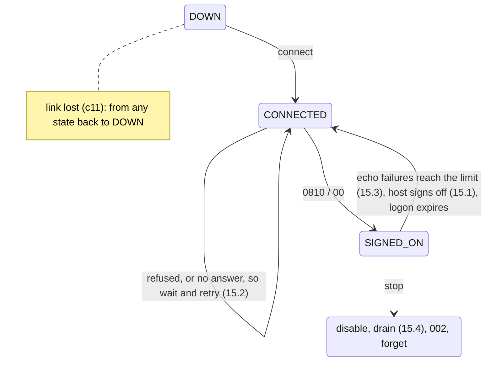

# 15. The Logon Lifecycle

At 02:00 the host's operators start their weekly maintenance. They send an 0800 with code 002 on
link A, signing the link off from their side, and for the next twenty minutes the host refuses
every sign-on. The client runs the sign-on manager and the echo responder of unit c11, with two
links behind a pool that has `check-enabled`.

At 07:30 someone notices that since 02:00 half of all purchases have been declined with 91. Every
one of them went to link A. The maintenance ended more than five hours earlier.

Unit c11 built the lifecycle a client starts: sign on, echo, sign off. The rest of it is started by
the host or goes wrong on the way, in five rules, one per section from 15.1 to 15.5.

## 15.1 The Host Starts Network Messages Too, and Each One Needs Its Own Answer

The examples run a real Q2 with unit c11's descriptors against c11's test host on 127.0.0.1, which
can now also refuse sign-ons for a while, miss an echo, answer purchases late and send its own
0800s. It declines purchases with 91 until a connection signs on, and answers echoes either way.
Links A and B sit behind a round-robin pool with `check-enabled`. A purchase goes out about every
250 ms, and the manager echoes every 4 seconds.

The 02:00 night, compressed: host A signs off at 1.0 s and refuses sign-ons for the next 8 seconds:

```text
   1.0 s  host A: sent 0800 70=002 11=000042
   1.5 s  host-mux-unhandled: 0800 70=002
   3.5 s  host A so far: purchases approved 2, declined 5; sign-ons refused 0
   5.5 s  host A so far: purchases approved 2, declined 9; sign-ons refused 0
   7.5 s  host A so far: purchases approved 2, declined 13; sign-ons refused 0
   9.5 s  host A so far: purchases approved 2, declined 17; sign-ons refused 0
  11.5 s  host A so far: purchases approved 2, declined 21; sign-ons refused 0
  13.5 s  host A so far: purchases approved 2, declined 25; sign-ons refused 0
```

The maintenance ended at 9 s. Why did nothing change?

The 002 is a request, not an answer, so QMUX hands it straight to its request listeners. c11's
responder takes only echoes, so the 002 went on to `<unhandled>` and expired there two minutes
later, unanswered. The adaptor doesn't read it either, and the connection stays open. The manager's
logon mark still holds this connection's ready object, so `decide` says "signed on", the host
answers every echo, and the enabled mark stays. The pool keeps sending A its share of the purchases,
and the host declines each one, because for the host the session is over. That lasts until the logon
mark expires, a day after the last sign-on.

The answer to a host's 0800 depends on what it asks:

```java
package com.example.jpos.client.link;

import org.jpos.core.Configurable;
import org.jpos.core.Configuration;
import org.jpos.iso.ISOException;
import org.jpos.iso.ISOMsg;
import org.jpos.iso.ISORequestListener;
import org.jpos.iso.ISOSource;
import org.jpos.space.Space;
import org.jpos.space.SpaceFactory;
import org.jpos.space.SpaceUtil;

import java.io.IOException;

/** Course code: answers the 0800s a host starts on one link. Replaces c11's responder. */
public class NetworkRequestHandler implements ISORequestListener, Configurable {
    protected Space<String, Object> sp;
    protected String muxName;

    @Override
    public void setConfiguration(Configuration cfg) {
        sp = SpaceFactory.getSpace(cfg.get("space", ""));
        muxName = cfg.get("mux", "host-mux");
    }

    @Override
    public boolean process(ISOSource source, ISOMsg m) {
        try {
            if (!m.getMTI().startsWith("080") || !m.isRequest())
                return false;                                 // (1) not ours: next listener
            ISOMsg reply = (ISOMsg) m.clone(0, 7, 11, 70);    // (2) never the whole request
            reply.setResponseMTI();
            reply.set(39, resultFor(m));
            source.send(reply);
            return true;
        } catch (ISOException | IOException e) {
            return false;
        }
    }

    protected String resultFor(ISOMsg m) {
        switch (m.hasField(70) ? m.getString(70) : "") {
            case "301":                                       // the host's echo
            case "001":                                       // the host signs on to us
                return "00";
            case "002":                                       // (3) the host signs off
                SpaceUtil.wipe(sp, muxName + ".enabled");     //     no new traffic, now
                SpaceUtil.wipe(sp, muxName + ".logon");       //     and our side signs on again
                return "00";
            default:
                return "12";                                  // (4) unknown: refuse, never approve
        }
    }
}
```

**(1) Only requests of its own kind**, 0800 and its repeat 0801. A late 0210, or the host's answer to
something, must go on to the next listener and to `<unhandled>`, as in unit c11.

**(2) A list of fields, not a copy.** A request can carry fields the host never expects back. A key
change carries a key (15.5).

**(3) A host sign-off removes both marks.** Without the enabled mark, the pool sends nothing more
to the link from the next request on. Without the logon mark, the manager's `decide` sees a
connection that never signed on and signs on again. Remove only the enabled mark, and the link
stays out of the pool until the logon mark expires, the same trap unit c11 showed for its own stop.

**(4) A function you don't know is refused.** An approval tells the host that you did what it
asked. `12` stands for whatever refusal code your network's specification gives.

The handler replaces c11's responder in `20_host_mux.xml`. QMUX creates it and passes it the
properties:

```xml
<mux class="org.jpos.q2.iso.QMUX" name="host-mux" logger="Q2">
  <in>host-receive</in>
  <out>host-send</out>
  <ready>host-channel.ready</ready>
  <unhandled>host-mux-unhandled</unhandled>
  <request-listener class="com.example.jpos.client.link.NetworkRequestHandler">
    <property name="mux" value="host-mux"/>
  </request-listener>
</mux>
```

The same night with the handler:

```text
   1.0 s  host A: sent 0800 70=002 11=000042
   1.0 s  host A: got 0810 39=00 on connection 1
   1.5 s  host-mux-unhandled: empty
   1.5 s  host A: 0800 70=001 on connection 1 -> 39=91
   2.6 s  host A: 0800 70=001 on connection 1 -> 39=91
   3.5 s  host A so far: purchases approved 2, declined 0; sign-ons refused 2
   3.6 s  host A: 0800 70=001 on connection 1 -> 39=91
   4.6 s  host A: 0800 70=001 on connection 1 -> 39=91
   5.5 s  host A so far: purchases approved 2, declined 0; sign-ons refused 4
   5.6 s  host A: 0800 70=001 on connection 1 -> 39=91
   6.6 s  host A: 0800 70=001 on connection 1 -> 39=91
   7.5 s  host A so far: purchases approved 2, declined 0; sign-ons refused 6
   7.6 s  host A: 0800 70=001 on connection 1 -> 39=91
   8.6 s  host A: 0800 70=001 on connection 1 -> 39=91
   9.5 s  host A so far: purchases approved 2, declined 0; sign-ons refused 8
   9.6 s  host A: 0800 70=001 on connection 1 -> 39=00
  11.5 s  host A so far: purchases approved 6, declined 0; sign-ons refused 8
  13.5 s  host A so far: purchases approved 10, declined 0; sign-ons refused 8
```

A left the pool the moment the 002 arrived, and no purchase was declined: B carried everything until
A's sign-on was accepted at 9.6 s. The cost is a refused sign-on every second.

Hosts also send **advices**: an 0820 reports something that has already happened, such as a cutover
to a new business day. There is nothing to refuse, so on most networks an advice and its repeat 0821
are acknowledged with an 0830 and `39=00`. `setResponseMTI` maps both:

```text
0820 isRequest true, setResponseMTI -> 0830
0821 isRequest true, setResponseMTI -> 0830
```

The handler above leaves 0820s to the next listener, so they end on `<unhandled>`, and a host that
wants them acknowledged repeats each one as an 0821. If your host sends advices, add a branch for
them.

The listener runs on the adaptor's receiver, the thread that put the message on the QMUX's `<in>`
queue. Nothing else is read from the link while it works, so anything slow, such as a call to a
hardware security module across the network, delays every answer behind it.

> **Networks differ.** Links on ISO 8583:1993 or later use 1804 and 1814, and a function code in
> field 24 instead of field 70, with codes of their own. The rules of this unit stay the same.

## 15.2 A Refused Sign-On Waits Longer Each Time

After a refusal, wait before the next sign-on. Double the wait after each further refusal, stop at a
cap, and start from the beginning after a success. Host A's sign-on lines and two of its counts on
the same night, with a wait of 1 second after the first refusal and a cap of 8 seconds:

```text
   1.0 s  host A: sent 0800 70=002 11=000042
   1.0 s  host A: got 0810 39=00 on connection 1
   1.5 s  host A: 0800 70=001 on connection 1 -> 39=91
   2.5 s  host A: 0800 70=001 on connection 1 -> 39=91
   4.5 s  host A: 0800 70=001 on connection 1 -> 39=91
   8.5 s  host A: 0800 70=001 on connection 1 -> 39=91
  15.5 s  host A so far: purchases approved 2, declined 0; sign-ons refused 4
  16.5 s  host A: 0800 70=001 on connection 1 -> 39=00
  21.5 s  host A so far: purchases approved 12, declined 0; sign-ons refused 4
```

Four refusals instead of eight, at waits of 1, 2, 4 and 8 seconds. The host was ready again at 9 s,
though, and A came back at 16.5 s. The cap is also the longest a link can stay out after its host
has recovered.

With c11's loop, which asks on every pass, a twenty-minute maintenance window puts about 1200
refused sign-ons in the host's log, and as many lines in yours. With a wait of 5 seconds doubling to
a cap of 5 minutes, it is about ten, and the link is back at most 5 minutes after the host. With
another link in the pool the cap costs little; on a link that carries traffic alone, choose a
smaller one.

A sign-on that gets no answer at all counts as a refusal too. Its timeout (30 seconds by default,
unit c11) already spaces the attempts out, and the wait adds to it. The manager keeps two values per
link: refusals in a row, and the earliest time of the next attempt. The LOGON branch of c11's `step`
skips the link until that time, and a success clears both. Log a change of state, from signed on to
refused and back, not every attempt.

### 15.2.1 Spot the Problem: Doubling by Shifting

The obvious way to double is a shift:

```java
static long delay(long base, long max, int refusals) {
    return Math.min(base << (refusals - 1), max);       // base, 2 x base, 4 x base, ...
}
```

It passes a test with ten refusals. Does it pass one with a hundred? Beside it is a version that
doubles step by step and stops at the cap, both with a base of 5 seconds and a cap of 5 minutes. The
hours are the time the step-by-step version has spent waiting by then:

```text
refusal  1 after  0.00 h: shift    5000 ms, step by step   5000 ms
refusal  2 after  0.00 h: shift   10000 ms, step by step  10000 ms
refusal  3 after  0.00 h: shift   20000 ms, step by step  20000 ms
refusal  4 after  0.01 h: shift   40000 ms, step by step  40000 ms
refusal  5 after  0.02 h: shift   80000 ms, step by step  80000 ms
refusal  6 after  0.04 h: shift  160000 ms, step by step 160000 ms
refusal  7 after  0.09 h: shift  300000 ms, step by step 300000 ms
refusal  8 after  0.17 h: shift  300000 ms, step by step 300000 ms
...
refusal 51 after  3.75 h: shift  300000 ms, step by step 300000 ms
refusal 52 after  3.84 h: shift -7187745005283311616 ms, step by step 300000 ms
refusal 53 after  3.92 h: shift  300000 ms, step by step 300000 ms
refusal 64 after  4.84 h: shift       0 ms, step by step 300000 ms
refusal 65 after  4.92 h: shift    5000 ms, step by step 300000 ms
refusal 66 after  5.00 h: shift   10000 ms, step by step 300000 ms
```

From refusal 52 the shift no longer fits in a `long`: the delay turns negative, `Math.min` keeps it,
and the next pass signs on at once. Java uses only the low six bits of a shift count, so refusal 64
shifts by 63 and gives 0, and refusal 65 shifts by 0 and starts again at 5 seconds. Every 64
refusals the client sends a burst of sign-ons.

Double step by step instead, and stop doubling once the cap is reached. Then no refusal count can
produce more than the cap.

<!-- practice 1 -->

## 15.3 One Lost Echo Is Not a Dead Host

c11's manager took a link out after one unanswered echo. Instead, count the failures in a row, and
take the link out only at a limit. Here host A misses a single echo. The manager echoes every 3
seconds with a timeout of 2 seconds, with a limit of 1 (c11) and then 2:

```text
   0.0 s  host A: will miss the next echo
   3.5 s  host A: 0800 70=301 on connection 1 -> no answer
   5.5 s  host-mux.enabled removed
   6.5 s  host A: 0800 70=001 on connection 1 -> 39=00
   6.5 s  host-mux.enabled written again
  10.5 s  host A: 0800 70=301 on connection 1 -> 39=00
  12.0 s  purchases with no answer: 0; host A sign-ons: 2
```

```text
   0.0 s  host A: will miss the next echo
   2.5 s  host A: 0800 70=301 on connection 1 -> no answer
   5.5 s  host A: 0800 70=301 on connection 1 -> 39=00
   8.5 s  host A: 0800 70=301 on connection 1 -> 39=00
  12.0 s  purchases with no answer: 0; host A sign-ons: 1
```

With a limit of 1 a healthy link left the pool, signed on again, and came back a second later. B
took the traffic for that second; with a single link, nothing could be sent in it. Echoes do get
lost on a busy host, and with a limit of 1 each one costs that much.

After a failed echo the echo mark is still absent, so the next pass echoes again, not an echo
interval later: failures in a row come one timeout plus one pass of the loop apart. One answered
echo sets the count back to zero. A count of failures in total would sooner or later take a healthy
link out over lost echoes spread across a week.

Now host A's application hangs, while 10 purchases a second go through the pool, half of them to A.
With limits of 1, 2 and 3:

```text
   0.0 s  host A: the application hangs
   4.5 s  host-mux.enabled removed
  14.0 s  purchases with no answer: 22; host A sign-ons: 1
```

```text
   0.0 s  host A: the application hangs
   8.5 s  host-mux.enabled removed
  14.0 s  purchases with no answer: 43; host A sign-ons: 1
```

```text
   0.0 s  host A: the application hangs
  10.5 s  host-mux.enabled removed
  16.0 s  purchases with no answer: 53; host A sign-ons: 1
```

Until the limit is reached the link stays in the pool, and every purchase sent to it is an unknown
outcome that has to be reversed (unit c12). Each failure the limit allows adds one echo timeout,
plus a pass, of that. With c11's default timeout of 30 seconds and a limit of 3, that is more than a
minute and a half of purchases sent to a dead host, on top of the wait for the first echo, which can
be a whole echo interval.

Size the limit by what is behind the link. With another link to fail over to, use 1 or 2: a false
alarm costs a second of rerouting. On a single link, taking it out stops all traffic, so allow a
little more.

<!-- practice 2 -->

## 15.4 Drain a Link Before You Sign It Off

c11's stop takes the link out of the pool, signs it off and forgets the session, in that order, and
does nothing about requests already on the link. Here Q2 is stopped for a release while a purchase
waits for an answer that the host sends after 1.5 seconds. Q2 undeploys in reverse file-name order:
the manager (`30_`) first, then the QMUX (`20_`), then the adaptor (`10_`):

```text
   0.0 s  host: 0200 11=000701 on connection 1, will answer 39=00 in 1500 ms
   0.3 s  Q2 shutting down
   0.3 s  host: 0800 70=002 on connection 1 -> 39=00
   0.3 s  Q2 stopped
   1.5 s  host: answer to 11=000701 lost: the connection is closed
   5.0 s  purchase -> null
```

Who has the money?

The host approved the purchase, and its answer found the connection closed. The caller waited out
its 5-second timeout, got `null`, and by unit c12's rule has to reverse a purchase that went
through, while the cardholder is told it failed. On a busy link a stop does that to every purchase
in flight, several at each release.

So wait between taking the link out and signing it off. QMUX counts the requests still waiting for
an answer: `getRXPending()`. Disable the link first, so nothing new arrives, then pause until that
count is zero, checking before the first pause so an idle link signs off at once. Bound the wait: a
request that never gets an answer counts until its own timeout ends, so the longest request timeout
plus a margin is enough (QMUX can hold a request up to 10 seconds past its timeout when an answer
races with it). The same stop with a drain of up to 10 seconds:

```text
   0.0 s  host: 0200 11=000701 on connection 1, will answer 39=00 in 1500 ms
   0.3 s  Q2 shutting down
   1.5 s  host: answered 11=000701
   1.5 s  purchase -> 0210 39=00
   1.6 s  host: 0800 70=002 on connection 1 -> 39=00
   1.6 s  Q2 stopped
```

Q2 waited for the manager's stop before it undeployed the QMUX and the adaptor, so the answer came
back over a live connection. The order is now **disable, drain, sign off, forget**. When the bound
runs out with requests still pending, sign off anyway and log how many were left, since each of them
is going to be reversed. To take one link out for maintenance without stopping the process, run the
same four steps for that link and stop its adaptor afterwards.

<!-- practice 3 -->

## 15.5 A New Key Is Acknowledged Only Once It Is Installed

Unit c7 imported a PIN key received under the ZMK and checked it by its check value. On many
networks that key arrives in a network message. Here the host sends an 0800 with code 161, and field
48 holds the new key under the ZMK (32 hex digits) followed by its check value (6 hex digits). The
handler of 15.1 refuses code 161, so a subclass installs the key:

```java
package com.example.jpos.client.link;

import org.jpos.iso.ISOMsg;
import org.jpos.iso.ISOUtil;
import org.jpos.security.SMAdapter;
import org.jpos.security.SMException;
import org.jpos.security.SecureDESKey;
import org.jpos.util.NameRegistrar;

import java.util.Arrays;

/**
 * Course code: also answers this network's key change, an 0800 with 70=161 whose field 48 holds
 * the new PIN key under the ZMK (32 hex digits) and its check value (6 hex digits).
 */
public class ZpkChangeHandler extends NetworkRequestHandler {
    @Override
    protected String resultFor(ISOMsg m) {
        if ("161".equals(m.getString(70)))
            return installed(m) ? "00" : "12";       // 00 only once the key is in place
        return super.resultFor(m);
    }

    private boolean installed(ISOMsg m) {
        try {
            @SuppressWarnings("unchecked")
            SMAdapter<SecureDESKey> hsm = (SMAdapter<SecureDESKey>) NameRegistrar.get("hsm");
            SecureDESKey zmk = (SecureDESKey) NameRegistrar.get("zmk." + muxName);
            String f48 = m.getString(48);
            byte[] underZmk = ISOUtil.hex2byte(f48.substring(0, 32));
            byte[] checkValue = ISOUtil.hex2byte(f48.substring(32, 38));
            SecureDESKey zpk = hsm.importKey(SMAdapter.LENGTH_DES3_2KEY, SMAdapter.TYPE_ZPK,
                    underZmk, zmk, true);
            if (!Arrays.equals(zpk.getKeyCheckValue(), checkValue))
                return false;                        // damaged, or not the key announced
            sp.put("zpk." + muxName, zpk);           // where the PIN translation reads it
            return true;
        } catch (NameRegistrar.NotFoundException | SMException | RuntimeException e) {
            return false;                            // the old key stays in use
        }
    }
}
```

The security module is c7's `hsm`, and the ZMK, under the module's LMK, was registered at start-up
by whatever loads your keys. The host sends two key changes, and the second is damaged on the way:

```text
   0.0 s  host: new ZPK, check value C93580
   0.0 s  host: sent 0800 70=161 11=000051
   0.0 s  host: got 0810 39=00 on connection 1
   0.5 s  client: zpk.host-mux check value C93580
   0.5 s  host: new ZPK, check value 92EA9A (field 48 damaged on the way)
   0.5 s  host: sent 0800 70=161 11=000052
   0.5 s  host: got 0810 39=12 on connection 1
   1.0 s  client: zpk.host-mux check value C93580
```

The 0810 with `00` is the host's signal to switch. From the moment the network defines (at once,
from the next message, or after a confirmation), the host translates PINs to the new key. Answer
`00` before the key is stored, and a failed import leaves the host on a key you don't have: every
PIN purchase is declined 55, as in unit c7, and to the host it looks like your fault. So the handler
imports, compares the check value, stores, and only then answers. When anything fails, the answer is
a refusal and the old key stays, so PIN traffic continues under it.

The handler above overwrites the previous key. A host that may still send messages under it for a
while needs the previous key kept as well, until no request in flight can be using it. Field 48
never goes back to the host: the answer is built from fields 7, 11 and 70 (15.1). Keep it out of
the logs too, even though it is encrypted. The `wipe` list of the `ProtectedLogListener` (unit c8)
covers the message, but the 2.1.7 security module logs its own `s-m-operation` event for every
import, with the encrypted key in it, to whatever logger the `hsm` has.

> **Networks differ.** Some let the client ask for a new key with an 0800 and send the key in the
> 0810. The code, the field, the layout and the moment the new key becomes active are all in your
> network's specification.

<!-- practice 4 -->

## 15.6 The Lifecycle Is a Handful of States, and the Marks Say Which

Unit c11 kept the lifecycle as marks in the Space and decided each pass from them. Drawn as states
of one link, with the section that owns each transition:



| State | Ready entry | `<mux>.logon` | `<mux>.enabled` | Pool uses the link |
|---|---|---|---|---|
| DOWN | absent | absent, or another connection's object | absent | no |
| CONNECTED | a new `Date` | absent, or another connection's object | absent | no |
| SIGNED_ON | the `Date` | the same `Date` | the same `Date` | yes |
| stopping | the `Date` | the same `Date` | absent | no |

Answered echoes keep a link in SIGNED_ON. A key change (15.5) and a host sign-on (`001` from the
host) change no mark.

`LifecycleManager`, the class our runs deployed, is c11's `LogonManager` with the changes of 15.2
to 15.4. It reads four new properties:

```xml
<logon-manager name="host-logon" class="com.example.jpos.client.link.LifecycleManager" logger="Q2">
  <property name="mux" value="host-mux"/>
  <property name="stan-space" value="je:stan"/>
  <property name="stan-key" value="stan.host"/>
  <property name="timeout" value="30000"/>
  <property name="echo-interval" value="300000"/>
  <property name="logon-interval" value="86400000"/>
  <property name="retry-base" value="5000"/>
  <property name="retry-max" value="300000"/>
  <property name="echo-failure-limit" value="2"/>
  <property name="drain-time" value="45000"/>
</logon-manager>
```

<!-- practice 5 -->

## 15.7 Summary

- **The host starts network messages too.** Answer each 0800 by its function, through the `source`
  you are given and from a list of fields. A host sign-off removes the enabled and logon marks, so
  the pool stops at once and the manager signs on again. Unknown functions are refused; advices are
  acknowledged with an 0830.
- **A refused sign-on waits longer each time**, doubling up to a cap and starting over after a
  success. The cap is also how long a link may stay out after its host recovers. A shift that
  doubles overflows after a few hours of outage.
- **One lost echo is not a dead host.** Count failures in a row. Each failure the limit allows
  keeps a dead host in the pool for one more echo timeout, and every purchase sent there is
  reversed.
- **Drain before you sign off**: disable, wait (bounded) until `getRXPending()` is zero, sign off,
  forget. A stop without the drain turns approvals in flight into reversals.
- **A new key is acknowledged only once it is installed**: import, compare the check value, store,
  then answer `00`. A failure is refused and the old key stays.

## 15.8 Reference

**Network management MTIs (ISO 8583:1987):**

| MTI | Meaning | Answered by |
|---|---|---|
| `0800` / `0801` | network management request / its repeat | `0810` |
| `0820` / `0821` | network management advice / its repeat | `0830`, usually `39=00` |

**Field 70 codes** (n 3). `001`, `002` and `301` are common to most specifications. The others are
examples; your network's specification is the authority:

| Code | Meaning | Usually sent by |
|---|---|---|
| `001` | sign-on | the acquirer after each connect; some hosts too |
| `002` | sign-off | either side, before a planned stop |
| `301` | echo test | either side, while the link is quiet |
| `161` | key change | network-specific |
| `162` | new key or key verification | network-specific |
| `201` | cutover to a new business day | the host, often as an 0820 |

**What the client answers:**

| Received | Answer | Also |
|---|---|---|
| `0800` or `0801` / `301` | `0810`, `39=00` | nothing |
| `0800` or `0801` / `001` | `0810`, `39=00` | nothing |
| `0800` or `0801` / `002` | `0810`, `39=00` | remove `<mux>.enabled` and `<mux>.logon` |
| `0800` or `0801` key change | `0810`, `00` once the key is stored, else a refusal | never send the key back |
| `0800` or `0801`, other code | `0810` with your network's refusal code | nothing more |
| `0820` / `0821` | `0830`, usually `39=00` | act on it, such as a cutover |
| anything else | nothing: return `false` | the next listener or `<unhandled>` gets it |

**The manager's new properties** (in addition to unit c11's):

| Property | Example | Meaning |
|---|---|---|
| `retry-base` | 5000 ms | the wait after the first refused sign-on |
| `retry-max` | 300000 ms | the cap on that wait |
| `echo-failure-limit` | 2 | failed echoes in a row before the link is taken out |
| `drain-time` | 45000 ms: the longest request timeout plus a margin | the longest the stop waits for requests in flight |

`QMUX.getRXPending()` is the number of requests waiting for an answer on that QMUX, from
`request` and from asynchronous requests alike. It drops when the answer arrives or the request's
timeout ends.

## 15.9 Challenges

1. Your host answers echoes in 200 ms on a normal day and in up to 12 seconds during its batch
   window at 23:00. Choose the echo timeout and the limit for a pool of two links, and for a single
   link. What does each choice cost at 23:00, and on the night the host really dies?
2. Forty clients sign on to the same host, all with the same base and cap. The host restarts. Draw
   when their sign-ons arrive. What would adding a random part to each wait change, and how would
   you test it without a clock?
3. A release stops Q2 with `drain-time` 90 seconds while the host is hung. What does the operator
   see during those 90 seconds, and what would you log at the end so the reversals that follow are
   no surprise?
4. A host changes the PIN key every day at 02:00, and its 0810 means "switch now". List the
   messages in flight at that moment whose PIN blocks are under the old key, and decide how long the
   client keeps that key.

## 15.10 Design Note: Why Management Travels With the Payments

The 0800s share the link with the purchases: the same adaptor, the same QMUX, the same STAN sequence
and the same host application. Much of this unit is the price of that choice. A slow echo looks the
same as a slow purchase, a sign-off can overtake a purchase that went out first, and a key change
arrives in the middle of traffic that depends on the old key.

A separate management channel would avoid that, but for the lifecycle of a link the shared path is
the point. An echo that comes back proves that the path a purchase takes can carry a message right
now, which is what the pool needs to know. An echo on another channel would prove only that the
other channel works. A sign-on, too, is tied to the connection it travels on, which is what lets
unit c11 compare one object with another to know which connection is signed on.