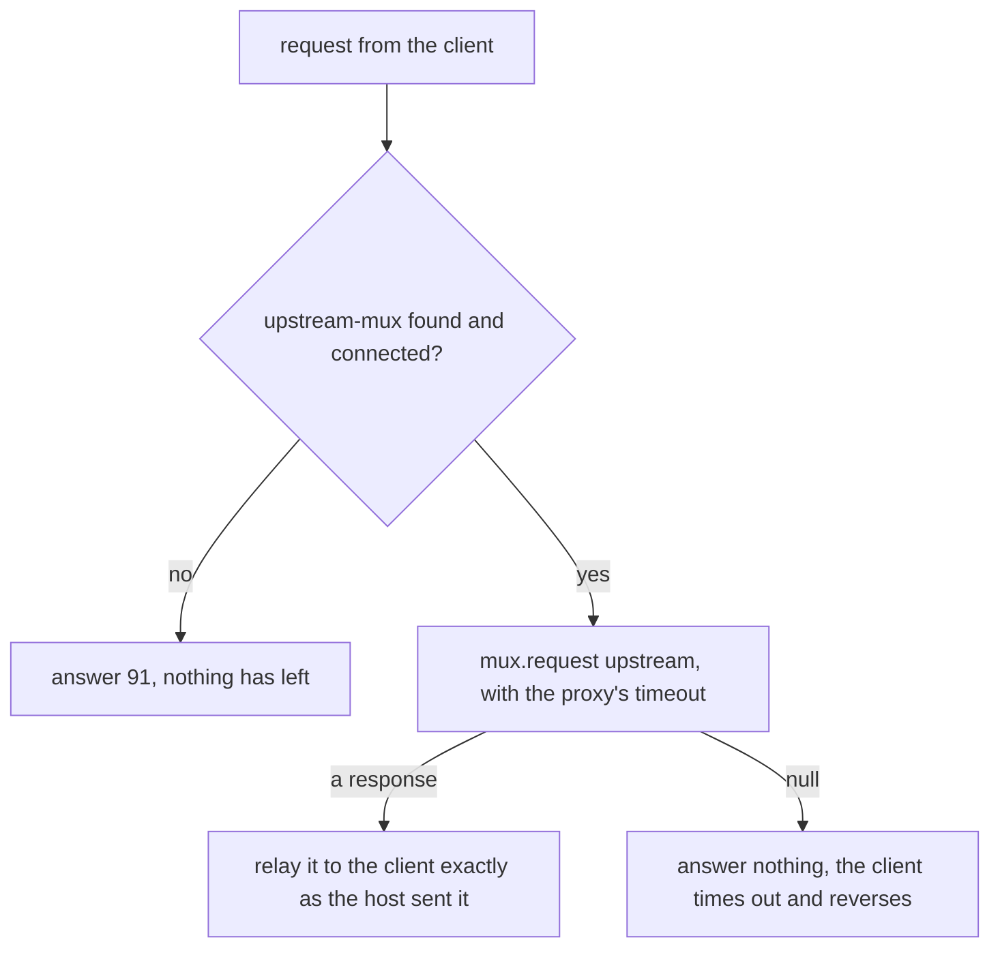

# 16. Simulators and Test Harnesses

Certification with the acquirer is booked for two slots of three hours each. The acquirer's script
has forty cases. Card `5555555555554444` must be declined with `05`. A purchase over 500.00 must
be declined with `51`, and one of exactly 500.00 approved. For 777.00 the acquirer's test host
stays silent, and the client has to reverse the purchase before the case passes. 888.00 is
approved after 1.5 seconds. Each failed case costs slot time, and a third slot costs money.

Before the first slot the team runs the same cases every night against a simulator on 127.0.0.1,
and they pass. In the first slot the silent-host case fails: the client never sent a reversal. The
simulator had answered 777.00 with `51` every night, so the reversal path had never run.

A simulator, a proxy or a test harness can disagree with the real host while the build stays
green. This unit's five rules:

1. A simulator's rules are data, and the first rule that matches decides.
2. A listener runs on the session's thread, so a late answer is scheduled, never slept.
3. The simulator is a witness: ask it what the client sent.
4. A proxy may answer only for a request that never left.
5. A scripted case grades every field and reports every failure.

Unit c10's stand-ins live inside the test. The tools here run beside the system while you develop
and certify it. Every output comes from jPOS 2.1.7, with the simulator, the client's `host-channel`
and its `host-mux` deployed by one Q2 in one JVM.

## 16.1 A Simulator's Rules Are Data, and the First Rule That Matches Decides

A simulator that a team shares gets a new case every week. If its behaviour is code, each new case
waits for a developer, a build and a redeploy. If it is a table in the deploy descriptor, the tester
adds a line.

The team's nightly table has one rule per line: conditions, an arrow, actions.

```text
pan=5555555555554444             -> rc=05
mti=0200 amount=50001-99999999   -> rc=51
mti=0200 amount=77700-77700      -> silent
mti=0200 pcode=31                -> rc=00 54=1001840C000000012345
any                              -> rc=00 38=A1B2C3
```

Amounts are in minor units, as in field 4, and a range includes both of its ends. Which rule
answers a purchase of 777.00?

The simulator tries the rules from the top, and the first match answers. 777.00 is inside
`50001-99999999`, so the second rule answers `51` and the third never runs. Six requests, against
that table and then with the silent rule moved to the top (card's first digits, field 3, field 4,
answer):

```text
silent rule last:
  4111  000000  000000012000  0210 39=00 38=A1B2C3
  5555  000000  000000012000  0210 39=05
  4111  000000  000000050000  0210 39=00 38=A1B2C3
  4111  000000  000000050001  0210 39=51
  4111  000000  000000077700  0210 39=51
  4111  310000  000000000000  0210 39=00 54=1001840C000000012345
silent rule first:
  4111  000000  000000012000  0210 39=00 38=A1B2C3
  5555  000000  000000012000  0210 39=05
  4111  000000  000000050000  0210 39=00 38=A1B2C3
  4111  000000  000000050001  0210 39=51
  4111  000000  000000077700  silent
  4111  310000  000000000000  0210 39=00 54=1001840C000000012345
```

The first run is the nightly one: it answers every request, so the silent case never happens.

Why not let the most specific rule win? A tester can't check "most specific" by eye: is a card
rule more specific than an amount range? First-match can be checked by reading from the top. So put
exceptions first, ranges after them, and `any` last.

The simulator is an `ISORequestListener`, like unit c10's `LoopbackHost`. `QServer` creates it
with its no-arg constructor and hands it its `<property>` elements through `Configurable`:

```java
package com.example.jpos.client.sim;

import org.jpos.core.Configurable;
import org.jpos.core.Configuration;
import org.jpos.core.ConfigurationException;
import org.jpos.iso.ISOException;
import org.jpos.iso.ISOMsg;
import org.jpos.iso.ISORequestListener;
import org.jpos.iso.ISOSource;
import org.jpos.space.Space;
import org.jpos.space.SpaceFactory;

import java.util.ArrayList;
import java.util.LinkedHashMap;
import java.util.List;
import java.util.Map;
import java.util.concurrent.Executors;
import java.util.concurrent.ScheduledExecutorService;
import java.util.concurrent.TimeUnit;

/** A host simulator driven by an ordered table of rules: the first rule that matches answers. */
public class RuleHost implements ISORequestListener, Configurable {
    private static final List<String> CONDITIONS = List.of("any", "mti", "pan", "pcode", "amount");

    record Rule(String text, Map<String, String> when, Map<String, String> then) { }

    private final List<Rule> rules = new ArrayList<>();
    private final ScheduledExecutorService later = Executors.newSingleThreadScheduledExecutor(r -> {
        Thread t = new Thread(r, "rule-host-late");
        t.setDaemon(true);
        return t;
    });
    private Space<String, Object> sp;
    private String seen;                                 // queue of what the host received

    @Override
    public void setConfiguration(Configuration cfg) throws ConfigurationException {
        rules.clear();
        for (String text : cfg.getAll("rule"))          // a repeated property, in order
            rules.add(parse(text));
        sp = SpaceFactory.getSpace(cfg.get("space", "tspace:default"));
        seen = cfg.get("seen", null);
    }

    static Rule parse(String text) throws ConfigurationException {
        String[] sides = text.split("->");
        if (sides.length != 2)
            throw new ConfigurationException("rule without '->': " + text);
        Map<String, String> when = words(sides[0]), then = words(sides[1]);
        for (String k : when.keySet())
            if (!CONDITIONS.contains(k))
                throw new ConfigurationException("unknown condition '" + k + "' in: " + text);
        for (Map.Entry<String, String> a : then.entrySet())
            if (!a.getKey().matches("rc|silent|late|\\d+") || a.getValue().isEmpty() != a.getKey().equals("silent"))
                throw new ConfigurationException("bad action '" + a.getKey() + "' in: " + text);
        if (!then.containsKey("rc") && !then.containsKey("silent"))
            throw new ConfigurationException("rule needs rc= or silent: " + text);
        return new Rule(text.trim(), when, then);
    }

    private static Map<String, String> words(String s) {
        Map<String, String> m = new LinkedHashMap<>();
        for (String w : s.trim().split("\\s+")) {
            String[] kv = w.split("=", 2);
            m.put(kv[0], kv.length > 1 ? kv[1] : "");
        }
        return m;
    }

    static boolean matches(Rule rule, ISOMsg m) throws ISOException {
        for (Map.Entry<String, String> c : rule.when().entrySet()) {
            String v = c.getValue();
            boolean ok = switch (c.getKey()) {
                case "mti" -> v.equals(m.getMTI());
                case "pan" -> v.equals(m.getString(2));
                case "pcode" -> m.hasField(3) && m.getString(3).startsWith(v);
                case "amount" -> {                       // lo-hi in minor units, both ends included
                    String[] r = v.split("-");
                    long amount = Long.parseLong(m.getString(4));
                    yield amount >= Long.parseLong(r[0]) && amount <= Long.parseLong(r[1]);
                }
                default -> true;                         // any
            };
            if (!ok)
                return false;
        }
        return true;
    }

    /** The first rule that matches, or null. */
    Rule decide(ISOMsg m) throws ISOException {
        for (Rule rule : rules)
            if (matches(rule, m))
                return rule;
        return null;
    }

    @Override
    public boolean process(ISOSource source, ISOMsg m) {
        try {
            if (!m.isRequest())
                return false;                            // a response is not ours to answer
            if (seen != null)
                sp.out(seen, m.clone(), 60000L);         // what the client sent, kept for a minute
            Rule rule = decide(m);
            if (rule == null)
                return false;                            // let the next listener try
            if (rule.then().containsKey("silent"))
                return true;                             // handled: the host says nothing
            ISOMsg r = (ISOMsg) m.clone();               // never change the request itself
            r.setResponseMTI();
            r.unset(35, 45, 52, 55);                     // no card secrets in an answer
            for (Map.Entry<String, String> a : rule.then().entrySet()) {
                if (a.getKey().equals("rc")) r.set(39, a.getValue());
                else if (a.getKey().matches("\\d+")) r.set(Integer.parseInt(a.getKey()), a.getValue());
            }
            long late = Long.parseLong(rule.then().getOrDefault("late", "0"));
            if (late > 0)
                later.schedule(() -> send(source, r), late, TimeUnit.MILLISECONDS);
            else
                send(source, r);
            return true;
        } catch (ISOException | NumberFormatException e) {
            return false;                                // no MTI, or an amount that isn't a number
        }
    }

    private static void send(ISOSource source, ISOMsg r) {
        try {
            if (source.isConnected())
                source.send(r);
        } catch (Exception e) {
            // the client went away; a real host would log it
        }
    }
}
```

The answer is a clone, so the request the session holds is unchanged (unit c10 showed what a
stand-in that answers with the request itself hides). A `silent` rule returns `true`: handled, by
saying nothing. When no rule matches, `process` returns `false` and `ISOServer`
offers the message to its next listener, so end the table with `any`.

Amounts are compared as numbers: field 4 is twelve zero-padded digits and the bounds are not, so
as text `000000077700` would sort below `50001`.

**A rule that can't be read stops the deploy.** Suppose a tester types `amout=` in the over-limit
rule. A parser that skips unknown words reads the rule as "every 0200 gets `51`". One that
skips the whole rule approves every purchase over 500.00, and the nightly run stays green until the
over-limit case meets the real host. `parse` refuses instead:

```text
refused: unknown condition 'amout' in: mti=0200 amout=50001-99999999 -> rc=51
refused: bad action 'rc' in: pan=5555555555554444 -> rc 05
refused: rule without '->': pan=5555555555554444 rc=05
```

Each rule is one repeated `rule` property, and `cfg.getAll("rule")` returns them in descriptor
order:

```xml
<server name="host-simulator" class="org.jpos.q2.iso.QServer" logger="Q2">
  <attr name="port" type="java.lang.Integer">${sim.port:8000}</attr>
  <channel class="org.jpos.iso.channel.ASCIIChannel" logger="Q2" realm="host-simulator"
           packager="org.jpos.iso.packager.GenericPackager">
    <property name="packager-config" value="jar:packager/iso87ascii.xml"/>
  </channel>
  <request-listener class="com.example.jpos.client.sim.RuleHost" logger="Q2">
    <property name="seen" value="host-simulator.seen"/>
    <property name="rule" value="pan=5555555555554444             -> rc=05"/>
    <property name="rule" value="mti=0200 amount=77700-77700      -> silent"/>
    <property name="rule" value="mti=0200 amount=88800-88800      -> rc=00 late=1500"/>
    <property name="rule" value="mti=0200 amount=50001-99999999   -> rc=51"/>
    <property name="rule" value="mti=0420                         -> rc=00"/>
    <property name="rule" value="any                              -> rc=00 38=A1B2C3"/>
  </request-listener>
</server>
```

The rest of the unit runs this simulator, saved as `deploy/50_host_simulator.xml`. With `amout=`
in it, Q2 deploys the file and the `QServer` fails to start:

```text
    error starting service
      org.jpos.core.ConfigurationException: unknown condition 'amout' in: mti=0200 amout=50001-99999999   -> rc=51
```

Nothing listens on the port, the client's link never comes up, and the client reports
`isConnected: false`. The nightly run fails at its first case, with the rule's text in the log.

Use the real host's channel class and packager. A simulator with an easier wire format hides the framing and packing problems you most want to find before certification.

<!-- practice 1 -->

## 16.2 A Listener Runs on the Session's Thread, So a Late Answer Is Scheduled

For the slow 888.00 case, the obvious simulator sleeps:

```java
if ("000000088800".equals(m.getString(4)))
    Thread.sleep(1500);                    // "the host is slow today"
```

The client, with a one-second timeout, sends the 888.00 purchase and, while it waits, a purchase
of 120.00 on the same connection. When does 120.00 get its answer?

```text
000101 (888.00): null at 1000 ms
000102 (120.00): null at 1000 ms
```

Both timed out. `ISOServer` gives each connection a session. The session reads one message, calls
the listeners on its own thread, and reads the next only when `process` has returned. While the
listener sleeps, 120.00 sits unread in the socket, and its answer leaves after the first, 1.5
seconds late too.

The same two purchases against `RuleHost`, whose rule for 888.00 is `late=1500`:

```text
000101 (888.00): null at 1000 ms
000102 (120.00): 0210 39=00 at 0 ms
```

`process` hands the late answer to a scheduler and returns, so the session reads 120.00 at once.
The answer to 888.00 still arrives after 1.5 seconds, and QMUX, with nobody waiting for it, puts it
on `host-unhandled` (unit c12).

With the sleep, one slow case became two unknown outcomes. A client that reverses on `null`
(unit c12) sends two reversals where the script expects one, and the failing case is 120.00, which
had nothing to do with the slow host. In a load run (unit c10) every session that meets a slow case
stops reading, so the run measures the simulator instead of the system. Keep sleeps out of a
simulator's listeners.

Two other faults:

- **Every answer slow.** jPOS 2.1.7's `org.jpos.iso.filter.DelayFilter` sleeps for its `delay`
  property, in milliseconds, each time a message passes. On the simulator's channel, outgoing, it
  delays every answer. It sleeps in the sending thread, on a server the session's, so it blocks the
  session as `Thread.sleep` does. Use it to size timeouts
  against a uniformly slow host, and `late` rules for one slow case.
- **The connection drops mid-purchase.** In `process`, the `ISOSource` is the session's channel, so
  a `drop` action is `((ISOChannel) source).disconnect()` followed by `return true`.

```xml
<channel class="org.jpos.iso.channel.ASCIIChannel" logger="Q2" realm="host-simulator"
         packager="org.jpos.iso.packager.GenericPackager">
  <property name="packager-config" value="jar:packager/iso87ascii.xml"/>
  <filter class="org.jpos.iso.filter.DelayFilter" direction="outgoing">
    <property name="delay" value="1500"/>
  </filter>
</channel>
```

With this channel in the simulator, both purchases above came back `null` at 1000 ms.

<!-- practice 2 -->

## 16.3 The Simulator Is a Witness: Ask It What the Client Sent

A test that checks only what the client reports can pass a client that does the wrong thing. Two
clients each send a 0200 with a one-second timeout. When no answer comes, the first sends the same
0200 again:

```java
static String retrying(MUX mux, ISOMsg p) throws Exception {
    ISOMsg r = mux.request(p, 1000);
    if (r == null) r = mux.request(p, 1000);
    return r == null ? "NO_ANSWER" : "00".equals(r.getString(39)) ? "APPROVED" : "DECLINED";
}
```

The second, `reversing`, sends an 0420 that points at the purchase through field 90, as unit c12
builds it. Both run against the 888.00 rule. Then the test takes the next two requests the
simulator received from its `seen` queue:

```java
Space<String, Object> sp = SpaceFactory.getSpace();          // the default Space, as RuleHost's
for (int i = 0; i < 2; i++) {
    ISOMsg m = (ISOMsg) sp.in("host-simulator.seen", 2000);     // waits for it, at most 2 s
    System.out.println("  host saw " + m.getMTI() + " 11=" + m.getString(11)
        + (m.hasField(90) ? " 90=" + m.getString(90) : ""));
}
```

```text
retrying:  APPROVED
  host saw 0200 11=000301
  host saw 0200 11=000301
reversing: NO_ANSWER
  host saw 0200 11=000311
  host saw 0420 11=000312 90=020000031111061015000000012345600000000000
```

The retrying client reports `APPROVED`. When the first `request` returned `null`, QMUX released
its key, so the resend was accepted and sent. It has the same key, so the *first* attempt's
approval, arriving at 1.5 seconds, matched the resend, which was still waiting. The host received
two purchases and approved both. The cardholder paid twice, and a test that asserts "approved" passes.

Only the simulator knows what crossed the wire, so the test asks it. `RuleHost` writes a clone of
every request it receives to the queue named by its `seen` property, in the default Space. A test
in the same JVM takes them in arrival order.

- **Take with a timeout.** `sp.in(key, 2000)` returns `null` after two seconds when the client sent
  nothing, so the test fails instead of hanging.
- **Let the records expire.** Each clone goes in with a lifetime of 60 seconds, so a simulator that
  runs all week doesn't keep every request it ever saw. The clones hold clear test PANs and live
  only in memory.

## 16.4 A Proxy May Answer Only for a Request That Never Left

To see what your client and the acquirer's test host say to each other, put a recording proxy
between them: a `QServer` your client connects to, whose listener forwards each request through a
QMUX to the test host, relays the answer, and logs both.

### 16.4.1 Spot the Problem: The Proxy That Helped

A first version has no answer to relay in two situations, and answers both the same way:

```java
package com.example.jpos.client.sim;

import org.jpos.core.Configurable;
import org.jpos.core.Configuration;
import org.jpos.iso.ISOMsg;
import org.jpos.iso.ISORequestListener;
import org.jpos.iso.ISOSource;
import org.jpos.iso.MUX;
import org.jpos.util.NameRegistrar;

/** The proxy that "helps": it answers 91 whenever it has nothing better. */
public class EagerProxy implements ISORequestListener, Configurable {
    private String muxName;
    private long timeout;

    @Override
    public void setConfiguration(Configuration cfg) {
        muxName = cfg.get("mux", "upstream-mux");
        timeout = cfg.getLong("timeout", 30000L);
    }

    @Override
    public boolean process(ISOSource source, ISOMsg request) {
        try {
            MUX mux = NameRegistrar.getIfExists("mux." + muxName);
            ISOMsg response = mux != null && mux.isConnected()
                ? mux.request(request, timeout)                // (1)
                : null;
            if (response == null) {                            // (2)
                response = (ISOMsg) request.clone();
                response.setResponseMTI();
                response.set(39, "91");                        // (3) "the switch is down, try later"
            }
            source.send(response);
        } catch (Exception e) {
            // ignored in this version
        }
        return true;
    }
}
```

The client waits three seconds and the proxy one. What happens to the 888.00 purchase, which the
host approves after 1.5 seconds?

```text
EagerProxy, proxy waits 1000 ms, client waits 3000 ms
  client 000401: 0210 39=00 at 0 ms
  client 000402: 0210 39=91 at 1000 ms
  upstream-unhandled: 0210 11=000402 39=00
```

The client was told `91` at one second, a decline. Half a second later the host approved the
purchase, and its approval landed on the proxy's `upstream-unhandled` queue, where nobody reads it.
At a real counter the cardholder is told the payment failed, pays another way, and finds both
payments on the statement. The client got an answer, so it has nothing to reverse.

The mistake is at (2), which treats two situations as one. When the link is down, (1) sent
nothing, the host knows nothing of the purchase, and `91` is true. When `request` returns `null`,
the purchase has left, and the proxy knows as little as a client whose request timed out (unit
c12). It must not answer, so that the client's own timeout fires and the client reverses.

`RecordingProxy` keeps the two apart:

```java
package com.example.jpos.client.sim;

import org.jpos.core.Configurable;
import org.jpos.core.Configuration;
import org.jpos.iso.ISOMsg;
import org.jpos.iso.ISORequestListener;
import org.jpos.iso.ISOSource;
import org.jpos.iso.MUX;
import org.jpos.util.LogEvent;
import org.jpos.util.LogSource;
import org.jpos.util.Logger;
import org.jpos.util.NameRegistrar;

/** Sits between a client and a test host: forwards each request, relays the answer, logs both. */
public class RecordingProxy implements ISORequestListener, Configurable, LogSource {
    private String muxName;
    private long timeout;
    private Logger logger;
    private String realm;

    @Override
    public void setConfiguration(Configuration cfg) {
        muxName = cfg.get("mux", "upstream-mux");
        timeout = cfg.getLong("timeout", 30000L);
    }

    @Override
    public boolean process(ISOSource source, ISOMsg request) {
        LogEvent ev = new LogEvent(this, "proxy");
        ev.addMessage(request);                          // the ISOMsg itself: the logger masks it
        try {
            MUX mux = NameRegistrar.getIfExists("mux." + muxName);
            if (mux == null || !mux.isConnected()) {     // (1) nothing has left
                ISOMsg r = (ISOMsg) request.clone();
                r.setResponseMTI();
                r.set(39, "91");                         // issuer or switch inoperative
                source.send(r);
                ev.addMessage("upstream down, answered 91");
                return true;
            }
            ISOMsg response = mux.request(request, timeout);
            if (response == null) {                      // (2) it left, and the host may have approved it
                ev.addMessage("no answer upstream, nothing sent to the client");
                return true;
            }
            ev.addMessage(response);
            source.send(response);                       // (3) exactly as the host sent it
        } catch (Exception e) {
            ev.addMessage(e);
        } finally {
            Logger.log(ev);
        }
        return true;
    }

    @Override public void setLogger(Logger logger, String realm) { this.logger = logger; this.realm = realm; }
    @Override public String getRealm() { return realm; }
    @Override public Logger getLogger() { return logger; }
}
```



It is still not right with a one-second wait:

```text
RecordingProxy, proxy waits 1000 ms, client waits 3000 ms
  client 000401: 0210 39=00 at 0 ms
  client 000402: null at 3000 ms
  upstream-unhandled: 0210 11=000402 39=00
```

The client now reverses, which is safe. But the approval came at 1.5 seconds, while the client was
still waiting, but after the proxy had given up. A purchase that would have gone through became a
reversal. The client decides how long to wait, so the proxy must wait at least as
long:

```text
RecordingProxy, proxy waits 5000 ms, client waits 3000 ms
  client 000401: 0210 39=00 at 0 ms
  client 000402: 0210 39=00 at 1500 ms
```

**What the proxy records is not what it forwards.** The host needs the PAN, and the client needs the
answer exactly as the host sent it, so (3) relays the host's message untouched. The record is the
`LogEvent`, which carries the `ISOMsg` objects themselves, so the `ProtectedLogListener` at the
front of the `Q2` logger (unit c8, with `protect` covering field 2) masks a copy before any writer
sees it. The request shows as `outgoing` because the event is logged at the end, after the upstream
channel has sent the same object on:

```text
<log realm="proxy" at="2026-11-06T12:51:42.131643850" lifespan="2ms">
  <proxy>
    <isomsg direction="outgoing">
      <!-- org.jpos.iso.packager.GenericPackager[jar:packager/iso87ascii.xml] -->
      <field id="0" value="0200"/>
      <field id="2" value="411111______1111"/>
      <field id="3" value="000000"/>
      <field id="4" value="000000012000"/>
      <field id="7" value="1106101500"/>
      <field id="11" value="000401"/>
      <field id="32" value="123456"/>
      <field id="41" value="29110001"/>
    </isomsg>
```

Masking field 2 in the forwarded message instead would make the host decline every purchase as an
invalid card. Logging the message as a string would put the PAN in clear on disk.

Toward the test host the proxy is an ordinary client: a `ChannelAdaptor` named `upstream-channel`
with queues `upstream-send` and `upstream-receive`, like unit c1's `host-channel`, and this QMUX:

```xml
<mux name="upstream-mux" class="org.jpos.q2.iso.QMUX" logger="Q2">
  <in>upstream-receive</in>
  <out>upstream-send</out>
  <ready>upstream-channel.ready</ready>
  <unhandled>upstream-unhandled</unhandled>
</mux>
```

The server your client connects to names the listener, the QMUX and the wait:

```xml
<server name="proxy-server" class="org.jpos.q2.iso.QServer" logger="Q2">
  <attr name="port" type="java.lang.Integer">${proxy.port:8001}</attr>
  <channel class="org.jpos.iso.channel.ASCIIChannel" logger="Q2" realm="proxy-client-side"
           packager="org.jpos.iso.packager.GenericPackager">
    <property name="packager-config" value="jar:packager/iso87ascii.xml"/>
  </channel>
  <request-listener class="com.example.jpos.client.sim.RecordingProxy" logger="Q2" realm="proxy">
    <property name="mux" value="upstream-mux"/>
    <property name="timeout" value="${proxy.timeout:30000}"/>
  </request-listener>
</server>
```

### 16.4.2 One QMUX Serves Every Client of the Proxy

Two testers point their clients at one proxy. Both use the lab's terminal ID, `29110001`, and
both number STANs from the start of the day. While the first tester's 888.00 purchase waits for the
host, the second sends a purchase with the same STAN:

```text
Duplicate key 'upstream-send.0200000000029110001000501.req' detected
RESULT first client:  0210 39=00
RESULT second client: nothing within 3000 ms
```

The proxy's QMUX builds its key from the MTI and fields 41 and 11 (unit c12), and it can't tell the two clients
apart. It refused the second request, and the proxy logged the exception and sent nothing. The second
tester sees a host that didn't answer.

A recording proxy shouldn't renumber STANs the way unit c12's gateway does, because then what it
records is no longer what the client sent. Give each client its own terminal ID, or run one proxy
per client.

`mux.request` also blocks the session thread (16.2), so requests on one connection are answered
one at a time. Separate clients don't wait on each other, since each connection has its own
session.

> **Test links only.** A proxy on a production link holds every PAN that crosses it, and it falls
> under the same card-data controls as the systems on both sides.

<!-- practice 3 -->

## 16.5 A Scripted Case Grades Every Field and Reports Every Failure

A certification case is data: a request, and what its answer must carry. The answer can fail in
several fields at once, and the analyst reading the report has one slot to fix them in. A test that
asserts field by field stops at the first failure. A grader that collects every difference reports
them all in one run.

The expected values take four forms: a literal (`00`), `*` for "present, any value" (38 on an
approval), `-` for "absent" (38 on a decline), and `=` for "the request's value echoed" (11, 41):

```java
package com.example.jpos.client.sim;

import java.util.ArrayList;
import java.util.List;
import java.util.Map;
import java.util.TreeMap;

import org.jpos.iso.ISOException;
import org.jpos.iso.ISOMsg;
import org.jpos.iso.ISOUtil;

/** Grades a response field by field: a literal, "*" present, "-" absent, "=" echoed. */
public final class CaseGrader {
    private CaseGrader() { }

    public static List<String> grade(ISOMsg request, Map<Integer, String> expect, ISOMsg response)
            throws ISOException {
        if (response == null)
            return List.of("no response");
        List<String> failures = new ArrayList<>();
        for (Map.Entry<Integer, String> e : new TreeMap<>(expect).entrySet()) {   // field order
            int f = e.getKey();
            String want = e.getValue();
            String got = f == 0 ? response.getMTI() : response.getString(f);
            if (want.equals("*") && got == null)
                failures.add(f + ": expected a value, got none");
            else if (want.equals("-") && got != null)
                failures.add(f + ": expected none, got " + show(f, got));
            else if (want.equals("=") && (got == null || !got.equals(request.getString(f))))
                failures.add(f + ": expected echo " + show(f, request.getString(f)) + ", got " + show(f, got));
            else if (!want.matches("[*=-]") && !want.equals(got))
                failures.add(f + ": expected " + show(f, want) + ", got " + show(f, got));
        }
        return failures;
    }

    private static String show(int field, String value) {
        if (value == null) return "none";
        return field == 2 || field == 35 ? ISOUtil.protect(value) : value;   // reports get pasted
    }
}
```

The script sends each case through the client's `host-mux` to the simulator of 16.1, and takes
every STAN from one counter, so no case repeats a key and each one can be found in both logs:

```java
MUX mux = NameRegistrar.get("mux.host-mux", 10000);     // the client's QMUX, deployed by Q2
AtomicLong stan = new AtomicLong(700);                    // one counter: no key repeats
for (Case c : script) {
    ISOMsg request = new ISOMsg("0200");
    request.set(2, c.pan()); request.set(3, c.pcode()); request.set(4, c.amount());
    request.set(11, ISOUtil.zeropad(stan.incrementAndGet(), 6)); request.set(41, "29110001");
    ISOMsg response = mux.request(request, 2000);
    List<String> failures = CaseGrader.grade(request, c.expect(), response);
    System.out.printf("%-19s %s%n", c.name(), failures.isEmpty() ? "OK" : "FAIL " + failures);
}
```

```text
approved purchase   OK
declined card       OK
limit is inclusive  OK
over the limit      OK
wrong expectation   FAIL [2: expected 411111______1111, got 555555______4444, 38: expected a value, got none, 39: expected 00, got 05]
```

Each `Case` holds a name, the card, field 3, field 4 and the expectations. The last case is wrong
on purpose: it expects an approval, and the Visa PAN in field 2, for the card the table declines. The report lists all three differences in field order, and the card numbers in it
are protected, because reports get pasted into tickets.

A `null` response is one failure, `no response`, not one line per expected field. A case that
expects silence, like 777.00, runs outside this loop: it passes when the simulator's `seen` queue
shows the reversal (16.3).

Run the same script against the simulator on every build, and against the acquirer's test host in
the certification slot. When the two disagree, the simulator is the one to fix.

<!-- practice 4 -->

## 16.6 Summary

- **A simulator's rules are data, and the first rule that matches decides.** Put exceptions above
  ranges and `any` last. Compare amounts as numbers, and refuse a rule you can't read, so a typo
  fails the deploy instead of quietly approving.
- **A listener runs on the session's thread.** A sleep delays every later request on the
  connection. Schedule a late answer, use `DelayFilter` for a uniformly slow host, and keep the
  simulator out of a load run's measurements.
- **The simulator is a witness.** A client can report the right outcome and still double-charge.
  Assert on what the simulator received, take with a timeout, and let the records expire.
- **A proxy may answer only for a request that never left.** `91` when the link is down, silence
  when the host didn't answer, a wait at least as long as the client's, the host's answer relayed
  untouched and only the log copy masked. Its one QMUX needs distinct keys from all its clients.
- **A scripted case grades every field and reports every failure,** in field order, with card
  numbers protected and a missing answer as one failure.

## 16.7 Reference

**`RuleHost` rule syntax** (conditions, `->`, actions; words separated by spaces):

| Condition | Matches when |
|---|---|
| `any` | always |
| `mti=0200` | the MTI is exactly that |
| `pan=...` | field 2 is exactly that |
| `pcode=31` | field 3 starts with those digits |
| `amount=lo-hi` | field 4, as a number of minor units, is from `lo` to `hi`, both included |

| Action | Effect |
|---|---|
| `rc=NN` | answer with `NN` in field 39 |
| `NN=value` | also set field `NN` in the answer |
| `silent` | answer nothing, and report the request as handled |
| `late=ms` | send the answer that many milliseconds later, from a scheduler |

**What a stand-in exercises** (the first three are unit c10's):

| Stand-in | Lives | Exercises |
|---|---|---|
| fake `MUX` | inside the test | the client's decisions |
| real QMUX + queue host | inside the test | keys and matching |
| `ISOServer` on 127.0.0.1 + embedded Q2 | inside the test | your descriptors, packager and channel |
| rule-table simulator | a `QServer` beside the system | scripted cases, by people and by builds |
| recording proxy | a `QServer` between client and test host | what two real parties exchange |

**What a proxy sends the client:**

| Upstream | Sent to the host? | Proxy sends |
|---|---|---|
| answered | yes | the host's answer, unchanged |
| no answer within the proxy's wait | yes | nothing; the client times out and reverses |
| link down | no | a copy of the request with the response MTI and `39=91` |

## 16.8 Challenges

1. The acquirer's script has a case in which the host answers after 25 seconds and your client
   waits 20. Write the rule, then say what the case's expected result is: the answer, the reversal,
   or both, and how the harness checks each.
2. Your QA team wants the simulator to decline the third purchase of the day on any card. What
   state does `RuleHost` need for that, where would you keep it so that two sessions agree, and what
   does a restart of the simulator do to the case?
3. The simulator runs from a descriptor that QA edits. How would you stop a table whose `any` rule is
   not last from deploying at all, and is a rule that can never match always a mistake?
4. A partner asks you to put the recording proxy in front of their certification endpoint for a
   week. List what it holds in memory and on disk, and what you would change before agreeing.

## 16.9 Design Note: A Simulator Built From Your Own Parts

The simulator is built from the same jPOS pieces as the client: a `QServer`, the channel class and
packager from the acquirer's specification, and a listener. That makes it cheap: there is no second
tool to learn.

It also shares the client's blind spots. If the packager you copied into the simulator misreads a field, the
client and the simulator misread it the same way, and every case passes (unit c13 showed a
round-trip test failing the same way). The same holds for anything else the two share: a
misunderstanding of the specification written into the rule table is checked only against itself.
It finds faults in the client's behaviour (declines, silence, late answers, reversals), not
differences between your reading of the specification and the acquirer's.

So keep two sources of truth. The specification's sample messages, packed and compared byte for
byte, check the packager. The acquirer's test host, in the certification slot, checks everything
else once. The simulator sits between them and makes the slot short, because every case has
already run every night.
