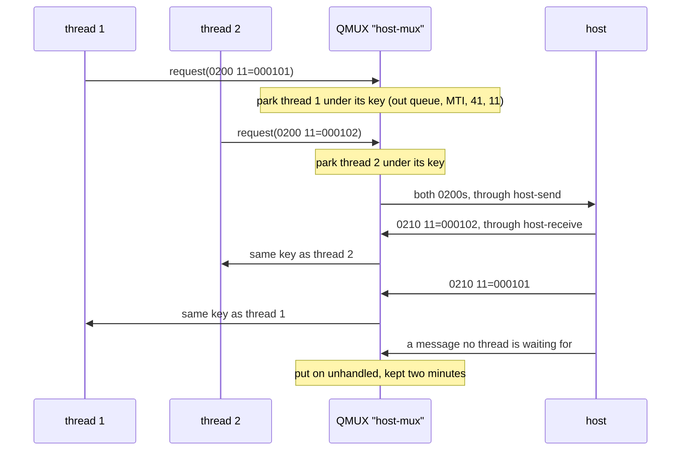

# 4. Transaction Sending

A checkout service runs two hundred threads over one TCP connection to the acquirer's host, the
ChannelAdaptor of unit c3. Thread 17 sends a 0200 for 10.00, and the next 0210 off the socket
answers thread 42's purchase of 40.00, which thread 17 must not read. When the host says nothing,
or the link is down, thread 17 still has to tell a cashier something.

QMUX solves this for every thread at once. What it promises and what it leaves to you comes down
to seven rules, one per section heading. Every output is from jPOS 2.1.7: Q2 in the same JVM,
started from the descriptors shown here (a ChannelAdaptor and a QMUX), and an `ISOServer` on
127.0.0.1 playing the host, with a 500 ms reconnect delay so the examples finish quickly.

## 4.1 QMUX Sits on the Adaptor's Queues, Crossed

The ChannelAdaptor of unit c3 never talks to your code. It writes what it takes from the Space
queue `host-send` to the socket, and puts everything it reads on `host-receive`. QMUX is the other
end: it writes requests to the queue the adaptor sends from and reads the queue the adaptor fills.

`deploy/20_host_mux.xml`, the same file as in unit c1:

```xml
<mux name="host-mux" class="org.jpos.q2.iso.QMUX" logger="Q2">
  <in>host-receive</in>
  <out>host-send</out>
  <ready>host-channel.ready</ready>
  <unhandled>host-unhandled</unhandled>
</mux>
```

Each element is named from the QMUX's point of view: its `<in>` is what comes in from the host,
the adaptor's `<out>`, and its `<out>` is the adaptor's `<in>`. What happens if you copy
`<in>host-send</in>` and `<out>host-receive</out>` from the adaptor's file, because the names look
like they should match? Each version on its own, with the link up, sending one purchase with a
2-second timeout:

```text
crossed: isConnected true
crossed: 0210 39=00 after 0 ms, host received 1
copied:  isConnected true
copied:  null after 2000 ms, host received 0
```

The copied QMUX writes the purchase into `host-receive`, a queue only the adaptor should write to,
and listens on `host-send`, where no answer arrives. The purchase never leaves the JVM. Q2 logs
nothing, `isConnected()` is true because the adaptor's ready entry exists, and every request
returns `null` after its full timeout. A client that handles `null` correctly (section 4.3) reports
every purchase as "outcome unknown" and, with unit c12's policy, queues a reversal for each. When
every request times out and the host has no record of any, check the queues first.

`<ready>` names the entry the adaptor keeps in the Space while it is connected,
`host-channel.ready` (unit c3); section 4.4 shows why you need it. `<unhandled>` is where QMUX puts
messages nobody is waiting for.

## 4.2 Every Thread Gets Its Own Answer

Five threads send a purchase at once over the one link, each with its own STAN and amount. The
host holds all five and answers them in its own order. Which thread gets the first 0210?

```java
Future<?> f = pool.submit(() -> {
    ISOMsg r = mux.request(Stack.purchase("29110001", stans[n], amounts[n]), 5000);
    ...
});
```

```text
host answers in this order: 000102 000105 000103 000101 000104
thread 1 sent 11=000101 4=000000001000  got 0210 11=000101 4=000000001000
thread 2 sent 11=000102 4=000000002000  got 0210 11=000102 4=000000002000
thread 3 sent 11=000103 4=000000003000  got 0210 11=000103 4=000000003000
thread 4 sent 11=000104 4=000000004000  got 0210 11=000104 4=000000004000
thread 5 sent 11=000105 4=000000005000  got 0210 11=000105 4=000000005000
```

Thread 2 got the first answer, because it was for STAN 000102. When QMUX sends a request, it
computes a string from it, the **key**: by default the out queue, the MTI (a response's 0210 mapped
back to 0200), and fields 41 and 11. It parks the waiting thread under that key, computes the key of
every message on `host-receive`, and hands each to the thread parked under the same key. Unit c12
takes the key apart and shows what goes wrong when two requests share one.

A message that matches no waiting thread (an answer that came too late, or a request the host sent
on its own) goes to `<unhandled>`, where it stays for two minutes (fixed in 2.1.7) unless you read
it first.



The usual alternative, a lock around "write, then read the next message", serialises the service:
with a host that takes 300 ms to answer, it completes about three purchases a second, however many
threads it has. The same reasoning ruled out pools of raw channels in unit c3.

## 4.3 A Missing Answer Comes Back as null

The host receives a purchase for 42.00 and never answers. What `request` gives back, and what the
obvious next line does with it:

```java
ISOMsg response = mux.request(Stack.purchase("29110001", "000318", "000000004200"), 2000);
boolean approved = "00".equals(response.getString(39));
```

```text
response: null after 2000 ms
java.lang.NullPointerException
host received 1, 4=000000004200
```

`request` waited the whole timeout and returned `null`; it did not throw. Unit c3's socket read
timeout is an exception, so it is easy to expect one here. The `ISOException`s that `request` does
throw mean the message was refused before it was sent: none of the key fields is present, or the
key is a duplicate (unit c12).

The `NullPointerException` is the cheap part of the bug. It lands in a generic error handler and the
cashier sees "system error", while the host's log shows the purchase arrived. The host may have
approved it and lost the answer, and nothing in the code starts the reversal that unit c12 builds
for this case. A `null` from `request` is an unknown outcome: not a decline, and never a reason to
send the same purchase again.

## 4.4 A Request on a Down Link Waits in the Queue

The host restarted, and the adaptor is reconnecting. A thread calls `request` with a 5-second
timeout anyway. Does the purchase fail at once?

```text
-- the link comes back within the timeout
0.0 s  isConnected: false
1.1 s  host is up
1.5 s  request returned 0210 39=00
host received 1
-- the link stays down past the timeout
0.0 s  isConnected: false
2.0 s  request returned null
3.0 s  host is up
4.5 s  host received 0
```

In 2.1.7 `request` never checks the link. It puts the message on `host-send` with the timeout as
its lifetime and waits. If the adaptor reconnects in time, the message goes out, here after a
second and a half. If not, it expires in the queue unsent, and `request` returns `null` like any
missing answer. (`send`, the method without an answer, does check, and throws `ISOException` "MUX
is not connected".)

In the first ending, a purchase can reach the host many seconds after it was made, when a terminal
that waits less than your timeout has already shown a failure. In the second, the cashier waits the
full timeout to hear "outcome unknown" about a purchase that never left the building. The reversal
queued for it is usually harmless but is noise, and the true answer was available at once: the host
is unavailable, try again or take another payment method.

So ask first. With `<ready>` configured, `isConnected()` is true only while the adaptor's ready
entry exists; without it, whenever the QMUX is running. A client that keeps the endings apart:

```java
package com.example.jpos.client.send;

import org.jpos.iso.ISOException;
import org.jpos.iso.ISOMsg;
import org.jpos.iso.MUX;

public class AuthorizationClient {
    public enum Outcome { APPROVED, DECLINED, NO_ANSWER, HOST_UNAVAILABLE }

    private final MUX mux;
    private final long timeout;

    public AuthorizationClient(MUX mux, long timeout) {
        this.mux = mux;
        this.timeout = timeout;
    }

    public Outcome authorize(ISOMsg request) throws ISOException {
        if (!mux.isConnected())
            return Outcome.HOST_UNAVAILABLE;           // nothing left our side
        ISOMsg response = mux.request(request, timeout);
        if (response == null)
            return Outcome.NO_ANSWER;                  // unknown: unit c12 reverses it
        return "00".equals(response.getString(39)) ? Outcome.APPROVED : Outcome.DECLINED;
    }
}
```

Against a host that approves, declines, drops, and then goes away:

```text
000801: APPROVED after 0 ms
000802: DECLINED after 0 ms
000803: NO_ANSWER after 2000 ms
000804: HOST_UNAVAILABLE after 0 ms
host received 3
```

The check is not a guarantee: the link can drop between `isConnected()` and the write, which puts
you back in the first ending. It turns the common case, a link that has been down for a while, into
an immediate and certain answer.

<!-- practice 1 -->

## 4.5 The Asynchronous Form Calls Back Once, With an Answer or With null

A blocking `request` holds its thread as long as the host takes. A service waiting on thousands of
answers can pass a listener instead and get its thread back at once:

```java
mux.request(purchase, 2000, (resp, handBack) -> { ... }, "000401");
```

The listener is an `ISOResponseListener`. Its one abstract method is `responseReceived(response,
handBack)`, where the hand-back is any object you passed in, returned untouched. When the timeout
passes with no answer, QMUX calls `expired(handBack)`, whose 2.1.7 default calls
`responseReceived(null, handBack)`, so a lambda sees `null` on expiry as the blocking form does. An
answered request and a dropped one, with the thread each callback ran on:

```text
caller thread: main
both requests sent, caller continues
000401: 0210 39=00 on channel-receiver-host-receive
000402: null on pool-2-thread-1
```

A response's callback runs on the adaptor's receiver thread, the one thread that reads the socket,
and an expiry's on a QMUX scheduler thread. Neither is yours.

A listener that ignores `null`, say one that completes a future only when
a response arrives, leaves that future waiting forever:

```text
000403: future done after 5 s? false
```

The caller, perhaps an HTTP request in your own API, hangs until its own timeout, and every dropped
purchase adds another hung caller.

A listener that does real work holds up the whole link. One asynchronous request whose listener
spends three seconds writing to a database, then a blocking request with a 2-second timeout that
the host answered at once:

```text
000702: null after 2000 ms
000701: listener done
host answered 2 requests at once
host-mux-unhandled: 0210 11=000702
```

The receiver thread was inside the first listener, so nobody read the second approval off the
socket until the blocking request had given up: the host approved 000702, the caller got `null`,
and the approval went to `<unhandled>`. Keep the listener to completing a future or handing the
message to a queue of your own, and do the work elsewhere:

```java
package com.example.jpos.client.send;

import org.jpos.iso.ISOException;
import org.jpos.iso.ISOMsg;
import org.jpos.iso.MUX;

import java.util.concurrent.CompletableFuture;

public class AsyncSender {
    private final MUX mux;
    private final long timeout;

    public AsyncSender(MUX mux, long timeout) {
        this.mux = mux;
        this.timeout = timeout;
    }

    /** Completes with the response, with null when none came in time, or with the refusal. */
    public CompletableFuture<ISOMsg> send(ISOMsg request) {
        CompletableFuture<ISOMsg> result = new CompletableFuture<>();
        try {
            mux.request(request, timeout,
                    (response, handBack) -> result.complete(response),   // null on expiry
                    null);
        } catch (ISOException e) {
            result.completeExceptionally(e);           // refused: nothing was sent
        }
        return result;
    }
}
```

```text
000901: 0210 39=00
000902: null
000903 again: failed, Duplicate key 'host-send.0200000000029110001000903.req' detected.
000903: null
```

The asynchronous `request` throws the same `ISOException`s as the blocking one, before anything is
sent. That third ending is not a `null`: the host never saw the message, so there is nothing to
undo.

<!-- practice 2 -->

## 4.6 Each Link Numbers Its Own Messages

Field 11, the STAN, has six digits and is one of the two default key fields. The host uses it with
field 41 to spot duplicates, and a reversal names its original by it. Where should it come from?

A random number looks unique enough. One terminal ID, simulated with 20 purchases in flight and
100,000 a day, each with a random STAN:

```text
random STANs, 20 in flight, 100,000 purchases a day: 1.8 collisions a day (30 days)
```

Each collision is a purchase QMUX refuses as a duplicate key while the other waits. Over a day,
100,000 draws from a million values also repeat many times, which a host that looks for duplicates
notices. Use a counter: one sequence per outbound link, 000001 to 999999, then 000001 again.

```java
package com.example.jpos.client.send;

import org.jpos.iso.ISOUtil;
import org.jpos.space.Space;
import org.jpos.space.SpaceUtil;

/** One STAN sequence per outbound link: 000001 .. 999999, then 000001 again. */
public final class StanSequencer {
    private final Space<String, Object> space;
    private final String key;

    public StanSequencer(Space<String, Object> space, String link) {
        this.space = space;
        this.key = "stan." + link;
    }

    public String next() {
        long n = SpaceUtil.nextLong(space, key);    // atomic within this JVM
        return ISOUtil.zeropad(((n - 1) % 999999) + 1, 6);
    }
}
```

`SpaceUtil.nextLong` takes the number from the Space, adds one and puts it back while holding the
Space's lock, so two threads never get the same number. Started at 999997, it continues:

```text
999998 999999 000001
```

Where the counter lives decides what a restart does. A program that takes three STANs, run twice
with a transient space (`tspace:stan`) and twice with `je:stan`, the Berkeley DB space that ships
with jPOS 2.1.7 (the part before the colon picks the kind of space, the part after names it):

```text
tspace:stan: 000001 000002 000003
tspace:stan: 000001 000002 000003
je:stan: 000001 000002 000003
je:stan: 000004 000005 000006
```

After a restart the transient counter starts at 000001 again, so the afternoon's first purchases
repeat the morning's terminal and STAN, and a host that checks duplicates by those fields may
decline them. Production uses a persistent space. The lock is local to the JVM, though: two
processes that share a terminal ID on one link need one shared sequence, such as a database
sequence, rather than a space each.

Keep every request with its transaction record. A reversal (unit c12) copies fields from it and
names it by its MTI, STAN, field 7 and acquirer ID. The rest of the request comes from unit c2's
request factory.

<!-- practice 3 -->

## 4.7 Code Names a MUX and Never Keeps One

Q2 registers each QMUX in the `NameRegistrar` as `mux.<name>`, and `QMUX.getMUX("host-mux")` looks
it up. The registry is per JVM, so this works only in the process that runs Q2, as the application or
embedded in it (unit c1).

A lookup in the constructor fails if the service is built before Q2 has deployed the descriptor.
Here a service looked up `host-pool`, the pool of section 4.7.1, too early:

```text
before deploy: org.jpos.util.NameRegistrar$NotFoundException: mux.host-pool
```

A reference kept from startup goes stale when an operator edits the descriptor and Q2 redeploys it.
After touching the file, one purchase through a kept reference and one through a fresh lookup:

```text
descriptor redeployed; same object? false
kept reference: isConnected false, request -> null
looked up now:  isConnected true, request -> 0210
host received:
- 0200 11=000601
- 0200 11=000602
host-mux-unhandled: 0210 11=000601 39=00
```

The old QMUX is stopped but still wrote the purchase to `host-send`, as any `request` does. The
adaptor sent it, the host approved it, and the approval reached the new QMUX, which had nobody
waiting for it, so the caller got `null` for a purchase that went through. Look the MUX up when you use
it:

```java
package com.example.jpos.client.send;

import org.jpos.iso.MUX;
import org.jpos.q2.iso.QMUX;
import org.jpos.util.NameRegistrar;

import java.util.function.Supplier;

/** Finds the MUX by name each time it is needed. */
public final class MuxLocator implements Supplier<MUX> {
    private final String name;

    public MuxLocator(String name) {
        this.name = name;
    }

    @Override
    public MUX get() {
        try {
            return QMUX.getMUX(name);                  // "mux." + name in the NameRegistrar
        } catch (NameRegistrar.NotFoundException e) {
            throw new IllegalStateException("MUX '" + name + "' is not deployed", e);
        }
    }
}
```

### 4.7.1 A Pool Takes the Name's Place

The lookup returns the `MUX` interface, and the code needs nothing more. When one link is not
enough, each link gets its own ChannelAdaptor and QMUX, and a `MUXPool` in front of
them is itself a `MUX`, registered the same way. `deploy/25_host_pool.xml`:

```xml
<mux name="host-pool" class="org.jpos.q2.iso.MUXPool" logger="Q2">
  <muxes>host-mux host-mux-b</muxes>
  <strategy>primary-secondary</strategy>
</mux>
```

The second pair is the first one with other names: adaptor `host-channel-b` with queues
`host-b-send` and `host-b-receive`, and QMUX `host-mux-b`. Each QMUX reads only its own in queue, so
the two links never confuse each other's answers.

The pool looks its members up once, when it is deployed, so it comes after them (`25_`), and a
missing name fails the deployment. It keeps those references: redeploy a member and the pool still
holds the stopped one, so redeploy the pool with it. With two hosts, A and B:

```text
host-pool is a MUXPool
000501: 0210 from host A after 0 ms
000502: 0210 from host A after 0 ms
link A down
000503: 0210 from host B after 0 ms
link B down, pool isConnected: false
000504: null after 3000 ms
```

`primary-secondary` uses the first member that is connected, so B takes over when A drops. With no
member connected, the pool checks again every second until the timeout is spent and then returns
`null` without handing the purchase to any member, the same answer as a lost response. Ask
`isConnected()` first here too: the pool's is true while any member is. The application changed
one word, `host-pool` for `host-mux`. Unit c14 covers the other strategies and how to design for failover.

> **The pool's asynchronous form differs.** In 2.1.7, `MUXPool.request` with a listener also waits
> in the caller's thread for a usable member, up to the timeout, and then throws `ISOException`
> "No MUX available" instead of calling the listener. In our run that took the full 3000 ms.

Depending on `MUX` also lets a test hand the client a fake that answers, declines or stays silent on
demand (unit c10).

<!-- practice 4 -->

<!-- practice 5 -->

## 4.8 Summary

- **QMUX sits on the adaptor's queues, crossed.** Its `<in>` is the adaptor's `<out>`. Copied
  unchanged, every request times out without leaving the JVM or logging an error.
- **Each thread gets its own answer**, matched by a key, in whatever order the host answers. A lock
  around write-then-read serialises the whole service.
- **A missing answer is `null`, not an exception.** It means "unknown", never "declined" and never "send it
  again".
- **`request` doesn't check the link.** On a down link the message waits in the queue for the
  timeout and may go out late. Ask `isConnected()` first, with `<ready>` configured.
- **The asynchronous listener runs once, on a jPOS thread**, with `null` on expiry. Complete the
  caller's future in both cases, and keep the listener short, or every answer on the link waits.
- **One STAN sequence per link**, wrapping 999999 to 000001, kept in a persistent space. Random or
  in-memory numbers repeat.
- **Look a MUX up by name when you use it, and depend on `MUX`.** A kept reference goes stale on
  redeploy, and a `MUXPool` can take the name's place.

## 4.9 Reference

**The `MUX` interface in 2.1.7** (`MUX` extends `ISOSource`):

| Method | Does |
|---|---|
| `ISOMsg request(ISOMsg m, long timeout)` | sends and blocks; the matching response, or `null` after `timeout` ms |
| `void request(ISOMsg m, long timeout, ISOResponseListener l, Object handBack)` | sends and returns; `l` is called once, with the response or (via `expired`) with `null` |
| `void send(ISOMsg m)` | sends without waiting; QMUX throws `ISOException` when not connected |
| `boolean isConnected()` | QMUX: a `<ready>` entry exists (or, with no `<ready>`, the QMUX is running); MUXPool: some member is usable |

Both `request` forms throw `ISOException` before sending for "Key fields not found" and "Duplicate
key".

**QMUX elements used in this course:**

| Element | Meaning |
|---|---|
| `<in>` | queue QMUX reads: the adaptor's `<out>` |
| `<out>` | queue QMUX writes requests to: the adaptor's `<in>` |
| `<ready>` | Space entry (or entries) that `isConnected()` checks; `host-channel.ready` |
| `<unhandled>` | queue for messages nobody waits for; each expires after 120000 ms |
| `<key>` | key fields, default `41, 11` (unit c12) |
| `<request-listener>` | gets unmatched messages before `<unhandled>` (unit c11) |

**MUXPool strategies in 2.1.7:**

| `<strategy>` | Picks |
|---|---|
| `primary-secondary` (default) | the first usable member in `<muxes>` order |
| `round-robin` | the next usable member in turn |
| `round-robin-with-override` | round-robin, except that MTIs in `<follower-override>` go to the link named in the field set by `<original-channel-field>` |
| `split-by-divisor` | member number `<split-field>` modulo the member count, else round-robin |

"Usable" means connected. With `<property name="check-enabled" value="true"/>` a QMUX member also
needs an entry named after the QMUX plus `.enabled`, which must be the same object as its ready
entry when the QMUX has one `<ready>` name, and merely present when it has several (unit c11). When no
member is usable, the pool checks once a second until the timeout runs out.

## 4.10 Challenges

1. Your host answers in 300 ms on average, and 2% of answers take 8 seconds. How many threads does a
   service using the blocking form need for 200 purchases a second? How many does the asynchronous
   form need, and what does it need instead?
2. The link drops for 40 seconds at lunchtime. Your request timeout is 25 seconds and the adaptor's
   reconnect delay is 10 seconds. Draw what happens to purchases submitted at seconds 0, 20 and
   35, with and without the `isConnected()` check.
3. Two instances of the checkout service share one terminal ID on one link. Design their STAN
   numbering without a shared database. What happens at a restart?
4. Write a request listener for `<unhandled>` traffic that logs late approvals. Which fields would
   you log, and which must you never log?

## 4.11 Design Note: Why Queues Between the MUX and the Socket?

QMUX never touches the socket. A MUX that owned the channel would be shorter by one thread, but
jPOS puts Space queues in between.

The queues keep the two sides independent. The adaptor reconnects and backs off without the MUX
knowing, and the MUX keeps its waiting threads throughout. A message written while the link is down
waits, which suits an advice (a 0220 reporting something already done) and, as section 4.4 showed,
can send a purchase late. Anything can sit on the other end of the queues: a second adaptor, a test
host in the same JVM, a recorder. Unit c12 replaces the adaptor with a scripted host, and QMUX
can't tell.

The price is that the queues hide the link. A write to a queue always succeeds, so a mistake like
copied queue names shows up only as timeouts, and a stopped QMUX can still put a purchase on the
wire. The MUX's whole view of the link is a single Space entry, the ready flag.
