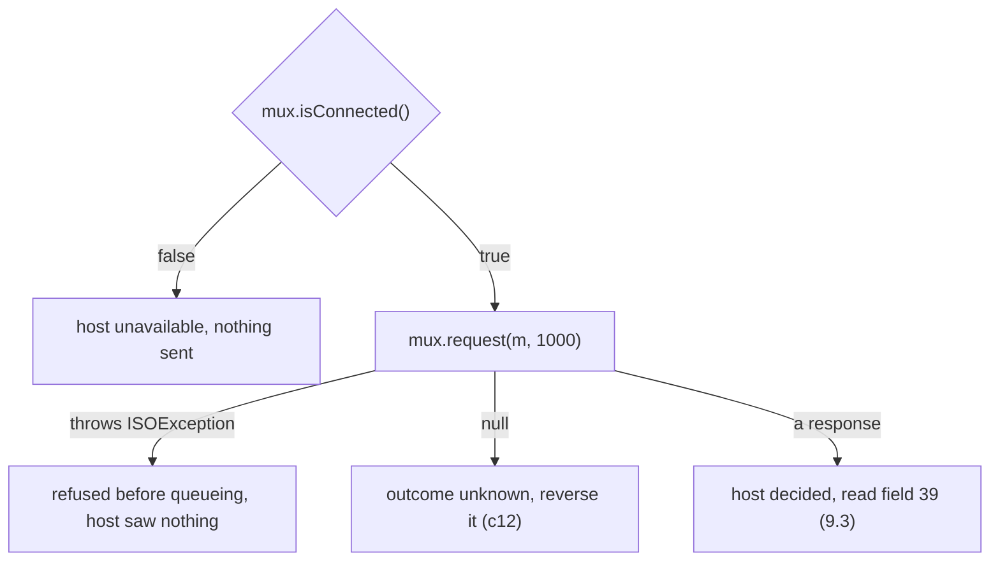

# 9. Error Handling in jPOS Client

A bakery signs up with a merchant name of 41 characters. Its first purchase goes through your
client, and `request` throws nothing. A moment later a cardholder at another till, whose purchase
the host had approved, is told "outcome unknown". The only trace in the log is a warning:
`error packing field 43`.

The bakery's bug landed on someone else, and none of your error handling saw it. Where each failure
of a jPOS client shows up, and what it tells you, comes down to four rules, one per section heading.

Every output is from jPOS 2.1.7: Q2 in the same JVM with unit c4's ChannelAdaptor and QMUX, and an
`ISOServer` on 127.0.0.1 as the host. The host can answer, decline, drop or hold each request, or
answer with a field 39 we choose. The reconnect delay is 500 ms, so the examples finish quickly.

## 9.1 Your Thread Sees Four Endings, and Each Says What the Host Knows

We sent five purchases. One had neither field 11 nor field 41. One reused the key of a purchase
still waiting. The host declined one, dropped one, and was shut down before the last. The call is
wrapped the way most first versions are:

```java
try {
    if (!mux.isConnected()) ending = "isConnected() false";
    else ending = "returned " + show(mux.request(m, 1000));
} catch (ISOException e) {
    ending = "ISOException: " + e.getMessage();
}
```

In which cases did the host receive the purchase?

```text
no 11, no 41  host received 0   ISOException: Key fields not found - not sending host-send.020
same key      host received 0   ISOException: Duplicate key 'host-send.0200000000029110001000611.req' detected
declined      host received 1   returned 0210 39=05
dropped       host received 1   returned null
link down     host received 0   isConnected() false
```

Each of the four endings says something different about the host:

- **An `ISOException` from `request`** means QMUX refused the message before queueing it. The host
  saw nothing. Fix the message, and if the key was a duplicate, send it again with a new STAN.
- **`isConnected()` false** means nothing was sent either. Tell the caller the host is unavailable.
  (The link can still drop between a `true` and the call; that ends in `null`, as unit c4 showed.)
- **`null`** means the outcome is unknown: the host may have approved the purchase. Unit c12
  reverses it.
- **A response** means the host decided, and field 39 says what, as long as you can read it (9.3).



`request` declares only `ISOException`, so a `catch (IOException e)` around it doesn't compile.
The socket is read and written on the adaptor's threads, so a broken connection reaches you as
`isConnected()` false or as `null`. A timeout is `null` too, never a `TimeoutException`.

The trap is reading these four as two, "it threw" and "it didn't". Put an `ISOException` and a
`null` in the same "failed" branch and you either reverse purchases the host never saw, or tell a
cardholder "declined, try again" about a purchase the host approved. Ask of every failure what the
host knows. Only `null`, and an answer you can't read, leave that open.

## 9.2 A Field the Packager Refuses Fails on the Adaptor's Thread, and Takes the Link With It

The bakery's 41 characters go into field 43, which holds 40. Where does packing fail?

QMUX doesn't pack. It puts the `ISOMsg` on the adaptor's queue, and the adaptor's sender thread
packs it when it writes to the socket. We sent three purchases on one link: 000201, whose approval
the host held for a moment, then 000202 with the long field 43, and 100 ms later 000203:

```java
ISOMsg bad = Stack.purchase("29110002", "000202", "000000001000");
bad.set(43, "THE CORNER BAKERY AND COFFEE HOUSE LONDON");   // 41 characters, field 43 holds 40
Future<ISOMsg> refused = pool.submit(() -> mux.request(bad, 5000));
```

```text
isConnected 0.3 s after the bad message: false
host could not answer 000201: unconnected ISOChannel
000201 (sent before): null
000202 (bad):         null
000203 (sent after):  0210 39=00 after 900 ms
host received: 2
```

Nothing threw in the calling thread. The sender thread caught the `ISOException`, logged a warning
in the realm `org.jpos.q2.iso.ChannelAdaptor` with the text `error packing field 43`, closed the
connection and slept for a second before taking the next message. The 2.1.7 source does this for
any `ISOException` during a send, except a veto from a channel filter.

- **000201 had nothing wrong with it.** The host approved it and tried to answer on a connection
  that no longer existed. Its caller got `null`, its cardholder hears "outcome unknown", and a
  reversal goes out for a purchase that was fine.
- **000202 never left the JVM.** Its caller still waited the full five seconds and got `null`, the
  same answer as a lost approval. A client that follows the rules reverses a purchase the host
  never saw.
- **000203** went out on the new connection, about a second late.

The warning names a field number but no STAN or terminal, so with twenty purchases in flight the
log can't tell which one was bad.

With the adaptor's `<ignore-iso-exceptions>yes</ignore-iso-exceptions>`, the same run keeps the
link:

```text
isConnected 0.3 s after the bad message: true
000201 (sent before): 0210 39=00
000202 (bad):         null
000203 (sent after):  0210 39=00 after 900 ms
```

The bad purchase still waits five seconds for a `null` that means
"unknown" when the truth is "never sent", and the one-second pause after the error still delays the
next message. The switch also covers the receiving side, where an answer that can't be unpacked
drops the link too by default.

The fix is to pack a copy with the channel's packager, in the caller's thread, before you queue.
The failure is then an `ISOException` before sending.

```java
package com.example.jpos.client.errors;

import org.jpos.iso.ISOException;
import org.jpos.iso.ISOMsg;
import org.jpos.iso.ISOPackager;

/** Packs a copy with the link's packager, so a bad field fails here and not on the link. */
public final class Preflight {
    private final ISOPackager packager;

    public Preflight(ISOPackager packager) {
        this.packager = packager;               // the same packager the channel uses
    }

    public void check(ISOMsg m) throws ISOException {
        ISOMsg copy = (ISOMsg) m.clone();
        copy.setPackager(packager);
        copy.pack();                            // throws "error packing field NN"
    }
}
```

Purchases 000201 and 000202 again, with `preflight.check(m)` before each `request`:

```text
000202 (bad):  refused after 0 ms: error packing field 43
isConnected: true
000201 (good): 0210 39=00
host received: 1
```

The bad purchase is refused at once, in the thread that knows its STAN and terminal, with nothing
to reverse, and the link stays up. The price is packing every message twice, small next to a
network round trip. The check uses the packager alone: if the channel has outgoing filters that
change fields, or picks a packager per message, check against what it really sends.

A packager checks lengths, not meaning. With `iso87ascii.xml`, a 41-character field 43 or a
20-digit PAN fails, but an amount written as `50.00` packs and reaches the host as `000000050.00`.
Checking what is in a field stays the job of the code that builds the request (unit c2).

<!-- practice 1 -->

## 9.3 Field 39 Says Who Acts Next

A response means the host decided, and field 39 says what. Most first versions read it like this:

```java
String naive = "00".equals(r.getString(39)) ? "APPROVED" : "DECLINED";
```

The host answered seven purchases, each with a different field 39 (the last two with none at all
and with a code that isn't on the network's list). We read each answer with the line above and
with a policy built from the network's code list. Which answers moved the cardholder's money, and
after which should the cardholder try again in a minute?

```text
39    "00" or declined    policy
00    APPROVED            APPROVED
08    DECLINED            APPROVED
51    DECLINED            DECLINED
91    DECLINED            TRY_LATER
30    DECLINED            FIX_REQUEST
none  DECLINED            REVERSE
N7    DECLINED            REVERSE
```

The naive line reads two rows of seven correctly.

- **08 is an approval** ("honour with identification" in ISO 8583:1987). Read as a decline, the
  till says the purchase failed while the money has moved. Because a decline needs no reversal,
  nothing ever gives it back.
- **91 says the issuer or the switch is unavailable.** Reported as a decline, it sends away a
  cardholder whose card is fine and who would have succeeded in a minute. Trying again means a new
  transaction with a new STAN, not the same message again.
- **30 is a format error**: your request is wrong. After a release that breaks one field, every
  purchase comes back 30. Read as declines, cardholders blame their cards, and no alert reaches the
  developers who could fix it.
- **No field 39, or a code you don't know**, says nothing about the money. Treat it as no answer,
  and reverse. Sending the same purchase again would charge twice if the first was approved.

A reversal costs one message and undoes the worst case; the design note weighs it.

The code list belongs to the network, so keep it as data and keep the decisions in code:

```java
package com.example.jpos.client.errors;

import org.jpos.iso.ISOMsg;

import java.util.Map;

/** What field 39 asks of us. The codes come from the network's specification. */
public final class AnswerPolicy {
    public enum Next { APPROVED, DECLINED, TRY_LATER, FIX_REQUEST, REVERSE }

    private final Map<String, Next> codes;

    public AnswerPolicy(Map<String, Next> codes) {
        this.codes = Map.copyOf(codes);
    }

    public Next of(ISOMsg response) {
        String rc = response.getString(39);
        if (rc == null)
            return Next.REVERSE;                      // an answer that decides nothing
        return codes.getOrDefault(rc, Next.REVERSE);  // a code we can't place: the same
    }
}
```

Each value of `Next` says who acts: the cardholder goes home with the goods, tries another card or
tries again later; a developer fixes the request; or the reversal process takes over. The run above
used the list in the Reference.

> **Networks differ.** Each network publishes its own field 39 values, and its own rules for which
> are approvals and which may be retried, and how soon. Build the map from your network's
> specification; the codes in this unit are the common ISO 8583:1987 ones.

<!-- practice 2 -->

## 9.4 An Exception in a jPOS Callback Drops the Link and Reaches No Caller

Unit c4's asynchronous `request` calls your listener with the answer on the adaptor's receiver
thread (an expiry arrives on a QMUX timer thread instead). Suppose the listener writes the answer to
the database and the write fails, while purchase 000301 waits for its own answer:

```java
mux.request(purchase, 5000, (response, handBack) -> {
    System.out.println("listener for 000302 got " + response.getString(11) + " 39=" + response.getString(39) + ", and throws");
    throw new IllegalStateException("payments table is locked");     // say, a failed database write
}, null);
```

What happens to 000301?

```text
listener for 000302 got 000302 39=00, and throws
isConnected: false
000301 (blocking): null
host received: 2
```

The link dropped, and 000301's approval, which the host sent right behind 000302's, was lost with it.

The receiver puts each incoming message on the QMUX's in queue, and the Space calls QMUX on that
same thread to match it. QMUX calls your listener from there, and nothing on the way catches a
runtime exception. It ends in the receiver's own
`catch (Exception e)`, which logs a warning in the `ChannelAdaptor` realm and reconnects. Every
answer still in the socket is lost, and each of those purchases returns `null` and is reversed.

QMUX's `<request-listener>`s are called the same way, for every message no request is waiting for.
Ours takes the first six digits of field 2 of everything it sees. An 0800 echo, STAN 000402, gave
up after 300 ms while purchase 000401 waited. Then the host answered both, the late 0810 first, and
an 0810 has no field 2:

```text
000402: null
request listener got 0810 000402
isConnected: false
000401: null
```

No caller hears of the exception: the thread that called `request` gets `null` like any lost
answer, and the listener's caller is jPOS. A Spring `@ControllerAdvice` sees only exceptions thrown
by a controller method on the HTTP request's thread, so it misses this one too. The decision about
the purchase (reverse, repeat, report) belongs in the code that called the MUX, made from the ending
it got, before anything returns to the HTTP layer.

So a callback that jPOS calls catches its own failures and hands them to whoever is waiting:

```java
package com.example.jpos.client.errors;

import org.jpos.iso.ISOException;
import org.jpos.iso.ISOMsg;
import org.jpos.iso.MUX;

import java.util.concurrent.CompletableFuture;
import java.util.function.Consumer;

/** Sends asynchronously and records each answer; a failure is the caller's, never the link's. */
public class RecordingSender {
    private final MUX mux;
    private final long timeout;
    private final Consumer<ISOMsg> recorder;           // e.g. a write to the payments table

    public RecordingSender(MUX mux, long timeout, Consumer<ISOMsg> recorder) {
        this.mux = mux;
        this.timeout = timeout;
        this.recorder = recorder;
    }

    public CompletableFuture<ISOMsg> send(ISOMsg request) throws ISOException {
        CompletableFuture<ISOMsg> result = new CompletableFuture<>();
        mux.request(request, timeout, (response, handBack) -> {
            try {                                       // the receiver thread (a timer thread on expiry)
                if (response != null)
                    recorder.accept(response);
                result.complete(response);
            } catch (RuntimeException e) {
                result.completeExceptionally(e);        // the caller learns of it; the link doesn't
            }
        }, null);
        return result;
    }
}
```

The same failing write, through `RecordingSender`:

```text
isConnected: true
000301 (blocking): 0210 39=00
000302 (async):    java.lang.IllegalStateException: payments table is locked
```

The caller of 000302 knows the host approved and the record wasn't written, and can retry the
write or reverse. A request listener follows the same rule, with one more option: return `false`
from `process` for anything it can't handle, and the message goes on to the next listener or to
`<unhandled>`.

Unit c4 has the other half of this rule: a callback that blocks holds up every answer on the link.
Keep callbacks short, and never let them throw.

<!-- practice 3 -->

<!-- practice 4 -->

## 9.5 Summary

- **Your thread sees four endings.** An `ISOException` and `isConnected()` false mean the host saw
  nothing. A response you can read means it decided, and `null` means nobody knows. `null` needs a
  reversal, and no catch block ever sees it.
- **A field the packager refuses fails on the adaptor's sender thread.** By default the link drops,
  innocent purchases in flight come back `null`, and the bad one waits out its timeout. Pack a copy
  in the caller's thread first and it becomes a plain refusal.
- **Field 39 says who acts next.** Read it from the network's list: approvals other than 00, "try
  later" as a new transaction, format errors as a developer's problem. An answer with no code or an
  unknown one is treated like no answer, and reversed.
- **An exception in a listener drops the link.** A response listener given an answer, and every
  request listener, runs on the receiver thread. Its exception ends in the adaptor's reconnect,
  never with a caller. Catch inside the callback and hand the failure to whoever waits.

## 9.6 Reference

**Where each failure of a 2.1.7 client surfaces:**

| What fails | Where it surfaces | Did the host see it? | What to do |
|---|---|---|---|
| no key field, or a key already waiting | `ISOException` from `request`, in your thread | no | fix the message; a new STAN for a duplicate |
| link down before the call | `isConnected()` false | no | report the host unavailable |
| no answer, a lost answer, a link that dropped | `null` after the timeout | unknown | reverse (unit c12) |
| a field the packager refuses | warning `error packing field NN` on the sender; link dropped; `null` | no | pack a copy first |
| an answer that can't be unpacked | warning on the receiver; link dropped; `null` | yes | reverse |
| an exception in a response or request listener | warning on the receiver; link dropped | depends | catch inside the callback |
| an answer | the response; field 39 | yes, and it decided | by the code's category |

**ChannelAdaptor settings involved:**

| Element | Default | Effect |
|---|---|---|
| `<ignore-iso-exceptions>` | `no` | with `yes`, an `ISOException` while packing or unpacking is logged and the link stays up |
| `<reconnect-delay>` | 10000 ms | wait before reconnecting after the link drops |

After an error (other than a filter's veto), the sender or receiver thread also sleeps for one
second before it carries on.

**Common ISO 8583:1987 response codes** (your network's list is the one that counts):

| Code | Meaning | `Next` in this unit |
|---|---|---|
| `00` | approved | `APPROVED` |
| `08` | honour with identification | `APPROVED` |
| `05` | do not honour | `DECLINED` |
| `51` | insufficient funds | `DECLINED` |
| `54` | expired card | `DECLINED` |
| `55` | incorrect PIN | `DECLINED` |
| `91` | issuer or switch inoperative | `TRY_LATER` |
| `96` | system malfunction | `TRY_LATER` |
| `12` | invalid transaction | `FIX_REQUEST` |
| `13` | invalid amount | `FIX_REQUEST` |
| `30` | format error | `FIX_REQUEST` |
| none, or not on the list | | `REVERSE` |

## 9.7 Challenges

1. A network wants `ignore-iso-exceptions` off, because it treats an unreadable answer as a broken
   session. You want it on, because of the bakery. Which failures does each setting turn into a
   dropped link, and which into a silent timeout? Could you have both behaviours with one link?
2. Your packager accepts `50.00` as an amount. List the fields of your purchase where a value of the
   right length can still be wrong, and decide for each whether the request builder, the preflight
   or the host should catch it.
3. After a release, one purchase in ten comes back 30. How would you notice within a minute, and
   what would you stop doing until it is fixed?
4. A response listener writes to a database that sometimes takes three seconds and sometimes
   throws. Design the hand-off so that neither the delay nor the failure reaches the link, and say
   what the caller learns in each case.

## 9.8 Design Note: Why Reverse an Answer You Can't Read?

An answer with no field 39, or with a code nobody on your team recognises, is still an answer, and
it is tempting to call it a decline: the host did reply, and a decline sounds cautious at the till.

It is cautious only for the merchant. A decline needs nothing more from you, so if the unreadable
answer was an approval, the cardholder has paid for goods they didn't get, and nothing in your
system will notice. A reversal costs one more message: if the host had declined, it finds nothing
to undo, and if it had approved, the money comes back. When you don't know which mistake you are
making, choose the one whose cost you can see and bound.

The same reasoning sorts every ending in this unit. A refusal before sending and a link that was
down leave nothing to undo. A decision you can read is followed. A `null`, an answer lost to a
dropped link and a code you can't place are outcomes you don't know, and get the one answer that is
safe when you don't know. The price is reversals for some purchases that were declined anyway, and
a reversal process that must be reliable (unit c12).
