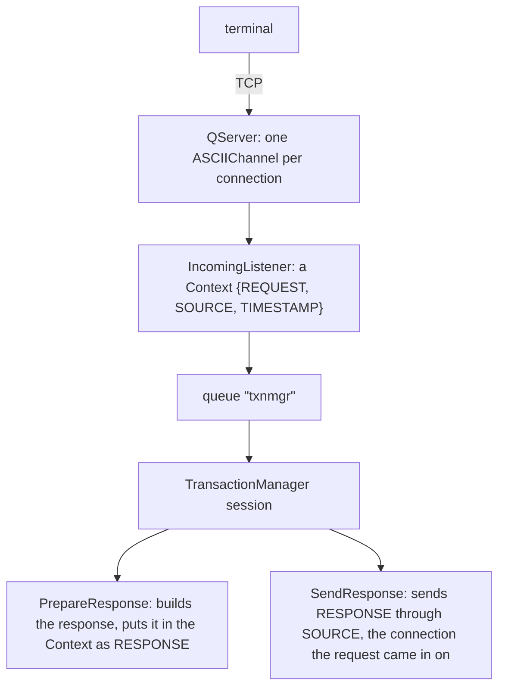

# jPOS Server: Basic Setup

Your new server is up. Q2 has logged every descriptor as deployed, and port 8000 accepts
connections. A terminal sends its first echo, waits twenty seconds, and gets nothing back. Where
did the 0800 go?

Between the socket and the answer a request passes four components: QServer, `IncomingListener`,
the TransactionManager and `SendResponse`. Any of them can drop it without stopping the server,
and the terminal sees the same silence whichever one did. This unit builds the server that the rest
of the series grows, and shows how to find, from the log alone, the step that dropped a request. It
has six rules, one per section heading.

Unit c1 covers what the client and the server share: how Q2 deploys `deploy/`, `${...}` values,
the `NameRegistrar` and the masking logger. This unit uses the same `00_logger.xml`.

> **Versions.** The course runs on jPOS 2.1.7, Java 17 and Maven, the combination the practices
> are graded on. 2.1.x is jPOS's maintenance ("tail") line and 2.1.9 is its latest release. jPOS
> 3.x is the current line; it needs Java 23 or later and its tooling is Gradle-based. Unit s13
> lists what changes there.

> **Licence.** jPOS is licensed under the GNU AGPL v3, and Q2 says so when it starts. If
> users reach your modified server over a network, the AGPL requires you to offer them its source.
> The jPOS project sells a commercial licence for those who can't.

## 1.1 A Request Crosses Four Components, and the Log Shows Each Step

The server is three descriptors and one class of our own:

```text
iso-server/
├── pom.xml                       the build (in the reference at the end of the unit)
├── deploy/
│   ├── 00_logger.xml             the masking logger of unit c1
│   ├── 30_txnmgr.xml             the TransactionManager and its participants
│   └── 50_server.xml             the QServer: the port, the channel, the listener
├── cfg/default.yml               values for ${...} (optional)
├── log/                          must exist
└── src/main/java/com/example/jpos/server/participant/PrepareResponse.java
```

`deploy/50_server.xml`:

```xml
<qserver name="iso-server" class="org.jpos.q2.iso.QServer" logger="Q2">
  <attr name="port" type="java.lang.Integer">${iso.server.port:8000}</attr>
  <channel class="org.jpos.iso.channel.ASCIIChannel"
           packager="org.jpos.iso.packager.GenericPackager" logger="Q2">
    <property name="packager-config" value="jar:packager/iso87ascii.xml"/>
  </channel>
  <request-listener class="org.jpos.iso.IncomingListener" logger="Q2">
    <property name="queue" value="txnmgr"/>
    <property name="timeout" value="15000"/>
  </request-listener>
</qserver>
```

`deploy/30_txnmgr.xml`:

```xml
<txnmgr name="txnmgr" class="org.jpos.transaction.TransactionManager" logger="Q2">
  <property name="queue" value="txnmgr"/>
  <property name="sessions" value="${txnmgr.sessions:2}"/>
  <property name="debug-context" value="false"/>
  <participant class="com.example.jpos.server.participant.PrepareResponse" logger="Q2">
    <property name="unsupported-rc" value="12"/>
  </participant>
  <participant class="org.jpos.transaction.participant.SendResponse" logger="Q2"/>
</txnmgr>
```

A request takes this path:



QServer accepts connections and creates a channel for each from the `<channel>` template. It
passes each message it reads to the request listener without understanding or answering it.
`IncomingListener` wraps it in a `Context`, a map that travels with the transaction: the message
under `REQUEST`, the connection under `SOURCE`, the arrival time under `TIMESTAMP`. It puts the
Context into the `txnmgr` queue of a Space, and returns. A TransactionManager session takes the
Context from the queue and runs the participants listed in its descriptor, in order. The last one,
`SendResponse`, ships with jPOS: it writes whatever the others left under `RESPONSE` back to
`SOURCE`.

Every example in the unit uses this terminal:

```java
package com.example.jpos.server.testing;

import org.jpos.iso.ISOException;
import org.jpos.iso.ISOMsg;
import org.jpos.iso.channel.ASCIIChannel;
import org.jpos.iso.packager.GenericPackager;

import java.io.IOException;
import java.net.SocketTimeoutException;

/** A terminal for trying a server by hand: one connection, one request at a time. */
public final class TestTerminal implements AutoCloseable {
    private final ASCIIChannel channel;

    public TestTerminal(String host, int port) throws ISOException, IOException {
        channel = new ASCIIChannel(host, port, new GenericPackager("jar:packager/iso87ascii.xml"));
        channel.connect();
    }

    /** Sends a request and returns the next message that arrives, or null after timeout ms. */
    public ISOMsg send(ISOMsg request, int timeout) throws ISOException, IOException {
        channel.setTimeout(timeout);
        channel.send(request);
        try {
            return channel.receive();
        } catch (SocketTimeoutException e) {
            return null;                                 // the channel has closed its socket
        }
    }

    @Override
    public void close() throws IOException {
        channel.disconnect();
    }
}
```

It takes the next frame as the answer, which is safe only with one request at a time on the
connection (unit c3). We started Q2 from `/iso-server` and sent an echo, then a purchase, each from
terminal `29110001` on a new connection:

```text
0800 000101: 0810 39=00 11=000101 41=29110001
0200 000102: 0210 39=12 11=000102 41=29110001
```

The echo was approved and the purchase refused with `12` (invalid transaction), because this
server only answers network messages so far. The log for the echo, trimmed to the three entries
that matter:

```text
<log realm="channel/127.0.0.1:58820" at="2026-11-06T23:13:13.584519283" lifespan="10ms">
  <receive>
    <isomsg direction="incoming">
      <field id="0" value="0800"/>
      <field id="7" value="1106093000"/>
      <field id="11" value="000101"/>
      <field id="41" value="29110001"/>
      <field id="70" value="301"/>
    </isomsg>
  </receive>
</log>
<log realm="channel/127.0.0.1:58820" at="2026-11-06T23:13:13.594220130">
  <send>
    <isomsg direction="outgoing">
      <field id="0" value="0810"/>
      <field id="7" value="1106093000"/>
      <field id="11" value="000101"/>
      <field id="39" value="00"/>
      <field id="41" value="29110001"/>
      <field id="70" value="301"/>
    </isomsg>
  </send>
</log>
<log realm="org.jpos.transaction.TransactionManager" at="2026-11-06T23:13:13.595318277" lifespan="9ms">
  <commit>
    txnmgr-0:idle:1
            prepare: c.e.j.s.p.PrepareResponse PREPARED NO_JOIN
            prepare: o.j.t.p.SendResponse PREPARED READONLY
             commit: o.j.t.p.SendResponse
```

The connection's channel logged the `<receive>` and the `<send>`. The TransactionManager logged
one event per transaction, when the transaction ended: which session ran it (`txnmgr-0`), its
number (`1`), and how each participant voted (1.4 explains the votes). That gives you three
checkpoints for any request. A `<receive>` with no TransactionManager event means the request never
reached a session. A TransactionManager event with no `<send>` means the participants ran and
nothing was sent. No `<receive>` at all points at the connection or the packager instead.

The descriptors are numbered so that the TransactionManager (`30_`) is started before the server
(`50_`) opens its port; unit c1 explains the order.

## 1.2 The Listener and the TransactionManager Meet Only in a Queue

The QServer descriptor names no TransactionManager, and the TransactionManager knows nothing about
servers. All they share is a queue name, `txnmgr`, in the default Space (neither descriptor sets a
`space` property, so both use the same one). A Space with another name, `tspace:switch` for
instance, is another Space with queues of its own, so the name and the Space must both match.

Someone renames the TransactionManager's queue to `txn`, to match a naming scheme, and forgets
`50_server.xml`. Both files deploy without a complaint. The terminal waits 20 seconds:

```text
0800 000201: no answer after 20162 ms
```

The log has the channel's `<receive>` for the echo, and then nothing: no TransactionManager event,
no `<send>`. The listener put the Context into `txnmgr`, where no session reads, and moved on. After
the listener's `timeout`, 15 seconds here, the Context expired from the queue unread.

On the terminal's side this is the case of unit c12. An echo that times out is a link problem. A
purchase that times out has an unknown outcome, so the terminal's acquirer reverses it and may
try again, and every purchase after it does the same. The reversals arrive at a server that
processed nothing, and they too go into the queue no session reads.

The listener's `timeout` is the longest a request may wait for a free session; the participants'
own time comes on top. Keep the two together shorter than the terminal's timeout, so that a request
nobody took in time is dropped instead of being answered after the terminal gave up. When a
`<receive>` has no TransactionManager event after it, compare the `queue` of the two descriptors
first.

## 1.3 A Component That Fails to Deploy Leaves Q2 Running, and Says So Once

### 1.3.1 Spot the Problem: The Package Rename

During a refactoring, a search-and-replace renames the package `participant` to `participants` in
every file. The participant class itself is never moved, so `30_txnmgr.xml` now says:

```xml
<participant class="com.example.jpos.server.participants.PrepareResponse" logger="Q2">
  <property name="unsupported-rc" value="12"/>
</participant>
```

Q2 starts and logs, as usual:

```text
deploy: /iso-server/deploy/30_txnmgr.xml
deploy: /iso-server/deploy/50_server.xml
listening on port 8000
```

The terminal connects, sends its echo, and gets nothing after 20 seconds. The deploy directory still
holds `30_txnmgr.xml` under its own name. Where did the echo go?

Q2 deployed the file and called the TransactionManager's `init`, which creates the participants
and could not load the class. The failure is one warning:

```text
<log realm="org.jpos.transaction.TransactionManager" at="2026-11-06T19:01:00.750206724">
  <warn>
    init
    <iso-exception>
      com.example.jpos.server.participants.PrepareResponse
      ...
Caused by: java.lang.ClassNotFoundException: com.example.jpos.server.participants.PrepareResponse
```

`QBeanSupport`, the base class of every QBean in jPOS, catches whatever `init` or `start` throws,
logs it as a warning and carries on. The TransactionManager was never started. It started no
sessions (the two `start Thread` entries of a good start are missing), and it never registered its
name. QServer, in the next file, started normally and fed the queue that nobody reads. From the
terminal, this looks exactly like 1.2.

Q2 renames a descriptor only when it can't read the file or can't build and configure the
component. With the closing tag of a `<property>` removed from `30_txnmgr.xml`, Q2 logs the parse
error and renames the file:

```text
Tidying /iso-server/deploy/30_txnmgr.xml out of the way, by adding .BAD
```

A failure inside `init` or `start` leaves the file as it is. **After every deploy, search
the log for `<warn>` before you send anything.** A test that deploys your own descriptors (unit c10)
and waits for the TransactionManager by name, `NameRegistrar.get("txnmgr", 10000)`, fails at
startup instead of at the first terminal.

## 1.4 A Participant Decides in `prepare`, and an Abort Still Answers

`PrepareResponse`, the participant the server runs:

```java
package com.example.jpos.server.participant;

import org.jpos.core.Configurable;
import org.jpos.core.Configuration;
import org.jpos.iso.ISOException;
import org.jpos.iso.ISOMsg;
import org.jpos.transaction.Context;
import org.jpos.transaction.ContextConstants;
import org.jpos.transaction.TransactionParticipant;

import java.io.Serializable;

/** Approves 0800 network messages and refuses everything else, with a response either way. */
public class PrepareResponse implements TransactionParticipant, Configurable {
    /** The fields a response copies from its request; unit s2 explains the list. */
    private static final int[] ECHOED = { 0, 2, 3, 4, 7, 11, 12, 13, 32, 37, 41, 42, 49, 70 };

    private String refusal;                              // configuration only: see 1.5

    @Override
    public void setConfiguration(Configuration cfg) {
        refusal = cfg.get("unsupported-rc", "12");
    }

    @Override
    public int prepare(long id, Serializable context) {
        Context ctx = (Context) context;
        ISOMsg request = ctx.get(ContextConstants.REQUEST.toString());
        try {
            ISOMsg response = (ISOMsg) request.clone(ECHOED);  // (1) STAN and terminal ID included
            response.setResponseMTI();
            boolean network = "0800".equals(request.getMTI());
            response.set(39, network ? "00" : refusal);
            ctx.put(ContextConstants.RESPONSE.toString(), response);   // (2) before the vote
            return network ? PREPARED | NO_JOIN : ABORTED;             // (3)
        } catch (ISOException e) {
            ctx.log(e);
            return ABORTED;
        }
    }
}
```

The TransactionManager calls `prepare` on each participant in the order of the descriptor, and
each one votes. `PREPARED` means "go on". `ABORTED` means "this transaction fails", and from then on
only participants that implement `AbortParticipant` are called. When every participant has voted,
the TransactionManager calls `commit` on the ones that joined, or `abort` if anyone voted
`ABORTED`, again only on the ones that joined. A participant joins unless its vote includes
`NO_JOIN`, "don't call me again for this transaction"; `READONLY` means "I changed
nothing in the Context". The TransactionManager builds one instance of each participant from the
descriptor, through its public no-argument constructor, and passes it the nested `<property>`
values through `setConfiguration`.

`SendResponse`'s `prepare` only checks that the connection is still there, and it joins, so it
sends in `commit` or in `abort`. Because it is an `AbortParticipant`, it is still asked to join
after an `ABORTED` vote, through `prepareForAbort`. For the 0200 of 1.1 the TransactionManager
logged:

```text
  <abort>
    txnmgr-1:idle:2
            prepare: c.e.j.s.p.PrepareResponse ABORTED
    prepareForAbort: o.j.t.p.SendResponse
              abort: c.e.j.s.p.PrepareResponse
              abort: o.j.t.p.SendResponse
```

`PrepareResponse` voted plain `ABORTED`, without `NO_JOIN`, so it joined and got an `abort` call
that does nothing. The terminal got its `0210` with `12`, and only because of (2): the response is
in the Context *before* the participant votes.

The mistake is to think that a refused request has nothing to send. This participant votes
`ABORTED` first and builds a response only for what it approves:

```java
if (!"0800".equals(request.getMTI()))
    return ABORTED;                                  // "nothing to answer"
```

The echo still works. The purchase:

```text
0800 000501: 0810 39=00 11=000501 41=29110001
0200 000502: no answer after 20009 ms
```

The TransactionManager event is the same as above, line for line. `SendResponse` ran on the abort
path, found no `RESPONSE`, and sent nothing. It notes that in the Context's own log, which is
printed only with the Context dump that 1.6 turns off, so the channel's log is where you see it: a
`<receive>` with no `<send>`. On the terminal's side, a refusal the server decided in a millisecond
became 20 seconds of waiting and an unknown outcome, so the acquirer reverses a purchase that never
went through.

- **(1) The response is a copy of listed fields of the request.** `clone(ECHOED)` copies only the
  fields named in `ECHOED`, among them the STAN (field 11) and the terminal ID (field 41), which
  are what the terminal's multiplexer matches it by (unit c12). A response built as a new, empty
  message matches nothing on the other side, and the terminal times out as if it had never been
  sent. A full `clone()` would send track 2 and the PIN block back to the terminal (unit s2). The
  copy also leaves the request in the Context as it arrived, for the participants after this one
  and for the log.
- **(3) The vote says what is left to do.** The approved echo votes `PREPARED | NO_JOIN`: it has
  nothing to commit or undo. Work that must happen only if the whole transaction succeeds, such as
  writing a row, belongs in `commit`, which runs only after every participant has voted
  `PREPARED`. A participant later in the chain may still abort, and what `prepare` already wrote
  would then stay written.

<!-- practice 1 -->

## 1.5 One Participant Serves Every Session

The descriptor asks for two sessions, two threads that each take a Context from the queue and run
the whole chain. How many `PrepareResponse` objects are there?

The TransactionManager creates each participant once, when it is initialised, and every
session calls the same object. So everything that belongs to one transaction lives in local
variables or in the Context, and fields hold configuration only.

### 1.5.1 Spot the Problem: The Terminal Check

`PrepareResponse` grows a check: only known terminals get `00`. The check reads a table, which
takes about 50 ms:

```java
package com.example.jpos.server.participant;

import org.jpos.iso.ISOException;
import org.jpos.iso.ISOMsg;
import org.jpos.iso.ISOUtil;
import org.jpos.transaction.Context;
import org.jpos.transaction.ContextConstants;
import org.jpos.transaction.TransactionParticipant;

import java.io.Serializable;

/** PrepareResponse plus a terminal check, with the request kept in a field. */
public class TerminalCheck implements TransactionParticipant {
    private static final int[] ECHOED = { 0, 2, 3, 4, 7, 11, 12, 13, 32, 37, 41, 42, 49, 70 };
    private ISOMsg request;                                  // (1)

    @Override
    public int prepare(long id, Serializable context) {
        Context ctx = (Context) context;
        request = ctx.get(ContextConstants.REQUEST.toString());
        try {
            boolean known = isKnown(request.getString(41)); // (2) about 50 ms
            ISOMsg response = (ISOMsg) request.clone(ECHOED); // (3)
            response.setResponseMTI();
            response.set(39, known ? "00" : "03");
            ctx.put(ContextConstants.RESPONSE.toString(), response);
            return PREPARED | NO_JOIN;
        } catch (ISOException e) {
            return ABORTED;
        }
    }

    private boolean isKnown(String terminal) {
        ISOUtil.sleep(50);                                   // stands in for a database query
        return terminal.startsWith("2911");
    }
}
```

Every test passes, one request at a time. In production, two terminals send an echo at the same
moment, each on its own connection. Can you see what each of them receives?

```text
terminal 29110001 sent 11=000731, got 0810 39=00 11=000731 41=29110001
terminal 29110002 sent 11=000412, got 0810 39=00 11=000731 41=29110001
```

Both sessions wrote the field at (1). While terminal `29110002`'s session waited at (2), terminal
`29110001`'s session replaced the request, and each session built its response at (3) from
whatever the field held by then. `SendResponse` sent each response to the right connection,
because `SOURCE` came from the Context, but terminal `29110002`'s response was a copy of the other
terminal's message. We ran it four times, and every time one of the terminals got the other's
answer; which one depended on timing.

Terminal `29110002`'s multiplexer can't match an answer with another STAN and terminal ID, so the
request times out, and for a purchase the acquirer reverses it. With purchases, the answer would
also carry the other terminal's amount and card number. Nothing in the log flags it: every
transaction was answered, and only a reader who compares each `<send>` with its `<receive>` would
notice.

The fix is a local variable instead of the field. **A participant's fields hold what came from
`setConfiguration`, and nothing that came from a Context.**

<!-- practice 2 -->

## 1.6 The Transaction Trace Dumps What the Log Filter Can't Mask

`30_txnmgr.xml` above sets `debug-context` to `false`. We removed that line and sent a
purchase with the test card `4111111111111111`, through the masking logger of unit c1. The
channel's `<receive>` is masked:

```text
      <field id="2" value="411111______1111"/>
      <field id="35" value="411111______1111=____________________"/>
```

The TransactionManager's event for the same transaction is not:

```text
  <abort>
    txnmgr-0:idle:1
    <context>
      TIMESTAMP: Fri Nov 06 19:33:12 UTC 2026
      SOURCE: org.jpos.iso.channel.ASCIIChannel@274a20d7
      REQUEST: 
       <isomsg direction="incoming">
         <field id="0" value="0200"/>
         <field id="2" value="4111111111111111"/>
         ...
         <field id="35" value="4111111111111111=28121010000000000000"/>
```

`ProtectedLogListener` masks a message only when the message itself is in the log event (unit c8
shows the same trap with a client-side object). Here the event holds the Context, and the
TransactionManager turns the whole event into text before any listener sees it, so there is no
message left to mask. In 2.1.7 the TransactionManager adds the Context to every transaction's event
unless `debug-context` is `false`; when it isn't set, it follows `debug`, which is on by default. So
by default every purchase writes its card number and track 2 in clear to `log/q2.log`, and to
wherever the log is shipped, while the channel's `<receive>` entries look properly masked.

With `debug-context` set to `false`, the event keeps the participant trace and the timings of 1.1
and loses the dump. Turn the dump on only on a test system with test cards. Unit s8 covers what a
participant itself may log.

<!-- practice 3 -->

## 1.7 Summary

- **A request crosses four components:** QServer's channel receives it, `IncomingListener` puts a
  Context in a queue, a TransactionManager session runs the participants, and `SendResponse`
  answers through `SOURCE`. The channel's `<receive>` and `<send>` and the TransactionManager's
  event tell you which step dropped it.
- **The listener and the TransactionManager share only a queue name and a Space.** A mismatch
  deploys cleanly, and every request expires unread while terminals time out and reverse.
- **A component that fails in `init` or `start` leaves Q2 running** and logs one warning. Only a
  file Q2 can't read, build or configure is renamed `.BAD`. Check the log for `<warn>` after every deploy.
- **A participant decides in `prepare` and puts its response in the Context before it votes.**
  `SendResponse` answers on the commit path and the abort path; a refusal without a response
  leaves the terminal waiting. Build the response from the request, and leave durable work to
  `commit`.
- **One instance of each participant serves every session.** Per-transaction state in a field
  sends one terminal's answer to another.
- **The Context dump is not masked.** Set `debug-context` to `false`.

## 1.8 Reference

**`pom.xml`** for the server. The two plugins build a jar whose main class is Q2 and copy the
dependencies into `target/lib/`:

```xml
<?xml version="1.0" encoding="UTF-8"?>
<project xmlns="http://maven.apache.org/POM/4.0.0"
         xmlns:xsi="http://www.w3.org/2001/XMLSchema-instance"
         xsi:schemaLocation="http://maven.apache.org/POM/4.0.0 https://maven.apache.org/xsd/maven-4.0.0.xsd">
  <modelVersion>4.0.0</modelVersion>
  <groupId>com.example.jpos</groupId>
  <artifactId>iso-server</artifactId>
  <version>1.0.0</version>

  <properties>
    <project.build.sourceEncoding>UTF-8</project.build.sourceEncoding>
    <maven.compiler.release>17</maven.compiler.release>
  </properties>

  <dependencies>
    <dependency>
      <groupId>org.jpos</groupId>
      <artifactId>jpos</artifactId>
      <version>2.1.7</version>
    </dependency>
    <dependency>
      <groupId>org.junit.jupiter</groupId>
      <artifactId>junit-jupiter</artifactId>
      <version>5.14.4</version>
      <scope>test</scope>
    </dependency>
  </dependencies>

  <build>
    <plugins>
      <plugin>
        <groupId>org.apache.maven.plugins</groupId>
        <artifactId>maven-dependency-plugin</artifactId>
        <version>3.6.1</version>
        <executions>
          <execution>
            <phase>package</phase>
            <goals><goal>copy-dependencies</goal></goals>
            <configuration>
              <outputDirectory>${project.build.directory}/lib</outputDirectory>
              <includeScope>runtime</includeScope>
            </configuration>
          </execution>
        </executions>
      </plugin>
      <plugin>
        <groupId>org.apache.maven.plugins</groupId>
        <artifactId>maven-jar-plugin</artifactId>
        <version>3.3.0</version>
        <configuration>
          <archive>
            <manifest>
              <mainClass>org.jpos.q2.Q2</mainClass>
              <addClasspath>true</addClasspath>
              <classpathPrefix>lib/</classpathPrefix>
            </manifest>
          </archive>
        </configuration>
      </plugin>
    </plugins>
  </build>
</project>
```

**Running it.** During development, run `org.jpos.q2.Q2` as the main class with the project root
as the working directory. For a packaged run, put the jar, `lib/`, `deploy/` and `cfg/` in one
directory, create `log/`, and start it from there:

```text
iso-server-1.0.0/
├── iso-server-1.0.0.jar     Main-Class: org.jpos.q2.Q2, Class-Path: lib/...
├── lib/                     jpos-2.1.7.jar and its dependencies
├── deploy/
├── cfg/
└── log/
```

```bash
java -Xms512m -Xmx512m -jar iso-server-1.0.0.jar
```

Q2 switches used in this course: `-d <dir>` another deploy directory, `-E <name>` the environment
(`cfg/<name>.yml`; with `-E prod` and `sessions: 4` under `txnmgr:` in `cfg/prod.yml`, the
TransactionManager started four sessions), `--help` for the rest. Set `-Xms` equal to `-Xmx`, and
leave out JVM flags copied from pre-Java 17 guides: an unknown `-XX` flag stops the JVM.

**Descriptor elements and properties used in this unit (2.1.7):**

| Where | Name | Meaning |
|---|---|---|
| QServer | `<attr name="port">` | TCP port to listen on |
| QServer | `<channel>` | template for the channel of each accepted connection |
| QServer | `<request-listener>` | receives each incoming message; several may be listed |
| `IncomingListener` | `queue` | queue the Context is written to (required) |
| `IncomingListener` | `space` | Space of that queue; default: the default Space |
| `IncomingListener` | `timeout` | ms the Context may wait in the queue; default 15000 |
| TransactionManager | `queue` | queue its sessions read (required) |
| TransactionManager | `space` | Space of that queue; default: the default Space |
| TransactionManager | `sessions` | number of session threads; default 1 |
| TransactionManager | `debug` | write one event per transaction; default true |
| TransactionManager | `debug-context` | add the whole Context to that event; default: same as `debug` |
| TransactionManager | `<participant class="...">` | one participant, in chain order, with nested `<property>` values |
| `SendResponse` | `source`, `response` | Context keys it reads; default `SOURCE`, `RESPONSE` |

**Participant votes:** `PREPARED` go on; `ABORTED` the transaction fails; `| NO_JOIN` no
`commit`/`abort` call for this participant; `| READONLY` the Context was not changed. A participant
that throws from `prepare` is logged and counted as `ABORTED`.

## 1.9 Challenges

These have no single answer.

1. Your terminals give up after 30 seconds and your participants call a host that answers within
   10. Choose the listener's `timeout` and the number of sessions for a peak of 50 requests per
   second. What happens to the request that waits longest when one host call takes 25 seconds?
2. Write a startup check that fails the deployment when the TransactionManager isn't running or
   when the listener's queue doesn't match the TransactionManager's. Where does it run: in a test,
   in a QBean, or in the deployment pipeline? What can each of them see?
3. The participant of 1.5.1 needs its terminal table, and loading it takes a minute. Where do you
   load it so that every session shares it safely, and what happens to requests that arrive during
   the first minute?
4. Operations want the Context dump back for one terminal that is being debugged in production.
   What would you log instead, and how do you keep card data out of it?

## 1.10 Design Note: Why a Queue Between the Server and the TransactionManager?

QServer could have called the participants itself, on the thread that read the message. jPOS puts
a Space queue between them instead, and you pay for it: two descriptors that must agree on a name,
and a failure mode (1.2) that throws nothing.

In return the two sides are sized separately. QServer gives each connection a thread from its pool
(at most 100 by default, `maxSessions`), and most connections of a terminal network are idle most of
the time. The TransactionManager runs as many sessions as the back end can take, perhaps a few
dozen. The queue absorbs the difference: a burst from a hundred terminals waits in the queue instead
of opening a hundred database connections. Anything that writes a Context into the queue feeds the
same chain, such as a second QServer on another port with another framing, or a test that has no
socket at all, which is how this unit's practices run. And the listener's `timeout` puts a limit on
the wait that the queue adds. Nothing checks the pairing, though, so the three checkpoints of 1.1
are how you find a broken one.
