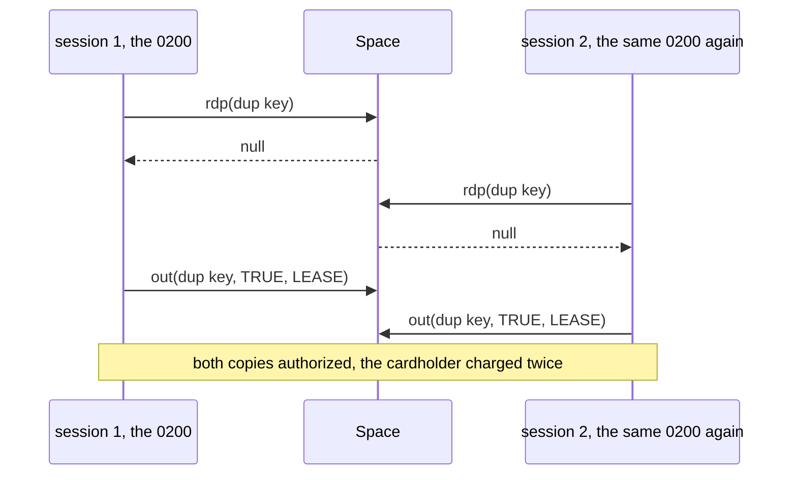

# 12. The Space

At midnight the switch moves to a new business date. A QBean writes the new date into the Space,
and the participants read it from there for the settlement date of each transaction. At twenty past
midnight operations finds that every transaction since midnight was filed under yesterday. The QBean
ran, and the new date is in the Space.

Every server unit so far used the Space through jPOS's own components: `IncomingListener` writes
each Context to the `txnmgr` queue and the sessions take it (unit s1), and a resumed transaction
goes back on that queue (unit s4). Code of your own that uses the Space directly has to follow the
rules those components already follow: five rules, one per section heading.

`SpaceFactory.getSpace(uri)` returns the same instance for the same URI anywhere in the JVM, and
with no argument it returns `tspace:default`. Every output comes from jPOS 2.1.7.

## 12.1 A Key Holds a Queue: `out` Adds, `put` Replaces, `push` Goes First

A Space maps each key to a list of entries, not to one value. `out` appends to the list, `push`
inserts at its head, and `put` replaces the whole list with one entry. Readers get the head: `rdp`
reads it, `inp` takes it. The cutover task written three ways, after three midnights:

```java
sp.put("business.date", "1105");                 // set at start-up
for (String day : new String[] { "1106", "1107", "1108" }) {   // three midnights
    switch (op) {
        case "out" -> sp.out("business.date", day);
        case "push" -> sp.push("business.date", day);
        default -> sp.put("business.date", day);
    }
}
```

```text
out   participants read 1105, entries under the key: 4
push  participants read 1108, entries under the key: 4
put   participants read 1108, entries under the key: 1
```

With `out` the participants read the start-up date until the server restarts. Each new date queues
behind it, and `rdp` returns the oldest entry. The settlement file puts every transaction under
5 November, and reconciliation with the acquirer fails for each day after it. `push` gives the right
date and adds an entry every night that nobody takes. Only `put` keeps one.

Keys hold lists because the Space was built for queues. `txnmgr` holds every Context that waits for
a session, in arrival order, and a resumed transaction is pushed so that it runs before the new
ones. A key that holds the current value of something, such as a date or a mode, is written with
`put` and read with `rdp`. A reader that uses `inp` or `in` takes the value away: the next
transaction's `inp` finds nothing, and its `in` waits.

## 12.2 A Wait Without a Timeout and an Entry Without a Lease Both Last Forever

`in(key)` and `rd(key)` wait until an entry arrives. This consumer loop is told to stop while its
queue is empty:

```java
while (running) {
    Object job = timed ? sp.in("jobs", 1000) : sp.in("jobs");
    if (job != null) System.out.println("handled " + job);
}
```

```text
in(jobs)       stop asked; after 5001 ms the worker is still waiting (WAITING)
in(jobs, 1000) stop asked; after 801 ms the worker is gone
```

Clearing `running` changes nothing for a thread that waits inside `in`. The same untimed loop as a
QBean, undeployed by Q2, and then a job is queued:

```text
undeployed: true
job-worker thread alive after undeploy: true
job-worker handled settle-29110001 (running=false)
```

The stopped component processed the job, and a redeploy would start a second consumer beside the
old one. With `in(key, 1000)` the loop sees the flag within a second. The TransactionManager's sessions wait the same way, 15 seconds at a time.

An entry, too, stays until someone takes it. A duplicate check writes a mark
`dup.<terminal>.<STAN>` for each purchase and declines with response code `94` (duplicate
transmission) when the mark already exists. Nothing takes the marks. A million purchases, without a
lease and with a lease of 2 seconds:

```text
no lease    after 1,000,000 purchases: 1,000,000 keys, heap +161 MB
no lease    12 s later:            1,000,000 keys, heap +161 MB
lease 2 s  after 1,000,000 purchases: 1,000,000 keys, heap +230 MB
lease 2 s  12 s later:            0 keys, heap +16 MB
```

Without a lease the marks keep 161 MB, more every day, until a restart. (A leased entry costs
more while it lives, because TSpace wraps it and tracks its key for expiry.) `out(key, value, lease)`
ends an entry when the lease runs out: readers stop seeing it at once, and a background task in
TSpace removes it within seconds. Give the mark as long as a terminal may take to resend, minutes
rather than days. `IncomingListener` puts each Context on `txnmgr` with a lease in the same way
(unit s1).

## 12.3 The Space's Own Operations Are Atomic, and a Read Followed by a Write Is Not

The first version of the duplicate check:

```java
if (sp.rdp(key) != null)
    return false;                                    // duplicate: answer 94
sp.out(key, Boolean.TRUE, LEASE);
return true;
```

A terminal times out and sends the same 0200 again on a new connection, and the two copies reach two
sessions at the same moment. We ran the check from two threads released together, 10,000 times:

```text
rdp, then out  10,000 pairs, both copies processed: 164
outIfEmpty     10,000 pairs, both copies processed: 0
```

In 164 pairs both threads read `null` before either wrote. Both copies were authorized, and the
cardholder was charged twice. Each call held the space's lock, but the lock was free between
`rdp` and `out`.



`SpaceUtil.outIfEmpty(sp, key, value, 0, lease)` holds the lock across both steps. It synchronizes
on the space object, as TSpace's own methods do, checks that the key is empty and writes.
`SpaceUtil.nextLong`, the STAN counter of unit c4, works the same way. Wrap a read-modify-write of
your own in `synchronized (sp) { ... }`, on the space and not on your participant, since two
TransactionManagers have two participant instances. On `je:`, `out`, `rdp` and `inp` don't take
that lock, so it protects only against other code that also locks the space.

The lock lives in one JVM. Two Q2 nodes behind one terminal network need something both of them see,
such as a unique constraint in a shared database.

<!-- practice 1 -->

## 12.4 A Listener Runs on the Writer's Thread and Takes Nothing

A `LocalSpace`, such as TSpace or JESpace, calls each `SpaceListener` registered on a key whenever an
entry is written under that key. Operations want to count the requests that reach the
TransactionManager, so someone puts a listener on `txnmgr`. Here are three versions, against a real
TransactionManager fed by unit s4's `DirectTerminal`, the terminal without a socket:

```java
SpaceListener<String, Object> slow = (k, v) -> {
    writer = Thread.currentThread().getName();
    sleep(300);                                          // writes an audit row
};
SpaceListener<String, Object> taking = (k, v) -> {
    Object ctx = sp.inp(k);                              // "take it to have a look"
    if (ctx != null) sp.out("audit", ctx.getClass().getSimpleName());
};
SpaceListener<String, Object> handOff = (k, v) ->
    audit.submit(() -> sleep(300));                      // the value is all it needs
```

```text
none      20 purchases: 20 answered, slowest answer 12 ms
slow      20 purchases: 20 answered, slowest answer 300 ms
          the slow listener ran on thread main
taking    20 purchases:  4 answered, slowest answer 1 ms
hand-off  20 purchases: 20 answered, slowest answer 0 ms
```

The slow listener ran on `main`, the thread that called `out`, which here is the terminal's. In a
server it is the QServer session that read the request, inside `IncomingListener`. TSpace calls the
listeners after the entry is in the list, on the writer's thread, one after another. So every answer
came 300 ms later, and the session read nothing more from its connection in the meantime.

The taking listener lost 16 of 20 purchases. A listener is told about an entry and does not receive
it: the entry stays in the space, where the TransactionManager's sessions are waiting for it, and
whichever `inp` comes first wins. In four more runs, 3 to 6 of the 20 got through. The listener
took the rest and kept only their class name, so they never reached a participant. Their terminals timed out and reversed
purchases the server never saw.

The hand-off version moves the slow work to a thread of its own. A listener that must consume, as QMUX does on its `<in>` queue, takes the entry with `inp` and accepts
`null`, because another consumer may have been first.

<!-- practice 2 -->

## 12.5 A Transient Space Hands Back the Stored Object, and a Persistent One a Copy

`tspace:` keeps your objects in memory and hands back the objects themselves. `je:` (Berkeley DB)
serializes each entry to disk, and every read builds a new copy. `jdbm:` serializes too, but in
2.1.7 it caches 512 records in memory, so a read in the same JVM usually hands back the stored
object itself, as `tspace:` does. Here a store-and-forward queue holds an advice, and a sender marks
the next attempt as a repeat on the message it read:

```java
ISOMsg read = (ISOMsg) sp.rdp("saf.host");
read.setMTI("0221");                                  // "the next attempt is a repeat"
ISOMsg again = (ISOMsg) sp.rdp("saf.host");
```

```text
tspace:saf       read == stored: true   stored MTI after the change: 0221
tspace:saf       out(new Note()): accepted
je:saf:data/saf  read == stored: false  stored MTI after the change: 0220
je:saf:data/saf  out(new Note()): SpaceError: java.io.NotSerializableException: demo.Copies$Note
```

The tests run on `tspace:`, where the change reaches the stored advice, so they pass. Production
runs on `je:` so that the queue survives a restart (unit c12), and there the change reaches only a
copy: the advice stays 0220, and every attempt goes out as a first attempt. On `tspace:` the change
reaches every other reader too.

Treat what you read as a copy in both. Change a clone and write it back: `put` for a single value,
or take the entry and `push` the changed one so that it keeps its place, as unit c12's SAF does. Take
and push are two steps, so do them under `synchronized (sp)` or from a single sender. Store only
`Serializable` values: `je:` refuses anything else on write, while `tspace:` accepts it.

<!-- practice 3 -->

<!-- practice 4 -->

## 12.6 Summary

- **A key holds a queue.** `out` adds behind the oldest entry, so `rdp` doesn't see a value
  written with `out` while an older one remains. Use `put` for a current value, `out` for work, and `push` for work that goes
  first.
- **A wait without a timeout and an entry without a lease last forever.** An untimed `in` keeps a
  stopped component's thread alive. A mark nobody takes stays in memory until a restart.
- **The space's operations are atomic, a read followed by a write is not.** Two sessions can both
  pass a check-then-write. Use `outIfEmpty`, `nextLong` or `synchronized (sp)`, and remember that
  the lock ends at the JVM.
- **A listener runs on the writer's thread and takes nothing.** A slow listener slows the writer,
  and a listener that takes the entry steals it from the consumer.
- **A transient space hands back the object, a persistent one a copy.** Change a clone and write it
  back, and store only `Serializable` values.

## 12.7 Reference

**Operations (`org.jpos.space.Space`, 2.1.7):**

| Method | Blocks? | Effect |
|---|---|---|
| `out(k, v)` / `out(k, v, lease)` | no | append `v` to `k`'s list, with a lease in ms if given |
| `push(k, v)` / `push(k, v, lease)` | no | insert at the head |
| `put(k, v)` / `put(k, v, lease)` | no | replace every entry under `k` with `v` |
| `in(k)` / `in(k, timeout)` | yes / up to `timeout` | take the head; `null` after the timeout |
| `rd(k)` / `rd(k, timeout)` | yes / up to `timeout` | read the head without taking it |
| `inp(k)` / `rdp(k)` | no | take / read the head, or `null` at once |
| `nrd(k)` / `nrd(k, timeout)` | yes / up to `timeout` | wait until `k` has no entries |
| `existAny(keys)` / `existAny(keys, timeout)` | no / up to `timeout` | is there an entry under any of the keys? |

`LocalSpace` adds `addListener(k, l)`, `removeListener(k, l)`, `size(k)` and `getKeySet()`.

**`SpaceFactory.getSpace(uri)`:**

| URI | Implementation | Kept across a restart |
|---|---|---|
| none, `""` or `null` | `tspace:default` | no |
| `name` (no scheme) | `tspace:name` | no |
| `tspace:name`, `transient:name` | `TSpace` (two URIs, two instances) | no |
| `je:name` or `je:name:path` | `JESpace`, Berkeley DB Java Edition | yes |
| `jdbm:name[:path]`, `persistent:name[:path]` | `JDBMSpace` | yes |

**`SpaceUtil`:**

| Method | Does |
|---|---|
| `nextLong(sp, key)` | increments a `Long` under `key` (from 1) while holding the space's lock, and returns it |
| `outIfEmpty(sp, key, v, nrdTimeout, lease)` | writes `v` only if `key` is empty (or empties within `nrdTimeout`), under the lock; `true` if written |
| `wipe(sp, key)` | removes every entry under `key` |
| `inpAll(sp, key)` | takes every entry under `key`, as an array |

**TSpace details:** every read and write synchronizes on the space object (JESpace's `out`, `push`,
`rdp` and `inp` don't). Listeners run after the write,
on the writer's thread. Expired entries are invisible at once and removed by a task that runs
every 5 seconds (entries with leases over a minute are checked once a minute).

## 12.8 Challenges

These have no single answer.

1. The duplicate check runs on two Q2 nodes behind a load balancer. Design it with a database
   table. What does a lost connection to the database do to the check, and do you approve or
   decline while it lasts?
2. Your participants read ten configuration values from the Space on every transaction. Measure
   `rdp` against a field filled at `setConfiguration`. When is the Space worth its cost?
3. A listener on `txnmgr` must count requests per terminal without slowing the sessions. Write it,
   and say what it does when the counting thread falls behind for an hour.
4. The SAF queue moves from `tspace:` to `je:`. List every line of the sender that could behave
   differently, and the test that would catch each.

## 12.9 Design Note: Why Is the Space So Small?

The Space has about a dozen operations on lists of entries, and nothing else: no transactions across
keys, no compare-and-set, and no notification that takes the entry for you. jPOS uses it for queues
(`txnmgr`, a QMUX's `<in>` and `<out>`), for flags (a channel's ready entry), for counters
(`nextLong`) and for a TransactionManager's journal (unit s15). A component that names a URI makes
the same calls on a transient or a persistent space, and a test can feed a component by writing to
its queue.

The price is that anything more than one operation, a check before a write or a change to a stored
entry, is yours to make atomic. And the same call means different things on different spaces: a
reference in `tspace:`, a copy in `je:`. So a test that runs only on `tspace:` can't see what the
production space does with your entries.
