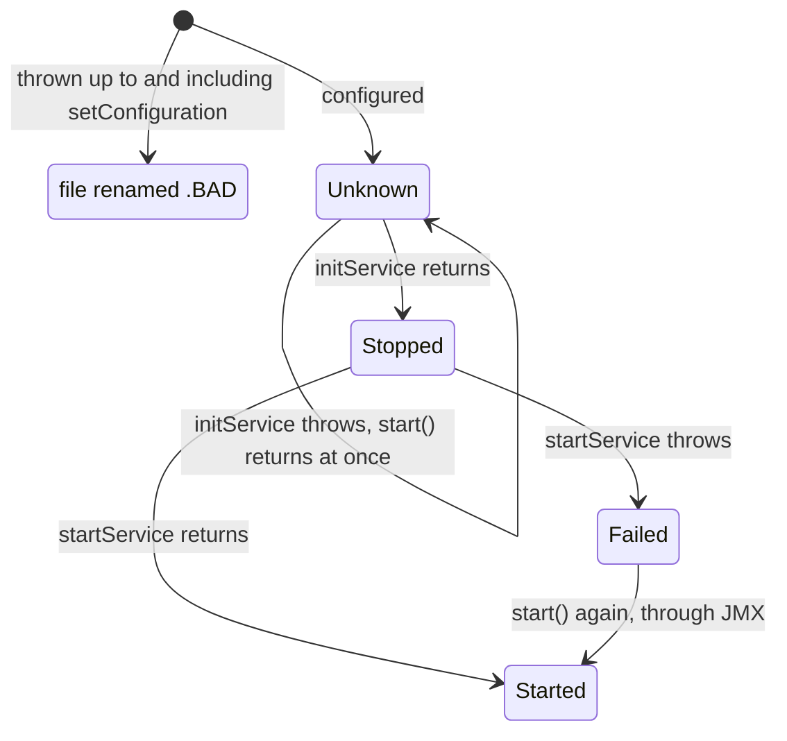

# 14. Q2 and QBeans in Depth

A release adds `CutoverService`, a QBean that closes the business day at the time its descriptor
names:

```xml
<cutover name="cutover" class="com.example.jpos.server.q2.CutoverService">
  <property name="time" value="${CUTOVER_TIME}"/>
</cutover>
```

On the new production machine nobody set `CUTOVER_TIME`. Q2 logs `deploy:` for the file, the
service starts, no warning appears, and the day closes at midnight instead of 23:00. An hour of
purchases that belong to the next business day goes into today's settlement, and reconciliation is
off on two days.

As far as Q2 could tell, nothing was wrong. What follows is what Q2 checks when it deploys a QBean,
what it leaves to you, and where your own checks go so that a mistake shows up at deploy time and
not at 23:00. The deploy order and the sources of `${name}` values are in unit c1.

## 14.1 A Deploy Directory You Can Inspect

Every example in this unit runs Q2 in the same JVM, on a scratch deploy directory, and asks two
questions about each descriptor after Q2's first pass: what is the file called now, and what state
is its QBean in? Q2 registers each QBean with the JVM's MBean server as
`Q2:type=qbean,service=<name>`, so the state is one JMX read away:

```java
package com.example.jpos.server.q2;

import org.jdom2.Element;
import org.jdom2.input.SAXBuilder;
import org.jpos.q2.Q2;

import javax.management.MBeanServer;
import javax.management.ObjectName;
import java.io.StringReader;
import java.nio.file.Files;
import java.nio.file.Path;
import java.util.LinkedHashMap;
import java.util.Map;

/** Q2 on a scratch deploy directory: write descriptors, run a pass, see what became of each. */
public final class DeployRun implements AutoCloseable {
    public final Path dir;
    private final Map<String, String> beans = new LinkedHashMap<>();    // file -> QBean name
    private Q2 q2;

    public DeployRun() throws Exception {
        dir = Files.createTempDirectory("deploy");
    }

    public DeployRun file(String file, String xml) throws Exception {
        Element root = new SAXBuilder().build(new StringReader(xml)).getRootElement();
        beans.put(file, root.getAttributeValue("name", root.getName()));
        Files.writeString(dir.resolve(file), xml);
        return this;
    }

    public DeployRun start() {
        q2 = new Q2(dir.toString());
        q2.start();
        if (!q2.ready(10_000))
            throw new IllegalStateException("Q2 did not finish its first pass");
        return this;
    }

    /** What the file is called now, and the state of the QBean it declares. */
    public String report(String file) throws Exception {
        String now = file;
        for (String suffix : new String[] { ".BAD", ".DUP", ".ENV" })
            if (Files.exists(dir.resolve(file + suffix)))
                now = file + suffix;
        MBeanServer jmx = q2.getMBeanServer();
        ObjectName bean = new ObjectName("Q2:type=qbean,service=" + beans.get(file));
        String state = jmx.isRegistered(bean) ? (String) jmx.getAttribute(bean, "StateAsString") : "-";
        return String.format("%-26s %s", now, state);
    }

    public Q2 q2() {
        return q2;
    }

    @Override
    public void close() {
        q2.shutdown(true);
    }
}
```

A file name with `.BAD` added means Q2 gave up on the file (`.DUP` and `.ENV` are in the
Reference). The state is what `QBeanSupport`
reports: `Started`, `Failed`, `Unknown` for a bean whose `init` never completed, or `-` when
nothing is registered under that name.

## 14.2 A Value Nobody Set Is Absent, and Absent Means the Default

The service closes the day `grace-seconds` (default 30) after its `time`. The first version gave
the time a default too:

```java
@Config("time")
private String time = "00:00";                // the default "for convenience"
```

`@Config` is jPOS 2.1.7's field injection: before Q2 calls `setConfiguration`, it sets every
annotated field whose property the descriptor has, and leaves the others as they were
initialised. We deployed this version four times, with these `time` properties:

- `a`: `value="23:00"`;
- `b`: `value="${CUTOVER_TIME}"`, with the variable not set;
- `c`: the same `23:00`, but under the name `cutover-time`;
- `d`: `value="${CUTOVER_TIME:23:00}"`, a default after the colon.

Which of them close the day at 23:00?

```text
60_cutover_a.xml           Started  closes at 23:00:30
61_cutover_b.xml           Started  closes at 00:00:30
62_cutover_c.xml           Started  closes at 00:00:30
63_cutover_d.xml           Started  closes at 23:00:30
```

All four started. In `b` the variable resolved to nothing and there was no default after the
colon, so the value counts as absent. In `c` the descriptor has no property called `time`. Q2
treats both the same way: the field keeps its initialiser. For a value that doesn't resolve, the
`Configuration` that `setConfiguration` receives returns the caller's default, and `get(name)`
returns `""`:

```text
get("time")          ''
get("time", "23:00") '23:00'
get("time", null)    null
getInt("count")      0
getInt("count", 5)   5
```

Q2 can't tell a value left out by mistake from one left out on purpose. A descriptor names only
what differs from the defaults, so absence has to be allowed. Only the code knows which values have
a safe default. Grace can default to 30 seconds, but no cutover time suits every network, so
`time` gets no default. Leave such a field `null` and refuse to run without it.
A misspelt name then fails at deploy too, not at 23:00.

## 14.3 A Configuration Refused in `setConfiguration` Renames the File; Refused Later, It Only Logs

The service, with no default for `time`:

```java
package com.example.jpos.server.q2;

import org.jpos.core.Configuration;
import org.jpos.core.ConfigurationException;
import org.jpos.core.annotation.Config;
import org.jpos.q2.QBeanSupport;
import org.jpos.util.NameRegistrar;

import java.time.LocalTime;
import java.time.format.DateTimeParseException;

/** Closes the business day at the time its descriptor names. */
public class CutoverService extends QBeanSupport {
    @Config("time")
    private String time;                          // (1) no initialiser: no safe default
    @Config("grace-seconds")
    private int graceSeconds = 30;                // optional: the initialiser is the default

    private LocalTime cutover;

    @Override
    public void setConfiguration(Configuration cfg) throws ConfigurationException {
        super.setConfiguration(cfg);              // (2) keeps cfg for QBeanSupport
        if (time == null)                         // (3) absent, misspelt or unresolved
            throw new ConfigurationException("property 'time' is required");
        try {
            cutover = LocalTime.parse(time);
        } catch (DateTimeParseException e) {
            throw new ConfigurationException("property 'time' is not a time: " + time, e);
        }
    }

    @Override
    protected void startService() {
        NameRegistrar.register(getName(), this);
    }

    @Override
    protected void stopService() {
        NameRegistrar.unregister(getName());
    }

    public LocalTime closesAt() {
        return cutover.plusSeconds(graceSeconds);
    }
}
```

The check could also go into `initService`, and a colleague's version puts it there:

```java
@Override
protected void initService() {
    if (time == null)
        throw new IllegalStateException("property 'time' is required");
    cutover = LocalTime.parse(time);
}
```

Four descriptors in one pass: `CutoverService` with `CUTOVER_TIME` unset, the colleague's
version with the same descriptor, `CutoverService` with `time` set to `23.00`, and a bean whose
`startService` throws while the system property `settlement.dir` is missing:

```text
60_cutover.xml.BAD         -
61_cutover_init.xml        Unknown
62_bad_time.xml.BAD        -
70_start.xml               Failed
```

Q2 builds and configures a QBean while it deploys the file. Anything thrown up to and including
`setConfiguration` makes Q2 unregister the bean and rename the file, with the reason in the
`deploy:` event:

```text
    Tidying /tmp/deploy5830396106261441433/60_cutover.xml out of the way, by adding .BAD
...
    deploy: /tmp/deploy5830396106261441433/60_cutover.xml
    <iso-exception>
      org.jpos.core.ConfigurationException: property 'time' is required
```

`init` and `start` are different. `QBeanSupport` catches what `initService` and `startService`
throw, logs a warning (unit s1) and records the outcome in the state. **`Unknown`** means `init`
never completed. `start()` returns at once in that state, so `startService` never runs. **`Failed`** means
`startService` threw, and `start()` may be called again. We then set `settlement.dir` and called
`start` on both beans through JMX:

```text
61_cutover_init.xml        Unknown
70_start.xml               Started
```



The colleague's version is also harder to notice and to fix. Its file keeps its name, so
`ls deploy/` and a monitor that looks for `.BAD` files show a clean directory. The bean can't be
started from JConsole either. Only the one warning in the log says that the day will never close,
and only a redeploy of the file brings it back.

So a configuration error is refused in `setConfiguration`, with a `ConfigurationException`.
`startService` is for what can only be checked at that moment, such as a resource that may be
down. A failure there leaves a bean that can be started again once the resource is back.

**(2)**: `QBeanSupport` keeps the configuration in its protected `cfg` field. An
override that doesn't call `super.setConfiguration` leaves `cfg` `null`, and the first `cfg.get`
in `startService` throws a `NullPointerException`.

Participants are different. The TransactionManager configures its participants inside its own
`init`, so a participant's `ConfigurationException` shows up as the TransactionManager's `init`
warning, as in unit s5, and `30_txnmgr.xml` keeps its name.

<!-- practice 1 -->

## 14.4 `<attr>` Is Set Through JMX, So Its Setter Belongs in the MBean Interface

On busy nights operations want to give terminals more grace before the cutover, without a
release. QServer reads its port from an `<attr>` element (unit s1), so they add one to
`60_cutover.xml`:

```xml
<cutover name="cutover" class="com.example.jpos.server.q2.CutoverService">
  <attr name="graceSeconds" type="int">60</attr>
  <property name="time" value="23:00"/>
</cutover>
```

```text
60_cutover.xml.BAD         -
```

```text
      javax.management.AttributeNotFoundException: No such attribute: GraceSeconds
```

`<attr>` isn't another way to write a `<property>`. Q2 capitalises the name and asks the MBean
server to set the attribute `GraceSeconds` on the registered bean. The MBean server knows only the
attributes of the bean's MBean interface. `CutoverService` has none of its own, so JMX sees what
`QBeanSupportMBean` declares, and that has no `GraceSeconds`. An unknown attribute fails the
deploy, and the file is renamed.

The interface is named after the class with `MBean` added, and it extends `QBeanSupportMBean`:

```java
package com.example.jpos.server.q2;

import org.jpos.q2.QBeanSupportMBean;

public interface CutoverServiceMBean extends QBeanSupportMBean {
    int getGraceSeconds();
    void setGraceSeconds(int seconds);
}
```

`CutoverService` declares `implements CutoverServiceMBean` and gets the getter and setter for its
`graceSeconds` field. Deployed with the descriptor above as `61_cutover_jmx.xml`, then changed through JMX, then
redeployed:

```text
61_cutover_jmx.xml         Started
deployed:            closes at 23:01
set through JMX:     closes at 23:10
after a redeploy:    closes at 23:01
```

Use `<attr>` for a value an operator changes on a running server, from JConsole or any
JMX client, with no redeploy. The change lives only in the object, so the next redeploy or restart
puts back the descriptor's value. Write the change into the descriptor as well. A value read only
at start needs no interface: use a `<property>`.

## 14.5 Nothing Is Started Until Everything Is Initialised, So a QBean Looks for What It Needs in `startService`

A settlement job writes the settlement file every night from the transaction database. It needs
`ds.txn`, the connection pool that unit s9's `DataSourceService` registers when it starts, from
`15_datasource.xml`. The first version finds the pool in `initService`:

```java
@Override
protected void initService() throws Exception {
    ds = NameRegistrar.get("ds.txn");          // throws NotFoundException if absent
}
```

In the runs below a small QBean stands in for `DataSourceService`: it registers a `DataSource`
under `ds.txn` in `startService`, with no database behind it.

The developer tested the job by copying `70_settlement.xml` into the `deploy/` directory of a
running server:

```text
== 70_settlement.xml dropped in while Q2 runs
15_datasource.xml          Started
70_settlement.xml          Started
```

After the Sunday restart:

```text
== restart, first pass took 667 ms
15_datasource.xml          Started
70_settlement.xml          Unknown
```

with one warning, `init` and `NotFoundException: ds.txn`. Can you see why only the restart broke
it?

Unit c1 showed the order of a pass: Q2 initialises every new file, then starts them. Copied in
later, the job got a pass of its own, and the pool had started in an earlier one. After the
restart both files are in the first pass. When the job's `init` runs, the pool has been initialised
but not started, and it registers `ds.txn` only in `startService`. A lower prefix doesn't help:
it orders the inits among themselves and the starts among themselves, and never puts a start
before an init. So Monday has no settlement file, and the job is `Unknown`, which JMX can't start
(14.3).

The job looks for the pool in `startService` instead:

```java
package com.example.jpos.server.q2;

import org.jpos.core.annotation.Config;
import org.jpos.q2.QBeanSupport;
import org.jpos.util.NameRegistrar;

import javax.sql.DataSource;
import java.sql.Connection;
import java.util.concurrent.ScheduledFuture;
import java.util.concurrent.TimeUnit;

/** Writes the settlement file every night from the transaction database. */
public class SettlementJob extends QBeanSupport {
    @Config("datasource")
    private String dataSource = "ds.txn";
    @Config("wait")
    private long wait = 2000L;                    // how long start waits for the pool
    @Config("interval")
    private long interval = 86_400_000L;

    private ScheduledFuture<?> task;

    @Override
    protected void startService() {
        if (NameRegistrar.get(dataSource, wait) == null)          // (1) null after `wait` ms
            throw new IllegalStateException("'" + dataSource + "' is not registered");
        task = getScheduledThreadPoolExecutor().scheduleAtFixedRate(
                this::settle, interval, interval, TimeUnit.MILLISECONDS);
    }

    @Override
    protected void stopService() {
        if (task != null)
            task.cancel(false);
    }

    void settle() {
        DataSource ds = NameRegistrar.getIfExists(dataSource);    // (2) looked up at each use
        if (ds == null) {
            getLog().warn("settlement skipped: '" + dataSource + "' is not registered");
            return;
        }
        try (Connection c = ds.getConnection()) {
            getLog().info("settlement written");                  // the file itself is left out
        } catch (Exception e) {
            getLog().warn("settlement failed", e);
        }
    }
}
```

```xml
<settlement name="settlement" class="com.example.jpos.server.q2.SettlementJob">
  <property name="wait" value="2000"/>
</settlement>
```

```text
== fixed, first pass took 665 ms
15_datasource.xml          Started
70_settlement.xml          Started
```

**(1)** waits up to two seconds for the pool, which helps less than it seems. Q2 calls the starts one after
another on its own thread, in file order. A pool with a lower prefix has finished its start before
the job's begins, so the wait returns at once. Renamed to `80_datasource.xml`, the pool sorts after
the job:

```text
== pool-last, first pass took 2774 ms
70_settlement.xml          Failed
80_datasource.xml          Started
```

The job waited its two seconds on Q2's thread, and the pool's start could only begin after that. So
the job failed, and every file after it started two seconds late. The wait only helps with a
provider that becomes ready on a thread of its own, such as a pool that connects in the background,
and every later start waits with it, so keep it short. A missing
provider leaves the job `Failed`, which the log and JMX show, and once the pool is up the job can be
started again (14.3).

**(2)** is unit c1's rule: look a component up each time you use it, because a redeployed pool is a
new object.

> **In jPOS 3.** An `eager-start="true"` attribute starts a QBean right after its own `init`, for a
> provider that another bean needs during its `init` (jpos.org blog, October 2024). 2.1.7 does not
> have it.

<!-- practice 2 -->

## 14.6 Q2 Deploys Whatever It Finds in `deploy/`, Even Half a File

A switch creates one channel descriptor per row of its configuration table and writes each into
the `deploy/` directory of the running server. Q2 watches the directory (unit c1), and a new file
starts a pass right away. We tried it with the cutover descriptor: we wrote the first 60
characters of `60_cutover.xml`, flushed them, and wrote the rest a moment later:

```text
    created deploy4168846111856591656/60_cutover.xml
...
    Tidying /tmp/deploy4168846111856591656/60_cutover.xml out of the way, by adding .BAD
...
Caused by: org.xml.sax.SAXParseException; systemId: file:/tmp/deploy4168846111856591656/60_cutover.xml; lineNumber: 1; columnNumber: 61; XML document structures must start and end within the same entity.
...
files: [60_cutover.xml.BAD]
60_cutover.xml.BAD: <cutover name='cutover' class='com.example.jpos.server.q2.CutoverService'><property name='time' value='23:00'/></cutover>
```

Q2 parsed the file as soon as it appeared, failed at character 61, and renamed it. The writer
then finished its work in the renamed file. So the `.BAD` file holds a complete, valid descriptor,
and whoever opens it to find the error finds none. A large descriptor copied with `cp`, or written
by a slow script, can be read half-written in the same way.

Write the file in a directory outside `deploy/` on the same file system, and move it in. Within
one file system a move is a rename, so Q2 sees either no file or the whole one. With
`ATOMIC_MOVE`, a move that would have to copy across file systems throws
`AtomicMoveNotSupportedException` instead:

```java
Files.writeString(tmp, CUTOVER);
Files.move(tmp, deploy.resolve("60_cutover.xml"), StandardCopyOption.ATOMIC_MOVE);
```

```text
files: [60_cutover.xml], cutover registered: true
```

Q2 has a method for writing a descriptor, `deployElement(element, fileName, encrypt, isTransient)`.
It writes the JDOM element in place with a `FileWriter`, so it has the same exposure once Q2 is
watching: call it before `q2.start()`, or write and move the file yourself. With `isTransient`
true, it adds the running Q2's instance id to the root element and deletes the file when the JVM
exits. If the JVM dies before it can, the next Q2 finds an id that isn't its own and deletes the
file instead of deploying it, so a crash can't leave yesterday's channels behind for the next
start. Here a transient descriptor, then a file left behind by another instance:

```text
<cutover name="cutover" class="com.example.jpos.server.q2.CutoverService" instance="d5f58eda-44ae-413b-a77b-b948f75d2781">
  <property name="time" value="23:00" />
</cutover>
this Q2: d5f58eda-44ae-413b-a77b-b948f75d2781
...
    Deleted transient descriptor /tmp/deploy16349860212314038177/61_leftover.xml (55dea394-b533-46e8-9f2c-fe41f55fe4d1)
```

<!-- practice 3 -->

## 14.7 Summary

- **A value nobody set is absent, and absent means the default.** A missing property, a misspelt
  name and an unresolved `${...}` all leave a `@Config` field at its initialiser and make `get`
  return `""`. A value with no safe default gets no default, and the code refuses its absence.
- **Refuse a configuration in `setConfiguration`.** Q2 then renames the file `.BAD`. Refused in
  `initService`, the bean stays `Unknown`, can't be started, and only one warning shows it. A
  `Failed` start can be retried.
- **`<attr>` is set through JMX.** Its setter belongs in the bean's MBean interface, or the file is
  `.BAD`. A value changed over JMX lasts until the next redeploy.
- **A QBean looks for what it needs in `startService`.** Within one pass every `init` comes before
  every `start`. The file order decides which start comes first, and a wait holds up every later
  start.
- **Q2 deploys whatever it finds.** Write a descriptor elsewhere and move it into `deploy/`.
  Transient descriptors carry the instance id and don't survive their run.

## 14.8 Reference

**What Q2 does with each new descriptor in 2.1.7, in order**, and what a failure does:

| Step | A failure |
|---|---|
| parse the XML | `.BAD` |
| an `instance` attribute that isn't this Q2's id | the file is deleted |
| `enabled` resolves to something other than `true`, `yes` or a value containing the environment name | skipped, `deploy ignored` in the log |
| load the `class` (or the short name's class from `QFactory.properties`, such as `qserver` or `txnmgr`) and register the MBean | `.BAD`; a name already registered is `.DUP` |
| `<attr>` children, through the MBean server | `.BAD` |
| `@Config` fields, then `setConfiguration(Configuration)`, then `setConfiguration(Element)` for an `XmlConfigurable` | `.BAD` (a `java.lang.Error` from `@Config` or `setConfiguration`: `.ENV`) |
| `init()` | a warning; the bean stays `Unknown` |
| after every file of the pass: `start()`, in file order | a warning; the bean is `Failed` |

**`QBeanSupport` states:**

| Call | Runs only when the state is | On success | When the `*Service` method throws |
|---|---|---|---|
| `init()` | `Unknown` (never initialised) | `Stopped` | stays `Unknown` |
| `start()` | `Stopped`, `Failed` or `Destroyed` | `Started` | `Failed` |
| `stop()` | `Started` | `Stopped` | `Failed` |
| `destroy()` | anything but `Destroyed` | `Destroyed` | `Destroyed` |

`running()` is true in `Starting` and `Started`; a loop in your own thread tests it (unit c11).

**`@Config` in 2.1.7:** fills `String`, `int`/`Integer`, `long`/`Long` and `boolean`/`Boolean`
fields, in the class and its superclasses, private ones included. A field of another type, a
`double` for instance, is left alone without a word. A value that doesn't parse (`count="seven"`
for an `int`) fails the deploy with `NumberFormatException`, so the file is `.BAD`. The
TransactionManager configures participants the same way, so `@Config` works on them too.

**Booleans:** `true` and `yes`, in any case, are true; everything else is false.

**`${...}` forms:** `${name}` and `${name:default}` (the lookup order is in unit c1), `$env{name}`
the environment only, `$sys{name}` system properties only, `$cfg{name}` the environment file only,
`$verb{text}` the text as written. After a `${...}` resolves, a value starting `file::` is replaced
by that file's content (`file::/run/secrets/db-password`) and one starting `obf::` is
de-obfuscated. Obfuscation is not encryption. A literal `file::...` that isn't the result of a
`${...}` stays as it is.

**Repeated properties resolve once.** `getAll` writes the resolved values back into the stored
array, so the first call fixes them, and an entry that didn't resolve then is dropped for good.

**Other sources of configuration:**

| Element or attribute | Effect |
|---|---|
| `<property file="cfg/x.yml"/>` | loads a YAML file (nested keys become dotted names) or a properties file; a missing file is `.BAD` |
| `<property file="cfg/x.yml" env="true"/>` | also loads `cfg/x-<env>.yml` and `cfg/x-<env>.properties`, whose values win |
| `<config name="n" class="org.jpos.q2.qbean.QConfig">` | registers its properties as `config.n` in its `init` |
| `merge-configuration="n"` on any descriptor or participant | fills the names this descriptor doesn't set from `config.n`; local values win. A repeated property of `n` is not merged. A `config` deployed in a later file than the one that merges it is `.BAD` |
| `XmlConfigurable` | the bean receives the root `Element`, as the TransactionManager and QMUX do |

**Deploying from code and from jars:** `deployElement` (14.6); descriptors on the class path under
`META-INF/q2/deploy/` are deployed as transient services at start-up, so a jar can start services
you didn't write; a file containing `<shutdown/>` stops Q2.

## 14.9 Challenges

These have no single answer.

1. Write a check, run in your build, that deploys every descriptor of `deploy/` with an empty
   environment and fails when any QBean is not `Started`. Which beans can't pass it without a
   database or a host, and what do you do about them?
2. The settlement job needs the pool and the cutover service, and the cutover service needs the
   pool. Choose prefixes and waits, and say what happens on a restart when the pool's descriptor is
   `.BAD`.
3. An operator raised `graceSeconds` through JMX on one of two nodes. How do you find out that the
   two nodes now close the day at different times, and what would make that impossible?
4. Your switch generates 40 channel descriptors at start-up from a table. Compare transient
   descriptors written before `q2.start()` with descriptors kept in the repository. What does each
   cost when a row changes during the day?

## 14.10 Design Note: Why Does Q2 Keep Running When a QBean Fails?

A Spring application context that can't create one of its beans refuses to start at all. Q2 does
the opposite: it deploys every file it can, renames the ones it can't, and leaves a bean that fails
in `init` or `start` with a warning and a state.

Q2 is built for servers that change while they run. Files are added, touched and removed in
`deploy/` without a restart, and each change is a pass of its own. If a broken descriptor stopped
Q2, one bad file copied into a running switch would take every link down with it. So a failure
stays with its own file and its own bean, and the channels, servers and transaction managers
beside it keep working.

You pay for that with the checking. Q2 can't know that a missing `time` is fatal for one bean and
harmless for another, so only your code can make the difference visible, by refusing early
(14.3). A server that started can still have `.BAD` files and beans that are not `Started`; after
every deploy, look for both, as `DeployRun` does.
