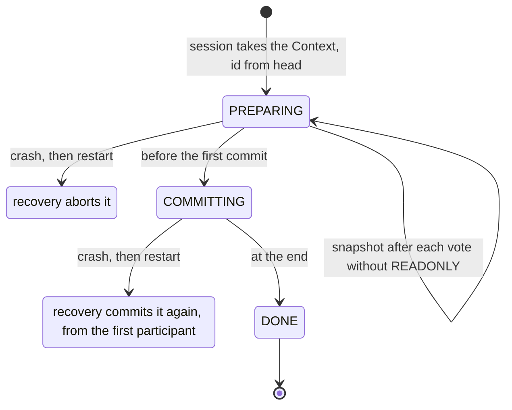

# 15. The TransactionManager in Depth

At 12:40, in the lunch peak, the server process is killed and restarts forty seconds later. A week
on, two prepaid cardholders call. One has had 50.00 on hold since that day for a purchase whose
terminal never got an answer. The other was approved, and the prepaid ledger was told twice to
capture the same hold.

Both purchases were in the middle of a transaction when the process died. What the
TransactionManager does with them at the next start, and with votes, retries, pauses and `Join`
while it runs, comes down to six rules, one per heading from 15.2 to 15.7.

## 15.1 A Server You Can Kill

The examples run as in unit s4: a real Q2 in the same JVM and `DirectTerminal` in front of it. Two
pieces are new. The prepaid ledger stands outside the server, so here it is a file,
`data/ledger.log`, that outlives the process (`FileLedger`, in the Reference). The other is `Crash`, a participant
that kills the process at a chosen point:

```java
package com.example.jpos.server.testing;

import org.jpos.core.Configurable;
import org.jpos.core.Configuration;
import org.jpos.transaction.TransactionParticipant;

import java.io.File;
import java.io.IOException;
import java.io.Serializable;

/** Kills the JVM, as kill -9 or a power cut would, in prepare or in commit; only on the first run. */
public class Crash implements TransactionParticipant, Configurable {
    private String in;

    @Override
    public void setConfiguration(Configuration cfg) {
        in = cfg.get("in", "prepare");
    }

    @Override
    public int prepare(long id, Serializable context) {
        if (in.equals("prepare"))
            halt(id, "prepare");
        return PREPARED | READONLY;                   // joins, so that commit reaches it
    }

    @Override
    public void commit(long id, Serializable context) {
        if (in.equals("commit"))
            halt(id, "commit");
    }

    private static void halt(long id, String where) {
        File once = new File("data/crashed");         // the restarted server must not die again
        try {
            if (!once.createNewFile())
                return;
        } catch (IOException e) {
            throw new IllegalStateException(e);
        }
        System.out.println("*** process dies in " + where + " of transaction " + id);
        Runtime.getRuntime().halt(137);               // no shutdown hooks, no finally blocks
    }
}
```

The participant under test holds the amount on the ledger in `prepare`, captures the hold on
commit and releases it on abort:

```java
package com.example.jpos.server.participant;

import com.example.jpos.server.ledger.Ledger;
import org.jpos.core.Configurable;
import org.jpos.core.Configuration;
import org.jpos.iso.ISOMsg;
import org.jpos.transaction.Context;
import org.jpos.transaction.ContextRecovery;
import org.jpos.transaction.TransactionParticipant;
import org.jpos.util.NameRegistrar;

import java.io.Serializable;

import static org.jpos.transaction.ContextConstants.REQUEST;
import static org.jpos.transaction.ContextConstants.RESPONSE;

/** Holds the amount on the prepaid ledger in prepare; captures the hold on commit, releases it on abort. */
public class ReserveFunds implements TransactionParticipant, ContextRecovery, Configurable {
    public static final String HOLD_ID = "HOLD_ID";
    private String ledgerName;

    @Override
    public void setConfiguration(Configuration cfg) {
        ledgerName = cfg.get("ledger", "ledger");
    }

    @Override
    public int prepare(long id, Serializable context) {
        Context ctx = (Context) context;
        ISOMsg request = ctx.get(REQUEST.toString());
        try {
            Ledger ledger = NameRegistrar.get(ledgerName);
            String holdId = ledger.hold(request.getString(102), Long.parseLong(request.getString(4)));
            ctx.put(HOLD_ID, holdId, true);           // (1) persisted: the journal keeps it
            return PREPARED;                          // (2) joins, and no READONLY: the Context changed
        } catch (Exception e) {
            ctx.log("hold failed: " + e);
            try {
                ctx.put(RESPONSE.toString(), Responses.reply(request, "96"));
            } catch (Exception ignored) {
                // no request to answer
            }
            return ABORTED | NO_JOIN;
        }
    }

    @Override
    public void commit(long id, Serializable context) {
        finish((Context) context, true);
    }

    @Override
    public void abort(long id, Serializable context) {
        finish((Context) context, false);
    }

    @Override
    public Serializable recover(long id, Serializable context, boolean commit) {
        return context;                               // what commit or abort will receive
    }

    private void finish(Context ctx, boolean capture) {
        String holdId = ctx.getString(HOLD_ID);       // (3) never REQUEST: after a crash it is gone
        if (holdId == null)
            return;                                   // (4) this transaction holds nothing here
        try {
            Ledger ledger = NameRegistrar.get(ledgerName);
            if (capture)
                ledger.capture(holdId);
            else
                ledger.release(holdId);
        } catch (Exception e) {
            ctx.log((capture ? "capture" : "release") + " failed for " + holdId + ": " + e);
        }
    }
}
```

`Authorize` and `SendResponse` are unit s4's. Classes named `demo.*` below are throwaway stand-ins
for one run. Each experiment runs twice on the same directory. Run 1 sends a purchase of 50.00 for account
`ACC-0042` (field 102) and dies where `Crash` says. Run 2 starts Q2 again and lists the holds that
were neither captured nor released.

## 15.2 Without a Persistent Space, a Crash Forgets What Was in Flight

`Crash` sits last in the chain, so every participant before it has voted `PREPARED` when the
process dies:

```xml
<txnmgr name="txnmgr" class="org.jpos.transaction.TransactionManager" logger="Q2" realm="txnmgr">
  <property name="queue" value="txnmgr"/>
  <property name="debug-context" value="false"/>
  <participant class="com.example.jpos.server.participant.ReserveFunds" logger="Q2"/>
  <participant class="com.example.jpos.server.participant.Authorize" logger="Q2">
    <property name="available" value="100000"/>
  </participant>
  <participant class="org.jpos.transaction.participant.SendResponse" logger="Q2"/>
  <participant class="com.example.jpos.server.testing.Crash" logger="Q2">
    <property name="in" value="prepare"/>
  </participant>
</txnmgr>
```

```text
run 1:  ledger: hold H-0001 5000 on ACC-0042
        *** process dies in prepare of transaction 1
run 2:  open holds after restart: [H-0001]
```

The hold stays open, and nothing will release it: the hold id existed only in the dead process.
The terminal got no answer and reverses the purchase (unit c12), but the reversal can't find a hold
the server no longer knows about.

The TransactionManager's `recover` property is `true` by default, but recovery reads a journal,
and this one was in memory.

A session keeps the journal as it works. It takes a Context from the queue and gives it the next id
(`head`). Before the first `prepare` it stores the id's state, `PREPARING`, and a snapshot of the
Context. After each participant that didn't vote `READONLY` it stores the snapshot again. Before
the first `commit` the state becomes `COMMITTING`, and at the end `DONE`; `tail`, the oldest
unfinished id, moves past it once every older id is done. The journal lives in the
`persistent-space`, by default an in-memory `TSpace` that dies with the process.

A space on disk keeps the journal. `je:<name>:<directory>` is jPOS's Berkeley DB space (the `je`
jar comes with jPOS 2.1.7). It takes one line in the descriptor:

```xml
<property name="persistent-space" value="je:txnmgr-journal:data/journal"/>
```

```text
run 1:  ledger: hold H-0001 5000 on ACC-0042
        *** process dies in prepare of transaction 1
run 2:      recover - tail=1, head=2
        ledger: release H-0001
        open holds after restart: []
```

```text
<log realm="txnmgr" at="2026-11-06T15:06:07.549558739" lifespan="32ms">
  <recover>
    <id>1</id>
    <context>
      HOLD_ID(P): H-0001
      RESULT: 
       <result/>
      
      LOGEVT: 
        <info>
          RESPONSE not present
        </info>
      
    </context>
      abort-recover: c.e.j.s.p.ReserveFunds
              abort: c.e.j.s.p.ReserveFunds
              abort: c.e.j.s.p.Authorize
              abort: o.j.t.p.SendResponse
              abort: c.e.j.s.t.Crash
    <profiler>
        abort: c.e.j.s.p.ReserveFunds [7.1/7.1]
        abort: c.e.j.s.p.Authorize [0.7/7.8]
        abort: o.j.t.p.SendResponse [1.9/9.8]
        abort: c.e.j.s.t.Crash [0.1/10.0]
      end [25.0/35.1]
    </profiler>
  </recover>
</log>
```

The Context in the journal holds one entry, `HOLD_ID`, marked `(P)`: the entry (1) put with
`persist` true. The journal serializes a Context, and a Context serializes only its persistent
entries, so `REQUEST`, `SOURCE` and everything put the ordinary way are gone. `RESULT` and `LOGEVT`
were added during recovery, by `SendResponse`, which found nothing to send.

The event dumps the Context although `debug-context` is false, so never persist card data. And the
snapshot is the only copy recovery gets, which is why (2) leaves out `READONLY`: a participant that
changes the Context and votes `READONLY` leaves an older snapshot behind.

Give each TransactionManager a journal of its own: `$HEAD`, `$TAIL` and `$RETRY_QUEUE` are not
prefixed with the TransactionManager's name, so two sharing one space would share the counters and
each other's retries. A disk write per
snapshot costs time on every transaction, so a persistent journal is for flows that leave something
outside the server to finish, like this hold.

## 15.3 Recovery Aborts What Was Preparing and Commits Again What Was Committing

The second cardholder's purchase got further. `Crash` now dies in `commit`; it is declared after
`SendResponse`, so the approval has left:

```text
run 1:  ledger: hold H-0001 5000 on ACC-0042
        ledger: capture H-0001
        purchase: 0210 39=00
        *** process dies in commit of transaction 1
run 2:      recover - tail=1, head=2
        ledger: capture H-0001
```

```text
     commit-recover: c.e.j.s.p.ReserveFunds
             commit: c.e.j.s.p.ReserveFunds
             commit: c.e.j.s.p.Authorize
             commit: o.j.t.p.SendResponse
             commit: c.e.j.s.t.Crash
```

At start-up the TransactionManager walks every id from `tail` to `head`. A transaction left in
`PREPARING` never had its outcome decided, so it is aborted, even though every vote so far was
yes. One left in `COMMITTING` had been decided, so it is committed again, from the first
participant. The journal records the state, not which commits already ran, so `ReserveFunds`
captured H-0001 a second time.



A ledger that books each capture charges this cardholder 100.00 for a 50.00 purchase. `commit`
can't prevent it: the journal takes no snapshot during commit, so nothing a commit writes into the
Context survives the crash. The call itself has to be safe to repeat. Here the hold id is the
natural key: a ledger that captures a hold only once, and answers a second capture of H-0001 with
"already captured", makes the replay harmless. Where the remote side can't do that, keep your own
record of finished calls, keyed the same way.

In the trail, `Authorize`, `SendResponse` and `Crash` all got `commit`, though `Authorize` voted
`NO_JOIN`. Recovery doesn't know who joined, so it calls every participant of the
chain, plus the groups the transaction selected (unit s5). That is why `finish` returns at (4) when
there is no hold id: a recovered transaction may never have reached this participant, or reached it
and held nothing.

Before calling `commit` or `abort`, recovery calls `recover(id, context, commit)` on each
participant that implements `ContextRecovery`, and passes on the Context it returns.

Recovery answers nobody: the terminal's connection died with the old process. A terminal whose
purchase was still preparing gets no answer and reverses, as in 15.2.

The journal reads each key back as a `String`. In a variant of the chain, a participant persisted
an entry under the enum constant, `ctx.put(TXNNAME, "purchase", true)`. A snapshot first removes
the previous one by taking it out of the space, which reads it back. So when a later participant
voted without `READONLY`, its snapshot failed, and the transaction ended as `<undefined>` with a
`ClassCastException`, no answer and the hold still open. When the crash came before any later
snapshot, recovery hit the same exception at every restart:

```text
    recover - tail=1, head=2
  <warn>
    start
    <exception name="java.lang.ClassCastException: class org.jpos.transaction.ContextConstants cannot be cast to class java.lang.String (org.jpos.transaction.ContextConstants is in unnamed module of loader 'app'; java.lang.String is in module java.base of loader 'bootstrap')">
txnmgr registered: false
```

The TransactionManager didn't start, so the server answered no request at all until someone deleted
the journal. Persist under string keys only (unit s4).

<!-- practice 1 -->

## 15.4 A Vote Is Read Bit by Bit, and Only `PREPARED` Says Yes

A fraud check (`demo.PauseOnly`) starts an asynchronous call, asks to wait for it, and has nothing to commit, so it
returns `PAUSE | NO_JOIN`. The call succeeds 50 ms later and the callback resumes the Context. After
it come `Authorize` and `SendResponse`:

```text
            prepare: d.PauseOnly ABORTED PAUSE NO_JOIN
    prepareForAbort: o.j.t.p.SendResponse
              abort: o.j.t.p.SendResponse
purchase: no answer after 3000 ms
```

Nothing failed, and the transaction aborted. The TransactionManager reads the vote one bit at a
time. `PREPARED` is the value 1, the lowest bit, and a vote without it is an abort, whatever else it carries. The
`PAUSE` bit parked the transaction, and when it resumed it went on along the abort path: `Authorize`,
a plain participant, was skipped, nothing put a response in the Context, and the terminal got
nothing. Every terminal that sent a purchase through this check reverses it.

`NO_JOIN` and `READONLY` never change the outcome; they only remove a call and a snapshot.
`RETRY` asks for a second attempt only together with an abort; next to `PREPARED` it is ignored,
except inside `Join` (see the Reference).
So a participant that pauses returns `PREPARED | PAUSE` and lets a later participant decide, as
`QueryIssuer` does in unit s4.

## 15.5 `RETRY` Starts Over Under a New Id, and Nobody Hears How the First Attempt Ended

`RETRY` is for a short, local obstacle, such as a row another transaction has locked for a moment.
The chain is `ReserveFunds`, then a step that answers `RETRY` on the first attempt and
`PREPARED | NO_JOIN` on the second (`demo.Busy`, which counts attempts in the Context), then
`Authorize` and `SendResponse`. One purchase of 25.00:

```text
ledger: hold H-0001 2500 on ACC-0042
Busy: transaction 1, attempt 1
ledger: hold H-0002 2500 on ACC-0042
Busy: transaction 2, attempt 2
ledger: capture H-0002
purchase: 0210 39=00 after 20 ms
open holds: [H-0001]
```

`RETRY` counts as an abort vote, but nobody gets `abort` (unit s4), and no event is logged for
transaction 1. The TransactionManager puts the same Context on a retry queue. A task that sweeps the
queue every `retry-interval` milliseconds (default 5000) moves it back to the input queue, so the
second attempt can start at once or up to that long later. It starts as a new transaction, with a
new id, from the first participant.

`ReserveFunds` joined attempt 1 and was never told how it ended, so H-0001 stays open, and attempt 2
holds the amount again. `HOLD_ID` now names H-0002, and nothing refers to H-0001 any more.

The retry queue lives in the persistent space. With the journal of 15.2 on disk, the same
purchase:

```text
ledger: hold H-0001 2500 on ACC-0042
Busy: transaction 1, attempt 1
            prepare: c.e.j.s.p.ReserveFunds ABORTED NO_JOIN
    prepareForAbort: o.j.t.p.SendResponse
purchase: no answer after 5000 ms
open holds: [H-0001]
```

The Context came back through the disk, with its persistent entries only. Transaction 2 had no
`REQUEST`, so `ReserveFunds` failed, and no `SOURCE`, so nothing could be sent. The same happens to
requests that `max-active-sessions` (unit s9) turns away, because its "emergency retry" uses the
same queue. One session, a cap of one, a first purchase paused for 500 ms and a second one 50 ms
behind it:

```text
    txnmgr-0:idle: emergency retry, running-sessions=1, max-active-sessions=1
29110004: 0210 39=00 after 500 ms
29110005: no answer after 4000 ms
```

With the in-memory journal both were answered, the second after 1500 ms, at the next sweep of the
retry queue (`retry-interval` was 1000 in these runs).

So return `RETRY` only from a participant placed before anything that changes the world outside the
Context, and don't combine `RETRY` or `max-active-sessions` with a persistent journal. Where
`RETRY` doesn't fit, answer the request (a `91`, say) and let the terminal try again.

## 15.6 A Paused Transaction Resumes Once, and an Extra `resume()` Is Kept for the Next Pause

### 15.6.1 Spot the Problem: Resuming on Every Outcome

A purchase pauses twice: `ScoreRisk` waits for a risk score (50 ms), then `AskIssuer` waits for the
issuer (300 ms), and `Decide` answers with the issuer's code, or `91` when there is none. Unit s4
said every callback must resume, so a developer made sure of it:

```java
Services.score(request.getString(41))
    .thenAccept(score -> {
        ctx.put("RISK_SCORE", score);
        ctx.resume();                         // (1)
    })
    .whenComplete((nothing, error) -> ctx.resume());   // (2) "resume on every outcome"
return PREPARED | PAUSE | NO_JOIN;
```

The profiler of the purchase, first with a single `whenComplete` that stores the score and resumes,
then with the code above:

```text
      prepare: d.ScoreRisk [9.3/9.3]
      resume [49.0/58.3]
      prepare: d.AskIssuer [2.1/60.5]
      resume-1 [298.6/359.1]
      prepare: d.Decide [0.7/359.8]
purchase: 0210 39=00 after 360 ms
```

```text
      prepare: d.ScoreRisk [6.0/6.0]
      resume [49.8/55.8]
      prepare: d.AskIssuer [1.3/57.1]
      resume-1 [0.0/57.2]
      prepare: d.Decide [0.3/57.6]
purchase: 0210 39=91 after 60 ms
issuer answers 00 for 000733
```

On a success, (1) and (2) both run. The second pause ended after 0.0 ms, `Decide` found no answer
from the issuer, and the terminal was told `91`. A quarter of a second later the issuer approved
the purchase. Nothing reverses it: `Decide` answered `91` and asked the issuer to undo nothing, so
the cardholder is declined at the till and charged by the issuer.

A `resume()` on a transaction that is already resumed is not lost. It sets a flag in the
Context, and the next time the transaction pauses it resumes at once. The flag exists for the
opposite race: a callback that runs before the TransactionManager has finished parking the
transaction would otherwise resume nothing, and the transaction would wait for ever.

Resume exactly once per pause, on whichever outcome comes first: answer, failure or your own
timeout. Guard the resume with something that belongs to this transaction, such as an `AtomicBoolean` created
in `prepare`, never a field of the participant (unit s1). The TransactionManager's `pause-timeout`
resumes too, so a callback that arrives after it has resumed the transaction is an extra resume as
well.

> **In jPOS 3** `PAUSE` is deprecated: sessions run on virtual threads, and a participant can block
> while it waits (unit s13).

<!-- practice 2 -->

## 15.7 `Join` Tells Every Nested Participant the Outcome, Joined or Not

`org.jpos.transaction.participant.Join` runs the participants nested in it in parallel. Here a card
check and a points hold go together (`demo.Nested` prints each call it gets):

```xml
<participant class="org.jpos.transaction.participant.Join" logger="Q2">
  <participant class="demo.Nested" logger="Q2">
    <property name="name" value="CheckCard"/>
    <property name="joins" value="false"/>
  </participant>
  <participant class="demo.Nested" logger="Q2">
    <property name="name" value="HoldPoints"/>
    <property name="joins" value="true"/>
  </participant>
</participant>
```

`CheckCard` has nothing to undo and votes `PREPARED | NO_JOIN | READONLY`. `HoldPoints` holds points
and votes `PREPARED`. Which of them gets `commit`?

```text
HoldPoints: prepare, votes PREPARED, getContext() null
CheckCard: prepare, votes PREPARED | NO_JOIN | READONLY, getContext() null
CheckCard: commit on thread commitorg.jpos.transaction.participant.Join$Runner:demo.Nested
HoldPoints: commit on thread commitorg.jpos.transaction.participant.Join$Runner:demo.Nested
```

```text
            prepare: o.j.t.p.Join PREPARED
            prepare: c.e.j.s.p.Authorize PREPARED NO_JOIN
            prepare: o.j.t.p.SendResponse PREPARED READONLY
             commit: o.j.t.p.Join
             commit: o.j.t.p.SendResponse
```

Both did. `Join` merges the nested votes into one: it joins if any nested participant joined, and
it stays `READONLY` only if all of them were. On `commit` or `abort` it starts a fresh runner for
every nested participant, and a fresh runner remembers no vote, so each one is called. A nested
participant must check its own entries in `commit` and `abort`, as recovery already requires.

Every call runs on a new thread per nested
participant, so `TransactionManager.getContext()` is `null` there (unit s13). `Join` waits for all
of them, with no timeout, so a nested call that hangs holds the session. The trail names only
`Join`. The nested participants share one Context, whose map is synchronized; the objects in it
are not, so two nested participants must not change the same `ISOMsg`.

<!-- practice 3 -->

## 15.8 Summary

- **Without a persistent space, a crash forgets what was in flight.** The journal is in memory by
  default; name a `persistent-space` on disk for flows that leave work outside the server.
- **Recovery aborts what was preparing and commits again what was committing,** on every
  participant of the chain, with only the persisted entries of the last snapshot. A commit may run
  twice, so the outside call must be safe to repeat; persisted keys must be strings.
- **Only `PREPARED` says yes.** `PAUSE` or `RETRY` without it is an abort, and a paused transaction
  without it resumes on the abort path.
- **`RETRY` starts over under a new id,** and nobody hears how the first attempt ended. Through a
  persistent journal the retried Context loses its request, as does an emergency retry.
- **A paused transaction resumes once.** An extra `resume()` is kept and ends the next pause at
  once.
- **`Join` tells every nested participant the outcome,** on threads of its own, with no timeout.

## 15.9 Reference

**The journal (2.1.7).** In the `persistent-space`: `$HEAD` (next id) and `$TAIL` (oldest
unfinished id), shared by name; per transaction, `<txnmgr>.$STATE.<id>`, `<txnmgr>.$CONTEXT.<id>`
and `<txnmgr>.$GROUPS.<id>` (the groups selected).

| When | Written |
|---|---|
| a session starts or resumes a transaction | state `PREPARING`, snapshot |
| after a participant without `READONLY` | snapshot |
| before the first `commit` (if anyone joined) | state `COMMITTING` |
| the end, also for `RETRY` | state `DONE`; entries removed; `tail` moves when the id was the tail |

**Recovery** (`recover`, default `true`, at start, before any session): for each id from `tail` to
`head`, `PREPARING` is aborted, `COMMITTING` committed, on every participant of the default group
and the selected groups. `ContextRecovery.recover(id, ctx, commit)` runs first and its result is
passed on. With `recover` false, `tail` jumps to `head`.

**How a vote is read:**

| You return | The TransactionManager reads |
|---|---|
| `PREPARED` | yes; joins; snapshot |
| `PREPARED \| NO_JOIN \| READONLY` | yes; no `commit`/`abort`; no snapshot |
| `PREPARED \| PAUSE` | yes; parks the transaction; after `resume()` the next participant is prepared |
| `PAUSE` (with or without `NO_JOIN`) | no; parks; after `resume()` it continues on the abort path |
| `ABORTED` | no; joins, so it gets `abort` |
| `RETRY` | no, and run again under a new id; nobody gets `commit` or `abort` |
| `PREPARED \| RETRY` | yes; `RETRY` is ignored |
| an exception from `prepare` | `ABORTED`: joins (unit s4) |

A chain longer than 1000 participants for one transaction (a selector that keeps selecting its own
group) is logged as `loop detected` and aborted.

**Properties used in this unit:**

| Property | Default | Meaning |
|---|---|---|
| `persistent-space` | an in-memory `TSpace` | where the journal and the retry queue live |
| `recover` | `true` | finish unfinished ids at start |
| `retry-interval` | 5000 | ms between sweeps of the retry queue |
| `retry-timeout` | 60000 | lease of a retried Context on the input queue |
| `max-active-sessions` | 0 (none) | transactions in flight, paused ones included; at the cap, a new one goes to the retry queue |
| `pause-timeout` | 0 (none) | resume a paused transaction after this many ms |
| `abort-on-pause-timeout` | `true` | resume it on the abort path |

**Context (2.1.7):** `put(k, v)` is transient; `put(k, v, true)` and `persist(k)` also store a
`Serializable` value in the persistent map; `evict(k)` removes it from that map only; `remove(k)`
from both. Keys starting with `.` or `*` are left out of the dump; they are stored and persisted
like any other. `ctx.get(k, 0)`
binds to the timed `get(Object, long)`, so it returns `null`, not `0`, for a missing key; write
`ctx.get(k, Integer.valueOf(0))`.

**`Join` (2.1.7):** one new thread per nested participant for each of `prepare`, `prepareForAbort`,
`commit` and `abort`, joined without a timeout. Merged vote: any `RETRY` gives `RETRY`; any abort
gives `ABORTED`; `NO_JOIN` and `READONLY` only when every nested participant returned them.
`commit` and `abort` reach every nested participant. An exception in a nested thread is not caught
by `Join` and counts as `ABORTED`.

**The other classes of the examples.** The ledger and its file-backed stand-in:

```java
package com.example.jpos.server.ledger;

/** The prepaid ledger, a service outside the server: it holds funds, then captures or releases the hold. */
public interface Ledger {
    String hold(String account, long amount) throws Exception;   // returns a hold id
    void capture(String holdId) throws Exception;
    void release(String holdId) throws Exception;
}
```

```java
package com.example.jpos.server.testing;

import com.example.jpos.server.ledger.Ledger;

import java.nio.file.Files;
import java.nio.file.Path;
import java.nio.file.StandardOpenOption;
import java.util.ArrayList;
import java.util.LinkedHashMap;
import java.util.List;
import java.util.Map;

/** Stands in for the remote ledger: every call is a line in data/ledger.log, so it outlives the server. */
public final class FileLedger implements Ledger {
    private final Path file;

    public FileLedger(Path file) throws Exception {
        this.file = file;
        Files.createDirectories(file.getParent());
        if (!Files.exists(file)) Files.createFile(file);
    }

    private synchronized void append(String line) throws Exception {
        Files.writeString(file, line + "\n", StandardOpenOption.APPEND);
        System.out.println("ledger: " + line);
    }

    @Override public synchronized String hold(String account, long amount) throws Exception {
        long n = Files.readAllLines(file).stream().filter(l -> l.startsWith("hold")).count() + 1;
        String id = String.format("H-%04d", n);
        append("hold " + id + " " + amount + " on " + account);
        return id;
    }
    @Override public void capture(String holdId) throws Exception { append("capture " + holdId); }
    @Override public void release(String holdId) throws Exception { append("release " + holdId); }

    /** Holds that were neither captured nor released. */
    public synchronized List<String> openHolds() throws Exception {
        List<String> open = new ArrayList<>();
        state().forEach((id, events) -> { if (events.size() == 1) open.add(id); });
        return open;
    }

    /** Each hold and what happened to it. */
    public synchronized Map<String, List<String>> state() throws Exception {
        Map<String, List<String>> m = new LinkedHashMap<>();
        for (String l : Files.readAllLines(file)) {
            String[] w = l.split(" ");
            if (w[0].equals("hold")) m.put(w[1], new ArrayList<>(List.of(w[2])));
            else m.get(w[1]).add(w[0]);
        }
        return m;
    }
}
```

`FileLedger` is registered as `ledger` before Q2 starts. `Authorize` is unit s4's, and so is the
reply helper:

```java
package com.example.jpos.server.participant;

import org.jpos.iso.ISOException;
import org.jpos.iso.ISOMsg;

public final class Responses {
    private Responses() { }

    /** A reply to {@code request} carrying response code {@code rc} in field 39. */
    public static ISOMsg reply(ISOMsg request, String rc) throws ISOException {
        ISOMsg r = (ISOMsg) request.clone();
        r.setResponseMTI();
        r.set(39, rc);
        r.unset(14, 35, 45, 52, 55, 64);   // expiry, tracks, PIN block, chip data, the request's MAC
        return r;
    }
}
```

## 15.10 Challenges

These have no single answer.

1. Your prepaid ledger can't make a capture idempotent. Design a record of finished captures that
   survives the crash of 15.3. Where does it live, and what happens when the process dies between
   the capture and the record?
2. Measure what the `je:` journal costs: transactions a second with and without it, for a chain of
   four participants of which one votes without `READONLY`. Which participants could vote
   `READONLY` that don't today?
3. A participant must wait for a host that is down for a minute at night. Compare `RETRY`, `PAUSE`
   with a timer, and answering `91` at once, for the cardholder, the session count and the
   journal.
4. Recovery calls `SendResponse` with a Context that has no `SOURCE`. Write a participant that
   tells operations about every recovered transaction it finds in `abort`, without card data.

## 15.11 Design Note: Why Journal the Context Instead of the Steps?

A TransactionManager could record each step as it finishes ("ReserveFunds held H-0001",
"ReserveFunds captured H-0001") and replay only what is missing after a crash. jPOS records less: a
state per transaction and a snapshot of the Context. Recovery then knows only whether the outcome
was decided, and calls everyone.

That keeps the TransactionManager ignorant of what participants do, as it is everywhere else (unit
s4's design note): it can't know whether a capture happened, because the capture happened in
someone else's system, and a step log written after the call would miss exactly the crash between
the call and the log line. Any design has that gap. jPOS hands it to the one place that can close
it, the participant and the system it calls, through persisted entries and repeatable calls.

The rules of 15.3 are the cost. Every `commit` and `abort` must work from persisted entries
alone, accept transactions it never saw, and be safe to run twice. A participant written for the
happy path, with the request at hand and one call per outcome, passes every test that doesn't kill
the process.
