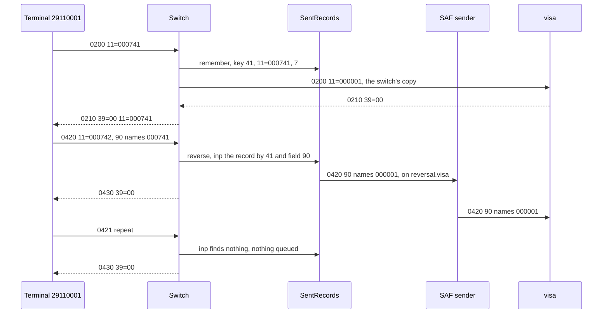

# 16. Building a Switch

An acquirer's switch takes purchases from its terminals and forwards each one to the card's network.
A purchase of 42.50 is approved, and the 0210 is lost on its way back to the terminal. The terminal
reverses, as unit c12 taught it: an 0420 whose field 90 names the purchase. The switch forwards the
reversal, the network answers `00`, and the terminal is done. A week later the cardholder calls
the bank, because the 42.50 is still held. The network never found the purchase the reversal named:
it had never seen the STAN the terminal gave it.

A switch is a server toward its sources and a client toward its destinations. Unit s5 forwarded
requests unchanged, and unit c12's gateway renumbered them for one link. The switch between them
follows four rules, one per section heading.

Every output comes from jPOS 2.1.7 in one JVM. Q2 deploys the switch, unit s4's `DirectTerminal`
plays the terminals, and two QMUXes, `visa` and `onus` (the bank's own issuer system), have a
scripted destination on their queues, like unit c12's test host. The destination holds every amount
it approves until a reversal names the purchase; its code is in the Reference. Unit c12's SAF sender
delivers the switch's queued reversals, and the switch's records (16.2) are registered as
`switch-records` before Q2 starts. Each run starts with empty spaces, and the `90=` columns show
the first 20 of field 90's 42 digits: the original's MTI, STAN and field 7.

## 16.1 The Destination Gets a Copy Numbered by the Switch, and Every Answer Starts From the Source's Request

The switch's TransactionManager:

```xml
<txnmgr name="txnmgr" class="org.jpos.transaction.TransactionManager" logger="Q2">
  <property name="queue" value="txnmgr"/>
  <property name="sessions" value="2"/>
  <property name="debug-context" value="false"/>

  <participant class="org.jpos.transaction.participant.SelectDestination" logger="Q2">
    <endpoint destination="visa">4</endpoint>
    <endpoint destination="onus">555555</endpoint>
  </participant>
  <participant class="com.example.jpos.server.participant.SelectByMti" logger="Q2"/>
  <participant class="com.example.jpos.server.participant.AnswerFailures" logger="Q2" realm="answer-failures"/>
  <participant class="org.jpos.transaction.participant.SendResponse" logger="Q2"/>

  <group name="purchase">
    <participant class="com.example.jpos.server.participant.PrepareOutbound" logger="Q2">
      <property name="space" value="tspace:switch"/>
      <property name="acquirer-id" value="12345678901"/>
      <property name="drop" value="48"/>
    </participant>
    <participant class="org.jpos.transaction.participant.QueryHost" logger="Q2">
      <property name="request" value="OUTBOUND"/>
      <property name="response" value="HOST_RESPONSE"/>
      <property name="timeout" value="2000"/>
    </participant>
    <participant class="com.example.jpos.server.participant.MapResponse" logger="Q2">
      <property name="visa.00" value="APPROVED"/>
      <property name="visa.05" value="DO_NOT_HONOUR"/>
      <property name="visa.51" value="NOT_SUFFICIENT_FUNDS"/>
      <property name="visa.54" value="EXPIRED"/>
      <property name="onus.0000" value="APPROVED"/>
      <property name="onus.1001" value="EXPIRED"/>
      <property name="onus.1016" value="NOT_SUFFICIENT_FUNDS"/>
    </participant>
  </group>
  <group name="reversal">
    <participant class="com.example.jpos.server.participant.ReverseUpstream" logger="Q2"/>
  </group>
</txnmgr>
```

`SelectDestination` (unit s5) picks `visa` or `onus` from the card number, and each QMUX is named
after its destination, so `QueryHost` finds it as `mux.visa`. `SelectByMti` and `AnswerFailures`
are unit s10's: reversals run the `reversal` group, and `AnswerFailures` has one more line in its
table, `DO_NOT_HONOUR` answered `05`. In the `purchase` group, `PrepareOutbound` builds the message
the destination receives, `QueryHost` sends it, and `MapResponse` (16.3) turns the answer into the
terminal's reply.

```java
package com.example.jpos.server.participant;

import com.example.jpos.client.reversal.StanSequencer;
import com.example.jpos.server.switching.SentRecords;
import org.jpos.core.Configurable;
import org.jpos.core.Configuration;
import org.jpos.core.ConfigurationException;
import org.jpos.iso.ISOMsg;
import org.jpos.rc.CMF;
import org.jpos.space.Space;
import org.jpos.space.SpaceFactory;
import org.jpos.transaction.Context;
import org.jpos.transaction.TransactionParticipant;
import org.jpos.util.Caller;
import org.jpos.util.NameRegistrar;

import java.io.Serializable;
import java.util.Arrays;

import static org.jpos.transaction.ContextConstants.DESTINATION;
import static org.jpos.transaction.ContextConstants.REQUEST;

/** Builds the message the destination receives. The source's request is never changed. */
public class PrepareOutbound implements TransactionParticipant, Configurable {
    public static final String OUTBOUND = "OUTBOUND";

    private Space<String, Object> space;
    private SentRecords records;
    private String acquirerId;
    private int[] drop;

    @Override
    public void setConfiguration(Configuration cfg) throws ConfigurationException {
        space = SpaceFactory.getSpace(cfg.get("space", "tspace:switch"));
        try {
            records = NameRegistrar.get(cfg.get("records", "switch-records"));
        } catch (NameRegistrar.NotFoundException e) {
            throw new ConfigurationException("no switch records registered", e);
        }
        acquirerId = cfg.get("acquirer-id");
        if (!acquirerId.matches("\\d{1,11}"))
            throw new ConfigurationException("acquirer-id must be 1 to 11 digits");
        drop = Arrays.stream(cfg.get("drop").split("[\\s,]+"))
                     .filter(s -> !s.isEmpty()).mapToInt(Integer::parseInt).toArray();
    }

    @Override
    public int prepare(long id, Serializable context) {
        Context ctx = (Context) context;
        ISOMsg request = ctx.get(REQUEST.toString());
        String destination = ctx.getString(DESTINATION.toString());
        try {
            ISOMsg out = (ISOMsg) request.clone();                     // (1) a copy: REQUEST stays as it came
            out.unset(drop);                                           //     fields only the source reads
            out.set(11, new StanSequencer(space, destination).next()); // (2) the switch numbers this link
            out.set(32, acquirerId);                                   //     and is the acquirer upstream
            records.remember(request, destination, out);               // (3) for a reversal, 16.2
            ctx.put(OUTBOUND, out);
            return PREPARED | NO_JOIN;
        } catch (Exception e) {
            return ctx.getResult().fail(CMF.SYSTEM_ERROR, Caller.info(), "%s", e).FAIL();
        }
    }
}
```

`QueryHost` sends whatever is under its `request` key. Why build a copy, when the switch could set
fields 11 and 32 on `REQUEST` and send that? Two purchases from terminal `29110001`, one approved and
one whose approval is lost on the way back, first with `REQUEST` renumbered in place, then with the
copy:

```text
renumbered in place:
  approved  sent 11=000731, got 0210 39=00 11=000001
  silent    sent 11=000732, got 0210 39=91 11=000002
copied under OUTBOUND:
  approved  sent 11=000733, got 0210 39=00 11=000733
  silent    sent 11=000734, got 0210 39=91 11=000734
  visa saw  0200 11=000001 32=12345678901 48=null
```

Renumbered in place, both answers carry the switch's STAN. Every participant that answers the
terminal starts from `REQUEST`, as unit s2 requires: `MapResponse` for the approval, `AnswerFailures`
for the `91`. The terminal's QMUX
matches neither (unit c12), waits out its timeout, and reverses a purchase the network approved.
Unit c12's gateway restored the terminal's STAN in its one answer; here several participants
answer, on both paths, and each would need that step.

**(1) A copy.** `clone()` keeps what the destination needs, track data included, and `drop` removes
what only the source reads, here field 48. A real switch also translates the PIN block (52) from the
terminal's key to the network's, in its security module (unit s7).

**(2) The switch numbers the link.** Upstream the switch is the sender, so the STAN comes from its own
sequence per destination (unit c12's `StanSequencer`, key `stan.visa`), whatever the terminals sent.
Field 32 names the switch as the acquirer. In production the space is persistent (`je:switch`), so
the sequence survives a restart.

<!-- practice 1 -->

## 16.2 A Source's Reversal Finds What the Destination Saw Only Through the Switch's Record

The terminal's purchase is approved, and the terminal reverses it anyway, as it
would if the 0210 had been lost, then repeats the reversal. With the reversal forwarded like any
request:

```text
forwarded like a purchase:
  0200 11=000741  0210 39=00 11=000741  visa holds 1
  0420 11=000742  0430 39=00 11=000742  visa holds 1
  0421 11=000742  0430 39=00 11=000742  visa holds 1
  visa saw 0200 11=000001
  visa saw 0420 11=000002 90=02000007411106121530
  visa saw 0421 11=000003 90=02000007411106121530
```

What does field 90 of the forwarded 0420 name? The terminal's purchase: MTI 0200, STAN 000741, sent
at 1106121530. Visa saw that purchase as STAN 000001, found nothing to undo, and answered `00`, which
is how a reversal of an unknown purchase is answered (unit s10). The 42.50 stays held.

Only the switch knows which upstream message carried the terminal's purchase, so it keeps a record
of each one, written before the message leaves:

```java
package com.example.jpos.server.switching;

import com.example.jpos.client.reversal.ReversalBuilder;
import com.example.jpos.client.reversal.StanSequencer;
import org.jpos.iso.ISOException;
import org.jpos.iso.ISOMsg;
import org.jpos.iso.ISOUtil;
import org.jpos.space.Space;

import java.io.Serializable;
import java.time.Clock;

/** What the switch sent upstream for each source request, kept until it is reversed or expires. */
public final class SentRecords {
    record Sent(String destination, ISOMsg message) implements Serializable { }

    private final Space<String, Object> space;          // persistent in production, e.g. "je:switch"
    private final long lease;                           // longer than the sources' reversal window
    private final Clock clock;

    public SentRecords(Space<String, Object> space, long lease, Clock clock) {
        this.space = space;
        this.lease = lease;
        this.clock = clock;
    }

    /** Before the request leaves: the source's identity, and what the destination will see. */
    public void remember(ISOMsg request, String destination, ISOMsg outbound) throws ISOException {
        ISOMsg kept = (ISOMsg) outbound.clone();
        kept.unset(35, 45, 52, 55);                     // no tracks, PIN block or chip data at rest
        space.put(key(request.getString(41), request.getString(11), request.getString(7)),
                  new Sent(destination, kept), lease);
    }

    /** Queues one reversal of what was sent for this source request. False: nothing to reverse. */
    public boolean reverse(String terminal, String stan, String transmitted) throws ISOException {
        Sent sent = (Sent) space.inp(key(terminal, stan, transmitted));    // (1) taken, not read
        if (sent == null)
            return false;
        ReversalBuilder builder =                       // (2) the link's own STAN sequence
            new ReversalBuilder(new StanSequencer(space, sent.destination()), "0420", clock);
        space.out("reversal." + sent.destination(), builder.reversalOf(sent.message()));
        return true;
    }

    static String key(String terminal, String stan, String transmitted) throws ISOException {
        return "sent." + terminal + "." + ISOUtil.zeropad(stan, 6) + "." + ISOUtil.zeropad(transmitted, 10);
    }
}
```

`PrepareOutbound`'s line (3) calls `remember` with the source's request and the copy. The `reversal`
group holds one participant, which finds the record by the terminal ID and by the STAN and time in
field 90:

```java
package com.example.jpos.server.participant;

import com.example.jpos.server.switching.SentRecords;
import org.jpos.core.Configurable;
import org.jpos.core.Configuration;
import org.jpos.core.ConfigurationException;
import org.jpos.iso.ISOException;
import org.jpos.iso.ISOMsg;
import org.jpos.transaction.Context;
import org.jpos.transaction.TransactionParticipant;
import org.jpos.util.NameRegistrar;

import java.io.Serializable;

import static org.jpos.transaction.ContextConstants.REQUEST;
import static org.jpos.transaction.ContextConstants.RESPONSE;

/** A source's reversal: queues one reversal of what the switch sent upstream, and answers 00. */
public class ReverseUpstream implements TransactionParticipant, Configurable {
    private static final int[] ECHOED = { 0, 2, 3, 4, 7, 11, 32, 37, 41, 42, 49, 90 };
    private SentRecords records;

    @Override
    public void setConfiguration(Configuration cfg) throws ConfigurationException {
        try {
            records = NameRegistrar.get(cfg.get("records", "switch-records"));
        } catch (NameRegistrar.NotFoundException e) {
            throw new ConfigurationException("no switch records registered", e);
        }
    }

    @Override
    public int prepare(long id, Serializable context) {
        Context ctx = (Context) context;
        ISOMsg reversal = ctx.get(REQUEST.toString());
        String original = reversal.getString(90);                  // the source's MTI, STAN, field 7
        try {
            if (original != null && original.length() >= 20)
                records.reverse(reversal.getString(41), original.substring(4, 10), original.substring(10, 20));
            ISOMsg response = (ISOMsg) reversal.clone(ECHOED);
            response.setResponseMTI();
            response.set(39, "00");                                // found or not (unit s10)
            ctx.put(RESPONSE.toString(), response);
        } catch (ISOException e) {
            ctx.log(e);
        }
        return PREPARED | NO_JOIN;
    }
}
```

The same three messages:

```text
through the switch's record:
  0200 11=000741  0210 39=00 11=000741  visa holds 1
  0420 11=000742  0430 39=00 11=000742  visa holds 0
  0421 11=000742  0430 39=00 11=000742  visa holds 0
  visa saw 0200 11=000001
  visa saw 0420 11=000002 90=02000000011106121530
```

The switch queued an 0420 naming STAN 000001; unit c12's SAF sender delivered it, and visa released
the amount.



**(1) Taken, not read.** `inp` removes the record, so the repeat finds nothing and queues nothing.
`inp` is atomic (unit s12), so two sessions can't both take the same record.

**(2) The link's own sequence.** The upstream reversal is a new message on the visa link (unit c12).
Its STAN comes from `stan.visa`, in the space `PrepareOutbound` numbers from.

The record is written before the request leaves, because the purchase that most needs it is the one
whose answer never came (16.4). It holds a PAN, so it is kept like the transaction database: no
track data, PIN block or chip data, and a lease a little longer than the time a source may take to
reverse.

<!-- practice 2 -->

## 16.3 A Destination's Code Becomes a Cause, and Each Source's Table Answers It

The terminals and visa speak ISO 8583:1987, with two-character response codes. `onus` was built on
jPOS's Common Message Format (CMF) and answers with four-digit action codes: `0000` approved, `1016`
not sufficient funds. Here the destination's field 39 goes into the reply as it is, and each answer
is packed with the terminal link's packager, as the server's channel would pack it:

```text
passed through:
  visa answers 00    terminal gets 0210 39=00 11=000751
  visa answers 51    terminal gets 0210 39=51 11=000752
  onus answers 0000  terminal gets nothing (Field length 4 too long. Max: 2)
  onus answers 1016  terminal gets nothing (Field length 4 too long. Max: 2)
```

`iso87ascii.xml` gives field 39 two characters, so no answer from onus can be sent, approvals
included. `SendResponse` catches the exception and notes it in the Context, which the log shows only
when `debug-context` is true. The terminal waits out its timeout and reverses.

Translating code to code needs a table for every pair: with three sources and four destinations,
twelve. The switch instead turns each destination's code into a cause, one of the `CMF` names that
unit s10's participants report, and one table per source turns the cause into that source's code.
That is seven tables, and a new destination adds one:

```java
package com.example.jpos.server.participant;

import com.example.jpos.server.switching.SentRecords;
import org.jpos.core.Configurable;
import org.jpos.core.Configuration;
import org.jpos.core.ConfigurationException;
import org.jpos.iso.ISOException;
import org.jpos.iso.ISOMsg;
import org.jpos.rc.CMF;
import org.jpos.rc.IRC;
import org.jpos.transaction.Context;
import org.jpos.transaction.TransactionParticipant;
import org.jpos.util.Caller;
import org.jpos.util.NameRegistrar;

import java.io.Serializable;

import static org.jpos.transaction.ContextConstants.DESTINATION;
import static org.jpos.transaction.ContextConstants.REQUEST;
import static org.jpos.transaction.ContextConstants.RESPONSE;

/** After QueryHost: an approval becomes the source's reply, a decline a cause, the rest a reversal. */
public class MapResponse implements TransactionParticipant, Configurable {
    public static final String HOST_RESPONSE = "HOST_RESPONSE";
    private static final int[] ECHOED = { 0, 2, 3, 4, 7, 11, 12, 13, 32, 37, 41, 42, 49 };

    private Configuration cfg;
    private SentRecords records;

    @Override
    public void setConfiguration(Configuration cfg) throws ConfigurationException {
        this.cfg = cfg;
        try {
            records = NameRegistrar.get(cfg.get("records", "switch-records"));
        } catch (NameRegistrar.NotFoundException e) {
            throw new ConfigurationException("no switch records registered", e);
        }
    }

    @Override
    public int prepare(long id, Serializable context) {
        Context ctx = (Context) context;
        ISOMsg request = ctx.get(REQUEST.toString());
        String destination = ctx.getString(DESTINATION.toString());
        ISOMsg answer = ctx.get(HOST_RESPONSE);
        try {
            if (answer == null)                                    // QueryHost reported HOST_UNREACHABLE
                return unknownOutcome(request);
            String code = answer.getString(39);
            IRC cause = causeOf(destination, code);                // (1) the destination's code, as a cause
            if (cause == null) {
                ctx.getResult().fail(CMF.SYSTEM_ERROR, Caller.info(), "%s answered %s", destination, code);
                return unknownOutcome(request);                    // (3) 16.4
            }
            if (!cause.success())                                  // (2) AnswerFailures answers it
                return ctx.getResult().fail(cause, Caller.info(), "%s answered %s", destination, code).FAIL();
            ISOMsg reply = (ISOMsg) request.clone(ECHOED);         // the source's own request
            reply.setResponseMTI();
            reply.set(39, "00");
            if (answer.hasField(38))
                reply.set(38, answer.getString(38));               // the approval code, and nothing else
            ctx.put(RESPONSE.toString(), reply);
            return PREPARED | NO_JOIN;
        } catch (ISOException e) {
            return ctx.getResult().fail(CMF.SYSTEM_ERROR, Caller.info(), "%s", e).FAIL();
        }
    }

    /** The destination may have approved: reverse what it was sent, and fail the transaction. */
    private int unknownOutcome(ISOMsg request) throws ISOException {
        records.reverse(request.getString(41), request.getString(11), request.getString(7));
        return FAIL;
    }

    /** {@code <property name="visa.51" value="NOT_SUFFICIENT_FUNDS"/>}; null when the table has no line. */
    IRC causeOf(String destination, String code) {
        String name = cfg.get(destination + "." + code, null);
        return name == null ? null : CMF.valueOf(name);
    }
}
```

**(1) The destination's table** is in the descriptor, one property per code: `visa.51` and
`onus.1016` both name `NOT_SUFFICIENT_FUNDS`.

**(2) A decline is reported as a cause**, and `AnswerFailures`, the source's table, answers it from
the source's request. An approval is built here, from the same request. It copies only field 38 from the
answer, so the destination's STAN, its field 32 and its private fields stay out of the reply.

```text
translated:
  visa answers 00    terminal gets 0210 39=00 11=000751
  visa answers 51    terminal gets 0210 39=51 11=000752
  onus answers 0000  terminal gets 0210 39=00 11=000753
  onus answers 1016  terminal gets 0210 39=51 11=000754
```

The `CMF` names are jPOS's internal result codes. CMF is also a complete message format, based on
ISO 8583:2003, and the 2.1.7 jar has its packager as `jar:packager/cmf.xml`. A purchase packed and
unpacked with it:

```text
4:  ISOAmount, currency 978, amount 42.50 (getString: 9782000000004250)
11: 000000000731
39: 1016
```

Field 4 unpacks as an `ISOAmount` that carries its currency and its number of decimals, field 11 has
twelve digits and field 39 four. By CMF's convention the MTI starts with the version digit 2
(`2200`); the packager doesn't check it. This switch keeps
1987 messages inside and uses CMF only for its codes. A switch that adopts the whole format
translates every message into it at the edge, and saves tables the same way.

## 16.4 A Code the Table Lacks Is Like Silence, and the Switch Reverses What It Sent

Visa answers a purchase with `08`, and visa's table has no line for it. With an unlisted code taken
for a decline:

```text
  visa answers 08  terminal gets 0210 39=05 11=000761  nothing queued  visa holds 1
```

`08`, "honour with identification", is an approval (unit s10). The terminal shows a decline, the
cardholder pays another way, and visa holds 42.50 for a purchase nobody completed. A code the switch
can't read tells it no more than silence does: the destination may have approved. `MapResponse`
handles both alike: `unknownOutcome` reverses what was sent and fails, and `AnswerFailures` answers
`96` (`SYSTEM_ERROR`) or `91` (`HOST_UNREACHABLE`).

The same `08`, then a purchase visa approves but whose answer is lost, then the terminal's reversal
of that purchase:

```text
unlisted taken for an unknown outcome:
  visa answers 08  terminal gets 0210 39=96 11=000761  queued 0420 90=02000000011106121530  visa holds 0
  visa is silent   terminal gets 0210 39=91 11=000762  queued 0420 90=02000000031106121530  visa holds 0
  terminal's 0420  terminal gets 0430 39=00 11=000763  nothing queued  visa holds 0
```

Both reversals name the switch's STANs: 000001, then 000003, because the first reversal took 000002
from the same sequence. The terminal's 0420 found no record, since `unknownOutcome` had taken it,
so visa gets one reversal per purchase.

`MapResponse` is a plain participant, so it runs only while the transaction is prepared. With
`QueryHost`'s `continuations` at their default, `true`, a timeout comes back prepared (unit s5). With
`false`, `QueryHost` votes `FAIL` on a timeout and `MapResponse` never runs. The terminal still gets
its `91`, so it has nothing to reverse, and the silent purchase above stays held with nobody
reversing it. When the link is down, `QueryHost` fails before
sending, and the record waits out its lease. A reversal from the terminal then queues one for a
purchase visa never saw, which visa acknowledges.

A late answer lands on `visa-unhandled` (unit c12). Its reversal is already queued, so it needs only
a log line, without card data.

<!-- practice 3 -->

## 16.5 Summary

- **The destination gets a copy numbered by the switch, and every answer starts from the source's
  request.** Renumber `REQUEST` itself, and the approval and the `91` alike carry the switch's STAN,
  match nothing at the terminal, and turn into reversals.
- **A source's reversal finds what the destination saw only through the switch's record.** Forwarded
  as it came, it names a STAN the destination never saw, is answered `00`, and undoes nothing. The
  record is written before sending, taken once, and kept without card secrets.
- **A destination's code becomes a cause, and each source's table answers it.**
  Passed through, a code from another format can make the reply unsendable. One table per endpoint
  is n + m tables instead of n × m.
- **A code the table lacks is like silence**: the outcome is unknown, so the switch reverses what
  the destination was sent, once, and answers `96` or `91`. Taken for a decline, an unknown approval
  holds the cardholder's money.

## 16.6 Reference

**The switch's Context entries:**

| Key | Put by | Holds |
|---|---|---|
| `REQUEST`, `SOURCE` | `IncomingListener` | the source's request, never changed, and where to answer |
| `DESTINATION` | `SelectDestination` | the destination's name, which `QueryHost` turns into `mux.<name>` |
| `OUTBOUND` | `PrepareOutbound` | the copy the destination receives (`QueryHost`'s `request`) |
| `HOST_RESPONSE` | `QueryHost` | the destination's answer (`QueryHost`'s `response`); absent after a timeout |
| `RESPONSE` | `MapResponse`, `ReverseUpstream`, `AnswerFailures` | the source's reply, built from `REQUEST` |

**`cmf.xml` and `iso87ascii.xml` in 2.1.7:**

| Field | `iso87ascii.xml` | `cmf.xml` |
|---|---|---|
| MTI | `0200`, `0210` | version 2: `2200`, `2210` |
| 4 | 12 digits, minor units | `ISOAmount`: currency, decimals, amount |
| 11 | 6 digits | 12 digits |
| 39 | 2 characters, response code | 4 digits, action code (`org.jpos.rc.CMF`) |
| original data elements | field 90, 42 digits | field 56, up to 41 digits |

**The other classes of the examples.** The scripted destination, on the far side of a QMUX's
queues:

```java
package com.example.jpos.server.testing;

import org.jpos.iso.ISOException;
import org.jpos.iso.ISOMsg;
import org.jpos.iso.ISOUtil;
import org.jpos.space.LocalSpace;
import org.jpos.space.SpaceListener;

import java.util.ArrayDeque;
import java.util.ArrayList;
import java.util.Deque;
import java.util.LinkedHashMap;
import java.util.List;
import java.util.Map;
import java.util.Set;

/** A destination on the far side of a QMUX's queues. It holds what it approved until it is reversed. */
public final class DestinationHost implements SpaceListener<String, Object> {
    public static final String LOST = "lost:";       // prefix: answer with this code, but the answer is lost
    private static final Set<String> APPROVALS = Set.of("00", "08", "0000");

    private final LocalSpace<String, Object> sp;
    private final String in;
    private final Deque<String> script = new ArrayDeque<>();
    private final List<ISOMsg> received = new ArrayList<>();
    private final Map<String, String> holds = new LinkedHashMap<>();   // original's MTI+STAN+7 -> amount

    public DestinationHost(LocalSpace<String, Object> sp, String name) {
        this.sp = sp;
        this.in = name + "-receive";
        sp.addListener(name + "-send", this);
    }

    /** The response codes for the next requests, in order; afterwards, "00". */
    public synchronized DestinationHost then(String... codes) {
        script.addAll(List.of(codes));
        return this;
    }

    public synchronized List<ISOMsg> received() { return new ArrayList<>(received); }

    public synchronized int holds() { return holds.size(); }

    @Override
    public void notify(String queue, Object value) {
        ISOMsg request = (ISOMsg) sp.inp(queue);
        if (request == null) return;
        try {
            String code;
            synchronized (this) {
                received.add(request);
                if (request.getMTI().startsWith("04")) {
                    String o = request.getString(90);
                    holds.remove(o == null ? "" : o.substring(0, 20));     // undo the original, if known
                    code = "00";                                           // acknowledged either way
                } else {
                    code = script.isEmpty() ? "00" : script.poll();
                    String plain = code.startsWith(LOST) ? code.substring(LOST.length()) : code;
                    if (APPROVALS.contains(plain))
                        holds.put(request.getMTI() + ISOUtil.zeropad(request.getString(11), 6)
                            + ISOUtil.zeropad(request.getString(7), 10), request.getString(4));
                }
            }
            if (code.startsWith(LOST)) return;
            ISOMsg response = (ISOMsg) request.clone();
            response.setResponseMTI();
            response.set(39, code);
            if (APPROVALS.contains(code)) response.set(38, "A1B2C3");
            response.set(63, "DESTINATION-PRIVATE");
            sp.out(in, response);
        } catch (ISOException e) {
            throw new IllegalStateException(e);
        }
    }
}
```

Unit c12's `StanSequencer` and `ReversalBuilder`, unchanged:

```java
package com.example.jpos.client.reversal;

import org.jpos.iso.ISOUtil;
import org.jpos.space.Space;
import org.jpos.space.SpaceUtil;

/** One STAN sequence per outbound link: 000001 .. 999999, then 000001 again. */
public final class StanSequencer {
    private final Space<String, Object> space;
    private final String key;

    public StanSequencer(Space<String, Object> space, String link) {
        this.space = space;
        this.key = "stan." + link;
    }

    public String next() {
        long n = SpaceUtil.nextLong(space, key);
        return ISOUtil.zeropad(((n - 1) % 999999) + 1, 6);
    }
}
```

```java
package com.example.jpos.client.reversal;

import org.jpos.iso.ISODate;
import org.jpos.iso.ISOException;
import org.jpos.iso.ISOMsg;
import org.jpos.iso.ISOUtil;

import java.time.Clock;
import java.util.Date;
import java.util.TimeZone;

public final class ReversalBuilder {
    /** What the host needs to find the original and undo it. Never 35, 52 or 55. */
    private static final int[] COPIED = { 2, 3, 4, 12, 13, 14, 22, 32, 33, 37, 41, 42, 49 };

    private final StanSequencer stans;
    private final String reversalMti;                   // "0420", or "0400" if the network says so
    private final Clock clock;

    public ReversalBuilder(StanSequencer stans, String reversalMti, Clock clock) {
        this.stans = stans;
        this.reversalMti = reversalMti;
        this.clock = clock;
    }

    public ISOMsg reversalOf(ISOMsg original) throws ISOException {
        ISOMsg rev = (ISOMsg) original.clone(COPIED);
        rev.setMTI(reversalMti);
        rev.set(7, ISODate.getDateTime(Date.from(clock.instant()), TimeZone.getTimeZone("UTC")));
        rev.set(11, stans.next());                      // a new message on the link
        rev.set(90, field90(original));                 // ...that points at the original
        return rev;
    }

    static String field90(ISOMsg o) throws ISOException {
        return o.getMTI()
                + ISOUtil.zeropad(o.getString(11), 6)
                + ISOUtil.zeropad(o.getString(7), 10)
                + ISOUtil.zeropad(o.hasField(32) ? o.getString(32) : "", 11)
                + ISOUtil.zeropad(o.hasField(33) ? o.getString(33) : "", 11);
    }
}
```

## 16.7 Challenges

1. A destination answers `10`, a partial approval, with a smaller amount in field 4. Which cause
   does `MapResponse` report, what does the terminal get, and which fields must the reply take from
   the answer?
2. Two instances of the switch share the visa link. Where do the STAN sequence and the records live,
   and what happens to a terminal's reversal that reaches the instance that didn't send the
   purchase?
3. Visa sends the switch an 0420 of its own, for a purchase it gave up on. How does the switch find
   the terminal's purchase, and does the terminal need to hear about it?
4. A source may reverse for up to 24 hours, and the switch forwards 200 purchases a second. How
   large does the record space grow, and what does a shorter lease cost?

## 16.8 Design Note: Why Causes, and Not Code-to-Code Tables?

A table from each destination's codes straight to each source's codes says exactly what the two
parties mean, and nothing is lost on the way. It also has to be written, tested and kept up to date
for every pair, and the business rules in between have to be written against every dialect.

Translating through causes puts one vocabulary in the middle. jPOS's stock participants already
report in it (unit s10), the switch's own rules read it, and each endpoint needs one table. The
price is that a cause is coarser than either code. Two destination codes that mean slightly
different things may map to one cause, and the source then hears one code for both. A network's
code with no cause to map to has to wait for one, and until then it is an unknown outcome (16.4).
The loss matters less than it sounds, because a terminal acts on few codes. The real work is in the codes
that fit no cause, and a switch should log them where someone will read them.
