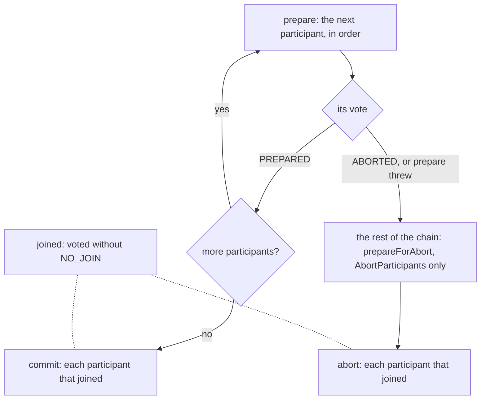
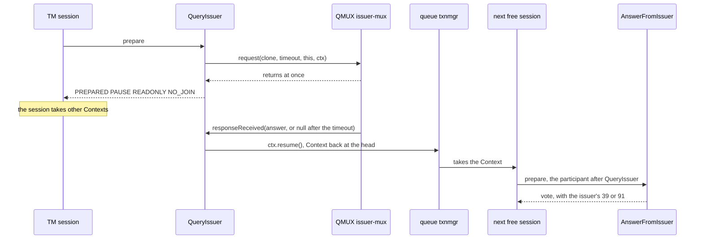

# 4. Transaction Processing

At ten past three a cardholder's 60.00 of groceries is declined with `61`, "exceeds amount
limit". Her card allows 500.00 a day, and she hasn't bought anything today. Before lunch she tried
a jacket for 300.00 and shoes for 150.00, both declined with `51` because her account holds 120.00.
Our participant that counts each purchase against the daily limit counted those two as well, and
nothing gave the amounts back.

Unit s1 showed how a participant votes in `prepare` and how `SendResponse` answers on either path.
This unit covers what happens after the votes, and how long a transaction holds a session, in six
rules, one per section heading from 4.2.

## 4.1 A Server You Can Feed Without a Socket

QServer hands each message to its request listener, with the channel it came in on (the
`ISOSource` to answer through), and `IncomingListener` does the rest. A terminal that calls a real
`IncomingListener` itself, as its own source, takes the same path as one on a socket:

```java
package com.example.jpos.server.testing;

import org.jpos.core.ConfigurationException;
import org.jpos.core.SimpleConfiguration;
import org.jpos.iso.ISOMsg;
import org.jpos.iso.ISOSource;
import org.jpos.iso.IncomingListener;

import java.util.concurrent.BlockingQueue;
import java.util.concurrent.LinkedBlockingQueue;
import java.util.concurrent.TimeUnit;

/** A terminal with no socket: it hands each request to a real IncomingListener, as QServer does. */
public final class DirectTerminal implements ISOSource {
    private final IncomingListener listener = new IncomingListener();
    private final BlockingQueue<ISOMsg> answers = new LinkedBlockingQueue<>();

    public DirectTerminal(String queue) throws ConfigurationException {
        SimpleConfiguration cfg = new SimpleConfiguration();
        cfg.put("queue", queue);                         // the TransactionManager's queue
        listener.setConfiguration(cfg);
    }

    /** Sends one request and returns the server's answer, or null after wait ms. */
    public ISOMsg request(ISOMsg m, long wait) throws InterruptedException {
        listener.process(this, m);                       // Context {REQUEST, SOURCE, TIMESTAMP}
        return answers.poll(wait, TimeUnit.MILLISECONDS);
    }

    @Override
    public void send(ISOMsg m) {                         // SendResponse answers here
        answers.add(m);
    }

    @Override
    public boolean isConnected() {
        return true;
    }
}
```

The other side is a real Q2, started in the same JVM on a `deploy/` directory that holds the
logger of unit s1 and a TransactionManager descriptor:

```java
q2 = new Q2("deploy");
q2.start();
NameRegistrar.get("txnmgr", 20000);
```

`NameRegistrar.get` waits up to 20 seconds for the TransactionManager, which registers only if it
deployed. Every output in this unit, and every practice, runs this way on jPOS 2.1.7, with the real
TransactionManager and `SendResponse`.

## 4.2 A Participant Hears the Outcome Only If It Joined

The descriptor behind the groceries story has two participants that decide and one that answers:

```xml
<txnmgr name="txnmgr" class="org.jpos.transaction.TransactionManager" logger="Q2">
  <property name="queue" value="txnmgr"/>
  <property name="sessions" value="2"/>
  <property name="debug-context" value="false"/>
  <participant class="com.example.jpos.server.participant.ReserveDailyLimit" logger="Q2"/>
  <participant class="com.example.jpos.server.participant.Authorize" logger="Q2">
    <property name="available" value="12000"/>
  </participant>
  <participant class="org.jpos.transaction.participant.SendResponse" logger="Q2"/>
</txnmgr>
```

`ReserveDailyLimit` adds each purchase to the card's total for the day and declines with `61`
when the total would pass 500.00. `Authorize` stands in for the account check and declines with
`51` above 120.00. Both build answers with `Responses.reply`, and the totals live in a shared
`DailyTotals`; both are in the Reference. The first `ReserveDailyLimit` (it ran as
`demo.LeakyReserveDailyLimit`) ended its `prepare` like this:

```java
if (!totals.reserve(request.getString(2), amount)) {
    ctx.put(RESPONSE.toString(), Responses.reply(request, "61"));
    return ABORTED | NO_JOIN;
}
return PREPARED | NO_JOIN;           // "my part went fine"
```

Both votes say `NO_JOIN`: the participant had done its part and seemed to have nothing left to
do. The cardholder's day, all on `4111111111111111`, with the card's total after each answer:

```text
purchase 000000030000: 0210 39=51   total today: 30000
purchase 000000015000: 0210 39=51   total today: 45000
purchase 000000006000: 0210 39=61   total today: 45000
```

Which participants does the trace of the first purchase name after the votes?

```text
  <abort>
    txnmgr-0:idle:1
            prepare: d.LeakyReserveDailyLimit PREPARED NO_JOIN
            prepare: c.e.j.s.p.Authorize ABORTED NO_JOIN
    prepareForAbort: o.j.t.p.SendResponse
              abort: o.j.t.p.SendResponse
```

Only `SendResponse` got an `abort` call: after the votes, the TransactionManager calls `commit` or
`abort` only on the participants that joined. `NO_JOIN` doesn't mean "I'm done"; it means "don't
tell me how this ends". A participant that changed something outside the Context in `prepare` must
hear the outcome, because on the abort path it is the only one that knows what to undo.

The participant joins when it reserves, and leaves the amount in the Context for its `abort`:

```java
package com.example.jpos.server.participant;

import com.example.jpos.server.limits.DailyTotals;
import org.jpos.core.Configurable;
import org.jpos.core.Configuration;
import org.jpos.core.ConfigurationException;
import org.jpos.iso.ISOMsg;
import org.jpos.transaction.Context;
import org.jpos.transaction.TransactionParticipant;
import org.jpos.util.NameRegistrar;

import java.io.Serializable;

import static org.jpos.transaction.ContextConstants.REQUEST;
import static org.jpos.transaction.ContextConstants.RESPONSE;

/** Counts each purchase against the card's daily limit, and gives it back if the purchase fails. */
public class ReserveDailyLimit implements TransactionParticipant, Configurable {
    private static final String RESERVED = "RESERVED";
    private DailyTotals totals;                               // a shared service, not a request

    @Override
    public void setConfiguration(Configuration cfg) throws ConfigurationException {
        try {
            totals = NameRegistrar.get(cfg.get("totals", "daily-totals"));
        } catch (NameRegistrar.NotFoundException e) {
            throw new ConfigurationException("no daily totals registered", e);
        }
    }

    @Override
    public int prepare(long id, Serializable context) {
        Context ctx = (Context) context;
        ISOMsg request = ctx.get(REQUEST.toString());
        try {
            long amount = Long.parseLong(request.getString(4));
            if (!totals.reserve(request.getString(2), amount)) {
                ctx.put(RESPONSE.toString(), Responses.reply(request, "61"));  // exceeds limit
                return ABORTED | NO_JOIN;                  // (1) nothing reserved, nothing to undo
            }
            ctx.put(RESERVED, amount);                     // (2) what abort has to give back
            return PREPARED;                               // (3) joins: abort must reach us
        } catch (Exception e) {
            ctx.log(e);
            return ABORTED | NO_JOIN;
        }
    }

    @Override
    public void abort(long id, Serializable context) {
        Context ctx = (Context) context;
        Long amount = ctx.get(RESERVED);
        if (amount != null) {
            ISOMsg request = ctx.get(REQUEST.toString());
            totals.release(request.getString(2), amount);
        }
    }
}
```

The same day:

```text
purchase 000000030000: 0210 39=51   total today: 0
purchase 000000015000: 0210 39=51   total today: 0
purchase 000000006000: 0210 39=00   total today: 6000
```

```text
            prepare: c.e.j.s.p.ReserveDailyLimit PREPARED
            prepare: c.e.j.s.p.Authorize ABORTED NO_JOIN
    prepareForAbort: o.j.t.p.SendResponse
              abort: c.e.j.s.p.ReserveDailyLimit
              abort: o.j.t.p.SendResponse
```

Joining depends on the flag, not on the vote: a participant that votes `ABORTED` also hears the
abort unless it says `NO_JOIN`, as (1) does, and one that throws from `prepare` counts as a plain
`ABORTED` and joins too. Had (1) voted plain `ABORTED`, `abort` would reach a
participant that reserved nothing. The `RESERVED` check would save the total; an unchecked `abort`
would subtract the amount of every purchase the limit declined.

With the leak, the cardholder notices first, at the till, and the total stays wrong until the
daily reset. The log shows nothing wrong: every transaction ended the way its votes said.

<!-- practice 1 -->

## 4.3 After an Abort, Only Abort Participants Are Asked

For a card-testing alert (a stolen card number tried again and again until something goes
through), the fraud team wants declines counted per card. The counting participant joins every
transaction, counts in `abort`, and goes after `Authorize` in the chain of 4.2, once every decision
is made:

```xml
<participant class="com.example.jpos.server.participant.Authorize" logger="Q2">
  <property name="available" value="12000"/>
</participant>
<participant class="com.example.jpos.server.participant.DeclineMonitor" logger="Q2"/>
<participant class="org.jpos.transaction.participant.SendResponse" logger="Q2"/>
```

Three purchases on `5555555555554444`, all larger than the account can pay:

```text
purchase 000000019900: 0210 39=51
purchase 000000014900: 0210 39=51
purchase 000000012900: 0210 39=51
declines counted: 0
```

Unit s1 showed the reason in `SendResponse`: once a participant votes `ABORTED`, the
TransactionManager offers the rest of the chain only to participants that implement
`AbortParticipant`. The monitor was a plain participant, so its `prepare` never ran, it never
joined, and its `abort` was never called; the trace names only `ReserveDailyLimit` and
`SendResponse`. (The counts are a `ConcurrentHashMap`, registered under `declines` before Q2
starts, since every session updates it.)

The fix implements `AbortParticipant` instead of `TransactionParticipant`:

```java
package com.example.jpos.server.participant;

import org.jpos.core.Configurable;
import org.jpos.core.Configuration;
import org.jpos.core.ConfigurationException;
import org.jpos.iso.ISOMsg;
import org.jpos.transaction.AbortParticipant;
import org.jpos.transaction.Context;
import org.jpos.util.NameRegistrar;

import java.io.Serializable;
import java.util.Map;

import static org.jpos.transaction.ContextConstants.REQUEST;

/** Counts declined purchases per card, for the fraud team's card-testing alert. */
public class DeclineMonitor implements AbortParticipant, Configurable {
    private Map<String, Integer> declines;                   // a shared service, found by name

    @Override
    public void setConfiguration(Configuration cfg) throws ConfigurationException {
        try {
            declines = NameRegistrar.get(cfg.get("counts", "declines"));
        } catch (NameRegistrar.NotFoundException e) {
            throw new ConfigurationException("no decline counts registered", e);
        }
    }

    @Override
    public int prepare(long id, Serializable context) {
        return PREPARED | READONLY;                          // joins: it wants the outcome
    }

    @Override
    public void abort(long id, Serializable context) {
        ISOMsg request = ((Context) context).get(REQUEST.toString());
        declines.merge(request.getString(2), 1, Integer::sum);
    }
}
```

```text
declines counted: 3
```

The end of the trace, after `Authorize` voted `ABORTED`:

```text
    prepareForAbort: c.e.j.s.p.DeclineMonitor
    prepareForAbort: o.j.t.p.SendResponse
              abort: c.e.j.s.p.ReserveDailyLimit
              abort: c.e.j.s.p.DeclineMonitor
              abort: o.j.t.p.SendResponse
```

On the abort path the TransactionManager calls `prepareForAbort`, whose default in
`AbortParticipant` calls `prepare`. That is fine here, since this `prepare` decides nothing. A
participant whose `prepare` does real work, such as reserving an amount, would do it on aborted
transactions too; override `prepareForAbort` when the two paths need different things.

The plain monitor placed at the top of the chain, ahead of `ReserveDailyLimit`, also counted all
three: it was prepared before anyone aborted, and it joined. A participant sees every outcome if it
comes before every participant that can abort, or if it implements `AbortParticipant`.



With the plain monitor after `Authorize`, the alert never fires: a card under attack shows zero
declines while the attacker works through amounts until one is approved.

## 4.4 Commit Cannot Change the Outcome

Settlement reconciles the day against a journal of approvals. `RecordApproval` joins when the
response says `00` and writes the line in `commit`, as unit s1 recommends for work that must happen
only if the whole transaction succeeds. It sits between `Authorize` and `SendResponse`:

```java
@Override
public void commit(long id, Serializable context) {
    ISOMsg response = ((Context) context).get(RESPONSE.toString());
    journal.accept(response.getString(41) + " " + response.getString(11) + " " + response.getString(4));
}
```

The journal's disk is full, and every write throws. A purchase of 27.50:

```text
purchase: 0210 39=00
journal lines: 0
```

```text
  <warn>
    COMMIT: 1
    <exception name="java.io.IOException: No space left on device">
```

```text
  <commit>
    txnmgr-0:idle:1
            prepare: c.e.j.s.p.ReserveDailyLimit PREPARED
            prepare: c.e.j.s.p.Authorize PREPARED NO_JOIN
            prepare: c.e.j.s.p.RecordApproval PREPARED READONLY
            prepare: o.j.t.p.SendResponse PREPARED READONLY
             commit: c.e.j.s.p.ReserveDailyLimit
             commit: c.e.j.s.p.RecordApproval
             commit: o.j.t.p.SendResponse
```

By the time `commit` runs, every participant has voted `PREPARED`, and the TransactionManager
won't go back on that. An exception from `commit` becomes a warning, and the next participant's
`commit` runs. In 2.1.7 the calls go in declaration order, so `SendResponse`, declared last, sent
the approval after `RecordApproval` had failed. `abort` is called in the same order and treats
exceptions the same way.

The terminal printed a receipt, the money moved, and the journal has no line. Settlement is short
by 27.50, and by every approval after it until someone frees the disk; the only trace is one
`<warn>` per purchase.

Do what can fail in `prepare`, in a form `abort` can undo, while a failure can still become a
decline; `commit` only makes it final. A failure after `Authorize` has put its `00` in `RESPONSE`
becomes a decline only if something replaces that `00`; otherwise the abort path sends it
(unit s10). With a database, that means writing the row in `prepare` inside an open database transaction
and committing it in `commit` (unit s9). A database commit can still fail, much more rarely, and
then the TransactionManager can only log it, which is one reason settlement reconciles at all.

> **In jPOS 3** `commit` and `abort` are called in reverse declaration order.

## 4.5 The Context Is Keyed by Strings

`ContextConstants` is an enum, and after `import static ...ContextConstants.REQUEST` the shorter
call compiles:

```java
ISOMsg request = ctx.get(REQUEST);
```

The Context is a map with `Object` keys, and `IncomingListener` stored the request under the
string `"REQUEST"`. The enum constant is a different key:

```text
get(REQUEST.toString()): 0200
get(REQUEST):            null
```

With that line in `Authorize` (it ran as `demo.EnumKeyAuthorize`, followed only by
`SendResponse`), a purchase:

```text
purchase: no answer after 10000 ms
```

```text
            prepare: d.EnumKeyAuthorize ABORTED NO_JOIN
    prepareForAbort: o.j.t.p.SendResponse
              abort: o.j.t.p.SendResponse
```

The `NullPointerException` from `request.getString(4)` fell into `Authorize`'s own `catch`, which
logged it to the Context and voted `ABORTED | NO_JOIN` with no response set. The Context's log is
printed only with the Context dump, which unit s1 turned off, so the log shows an abort and no
warning. Every terminal waits out its timeout, and the acquirer then reverses each purchase.

Write `REQUEST.toString()` everywhere, or keep the names in `static final String` constants. The
same goes for your own keys: `"RESERVED"` above is a string, and a key you `put` with a typo is a
key nobody `get`s.

## 4.6 A Session Is Busy for the Whole Transaction

The server now forwards purchases to the card issuer's host through a QMUX, `issuer-mux` (the
client side of unit c12). Visa's issuer answers at once; today Mastercard's takes two seconds for
every answer. The obvious participant asks and waits:

```java
ISOMsg response = mux.request((ISOMsg) request.clone(), timeout);   // the session waits here
if (response != null)
    ctx.put("ISSUER_RESPONSE", response);
```

After it, `AnswerFromIssuer` builds the response from the issuer's field 39, or `91` (issuer
unavailable) when there was none, and votes. The TransactionManager runs four sessions. Eight
Mastercard purchases arrive within 50 ms, each from its own terminal, and 100 ms later one Visa
purchase. How long does the Visa purchase wait?

```text
Mastercard 29110011: 0210 39=00 after 2000 ms
Mastercard 29110012: 0210 39=00 after 2000 ms
Mastercard 29110013: 0210 39=00 after 2000 ms
Mastercard 29110014: 0210 39=00 after 2000 ms
Mastercard 29110015: 0210 39=00 after 4000 ms
Mastercard 29110016: 0210 39=00 after 3900 ms
Mastercard 29110017: 0210 39=00 after 3900 ms
Mastercard 29110018: 0210 39=00 after 3900 ms
Visa       29110019: 0210 39=00 after 3800 ms
```

A session takes a Context from the queue and keeps it until the last `commit` or `abort` returns.
While `mux.request` waits, the session's thread waits with it. The first four Mastercard purchases
held all four sessions for two seconds, the next four took them for the next two, and the Visa
purchase waited in the queue behind them. Each transaction's event shows the queue at the moment
it ended: `outstanding` counts the Contexts that no session has taken yet.

```text
     in-transit=2/4, head=5, tail=1, paused=0, outstanding=5, active-sessions=4/4, ...
```

Four sessions, each held two seconds, finish two Mastercard purchases a second. We sent four a
second, plus one Visa purchase a second, for 20 seconds:

```text
Visa sent at  0 s: answered after 0 ms
Visa sent at  1 s: answered after 1200 ms
Visa sent at  2 s: answered after 2200 ms
...
Visa sent at 13 s: answered after 13200 ms
Visa sent at 14 s: answered after 14200 ms
Visa sent at 15 s: no answer
Visa sent at 16 s: answered after 14700 ms
Visa sent at 17 s: no answer
Visa sent at 18 s: answered after 14700 ms
Visa sent at 19 s: no answer
Mastercard answered: 71 of 80
```

The wait grows by a second every second. After 15 seconds it reaches the listener's `timeout`
(15000 ms by default, unit s1), and Contexts start to expire from the queue before any session
takes them. From then on the server answers some requests 14.7 seconds late and the others never,
whatever their brand. Acquirers reverse the purchases their terminals gave up on, and the reversals
join the same queue.

`max-sessions` lets the TransactionManager add sessions when the queue grows. In 2.1.7 each one is a
platform thread, and a slow host holds every one you add. Size the sessions from the time a
transaction holds one, and put a timeout shorter than the terminal's on every call a participant
makes.

## 4.7 `PAUSE` Gives the Session Back While You Wait

QMUX can also call you back instead of blocking: `mux.request(m, timeout, listener, handBack)`
returns at once and later calls `listener.responseReceived(response, handBack)`, with `null` once
the timeout passes. A participant that returns `PAUSE` tells the TransactionManager to set the
transaction aside and free the session. `ctx.resume()` puts the Context back at the head of the
queue, and the next free session continues with the participant after the one that paused:

```java
package com.example.jpos.server.participant;

import org.jpos.core.Configurable;
import org.jpos.core.Configuration;
import org.jpos.iso.ISOException;
import org.jpos.iso.ISOMsg;
import org.jpos.iso.ISOResponseListener;
import org.jpos.iso.MUX;
import org.jpos.transaction.Context;
import org.jpos.transaction.TransactionParticipant;
import org.jpos.util.NameRegistrar;

import java.io.Serializable;

import static org.jpos.transaction.ContextConstants.REQUEST;

/** Asks the issuer's host and gives the session back while the host thinks. */
public class QueryIssuer implements TransactionParticipant, ISOResponseListener, Configurable {
    static final String ISSUER_RESPONSE = "ISSUER_RESPONSE";
    private String muxName;
    private long timeout;

    @Override
    public void setConfiguration(Configuration cfg) {
        muxName = cfg.get("mux", "issuer-mux");
        timeout = cfg.getLong("timeout", 10000);
    }

    @Override
    public int prepare(long id, Serializable context) {
        Context ctx = (Context) context;
        ISOMsg request = ctx.get(REQUEST.toString());
        MUX mux = NameRegistrar.getIfExists("mux." + muxName);
        if (mux == null || !mux.isConnected())
            return PREPARED | READONLY | NO_JOIN;                        // no answer: 91 follows
        try {
            mux.request((ISOMsg) request.clone(), timeout, this, ctx);   // (1) returns at once
            return PREPARED | PAUSE | READONLY | NO_JOIN;                // (2) the session is free
        } catch (ISOException e) {
            ctx.log(e);
            return PREPARED | READONLY | NO_JOIN;
        }
    }

    /** Called by the MUX, on its own thread, with the answer or with null after the timeout. */
    @Override
    public void responseReceived(ISOMsg response, Object handBack) {
        Context ctx = (Context) handBack;                                // (3) this transaction's Context
        if (response != null)
            ctx.put(ISSUER_RESPONSE, response);
        ctx.resume();                                                    // (4) back into the queue
    }
}
```

The same nine purchases and four sessions:

```text
Mastercard 29110011: 0210 39=00 after 2000 ms
...
Mastercard 29110018: 0210 39=00 after 2000 ms
Visa       29110019: 0210 39=00 after 0 ms
```

The Visa purchase's event, written while the eight Mastercard purchases were paused:

```text
            prepare: c.e.j.s.p.QueryIssuer PREPARED PAUSE READONLY NO_JOIN
            prepare: c.e.j.s.p.AnswerFromIssuer PREPARED NO_JOIN
            prepare: o.j.t.p.SendResponse PREPARED READONLY
             commit: o.j.t.p.SendResponse
     in-transit=8/9, head=10, tail=1, paused=8, outstanding=0, active-sessions=4/4, ...
```

Under the 20-second load of 4.6, all 80 Mastercard purchases were answered, and every Visa
purchase in under 100 ms. A paused transaction holds no thread, so the limit is now the issuer and
the MUX's timeout.

- **(1) and (2): the vote is cast before the answer exists.** `PREPARED | PAUSE` says "go on when
  I resume". This participant can't change its vote once the issuer answers, so a participant
  after it decides, here `AnswerFromIssuer`.
- **(3): the callback finds its transaction through `handBack`.** One `QueryIssuer` serves every
  session (unit s1), and dozens of transactions may be paused in it at once. A field holding
  "the current Context" would hold whichever transaction paused last.
- **(4): every callback resumes, the empty one too.** When the timeout passes, QMUX calls the
  listener's `expired`, which by default calls `responseReceived(null, ...)`.



With the issuer silent and a 3-second timeout:

```text
purchase: 0210 39=91 after 3000 ms
```

`AnswerFromIssuer` found no issuer response and answered `91`. A MUX that isn't deployed or isn't
connected gets the same answer at once, from the check before (1). A transaction that is never
resumed stays paused, and its terminal waits out its own timeout; the TransactionManager's
`pause-timeout` property, when set, resumes it on the abort path after that many milliseconds.

jPOS's own `org.jpos.transaction.participant.QueryHost` does this, pausing while its
`continuations` property is true, the default. It picks the MUX from a destination
in the Context and reports a timeout through `ctx.getResult()`; unit s5
uses it. `Join` is the other tool for waiting: it runs the participants nested in it in parallel,
for independent slow steps such as a call to an HSM and a database lookup.

> **In jPOS 3** sessions run on virtual threads. A blocked session costs little, and `PAUSE` is
> deprecated.

<!-- practice 2 -->

<!-- practice 3 -->

## 4.8 Summary

- **A participant hears the outcome only if it joined.** One that changes something outside the
  Context in `prepare` joins and undoes it in `abort`; with `NO_JOIN` what it reserved leaks. One
  that votes `ABORTED` joins too, unless it says `NO_JOIN`.
- **After an abort, only abort participants are asked.** Plain participants later in the chain are
  never prepared and never hear the abort. `prepareForAbort` calls `prepare` unless you override it.
- **Commit cannot change the outcome.** An exception in `commit` is a warning, and the approval
  still goes out. Do what can fail in `prepare`, in a form `abort` can undo.
- **The Context is keyed by strings.** `ctx.get(REQUEST)` returns `null`; use `REQUEST.toString()`.
- **A session is busy for the whole transaction.** Sessions divided by the time each transaction
  holds one is the throughput. Past it the queue grows until the listener's timeout drops requests,
  slow and fast alike.
- **`PAUSE` gives the session back.** The callback finds its Context through `handBack` and always
  resumes, and a participant after the paused one decides.

## 4.9 Reference

**Votes** (`org.jpos.transaction.TransactionConstants`, combined with `|`):

| Value | Meaning |
|---|---|
| `PREPARED` | go on; the transaction commits if everyone says so |
| `ABORTED` (0) | the transaction aborts |
| `NO_JOIN` | no `commit` or `abort` call for this participant |
| `READONLY` | the Context was not changed, so it is not snapshotted after this participant |
| `FAIL` | `ABORTED \| READONLY \| NO_JOIN` |
| `PAUSE` | free the session until `ctx.resume()` |
| `RETRY` | with `ABORTED`: neither `commit` nor `abort`; the Context is queued again after `retry-interval` |

**Who is called (2.1.7):** until someone aborts, `prepare` on each participant in order; after
that, only `prepareForAbort` on `AbortParticipant`s. Then `commit` (everyone `PREPARED`) or `abort`
on those that joined, in declaration order. A throw from `prepare` counts as `ABORTED` and joins; a
throw from `prepareForAbort` counts as `ABORTED | NO_JOIN`; a throw from `commit` or `abort` is
logged and the next participant is called.

**Participant lifecycle:** created once, from `class`, with its public no-argument constructor;
then `setLogger` if it is a `LogSource`, `setTransactionManager(TransactionManager)` if it has that
method, and `setConfiguration` if it is `Configurable`. A `ConfigurationException` there stops the
TransactionManager from starting (unit s1). `destroy()` is called at stop if it implements
`org.jpos.util.Destroyable`. On a session thread, `TransactionManager.getContext()` and `getId()`
return the current transaction's Context and id.

**Context keys used by jPOS 2.1.7 components** (`ContextConstants`, as strings):

| Key | Put by | Holds |
|---|---|---|
| `REQUEST`, `SOURCE`, `TIMESTAMP` | `IncomingListener` | the request, where to answer, when it arrived |
| `RESPONSE` | your participants | what `SendResponse` sends |
| `TX` | your database participants | an open database transaction; `SendResponse` refuses to send while it is set (unit s9) |
| `DESTINATION` | `SelectDestination` | the name `QueryHost` turns into a MUX (unit s5) |

`ctx.put(key, value)` stores a transient entry. `ctx.put(key, value, true)` also stores it in the
persistent map, which is the part a persistent space keeps; never put card data there.

**TransactionManager properties used or mentioned in this unit:**

| Property | Default | Meaning |
|---|---|---|
| `queue` | required | the Space queue its sessions read |
| `sessions` | 1 | sessions started at boot |
| `max-sessions` | `sessions` | ceiling on all sessions, including those added when the queue grows |
| `threshold` | `sessions / 2` | queued Contexts above which extra sessions start |
| `debug`, `debug-context`, `profiler` | true, `debug`, `debug` | the per-transaction event, the Context dump, the timings; turning on either of the last two turns on `debug` |
| `pause-timeout` | 0 (none) | resume a paused transaction after this many ms |
| `abort-on-pause-timeout` | true | resume it on the abort path |
| `retry-interval`, `retry-timeout` | 5000, 60000 | for `RETRY` |
| `call-selector-on-abort` | true | ask a `GroupSelector` even on the abort path (unit s5) |

**The event's status line:** `in-transit` active transactions (paused ones included) over
`head - tail`; `head` and `tail` the next and the oldest unfinished transaction ids; `paused`;
`outstanding` Contexts queued and not yet taken; `active-sessions` running over `max-sessions`.

**The other classes of the examples.** The reply helper, which units s5 and s9 use as well:

```java
package com.example.jpos.server.participant;

import org.jpos.iso.ISOException;
import org.jpos.iso.ISOMsg;

public final class Responses {
    private Responses() { }

    /** A reply to {@code request} carrying response code {@code rc} in field 39. */
    public static ISOMsg reply(ISOMsg request, String rc) throws ISOException {
        ISOMsg r = (ISOMsg) request.clone();
        r.setResponseMTI();
        r.set(39, rc);
        r.unset(14, 35, 45, 52, 55, 64);   // expiry, tracks, PIN block, chip data, the request's MAC
        return r;
    }
}
```

The daily totals, registered with `NameRegistrar.register("daily-totals", new DailyTotals(50000))`
before Q2 starts:

```java
package com.example.jpos.server.limits;

import java.util.HashMap;
import java.util.Map;

/** Today's total per card, in minor units, against one daily limit. Shared by every session. */
public final class DailyTotals {
    private final Map<String, Long> totals = new HashMap<>();
    private final long limit;

    public DailyTotals(long limit) {
        this.limit = limit;
    }

    /** Adds the amount to the card's total, unless that would pass the limit. */
    public synchronized boolean reserve(String card, long amount) {
        long now = totals.getOrDefault(card, 0L);
        if (now + amount > limit)
            return false;
        totals.put(card, now + amount);
        return true;
    }

    public synchronized void release(String card, long amount) {
        totals.merge(card, -amount, Long::sum);
    }

    public synchronized long total(String card) {
        return totals.getOrDefault(card, 0L);
    }
}
```

The account check that `Authorize` stands in for:

```java
package com.example.jpos.server.participant;

import org.jpos.core.Configurable;
import org.jpos.core.Configuration;
import org.jpos.core.ConfigurationException;
import org.jpos.iso.ISOMsg;
import org.jpos.transaction.Context;
import org.jpos.transaction.TransactionParticipant;

import java.io.Serializable;

import static org.jpos.transaction.ContextConstants.REQUEST;
import static org.jpos.transaction.ContextConstants.RESPONSE;

/** Stands in for the account check: approves what the account can pay, declines the rest with 51. */
public class Authorize implements TransactionParticipant, Configurable {
    private long available;

    @Override
    public void setConfiguration(Configuration cfg) throws ConfigurationException {
        available = cfg.getLong("available", -1);
        if (available < 0)
            throw new ConfigurationException("'available' must be set");
    }

    @Override
    public int prepare(long id, Serializable context) {
        Context ctx = (Context) context;
        ISOMsg request = ctx.get(REQUEST.toString());
        try {
            if (Long.parseLong(request.getString(4)) > available) {
                ctx.put(RESPONSE.toString(), Responses.reply(request, "51"));  // insufficient funds
                return ABORTED | NO_JOIN;
            }
            ISOMsg response = Responses.reply(request, "00");
            response.set(38, String.format("%06d", id % 1000000));          // approval code
            ctx.put(RESPONSE.toString(), response);
            return PREPARED | NO_JOIN;
        } catch (Exception e) {
            ctx.log(e);
            return ABORTED | NO_JOIN;
        }
    }
}
```

## 4.10 Challenges

1. The daily limit of 4.2 lives in memory. Move it to a database table. Where does the reservation
   happen, what does `commit` do now, and what happens to a reservation when the server dies
   between `prepare` and `abort`?
2. Your issuer answers in 300 ms on a normal day and in 8 seconds on a bad one. Terminals give up
   after 30 seconds and the peak is 200 purchases a second. How many sessions do you need with a
   blocking participant, and what limits you with `PAUSE`?
3. `DeclineMonitor` counts declines. The fraud team now wants to refuse the card after the fifth
   decline in an hour, before the sixth attempt reaches the issuer. Where in the chain does the
   check go, and what does it vote?
4. `RecordApproval` failed with only a warning. Design the alert: what do you watch, and how soon
   would you have known about the full disk?

## 4.11 Design Note: Why Does the TransactionManager Ask Twice?

A TransactionManager could run each participant once and stop at the first failure. jPOS asks in
two rounds instead, the way a database coordinates a distributed commit: first every participant
says whether it can, then each one that joined is told what happened.

The reason is the late decline. In an authorization the step that says no is often not the first:
the limit and the card are fine, and then the account check or the issuer declines. Every step
before it may have changed something, such as a reserved amount, a counter or a row, and each has
to undo exactly what it did. Two rounds let each participant keep its undo next
to its own work, and the TransactionManager only has to remember who joined.

The price is discipline the TransactionManager can't enforce. It doesn't know what a participant
changed, so it believes the flags: after `NO_JOIN` it never calls that participant again, and after
`READONLY` it skips the snapshot. And once everyone has voted `PREPARED` it has no way back, so a
`commit` that fails can only be logged.
